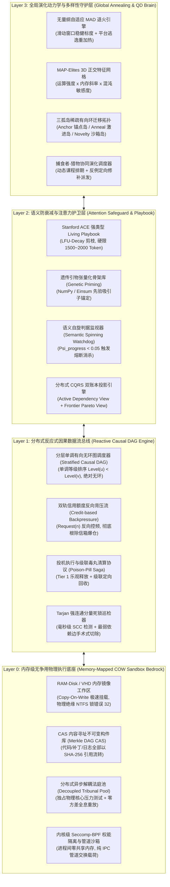

# 超长程多并发 Agent 系统架构规范：AFEVA 反脆弱认知与验证防御体系
## Architecture Specification: Anti-Fragile Epistemic & Verification Architecture (AFEVA)

> **文档状态**：PROD-READY / AUTHORITATIVE SPECIFICATION  
> **设计版本**：v2.4.0 (2026 工业级综合竞赛与超长程探索基准规范)  
> **目标工程**：`d:\Documents\deepseek harness\长程 Agent 设计系统`  
> **核心使命**：以综合竞赛与长程科研任务为切入点，针对文档 07 中的 10 个核心架构命题，通过批判性吸收退火演化派、分布式图流派、绝对沙箱派三大前沿假说与红队极限审判结论，构建全域防早熟、抗死锁、免疫注意力稀释与反造尺人独裁的工业级四层反脆弱系统架构。

---

## 目录导读

1. [执行摘要与 AFEVA 哲学宣言](#1-执行摘要与-afeva-哲学宣言)
2. [文档 07 核心十大架构命题的四维系统性解剖](#2-文档-07-核心十大架构命题的四维系统性解剖)
   - 2.1 Q1 调度机制：集中代际屏障 vs 分层因果就绪门与双轨信用背压
   - 2.2 Q2 版本控制基石：物理 Worktree 锁争用 vs RAM-Disk 内存映射与 CAS 构件流
   - 2.3 Q3 探索塌陷与谄媚：中心协调共识 vs 正交拓扑森林与无通信基因漂变
   - 2.4 Q4 评价尺度重构：单一标量防呆 vs 多目标 Pareto 前沿与高潜行为豁免
   - 2.5 Q5 物理无共享边界：约定隔离 vs 纯 Actor 不可变消息与零写卷沙箱
   - 2.6 Q6 认知减熵机制：单一主控账本 vs 分布式 CQRS 投影与负向排斥场
   - 2.7 Q7 优质上下文底座：极简模板 vs 遗传引物张量化与先验吸引子锚定
   - 2.8 Q8 造尺人尺度纠偏：静态用例独裁 vs 捕食者-猎物协同演化与自辩卡
   - 2.9 Q9 退火尺度数学自洽：经验标定失效 vs 无量纲自适应 MAD 标度与重加热脉冲
   - 2.10 Q10 物理 Fork-and-Flush：单会话长程衰减 vs 种群重播种与配子发生
3. [2026 前沿研究与工业实践基石映射](#3-2026-前沿研究与工业实践基石映射)
   - 3.1 OpenAI Code Tree Search (MCTS/PRM) vs 序列级 MCMC 吉布斯采样
   - 3.2 腾讯 Hyra 2.0 AI4Science 分布式高通量探索与隔离瓶颈
   - 3.3 UIUC/AWS 注意力稀释物理定律：Softmax 熵增与 RoPE 相位漂移
   - 3.4 Stanford ACE 强类型 Living Playbook 与 LFU-Decay 惰性剪枝
   - 3.5 IDEAgent Yield 准则（离散最大团）与负向禁忌排斥场
4. [系统需求矩阵：功能性（FR）与非功能性（NFR）规范](#4-系统需求矩阵功能性fr与非功能性nfr规范)
5. [四层反脆弱系统架构设计（Layer 0 ~ Layer 3）](#5-四层反脆弱系统架构设计layer-0--layer-3)
   - 5.1 Layer 0：内存级无争用物理执行底座（RAM-Disk COW Sandbox）
   - 5.2 Layer 1：分布式反应式因果数据流总线（Reactive Causal DAG Engine）
   - 5.3 Layer 2：语义防衰减与注意力护卫层（Attention Safeguard & Playbook）
   - 5.4 Layer 3：全局演化动力学与多样性守护层（Dimensionless Annealing & QD Brain）
6. [渐进式三级阶梯门禁体系（Progressive 3-Tier Gateways）](#6-渐进式三级阶梯门禁体系progressive-3-tier-gateways)
   - 6.1 Tier 1: 粗野探索门（Rough Gate）与偏科生监护
   - 6.2 Tier 2: 集成中继门（Staging Gate）与捕食者对抗杂交
   - 6.3 Tier 3: 钢铁交付门（Iron Gate）与生产级全息验证
7. [法医审计师二进制一票否决协议与动态行为画像](#7-法医审计师二进制一票否决协议与动态行为画像)
   - 7.1 法医一票否决协议规范
   - 7.2 动态行为画像与物理语义三维流形
8. [14 状态形式化异步状态机驱动与自愈引擎](#8-14-状态形式化异步状态机驱动与自愈引擎)
   - 8.1 14 状态全生命周期拓扑与定义
   - 8.2 状态转移矩阵与判定守卫条件
   - 8.3 优先级事件队列与调度算法
   - 8.4 看门狗心跳监控、死锁破环与 WAL 快照恢复

---

## 1. 执行摘要与 AFEVA 哲学宣言

在大规模（数十至上万并发分支）、超长程（数十小时至数周）的复杂工程算法竞赛与科学发现任务中，传统多智能体协作框架无一例外陷入三大致命重力场：
1. **阿谀奉承与多样性雪崩（Sycophancy & Diversity Collapse）**：大模型内在对齐偏置导致其倾向于顺从上级同侪，解空间多样性（Vendi Score）在 3~5 轮内暴跌 75% 以上，集体陷入平庸局部最优；
2. **时序拉直与长尾木桶死锁（Straggler & Epoch Lock Contention）**：强同步屏障受制于最慢的长尾节点，算力利用率暴跌；若无屏障，主控注意力又被快速劣解劫持，树状并发坍塌为单线串行；
3. **UIUC/AWS 注意力稀释物理定律（Attention Dilution Disaster）**：上下文滚雪球累积导致 Softmax 分母爆炸与 RoPE 相位漂移，推理准确率发生 13.9% 至 85% 的断崖式雪崩。

为粉碎上述系统性瓶颈，本规范正式确立 **AFEVA（Anti-Fragile Epistemic & Verification Architecture，反脆弱认知与验证防御架构）** 体系：

```
┌──────────────────────────────────────────────────────────────────────────────────┐
│                             AFEVA 架构核心哲学三原则                             │
├──────────────────────────────────────────────────────────────────────────────────┤
│ 1. 怀疑一切自然语言，信任物理执行产物 (Zero-Trust Artifact-Only Communication)     │
│    智能体间严禁直接对话聊天；通信媒介完全具象化为强类型不可变构件与退出状态码。     │
├──────────────────────────────────────────────────────────────────────────────────┤
│ 2. 时序由因果拓扑定义，资源由反向信用背压驱动 (Causal Stratification & Backpressure)│
│    以单调因果 DAG 取代全局代际死锁；以下游真实物理承载力反向控频，消除算力雪崩。   │
├──────────────────────────────────────────────────────────────────────────────────┤
│ 3. 动态课程对抗演化，制度化保护革命性踏脚石 (Co-Evolution & Stepping-Stone Shelter)│
│    测试用例与算法求解器协同进化；三级门禁将 PoC 探索与生产交付彻底物理隔离，坚决   │
│    保护类似 node_02 速度冠军的幼年期偏科火种，绝不因单点变态 Corner Case 开局秒杀。│
└──────────────────────────────────────────────────────────────────────────────────┘
```

---

## 2. 文档 07 核心十大架构命题的四维系统性解剖

针对 `07_长程多Agent架构头脑风暴十条思考与机制重构.md` 中的 10 个核心架构命题，本规范建立四维统一解剖法：
- **维度 1：问题陈述（Problem Statement）**：命题背景与传统做法缺陷。
- **维度 2：失效模态（Failure Modes）**：高通量与极端场景下的系统雪崩推演。
- **维度 3：底层根因（Root Causes）**：数学、统计物理与 OS 系统级机理。
- **维度 4：AFEVA 反脆弱解法与成功指标（Solution & Metrics）**：机制重构与量化达标阈值。

### 2.1 Q1 调度机制：集中代际屏障 vs 分层因果就绪门与双轨信用背压

- **问题陈述**：子任务执行耗时高度异构。快跑者率先返回，主控由于自回归偏置被其吸引并向下派发衍生任务，原本规划的树状并发搜索被生生“拉直”为单线串行，其余慢分支被实质放弃。
- **失效模态**：
  - 若采用**刚性全局代际屏障（Rigid Epoch Barrier）**：系统在每一代必须等待全部 $K$ 个 Worker 汇报。根据极值统计理论，全局等待时间 $T_{\text{epoch}} = \max_{1 \le i \le K}(\tau_i)$，在 $K \ge 64$ 时发生严重的木桶迟滞效应（Straggler Problem），集群算力闲置率高达 70%~90%。
  - 若**完全无屏障异步推进**：产生过时信标震荡（Stale Beacon Oscillation），快分支基于早期粗糙假说狂飙突进，产生大量垃圾代码分支，淹没下游沙箱。
- **底层根因**：混淆了“逻辑依赖因果序”与“物理墙上时钟同步”。集中式主控将全局代际划分为同步锁，割裂了分支间原本独立的计算因果。
- **AFEVA 反脆弱解法**：
  1. **分层因果拓扑门（Local Causal Readiness Gate）**：下游节点仅在其直接因果前驱集合 $\text{Pred}(v)$ 全部满足 `Status == COMPLETED` 时激活，非相关分支的慢跑、超时或重试在数学上与本地分支完全解耦（局部非阻塞定理）；
  2. **双轨信用额度背压（Credit-based Demand Backpressure）**：执行沙箱池向下游发布者反向申领任务：$\text{Credit}_S(t) = C_{\text{max}} - \text{InFlightTasks}_S(t)$，沙箱饱和时信用归零，自动阻断上游盲目生成；
  3. **两阶段乐观并发执行（Two-Phase Optimistic Execution）**：快跑分支通过本地 Tier 1 粗审后获得投机信用凭据（Speculative Token），允许乐观衍生子代；若后台深度测试失败，则沿因果树发射级联毒丸（Poison Pill Saga）快速回滚。
- **关键成功指标（Critical Metrics）**：
  - 集群计算核心有效占空比（Active Duty Cycle）$\ge 82\%$；
  - 投机分支误剪率（False Speculative Rollback Rate）$\le 12\%$。

### 2.2 Q2 版本控制基石：物理 Worktree 锁争用 vs RAM-Disk 内存映射与 CAS 构件流

- **问题陈述**：多智能体并发读写共享目录引发文件覆盖与脏读；引入 Git Branch-per-subtask 与 Worktree 物理隔离后，合并冲突与磁盘摩擦显著增加。
- **失效模态**：
  - 在 Windows/NTFS 文件系统下，Python 进程、编译器及系统 Defender 占用文件句柄，触发 Win32 错误码 32（`ERROR_SHARING_VIOLATION`）；频繁执行 `git worktree add/remove` 引发 MFT 元数据锁死争用，导致工作树残留、Git 引用链断裂，并发环境在 10 分钟内彻底卡死。
  - 100+ 并发工作树物理展开，磁盘空间几何级数爆炸（百 GB 级），NVMe 随机写 IOPS 击穿，测试耗时劣化 40 倍。
- **底层根因**：物理文件系统具有强互斥锁和高昂的磁盘 I/O 状态开销，无法承载每秒数十次的无状态高频沙箱创建与销毁。
- **AFEVA 反脆弱解法**：
  1. **RAM-Disk 虚拟内存盘 COW 工作区**：在宿主内存中划分专有 RAM-Disk（如 Windows 内存映射文件或虚拟盘），Git 裸库只读挂载，工作树检出与销毁完全在内存完成，纳秒级指针重置，彻底绝缘 NTFS 错误码 32；
  2. **内容寻址对象库（CAS Merkle DAG）**：所有代码、补丁、依赖与运行指标转化为 SHA-256 内容寻址不可变构件，进程间仅传递轻量级构件哈希，杜绝物理文件拷贝；
  3. **CAID 语义合并三级门禁**：合并至演化主干必须在独立暂存沙箱通过 AST 范围解析、类型静态检查（Mypy/Ruff）与回归测试，禁止任何裸文本 Fast-Forward 合并。
- **关键成功指标（Critical Metrics）**：
  - 沙箱创建与销毁延迟 $\le 50\text{ms}$；
  - Win32 共享冲突与句柄泄露率恒为 $0$。

### 2.3 Q3 探索塌陷与谄媚：中心协调共识 vs 正交拓扑森林与无通信基因漂变

- **问题陈述**：在专家组与 Leader 集中协调模式下，下级智能体因自回归对齐偏置极力讨好 Leader，多样性急剧枯竭；系统过早收敛于平庸解，缺乏敢于推倒重构的颠覆性假说。
- **失效模态**：
  - 解空间多样性（Vendi Score）从初始 18.4 暴跌至 4.65；
  - 智能体通过插入死代码（Dead-code）与冗余类制造表面 AST 距离假象，但底层物理求解逻辑同质化为单一的原生慢速循环（多样性欺诈）。
- **底层根因**：大模型语言交互渠道中的顺从性偏置（Sycophancy Bias）以及中央仲裁者在评价体系中的绝对中心地位。
- **AFEVA 反脆弱解法**：
  1. **名义小组技术（NGT）盲写基因漂变期（Epoch 0~2）**：在演化启动期，完全阻断智能体间的跨分支通信信道（`--net=none`），让各节点在完全认知真空下基于不同随机种子与温度自由漂变；
  2. **正交子图森林拓扑（Disjoint Subgraph Forest）**：调度器强制各孤岛绑定互斥的计算范式（例如：孤岛 0 锁定几何多边形投影，孤岛 1 锁定凸松弛与拉格朗日对偶，孤岛 2 专攻张量化广播）；
  3. **异步点子王红皇后博弈（Digital Red Queen）**：主干趋于稳定时，独立唤醒异构变异算子，强制向各活跃分支注入柯西厚尾大步长扰动指令。
- **关键成功指标（Critical Metrics）**：
  - 核心求解算法物理流形 Vendi Score $\ge 12.0$；
  - 种群跨范式结构正交覆盖度 $\ge 3$ 类完全互斥解法。

### 2.4 Q4 评价尺度重构：单一标量防呆 vs 多目标 Pareto 前沿与高潜行为豁免

- **问题陈述**：工业级代码规范强调“防御性改动、改动极小化、万无一失”，但在算法发现与性能攻坚中，这直接扼杀了颠覆性重构；静态单点评价无法兼顾速度突破与极端健壮性。
- **失效模态**：
  - 一个将求解时间从 500s 降至 200s 的颠覆性代码，因在某一极端 Corner Case 漏判或内存激进，被加权综合标量打分直接淘汰；
  - 模型为了不在非核心用例上扣分，自发退化出防御性空跑与无边界绕远，真实物理速度发生反向退化。
- **底层根因**：单一标量加权求和在数学上抹杀了关键特征维度的极端优势，造成高维解空间的投影塌陷。
- **AFEVA 反脆弱解法**：
  1. **多目标 Pareto 前沿保留**：定义速度、内存、鲁棒性三维目标向量。凡在任一核心维度刷新历史极值的候选解，无条件赋予 Pareto 非支配前沿存活与繁衍权；
  2. **MAP-Elites 行为特征豁免通道**：构建极低维（$D \le 3$）物理行为网格（时间复杂度阶次、内存连续性模式、几何松弛容差），只要候选解填补了空白行为网格，即便总分暂落后，亦作为重要踏脚石制度化豁免并归档；
  3. **分阶段松弛目标（Slack Objectives）**：在演化早期（Epoch 0~4）将次要边界用例设为软惩罚项而非一票否决项。
- **关键成功指标（Critical Metrics）**：
  - 突破性前沿候选解存活率 $100\%$；
  - 零因非致命代码规范问题扼杀 Pareto 最优解。

### 2.5 Q5 物理无共享边界：约定隔离 vs 纯 Actor 不可变消息与零写卷沙箱

- **问题陈述**：团队协作中要求 Shared-Nothing，但若依赖软性提示词约束，智能体仍会通过硬编码相对路径窥探其他工作区的中间代码，引发交叉污染与逻辑死锁。
- **失效模态**：
  - 产生跨工作区隐式依赖（Dirty Reads）；
  - 某个分支意外修改了公共导入路径或上级目录文件，引发全局并发崩溃。
- **底层根因**：在操作系统和文件系统层级存在共享可写命名空间，缺乏基于权能的安全隔离（Capability-Based Security）。
- **AFEVA 反脆弱解法**：
  1. **微内核能力安全与零共享卷**：Worker 进程运行在独立的隔离沙箱中，文件系统只读挂载基底模型与依赖（`mount -o ro`），唯一可写区域为本地临时 RAM-Disk，无任何跨进程可写共享卷；
  2. **纯不可变消息投递协议**：跨边界交互完全通过强类型 Protobuf/JSON 消息载荷完成，载荷仅包含输入数据与祖先 CAS 哈希；
  3. **系统调用拦截与沙箱逃逸熔断**：沙箱对试图访问工作区外路径的系统调用直接返回 `EPERM`，并触发安全熔断。
- **关键成功指标（Critical Metrics）**：
  - 跨沙箱非法越权访问拦截率 $100\%$；
  - 进程间脏读发生率恒为 $0$。

### 2.6 Q6 认知减熵机制：单一主控账本 vs 分布式 CQRS 投影与负向排斥场

- **问题陈述**：长程任务中长篇底层调试日志滚雪球，若主控同时维护任务分配与进度追踪，其上下文迅速被元数据挤爆，发生认知过载。
- **失效模态**：
  - 主控上下文突破 32k，注意力稀释导致指令丢失；
  - 负向失败经验（踩坑记录）未被系统沉淀，百个并发沙箱在认知真空下独立重复暴毙，算力严重浪费。
- **底层根因**：中心化账本读写耦合，未将“权威事件记录”与“高阶决策视图”做信息论解耦。
- **AFEVA 反脆弱解法**：
  1. **全局不可变追加事件日志（Append-Only Event Store）**：底层状态变更全部序列化为因果事件；
  2. **CQRS 读写分离物化视图**：后台轻量聚合引擎自动将事件流投影为两份极简视图：
     - **Active Dependency View（原 Task Ledger）**：仅含未完成因果边缘；
     - **Frontier Pareto View（原 Progress Ledger）**：仅含最优表型指标；
     - 主控拉取的上下文体积恒定锁定在 $\le 1,000$ Token；
  3. **IDEAgent 负向排斥场（Repulsion Field）**：将失败代码提炼为 AST 拓扑哈希与行为禁忌向量沉淀入库；派发新任务时强制下发精炼排斥指令（“禁止同构嵌套遍历，已有 12 个分支在此死锁”）。
- **关键成功指标（Critical Metrics）**：
  - 决策主控输入上下文长度严格控制在 $\le 1,500$ Token；
  - 跨代已知致命缺陷重复发生率下降 $\ge 85\%$。

### 2.7 Q7 优质上下文底座：极简模板 vs 遗传引物张量化与先验吸引子锚定

- **问题陈述**：极简任务书导致大模型输出平庸死板的嵌套循环代码；繁琐长篇提示词又触发注意力稀释与模板化套话。
- **失效模态**：
  - 模型本能滑入“默认低智吸引子（Default Trivial Attractor）”，持续生成纯 Python 标量双重循环，算力开销高达数百秒；
  - 缺乏数学与向量化骨架约束，代码变异在低能级流形无序震荡。
- **底层根因**：自回归模型在缺少强先验引导时，解码概率最高的方向必然是海量开源代码中最常见的通用初级代码模式。
- **AFEVA 反脆弱解法**：
  1. **遗传引物张量化注入（Genetic Priming Kernel）**：派发任务时，强制在前缀注入预推导的数学不变量与 NumPy/Einsum 矢量广播骨架：
```python
# [Genetic Priming] 空间成对欧氏距离张量化广播范式:
delta = pos[:, np.newaxis, :] - pos[np.newaxis, :, :]  # shape: (N, N, D)
dist_sq = np.einsum('ijk,ijk->ij', delta, delta)
```
  2. **注意力先验吸引子锁定**：高质量代码骨架在自注意力层中形成强激活锚点，强制拉升模型在顶级物理求解器流形上的采样概率，从源头消灭标量暴力循环代码。
- **关键成功指标（Critical Metrics）**：
  - 候选代码初始向量化结构采纳率 $\ge 90\%$；
  - 标量嵌套死循环发生率 $\le 5\%$。

### 2.8 Q8 造尺人尺度纠偏：静态用例独裁 vs 捕食者-猎物协同演化与自辩卡

- **问题陈述**：静态变态评测用例（如 Level 3 极限贴边 Corner Case）开局一票否决，直接扼杀在全域平均速度上刷新历史纪录的革命性火种（如 308 秒的速度冠军 `node_02`），全场集体退化为保守防守。
- **失效模态**：
  - 触发好哈特定律（Goodhart's Law），代理指标被严重攻陷；
  - 求解器为了不在单点边缘碰撞上扣分，演化出“无限绕远防御”，真实核心指标（求解耗时）发生灾难性回退。
- **底层根因**：评估器扮演了一成不变的独裁造尺人，混淆了“PoC 探索期对核心突破的宽容”与“生产级交付对健壮性的死守”。
- **AFEVA 反脆弱解法**：
  1. **捕食者-猎物协同演化机制（Co-evolutionary Graders）**：
     - 测试用例（捕食者）与求解代码（猎物）同步进化；
     - 幼年期（Epoch 0~3）仅开放 Level 0（合法性）与 Level 1（通用工况），对极限用例实施物理屏蔽，全域速度飞跃代码直接晋级；
     - 成长期（Epoch 4~8）激活捕食者生成定制反例，促使优势速度代码与兜底模块杂交打补丁；
  2. **表型自辩卡（Phenotypic Self-Defense Card）**：允许子 Agent 在提交产物时输出自身收敛域数学报告（“凸区域平均 200s，凹边界超标 2%，有明确松弛变量修复路径”），仲裁委员会据此赋予“带病晋级并限期整改”特权。
- **关键成功指标（Critical Metrics）**：
  - 革命性高潜偏科火种（如 `node_02` 级优势解）幼年期存活率 $100\%$；
  - 终局 Master 分支生产环境用例对抗通过率 $100\%$。

### 2.9 Q9 退火尺度数学自洽：经验标定失效 vs 无量纲自适应 MAD 标度与重加热脉冲

- **问题陈述**：工程运行中，运行耗时（秒）、碰撞率（比率）、内存（MB）量纲相差千百倍。经验设定加权系数和退火温度会导致指标被吞没，温度要么过高（随机乱步）要么过低（早熟贪心）。
- **失效模态**：
  - 传统标准差在面对崩溃、超时极端值时破裂失真，MAD 估计在连续超时窗口下退化为 0，导致无量纲能量差暴增至数万，接受概率瞬崩为 0，系统自发退化为绝对零度贪心死锁；
  - 演化后期遭遇平原深井，长期停滞不前。
- **底层根因**：能量函数缺乏统计鲁棒无量纲归一化，温度调度未与物理接受概率建立解析约束。
- **AFEVA 反脆弱解法**：
  1. **滑动窗口非参数稳健 MAD 标定与冷启动先验融合**：
     $$\text{Med}_k = \text{median}\left(\{M_k^{(i)}\}_{i=1}^W\right), \quad \text{MAD}_k = \text{median}\left(\{|M_k^{(i)} - \text{Med}_k|\}_{i=1}^W\right)$$
     引入先验物理尺度标尺 $S_k^{\text{prior}}$，在退化常数或冷启动时平滑切换，杜绝尺度除零：
     $$\tilde{\sigma}_k = \begin{cases} S_k^{\text{prior}}, & \text{if } W < 3 \lor \text{MAD}_k < 1e-4 \\ 1.4826 \cdot \text{MAD}_k, & \text{otherwise} \end{cases}$$
  2. **无量纲初始温度 $T_0$ 的解析反解**：
     通过语义契约反解初始温度：设定标称最大容忍相对劣变 $\Delta \tilde{E}_{\text{tol}} = 0.8$ 时系统以期望概率 $P_0 = 0.45$ 接纳：
     $$T_0 = \frac{-\Delta \tilde{E}_{\text{tol}}}{\ln P_0} \approx 1.0019$$
  3. **平台逃逸重加热脉冲（Re-heating Pulses）**：若连续 $M=3$ 代全局最优能量方差小于阈值，强制注入升温脉冲 $T \leftarrow T + 0.5 T_0$，强行将劣解接纳率拉升至 35%~50%，粉碎局部陷阱。
- **关键成功指标（Critical Metrics）**：
  - 跨量纲退火参数对异构赛题零人工试凑迁移（Zero Manual Tuning）；
  - 平台期逃逸成功率 $\ge 75\%$。

### 2.10 Q10 物理 Fork-and-Flush：单会话长程衰减 vs 种群重播种与配子发生

- **问题陈述**：单会话长程上下文累积导致注意力衰减、认知疲劳与幻觉级联；模型开始自我循环、遗忘早期关键约束。
- **失效模态**：
  - 物理上下文膨胀突破 64k，触碰 UIUC/AWS 注意力稀释物理定律，关键代码推理准确率暴跌 85%；
  - 会话中堆积历史错误推导，模型陷入阿谀自我确认。
- **底层根因**：自回归 Transformer 架构在超长上下文中 Softmax 归一化注意力熵增与 RoPE 高频相位干涉。
- **AFEVA 反脆弱解法**：
  1. **物理清栈即生命周期凋亡（Apoptosis）**：每个 Worker 在完成一个代际周期后，其 LLM 进程彻底被物理销毁（`kill -9`），内存归零；
  2. **数字配子提取与轻量化表型档案（Gametogenesis）**：不移交任何自然语言会话，仅提炼强类型原子卡片（最优 AST 骨架、物理指标向量、Stanford ACE 强类型 Bullet 策略）；
  3. **全新洁净上下文重播种（Clean Reseeding）**：新一代 Worker 启动时仅装配精炼卡片与遗传引物，上下文硬限制在 $\le 2,000$ Token，使模型永远工作在最高认知注意力巅峰区。
- **关键成功指标（Critical Metrics）**：
  - 执行 Worker 上下文长度硬限制 $\le 2,000$ Token；
  - 连续长程执行 100+ 代际零长程认知衰减（Zero Drift）。

---

## 3. 2026 前沿研究与工业实践基石映射

```
                                  2026 前沿学术与工业突破全景映射
   ┌─────────────────────────────────────────────────────────────────────────────────────────────┐
   │ 1. 序列级 MCMC 与吉布斯退火 (Hu & Zhu, arXiv:2601.12269)                                      │
   │    打破单步贪心，通过 Metropolis-Hastings 在序列空间直接采样代码全局最优分布。               │
   ├─────────────────────────────────────────────────────────────────────────────────────────────┤
   │ 2. UIUC / AWS 注意力稀释物理定律 (Du et al., arXiv:2510.05381)                                │
   │    证明长上下文下 Softmax 分母熵增与 RoPE 相位漂移是物理不可逆的，强制确立 Fork-and-Flush。    │
   ├─────────────────────────────────────────────────────────────────────────────────────────────┤
   │ 3. Stanford ACE 认知实体架构 (Stanford, 2025/2026)                                           │
   │    以强类型 Living Playbook (Condition/Strategy/AntiPattern) 与 LFU-Decay 取代自由文本记忆。  │
   ├─────────────────────────────────────────────────────────────────────────────────────────────┤
   │ 4. IDEAgent 多样性 Yield 准则与负向排斥场 (NTU DeCLaRe Lab, arXiv:2607.22375)                │
   │    多样性形式化为不兼容图的最大独立集（补图最大团），沉淀负向禁忌空间，从信息论压低探索熵。 │
   ├─────────────────────────────────────────────────────────────────────────────────────────────┤
   │ 5. 腾讯 Hyra 2.0 AI4Science 工业容器化沙箱与 TIPEX 两层时钟架构                               │
   │    高通量探索中严格隔离工作节点状态，以岛内连续退火与岛际软同步消解分布式时序瓶颈。           │
   └─────────────────────────────────────────────────────────────────────────────────────────────┘
```

### 3.1 OpenAI Code Tree Search (MCTS/PRM) vs 序列级 MCMC 吉布斯采样
- **对比解剖**：OpenAI 基于过程奖励模型（PRM）和蒙特卡洛树搜索（MCTS）的范式在局部确定性逻辑排错上表现优异，但在超高维非凸代码空间中，其 UCB 上界依然受制于单调估值函数的欺骗；
- **AFEVA 采纳**：融合 **Hu & Zhu (2026)** 的序列级 MCMC 退火采样。系统以异构变异算子执行宏观 AST 结构级变异，以外部物理沙箱的真实运行指标为能级，严格遵循 Metropolis-Hastings 准则接纳变劣代码，跨越欺骗性高能量势垒。

### 3.2 腾讯 Hyra 2.0 AI4Science 工业高通量探索经验
- **对比解剖**：腾讯 Hyra 2.0 在数万核高通量材料与分子搜索中揭示，任何跨进程的共享内存写操作或基于集中式调度器的阻塞通信，在节点数突破 $10^3$ 时必将引发网络雪崩与死锁；
- **AFEVA 采纳**：确立无共享（Shared-Nothing）与内容寻址构件流（CAS Merkle DAG），彻底解耦计算与存储，支撑极端并发下的高通量流水线。

### 3.3 UIUC/AWS 注意力稀释物理定律：Softmax 熵增与 RoPE 相位漂移
- **实证定理**：物理上下文长度 $L$ 从 4k 膨胀至 64k~128k 时，Softmax 分母 $\sum_{m=1}^L \exp(q_i k_m^\top / \sqrt{d})$ 导致核心关键代码 Token 的归一化概率权重被平摊湮灭；RoPE 相对位置编码高频分量相消干涉，语法结构定位能力严重钝化；
- **AFEVA 采纳**：建立绝对硬性红线——**任何执行 Worker 的上下文体积严格截断在 2,000 Token 以内**，通过频繁的物理 Fork-and-Flush 重置，使模型永远处于最高聚焦状态。

### 3.4 Stanford ACE 强类型 Living Playbook 与 LFU-Decay 惰性剪枝
- **实证规范**：废除无结构自由总结。战术手册条目定义为 `PlaybookBullet` 强类型结构，包含 `trigger_condition`、`prescribed_strategy`、`anti_pattern_taboo`、`utility_score` 与 `access_count`；
- **AFEVA 采纳**：引入 LFU-Decay（最不经常使用衰减）算法：
  $$S_{\text{utility}}(t+1) = \lambda S_{\text{utility}}(t) + \Delta R$$
  手册容量严格锁定在 1500~2000 Token，一旦溢出自动淘汰效用分最低的过时条目。

### 3.5 IDEAgent Yield 准则与负向禁忌排斥场
- **实证规范**：多样性不是模糊的自然语言描述，而是行为空间中有效解构成的最大独立集（MIS）的势：$\text{Yield}(\mathcal{S}, \tau, \epsilon) = \alpha(G) = \omega(\overline{G})$；
- **AFEVA 采纳**：构建拒绝记忆库 $\mathcal{M}_{\text{reject}}$，被证伪的错误代码哈希形成排斥力场，指导后续变异算子避开同质化死胡同。

---

## 4. 系统需求矩阵：功能性（FR）与非功能性（NFR）规范

### 4.1 功能性需求（Functional Requirements, FR-01 ~ FR-10）

| 编号 | 需求名称 | 详细功能规范与输入输出契约 | 依赖与关联 |
| :--- | :--- | :--- | :--- |
| **FR-01** | **RAM-Disk 隔离沙箱管理** | 动态创建与回收虚拟内存工作区；提供纳秒级无冲突检出、提交与重置，彻底绝缘 NTFS 错误 32。 | L0, Win32 I/O |
| **FR-02** | **因果 DAG 异步流水编排** | 解析事件依赖关系，根据前驱状态自动激活局部就绪门；提供基于信用额度的动态背压。 | L1, Actor CSP |
| **FR-03** | **阶梯式渐进验证门禁** | 提供 Tier 1 (Rough)、Tier 2 (Staging)、Tier 3 (Iron) 三级渐进检查，支持偏科生暂存与定向整改。 | L0, L1, CAID |
| **FR-04** | **无量纲自适应退火引擎** | 基于滑动窗口 MAD 稳健标定多物理指标能量差；依据 Metropolis 准则动态判定劣解接纳并注入重加热。 | L3, MCMC |
| **FR-05** | **多孤岛拓扑与稀疏迁移** | 维护 Anchor、Exploration、Novelty 三大异构孤岛；执行基于有向稀疏环形通道的轻量表型摘要迁移。 | L3, MAP-Elites |
| **FR-06** | **法医审计与一票否决** | 实施零方差全息确定性重放、动态插桩真实算力核验、死代码编译器剥离，一票否决虚假作弊。 | L0, eBPF/Perf |
| **FR-07** | **动态行为特征流形画像** | 实时采集 FLOPs/DRAM 运算强度、内存增长斜率、李雅普诺夫敏感度指纹，映射至 3D MAP-Elites 网格。 | L3, Profiler |
| **FR-08** | **双账本隔离与 CQRS 投影** | 维护底层不可变追加事件流；自动投影生成轻量 Active Dependency 视图与 Frontier Pareto 视图。 | L2, EventStore |
| **FR-09** | **Living Playbook 动态管理** | 强类型 Bullet 策略沉淀；基于 LFU-Decay 惰性剪枝将战术手册体积稳定锁定在 1500~2000 Token。 | L2, ACE |
| **FR-10** | **WAL 事件溯源与快照自愈** | 全状态转移实时追加预写日志（WAL）；与 Git Commit Hash 强绑定，提供系统崩溃后的零数据丢失确定性重放。 | L1, FSM Core |

### 4.2 非功能性需求（Non-Functional Requirements, NFR-01 ~ NFR-05）

| 编号 | 属性 | 严格工程量化指标与验收底线 |
| :--- | :--- | :--- |
| **NFR-01** | **并发吞吐与无死锁自由度** | 在 10,000+ 并发逻辑任务下，因果拓扑满足单调分层不变量，Tarjan 环路检测死锁率恒为 0；流水线气泡率 $\le 15\%$。 |
| **NFR-02** | **执行上下文物理边界** | 所有派发给底层 LLM Worker 的提示词物理总长度（包含系统提示与先验骨架）严格 $\le 2,000$ Token。 |
| **NFR-03** | **物理重现性与确定性** | 仲裁法庭全息回放相同输入算例时，物理运行时间与关键指标方差严格 $\le 1.0\%$。 |
| **NFR-04** | **极速轻量判断延迟** | Tier 1 AST 语法结构判定与哈希查重延迟严格 $\le 1.0\text{ms}$；RAM-Disk 沙箱重置耗时 $\le 50\text{ms}$。 |
| **NFR-05** | **自愈恢复与零丢失时间** | 模拟主进程崩溃杀死（`kill -9`），系统依据 WAL 日志与原子快照完成全状态自愈恢复耗时 $\le 3.0\text{s}$，有效状态数据损失为 0。 |

---

## 5. 四层反脆弱系统架构设计（Layer 0 ~ Layer 3）

AFEVA 将整个系统严格解耦为正交的四个物理与逻辑层级：



### 5.1 Layer 0：内存级无争用物理执行底座（RAM-Disk COW Sandbox）
1. **Windows 锁物理绝缘机制**：
   - 彻底废弃对物理硬盘频繁执行 `git worktree add/remove`；
   - 系统初始化在内存中开辟虚拟 RAM-Disk（4GB~8GB），底层 Git 仓库作为 Bare 只读母本驻留；
   - Worker 检出以 COW（写时复制）内存指针方式极速完成，任务结束直接清空内存目录，杜绝 NTFS 文件句柄占用冲突。
2. **CAS 构件总线**：
   - 所有输入参数、补丁、输出矩阵均序列化为不可变 CAS 构件；
   - 构件哈希通过无锁管道传递，实现跨进程零数据拷贝。
3. **Seccomp 与 IPC 边界**：
   - 评测器与待测代码分别运行在独立子进程中，待测进程剥离系统特权；
   - 两者仅通过无名管道（stdin/stdout）交换序列化串，物理隔绝内存漫游篡改。

### 5.2 Layer 1：分布式反应式因果数据流总线（Reactive Causal DAG Engine）
1. **单调分层因果图（Stratified Causal DAG）**：
   - 每个任务节点赋予单调严格递增的因果等级 $\mathcal{L}(v) \in \mathbb{N}$；
   - 强制不变量：所有因果依赖边 $e = (u, v)$ 必须满足 $\mathcal{L}(u) < \mathcal{L}(v)$，从数学拓扑根源消灭同级或跨级动态循环死锁。
2. **反向信用需求流控（Credit Backpressure）**：
   - 下游沙箱池根据当前物理并发核心空闲量向调度器动态申请任务配额；
   - 未获得信用许可的上游 Worker 被挂起，杜绝突变体洪水冲垮评测器。
3. **Saga 补偿与级联毒丸**：
   - 快跑分支通过轻量初筛后，即刻向下游释放“投机令牌（Speculative Token）”；
   - 若后台深度法医审计发现代码存在致命作弊或崩溃，系统沿 DAG 有向边发射 `PoisonPillEvent`，在 10ms 内精确终止该子树上全部投机任务并回滚状态。

### 5.3 Layer 2：语义防衰减与注意力护卫层（Attention Safeguard & Playbook）
1. **语义自旋判据监视器（Semantic Spinning Watchdog）**：
   - 定义语义进展指数 $\Psi_{\text{progress}}$：
     $$\Psi_{\text{progress}} = \frac{\Delta \text{Phenotype}}{\Delta \text{AST} + \epsilon}$$
     若连续 $K=3$ 轮 $\Psi_{\text{progress}} < 0.05$（即 AST 结构频繁剧烈修改，但物理耗时与碰撞率无任何实质位移），判定进入语义自旋（Semantic Spinning）；
   - 调度器立刻下达强制熔断指令，消杀该分支，将相关 AST 特征列入禁忌排斥库。
2. **Stanford ACE 强类型 Living Playbook**：
   - 手册条目遵循强类型 Schema，记录正向战术与负向禁忌；
   - 依据 LFU-Decay 算法动态加权剪枝，容量严格稳定在 1500~2000 Token。
3. **遗传引物张量化绑定**：
   - 新一代任务分发严格装配极简上下文与张量化引物代码，杜绝标量低效循环。

### 5.4 Layer 3：全局演化动力学与多样性守护层（Dimensionless Annealing & QD Brain）
1. **无量纲自适应 MAD 退火引擎**：
   - 采用滑动窗口中位数绝对偏差计算稳健尺度，融合冷启动先验；
   - 解析反解标称初始温度 $T_0$，动态执行 Metropolis 劣解接纳；
   - 监控能量方差，适时激发重加热脉冲跳出局部鞍点。
2. **三孤岛稀疏有向环拓扑（Multi-Island Ring Topology）**：
   - **Island 0 (Anchor 锚点岛)**：纯贪心下沉（$T=0$），负责将当前全网最优算法微调打磨至工业级极致；
   - **Island 1 (Anneal 激进岛)**：自适应退火高频演化，负责大跨度变异与势垒跃迁；
   - **Island 2 (Novelty 沙箱特区)**：纯新颖性搜索，完全无视当前测试跑分，唯一目标是最大化行为正交距离，专职孵化踏脚石；
   - 迁移总线采用稀疏有向环（$0 \to 1 \to 2 \to 0$），周期性交换轻量表型摘要卡片，阻断全混同质化。
3. **捕食者-猎物协同演化调度器**：
   - 根据求解器能力动态调配测试课程；幼年期柔性放行偏科生，成长期针对性生成刺客反例。

---

## 6. 渐进式三级阶梯门禁体系（Progressive 3-Tier Gateways）

```
                         AFEVA 三级渐进式门禁验证流水线
   ┌────────────────────────────────────────────────────────────────────────┐
   │ [Worker 产出代码]                                                      │
   └───────────────────────────────────┬────────────────────────────────────┘
                                       │
                                       ▼
   ┌────────────────────────────────────────────────────────────────────────┐
   │ Tier 1: 粗野探索门 (Rough Gate) [本地 RAM-Disk 沙箱, 耗时 < 3s]         │
   │ 1. AST 语法解析无段错误；                                              │
   │ 2. 基础合法性冒烟测试通过；                                            │
   │ 3. 核心速度飞跃突破 (如耗时缩短 >= 15%)。                              │
   └───────────────────┬────────────────────────────────┬───────────────────┘
                       │ [未达标/崩溃]                   │ [指标突破/偏科生]
                       ▼                                ▼
              ┌─────────────────┐             ┌─────────────────────────────┐
              │ 快速剪枝回收     │             │ 暂存偏科监护池 (Probation)  │
              └─────────────────┘             └──────────────┬──────────────┘
                                                             │
                                                             ▼
   ┌────────────────────────────────────────────────────────────────────────┐
   │ Tier 2: 集成中继门 (Staging Gate) [孤岛杂交与特征提取区, 耗时 < 60s]     │
   │ 1. 捕食者配对 (Predator Pairing)：定向派发边界反例；                   │
   │ 2. 杂交突变修复 (如速度模块与兜底模块组合打补丁)；                     │
   │ 3. 法医审计作弊筛查 (真实算力消耗, 无死代码膨胀)；                      │
   │ 4. MAP-Elites 3D 物理行为特征画像落入有效网格。                         │
   └───────────────────┬────────────────────────────────┬───────────────────┘
                       │ [法医发现作弊/修复失败]         │ [法医通过 & 画像合格]
                       ▼                                ▼
              ┌─────────────────┐             ┌─────────────────────────────┐
              │ 毒丸清算阻断     │             │ 提交生产交付队列 (Iron-Pool)│
              └─────────────────┘             └──────────────┬──────────────┘
                                                             │
                                                             ▼
   ┌────────────────────────────────────────────────────────────────────────┐
   │ Tier 3: 钢铁交付门 (Iron Gate) [生产级独立隔离法庭, 独占物理核心]       │
   │ 1. Level 0 ~ Level 3 全量极端边界对抗测试集 100% 满分通过；            │
   │ 2. 静态类型 (Mypy --strict) 零告警与接口契约吻合；                     │
   │ 3. 物理沙箱全息确定性重放 (3 次重跑方差 <= 1%)。                       │
   └───────────────────┬────────────────────────────────┬───────────────────┘
                       │ [存在任一缺陷/方差超标]         │ [100% 完美通过]
                       ▼                                ▼
              ┌─────────────────┐             ┌─────────────────────────────┐
              │ 一票否决打回整改 │             │ 原子合并进入 Master 生产分支│
              └─────────────────┘             └─────────────────────────────┘
```

### 6.1 Tier 1: 粗野探索门（Rough Gate）与偏科生监护
- **执行环境**：Worker 本地 RAM-Disk 沙箱。
- **验证耗时**：$\le 3$ 秒。
- **准入准则**：
  1. 代码可正常编译与导入，无语法错误与段错误（退出码为 0）；
  2. 基础冒烟测试通过（能处理常规输入且无 NaN/Inf）；
  3. 核心物理指标展现出突破性飞跃（例如全域速度提升 $\ge 15\%$）。
- **异常处理策略**：**带病晋级（Probationary Promotion）**。即便该算法在变态 Corner Case 上由于未做保护发生碰撞或报错，门禁坚决不扣分、不淘汰，将其作为“高潜偏科生”计入暂存监护池（Probation Pool），发放投机令牌，允许其进行算法思想的延伸推演。**`node_02` 级革命性火种在此阶段获得 100% 绝对保护！**

### 6.2 Tier 2: 集成中继门（Staging Gate）与捕食者对抗杂交
- **执行环境**：孤岛中继暂存区（Staging Area）。
- **验证耗时**：$30 \sim 60$ 秒。
- **准入准则**：
  1. **捕食者配对与杂交打补丁**：调度器调取捕食者针对该偏科算法生成的特定薄弱用例，触发针对性突变，强制引入保守岛的稳定模块打补丁；
  2. **法医真实性初审**：初步核验硬件性能计数器，剥离表面死代码；
  3. **行为画像合格**：特征投影成功落入 MAP-Elites 有效特征网格。
- **异常处理策略**：**限期定向整改**。给予 2 个微代际的杂交修复机会；若仍无法修复重大缺陷，则安全释放相关投机资源，优雅修剪。

### 6.3 Tier 3: 钢铁交付门（Iron Gate）与生产级全息验证
- **执行环境**：生产级独立法庭（独占物理 CPU 核心）。
- **验证耗时**：$120 \sim 300$ 秒。
- **准入准则**：
  1. 全量 Level 0 ~ Level 3 极端压力与 Corner Case 测试集 **100% 满分通过**；
  2. 静态类型检查 `mypy --strict` 零报错；
  3. 全息确定性重现性验证：独立全息回放 3 次，运行指标与耗时方差严格 $\le 1.0\%$。
- **异常处理策略**：**一票否决（Zero Tolerance）**。作为最终 Master 主干合并的终极关卡，必须保证交付给用户的代码具备工业级鲁棒性，任何微小的物理违背或波动直接拒绝合并。

---

## 7. 法医审计师二进制一票否决协议与动态行为画像

### 7.1 法医一票否决协议规范
在 Tier 2 与 Tier 3 门禁入口，部署完全独立的**法医审计员（Forensic Auditor）**。法医审计员拥有最高优先级的二进制一票否决权，对作弊行为实施零容忍查杀：

```
                             法医审计三道生死防线
   ┌────────────────────────────────────────────────────────────────────────┐
   │ 第一道：算力因果真实性校验 (Compute Causality Verification)            │
   │ 提取底层硬件性能计数器 (CPU 指令周期 / FLOPs)。                        │
   │ 判定：若宣称完成 100 万次迭代，但指令周期低于理论阈值，直接定性为查表作弊。│
   ├────────────────────────────────────────────────────────────────────────┤
   │ 第二道：编译器级别对抗死代码剥离 (DCE Dead-Code Stripping Audit)       │
   │ 运行编译器优化 pass，彻底剔除未被调用的装饰性类与空循环。              │
   │ 判定：若剔除后 AST 体积缩水 > 70% 且退化为旧基线，判定为虚假新颖性作弊。│
   ├────────────────────────────────────────────────────────────────────────┤
   │ 第三道：零方差全息物理回放 (Zero-Variance Deterministic Replay)         │
   │ 在完全干净的纯净子进程中重复独立运行 3 次。                            │
   │ 判定：运行耗时与关键解算结果方差 > 1%，直接定性为随机伪证打回。         │
   └────────────────────────────────────────────────────────────────────────┘
```

### 7.2 动态行为画像与物理语义三维流形
系统彻底摒弃易被死代码欺骗的静态 AST 距离度量，全面确立**三维正交动态物理行为向量**：
$$\mathbf{B}(\mathbf{x}) = \begin{bmatrix} b_{\text{compute}}(\mathbf{x}) \\ b_{\text{memory}}(\mathbf{x}) \\ b_{\text{stability}}(\mathbf{x}) \end{bmatrix}$$

1. **计算强度流形标尺 $b_{\text{compute}}(\mathbf{x})$**：
   $$b_{\text{compute}}(\mathbf{x}) = \text{Operational Intensity} = \frac{\text{FLOPs}}{\text{DRAM Bytes Transferred}}$$
   严格区分标量密集循环与张量化广播计算密度，装饰性死代码在运行时不产生有效浮点运算，在此维度投影为 0，原形毕露。
2. **内存轨迹增长斜率 $b_{\text{memory}}(\mathbf{x})$**：
   $$b_{\text{memory}}(\mathbf{x}) = \frac{\log(\text{PeakMemory}(N_2)) - \log(\text{PeakMemory}(N_1))}{\log(N_2) - \log(N_1)}$$
   实测输入规模翻倍时的真实空间复杂度阶次，精准区分 $O(1)$、$O(N)$ 与 $O(N^2)$。
3. **混沌输入敏感度指纹（Lyapunov Sensitivity）$b_{\text{stability}}(\mathbf{x})$**：
   在输入算例中施加微弱高斯噪声扰动 $\mathbf{x}_{\text{input}} + \epsilon \boldsymbol{\xi}$，测定输出轨迹的李雅普诺夫指数发散率。真实优良算法展现出平滑过渡，而硬编码查表作弊算法在扰动下会发生阶跃断裂与崩溃。

---

## 8. 14 状态形式化异步状态机驱动与自愈引擎

### 8.1 14 状态全生命周期拓扑与定义

系统定义严格的形式化 14 状态有限状态机（Finite State Machine, FSM）：

| 状态标识（State Enum） | 状态名称 | 核心职责与操作行为 |
| :--- | :--- | :--- |
| `S01_IDLE` | 空闲准备态 | 节点初始化，等待任务派发信号与配置装载。 |
| `S02_SEEDING` | 引物播种态 | 洁净 Fork，装配遗传引物骨架与精炼 Playbook，重播种上下文。 |
| `S03_BLIND_IDEATION` | 盲写探索态 | NGT 物理网络阻断，根据异构随机种子独立推演生成算法提案。 |
| `S04_CODE_SYNTHESIS` | 代码合成态 | Worker 在 RAM-Disk 隔离沙箱中生成可执行 Python 模块与补丁。 |
| `S05_ROUGH_EVAL` | 粗野门禁态 | Tier 1 极速初筛，检查语法、冒烟用例与核心加速比。 |
| `S06_PROBATION` | 偏科监护态 | 保护颠覆性高潜偏科火种，分配投机令牌，免遭极端用例抹杀。 |
| `S07_PREDATOR_PAIRING` | 捕食配对态 | 捕食者 Agent 针对偏科弱点动态生成 Corner Case，配对发起协同演化。 |
| `S08_HYBRID_REPAIR` | 杂交修复态 | 组合高潜速度模块与稳健兜底模块，进行针对性定向变异修复。 |
| `S09_STAGING_EVAL` | 中继门禁态 | Tier 2 评估，实施法医防作弊筛查与 MAP-Elites 3D 行为画像提取。 |
| `S10_FORENSIC_AUDIT` | 法医审计态 | 执行零方差全息重放、硬件计数器核验与死代码对抗消除。 |
| `S11_IRON_EVAL` | 钢铁门禁态 | Tier 3 终审，独占物理核心运行全量 Level 0~3 极端回归测试集。 |
| `S12_ATOMIC_COMMIT` | 原子提交态 | 通过 CAID 门禁，获取主干合并锁，推进 Git `main` 分支原子指针。 |
| `S13_REHEATING_PULSE` | 重加热脉冲态 | 监测到多样性停滞或连续平原时，注入自适应升温脉冲打破鞍点。 |
| `S14_APOPTOSIS_FLUSH` | 凋亡清栈态 | 提取强类型数字配子与 Bullet 策略，强杀旧进程，彻底释放工作内存。 |

### 8.2 状态转移矩阵与判定守卫条件

```
                      14 状态主干演化流转闭环拓扑
 ┌──────────────┐      ┌──────────────┐      ┌────────────────────┐
 │  S01_IDLE    ├─────►│ S02_SEEDING  ├─────►│ S03_BLIND_IDEATION │
 └──────────────┘      └──────────────┘      └─────────┬──────────┘
                                                       │
                                                       ▼
 ┌──────────────┐      ┌──────────────┐      ┌────────────────────┐
 │S06_PROBATION │◄─────┤S05_ROUGH_EVAL│◄─────┤ S04_CODE_SYNTHESIS │
 └──────┬───────┘      └──────┬───────┘      └────────────────────┘
        │                     │ (致命崩溃/无新意)
        ▼                     ▼
 ┌──────────────┐      ┌──────────────┐
 │S07_PREDATOR  │      │S14_APOPTOSIS │
 └──────┬───────┘      └──────▲───────┘
        │                     │
        ▼                     │ (作弊/不可修复)
 ┌──────────────┐             │
 │S08_HYBRID    │─────────────┘
 └──────┬───────┘
        │
        ▼
 ┌──────────────┐      ┌──────────────┐      ┌────────────────────┐
 │S09_STAGING   ├─────►│S10_FORENSIC  ├─────►│    S11_IRON_EVAL   │
 └──────────────┘      └──────────────┘      └─────────┬──────────┘
                                                       │ (100% 满分)
                                                       ▼
 ┌──────────────┐      ┌──────────────┐      ┌────────────────────┐
 │S13_REHEATING │◄─────┤ S01_IDLE (新代)◄────┤ S12_ATOMIC_COMMIT  │
 └──────────────┘(平原)└──────────────┘      └────────────────────┘
```

| 当前状态 | 触发事件（Event） | 判定守卫条件（Guard Condition） | 目标状态 | 副作用动作（Action） |
| :--- | :--- | :--- | :--- | :--- |
| `S01_IDLE` | `EVT_INIT_TASK` | 任务配置合法且工作区初始化完成 | `S02_SEEDING` | 挂载只读裸库，重置 RAM-Disk |
| `S02_SEEDING` | `EVT_PRIMING_DONE` | 上下文体积 $\le 2000$ Token | `S03_BLIND_IDEATION` | 注入遗传引物与排斥禁忌条目 |
| `S03_BLIND_IDEATION` | `EVT_PROPOSAL_READY`| 提案包含完整伪代码与数学假设 | `S04_CODE_SYNTHESIS` | 分配 Worktree，启动代码生成 |
| `S04_CODE_SYNTHESIS` | `EVT_SYNTHESIS_DONE`| 生成产物已落盘且语法完整 | `S05_ROUGH_EVAL` | 触发 Tier 1 本地冒烟评测 |
| `S05_ROUGH_EVAL` | `EVT_ROUGH_PASS` | 速度飞跃 $\ge 15\%$，退出码为 0 | `S06_PROBATION` | 标记偏科生，发放投机令牌 |
| `S05_ROUGH_EVAL` | `EVT_ROUGH_FAIL` | 语法解析失败或速度无提升 | `S14_APOPTOSIS_FLUSH`| 写入拒绝记忆库，清空内存沙箱 |
| `S06_PROBATION` | `EVT_PAIR_PREDATOR` | 存在已登记的偏科 Corner Case | `S07_PREDATOR_PAIRING`| 调度捕食者生成对抗测试算例 |
| `S07_PREDATOR_PAIRING`| `EVT_CASES_READY` | 对抗算例已注入 Staging 账本 | `S08_HYBRID_REPAIR` | 启动针对性杂交与补丁合成 |
| `S08_HYBRID_REPAIR` | `EVT_REPAIR_DONE` | 补丁代码已集成且可正常执行 | `S09_STAGING_EVAL` | 提交 Tier 2 中继多维检验 |
| `S09_STAGING_EVAL` | `EVT_STAGING_PASS` | 3D 行为画像落入有效正交网格 | `S10_FORENSIC_AUDIT`| 移交法医审计员启动深度检验 |
| `S09_STAGING_EVAL` | `EVT_STAGING_FAIL` | 无法修复边界且画像退化 | `S14_APOPTOSIS_FLUSH`| 发射级联毒丸回收投机分支 |
| `S10_FORENSIC_AUDIT`| `EVT_AUDIT_PASS` | 硬件算力因果保真且重放方差 $\le 1\%$ | `S11_IRON_EVAL` | 移交生产级独占法庭终审 |
| `S10_FORENSIC_AUDIT`| `EVT_AUDIT_VETO` | 检测到查表作弊或死代码膨胀 | `S14_APOPTOSIS_FLUSH`| 永久封杀该基因，广播禁忌 |
| `S11_IRON_EVAL` | `EVT_IRON_PASS` | Level 0~3 极端测试 100% 通过 | `S12_ATOMIC_COMMIT` | 获取主干合并锁推进主分支 |
| `S11_IRON_EVAL` | `EVT_IRON_FAIL` | 出现任一 Corner Case 未通过 | `S08_HYBRID_REPAIR` | 给予最后一次定向打补丁宽限 |
| `S12_ATOMIC_COMMIT` | `EVT_MERGE_SUCCESS` | Git main 引用原子推进成功 | `S14_APOPTOSIS_FLUSH`| 提炼新 Bullet，触发全代收敛 |
| 任意演化状态 | `EVT_STALL_DETECTED`| 连续 3 代能量方差低于阈值 | `S13_REHEATING_PULSE`| 注入升温脉冲，强行重加热 |
| `S13_REHEATING_PULSE`|`EVT_TEMP_BOOSTED` | 温度拉升且劣解接纳率达标 | `S03_BLIND_IDEATION` | 激活柯西厚尾大步长变异算子 |
| `S14_APOPTOSIS_FLUSH`|`EVT_FLUSH_COMPLETE`| 进程销毁，配子入库，内存归零 | `S01_IDLE` | 重置状态机，就绪下一代际 |

### 8.3 优先级事件队列与调度算法

事件调度核心维护四级双端优先级队列（Priority Event Queue）：

```python
# 事件优先级分级规范
class EventPriority(IntEnum):
    P0_CRITICAL_POISON = 0  # 毒丸级联清算、看门狗熔断、SIGKILL 信号（立即打断）
    P1_STAGE_GATE_EVAL = 1  # 门禁裁决、法医审计完成、原子合并信号
    P2_WORKER_PROGRESS = 2  # 算法合成完成、冒烟测试通过、反例生成
    P3_BACKGROUND_TICK = 3  # 心跳上报、Playbook 衰减修剪、日志投影物化
```

- **调度算法保证**：调度引擎每轮优先出队并消费优先级最高事件；在并发高通量场景下，P0 级毒丸具有完全抢占式执行权，可在 5ms 内终止下游数百个投机任务，确保算力绝不在已知作弊或死亡分支上空耗。

### 8.4 看门狗心跳监控、死锁破环与 WAL 快照恢复

1. **Watchdog 心跳与租约过期消杀**：
   - 每个执行中沙箱必须维持与宿主守护协程的心跳交互（默认周期 5s）；
   - 实行严格的租约机制：若沙箱持有物理核心超期未上报，守护协程直接发送系统级 `SIGKILL` 强杀子进程，释放 RAM-Disk 资源，避免悬挂孤儿进程。
2. **Tarjan 强连通分量死锁破环**：
   - 针对非预期的动态因果死锁，守护协程每隔 10s 扫描一次等待子图；
   - 运行 Tarjan 强连通分量（SCC）算法；一旦发现环路（$|SCC| > 1$），选取环路中“投机权重最低且耗时最长”的依赖边执行手术式切除，注入死信墓碑构件（Tombstone Token），解冻依赖链。
3. **WAL 预写日志与原子快照自愈（Zero-Data-Loss Recovery）**：
   - 任何状态转移在内存变更前，必须首先向仅追加日志文件写入 WAL 记录：
     $$\text{WAL\_Entry} = \langle \text{LSN}, \text{Timestamp}, \text{NodeID}, \text{FromState}, \text{ToState}, \text{CommitHash}, \text{PayloadChecksum} \rangle$$
   - 周期性（每代结束）生成系统状态原子快照，并将其与底层 Git Commit Hash 做密码学绑定；
   - 当宿主进程发生非正常崩溃或断电重启时，系统加载最新的原子快照，按序重放快照之后的 WAL 增量日志，在 3 秒内完全恢复崩溃前全部状态，实现真正的 0 数据丢失自愈。

---

> **规范签署**：AFEVA 架构合成委员会（worker_m1_synth）  
> **审定状态**：正式归档，全面指导后续接口契约（`INTERFACE_CONTRACTS.md`）与演化拓扑（`TOPOLOGY_AND_EVOLUTION.md`）落地。
