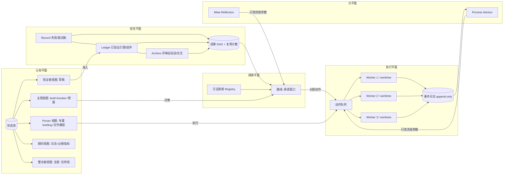

# 长城 Agent 框架设计 v1

> **v2 修订（2026-11-06）**：本文件的「五个平面」组织方式已被 `05_设计问题与自顶向下框架.md` 取代；请以 05 的问题链（P0–P9）为框架主线。本文件保留为各机制的展开与证据说明。

> 日期：2026-11-06｜状态：可质疑的设计提案，未实测｜作者：Lead（综合团队材料与用户既有设计）
> 读法：先读 `00_一页纸总纲.md`。本文回答"为什么这样设计"，`02_机制裁决表.md` 回答"每条论文机制怎么裁决"，`03_实验与评测计划.md` 回答"怎么证明"。
> 证据标记沿用 `work/00_团队协作规范与证据等级.md`：A-实验 / B-实验弱 / C-框架 / D-自述 / E-推断。

---

## 0. 这份文档要解决什么

用户读完了 8 组材料，脑中想法很多，但无法收敛。根因不是信息不够，而是**把五个不同层面的机制放在同一个平面上比较**：

- Anthropic 讲的是执行与上下文（怎么跑、怎么交接）；
- Cogentic 讲的是验证与知识沉淀（什么算成立、怎么入库）；
- Station 讲的是制度（承诺、元反思、档案、代际）；
- Novelty Search 讲的是搜索动力学（奖励什么、档案怎么用）；
- ARI 复评讲的是评测（怎么发现自己被骗）。

它们不在同一层，所以"看起来互相矛盾"。本文先分层，再给一套可实施的框架，最后给可证伪的研究主张。

---

## 1. 问题、主张与边界

### 1.1 系统要优化什么

在给定预算内产生更有价值的最终成果，同时积累能支持后续研究的成果与方法。有限任务以最终成果为主指标；开放研究同时报告独立发现及其后续用途。**不能用笔记数量、Agent 数量或运行时长代替研究收益。**

### 1.2 一句话主张

> 长城 Agent 是一个**以"可继承成果"为单位、以"验证过的知识"为共享层、以"离散决策代"为推进节拍**的长程研究工作台；它的核心假设是：在等算力下，"成果继承 + 显式组合 + 分层验证"比"围绕冠军做局部优化"产生更高的长期收益，并且这一收益可被消融实验测出来。

### 1.3 三个可证伪假设

| 编号 | 假设 | 最小对照 | 主指标 |
|---|---|---|---|
| **H1 继承（扩张版）** | 能扩张"可达集"的成果继承（新增工具/验证器/问题分解）优于从冠军派生；不扩张可达集的继承只买速度、不买上限 | 单 Agent / 多路线冠军跟随 / +继承（不扩张）/ +继承且扩张 / +组合 | 等成本最终成果；最佳已确认成果-预算曲线；**每轮可达集新增项**；成果复用率 |
| **H2 分离** | 共享事实与证据、隔离偏好与建议，能在保留迁移的同时抬高路线多样性 | 全共享 / 全隔离 / 分离 | 方法族分布熵；重复实验率；最终成果 |
| **H3 承诺** | 承诺窗口 + 外部人设元反思降低过早换向与路灯效应 | 无 / 仅承诺 / 仅反思 / 两者 | 项目驻留时长；pivot 率；attractor 任务占比 |

文献缺口（详见 02）：MLE-STAR 没有消融检索与定向精炼；Cogentic 没有逐角色消融、没有验证器错误率；Station 的消融是联合移除，不能拆到单机制；没有任何工作系统测量"共享什么会损害多样性"。**H1 是最值得先做的，因为它是你 0.1 草案的核心，且 literature 里没有人干净地测过。**

**H1 必须接受的硬约束（来自 LocalOptima 2609.34924，[A 定理 / E 外推]）**：如果每轮"能提出的补丁集合"（可达集）固定、质量函数有界，那么每轮改进量趋于 0，平台期是定理而不是运气；best-of-k 的天花板恰好等于最强 worker 的天花板（命题 5），固定专家池的有效轮数有可算上界（命题 7）。这意味着：

- **"多开几条路线"本身不提高上限**；TIPEX 也显示副本并行 n=3→5 边际递减、Judge 与 Oracle 有 5–15pt 差距。
- 要让 H1 成立，每个"成果发展"动作必须能指出**新增了什么**：新工具、新验证器、新的问题分解、新的适用条件、新的可检验探针。否则它只是重采样。
- 这把 H1 从"继承有没有用"升级为"**什么样的继承有用**"——更有区分度，也更不容易被"算力更多所以更好"解释掉。

### 1.4 不做什么（边界）

- 不做"又一个多智能体框架"的军备竞赛；角色数量不是贡献。
- 不做通用科研自动化；先在**有可计算评价器**的任务上把机制测干净，再谈开放式。
- 不承诺"自主发现新定理"；只承诺"在给定预算下把探索做得更有积累"。
- 不把工程复杂度（RAM-Disk、Actor 总线、CQRS、复杂状态机）当研究贡献。

---

## 2. 五平面模型：把论文放回它们各自的层

| 平面 | 核心问题 | 主要来源 | 典型失败 | 本框架对应 |
|---|---|---|---|---|
| **执行平面** | 谁在跑、跑多久、挂了怎么办、慢的拖累快的怎么办 | Anthropic [D]、OpenAI CDC [C]、TwoTier/Concurrency [B] | 状态丢失、错误复利、掉队者、并发争用 | L0 |
| **认知平面** | 谁读什么、读多少、如何交接 | Anthropic [D]、Cogentic [C]、Station [B-]、Context Engineering [B] | 主控上下文爆炸、传话失真、上下文腐坏 | L1 |
| **信任平面** | 什么算成立、什么能入库、谁说了算 | Cogentic [C]、Station [B-]、ARI 复评 [B]、MLE-STAR [A] | 幻觉、共谋、评审放水、伪新颖 | L2 |
| **探索平面** | 下一笔算力给谁、何时放弃、何时融合 | Novelty Search [A]、OpenAI CDC [C]、Station [B-]、Co-scientist [B/D] | 早熟收敛、路灯效应、过早换向、伪多样性 | L3 |
| **元平面** | 系统本身哪里坏了、如何调参 | Cogentic Advisor [C/D]、Station Meta Reflection [B-] | 元层自己产生偏见、调参教条化 | L4 |

**分层带来的第一个直接结论**：用户问的"Summarizer 汇报成果会不会损失多样性、和延迟授粉是否矛盾"，其实是两个平面的事——
- 汇报（briefing）是**认知平面**的压缩动作；
- 多样性是**探索平面**的分布属性；
- 两者通过"共享什么"这个阀门相连：共享事实/证据不损害多样性，共享偏好/建议才会。把阀门定义清楚，矛盾就消失了（见裁决一）。

---

## 3. 系统总览



**时间观**：执行异步，决策分代。每个决策代收集"上一代完成的动作 + 新入库成果 + 预算消耗 + 过程指标"，统一做四件事：更新前沿、分配下一代、检查多样性、记录决策理由。屏障只加在决策处（详见 §4.4）。

---

## 4. L0 执行平面

### 4.1 三类记录必须分开（Anthropic 的教训）

精读稿把"session 和日志"混成一个东西，实际应拆成三类：

| 记录 | 用途 | 内容 | 生命周期 |
|---|---|---|---|
| **trace（调试轨迹）** | 失败归因 | 决策链、工具调用、错误、耗时；元数据优先，不必存全对话 | 长期，可采样 |
| **state（任务状态）** | 断点恢复 | 当前计划、已完成/未决子任务、产物引用、预算消耗 | 与 run 同寿 |
| **artifact（成果产物）** | 继承与交付 | 代码、证明、报告、数据、图；写外部文件，只回传路径 | 永久（版本化） |

混在一起会同时削弱三者用途；分开后，恢复只需要 state，审计只需要 trace，研究继承只需要 artifact。

### 4.2 最小可恢复执行：六个组件，不造"引擎"叙事

Anthropic 原文只说"能从出错处恢复"，没有"引擎"这个词，也没有恢复率数字。最小实现是：

1. **步级状态快照**：每个动作（action）有 id、输入、预算、产物引用、状态（queued/running/done/failed/parked）。
2. **append-only 事件日志**：所有状态变更写事件，可重放；记录 prompt/工具/模型版本号。
3. **幂等工具封装**：重试、超时、退避；同一调用重复执行不产生重复副作用（写文件用临时文件+原子替换，外部调用带幂等键）。
4. **恢复协议**：区分"已完成可跳过""必须重放""不确定需人工确认"。
5. **版本钉住**：一次 run 内固定模型、prompt、工具 schema；避免在途升级。
6. **故障注入测试**：进程 kill、工具 500、超时、磁盘满、权限错各 5 次，测恢复成功率、重复副作用次数、恢复后完成率。

**没有这组数，不要写"具备容错能力"。**

### 4.3 动作（Action）是一等公民

动作卡字段：`id / question / mode(advance|develop|combine|verify|park) / inputs(成果ID) / operation / budget / deliverable / deadline`。完成时附：实际消耗、产物位置、成果卡草稿、失败原因（若有）。

- done 只表示动作结束，不表示研究问题解决。
- 失败任务也必须产出"为什么失败"的记录，否则无法进入 Record。
- 动作可以串行或并行；逻辑上保留多个研究起点，不要求物理同时运行。

### 4.4 掉队者：两个问题，两个解法

1. **执行掉队者**（慢的工具/慢的子任务）：异步执行 + 每动作预算上限 + 超时降级（带部分结果继续）+ 可选投机执行。
2. **注意力掉队者**（先返回的路线劫持主控注意力）：这是用户说的"时序拉直"，是真实问题。解法不是全局屏障，而是：
   - 执行完全异步；
   - **决策代**：每完成 N 个动作（或消耗固定预算区间）才做一次统一比较与分配；
   - 在决策代内，**未完成的路线保留最低公平额度**，不许把资源连续追加给先返回者；
   - 只有在"需要横向比较"时才强制同条件（同一批任务、同一预算），不是每时每刻。

**与 0.1 草案的差异**：0.1 写"异步执行，空出席位即选择动作"，但没有定义"何时比较"；决策代补上这个节拍。**与 Station 的差异**：Station 用同步 tick（每步等最慢者），吞吐受限于最慢者；我们只把屏障加在决策处。这是 [E-推断]，需要用"总墙钟/总成本/决策质量"三指标验证。

---

## 5. L1 认知平面：读者分离

### 5.1 角色 = 视图，不是常驻 Agent

| 角色 | 读什么 | 写什么 | 不读什么 |
|---|---|---|---|
| 主控 Orchestrator | brief、frontier（top-k 成果卡）、预算、决策队列、上代决策理由 | 动作卡、分配理由、终止决定 | 原始日志、完整草稿 |
| Prover/Builder | 自己的 briefing、相关文件（按需打开）、任务卡 | 产物、成果卡草稿 | 其他路线草稿、主控偏好 |
| Individual Verifier | 单份草稿 | 逐条判定 + 证据 | 其他草稿（避免被带偏） |
| Cross-Draft Verifier | 同代全部草稿 | 共享盲点、路线强度对比 | 历史完整日志 |
| Summarizer | 全量历史中与某方向相关的片段 | briefing（事实/失败/开放问题；建议须标注为建议） | — |
| Auditor | 被拒草稿中可隔离的片段 | 自包含引理 + 复验请求 | — |
| Process Advisor | 事件日志 + 过程指标 | 流程参数建议 + 理由 | 不应基于对象级内容下判断 |
| Consolidator | 全部（仅终局） | 交付报告 | — |

**"主控要不要也搞一个多智能体团队？"——不要。** 主控饱和的解法不是给它加下属，而是**把状态放进数据库，把不同投影给不同角色**。Cogentic 的 Advisor 之所以存在，理由正是"Orchestrator 上下文不够"，而不是"角色本身有价值"。

### 5.2 Briefing 的正确写法

每份 briefing 必须分三段，且**建议段必须显式标注**：

1. **已确立事实**（来源、条件、证据等级）；
2. **失败与障碍**（尝试了什么、为什么被驳、适用条件）；
3. **开放问题**（可选：标注为"某 Summarizer 的建议，非共识"）。

这一条直接回应"汇报成果 vs 保留多样性"：**事实段可以全共享，建议段必须被标记为偏好，且不应默认进入所有 Prover 的上下文**。Cogentic 原文的 briefing 带"下一步建议"，这是偏好泄漏点（[E-推断]），我们应在实现中把它降级为可选段。

### 5.3 主控上下文预算

主控只看：brief（≤2k tokens）+ frontier（top 8–12 张卡，每张 ≤300 tokens）+ 最近一代决策与结果（≤2k）+ 预算表。总量控制在 8k tokens 以内。想看细节就按需拉取单张卡或单份产物——**拉取动作本身要记录**，这既是审计也是"注意力分配"的测量。

### 5.4 会话交接（Fork-and-Flush 的正确形态）

- 会话更换、代码分叉、成果继承是三件可以独立发生的事，不要绑成一个"清栈"动作。
- 交接卡：当前目标、已验证成果、活跃路线、未决问题、下一步候选、失败教训、文件路径。
- 新会话**只继承交接卡 + 相关成果卡**，不继承旧对话；旧对话留在 trace 里可查。
- 代际/谱系：可以给每条路线维护"研究身份 + 私有笔记"，但私有笔记必须能被审计，且不能替代公共 Ledger。

### 5.5 语义对齐的四个层次（"谁来做"的答案）

用户问"语义对齐可能需要人来做？或者高阶 AI？"——把它拆成四件事，各有不同负责人：

| 层次 | 要解决的问题 | 谁来做 | 产物 |
|---|---|---|---|
| **任务对齐** | 目标、约束、验收标准是否一致 | 人写合同 → AI 复述 → 人确认 | `brief.md`（目标/约束/验收/预算） |
| **术语对齐** | 同一符号/概念是否同义 | AI 提案 → 人审批关键项 | 版本化术语表 / 本体 |
| **可比性对齐** | 两条结论是否在同样条件下 | 评测脚本强制（同数据/同预算/同指标） | 实验协议 + 共同基线 |
| **异议保留** | 少数派结论不被摘要抹掉 | 结构强制（异议单独入库，不并入共识） | dissent 记录 + 证据 |

所以不是"找一个高阶 AI 来对齐所有人"，而是**合同 + 术语表 + 测量协议 + 异议保留**。人负责边界（验收标准、最终接受、术语裁决），AI 负责操作层检查。Cogentic 的"no math opinion"只约束 Advisor/Orchestrator 的内容判断，不解决这四层。

---

## 6. L2 信任平面：三类资产 + 分层验证

### 6.1 三类知识资产

| 资产 | 单位 | 准入 | 用途 | 成本 |
|---|---|---|---|---|
| **Record** | 一次尝试 | 动作结束即写 | 防重复、保留失败条件 | 低 |
| **Ledger** | 自包含引理/组件/反例 | 隔离复验通过 | 后续可免证复用 | 中 |
| **Archive** | 综述/论文 | 评审 ≥ 阈值 | 解释、障碍、跨领域理解 | 高、慢 |

- **失败也必须入库**：Cogentic 的 Record 记录"尝试 + 判定"；Station 保留 199 次拒稿与 revision。失败记录的价值是"防止重蹈覆辙"，但必须带适用条件，否则会过度排除方向。
- **"已发表" ≠ "已验证"**：Archive 里可以有猜想与综述，但引用时必须标状态；Ledger 里的条目才是"可免证引用"。
- **不要把所有东西都做成论文**：Station 的开放科学版专门警告"为显得高产而灌水"是 attractor task。Archive 只在里程碑做。

### 6.2 成果卡与 DAG

成果卡字段：`id / 种类（引理|反例|实验发现|组件|文献方法|猜想）/ 内容 / 条件 / 证据（文件/命令/页码）/ 来源（动作、父成果）/ 状态（conjecture|supported|verified|refuted|parked）/ 复用计数 / 可继续（一个推广或组合方向）`。

DAG 边：`derived_from / used_in / contradicts / generalizes / instantiates / fails_under`。

**"垫脚石怎么存、要不要层层嵌套？"——不要嵌套。** 用扁平节点 + 类型化边；"垫脚石"的操作性定义是**被后续动作实际读取并使用**的节点，而不是目录深度。Lehman 的 archive 也是"行为代表点集合"，不是树。树只适合表达代码父子继承，表达不了"一个结论来自多条路线"。

### 6.3 分层验证协议

| 层 | 检查什么 | 谁执行 | 失败后果 |
|---|---|---|---|
| L1 确定性 | 能否执行、引文是否存在、数值是否对账、是否泄漏答案、格式是否合法 | 脚本 | 直接拒绝，不进 Ledger |
| L2 LLM 评审 | rubric（严密性/新颖性/重要性/证据充分性）、多评委、盲序、校准集 | LLM + rubric | 只做筛选/排序，不做最终裁决 |
| L3 人工/形式化 | 关键结论、最终交付、形式化证明（如 Lean） | 人 / 证明器 | 最终接受 |

**验证器必须被评测**：准备 20–30 份已知好/坏样本（含注入错误：循环论证、边界条件颠倒、引文虚构、重数错误、数据泄漏），测每层的漏检率与误杀率。Cogentic 与 Station 都没有报告验证器错误率——这是现成的研究贡献点。

**Individual vs Cross-Draft 的边界**：
- Individual 看单稿的局部正确性（边界、符号、方向）；
- Cross-Draft 看**共享盲点**（大家都默认了同一个未证引理）与路线间互补；
- 两者都通过才准入 Ledger。Cross-Draft 的上下文里应包含"本轮所有草稿 + 各自声称的依赖"，但不包含"当前最被看好的路线"（否则会被偏好污染）。

### 6.4 证据等级 × 状态

每个结论必须同时标：证据来源等级（A/B/C/D/E）和状态（conjecture/supported/verified/refuted）。**禁止把 C/D 级材料写成 A 级结论**；禁止把"论文说了"写成"我们复现了"；禁止把"评审通过"写成"成立"。

---

## 7. L3 探索平面

### 7.1 路线与方法族谱（Registry）

- **路线（Route）**：一个有明确问题、预算与承诺窗口的研究方向；路线可以共享成果节点。
- **方法族谱（Registry）**：按**核心机制**（不是措辞）给路线/成果归类：例如"用信息增益选点""用几何排除""用序列概率比早停""用对偶势函数"。每代更新一次分布。
- **用途边界**：Registry 只用于
  1. 发现扎堆（某族占比 > 阈值 → 触发再平衡）；
  2. 分配时的覆盖约束（保证至少 N 个族有活跃路线）；
  3. 事后分析（哪一族贡献了最终成果）。
  **不用于**给 Prover 发"你应该用 X 方法"的指令——那是偏好注入。

### 7.2 新颖性：定义行为维度，而不是代码差异

Novelty Search 的关键不是"奖励新"，而是**行为表征**：在迷宫任务里是"终点位置"，不是"代码文本"。迁移到长城 Agent：

- 行为维度候选：方法族标签、问题表述、约束条件、评价指标、数据结构/表示、验证手段。
- 新颖性 = 与**历史已见行为**的距离（k-NN），不是与当前冠军的距离；
- 档案 = 每个行为区域保留代表（不是所有变体）；档案规模要控制（Lehman §6.2 讨论过），去掉被支配的、重复的、证据不足的；
- **警告**：文本新颖 ≠ 机制新颖；"换个说法"不构成新颖；"无目标"也不等于"无质量"。Station 的 attractor task（反复开发工具、写论文、证明"此路不通"）就是"新颖性/活动性"被刷的例子。

### 7.3 承诺窗口与换向协议

- 每条路线在启动时声明：问题、预算下限（不是固定 tick）、预期产物、可能的停止条件。
- **在花完预算下限之前不许换向**；换向必须提交"新证据"（反例、明确的阻塞、外部约束变化），而不是"又失败了两次"。
- 承诺期结束后的选择：继续（追加预算）、暂存（parked，保留成果）、组合、终止。
- **不要照搬 60 tick / 320 tick**：这些数字依赖 Station 的任务与 tick 定义；我们用品量（token/墙钟/动作数）表示，并用消融确定阈值。
- 反模式：把"承诺"变成"沉没成本"——必须有"外部信号触发重审"的通道（例如关键假设被证伪、评测器变化、新文献）。

### 7.4 组合协议

从两个成果中明确指出要连接的内容：
- A 提供什么（表示/界/组件/数据）；
- B 需要什么；
- 接口是什么（输入输出、假设是否相容）；
- 组合后的产物是什么；
- 与相关父方案的同条件比较结果；
- 若失败，留下"不相容的条件"与"仍可复用的部分"。

组合不是 Git merge，也不是把两段文字拼在一起；组合的价值在于**接口**。数学任务要检查引理假设相容；实验任务要检查数据/预算/测量条件对齐。

### 7.5 五类动作与分配

| 动作 | 目的 | 预算 | 典型产出 |
|---|---|---|---|
| **advance** | 改善当前可交付成果 | 中 | 更好的方案/更强的界 |
| **develop** | 发展非冠军但有独立机制的成果 | 小-中 | **必须声明新增的可达集项**（新工具/验证器/问题分解/适用条件/可检验探针）；只重复讲潜力不算 |
| **combine** | 跨谱系连接 | 小-中 | 组合产物 + 比较 |
| **verify** | 检验关键假设/结论 | 小 | 判别实验、复核 |
| **park** | 暂存并记录 | 极小 | 条件、原因、可继续点 |

分配顺序建议（参数，不是教条）：先保证每条活跃路线的最低公平额度；再按"能否消除重要分歧/能否让两条成果接上/能否产出可检验内容"选下一批；**至少保留一个非冠军成果的发展额度**（若确实没有，记录原因）。

### 7.6 延迟融合的阶段表

| 阶段 | 共享什么 | 不共享什么 |
|---|---|---|
| 独立期（初始额度内） | 任务事实、公开文献、工具、术语 | 其他路线的草稿、偏好、潜力判断 |
| 初步证据期 | 已验证事实、失败记录、基线 | 当前最优路线、下一步建议 |
| 交叉期（决策代触发） | 相关成果卡 + 明确的组合问题 | 全量广播、排名/评分 |
| 收敛期（接近终止） | 全部证据、比较结果 | — |

---

## 8. L4 元平面

### 8.1 Process Advisor：读什么、能改什么

- **读**：事件日志、过程指标（每代动作数、失败率、评审通过率、路线驻留时长、重复率、族分布、token 分布）。
- **能改**：提示词强调项、验证阈值、预算分配比例、再平衡触发条件、评审 rubric 权重。
- **不能改**：具体数学/技术结论、某条路线"有没有希望"的判决、最终交付内容。
- **必须留**：每次干预的理由、依据的过程指标、预期效果、事后是否奏效。没有这四项，Advisor 就是新的教条来源。

**红线的准确表述**：元层可以基于**可测量的过程证据**调整流程；不得把对象级偏好伪装成流程判断。注意：分配预算本身是实质判断，所以"无数学意见"≠"无偏"，只是"不许把偏好说成事实"。

### 8.2 Meta Reflection

- 触发：每 N 个动作/每个决策代（可配置），或停滞触发。
- 形式：换一个模型/人设（外部资深审稿人），强制回答固定问题池：
  1. 我是否在过度声称？
  2. 我是否偏离了原始问题？
  3. 我是否在做"容易但无关"的任务（路灯效应）？
  4. 我是否在重复已失败的路？
  5. 我的方法族是否与别人趋同？
  6. 我是否在刷活动量（工具、日志、论文）而不是推进核心问题？
  7. 我最近一次改变主意是因为新证据，还是因为挫败？
  8. 我留下了什么可被别人继承的东西？
- 输出：**只写流程层面的调整**（下一步做什么类别的动作、要不要换方向、要不要补文献），不写具体技术建议。
- 指标：反思后 10 个动作内的行为变化（深化率、pivot 率、attractor 占比）。Station 报告 71.7% 的反思后出现深化（92 次事件，描述统计）[B-]，可作为参照，不是承诺。

### 8.3 停滞协议与多起点（可选，按预算）

- 停滞：连续 K 个决策代无"可确认进展" → 触发三选一：换问题表述、换表示、换验证标准；或强制分化（exploration/exploitation/revival/understanding/strategy）。
- 多起点：预算允许时，从同一初始状态并行 K 条短跑，选最有科学价值的一条继续（Station 的 multistart）。成本高，首版不做。

### 8.4 元层的反身风险

- 元层也会形成自己的教条（"必须每 N 步反思""必须多样化"），需要被同样的证据标准约束。
- 元层的建议如果连续多代无效，应降权或停用；记录"干预-效果"对，是最小可做的元层评估。

---

## 9. 主循环（伪代码）

```text
load brief, budget, acceptance
pre_research -> method_inventory, baseline_matrix, failed_approaches, open_gaps
init routes (2-4, 机制不同), 每条给最低额度与承诺窗口
for epoch in 1..E:
    harvest 上一代完成的 actions
    classify results: verified / supported / conjecture / failure / blocked
    update Record (所有尝试) and Ledger (复验通过者)
    update DAG edges + usage counts
    advisor: read process metrics -> process_adjustments (with rationale)
    registry: update family distribution; if clustered -> rebalance
    frontier: top deliverable + active routes + top-k non-champion stones + open questions
    decision (orchestrator view only):
        choose next batch of actions (advance/develop/combine/verify/park)
        enforce min fair budget per active route
        enforce at least one develop slot (or record why none)
        log decision rationale
    dispatch actions async (workers in worktrees)
    if stagnation: trigger reflection / reformulation / differentiation
finalize: reserve budget for consolidation & final verification
consolidate: report + evidence chain + open problems + handoff card
```

---

## 10. 与既有版本的关系（基于原始产物的考古，不是自述）

> 依据：`work/01_现状考古与资产盘点.md`。V1 无档案；V2/V3/设计系统均在本机重跑或核对了原始产物。

| 既有资产 | 实际是什么（可核） | 真正能留下的 | 必须丢掉的 |
|---|---|---|---|
| **V1（skill）** | 无可核工程档案；只有后代转述 [D] | 提示词纪律的教训 | "V1 证明了什么"的任何说法 |
| **V2（机制）** | 25 个子会话、12 节点、22 case GateReport 的真实多智能体运行；**但终局未过自设门**（node_12 Q3 250.22s/70.6%，termination_unlocked=false）；物理隔离未实现（同一仓库子目录）、盲写未实现（构建期显式传前序摘要）、中后期坍塌成 node_08→09→10→11 单链、.incumbent 为空 | 白盒评测栈（profiler/gate_check）、节点树 schema、BOARD 四类标签、spec_extractor/锦标赛提示词；"去表象审计"真抓到过伪实现（node_01 硬编码偏移） | "锦标赛当最终裁决"、"多角色=多智能体"、把"清栈"当隔离 |
| **V3 / AFEVA（竞赛运行）** | 7 节点、40 个 py、8,041 行，数字确实来自仿真（node_06 195.60s 可复算）；**但测的是双狗+自建沙箱+is_all_cleared 的代理任务**，不是官方单狗题；屏蔽完成信号后 node_06 从 173.94 升到 333.05s/源；node_08 从未启动、node_07 在 429 中断；"满贯/唯一可行路径/零生态位重叠"均超出证据 | 可重跑的沙箱与 12 项自测、门禁分层、run_metrics/裁决书格式 | "满贯""唯一路径""零作弊"叙事；gap≤1.60/waste≤0.15 这类被测量装置污染的阈值；把代理任务成绩当原题成绩 |
| **《长程 Agent 设计系统》** | 45/45 e2e、4 条不变性可重跑通过 [R]；**但全仓无 LLM/网络/Git 调用，Worktree 是 temp 目录复制，测试用 Mock**；它是"编排库/仿真器"，不是真实长程系统 | 状态机/账本/WAL/快照/门禁的接口与测试骨架（接入真实执行器后可复用） | "测试全绿=机制有效"；1500-token 硬上限；把 AFEVA 当底座 |
| **探索架构草案 0.1** | 设计文档 + 操作模板，**未实测**；方向正确、证据分级诚实 | **作为 v1 的基线** | 60/25/15 固定比例（改参数）、"主持只看卡"（改可调） |

**三版实战恰好演示了三种典型失败，这比任何论文都更值得写进你的研究叙事：**

1. **V1：没有状态与证据 → 只剩提示词纪律**，无法积累，也无法归因。
2. **V2：有并发、有角色，但没有物理隔离与盲写 → 中后期坍塌成单链**；说明"多智能体"不会自动带来多样性，结构才是原因（与 Diversity Collapse 的结论同向）。
3. **V3：有测量、有门禁，但测量装置本身制造了优势**（官方不提供的完成信号、自建双狗沙箱、waste 结构性为 0）——这正是 ARI 复评警告的"评测器失效"在你自己的工程里重演。

一句话：**不是推倒重来，是把 0.1 从"研究流程"升级成"有制度、可测量"的系统；三版实战的价值是提供了三个反例，而不是三个版本号。**

---

## 11. 明确拒绝/暂缓清单

| 机制 | 结论 | 理由 |
|---|---|---|
| 64 并发 / Agent 越多越好 | 拒绝 | 并发是预算参数；Anthropic 15× token 成本；OpenAI 64 是单命题特例 [C/D] |
| "多开路线就能提高上限" | 拒绝 | LocalOptima 命题 5/7：不扩张可达集只买速度；TIPEX n=3→5 边际递减、Judge 有 Oracle gap [A 定理/E 外推] |
| 全异步（无决策代） | 拒绝 | 会被先返回路线劫持；比较需要同条件 [E] |
| 全局同步 tick | 拒绝 | 吞吐受最慢者限制；只保留决策代屏障 [E] |
| 固定 60 tick 承诺 | 改造 | 用预算/动作数表示，阈值用消融定 [B-/E] |
| 每步都验证 | 拒绝 | 成本爆炸；验证放关口 [E] |
| LLM 评审做最终裁决 | 拒绝 | ARI 复评：7/7 全拒自产、误杀 4 篇真接收、漏掉全部硬伤 [B] |
| 关键词匹配判新颖 | 拒绝 | 12/12 判 novel，至少 4 个是已有技术 [B] |
| 知识全部沉淀成论文 | 暂缓 | attractor task 风险；先 Ledger，Archive 里程碑再做 [B-] |
| 完全去中心化 | 拒绝 | Station 实际是"方向/执行去中心、质量/知识中心"；原文不把增益归因于去中心化 [B-] |
| 图数据库/消息总线/CQRS | 暂缓 | 首版文件 + SQLite + git 足够；复杂度不是贡献 [E] |
| 固定预算比例 60/25/15 | 暂缓 | 0.1 已声明是实验参数；文献无依据 [E] |
| 自评排名当真理 | 拒绝 | 自评偏差；只做调度信号 [E] |
| "杂交是唯一可行路径" | 拒绝 | 证据不支持唯一；Station 的 604 可由三条不同路径达到 [B-] |

---

## 12. 研究定位（如果要做成前沿工作）

**不要**把贡献写成"我们建了一个多智能体系统"——Cogentic、Station、Anthropic 已经在那里。可成立的贡献按优先级：

1. **H1 的干净实验**：等成本下，"成果继承 + 显式组合" vs "冠军跟随"。文献里 Cogentic/Station 只做存在性证明，MLE-STAR 没消融检索，0.1 未测。这是最大的空白，也最贴近你已有的东西。
2. **H2 的分离原则**：共享事实/隔离偏好对多样性与迁移的联合影响。两篇 Station 与 Cogentic 都没测多样性；Diversity Collapse 只测坍塌。可测、可复现。
3. **验证器校准基准**：注入错误草稿，测 individual/cross-draft 的漏检率/误杀率。Cogentic 没报告任何验证器错误率；这是现成的方法学贡献。
4. **H3 的拆分消融**：Station 是联合消融；把承诺与元反思分开测，是对其结论的加固（增量，但扎实）。
5. **一个可复现的 harness + 任务集**：CUMCM B 仿真器 + 1–2 个开放式再发现任务（用模型截止后的论文做 oracle，Station 式评分）。工程量大但价值高。

**撞车风险**：Cogentic（证明发现）、Station（开放世界）、Aletheia/Kosmos/Bolzano（数学研究）、AI Scientist v2（实验树）。你的差异化不在"更会自动科研"，而在**机制归因与测量**——他们都在讲"我们做到了"，你可以讲"我们测清楚了哪个机制有用、在什么条件下有用"。

---

## 13. 开放问题（诚实清单）

1. 异步执行 + 决策代，是否真的优于同步 tick？没有文献对照。
2. "共享事实/隔离偏好"能否在真实任务上同时保住多样性与迁移？没有直接证据。
3. 验证器的可靠性如何测量、如何校准？目前只有设计声明。
4. 元层的干预是否真的改善结果，还是只是让流程"看起来更规范"？需要干预-效果对。
5. 成果 DAG 会不会膨胀到不可维护？需要档案规模与检索质量指标。
6. 承诺窗口的最优长度依赖任务结构，如何自动设定？
7. 开放式任务的评价尺度如何做到可复现、可盲评？Station 的 sub-discovery rubric 是一个起点，但样本少。
8. 成本核算：多 Agent 的 15× token 是否值得？只有在 H1 成立时才有意义。
9. "可达集"如何测量？目前只能人工/规则地列出"新增工具/验证器/分解"，能否自动识别？这是 H1 能否大规模验证的关键。
10. 行为新颖性的"行为维度"在代码树/研究路线上是否成立？Lehman 的维度是迷宫坐标与步态，迁移到"适用条件-证据"空间只是 [E] 推断。

---

## 14. 参考

- 论文与博客的逐条裁决见 `02_机制裁决表.md`（含证据等级与原文位置）。
- 实验、指标、消融与路线图见 `03_实验与评测计划.md`。
- V1/V2/V3 的可核复盘见 `04_三版实战复盘.md`。
- 团队原始材料：`work/01–05`（01 现状考古、02 基础设施与评测、03 证明发现与 Station、04 多样性/并发/上下文、05 Co-scientist 与前沿定位）。
