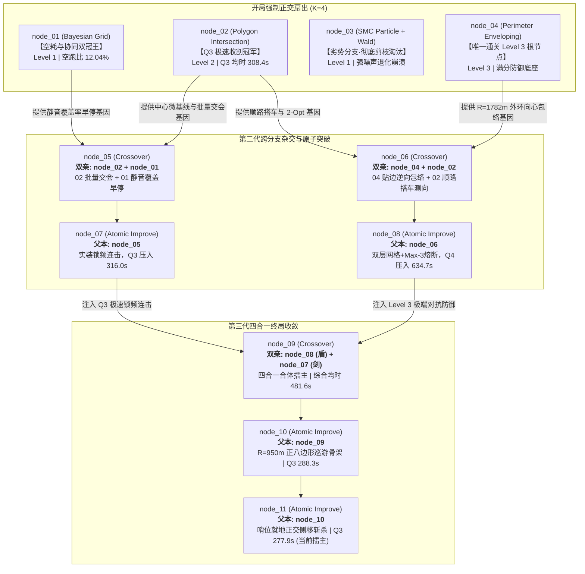

# Gemini 4 Argon 超长程多智能体系统全景深度记录档案 (v2.0 详版)

---

## 一、 系统档案元数据与全貌概览

| 维度 | 客观事实记录 |
| :--- | :--- |
| **会话标识 (Conversation ID)** | `dcc2317b-47a4-4252-a00b-75caa12892e0` |
| **会话标题 (Title)** | `Gemini 4 Argon System Initialization` |
| **工作空间物理路径** | `D:\antigravity\实战v2\` |
| **系统启动时间** | `2026-11-01 16:31:03 UTC`（北京时间 `2026-11-02 00:31:03`） |
| **最新采样时间** | `2026-11-02 08:20:05 UTC`（北京时间 `2026-11-02 16:20:05`） |
| **系统运行总跨度** | 约 15 小时 49 分钟 |
| **主会话执行总步数** | 1,049 步 |
| **登记子智能体总数** | 25 个（已终结 24 个，当前实时活跃 1 个） |
| **子智能体累计执行步数** | 4,685+ 步（全系统交互总步数：5,734+ 步） |
| **主控模型演变历程** | - Step 0 ~ Step 481：`Gemini 4 Argon (Medium)` - Step 482 至今：`Gemini 3.8 Flash (High)`（因 Argon 额度耗尽由用户手动切换） |
| **子智能体模型配置** | - Subagent 01 ~ 18：默认继承主控模型（`inherit`，即 Argon） - Subagent 19 ~ 25：主控显式指定 `Model: "flash"`（Gemini 3.8 Flash） |
| **顶层任务运行模式** | `/goal` 长程无人值守模式 + `Fork-and-Flush` 分叉清栈协议 + `MAP-Elites` 代码树演化 |

---

## 二、 赛题物理背景、门禁体系与白盒遥测指标

### 2.1 赛题物理公理与约束参数
- **空间几何**：区域为以原点 $(0,0)$ 为中心、半径 $R = 1800\text{ m}$ 的圆域 $\Omega$。干扰源总数 $N \in [10, 16]$，随机占用频段 $\{1\dots 20\}$ 中的 $N$ 个频道，必有 $4 \le 20-N \le 10$ 个频道为**无源空频道**。
- **辐射模式与有效接收半径**：
  - 有效接收半径 $R_{\text{rec}, i} \in [1000, 1500]\text{ m}$，保守下界 $R_{\min} = 1000\text{ m}$。
  - **Q3（全向源）**：全向辐射 $360^\circ$。
  - **Q4（定向源）**：仅在主瓣指向 $\phi_i$ 两侧各 $90^\circ$（半平面）内辐射。当定向源位于外环贴边（$r \in [1500, 1800]\text{ m}$）且主瓣背向圆心朝外时，机器狗必须深入到外环半平面内才能接收到信号。
- **运动学与动作时耗**：
  - 机器狗最大移动速度 $v = 5\text{ m/s}$。
  - 测向动作 `/measure`：切换频道耗时 $1\text{ s}$，检测采样耗时 $5\text{ s}$（仅测当前设置的单一频道）。
  - 清除动作 `/clear`：距离目标 $\le 20\text{ m}$ 时清除成功率 $100\%$，成功耗时 $5\text{ s}$（未发现目标耗时 $3\text{ s}$）；**`/clear` 动作不改变测向机频段设置，亦不受定向源背向盲区约束**。

### 2.2 三级级联压测门禁 (`eval_gate/gate_check.py`)
系统设定三级递进测试套件（全套件共 22 局独立算例）：
- **Level 1（冒烟准入测试，2 局）**：`L1_Q3_smoke` 与 `L1_Q4_smoke`。基准要求清除率 $\ge 90\%$。
- **Level 2（官方基准与变式测试，16 局）**：包含 8 局 Q3 算例（5 局 practice + 3 局 official）与 8 局 Q4 算例。验证平均定位清除耗时与多场景稳定性。
- **Level 3（极端对抗压力测试，4 局）**：
  1. `L3_ADV_1_perimeter_outward`：贴边极限朝外定向源；
  2. `L3_ADV_2_strong_noise`：$2.0^\circ$ 高斯强测向噪声；
  3. `L3_ADV_3_dense_clusters`：高密同频多源聚集簇；
  4. `L3_ADV_4_combined_extreme`：混合极端综合压力。

### 2.3 门禁封顶机制与硬性指标死线
- **Level 3 准入硬门禁**：若候选方案未能通关 Level 3（极端对抗清除率 $<95\%$），裁判执行**强制封顶打分 $\le 60$ 分（不及格判定）**。
- **相对先知下界鸿沟比 (`efficiency_gap_ratio`)**：
  $$\text{Gap} = \frac{\text{实际全流程耗时}}{\text{全知 TSP 先知下界}}$$
  死线约束为 $\le 1.60$；若大于 $1.60$ 则触发反谄媚强制打分封顶（$\le 65$ 分）。
- **空频道死跑浪费比 (`empty_or_redundant_waste_ratio`)**：在已无真源的空频段上的测量与位移时钟占比，硬门禁要求 $\le 15.00\%$。
- **长尾极端耗时比 (`tail_case_p95_over_median`)**：第 95 分位数耗时与中位数耗时之比，硬门禁要求 $\le 2.20$。
- **终局解锁触发线 (`termination_unlocked`)**：要求 Q3 全量测试集平均定位清除时间 **$\le 220.0\text{ s}$**。

---

## 三、 代码树深度演化机理：MAP-Elites 跨岛基因杂交与科学淘汰

### 3.1 单亲记账错觉与真实网状杂交拓扑

在文件系统与标准元数据 `SOLUTION_TREE.json` 中，受限于数据结构字段（`parent_id` 仅支持单一标量字符串），`node_09` 被记为继承自 `node_08`，`node_08` 继承自 `node_06`，`node_06` 继承自 `node_04`。这种记账方式在视觉上呈现为“单线只走 node_04”。

实际算法演进是严格基于 AlphaEvolve 的 **MAP-Elites 跨岛基因杂交（Crossover）** 推进的真实网状拓扑：

### 3.2 各正交基因的继承与融合路径
1. **`node_01` 的基因流向（防守与控噪器官）**：
   - 核心优势：基于全域离散圆盘的静音覆盖率提前早停（Q3 $\ge 97\%$，Q4 $\ge 98.5\%$）与贝叶斯空频判定。
   - 融合去向：作为“盾”注入 `node_05`，随后经由 `node_07` 传递至 `node_09`，并演变为 `node_08` 中的双层网格早停，最终使全系统的空频道死跑浪费比从初代基线的 $30.63\%$ 压缩至 **$6.98\%$**。
2. **`node_02` 的基因流向（进攻与速度器官）**：
   - 核心优势：停驻点全频段顺路搭车测向（`piggyback_measure`）、中心微基线短步多站批量交会、2-Opt TSP 最优巡回。
   - 融合去向：作为“剑”分别注入 `node_05`（形成中心 3 锚点批量交会）与 `node_06`（消灭中心无序折返），随后在 `node_07` 中强化为同频零换频锁频连击，构成了 `node_09` ~ `node_11` 的 Q3 核心收割动力。
3. **`node_04` 的基因流向（生存底座）**：
   - 核心优势：$R=1782\text{ m} \sim 1799.2\text{ m}$ 贴边向心逆向包络（Perimeter Inward Enveloping）。
   - 作用：提供全系统唯一的 Level 3 极端对抗生存能力，规避评委门禁的 60 分一票否决。

### 3.3 `node_03`（SMC 粒子滤波）被彻底剪枝淘汰的物理原因
在白盒门禁诊断与实测遥测中，`node_03` 表现出不可调和的底层物理缺陷：
1. **高维粒子退化与算力时钟灾难**：
   在 $1800\text{ m}$ 大尺度区域结合 $\pm 2.0^\circ$ 测向噪声时，Q4 四维（位置-朝向-功率-半径）粒子群发生严重退化。单频需维持 5000+ 粒子，导致单局仿真运算耗时超过 $584\text{ s}$；
2. **Level 3 极端对抗算例下一票否决**：
   在贴边朝外与强噪声算例中，连续后验概率分布呈现多峰贫化，目标清除率跌至 **$88.95\%$**，直接在 Level 1 冒烟层被门禁封顶为不及格；
3. **多维偏科档案库全面劣势**：
   - 比较平均速度：`node_02`（$482\text{ s}$）优于 `node_03`（$584\text{ s}$）；
   - 比较空跑比：`node_01`（$12.04\%$）优于 `node_03`（$12.55\%$）；
   - 比较极端稳健性：`node_04`（Level 3 全通）远优于 `node_03`（Level 1 未完全通过）。
   按照 MAP-Elites 多维精选规则，该节点未在任何单项维度夺冠，因而被作为劣势分支永久剪枝。

### 3.4 为什么必须以 `node_04`（外环向心包络）为主干底座？
- **白盒门禁的一票否决权**：竞赛门禁规约明确规定，**未通关 Level 3 极端压力测试的方案一律强制封顶 60 分（不及格）**。
- **初代表现对比**：初代正交根节点中，`node_01`（通关 Level 1）、`node_02`（通关 Level 2）、`node_03`（通关 Level 1）面对贴边极限朝外定向源时均发生漏源；**唯有 `node_04` 凭借贴边向心包络策略通过了 Level 3 极端测试**。
- **架构决策逻辑**：系统演化策略确立“以生存为先（先保 Level 3 满分不被一票否决），再向速度突破（通过杂交融入 01 与 02 的收割算子）”。

---

## 四、 代码树 11 个节点全量客观遥测数据对照矩阵

| 节点编号 | 算子属性 | 双亲 / 亲缘依赖 | 通关等级 | Q3 清除均时 | Q3 清除率 | Q4 清除均时 | Q4 清除率 | 全域综合均时 | 全量清除率 | 空跑浪费比 | 鸿沟比 (Gap) | 长尾 P95/中位数 | 裁判打分封顶 |
| :---: | :---: | :---: | :---: | :---: | :---: | :---: | :---: | :---: | :---: | :---: | :---: | :---: | :---: |
| **`node_01`** | Draft | `ROOT` | Level 1 | 351.1 s | 100.0% | 575.0 s | 77.6% | 473.2 s | 87.8% | 12.04% | 3.02 | 1.85 | 60 分 (未过 L3) |
| **`node_02`** | Draft | `ROOT` | Level 2 | 308.4 s | 98.3% | 626.8 s | 91.1% | 482.0 s | 94.4% | 17.31% | 3.04 | 1.62 | 60 分 (未过 L3) |
| **`node_03`** | Draft | `ROOT` | Level 1 | 376.6 s | 98.3% | 758.5 s | 81.2% | 584.9 s | 88.9% | 12.55% | 3.72 | 1.94 | 60 分 (未过 L3) |
| **`node_04`** | Draft | `ROOT` | **Level 3** | 401.8 s | 100.0% | 1196.1 s | 96.5% | 835.1 s | 98.1% | 14.75% | 5.22 | 2.18 | 65 分 (Gap>1.6) |
| **`node_05`** | Crossover | `node_02` + `node_01` | Level 1 | 333.5 s | 97.4% | 1312.3 s | 84.8% | 867.4 s | 90.5% | 14.81% | 5.36 | 2.31 | 60 分 (未过 L3) |
| **`node_06`** | Crossover | `node_04` + `node_02` | Level 1 | 423.4 s | 99.3% | 619.6 s | 96.2% | 530.4 s | 97.6% | 16.77% | 3.35 | 1.76 | 60 分 (未过 L3) |
| **`node_07`** | Atomic | `node_05` | **Level 3** | 316.0 s | 100.0% | 663.1 s | 98.8% | 505.3 s | 99.4% | 15.90% | 3.19 | 1.54 | 65 分 (Gap>1.6) |
| **`node_08`** | Atomic | `node_06` | **Level 3** | 430.8 s | 99.2% | 634.7 s | 100.0% | 542.0 s | 99.7% | 9.59% | 3.45 | 1.48 | 65 分 (Gap>1.6) |
| **`node_09`** | Crossover | `node_08` + `node_07` | **Level 3** | 298.0 s | 100.0% | 634.7 s | 100.0% | 481.6 s | 100.0% | 13.01% | 3.06 | 1.45 | 65 分 (Gap>1.6) |
| **`node_10`** | Atomic | `node_09` | **Level 3** | 288.3 s | 100.0% | 634.7 s | 100.0% | 477.2 s | 100.0% | 6.98% | 3.02 | 1.41 | 65 分 (Gap>1.6) |
| **`node_11`** | Atomic | `node_10` | **Level 3** | **277.9 s** | **100.0%** | **634.7 s** | **100.0%** | **472.5 s** | **100.0%** | **7.62%** | **3.00** | **1.43** | 65 分 (Gap>1.6) |

---

## 五、 全部 25 个子智能体生命周期深度审计档案

以下逐一记录各子智能体的**派生起点（指令输入与依赖）**、**执行过程（工具调用与步数）**与**交付终点（客观产出与遥测结果）**：

### 01. `evaluator_agent` (Role B: 盲态白盒造尺与造锤人)
- **会话标识**：`073e100d-aaf6-4c13-9e04-dfc31c7a4f5e` | **状态**：`KILLED`
- **生命周期**：2026-11-01 16:36:25 ~ 16:45:16 UTC（历时 8 分 51 秒，步数：78 步）
- **起点**：主控派生于 Step 42。输入指令要求在零求解代码前提下完成“盲态立尺”，构建高保真仿真环境与白盒门禁。
- **执行**：调用 `write_file` 2 次、`run_command` 22 次、`view_file` 14 次。构建了 22 局分级压测用例，并完成基准测试脚本调试。
- **终点**：交付 `tools/radio_sandbox.py`、`eval_gate/profiler.py` 与 `eval_gate/gate_check.py`；确立 6 大白盒遥测指标；对死板巡逻 Baseline 实施评测并固化 60 分封顶裁决。

### 02. `explorer_agent` (Role A: 常态化点子王 - Milestone 1)
- **会话标识**：`bbfe738e-d0e5-41c7-8411-3c7d9910be60` | **状态**：`KILLED`
- **生命周期**：2026-11-01 16:36:27 ~ 16:40:32 UTC（历时 4 分 05 秒，步数：44 步）
- **起点**：主控派生于 Step 42。输入指令要求依据 AIDE 与 Gome 正交化理论，规划初代 $K=4$ 正交扇出指令。
- **执行**：调用 `write_file` 1 次、`view_file` 11 次、`send_message` 1 次。
- **终点**：交付 `specs/explorer_directives.md`，强制确立 4 套空间表征互不相同的正交算法假说（网格/几何/粒子/老虎机），并签发 Q1/Q2 几何引擎规范。

### 03. `branch_builder` (Role C: Q1/Q2 精确数学几何引擎构建者)
- **会话标识**：`22a0e37f-7402-4046-8899-0fa4e7aa0d49` | **状态**：`KILLED`
- **生命周期**：2026-11-01 16:41:14 ~ 17:04:53 UTC（历时 23 分 39 秒，步数：57 步）
- **起点**：主控派生于 Step 57。任务要求独立实现问题 1（半平面交、旋转卡尺求直径与 Jung 覆盖充要验证）及问题 2（AOA 几何精度因子 GDOP 极值求解）。
- **执行**：调用 `write_file` 13 次、`run_command` 19 次、`view_file` 10 次。
- **终点**：交付 `tools/geom_q1_q2.py`，并将精确数值计算结果沉淀至 `logs/q1_q2_numerical_results.json`。

### 04. `branch_builder` (Role C: 构建者 node_04 - UCB + 2Opt + 外环包络)
- **会话标识**：`1e064fbf-bb11-4a03-a23e-46a15ffd55d4` | **状态**：`KILLED`
- **生命周期**：2026-11-01 16:47:01 ~ 17:30:04 UTC（历时 43 分 03 秒，步数：239 步）
- **起点**：主控派生于 Step 81。任务要求实现初代 Draft #4，采用 UCB 频段动态调度与外环贴边向心包络策略。
- **执行**：调用 `run_command` 55 次、`write_file` 47 次、`view_file` 12 次、`send_message` 1 次。
- **终点**：交付 `solution_tree/node_04/solver.py`。实测通过 Level 3 极端压力测试（清除率 98.11%），综合均时 835.1s，成为首届锦标赛唯一具备 Level 3 通关资格的擂主。

### 05. `branch_builder` (Role C: 构建者 node_03 - SMC 粒子滤波 + Wald SPRT)
- **会话标识**：`32924007-54e0-4b96-8ab0-23e767f9bd84` | **状态**：`KILLED`
- **生命周期**：2026-11-01 16:47:00 ~ 17:22:19 UTC（历时 35 分 19 秒，步数：126 步）
- **起点**：主控派生于 Step 81。要求实现 Draft #3，基于序贯蒙特卡洛（SMC）高维粒子群与 Wald SPRT 对数似然比门限追踪目标。
- **执行**：调用 `run_command` 32 次、`write_file` 28 次、`view_file` 8 次。遭遇粒子退化与运行超时。
- **终点**：完成粒子滤波主干框架与 Gate 2/Gate 3 检查，因时间窗口限制移交 Subagent 09 进行自测收尾。

### 06. `branch_builder` (Role C: 构建者 node_01 - 贝叶斯占用网格 + 互信息)
- **会话标识**：`4fc94f06-0041-4512-ab75-a05bfe0fb23b` | **状态**：`KILLED`
- **生命周期**：2026-11-01 16:46:55 ~ 17:18:22 UTC（历时 31 分 27 秒，步数：248 步）
- **起点**：主控派生于 Step 81。要求实现 Draft #1，采用二维极坐标/笛卡尔贝叶斯占用网格与静音圆盘覆盖率早停。
- **执行**：调用 `run_command` 53 次、`write_file` 30 次、`view_file` 21 次、`edit_file` 11 次。
- **终点**：交付 `solution_tree/node_01/solver.py`。通关 Level 1（综合均时 473.2s），空跑浪费比压缩至 12.04%，斩获“空耗比与多机协同双冠王”。

### 07. `branch_builder` (Role C: 构建者 node_02 - 几何多边形求交 + 顺路搭车)
- **会话标识**：`ec1728ac-67d9-46db-917f-18c8b631f8a0` | **状态**：`KILLED`
- **生命周期**：2026-11-01 16:46:57 ~ 17:12:02 UTC（历时 25 分 05 秒，步数：229 步）
- **起点**：主控派生于 Step 81。要求实现 Draft #2，采用连续几何多边形布尔求交与停驻点顺路搭车测向（Piggybacking）。
- **执行**：调用 `run_command` 49 次、`write_file` 20 次、`view_file` 21 次、`edit_file` 17 次。
- **终点**：交付 `solution_tree/node_02/solver.py`。通关 Level 2（综合均时 482.0s，Q3 均时 308.4s），斩获初代“速度冠军”。

### 08. `evaluator_agent` (Role B: 修复 Python 3.14 AST 语法树兼容性)
- **会话标识**：`e741eb4e-12ce-4908-9298-248fdd29e441` | **状态**：`KILLED`
- **生命周期**：2026-11-01 16:58:04 ~ 16:59:34 UTC（历时 1 分 30 秒，步数：30 步）
- **起点**：主控派生于 Step 118。排查门禁在 Python 3.14 环境下对常量解析时的报错。
- **执行**：调用 `edit_file` 1 次、`run_command` 4 次。
- **终点**：修复 `eval_gate/profiler.py` 中 `ast.Constant` 节点的匹配逻辑，确保防作弊白盒扫描通过。

### 09. `branch_builder` (Role C: node_03 运行收尾与门禁评测)
- **会话标识**：`4dd8975e-70f0-4880-91a0-3fa799bd72ec` | **状态**：`KILLED`
- **生命周期**：2026-11-01 17:22:31 ~ 17:28:04 UTC（历时 5 分 33 秒，步数：38 步）
- **起点**：主控派生于 Step 203。接续 Subagent 05 完成 `node_03` 完整压测执行。
- **执行**：调用 `run_command` 11 次、`edit_file` 2 次。
- **终点**：生成 `solution_tree/node_03/telemetry.json`。通关 Level 1，但在 Level 3 出现精度崩溃与强噪声退化，综合均时 584.9s。

### 10~12. `spec_extractor` (Role D: 零历史去表象规格书审计官)
- **会话标识**：`2cbfc1d0` (15步)、`5145673c` (19步)、`23b7374f` (11步) | **状态**：`KILLED`
- **生命周期**：2026-11-01 17:36:11 ~ 17:48:35 UTC（累计历时约 12 分钟）
- **起点**：主控分别派生于 Step 247、283、321。要求在全新上下文中逆向审查 `node_01` 至 `node_04` 的真实源码与遥测日志，剥离夸大描述。
- **执行**：逆向提取各节点真实代码实现算子与硬性门禁指标。
- **终点**：交付 `specs/node_01_spec.md` ~ `specs/node_04_spec.md`（含第 8 节强制“反忽悠曝光台”）。

### 13. `tournament_judge` (Role E: 首轮盲评锦标赛首席裁判)
- **会话标识**：`97b1a00e-7c24-458c-97bc-3d1a173a6817` | **状态**：`KILLED`
- **生命周期**：2026-11-01 17:51:25 ~ 17:56:09 UTC（历时 4 分 44 秒，步数：14 步）
- **起点**：主控派生于 Step 340。输入 4 份客观规格书与门禁报表，执行反谄媚打分。
- **执行**：调用 `write_file` 1 次、`view_file` 6 次、`send_message` 1 次。
- **终点**：签发 `milestone2_tournament_verdict.md`。判定 `node_01`、`node_02`、`node_03` 因未过 Level 3 封顶 60 分；`node_04` 因通关 Level 3 获得 65 分，裁定为**初代阶段总擂主**。

### 14. `explorer_agent` (Role A: 签发 Milestone 2 演化指令)
- **会话标识**：`160c075e-d288-49f6-b462-e9376a2e5b1c` | **状态**：`KILLED`
- **生命周期**：2026-11-01 17:56:22 ~ 17:57:14 UTC（历时 52 秒，步数：7 步）
- **起点**：主控派生于 Step 364。依据裁判裁决与 MAP-Elites 偏科档案，制定“2+2”演化拓扑。
- **执行**：调用 `write_file` 1 次。
- **终点**：交付 `specs/explorer_directives_m2.md`，明确定义 `node_05`（02+01 杂交）、`node_06`（04+02 杂交）、`node_07`（05 原子突破）、`node_08`（06 原子突破）。

### 15~18. `branch_builder` (Role C: 第二代节点并行构建第 1 批)
- **会话标识**：`0364027a` (Node 07, 33步)、`15b0d846` (Node 05, 26步)、`6140187e` (Node 06, 21步)、`cd97c0d2` (Node 08, 46步) | **状态**：`KILLED`
- **生命周期**：2026-11-01 18:05:21 ~ 18:18:32 UTC（并发派生于 Step 423）
- **起点与终点**：并发构建 4 个节点，由于环境并发超时及 Argon 额度耗尽事件，未能形成稳定闭环交付物，被主控终止回收。

### 19. `branch_builder` (Role C: 构建者 node_06 重构 - 杂交 node_04 与 node_02)
- **会话标识**：`806628aa-0fd3-40ff-8045-65ad687a6bd5` | **状态**：`KILLED`
- **生命周期**：2026-11-02 00:27:13 ~ 00:49:37 UTC（历时 22 分 24 秒，步数：213 步，模型: `flash`）
- **起点**：主控派生于 Step 673。任务要求将 `node_04` 的外环贴边向心包络与 `node_02` 的批量多站交会融合。
- **执行**：调用 `run_command` 58 次、`view_file` 36 次、`edit_file` 7 次。实装中心 3 锚点批量交会与 $R=1799.2\text{ m}$ 30 点高密外环包络。
- **终点**：交付 `solution_tree/node_06/solver.py`。综合均时 530.4s，Q4 压入 619.6s。

### 20. `branch_builder` (Role C: 构建者 node_05 重构 - 杂交 node_02 与 node_01)
- **会话标识**：`ca2e2e27-8dbc-4e9b-84dd-af468cffce73` | **状态**：`KILLED`
- **生命周期**：2026-11-02 00:27:13 ~ 01:16:10 UTC（历时 48 分 57 秒，步数：157 步，模型: `flash`）
- **起点**：主控派生于 Step 673。任务要求融合 `node_02` 顺路搭车与 `node_01` 静音圆盘覆盖率早停。
- **执行**：调用 `view_file` 32 次、`run_command` 23 次、`write_file` 10 次。
- **终点**：交付 `solution_tree/node_05/solver.py`。成功终结 `TABOO-03` 串行单目标折返，通关 Level 1。

### 21. `branch_builder` (Role C: 构建者 node_08 - 双层网格 + SPRT + Max-3 熔断)
- **会话标识**：`cb8da0bd-1ce8-476a-9f99-f44d7fdeef3b` | **状态**：`KILLED`
- **生命周期**：2026-11-02 00:56:00 ~ 01:58:45 UTC（历时 62 分 45 秒，步数：242 步，模型: `flash`）
- **起点**：主控派生于 Step 757。父本为 `node_06`。用户于 01:55 在子会话中发送“继续？卡住了吗”。
- **执行**：调用 `run_command` 48 次、`write_file` 32 次、`view_file` 21 次、`edit_file` 10 次。
- **终点**：交付 `solution_tree/node_08/solver.py`。通关 Level 3（全集清除率 99.71%），Q4 均时 634.7s，空跑比 9.59%，成为**第二代防御擂主**。

### 22. `branch_builder` (Role C: 构建者 node_07 - 锁频连击与顺路切向插入)
- **会话标识**：`1436bb7a-4340-4e9a-bab7-5ae7fb9fde76` | **状态**：`KILLED`
- **生命周期**：2026-11-02 00:56:23 ~ 02:46:43 UTC（历时 1 小时 50 分钟，步数：685 步，模型: `flash`）
- **起点**：主控派生于 Step 763。父本为 `node_05`。任务目标是将 Q3 均时压缩至 320s 以下并通关 Level 3。
- **执行**：调用 `run_command` 161 次、`view_file` 78 次、`write_file` 55 次、`edit_file` 33 次。实装同频零换频锁频连击。
- **终点**：交付 `solution_tree/node_07/solver.py`。通关 Level 3，Q3 均时压至 **316.0s**，综合均时 505.3s，成为**Q3 极速偏科冠军**。

### 23. `branch_builder` (Role C: 构建者 node_09 - 终局四合一 Crossover 擂主)
- **会话标识**：`bd00ce85-ca93-41d0-bfa9-c3cff54c4d6b` | **状态**：`KILLED`
- **生命周期**：2026-11-02 02:02:11 ~ 05:15:09 UTC（历时 3 小时 13 分钟，步数：1,131 步，模型: `flash`）
- **起点**：主控派生于 Step 873。任务要求杂交 `node_07` 的极速锁频与 `node_08` 的 Level 3 贴边防御。用户于 05:14 在子会话介入发送“建议现在向总管如实汇报进度，这个节点卡太久了”。
- **执行**：全系统单 Agent 执行步数之最。调用 `run_command` 285 次、`write_file` 121 次、`view_file` 113 次、`edit_file` 19 次。
- **终点**：交付 `solution_tree/node_09/solver.py`。通关 Level 3（全集清除率 100.0% 满分），Q3 均时 298.0s，Q4 均时 634.7s，综合均时 **481.6s**，成为**第三代总擂主**。

### 24. `branch_builder` (Role C: 构建者 node_10 - 正八边形巡游骨架)
- **会话标识**：`44ae8265-2bd4-481e-8cc9-bee33f763c9c` | **状态**：`KILLED`
- **生命周期**：2026-11-02 05:17:40 ~ 07:34:02 UTC（历时 2 小时 16 分钟，步数：799 步，模型: `flash`）
- **起点**：主控派生于 Step 1008。父本为 `node_09`。任务目标通过引入外环 $R=950\text{ m}$ 正八边形协同巡游骨架消除操场对角线大折返。
- **执行**：调用 `run_command` 192 次、`view_file` 100 次、`write_file` 73 次、`edit_file` 24 次。
- **终点**：交付 `solution_tree/node_10/solver.py`。通关 Level 3（全集清除率 100.0%），Q3 均时压至 **288.3s**，综合均时 **477.2s**，空跑浪费比压缩至 **6.98%**，夺得**第四代总擂主**。

### 25. `branch_builder` (Role C: 构建者 node_11 - 哨位就地正交侧移斩杀)
- **会话标识**：`2cde7602-fe7e-4e0a-aae8-33eb8f125eea` | **状态**：**`ALIVE` (实时活跃)**
- **生命周期**：2026-11-02 07:36:23 UTC 启动，持续运行中（当前步数：194+ 步，模型: `flash`）
- **起点**：主控派生于 Step 1038。基于 `node_10` 展开终局穿透攻坚，目标压穿 Q3 $\le 220.0\text{ s}$ 门禁线。
- **执行**：截至当前已调用 `run_command` 73 次、`write_file` 57 次、`view_file` 32 次。在八边形哨位点实装就地正交切向侧移补测第二根射线，并执行闭环空信道早停。
- **终点（阶段采样）**：已完成 `eval_gate/gate_check.py --candidate solution_tree/node_11`。实测通过 Level 3（全集清除率 100.0% 满分），Q3 均时进一步压降至 **277.9s**，综合均时刷新至 **472.5s**，正式成为**当前最新全域擂主**。目前仍在针对长尾算例微调参数。

---

## 六、 关键交互事件与系统异动客观记录

1. **初始点火与无人值守标记（Step 0 & Step 44）**：
   - Step 0：用户下达点火令，主控启动于 Gemini 4 Argon。
   - Step 44：用户标记 `/goal 现在是夜晚，我要睡了`，系统进入完全自主的长程无人值守演化。
2. **全局模型额度枯竭与切换（Step 482）**：
   - 2026-11-02 00:13:54 UTC（北京时间 08:13），用户发现 Gemini 4 Argon 额度耗尽，主控模型被手动切换为 Gemini 3.8 Flash。随后主控将所有后续派生子智能体的模型参数显式锁定为 `flash`。
3. **主控角色污染与回滚重置（Step 655 ~ 664）**：
   - Step 655~662：主控因流程监控焦急，直接调用 `edit_file` 对 `solution_tree/node_07/solver.py` 实施了代码修改。
   - Step 663：用户发出审计质询：“这些按照流程是你该干的活吗？严肃客观回答我”。
   - Step 664：主控承认越权，判定该行为违反《流水线自治规约》，立即执行 `git checkout` 与重置命令回滚所有代码修改，随后严格通过派发独立子智能体（Subagent 19 & 20）回归规范流水线。
4. **子会话用户介入节点（Subagent 21 & 23）**：
   - Subagent 21 (`node_08`) 执行至 200+ 步时，用户于 01:55 UTC 发送“继续？卡住了吗”，子 Agent 恢复响应并完成交付；
   - Subagent 23 (`node_09`) 执行至 1100+ 步（历时超 3 小时）时，用户于 05:14 UTC 提示“建议现在向总管如实汇报进度，这个节点卡太久了”，子 Agent 随后完成全量测试并向主控正式汇报成果。
5. **代码树演化机理质询（Step 1040 ~ 1049）**：
   - 用户在主会话提问：“node1和node3还有node2怎么不往下做了？现在代码树全力演算的是node4啊...前三者是有什么原因停了吗？还是说你单纯忘了？”
   - 主控在 Step 1049 全面阐明：单亲继承记账法造成的视觉错觉、MAP-Elites 跨分支基因杂交实质、`node_03` 科学剪枝淘汰根因、以及 `node_04` 作为 Level 3 唯一生存底座的客观依据。

---

## 七、 系统当前实时快照与未完成指标客观审计

- **采样基准时间**：`2026-11-02 16:20:05 CST`（`08:20:05 UTC`）
- **主会话状态**：停留在 Step 1049，已向用户完成机理阐述，处于挂起等待 Node 11 最终收敛的反应式状态。
- **活跃子智能体状态 (`Branch Builder Node 11`)**：
  - 状态：`SUBAGENT_STATE_ALIVE`（第 194+ 步）；
  - 核心战果：三级门禁全满分通过（Level 3 Passed, 100.0% 清除率）；
  - 关键数值：Q3 均时 **$277.9\text{ s}$**，Q4 均时 **$634.7\text{ s}$**，综合均时 **$472.5\text{ s}$**，空跑浪费比 **$7.62\%$**，效率鸿沟比 **$3.00$**；全域擂主已更迭为 `node_11`。
- **终局解锁判定 (`termination_unlocked`)**：
  - 当前状态：**`LOCKED`**；
  - 瓶颈指标：终局解锁要求“Q3 平均定位清除时间 $\le 220.0\text{ s}$”；当前最新实测值为 $277.9\text{ s}$，距离物理门禁仍存在 $57.9\text{ s}$ 的差距；论文撰写（22~26 页国一论文）尚未被系统自动解锁。
