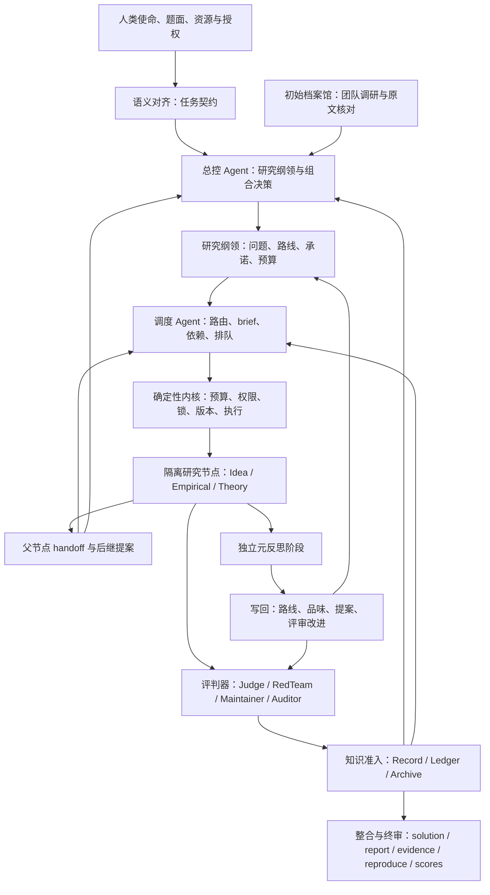

# 长城 Agent V4：以研究纲领组织、以知识演化延续的超长程研究系统

> **后续实质修订**：见 [14｜共同演化、自主提问与单模型工作树](<D:/Documents/deepseek harness/长城Agent_框架设计/14_V4修订_共同演化_自主提问_单模型工作树.md>)。评判器不只增补压力测试；子 Agent 在 V4.0 就独立提出研究问题；Fork-and-Flush 成为正式算子；默认允许全部角色使用用户额度充足的同一模型。本文相关段落与 14 冲突时，以 14 为准。

> **同轮追加**：14 的 §11–14 进一步明确开局实质方法广度、早期独立与 Registry、定理级阻塞、V2 去表象机制、ARI 复评对应的实质查新与审稿校准，以及跨节点 Meta Patterns。邻域优先适用于路线深化，不取消开局方法多样性。

日期：2026-11-06（按本次会话日期）  
作者：Codex，系统架构设计  
状态：完整架构提案；不是已验证系统、实现规范或实验排期。  
依据：本次用户要求与最新补充；11 号讨论全记录；00–07 与第一轮 work 材料；本地 Co-Scientist、两篇 Station 及相关原论文。具体阅读范围、原文定位与修正见 [13_依据与裁决](<D:/Documents/deepseek harness/长城Agent_框架设计/13_V4设计依据_原文核对与裁决.md>)。

**核心定义：长城 Agent 是一个在明确使命和资源边界内，自主提出问题、组织研究、检验解释、积累可继承知识，并能跨执行者与上下文持续推进的 AI for Science 系统。**

V4 的长期主体是研究纲领，执行者可以换代；研究的积累单位是带条件与证据的成果，代码只是其中一种载体。系统既追求当下任务的解决，也保留能改变下一轮研究的问题、方法、解释和反例。V4.0 首先把这一结构落在可验证竞赛与算法任务上，V4.1 才放开自主立题和开放科学价值判断。

本文所有未明确归于论文的机制均是本次架构提案。没有把原论文的结果直接当作 V4 的效果保证；回档 preview 不作为设计结论。

---

## 1. 从使命推导架构：系统究竟持续推进什么？

### 1.1 使命与“更好”

“更好”由选题和目标定义，不由框架预先给出一个万能分数。算法赛可能优先正确性和运行时间；数模任务还包括假设合理性、模型解释力、稳健性和报告质量；开放科学关注可信的新知识、解释范围与后续研究价值。

需要区分两种**验证情境**，不是把用户需求硬拆成两个产品：

- **目标明确、验收较可计算**：已有题面、数据、合法接口与评分规则。系统主要发现更好的解法，并解释其机制。
- **问题开放、价值不能直接算分**：可以开展实验，但什么问题值得研究、什么解释重要，需要可争议的学术判断。

数学建模竞赛也不是“跑一个脚本就能验收”的纯确定性任务。V4.0 采用混合验收：可计算部分用验证器，科学论证与写作部分用有依据的评审，比赛最终名次仍属于外部结果。

系统输出应使他人能够回答：解决了什么、依据是什么、在哪些条件下成立、如何重做、剩下什么问题。运行时长、Agent 数、文档数、内部 Elo 都不能替代这些答案。

### 1.2 自主与协作是同一系统的两种授权方式

**自主模式**：人类给出任务契约、预算信封和行动权限。系统在信封内连续研究、更新计划、派生节点和整合成果；只有超出授权或触及指定风险才请求人类决策。

**协作模式**：人类随时加入问题、证据、假设和批评；其输入保留来源与身份。人类改变目标可以修改契约，人类提供一个科学判断则仍是待检验主张。人类是授权者与研究参与者，并非所有事实的免检来源。

无人长期监管不等于无人负责，也不等于无限运行。信封耗尽时系统交付当前最强、状态清楚的结果及未决事项，不能把“预算终止”写成“任务成功”。

### 1.3 自上而下的主结构

这张图表达责任与产物流向。三个中央器官是总控、调度、评判；研究方向可以由节点发起，公共知识准入和资源记账集中。图中的角色不等于必须常驻相同数量的进程；唯有职责独立、需要不同信息的环节才必须分开上下文。

---

## 2. 第一块基石：怎样理解问题而不把猜测变成题意？

### 2.1 任务契约与研究解释分开

采用 CDC 提示词值得借鉴的做法：精确陈述对象、定义、允许条件、完成标准、什么不算完成，以及必须注意的逻辑缺口。拒绝照抄“假定肯定解存在”“无限预算”“固定 64 并发”这种特定任务条款。[S4]

| 标签 | 允许写入的内容 | 来源与权限 |
|---|---|---|
| VERBATIM | 原题、用户要求的逐字内容 | 保留原文件、页码或消息定位；版本不覆盖原文 |
| DEFINITION | 源文已有的定义；人类明确采纳的新术语 | 标出处；Agent 自拟解释不能冒充题面定义 |
| CONSTRAINT | 已明确的接口、资源、允许操作与边界 | 区分外部题面约束与本次资源约束 |
| ACCEPTANCE | 明确的交付要求及其检验映射 | 自建代理测试标为代理，不伪装为官方评分 |
| ASSUMPTION | 为推进研究而作的临时假设 | 单独附录，带作用范围、提出者、依据、撤销条件 |
| QUESTION | 尚未解决的歧义 | 保留问题，不在问题里夹带默认答案 |

**前四类构成权威任务契约；后两类是显式非权威的附属记录。** 不把主观判断、科学断言或推断混入契约。对于无法从原文确定的含义，不用“客观提取”之名偷偷填空。

低成本、可撤销的研究假设可以由 Agent 在授权内并行探索；会改变题目、成功标准或重大行动边界的歧义提交人类。没有答复时，可继续不依赖该歧义的研究，也可分条件讨论；不能默认获得授权。

### 2.2 验证器也要对齐题意

每个重要测试都能追溯到契约中的条件。仿真器额外可见的隐藏状态不能自动开放给求解器；代理任务上的改进只说明代理任务的表现。

“检测出测试器与题意不一致”是有效研究产物，可以获探索预算，但不能直接把测试器改成对自己有利的版本再宣布成绩提高。任务契约、测试器版本、候选版本要共同进入评分记录。

---

## 3. 研究从哪里起步：先建立可工作的档案馆

### 3.1 初始 teamwork 的任务

正式搜索前，安排一次有规模、有分工的初始研究团队：围绕任务的主要方法族、验证方式和关键争议分工读原文，再由综合者连成研究地图、由独立核对者检查关键引用。这是 V4 的运行设计，不是本次架构设计已执行了团队运行。

调研不是“下载若干论文后把摘要塞进上下文”。它应产出：

1. **问题与方法地图**：主要路线各在什么条件下工作、彼此有何关系。
2. **可比较的已知结果**：基线的任务、数据、指标、资源、验证范围，不能只抄最高数字。
3. **可进入的研究起点**：每条候选路线有最近邻工作、可复用材料和一个最先要澄清的问题。
4. **可信度与争议记录**：文献中的报告、作者解释、我们的推断分别标注；负结果有适用条件。

不固定“必须 20–40 篇”“每篇 300 字”。覆盖到足以辨识主要路线与验证风险即可启动，研究过程中继续按需调研。大规模意味着覆盖和深读质量，不意味着把档案量当目标。

初始资料来自已有论文，入库时状态为“外部文献报告”；只有本系统完成相应核验，才增加本地验证标记。论文发表不能替代本地适用性检查。

### 3.2 档案格式轻量，论证标准不轻量

日常记录写短 Markdown；能够被另一条路线复用时，整理成自包含的研究条目；一组相互支撑的结果成熟后，汇成内部论文。共同骨架是：

> 问题与条件 → 主张或发现 → 方法与依据 → 验证范围 → 失败与限制 → 与已有工作的关系 → 可复用部分与下一问题。

只要这些内容齐全，一页也能满足论文标准；不要求每个试探都写摘要、引言和长篇相关工作。不规定文档必须达到某个字数。

证据账本、基线表和失败清单可以是**同一份研究记录的不同视图**：基线是带条件的性能主张，失败是带条件的负观察或反例。它们不必让研究者重复填表。

“gap 卡”仅是未解决问题的便签，不是新制度：用 Question 的一段话，说明未知是什么、与当前任务什么关系、什么结果会改变决策即可。没有可靠调研支撑时，不声称“文献空白”。

### 3.3 方法族谱以 worktree 研究树维护

用户看到的主要组织形态就是研究树：每个方法族有锚点，节点链接具体 worktree、研究文档、证据与后继。可以保留长期方法分支，由多个执行节点继续生长。

同时区分三个语义，避免把 Git 限制误当科学限制：

- **研究树**记录方向从哪里来、为什么发芽、为什么暂停。
- **Git worktree**承载某个活跃节点的隔离文件与代码状态。
- **知识引用**可以跨树：A 族的反例能支持 B 族，组合节点能有多个来源。

因此界面和日常工作以树为主，交叉继承是额外引用边；不必建设图数据库。休眠节点保留提交和 Markdown 后可回收物理工作目录，复活时重新挂载。

---

## 4. 科学本体：什么能从一次研究留给下一次？

下表是科学含义，不是要求实现十五种服务或十五套表单。V4.0 可用统一 Markdown 头部加类型标签承载。

| 对象 | 含义与最低内容 | 如何继承 |
|---|---|---|
| Question | 待解决的不确定性、范围、与使命关系 | 继承问题及未决状态，不把预设答案一起继承 |
| Hypothesis | 可以被区分或反驳的候选主张，附预测与假设 | 可作候选；不会因传代而升级为事实 |
| Experiment | 有输入、干预/比较、测量方式与版本的检验行动 | 继承协议与执行产物；包含计算、实物、证明检查 |
| Observation | 一次运行或测量实际观察到什么 | 连同数据、条件、误差与失败状态继承 |
| Evidence | 某观察、证明或来源如何支持/反对特定主张 | 保留支持关系、反证关系与适用范围 |
| Claim | 范围明确、可审阅的断言 | 作为最小知识承接单位，必须附条件和状态 |
| Explanation | 为什么出现现象的机制说明及竞争解释 | 可以作为候选解释继承；预测或干预核验后增强支持 |
| Theory | 相互关联的定义、假设、机制/定理与预测体系 | 部分成立可部分继承；不因名称宏大自动权威化 |
| Method | 可执行方法或论证办法、前提、接口与失效边界 | 可跨路线复用；新环境要检查条件 |
| Artifact | 代码、数据、构造、模型、图、证明文件等版本化产物 | 按内容版本引用，不继承一个会悄悄变化的路径 |
| Paper | 将若干主张组织成可独立阅读的论证 | 是知识传播载体，不是整体真值凭证 |
| Review | 对特定对象、特定版本的审查及理由 | 保留不同意见；评审通过不是实验观察 |
| Program | 研究纲领：核心问题、承诺、路线组合、退出条件 | 跨多个节点和代际延续；此处不是代码程序 |
| BeliefState | 对核心主张的当前支持、反对、未知与争议视图 | 从最新证据重建；不继承过期的确定口吻 |

**继承的最小单位是“主张/方法/问题及其条件—证据关系”；论文是优先阅读载体，worktree 是执行载体。** 失败运行也可以产生可靠反例；成功运行也可能只支持很窄的观察。

状态至少要能区分：提出、已有支持、在规定范围核验、存在争议、被反驳、被取代/撤回。验证方式另列，如形式证明、独立复现、数据分析、文献转述、专家审查。开放科学不把一次复现标为普遍真理，也不强迫 LLM 给没有校准基础的精确概率。

不可混同的例子：

- “在三个给定输入上更快”是 Observation 支持的有限 Claim。
- “因为减少了某类冗余计算所以更快”是 Explanation，需要额外区分性依据。
- “所有输入上都更快”是更强 Claim，需要新的证明或限定。
- “论文已接收”是 Review/Archive 状态，不能替代前三者的核验。

---

## 5. 发现循环怎样耦合：Theory 必须有自己的研究空间

### 5.1 五个循环是一组可跳转的研究动作

| 循环 | 输入 | 主要动作 | 向其他循环交接 |
|---|---|---|---|
| Idea | Question、已知结果、异常、研究品味 | 提假设、找邻域变化、构造竞争解释 | Hypothesis + 最便宜的区分办法 |
| Empirical | 假设/预测、方法、条件 | 实验、诊断、比较、复现、反例搜索 | Experiment + Observation + 初步 Evidence |
| Theory | 问题、有限构造、异常、理论前提 | 推导、不变量、抽象、证明、机制解释 | Explanation/Theory/Method + 预测或证明义务 |
| Trust | 主张、原始证据、依赖、评判协议 | 验证、反驳、审稿、确认适用范围 | Review + 准入/争议/退修决定 + BeliefState 更新 |
| Meta | 一段轨迹、研究纲领、产物与过程指标 | 反省选择、坚持/换向、品味、知识沉淀 | 有责任人的写回提案与后续检查点 |

**Theory 是独立循环，并与 Empirical 双向耦合。** 它可以从题目直接出发，也可以从有限例子出发；既能解释已知结果，也必须能提出新推论、缩小搜索空间或产生可区分预测。把 Theory 放在实验之后写解释，会系统性偏向更容易刷分的工作。[S1/S2]

不是每个节点都要走完五个循环。一个纯证明节点可从 Theory 到 Trust；一个调参节点可从 Empirical 到 Trust；异常可以直接触发新的 Idea。循环是动作语义，不是五条强制流水线，也不必各常驻一个 Agent。

### 5.2 跨循环需要的不是聊天摘要，而是“下一方能行动的内容”

Empirical 向 Theory 交接：现象、条件、原数据位置、可重复程度，以及尚不能解释的差异。Theory 向 Empirical 交接：至少两个可区分结果会分别支持什么，或一个明确需要寻找的反例。Trust 向研究节点交接：哪一步缺证据、什么检查能消除争议；不只说“质量不够”。

提出**发现桥接要求**：重大结果进入下一阶段时，用一小段 Markdown 写清“旧结果使什么新问题/行动成为可能”。它是研究文献的一部分，不另建繁重审批卡。

桥接不保证进步，却能避免两种空转：实验只堆结果，理论只讲故事。某些成果暂时没有后续用途，可以归档为待用，不必编造用途。

### 5.3 Theory 如何获得生存空间

总控给研究纲领分配资源时，要区分性能推进和理解推进。理论路线的承诺产物可以是引理、反例、可检验预测、方法局限证明，不要求每轮提升赛分。

但“解释得很漂亮”不能自动续资。一个理论方向续投需要展示更清楚的可检查内容，或说明关键检验为何尚未完成；预算评估同时考虑验证成本和长期价值，不以短期实验数压制理论工作。

---

## 6. 研究纲领与组合：把下一笔资源给谁？

### 6.1 研究纲领大于节点

一个 Program 写明核心问题、科学动机、当前竞争假设、已有支持、关键未决点、路线组合、承诺资源和退出依据。它可以跨越多代 Agent、多个 worktree 和多次失败。

路线是研究纲领下的一种办法；节点是一次有产物目标的研究片段。节点结束不必改变方向；上下文重置也不意味研究重启。

承诺不是强行熬时长：在预留额度内完成约定的关键检验，允许调试、局部改动和反例诊断。仅因几次不理想结果不能抛弃核心问题；出现反证、关键依赖不可得或成本越界时，可以修订承诺。承诺窗口按验证经济学定义，不复制 Station 的 60 tick。[S2]

### 6.2 局部、邻域、正交的关系

- **局部改进**：维持核心机制和问题表述，优化参数、实现或某个算子。
- **邻域探索**：保留大部分结构，改变一个主要假设、表示、分解或适用条件；默认优先。
- **正交探索**：改变主机制或问题表述，承担更高不确定性；在局部平台、方法族过窄或明确结构障碍下开放。

“一步”是语义上的可解释变化，不是机械地数一维；一次表示变换可能连带改变复杂度与数据结构。候选必须说明相对于父节点的机制差别，而不是只提供文字距离。

正交提案必须给出新机制、不变量、分解或构造，以及最先能判断价值的产物。没有证据支持的“旧族都不行”不能作为转向理由。正交的成本和不确定性更高，不因此天然获得更高信用。[S2/S5]

### 6.3 1–2 个初级探索者怎样长期存在

在每个主要运行周期保留 1–2 个受保护的探索席位，使用高温度或模型允许的较高多样性设置。更重要的是建立**没有资深权威在场的扁平小环境**：

- 不注入总控喜好的路线和当前冠军的完整故事；只给使命、必要约束及精选事实。
- 先独立提出并尝试小探针，再按需交流；结果按匿名证据评审。
- 允许直接做低成本可执行试探，不限于“出点子”；产物可以是构造、反例、原型、预测或诊断。
- 基础席位预算保证它能产生第一份产物；之后的额外探索信用才由产物兑换。
- 保护的是探索能力与席位，不是某个 Agent 永久不受评价。长期无产物时可以换模型、换提示、换执行者，但不能把席位全部转成跟随冠军的优化者。

点子王就是该能力的角色名称，既可由受保护探索者承担，也可临时从其他路线召集。它不是总控的副手、另一位裁判或只在开局出现的策划者。[S6]

### 6.4 blocked、休眠与复活

`blocked` 必须指向明确障碍：缺一个定理级引理、关键数据不可得、测试环境不支持、预算不足，或主张依赖已被撤回。它不代表“这个方向永远不行”。

缺失引理与原问题等价时，不给“接近完成”的信用；如果节点提供了真正新的机制，可为解除障碍再拨资源。休眠节点保留复活条件；新证据、新方法、新资源或组合机会到来时，从旧提交长出新节点，不改写过去的历史。

### 6.5 组合不是强制杂交

组合前写清双方分别贡献什么、前提是否相容、接口在哪里、怎样识别组合增益。新组合在独立 worktree 中检验，保留父成果。

例如，A 的快速近似与 B 的正确性证书相组合，可能形成新方法；把两个长报告拼在一起不算组合。失败也有价值：如果发现接口条件矛盾，就保存其限制，避免后代继续盲拼。

总控维护“主任务推进、理解深化、邻域探针、独立发散、验证与交付”几种资源用途，但不把比例写成普适定律。研究者可以提出局部下一步，总控主要裁决跨纲领资源和使命偏离。

---

## 7. 总控、调度、评判：三器官如何合作而不互相吞并？

| 责任主体 | 核心判断 | 主要输入 | 有权决定 | 无权决定 |
|---|---|---|---|---|
| 总控 Agent | 什么问题值得承诺、路线如何组成组合 | 契约、Program、研究前沿、争议、预算投影 | 纲领、跨路线额度、重大转向、语义冲突 | 改写事实、伪造验收、绕过内核执行 |
| 调度 Agent | 哪个合格动作现在交给谁、读什么 | 授权、队列、依赖、节点提案、brief 需求 | 路由、排队、授权内后继、检索与交接组织 | 私自改变使命、科学假设或总预算 |
| 评判器系统 | 哪些主张成立到什么程度、候选怎样比较 | 产物、证据、评判协议、校准信息 | 验证与评分、知识准入、测试修订建议 | 给自己的高分直接兑现预算、重定义任务 |
| 确定性内核 | 请求是否符合资源与权限事实 | 有版本的请求及账本 | 预留/结算预算、锁、创建与回收、超时与日志 | 选择科学路线、推断科学价值 |

总控与调度都用大模型。内核不扮演第三个研究者，也不从自然语言随意推定权限。所有执行经过调度与内核；总控提出方向不是直接启动一个不记账的任务。

### 7.1 下放后继权，避免“总控批准每一颗芽”

总控给 Program 一份可撤销授权：允许的研究范围、额度、并发资源、变更边界和升级条件。子节点结束时提交成果、handoff 和后继建议。

在授权范围内，调度可以直接受理子节点提出的延续、邻域分支或低成本复活；无需等总控逐个批准。跨纲领、扩大预算、进入正交新机制或改变关键假设范围时，再交总控裁决。内核始终控制实际资源。

若总控拒绝节点提案，要留下具体理由；允许节点用新证据再次提交。总控可以判断价值，但不能用一句“我觉得没前途”抹去节点已产生的知识。

### 7.2 三种“货币”分别结算

| 判定 | 形式 | 决定什么 |
|---|---|---|
| 有效性 | 对声明范围的 pass / fail / unknown，附理由 | 能否把特定主张当作成立、能否进入某一用途 |
| 质量 | 带条件和不确定性的 Pareto 向量 | 有效候选在速度、精度、资源、鲁棒性等方面如何取舍 |
| 探索信用 | 有上限、指定用途和期限的预算额度 | 某个非冠军成果值不值得继续发展 |

有效性严格说是门槛而非可花费货币，这个比喻只表示三套账不能相互兑换。新颖性不能抵扣错误，赛分不能购买知识免检，探索信用不能加进最终成绩。

**粗野评价的核心**：容忍结构激进、代码不优雅和暂时偏科；不容忍把错误结果说成正确，不忽略明确的内存/成本硬约束。资源未超硬限时，内存更高属于质量取舍，不是自动否决。

例如某算法只在稀疏条件下正确且速度显著提升：它不能成为全场景冠军，却可作为“稀疏条件下的有效方法”进入知识库，并因有望推广而获得额外资源。若算法输出错误但暴露了一个有用结构，原算法主张失败；该结构作为独立成果重新核验。所谓缓刑，是允许继续研究，不是正确性半通过。

### 7.3 探索信用如何给，且不把无产物包装成创新

第一笔探针资源来自预授权基础预算，解决“没有产物就没预算、没预算就没产物”的循环。额外信用要求已提交可检查产物。

信用申请回答：新增了什么、接下来能检验什么、最便宜需要多少资源、什么结果终止或续投。总控依据证据与组合需要决定，调度执行，内核结算。不采用未校准的加权公式制造精确感。

可获信用的产物包括可靠反例、新测试、可用工具、证明片段、预测、适用条件的拓展；测试工具必须显示实际用途，不能靠“又造一个审计器”无限融资。信用只发给后续行动，不按新颖分直接发给作者。

### 7.4 Judge / RedTeam / Maintainer / Auditor 四角色

- **Judge**：根据当前协议检查与比较候选，输出有效范围、质量向量、分歧和缺证据项。盲作者、随机顺序；必要时采用 Co-Scientist 的成对比较，但 Elo 只作相对排序辅助。
- **RedTeam**：寻找反例、泄漏、脆弱条件、评判漏洞，提交可复现攻击案例；不决定自己案例的权威性。
- **Maintainer**：持续维护评判器；核查红队案例符合题意，更新 live 集、审查规则与校准材料，发布有版本的更新。不能偷偷改 frozen 或替选手改代码。
- **Auditor**：检查测试器与任务的对应、Judge 和 Maintainer 的盲点、评分来源和复现链；可冻结受影响成绩/准入状态并发起复核，不以审计身份直接分配研究方向。

四者是职责与信息隔离，不要求每次判断都召集四个模型。维护者持续存在于运行制度中，按事件工作；不是开局“造完尺”就退出，也不是每轮没事硬改规则。

### 7.5 frozen 与 live：持续变强，但不悄悄移动验收线

**frozen 协议**钉住任务、数据划分、指标、环境和测试版本，提供跨候选/跨版本的比较锚点。最终 holdout 受访问控制，不向探索节点反复泄露细节；常规迭代依靠开发验证集与 live 测试，二者不是新增一套成功标准。

**live 协议**由红队和维护者持续增加有效压力案例与诊断。每次比较必须在同一 live 版本上重测所比较候选，不能把昨日容易测试下的分与今日困难测试下的分混排。

实时更新首先指及时发现、审查和发布规则变化；在途实验仍钉住原版，后续节点使用新版。严重发现可立即标记受影响结果为待复核。frozen 若有题意错误或泄漏，也不是永远保存错误：保留旧版与作废原因，显式发新版并重测，不能继续宣称新旧数字直接可比。

开放任务可以冻结研究问题、实验资源和评审协议，而不虚构一个唯一正确答案。live 主要增加竞争解释、反例与验证要求。

---

## 8. 执行运行时：研究树怎样一直长下去？

### 8.1 五种生长动作

1. **延续**：在原节点的成果基础上推进同一问题，必要时换干净上下文。
2. **发芽**：从父节点分出邻域变体，不销毁父路线。
3. **回溯再生**：从祖先或休眠节点的某个固定版本出发，带着新证据重开。
4. **组合**：把多个节点中的可用成果引入新工作树，重新验证组合。
5. **换代**：旧 Agent 留下文献、handoff、品味与候选后继，新的 Agent 继续同一研究身份。

节点过少触发补充候选与探针，但不为凑数建立空节点。活跃数由可用资源、验证容量和授权共同决定；总节点可以远多于活跃节点。保留静态 1–2 个探索席位的要求，不预设“全系统必须 8–12 节点、每节点最多 3 子代”。

### 8.2 决策代不是同步栅栏

执行异步：谁有合格动作和资源谁继续。决策代是总控对一个**已完成事件集合与在途状态快照**作出组合决策的时点，可以由成本区间、关键证据或最长决策间隔触发。

慢节点不阻塞其他节点，也不因晚返回自动失去承诺额度。在途工作显示为在途，不能当作失败；未耗尽的预留预算不能被快速路线抢走。比较候选版本在比较时固定，但不冻结整个研究现场。

要区分三种代际：决策代（组合更新）、Agent 代（上下文/执行者更新）、知识版次（档案与信念更新）。三者不强制对齐。

### 8.3 只规定必要运行时语义

- **事件日志**：记录请求、授权、执行、产物提交、验证、入库与纠正。包含执行主体和对象版本，便于追踪因果。
- **状态快照**：保存活跃纲领、节点、队列、在途工作与预算；由日志恢复，而不是请模型回忆账目。
- **预算**：先预留再执行再结算；并发任务不能各自花同一笔余款。模型、工具、计算、存储和人类注意力分别记单位，不混成无意义总数。
- **版本钉住**：动作记录模型标识、提示版本、代码提交、数据和评判版本。模型服务不可精确复现时记录已知标识、时间和配置，并承认限制。
- **并发**：每个活跃写入区有明确所有者；共用基线与知识版本只读；组合在新 worktree 检验。
- **超时与恢复**：恢复时先核查外部动作是否已经完成；可重试的计算与可能已发生的付费/发布/实物动作区别处理。未知状态不盲目重放。

worktree 只隔离文件变更，不自动隔离权限、网络、数据访问或模型上下文。执行沙箱、brief 可见性、工具权限共同构成隔离边界。

架构不指定 RAM-Disk、消息总线或复杂分布式框架。它们是未来规模与环境驱动的实现选择。只保留研究不可缺的资源一致性和恢复语义。

---

## 9. 知识制度：让研究像文献一样积累，也能被纠正

### 9.1 四个名字、同一套材料

| 视图 | 所解决的问题 | 进入条件 |
|---|---|---|
| Record | 做过什么、失败在哪里，避免重蹈覆辙 | 真实记录即可；不意味结论正确 |
| Ledger | 哪些主张/方法在什么范围有可用依据 | 与该用途相称的核验及条件说明 |
| Archive | 怎样使后代理解并扩展已有研究 | 论文式整合、主张—证据对应、评审 |
| Lineage | 如何保留一个研究方向的身份、品味和未完成构想 | 可传私有笔记；标明非公共事实 |

四者是不同知识责任，可以共享文件和索引。避免为了“制度完整”复制四份同一数据。公开论文、内部论文、原始实验和个人构想分清即可。

### 9.2 准入针对主张，而不是只给整篇论文打分

借鉴 Station 的经评审文献和 Cogentic 的独立引理复验：论文可以有尚未解决的问题，正文必须标识；一个失败稿里的独立正确结论可以单独进入 Ledger。[S1/S3]

准入流程是：作者提交可复用内容 → 验证者检查来源、条件与关键依据 → 评审者评价论证及用途 → 入库并标状态。大量普通观察只进入 Record，无须逐条正式审稿。关键可复用主张、跨路线推广和最终交付才承担较高核验成本。

不按“文章 ≥6 分”一票通吃：可以接受方法描述、暂缓核心因果主张、保留争议。文献新颖性、结果正确性和科学意义分别写；不够新颖但可靠的基线仍有研究价值。

### 9.3 复现、撤回、更正和依赖传播

复现记录说明是同环境重跑、独立实现、不同数据/条件复现，还是形式检查。相同模型重复赞同，不算独立复现。

发现错误后，保留原版本，发布更正或撤回及理由。依赖该结论的下游主张进入“受影响、需复核”，不盲目全部删除：如果下游已独立证明或结果并不依赖错误部分，可以重新确认。

总控和新节点读取档案时优先获得当前状态及更正通知，不能把撤回论文的流畅摘要继续当作事实。私有 Lineage 笔记同样检查依赖状态，避免把旧错误留在隔离区永久繁殖。

### 9.4 信用不是引用数量

保留作者、验证者、复现者及组合者贡献。区分“读取”“引用”“在行动中使用”“产生被核验的下游贡献”。前三者不能自动证明成果有用，更不能声称因果贡献已测出。

可靠负结果、发现评判漏洞、纠正旧主张都有贡献；点赞、互引、论文数量不兑换质量分。记录贡献用于追溯和预算判断，不建设能被刷分的内部学术排行榜。

### 9.5 知识代际与隔离期

每次交接形成一个小型“研究继承包”：当前问题、适用契约、已确认成果、反例与未决项、关键文件版本、父节点建议、研究风格。私有品味标作偏好，不伪装为结论。

新节点先完成一次独立判断或探针，再按需开放其他路线的方法材料。任务事实、必要基线、已确认错误的纠正和关键安全信息不延迟。父节点的建议可以带入，但必须可质疑；初级探索者默认只接收更薄的父系材料，防止一出生就被冠军叙事锁住。

“共享事实、隔离偏好”是默认策略而非定理：事实的选择同样可能锚定路线。因此关键是按用途、阶段和来源控制暴露，并观察独立性与重复工作的取舍。

---

## 10. 上下文：谁读什么，怎样防止总控被淹没？

| 读者 | 默认读取 | 按需读取 |
|---|---|---|
| 总控 | 使命、纲领状态、有效前沿、争议、资源与待决事项 | 对重大冲突的关键原文/证据，不永久堆全量日志 |
| 调度 | 当前授权、队列、依赖、资源、节点与 brief 清单 | 路由必要的成果摘要，不替研究者解释全部文献 |
| 研究节点 | 专属 brief、自己 worktree、选择性档案 | 与当前问题相关的论文、证据和工具 |
| Judge | 候选、证据、评判协议 | 原始输出与依赖核验；不先读作者自夸 |
| Maintainer / Auditor | 评测事件、争议、失效案例、契约映射 | 测试代码与原始测量、必要研究轨迹 |
| Meta Agent | 有边界的一段研究轨迹和输入包 | 有针对性的原始证据，避免只审摘要遗漏 |
| 整合者 | 已确认成果、争议状态与研究纲领 | 报告需要的原始数据与历史，不为“全读”而全读 |

**brief = 父节点 handoff + 总控任务边界与授权 + 经选择的成果/文献 + 当前研究问题。** 每段标来源与状态；来源不同不能揉成一个无主语结论。父节点的“我建议”不能在压缩后变成“必须”。

需要较长材料时，调度调用按需的 Briefing/Surveyor Agent 生成专属简报，不把自己变成全量研究读者。它可以选材料、组织任务，但对范围和语义的实质变动要显式回到研究节点或总控。

上下文分成：常驻任务锚点、当前工作集、外部可检索材料。预算应随模型和任务调整；超预算先外移已完成细节与历史，不删除条件、争议和未决问题。总控使用可重建的状态投影，而非无限延长对话。必要时总控也可以换代。

trace 记录行为及工具过程；state 记录现在该做什么；artifact 保存研究产物。摘要服务于阅读，原始产物服务于核验，状态服务于恢复，三者不能互相冒充。

---

## 11. 元反思：一个有进入、产出、写回和退出的 Agent 阶段

### 11.1 触发与隔离

周期触发按研究预算区间或最长间隔；事件触发包括反复局部失败、准备换向、族分布过窄、成绩上升但核心问题未推进、评审持续分歧、下一代交接。周期并非越短越好，长实验在安全检查点交接，不因定时反思强行废弃运行。

默认启动独立 Meta Agent 和独立上下文；可用不同模型族增强视角差异，但异构不等于无偏。轻量模式可以保留同一执行身份并切换模型，仍必须形成明确阶段和写回。

Meta 阶段不运行新实验、不修改求解代码、不给自己论文盖章。它可以提出路线、问题或策略建议，但建议进入相应负责人审核；不能把“不能直接解题”扩大为“不能反思研究内容”。这吸收 Station 的实际提示内容，同时保留角色边界。

### 11.2 输入包

包括任务契约相关部分、Program 与承诺、最近动作—观察摘要、关键成果与失败、当前资源、blocked 原因、指标趋势、上一次写回及执行情况。输入范围可追溯；有疑点可定点读取依据，避免只根据执行者自选的成功摘要评判。

### 11.3 问题池与对应写回

| 问题 | 可能写回的位置 |
|---|---|
| 是否过度概括，把一次失败说成整个族失败？ | 主张范围、更正/复核请求 |
| 是否反应式追逐结果，忘了核心问题？ | Program 的问题链与承诺 |
| 何时该坚持、何时应换向？ | pivot 政策、阻塞条件与复活条件 |
| 是否在重复调参、造工具、写报告或反思中空转？ | 下一行动、停止条件与资源申请 |
| 哪些共享假设没人检验，怎样在旁边走一步？ | Question、邻域探针提案 |
| 我的研究品味有什么价值，何时会失效？ | Lineage 偏好与可反驳依据 |
| 本阶段真正新增了什么知识？ | 研究条目或内部论文整合请求 |
| 评判是否奖励了错误代理？ | Maintainer / Auditor 的改进请求 |

问题按触发原因选择，也保留随机抽取以减少套路化；不要求每次回答整张表。

### 11.4 写回完成才算阶段完成

Meta 输出一份简短记录：诊断证据、建议改变、目标对象、负责人、预期行为和检查时点。

在原授权内的个人工作计划/笔记可直接形成新版本；预算与跨路线转向交总控；调度策略交调度；知识更正交 Trust；评判修改交 Maintainer。写回接受、修改或拒绝都要记录理由。即使决定维持路线，也写明依据、下一项检验与再判断条件，不能只有“继续努力”。

完成状态表示写回已处理，不表示反思有效。之后检查实际行动是否变化、是否深化或完成验证、重复工作是否减少、换向是否有依据、反思自身成本，以及核心问题是否真正推进。采纳率不是最终目标，盲目高采纳同样可能有害。

如果连续反思没有带来新行动或新判断，应降频、换问题或换视角，而非再堆一个“反思的反思”常驻机构。

---

## 12. 人机协作与领域适配：验证经济学决定自主边界

### 12.1 五个治理对象的最低语义

- **Actor**：人、Agent、机构或工具的身份、权限和责任范围。
- **Approval**：对具体动作/动作类、资源、期限和条件的授权；宽泛使命不能替代具体高风险批准。
- **DomainProfile**：研究对象、数据、合法工具、证据标准、验证成本/延迟、风险类别、交付格式。
- **AccountabilityRecord**：谁提议、谁授权、谁执行、基于何证据、哪个版本、结果如何；可附在事件记录中。
- **HumanAttentionBudget**：预计与实际使用的人类阅读时间、决策次数和等待负担；约束打扰方式，不购买安全豁免。

### 12.2 分风险授权

预算信封内的检索、推导、沙箱试验、可撤销节点调整预授权。不可逆、高成本、对外发布、高风险动作需要人类批准；“高成本”由任务信封具体界定，不靠每个 Agent 临时猜。

请求人类时，提交已经准备好的可审阅对象：要做什么、已有证据、影响、费用、替代方案和不执行的结果。将普通选择批量汇报，不将每个实验都升级。没有答复时保留相关动作，继续其他获授权研究；沉默不视为批准。

预算不足不能通过不做必要验证来伪装完成。应缩小结论范围、延后交付或保留待核验状态。人类批准一次行动也不意味着批准其后所有派生行动。

### 12.3 四类验证经济学

| 领域 | 证据与主要成本 | 对架构的影响 |
|---|---|---|
| 算法/计算干实验 | 运行、独立测试、资源测量；通常反馈较快 | 多路线小探针；冻结比较；Theory 与性能路线并行 |
| 形式化研究 | 形式检查常较便宜，表达、建库和证明搜索可能很贵 | 自然语言解释与形式命题对齐；记录公理、检查器版本与信任范围 |
| 数据科学/数模 | 数据质量、切分、混杂、泛化与不确定性 | 训练/开发/保留集边界；因果解释不能仅靠相关性；领域假设可追溯 |
| 湿实验/实物研究 | 批次、仪器、耗材、人员、延迟、潜在不可逆后果 | 批量设计、运行前批准、链路记录与外部设施接口；自主推理与实际操作授权分开 |

V4 不因为有通用对象模型就宣称四域已经打通。V4.0 的正式范围是可验证竞赛/算法与人机协作，开放科学和湿实验需要后续能力门。

---

## 13. 开放式引擎：怎样自己提出值得做的问题？

### 13.1 问题从现有研究长出来

问题来源优先包括：观察与预测不符、两个解释给出不同预测、某个方法只在窄条件有效、不同文献相互矛盾、可复用构造尚无解释、原任务之外出现可信的新现象。

提案用四句话表达：未知是什么；为什么改变对现象的理解；已有最近邻是什么；哪项证据会使我们改变判断。对“科学价值”的判断保留为评价，不写进 TaskContract 的事实栏。

V4.0 允许提出相关子问题和保存旁支发现，但不能自主把比赛目标换掉；V4.1 才允许在已授权领域使命内持续产生新 Program。

### 13.2 研究品味允许不同，也必须能被质疑

Lineage 可以偏好构造、机制解释、简洁理论、极端反例或经验规律。总控不把这些品味统一成一种“标准科学家人格”，而是维持互补组合。

品味说明要包含偏好、预期价值和失效迹象。独立初级探索者可以挑战主流品味；专家反馈提供校准，不作为唯一权威。开放任务不存在架构可以自动解决的“真正重要性”判定器。

### 13.3 反 attractor 与反奖励黑客

attractor 按行为与问题推进判断，不能把“调参”“负结果”“工具”本身列入禁区。调参能检验机制时有价值，反例能封闭关键错误假设时有价值；同一活动反复进行但不改变知识或行动才值得警惕。

检查对象包括反复换 seed、无尽基准、工具套工具、过早论文包装、不断证明局部不可能、为新颖而改名，以及反思本身。干预优先问“最小什么证据能改变我们的判断”，然后调整一个行动；不因看见低分就强制全局转向。

多样性观察同时看问题、机制、条件、预测和失败模式，语义嵌入只辅助。文档长短、措辞差异和作者身份不代表多样性。共享事实也可能收敛，独立期也可能重复浪费，二者由实际研究收益校准。

---

## 14. 用一个贯穿案例检查架构是否连得起来

以下是设计推演，不是已做实验或真实成绩。

任务是在给定输入域与资源限制下改进组合优化算法，交付算法、报告和复现材料。

1. **语义对齐**明确哪些输入合法、是否要求精确解、时间/内存约束；未明确的数据性质进入 QUESTION，不默认所有图稀疏。
2. **初始调研**建立精确算法、近似算法、结构化特例等方法分支，各有原论文和已知限制。理论基线与可复用实现分清。
3. **总控建 Program**，同时承诺通用算法推进、特例机制研究与独立探针。调度从不同锚点建立隔离节点。
4. **A 节点**提高一般性能；**B 节点**提出激进表示，在特定条件下很快，但在另一些合法输入失败。Judge 限定 B 的主张；没有把失败隐藏进平均分。
5. **B 留下条件化研究条目**，提出从祖先版本另开分支。总控因其确有可检查产物给探索信用；调度在授权内创建后继。
6. **Theory 节点**发现 B 所需的不变量，推导一个可以快速识别适用条件的证书；Trust 检查该引理。这个结果的价值不依赖 B 当时是否冠军。
7. **组合节点**将证书与 A 的回退策略结合，在新 worktree 检验：证书成立时走 B，否则走 A。质量重新测量，不能相加父节点成绩。
8. **红队**找到证书边界案例。若违反题意，Maintainer 拒收；若属于合法输入，加入 live 新版并重测候选。frozen 原版不被暗改。
9. **元反思**发现团队不断微调证书却未检验适用域，写回一次边界验证行动；也可能认为当前路线值得坚持，明确下一项有区分力的检查。
10. **换代**时后继只接收契约、研究条目、条件化证书、失败例和父建议；更正同步送达，其他路线方法材料延迟注入。
11. **终局**按任务验收选择可交付方案，同时报告 B 的特例成果、证书与剩余限制。非冠军成果通过知识继承影响终局，而不是靠额外“创新分”赢过有效方案。

这个例子同时说明：粗野探索可以保留，正确性不降；理论有独立位置；工作树能回长；评判器能更新；元反思能写回；成果能跨代和跨路线使用。

### 14.1 最后交给用户什么

借鉴 Co-Scientist 的研究概览、假设与评审依据，以及 Station 的最高分产物/研究报告和实验记录，V4 统一一个交付信封。以下五项命名是本设计的适配，不声称两个原系统使用完全相同的目录协议。

| 部分 | 内容 | 不同任务如何变化 |
|---|---|---|
| solution | 可用算法、构造、证明或研究结果 | 比赛可包含可提交程序；开放研究可以是相互关联的发现 |
| report | 独立可读的研究问题、方法、论证、结果、限制与开放问题 | 适配比赛论文或科学报告；不硬编码页数/字数 |
| evidence | 重要主张到数据、实验、证明与审查的对应 | 对尚无充分依据的结论明确标识 |
| reproduce | 环境/版本、输入、重现步骤与已知限制 | 实物实验是协议与执行记录，不能假装一键复现 |
| scores | frozen/live 版本、质量向量、验证状态与成本 | 无有效标量时标“无此评分”并附评审向量，不编造总分 |

整合者只依据可追溯成果写作；终审检查写作过程是否扩大结论、漏掉反例或混用版本。任务达成、预算终止、仍有关键阻塞是三种不同交付状态，均可给出完整材料，但只有第一种声称完成任务。

---

## 15. 如何评估与定位科研贡献

这部分定义架构必须暴露的证据，不是安排实验日程。

### 15.1 两种任务的评价口径

可验证任务报告合法有效率、冻结条件下质量向量、最佳已确认成果随实际成本变化、跨任务/运行稳定性、交付与复现成功情况。可计算分数之外的报告质量分开报告。

开放任务报告主张证据覆盖、独立复现、竞争解释区分、纠错情况、专家对新颖性/意义的分歧，以及下游用途。再发现恢复率只是受限诊断，不等于开放发现能力；oracle 暴露和评审器偏差必须可见。[S2]

共同记录 token、费用、实验计算、墙钟、人类时间和失败运行。没有一个“等算力”数字自动匹配全部资源；比较时明确匹配哪项、其他差异多大。本文不沿用旧稿中的绝对“提高上限”结论。

### 15.2 H1/H2/H3：值得研究，但仍是待证主张

| 假设 | 可区分的设计主张 | 什么会使它不成立 |
|---|---|---|
| H1 条件化继承 | 在可比实际成本下，非冠军成果的核验、继承与组合比只跟随冠军带来更多有效后续成果 | 复用只是多读材料；扣掉核验与协调成本后没有收益，或错误传播抵消收益 |
| H2 选择性注入 | 按条件/阶段共享知识、延迟路线偏好，能兼顾复用与独立探索 | 多样性只停留在文字，重复成本增加且任务成果下降 |
| H3 有写回的元反思 | 承诺配合独立反思和写回，改善深度推进与合理换向 | 只延长驻留时间、增加流程成本，未改善核心发现或减少无效空转 |

消融意指在同等比较条件下去掉某个机制，看差异是否仍存在；不是要求这轮开始跑实验。H1 需要区分“有档案”“经核验”“有实际后继使用”；H2 区分全共享、全隔离与选择性注入；H3 区分承诺、反思、写回及其组合。验证器质量需要作为独立混淆因素观察。

衡量继承时区分读取、实际使用、下游成立和因果归因；观察到引用只能支持第一层。衡量 H3 时，单纯 pivot 少或驻留久不构成成功。

### 15.3 科研定位与撞车风险

Co-Scientist 已有异步专职 Agent、假设进化、评审反馈；Station 已有经评审文献、代际和元反思；Cogentic 已有独立简报、Record/Ledger、双验证。把这些部件集合起来不构成新颖性证据。

V4 可争取的研究问题是：**当知识、执行者和评判标准都随时间变化时，如何使非冠军成果可靠地改变后续研究，同时保持方向独立和资源可控？**

具体候选贡献在于条件化继承、评判版本变化下的知识再确认、后继提案权与中央资源控制的结合，以及有行为结算的反思。它们目前是组合设计与假设。本次按用户要求未做全网最新查新，不声称全球首次；后续投稿前需针对这些具体主张查新，而非搜索“多智能体科研”泛词。

---

## 16. V4.0–V4.3：按能力门推进，不按模块数量升级

| 版本 | 正式承诺的能力 | 进入下一版前必须成立的能力门 |
|---|---|---|
| V4.0：可验证研究系统 | 数模/算法类明确任务；混合验收；总控/调度/评判；隔离 worktree；研究文献与交接；初级探索者；有写回反思；人机授权 | 能从题意到交付闭合；可恢复而不混账；评分可追溯；错误可纠正；至少能展示可信的跨节点继承过程。这里只是验收要求，不声称已通过 |
| V4.1：开放研究纲领 | 在授权领域内生成问题；Theory 与 Empirical 长期互馈；多种研究品味；开放价值与再发现评估 | 能区分相关性/机制、观察/主张、已知/新发现；专家校准能暴露分歧；未决与失败可诚实交付；无需频繁人类救场才能维持基本研究 |
| V4.2：跨纲领知识积累 | 多 Program、跨代复用、条件迁移、矛盾与撤回传播、长期档案整理 | 能检测适用条件失配；更正传播到使用者；跨项目收益大于检索/审核负担；研究品味不被公共档案统一抹平 |
| V4.3：跨领域协作与设施接入 | 接入不同验证经济学，包含获授权的实物/湿实验设施与外部协作 | 具体领域的授权、责任、验证链和外部操作确认成熟；在该领域分别证明可用，不能从算法成绩外推 |

Theory、Meta、Archive 从 V4.0 就存在。V4.1 开放的是研究使命内自主立题与价值判断，不是到那时才给系统补上科学对象。V4.3 不承诺无限自我改进或全自动高风险研究。

### 16.1 继承旧版本什么、拒绝什么

| 来源 | 保留并改造 | 不沿用为 V4 原则 |
|---|---|---|
| V1 | 轻量 Markdown、角色任务表达、竞赛导向 | 靠提示词自行记账与自报成功；V1 原始资料不足，不判断其实际效果 |
| V2 | 预研、造尺、规格提取、盲评、偏科成果保留、分叉清栈的意图 | 固定节点数量才许交付；强制 2+2 杂交；全员统一清栈；把摘要继承等同独立探索 |
| V3 | 资源与状态意识、渐进验证、Pareto 取舍、动态红队、激进探索保护 | 复杂基础设施先行；强制大步正交；无条件保护任何刷极值的候选；代理任务成绩替代真实验收 |
| 2026-11-06 晚间讨论 | 双 LLM 器官、决策代、邻域探索、元反思写回、档案代际 | 将候选数字写成硬规则；把“共享事实”当作多样性保证；把所有元反思限制为流程参数 |

旧版测试与成绩在本次仅作为档案内容阅读；本次没有重跑其代码，不能把此前团队的验证标记写成本次独立验证。

---

## 17. 失败模式、边界与仍待裁决的问题

| 失败模式 | 识别信号 | 架构上的响应及残余问题 |
|---|---|---|
| 测量装置污染 | 代理分上涨但题面条件不符；隐藏状态泄漏 | 契约映射、Auditor、版本重测；仍需领域知识发现微妙偏差 |
| 评审失效或同源共识 | 已知错误通过、顺序变化改判、分歧消失得异常 | 校准、盲序、不同证据路径与独立复验；异构模型不是正确性保证 |
| live 移动球门 | 修改只针对某候选、不同版成绩混排 | 维护者与裁判分职、更新理由、同版重测、frozen 锚点 |
| frozen 污染 | 反复反馈形成隐式调参，测试不再独立 | 受控访问、开发反馈与终局留出区分；泄漏后显式换版 |
| 档案膨胀 | 检索返回大量重复稿，写作消耗超过用途 | 同源记录多视图、论文按研究价值整合、摘要索引与低频存储；保留可追溯原件 |
| 私有笔记固化错误 | 已撤回主张仍影响新代 | 继承时检查依赖状态；品味与事实分开 |
| 元反思成为 attractor | 反思多、行动不变、不断扩大问题池 | 有界阶段、具体写回、行为检查、降频；保留必要深思空间 |
| 总控早熟收敛 | 少数快路线持续吃掉全部资源 | 预留承诺、受保护探索席位、独立提案权；取消栅栏本身不足以解决 |
| 调度 scope creep | brief 偷加研究方向、为方便排队改变问题 | 变化显式标注，语义变更回总控/节点；按输入和权限隔离 |
| 上下文腐坏 | 条件消失、假设升级成事实、摘要引用失效 | 来源标签、可定位原件、工作集预算与换代；压缩无法保证零损失 |
| 探索信用套利 | 改名、重复负结果、无用工具不断换预算 | 核产物、去重、指定后继用途和期限；初始探针与追加信用分开 |
| 理论装饰化 | 只有事后解释，无区分性预测或证明 | Theory 独立预算、桥接要求与 Trust；不强求每个抽象都有即时赛分 |
| 成本失控 | 重试、红队、评审、调研吞掉主体资源 | 内核统一预留结算、可见成本构成、交付与验证预留；预算不足时诚实缩范围 |
| 人类注意力透支 | 普通事项频繁升级、请求难以判断 | 预授权、批量简报、具体审阅对象；关键审批不能以节省注意力省略 |

仍需在实际领域中裁决的参数包括：行为相似性的有效表示、承诺额度、隔离期的结束条件、验证成本与探索预算的分配、何时整理内部论文、开放价值的专家校准方式。此处不编造通用阈值。

这份设计最有把握的取舍是：总控/调度/内核分责；有效性/质量/探索预算分账；研究文献与带条件成果共同承担继承。最不确定的是：选择性注入能保住多少有效多样性、元反思的净收益，以及开放研究品味能否在低人类介入下得到稳定校准。

V4 的主张是让系统能够持续改变自己的研究起点：每一轮既留下答案，也留下被证据约束的新问题、方法和解释。能否带来更好的科学发现，必须由后续实际研究而非架构修辞回答。
