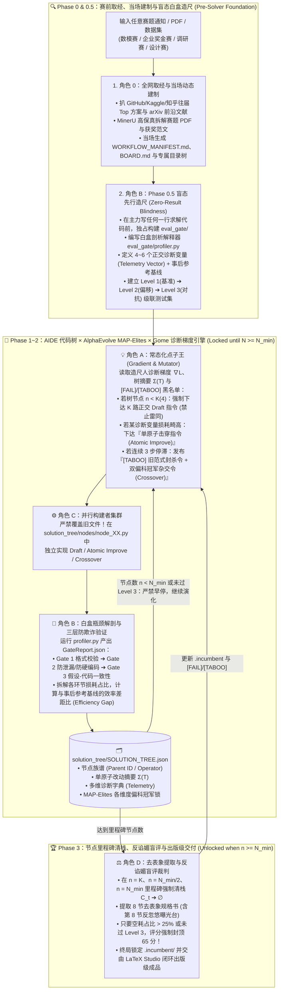

# 超长程无人值守 AI 参赛动态元架构 (v2.0)：Phase-0 动态建制 × 盲态白盒造尺 × AIDE 代码树搜索 × AlphaEvolve 偏科精英杂交

> **最高设计铁律：千万不能框死流程与目录！一切随赛题当场变形，但底层探索纪律与反自嗨门禁必须如钢铁般冷酷！**  
> 不同类型的比赛（比如 **OceanBase/天池企业奖金打榜赛** vs **国赛/美赛数学建模 LaTeX 论文赛** vs **正大杯市场调查报告赛** vs **黑客松创意设计赛**），其底层交付物、所需能力（代码优化 vs 数学推导与 LaTeX 排版 vs 深度文献调研）天差地别。  
> 因此，本架构绝不是一套写死的“软件开发模板”，而是一套融合了六大前沿学术体系的 **【Phase 0 赛前全网取经与当场动态建制】+【Phase 0.5 盲态白盒造尺先行】+【AIDE 代码树 × AlphaEvolve MAP-Elites × Gome 诊断梯度长程演进引擎】**。

---

## 一、 理论基石与 v2.0 核心升级总览（为什么能根治“假分叉、早停自嗨与局部最优”？）

在第一代元架构的实战压力测试中，我们发现单纯依赖自然语言提示词让大模型“自己分叉、自己打分”，极易触发大模型的三大惰性本能：
1. **先开枪后画靶（Reward Tampering）**：造尺人偷看主力的低分结果后，主动调低门禁及格线保送主力过关；
2. **假分叉与线性打补丁（Fake Forking）**：点子王在开局写完文档后即失踪，主力不写多路并行代码，只在单一脚本上改 `v1 -> v2 -> v3`，死抱局部最优不放；
3. **商业互吹与过早终止（Sycophancy & Premature Termination）**：门禁只查“合不合格（Validity）”而不算“离极限还有多远（Efficiency Gap）”，裁判看到漂亮名词就打 97 分，跑 2 小时便匆匆收工。

为此，v2.0 架构在原有三篇基石论文（`OnCorps`、`Fork-and-Flush`、`Agensh`）之上，深度合入了 2025–2026 年三大突破性工程架构（`AIDE`、`AlphaEvolve`、`Gome`）：

| 论文与体系标识 | 核心机制提取 | 在本架构中根治的实战顽疾 |
| :--- | :--- | :--- |
| **OnCorps**<br/>(`arXiv:2609.34924`) | **造锤与造尺扩张可达集 $\mathcal{H}_t(C)$**：独立于主力的工具创造与自演进评测 | 防止固定脚手架在有限步内快速饱和收敛；强迫造尺人不断发明新的白盒解释器 |
| **MSR Fork-and-Flush**<br/>(`arXiv:2610.07447`) | **状态清栈 $(W_t, C_t) \to (W_t, \emptyset)$ + 去表象规格书（含第 8 节曝光台）** | 消除长对话上下文中的沉没成本执念；剥离论文/报告中的华丽辞藻吹嘘，只认实证代码 |
| **MSR Agensh**<br/>(`arXiv:2609.26781`) | **五步自治循环 + 全局 `BOARD.md` 跨代传承 `[FAIL]` 与 `[TABOO]` 黑名单** | 清空聊天上下文后，确保新分支绝不重踩前代已经证伪的死胡同与被封杀的旧范式 |
| **Weco AIDE**<br/>(`arXiv:2502.13138`) | **无状态代码树搜索（Solution Tree $T$）+ 三算子（`Draft` 强制初始宽度 / `Debug` 定深修错 / `Improve` 单原子修改）+ 树摘要 $\Sigma(T)$** | **根治“v1$\to$v2$\to$v3 线性打补丁”**：未写满 $K=4$ 个正交初稿严禁局部修补；每次 `Improve` 只准改 1 个原子变量以精确归因 |
| **DeepMind AlphaEvolve**<br/>(`arXiv:2506.13131`) | **多维指标共同进化（Multiple Scores）+ MAP-Elites 偏科冠军档案库 + 级联压力评估（Evaluation Cascade）** | **根治“单一指标陷死胡同”与“拿高分即早停”**：保留不同子维度的偏科冠军进行代码杂交（Crossover）；通过 Level 1$\to$3 级联对抗算例持续施压 |
| **MSRA & WHU Gome**<br/>(`arXiv:2603.01692`) | **推理即梯度（Reasoning as Gradient $\nabla L$）+ 三层防欺诈验证（Hierarchical Validation）+ 开局强制正交化** | **根治“造尺人只给冷冰冰总分”**：造尺人输出结构化瓶颈分解向量，让点子王像沿负梯度方向一样精准打击最大损耗项，拦截 $66.7\%$ 虚假提分 |



---

## 二、 本机王牌插件与跨工具链武器库（Phase 0 自动按需挂载）

在每次任务启动时，系统不再赤手空拳写代码，而是直接调动本机已经配齐的四大类插件与工具链：

| 武器类别 | 具体插件 / 工具名称 | 在不同比赛中的核武器级用法 |
| :--- | :--- | :--- |
| **1. 高保真文档与公式拆解器** | **`mineru-pdf-reader` (`MinerU`)** | - **读赛题与附件**：秒级将复杂多栏 PDF 赛题、企业技术白皮书、Word 附件解析为带完整标准 LaTeX 公式（`$...$` / `$$...$$`）与 Markdown 表格的精准文本；<br/>- **解剖往届 O 奖 / 国一论文与顶会 Paper**：把搜集到的 3~5 篇往届获奖 PDF 喂给 MinerU，直接提取出冠军论文的“数学符号表规范、定理证明结构、灵敏度分析写法”。 |
| **2. 自动化出版级排版与防溢出引擎** | **DSH 内置 `LaTeX Studio`** + **`PaperFit` (`arXiv:2605.10341`) 视觉审美检查** | - **数学建模（国赛 / 数维杯 / APMCM / 美赛）与调研大赛（市调 `#104`）的主力产出器**：由主脑提炼最优树节点的数学推导，委派 DSH `LaTeX Studio` 自动化编译 `.tex` 源码、管理 BibTeX 参考文献、生成三线表（`booktabs`）；<br/>- 每次编译出 PDF 后，自动检查是否存在公式越界（Overfull `\hbox`）、图表漂移或页面留白失衡，确保交上去的 PDF 具有顶刊出版级质感。 |
| **3. 学术文献与科学计算技能群** | **`science` 插件群**<br/>（`literature-search-arxiv`、`literature-search-openalex`、`pubmed-database`、`chembl`、`uniprot` 等） | - 遇到任何跨学科赛题或算法瓶颈，在 **Phase 0** 及 **点子王破局阶段** 直接调用 `arxiv` 与 `openalex` 检索最新学术论文（注意遵循代理绕过与许可声明规约），把现成的SOTA 启发式算子、统计推断或深度学习架构搬过来改造成新的树节点！ |
| **4. 社区情报与工程自动化插件** | **`search_web` / `chrome-devtools` / `dsh-delegate`** | - 赛前自动去 GitHub、Kaggle Kernels、天池实验室、知乎专栏抓取同款赛题的开源 Baseline；<br/>- 遇到大规模树节点并发编译、蒙特卡洛仿真或长篇 LaTeX 排版时，通过异步子智能体与 `dsh-delegate` 后台并行推进。 |

---

## 三、 四大比赛形态的“当场动态变形表”与“白盒造尺解剖变量”（拒绝一刀切！）

当你在开局把比赛题目丢进来时，系统首先在 **Phase 0** 判定它属于哪一种形态，当场创建对应的目录树（**统一包含 `solution_tree/` 代码树目录与 `eval_gate/profiler.py` 白盒解释器**），并在 **Phase 0.5** 由造尺人定义该比赛专属的 **多维诊断特征向量（Diagnostic Telemetry Vector）**：

### 形态 ①：【数学建模与运筹优化/仿真论文型】（如国赛 CUMCM、数维杯、APMCM、美赛 MCM/ICM）
- **当场动态生成的目录分类**：
  ```text
  math_modeling_workspace/
  ├── BRIEF_AND_PROBLEM.md      # MinerU 提取的赛题原文、物理约束与评分要点
  ├── WORKFLOW_MANIFEST.md      # 当场生成的作战建制书（含节点预算锁 N_min 与诊断变量定义）
  ├── BOARD.md                  # Agensh 共享黑板（[FACT] 定理公理 | [OBSERVED] 诊断数据 | [FAIL] 死路 | [TABOO] 禁用范式）
  ├── references_gold/          # Phase 0 从 arXiv / 社区抓来的顶会论文与往届范文（经 MinerU 解析）
  ├── tools/                    # 造锤人打造的公共几何/物理仿真沙箱与 Science/Nature 出版级绘图库
  ├── solution_tree/            # ★ AIDE × AlphaEvolve 核心代码树目录（严禁单文件覆盖修改！）
  │   ├── SOLUTION_TREE.json    # 全局树状态账本（记录所有节点的父子关系、单原子改动摘要、多维诊断字典与偏科冠军锁）
  │   └── nodes/                # 历代演进节点脚本（如 node_01_draft_voronoi.py, node_02_draft_bayesian.py ...）
  ├── eval_gate/                # ★ 造尺人独占目录（Phase 0.5 盲态先行构建，主力只读）
  │   ├── profiler.py           # 白盒瓶颈解剖器（输出多维诊断变量 + 事后全知视角参考下界 + Level 1~3 级联压测）
  │   ├── gate_check.py         # 数据防伪校验（SHA256、正文与代码一致性、LaTeX 零 Warning 门禁）
  │   └── GateReport.json       # 最新结构化诊断与门禁报告
  ├── .incumbent/               # 当前通过 Level 3 压测的综合擂主与各维度 MAP-Elites 偏科精英资产锁
  ├── figures_publication/      # 由终局最优节点生成的 300 DPI 矢量级科研配图
  └── paper_latex/              # DSH LaTeX Studio 维护的 main.tex、refs.bib 与编译出的 main.pdf
  ```
- **造尺人（Role B）在此形态下必须引入的【白盒诊断变量字典】**：
  1. **`post_hoc_reference_bound`（事后全知参考基线）**：在仿真/运筹题中，造尺人利用沙箱内部的真实参数（God-View / Oracle），直接计算“零误差全知视角下的最短理想路径/最小理论能耗 $J_{\text{oracle}}$”，并算出当前算法的**竞争比差距 `efficiency_gap_ratio` $= J_{\text{alg}} / J_{\text{oracle}}$**（再也不会出现“理想只需 120 秒、跑了 511 秒还觉得自己 97 分”的笑话！）；
  2. **`empty_or_redundant_waste_ratio`（无效/空耗动作占比）**：统计花在无收益目标（如空频道探测、重复测向、无效折返移动）上的时间/算力占比；
  3. **`stage_wise_cost_breakdown`（分阶段耗时/误差切片）**：将总代价拆解为各子阶段占比（如粗搜索占比 vs 精定位占比 vs 移动赶路占比）；
  4. **`adversarial_survival_rate`（Level 3 极端对抗算例存活率）**：在造尺人专门构造的边缘死角、强噪声、高密度极端算例下的表现。

### 形态 ②：【企业悬赏与算法打榜型】（如 OceanBase 数据库赛、天池有奖赛、DataFountain、Kaggle）
- **当场动态生成的目录分类**：
  ```text
  enterprise_bounty_workspace/
  ├── BRIEF_AND_RULES.md        # 赛题指标公式（Metric）、提交格式约束与硬件资源限制
  ├── WORKFLOW_MANIFEST.md      # 建制书（定义 Local CV 折数、节点预算锁 N_min 与 MAP-Elites 维度）
  ├── BOARD.md                  # 重点记录：[FAIL] 掉分特征/算子 | [TABOO] 过拟合写法 | [MOMENTUM] Gome 成功记忆
  ├── community_baselines/      # Phase 0 从 GitHub / 论坛扒下来的往届冠军方案与开源 Baseline
  ├── solution_tree/            # ★ 代码树与多轨迹演进目录
  │   ├── SOLUTION_TREE.json    # 记录每个实验节点的特征集、模型家族、CV 各折得分与诊断梯度
  │   └── nodes/                # node_01_draft_lgb.py, node_02_draft_catboost.py, node_03_draft_nn.py ...
  ├── eval_gate/                # ★ 造尺人独占的【本地离线交叉验证 (Local CV) + Gome 三层防过拟合审计器】
  │   ├── profiler.py           # Bad-Case 切片器 + 特征重要性熵 + 训练/验证集分布ギャップ诊断
  │   └── GateReport.json       # 含分层错误率与过拟合拦截判定的诊断报告
  └── submissions/              # 由 MAP-Elites 异构偏科冠军融合（Ensemble/Stacking）生成的终极提交包
  ```
- **造尺人（Role B）在此形态下必须引入的【白盒诊断变量字典】**：
  1. **`stratum_error_breakdown`（分层/分群误差切片）**：不看笼统的总分，自动把验证集按类别、长尾区间、数值分位数切片，找出贡献了 $80\%$ 误差的 Top-3 最差子群（Bad-Case Strata）；
  2. **`generalization_gap_and_fold_std`（泛化ギャップ与折间方差）**：监控 `Train_Score - Val_Score` 及 K-Fold 标准差，配合 **Gome 三层验证（Hierarchical Validation）** 自动识别并枪毙“改损失函数权重/穿越特征导致的虚假提分（Deceptive Improvements）”；
  3. **`prediction_diversity_matrix`（跨节点预测相关性矩阵）**：计算当前节点与树上其他精英节点预测残差的皮尔逊相关系数（越低代表模型结构越正交，越值得留入 MAP-Elites 做终局融合！）；
  4. **`resource_bottleneck_profile`（系统/耗时火焰剖析）**：在系统赛（如 OceanBase）中拆解 I/O 等待、锁竞争、内存分配与 CPU 指令周期占比。

### 形态 ③：【深度调研、商业分析与设计报告型】（如正大杯市调大赛、统计建模、新文科大赛、Web3 投研 Bounty）
- **当场动态生成的目录分类**：
  - 同样配备 `solution_tree/`（用于演化不同的计量经济学检验框架、因果推断模型与叙事结构分支）与 `eval_gate/profiler.py`。
- **造尺人（Role B）必须引入的【白盒诊断变量字典】**：
  1. **`claim_to_evidence_density`（论点-实证支撑密度）**：扫描正文每一节，统计“纯空话段落占比” vs “绑定了真实统计检验 $p$ 值 / 真实调研图表 / 真实政策文号的硬核段落占比”；
  2. **`statistical_rigor_vector`（统计严密性向量）**：核查信效度检验、内生性处理（IV/DID/PSM）、稳健性检验与异质性分析是否真正闭环；
  3. **`counterfactual_stress_score`（反事实挑刺得分）**：扮演最挑剔的评委，对报告的核心商业/政策建议提出 3 个尖锐反例，测试正文是否有防呆闭环。

### 形态 ④：【黑客松与轻量级原型设计型】（如天池 Qoder 创造力赛、魔搭 Spaces 赛、计设大赛）
- **造尺人（Role B）必须引入的【白盒诊断变量字典】**：
  - `e2e_pipeline_latency`（端到端响应延迟分解）、`golden_case_pass_rate`（预置高难度真实样本通关率）、`headless_ui_geometry_defect_count`（无头浏览器实测 DOM 溢出/白屏/控制台报错计数）。

---

## 四、 六大底层引擎铁律（跨题型强制执行，封死一切偷懒与自嗨）

无论 **Phase 0** 当场生成了哪一种目录和流程，以下六条源自 `OnCorps`、`Fork-and-Flush`、`Agensh`、`AIDE`、`AlphaEvolve` 与 `Gome` 的底层铁律始终在后台强制运转：

1. **铁律一：Phase 0.5 盲态造尺先行与“解释器引入新变量”（`OnCorps` §G.4 + `Gome` §3.1）**
   - **盲态先行（Zero-Result Blindness）**：造尺人必须在主力写下第一行求解代码**之前**，独立完成 `eval_gate/profiler.py` 与评判标准构建。严禁造尺人根据主力跑出的低分结果倒推或放宽门禁（违者视为严重架构事故）。
   - **过程解剖代替代数打分**：造尺人禁止只输出单一标量总分或宽泛的 `PASS`，必须输出 **4~6 个正交的过程瓶颈诊断变量（Diagnostic Telemetry Vector）** 与 **事后参考基线差距（Efficiency Gap）**，把“分到底丢在哪个环节”直接暴露在阳光下。

2. **铁律二：开局强制正交宽度锁（`AIDE` `Draft` 算子 + `Gome` §3.5 Forced Diversification）**
   - 在代码树 `solution_tree/SOLUTION_TREE.json` 中，开局必须先通过 `Draft` 算子依次生成并跑通 **$K \ge 4$ 个在底层数学模型/核心数据结构/搜索范式上完全异构的根节点脚本**（`node_01` ~ `node_04`）。
   - 第 $n$ 个根节点的生成提示词必须显式传入前 $n-1$ 个节点的方案摘要，并强制要求其核心机制与前序节点互斥。**在 $K=4$ 个异构根节点全部落盘并通过运行测试前，严禁对任何单一脚本执行局部修改（`Improve`）！**

3. **铁律三：单原子修改纪律（`AIDE` Atomic `Improve`）与常态化点子王破局**
   - 点子王（Role A）绝不允许在开局写完一份文档后就下班！每生成 $M$ 个树节点（默认 $M=3$），必须强制唤醒点子王读取造尺人的最新诊断变量字典。
   - 每次执行 `Improve` 改进某父节点时，**主力构建者只允许在新的子节点脚本 `node_XX.py` 中实施 1 项明确的“原子级修改（Atomic Modification）”**（例如：仅加入“空频道剪枝”或仅修改“正交选点权重”），以便精确测量该单一改动对诊断变量的净梯度贡献 $\Delta h$。严禁在旧文件上直接覆盖修改！

4. **铁律四：MAP-Elites 多维偏科冠军保留与跨分支杂交（`AlphaEvolve` §2.4 & §2.5）**
   - `SOLUTION_TREE.json` 不仅记录“综合总分第一”的节点，还必须按造尺人定义的各个诊断子维度，分别标记 **“偏科冠军（Dimension Elites）”**（例如：`node_02` 移动耗时最短，`node_05` 极端噪声清除率最高，`node_07` 计算复杂度最低）。
   - 当单一路径连续 3 次原子改进增幅 $< 3\%$ 时，点子王必须下达 **`[TABOO]` 旧范式封杀令**，并选取两个互补的“偏科冠军”节点执行 **`Crossover`（代码杂交算子）**，将二者的核心优势模块融合成新一代突破节点。

5. **铁律五：基于树节点里程碑的 `Fork-and-Flush` 与树摘要 $\Sigma(T)$ 传承（`MSR 2610.07447` + `AIDE` §3.1）**
   - 废除靠大模型主观感觉喊“33% / 66% 到了”的假节拍！一律绑定 `SOLUTION_TREE.json` 中的实测有效节点数 $n$：
     - **Milestone 1 ($n = K = 4$)**：开局正交扇出完成，首次提取树摘要 $\Sigma(T)$；
     - **Milestone 2 ($n = \lfloor N_{\min}/2 \rfloor$)**：期中强制清栈（$C_t \to \emptyset$），执行去表象规格书审计、MAP-Elites 偏科盘点与跨岛杂交；
     - **Milestone 3 ($n = N_{\min}$)**：终局盲评锦标赛。
   - 每次清栈唤醒新子智能体时，只喂给它 **无状态四件套**：`父节点源码` + `SOLUTION_TREE.json 中的单行历史节点树摘要 Σ(T)` + `造尺人最新 GateReport.json 诊断字典` + `BOARD.md 中的 [FAIL] 与 [TABOO] 黑名单`。

6. **铁律六：最小探索节点预算硬锁（$N_{\min}$）+ 三级级联压力测试 + 反谄媚封顶扣分**
   - 在 `SOLUTION_TREE.json` 中真实跑通并完成白盒剖析的节点总数达到预设预算 $N_{\min}$（如快速演练 $N_{\min}=12$，正式比赛长程挂机 $N_{\min}=30\sim 50$）之前，**终局封箱与论文定稿阶段处于物理锁定状态，严禁提前宣布收工**。
   - 裁判打分全面废除主观印象分：凡是未通过造尺人 `Level 3` 极端对抗测试、或 `diagnostic_telemetry` 中存在 $>25\%$ 无效损耗、或与事后参考基线差距过大的方案，裁判总分**强制封顶 65 分**，倒逼系统榨干每一分推理潜力！
6. **Phase 4（终局国一/O奖级论文与交付物构建——22~26 页硬性体量与设计机理讲透门禁）**：
   - **彻底根除“12 页缩水报告自吹国赛获奖”的敷衍行为**：在数学建模/科研论文赛中，`paper_latex/main.pdf` 的编译总页数必须严格达到 **`22 <= page_count <= 26` 页**（20~22 页正文 + 2~4 页核心求解代码附录），少于 20 页由 `eval_gate/gate_check.py` 直接判 **`FAIL`**！
   - **每一问必须严格遵循「四步讲透法」交代清楚“模型与算法到底是怎么设计出来的”**：
     1. **痛点瓶颈与设计动机（Why This Design）**：剖析为何常规直觉方法（如暴力遍历、静态环路巡逻、无提前终止判据）会失效或导致高额空耗，阐明本文原创机制的设计初衷；
     2. **严密数学规划与定理证明（Mathematical Formulation）**：完整列出状态空间、目标函数、约束条件与定理推导全过程（严禁跳步），所有符号与开篇【符号说明三线表】严格对齐；
     3. **算法架构、状态转移与标准伪代码块（Algorithm & Pseudocode）**：用 LaTeX `algorithm` / `algorithmic` 完整排版算法伪代码，清晰交代单步决策方程、协同机制与提前终止条件；
     4. **基于 `SOLUTION_TREE.json` 的演化消融实证（Ablation & Empirical Proof）**：用三线表与 8~12 张 300 DPI 高密度科研配图展示从 `Draft` 初代节点到终极擂主节点的消融增量（$\Delta\text{Score}$ 与各诊断子指标对比），用真实数据证明每一个设计模块的必要性。
