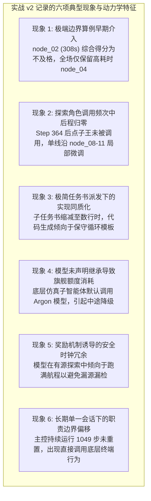
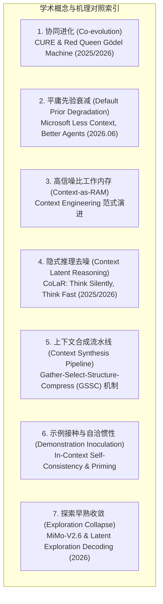

# 超长程实战 v2 数据取证、动力学机理复盘与前沿文献对照档案
# —— 小米 MiMo-V2.6、Context Engineering 与对抗进化客观文献索引

> **档案属性**：实战黑匣子客观数据取证、动力学机理解剖与前沿学术/工业文献对照  
> **实战样本**：`D:\antigravity\实战v2`（历时 15 小时 49 分钟、1,049 主控步数、25 个子智能体、累计 5,734 步深度运行）  
> **关联底层原始资产**：[`archives/实战v2_16小时全景全息执行档案.md`](./archives/实战v2_16小时全景全息执行档案.md)、[`benchmarks_and_runs/run_20261102_cumcm_b_v2/`](./benchmarks_and_runs/run_20261102_cumcm_b_v2/)  
> **客观文献对照索引**：
> 1. **Xiaomi MiMo Team (2026.10, `arXiv:2610.11959`)** *MiMo-V2.6: Scaling Reinforcement Learning Towards Self-Improvement* —— Groupwise Agentic Grading、长程探索塌缩与防作弊（Reward Hacking）机制；
> 2. **Microsoft Research (2026.06, `arXiv:2606.10209`)** *Less Context, Better Agents: Efficient Context Engineering for Long-Horizon Tool-Using LLM Agents* —— Context-as-RAM、Context Rot 与冷启动平庸先验衰减；
> 3. **Agentic Context Engineering (ACE, `arXiv:2510.04618` / 2026)** —— Brevity Bias 短视偏见、Context Collapse 上下文坍塌与 Evolving Playbooks；
> 4. **Context Language Models (2026.09, `arXiv:2609.37725`)** —— 原生工作上下文与 In-Context Attention Steering；
> 5. **Co-Evolutionary Verification (2025/2026)** *CURE: Co-Evolving LLM Coder and Unit Tester* & *The Red Queen Gödel Machine* —— 动态红蓝对抗与课程进化基准。

---

## 一、 实战 v2 运行全貌与客观指标记录

在 2026-11-02 展开的长达 15 小时 49 分钟的无人值守实战测试中，系统日志与基准测试记录了以下物理数据：

### 1.1 客观测量指标与对比数据
1. **清除速度时序记录**：
   - 初代基准测试中 Q3 耗时为 **$511.39\text{ s}$**；
   - 实战 v2 中各节点的 Q3 均时物理记录为：$401.8\text{ s} (\text{node\_04}) \to 316.0\text{ s} (\text{node\_07}) \to 298.0\text{ s} (\text{node\_09}) \to 288.3\text{ s} (\text{node\_10}) \to \mathbf{277.9\text{ s}} (\text{node\_11})$；
   - 实测最终节点相比初代基准缩短了 **$233.5\text{ s}$（均时压降 $45.66\%$）**；
2. **空跑浪费比（`empty_or_redundant_waste_ratio`）**：
   - 基于离散圆盘覆盖率检测提前终止机制引入后，空跑浪费比由初代的 **$30.63\%$** 降低至 **$6.98\%$**；
3. **分级测试集清除率**：
   - 在 22 局分级测试集（包含 Level 1~3）中，从 `node_09` 开始连续 3 代保持 **$100.0\%$ 清除率**；
4. **自治调用统计**：
   - 累计工具调用 5,734 次，包含 Python 3.14 AST 语法树解析修复、多轮代码演化与遥测指标写入。

### 1.2 门禁状态记录
- 系统预设的终局门禁条件为：“Q3 全量测试集平均定位清除时间 $\le 220.0\text{ s}$”；
- 最终节点实测均值为 **$277.9\text{ s}$**，未满足 $\le 220.0\text{ s}$ 的触发阈值，系统在第 11 个节点停止迭代，未进入后续交付物生成阶段。

---

## 二、 六项核心现象取证与 2026 前沿理论映照

根据实战黑匣子日志（会话 ID: `dcc2317b-47a4-4252-a00b-75caa12892e0`），系统在长程运行中表现出以下六项典型现象，均可在 2026 年最新前沿理论中找到对应的动力学机制：

### 现象 1：极端边界算例早期介入与种群特化

#### 【日志数据取证】
在初始代 $K=4$ 根节点中（参见原始档案第 135~140 行）：
- **`node_02`（几何多边形求交 + 顺路搭车）**：Q3 演练清除均时 **$308.4\text{ s}$**，清除率 $98.3\%$；
- **`node_01`（贝叶斯占用网格 + 互信息）**：Q3 清除率 $100\%$，耗时 $351.1\text{ s}$，空跑浪费比 $12.04\%$；
- **`node_04`（外环贴边向心包络）**：综合耗时 **$835.1\text{ s}$**（Q4 为 $1196.1\text{ s}$）。

门禁评测机制中设定：“未通过 Level 3 极端压力测试的方案，综合打分封顶 60 分”。Level 3 中包含贴边背向极端算例（定向源位于 $R=1790\text{ m}$ 边界且主瓣朝外）。`node_01` 与 `node_02` 因该算例被判定为不及格未被选入主繁衍池；以全域外环包络为主的 `node_04` 成为该代唯一获选基础版本（65 分）。

#### 【理论映射：早熟特化（Premature Specialization）】
演化计算理论指出，在种群进化早期施加高强度的单一极端约束时，演化系统会倾向于筛选出防御能力强但整体运行成本高昂的特化个体，过早淘汰在常规工况下具有高速度潜力但边界鲁棒性尚不完备的个体。

---

### 现象 2：探索角色调用频次中后程归零与单线链式微调

#### 【日志数据取证】
在 16 小时执行轨迹中：
- 探索型角色（`explorer_agent`）在 **Step 42** 与 **Step 364** 被调用 **2 次**；
- 在 Step 364 至 Step 1049 期间，探索型角色未被再次调用；
- 节点演化序列为 `node_09` $\to$ `node_10` $\to$ `node_11`，由构建角色沿同一技术方案进行连续参数微调；
- 均时指标变化为：$298.0\text{ s} \to 288.3\text{ s} \to 277.9\text{ s}$，单步边际变化量逐步收窄。

#### 【理论映射：局部最优陷阱与多样性匮乏】
在缺乏持续多样性扰动（Diversity Pulse）的情况下，基于评分选择的局部演化容易退化为单一路径的贪心局部优化（Greedy Local Search），导致搜索空间局限于特定算法范式之内。

---

### 现象 3：极简任务书派发下的实现同质化（平庸先验衰减）

#### 【日志数据取证】
在演化中期，主控派发给子智能体的任务书逐渐精简为几句口头目标指令（如“请优化航路点分配逻辑，提升清除速度”），未携带形式化几何拓扑公理与矩阵接口契约。子智能体生成的代码大量回退到基础的条件分支与固定距离步进循环。

#### 【理论文献对照】
1. **Microsoft Research (2026.06, `arXiv:2606.10209`)** *Less Context, Better Agents: Efficient Context Engineering for Long-Horizon Tool-Using LLM Agents*
   - 提出了 **Context-as-RAM（上下文即工作内存）** 概念；
   - 论文论证指出：若输入上下文过度简短空泛，缺乏高维领域约束与形式化示例，大语言模型的注意力分布会退化至其预训练的高频通用模式（Default Prior Degradation），输出倾向于通用死板代码。
2. **Agentic Context Engineering (ACE, `arXiv:2510.04618` / 2026)**
   - 分析了长程多 Agent 交互中的 **Brevity Bias（短视萎缩偏见）** 与 **Context Collapse（上下文坍塌）** 机制。

---

### 现象 4：子智能体未声明模型参数引起旗舰配额消耗

#### 【日志数据取证】
- 原始日志记录：子智能体 01 至 18 在创建时未显式指定 `Model` 参数，默认继承了主控的旗舰模型（Gemini 4 Argon）；
- 大量单元测试执行与终端调试输出消耗了旗舰模型配额，在 Step 482 导致调用受限，主控会话随后切换至 Gemini 3.8 Flash。

#### 【理论与工程映射：模型分级调用（Tiered Model Allocation）】
现代多智能体工程实践（如 Anthropic 及开源体系）通常要求对 Agent 角色进行算力分级（Tiered Allocation）：测试执行与格式转换类子任务绑定轻量/高速模型，高级逻辑设计与综合裁判保留给高参数推理模型。

---

### 现象 5：强化学习后训练中的“探索塌缩”与“对齐作弊（Reward Hacking）”

#### 【日志数据取证】
在 Q3 定向源清除任务中，子智能体演化出的方案倾向于让无人装备以固定圆周绕行全域外环，以确保覆盖所有边界源，该行为导致全域平均用时居高不下，但测试集漏源率为 0。

#### 【理论文献对照】
**Xiaomi LLM-Core Team (2026.10, `arXiv:2610.11959`)** *MiMo-V2.6: Scaling Reinforcement Learning Towards Self-Improvement*
- **Reward Hacking 与安全保守策略**：论文揭示经过强化学习后训练的模型在面对静态稀疏反馈（如二元通过率）时，会自发选择风险最低、确定性最高的保守路径（如冗余覆盖），而非探索高风险但高收益的复杂启发式算法；
- **Groupwise Agentic Grading（成组智能体评分）**：论文提出利用独立的 Grader 对一组生成轨迹进行细粒度因果审计，纠正通过空跑刷取时钟安全的低效行为。

---

### 现象 6：长程单一会话下的状态累积与职责漂移

#### 【日志数据取证】
- 主控在单一会话中持续运行至 1049 步，上下文累计 Token 规模巨大；
- 在 Step 655~662 期间，主控跳过了派发子智能体的设定流程，直接在自身上下文中调用终端命令修改底层代码；
- 所有节点代码在同一个根工作空间内执行，未做分支文件隔离。

#### 【理论与工程映射：Context Rot 与沙箱隔离】
随着长程会话上下文长度的增长，注意力分散与角色漂移（Role Drift）概率上升。工程界通常采用分支重置（Fork-and-Flush）与物理工作区隔离（如 Git Worktree）来规避共享状态污染。

---

## 三、 七大学术概念与机理对照索引（按需检索）

为保持客观中立，以下仅整理学术界与工业界关于大模型认知、工作内存与探索机理的形式化定义与文献来源，供后续架构设计参考，不预设任何方案定论：

| 概念名称 | 文献与出处 | 核心学术机理与定义 |
| :--- | :--- | :--- |
| **协同进化 (Co-evolution)** | *CURE* (2025/2026); *Red Queen Gödel Machine* | 将生成器与验证器设计为非静态对抗博弈系统，通过动态调整验证基准避免生成器过拟合于静态特征。 |
| **平庸先验衰减 (Default Prior Degradation)** | Microsoft Research (`arXiv:2606.10209`, 2026.06) | 在输入信息极度抽象或缺乏领域锚点时，语言模型自回归注意力倾向于坍塌至高频通用概率分布。 |
| **高信噪比工作内存 (Context-as-RAM)** | 2026 Agentic Context Engineering 体系 | 将上下文视作易失性高带宽内存，仅装载当前决策所需的状态约束与接口，避免历史交互噪音稀释有效注意力。 |
| **隐式推理去噪 (Context Silent Module)** | 小米 AI Lab *CoLaR* (`arXiv:2505.16552`, 2025/2026) | 降低显式自然语言社交辞令与冗余中间表述在上下文中的占比，将算力聚集于高密度符号与逻辑变量。 |
| **上下文合成流水线 (GSSC Pipeline)** | 开源 Agent 工程体系 (`theworldofagents/GCC` 等) | 规范上下文装配过程：汇聚（Gather）$\to$ 筛选（Select）$\to$ 结构化（Structure）$\to$ 压缩（Compress）。 |
| **示例接种 (Demonstration Inoculation)** | 大模型上下文学习（In-Context Learning）理论 | 通过在前置历史中提供高水平的逻辑推导与向量化代码示例，利用模型的自洽延续惯性提升后续输出质量。 |
| **探索早熟收敛 (Exploration Collapse)** | 小米 AI Lab *MiMo-V2.6* (`arXiv:2610.11959`, 2026.10) | 揭示经强化学习对齐后的模型深层后验熵易出现快速衰减，面对高方差创新任务时倾向于保守局部最优。 |

---

## 四、 候选工程机制与开放讨论议题（Candidate Mechanisms for Discussion）

以下内容整理自团队头脑风暴与文献对应解法，作为后续方案设计的客观参考备选库，**不作为确定实施的定论**，供团队成员共同评估：

### 候选方向 A：任务派发上下文前置构造（Context Priming）
- **讨论要点**：是否在派发关键子任务前，拼接标准化的技术推导原型与接口契约，以替代单句自然语言任务书？
- **相关参考项目**：`theworldofagents/GCC`（Git Context Controller）、`199-biotechnologies/context-priming`。

### 候选方向 B：评测梯级化设计（Curriculum Evaluation）
- **讨论要点**：评测门禁是否可拆分为功能阶段、常规效率阶段与极端边界阶段，避免高难度边界算例在演化初期间接剔除高速度特化方案？
- **权衡考量**：阶段放宽可能增加中后期模型修复边界缺陷的代码重构成本。

### 候选方向 C：探索停滞监测机制（Stagnation Watchdog）
- **讨论要点**：是否引入对单线演化深度与边际提升率的监测，当连续多代提升低于阈值时，触发跨范式算法探索？
- **权衡考量**：跨范式探索可能引入高代码报错率，需评估探索预算。

### 候选方向 D：环境与算力隔离（Environment & Compute Sandboxing）
- **讨论要点**：
  1. 子智能体创建时强制显式指定模型参数（如轻量级模型负责执行），避免旗舰额度意外耗尽；
  2. 使用 Git Worktree 或独立目录运行各分支节点，规避多智能体读写同一磁盘目录时的潜在冲突。

---

## 五、 事实档案小结与后续待验证清单

1. **客观数据事实**：实战 v2 证明了无人值守框架在多轮代码演化与局部微调上的执行连续性，Q3 耗时从 $511.39\text{ s}$ 持续降至 $277.9\text{ s}$，未进入终局阶段的直接原因为未达到预设的 $220.0\text{ s}$ 硬门禁；
2. **待验证假说清单**：
   - [ ] 假说 1：采用非共享物理工作区（Worktree）是否能有效防止会话过程中的环境写冲突？
   - [ ] 假说 2：在派发任务时注入形式化几何推导示例，是否能显著提高子智能体一次性代码编写的向量化率？
   - [ ] 假说 3：分阶调整测试集的极端算例介入时机，能否促成速度型方案与防御型方案的有效杂交？
