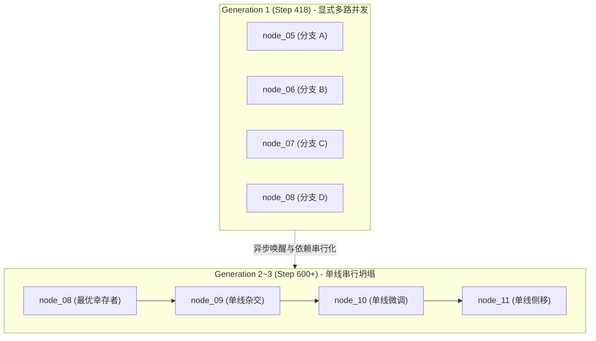
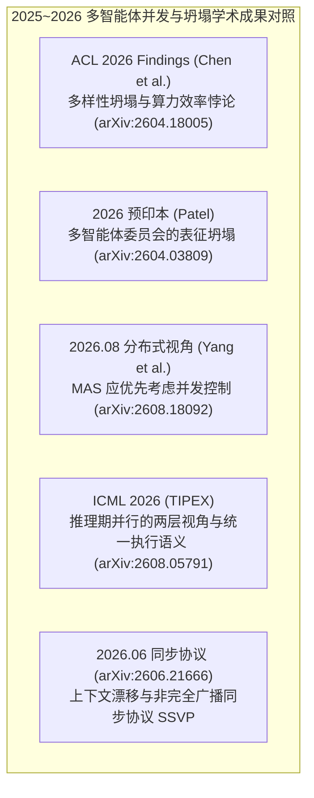
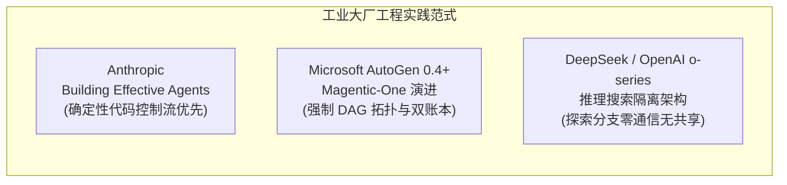

# 多智能体长程并发收敛现象、学界前沿文献与工业实践档案
# —— 记录实战 v2 并发坍塌事实、2025~2026 学术文献与工业级调度架构参考

> **档案性质**：客观事实取证、理论文献索引与工业工程实践对照（不含主观决断与强制方案假设）  
> **研究对象**：长程多智能体系统（MAS）在开放解空间探索中“初始并发启动、随后自发收敛坍塌为单线串行”的动力学现象  
> **实战数据溯源**：`D:\antigravity\实战v2`（运行日志 ID: `dcc2317b-47a4-4252-a00b-75caa12892e0`）  
> **前沿文献检索范围**：2025 年至 2026 年（含 ACL 2026、ICML 2026 及 2026 年中期分布式 MAS 最新成果）

---

## 一、 实战现象取证：并发探索的“单线收敛轨迹”

在实战 v2 的 16 小时连续运行中，系统日志记录了多智能体并行状态的演变全过程：

### 1.1 事实记录与时序数据
1. **初期并发扇出（Step 418）**：
   - 主控在 Generation 1 阶段，通过连续调用 `invoke_subagent` 同时派发了 4 个并行的代码探索分支（`node_05`、`node_06`、`node_07`、`node_08`），试图在不同算法方向（几何求交、外环包络、贪心分配、栅格划分）上开展并发验证；
2. **中后期单线收敛（Step 600~1049）**：
   - 自 Step 482 会话模型切换后，多分支并行机制未再次出现；
   - 系统演化路径呈现为严格的一维链表：以 `node_08` 为基础生成 `node_09`，`node_09` 评测完毕后生成 `node_10`，随后生成 `node_11`；
   - 探索角色未再被多路唤醒，演化拓扑由“树状展开”自发退化为“单链延伸”。

---

## 二、 客观归因：并发自发坍塌的四大机理分析

从底层系统日志、通信时序与状态依赖关系中，可以提取出促使并发走向单线串行的四个客观机理：

### 2.1 物理资源维度：并发资源激增与调用配额约束
- **日志取证**：Step 418 启动的 4 个子智能体未显式声明模型参数，默认继承了旗舰模型（Gemini 4 Argon）。
- **客观物理结果**：4 个高参数模型同时执行深层思维链推理并频繁调用终端运行仿真脚本，导致短时间内 Token 吞吐与请求频次剧增，在十余分钟内触及了高阶模型的周配额上限，系统在 Step 482 被迫全局降级。高额度消耗客观上抑制了后续高并发调度的发生。

### 2.2 调度机制维度：异步事件驱动下的“同步屏障缺失”
- **机制机理**：Antigravity 环境采用反应式异步唤醒机制（Reactive Wakeup），主控不具备强类型的阻塞等待屏障（Blocking Barrier）。
- **时序拉直效应**：4 个并发分支由于代码复杂度差异，执行时长各异（部分仅耗时 5 分钟，部分需 25 分钟）。当最先完成的分支返回结果时，主控被即刻唤醒并推进后续状态评估。在缺乏代际强制对齐栅栏的情况下，早先返回的数据打破了并行时序，驱动主控顺延推进，将原本并行的探索过程在时间线上拉直为串行事件流。

### 2.3 算法演化维度：跨分支依赖引入的因果串行约束
- **演化依赖关系**：
  $$\text{node\_09} = \mathcal{F}(\text{node\_07}_{\text{speed}}, \text{node\_08}_{\text{defense}})$$
- **贪心深度优先偏置（Greedy DFS Bias）**：下一代有效个体往往需要同时吸收上一代多个分支的有效成果。在依赖关系确立后，系统必须等待先决条件全部明确。当某一杂交方案（如 `node_09`）展现出正向提升后，语言模型在无外部宽度锁定的情况下，更倾向于沿着该优势分支做局部微调（深度优先遍历），探索未经验证新方向的边际不确定性使得模型自发选择阻力最小的单线深化。

### 2.4 环境与认知维度：共享状态竞争与工作记忆减熵
- **工作区状态竞争**：所有子任务在同一个物理工作空间运行，缺少轻量文件隔离（如 Worktree），并发读写增加文件冲突风险。
- **上下文工作记忆管理（Cognitive Load Reduction）**：维持多路并行需要主控在工作内存中同时追踪多个不兼容算法的状态、中间数据与报错栈。串行执行时，上下文因果关系单一、状态转换确定，模型在长程会话中本能地通过“消灭并发分支”来降低工作内存中的状态熵。

---

## 三、 2025~2026 学界前沿理论文献索引

近年来，针对大语言模型多智能体系统中的“早熟收敛”、“并发失调”与“多样性丧失”，学术界发表了一批基于分布式系统与演化计算的理论成果：

### 3.1 开放式探索中的“多样性坍塌”与“算力效率悖论”
- **文献出处**：Chen et al., **ACL 2026 Findings** (arXiv:2604.18005), *"Diversity Collapse in Multi-Agent LLM Systems: Structural Coupling and Collective Failure in Open-Ended Idea Generation"*
- **核心论点**：
  1. 论文研究了为什么旨在拓展解空间的多智能体系统在开放式创意与算法生成中反而会使解空间收缩；
  2. 提出了 **算力效率悖论（Compute Efficiency Paradox）**：经过高强度对齐（RLHF）的更强模型，由于其内在先验的高度一致性，在协同任务中产生的边际多样性反而呈现递减趋势；
  3. 稠密的交互拓扑与中央权威仲裁机制，通过“结构耦合（Structural Coupling）”加速了早熟收敛（Premature Convergence），导致系统在几轮对话内失去解的多样性。

### 3.2 角色扮演设定下的“表征坍塌（Representational Collapse）”
- **文献出处**：Patel, **2026 年前沿成果** (arXiv:2604.03809), *"Representational Collapse in Multi-Agent LLM Committees: Measurement and Diversity-Aware Consensus"*
- **核心论点**：
  1. 在评估多智能体委员会（通过 Prompt 赋予不同角色的同构模型）时，论文通过测量各智能体思考链（CoT）的高维表征嵌入；
  2. 实测表明，在数学推理与复杂任务中，不同角色之间的表征余弦相似度均值高达 **0.888**；
  3. 这一度量揭示：依靠 Prompt 模拟的不同角色在潜在特征空间中高度同质，并未能自发提供独立的正交解。

### 3.3 分布式系统视角：并发控制与陈旧读（Concurrency Control & Stale Reads）
- **文献出处**：Yang et al., **2026 年 8 月最新成果** (arXiv:2608.18092), *"Position: Multi-Agent Systems Should Prioritize Concurrency Control"*
- **核心论点**：
  1. 明确指出多 Agent 系统的协调失调在本质上属于经典分布式系统的并发控制缺陷；
  2. LLM 的长推理延迟使得智能体在并行执行过程中频繁面临 **陈旧读（Stale Reads）** 与 **丢失更新（Lost Updates）**；
  3. 对比了**基于轮次的同步屏障（Round-based Synchronization Barriers）**与完全异步执行的权衡，论证了外部事务原语在治理并发执行中的必要性。

### 3.4 推理期并行的两层视角与统一步伐语义（TIPEX 框架）
- **文献出处**：**ICML 2026** (arXiv:2608.05791), *"A Two-Tier Perspective on Inference-Time Parallelism in Multi-Agent LLM Systems"*
- **核心论点**：
  1. 提出了推理期并行执行的两个独立层级：
     - **副本并行（Replica Parallelism）**：面向多路径解法的多样性探索；
     - **结构并行（Structural Parallelism）**：面向复杂任务图解构的并发流水线；
  2. 为运行时的分支同步（Synchronize）与状态合并（Merge）提供了统一的形式化执行语义规范。

### 3.5 上下文漂移与选择性同步协议
- **文献出处**：**2026 年 6 月成果** (arXiv:2606.21666), *"Hallucination as Context Drift: Synchronization Protocols for Multi-Agent LLM Systems"*
- **核心论点**：
  1. 揭示了无节制的全量广播同步容易引发“级联污染（Cascade Contamination）”；
  2. 提出了 **共享状态验证协议（Shared State Verification Protocol, SSVP）**，使用标量散度指标（`Context Divergence Score`）在关键推理节点前进行选择性局部对齐。

---

## 四、 工业大厂工程实践与架构对照

顶级工业界团队在构建长程自动化多智能体系统（如代码重构、全天候仿真打榜）时，总结了一系列防止并发坍塌与控制流程发散的工程规范：

### 4.1 Anthropic：确定性代码工作流优先原则
- **核心规范**：在官方指引 *《Building Effective Agents》* 中指出：**“Prefer deterministic code workflows over fully autonomous loops wherever possible”**（在可能的情况下，优先使用确定性的代码/状态机工作流，而非完全由 LLM 自主驱动的黑盒循环）；
- **并发落地模式**：
  - **切片并行（Sectioning）**：明确切分的无状态独立任务通过代码并发派发；
  - **集成投票（Voting/Ensemble）**：多路模型针对同一输入独立生成方案，由外部固定逻辑负责聚合，杜绝 Worker 之间的非受控实时交流；
  - **编排者-工作者架构（Orchestrator-Workers）**：编排者的职责应限定为任务解构与最终评估，中间执行流程由状态机调度器托管。

### 4.2 微软：AutoGen 0.4+ 与 Magentic-One 拓扑演进
- **双账本机制（Dual Ledger）**：
  - 将调度上下文解耦为 **Task Ledger（事实与任务队列）** 和 **Progress Ledger（结构化进度）**，防止主控因记忆过多执行细节而出现注意力分散；
- **强制图式拓扑（DAG-based Fan-Out & Fan-In）**：
  - 在底层框架中通过有向无环图（DAG）硬性定义并发扇出与聚合栅栏，智能体无法越过外部拓扑自行修改并发或串行逻辑。

### 4.3 推理搜索系统（如 DeepSeek-R1 / OpenAI o-series 探索分支）：无通信隔离机制
- **分支间绝不通信（Shared-Nothing Architecture）**：
  - 在进行大规模解空间探索（如 MCTS 采样、变异搜索）时，不同并发分支在探索过程中保持信息物理隔离；
  - 避免分支间实时交换草稿方案，防止探索神经元被先入为主的局部解污染，多样性筛选统一由终局客观评估层（PRM 或单元测试）负责。

---

## 五、 候选机制讨论与开放性评估备选库

以下为基于文献与大厂经验整理的备选技术机制，仅作为后续团队讨论方案时的客观参考项，**不构成预设决定**：

| 备选机制 | 针对现象 | 机理与实现形式 | 权衡考量（Pros & Cons） |
| :--- | :--- | :--- | :--- |
| **外部代际同步屏障 (Epoch Barrier)** | 异步唤醒导致并行时序被拉直 | 由外部状态机调度，当前代所有分支未完成前，锁定下一代创建权限。 | **优势**：保证多路探索充分完成； **劣势**：存在短板等待时间（Straggler Effect）。 |
| **物理工作区隔离 (Git Worktree Sandboxing)** | 共享目录下的文件锁与写竞争 | 为每个并发分支分配独立的物理磁盘目录与运行进程。 | **优势**：彻底消除多 Agent 写竞态； **劣势**：多工作区占用更多磁盘存储。 |
| **模型算力显式分级 (Tiered Model Binding)** | 苦力子任务意外耗尽旗舰模型额度 | 在任务派发参数中物理显式指定 `Model: "flash"`。 | **优势**：消除配额雪崩隐患； **劣势**：轻量模型在复杂抽象逻辑上可能不如旗舰。 |
| **孤岛演化拓扑 (Island Model)** | 跨分支交叉依赖导致单线收敛 | 划分多个互不通信的独立演化孤岛，仅在固定周期做参数迁移。 | **优势**：阻断结构耦合，维持解的多样性； **劣势**：需设计跨岛迁移接口契约。 |

---

## 六、 开放待验证议题（Open Questions for Team Evaluation）

供后续实验与讨论核查的客观假说：
1. **假说 A**：在调度层加入硬性代际屏障（Join Barrier）后，多路分支是否能在第 2 代及之后维持稳定的并发度？
2. **假说 B**：完全阻断探索分支间的通信（无共享隔离），能否显著降低最终生成解在算法骨架上的余弦相似度？
3. **假说 C**：采用轻量模型进行多路并发探索，仅用旗舰模型进行终局裁判，是否能在保障探索广度的同时控制 Token 消耗？
