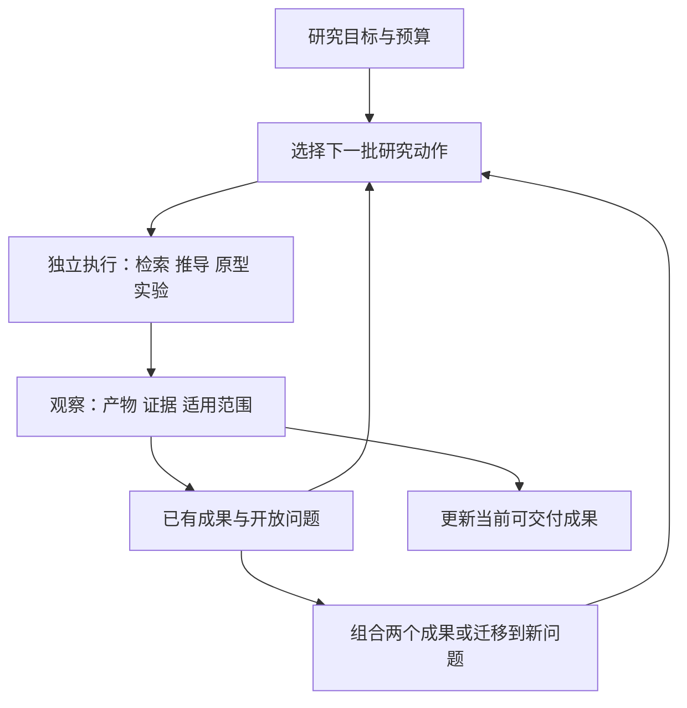

# 架构设计

## 1. 系统要优化什么

在给定预算内产生更有价值的最终成果，同时积累能够支持后续研究的知识和方法。有限任务以最终成果为主指标；开放研究同时报告独立发现及其后续用途。不能用笔记数量、Agent 数量或运行时长代替研究收益。

核心设计假设是：**把有证据的中间成果作为下一轮搜索起点，并允许跨谱系组合，比持续围绕当前冠军做局部修改，更容易形成长期收益。** 这是待验证假设，不是已有论文证明适用于所有 Agent 的结论。

最终目标、任务约束与“下一步应该朝哪个方向走”分开表达。最终方案仍需满足任务要求；中间方案可以只解决一个特殊情形，也可以提出反例、替代表述或可复用工具。它不必每次都提高总分。

## 2. 最小结构

三个职能即可：研究主持负责下一批动作和预算；执行者负责有边界的研究工作；证据审阅负责核对关键结论、设计比较。职能可以由同一个基础模型在不同会话承担，不要求三个常驻 Agent。核对脚本与实验工具完成可机械判断的部分。

主持不需要阅读所有原始轨迹。它看到当前成果、未解问题、少数相关证据及预算；想追问时再展开原始材料。主持也不垄断提问：执行者可以根据发现提议新的问题，获得一次小额尝试的机会。

## 3. 四类研究对象

| 对象 | 内容 | 用途 |
|---|---|---|
| 研究简报 | 最终目标、真实约束、资源、交付方式 | 保持方向 |
| 研究动作 | 问题、起点、做法、额度、预期产物 | 决定下一步 |
| 研究成果 | 结论或组件、条件、证据、来源及父成果 | 可继承的搜索起点 |
| 研究前沿 | 当前可交付成果、活跃路线、值得继续的成果与开放问题 | 选择和检索 |

研究成果包括：有证明的引理、实验支持的现象、反例、简化后的问题表述、有效的求解器、评价工具、从文献提取的方法。不同种类采用对应的证据标准。

一条成果卡只需回答：发现了什么；在哪些条件下成立；有什么证据；从哪里来；接下来可以做什么。猜想也可以保留，但清楚标注待证，不能作为已成立前提传递。

论文中的已有结论标注外部来源。Agent 没有重新运行实验时，不能把论文结果写成本系统复现。经验测量不能直接升级成数学定理。

## 4. 研究循环

### 启动

主持先读任务和少数最相关材料，建立一个可运行参考方案，提出两到三个实质不同的问题。不同问题可以来自不同假设、表示或信息来源，不强制每条路线绑定互斥范式。

在各路线提交独立初稿前，不提供其他路线的结论；共同任务事实、公开文献与工具照常可用。独立期结束的依据是形成可讨论的研究起点，不固定为两代或某个 token 数。

### 一次动作

动作可以是检索、推导、反例搜索、原型、实验、复测、推广、组合或问题重述。每次限定一个主要问题，给出额度与可交付内容。

有些动作是判别式的：什么结果会支持哪种解释？另一些是发现式的：从这个成果出发，能得到什么可检验的新性质或新方法？发现式动作无需事先说明最终目标收益。

执行者完成动作后提交产物与成果卡。没有得出结论时，报告实际完成的工作和剩余问题；主持据此决定续投、改问法或暂存。不能把预算耗尽自动解释成理论死路。

### 收到结果

先判断结果属于已支持发现、待证猜想还是未解释现象，再做两种不同决定：是否更新可交付成果；是否值得产生下一项研究动作。局部正确但不完整的方法可以继续研究，未必进入交付候选。

异步执行，空出席位即可选择动作。初始各路线有一次足以触及核心问题的额度；在其他路线形成初步证据前，不把全部追加资源连续给最先返回的路线。需要横向比较时使用共同条件，保持可比性。

## 5. 让旁支真正获得后续机会

工作分为三种用途，但不设三个独立子系统：

1. **目标推进**：改善当前可用方案，解决已知瓶颈。
2. **成果发展**：推广特殊情形、探索替代表述、制作工具、提出邻近猜想。
3. **交叉组合**：把不同路线的成果放在同一问题里尝试。

第一轮可用一个明确但可调整的起始方案：将可支配研究成本约 60% 用于目标推进、25% 用于成果发展、15% 用于组合。比例是实验参数，不是论文结论。启动尚无成果时，组合额度暂用于独立路线；需要更多独立探索时，也可主动调整。串行调用下按累计成本分配，无需凑齐三个常驻 Worker。

有限任务开始时另外预留约 15% 总预算用于最终比较与整理；上面的比例只作用于剩余研究预算。所有调用、检索和协调均计费。只有墙钟额度时同时记录工具耗时和模型用量，不把三者简单相加。

成果发展额度支持这样一种候选：它尚未提高总分，但有一个可验证的独特机制，而且下一步有具体做法。候选可以得到一次短探索。续投看新产物是否出现，而不是每次重复讲同一个潜力故事。

只归档不续投无法形成踏脚石。因此每次整理前沿，明确选出至少一个值得从中继续的非冠军成果；若确实没有，记录原因，不强行制造新颖性。

暂存的成果仍可检索。停止当前计算不等于宣告内容永久无价值。

## 6. 选择下一步：先用判断，后研究算法

主持提出少量动作并比较：

- 能否改善最终成果，或打开一类此前做不了的问题？
- 与现有成果有什么实质差别？
- 一个额度内能否产生可检验内容？
- 是否能够消除重要分歧，或使两条成果接上？
- 成本和时间是否合适？

选中的动作写一段理由即可，不合成虚假的精确总分。纯粹的预测性“潜力分”容易成为新的短视奖励。

成果发展的价值还可以体现在：提出一种以前没有的问题，增加可操作的表示或工具，发现原先忽略的条件。初期以可读的机制描述区分路线，只有某个领域的行为维度已经明确时才考虑 MAP-Elites 网格。

遇到平台期，依次考虑：当前问题是否问错；是否缺少文献或实验能力；是否存在尚未展开的成果；是否有值得组合的路线。增加同类采样只是一个可选动作。

## 7. 组合如何实际发生

从两个成果中明确指出要连接的内容，例如：A 提供状态表示，B 提供基于该表示的动作选择；A 证明一个界，B 用这个界缩小计算范围。

组合动作需交付三个东西：接口解释、组合后的产物、与相关父方案的同条件比较。若局部改善没有带来整体提升，留下原因和仍可复用的部分。思想迁移通常比直接合并两份代码更自然。

每隔一小批动作或出现重要成果时，主持安排一次成果交换：选少数相关卡片发给可能用得上的路线，请对方提出一个可执行的连接。无需把全部聊天广播给全部成员。

在数学任务中，组合尤其要检查引理假设是否相容；在实验任务中，要检查数据、预算和测量条件能否对齐。这些检查服务于论证本身。

## 8. 证据与记忆

证据强度按领域处理：形式化证明、可审阅推导、可复现实验、案例观察、猜想分别标注。程序优化可用自动评价；开放研究允许人工判断重要性，并明确该判断的主观部分。

研究阶段用便宜且能回答当前问题的验证。最终采用时再依据真实任务要求检查完整性。必要的任务约束从一开始就是事实；不以额外假想场景统治全部探索。

前沿摘要只保留当前选择所需的信息，详细推导和实验日志在原处。更换问题或上下文被无关轨迹占据时启动新会话，移交研究状态和相关证据。会话更换、代码分叉、成果继承可各自发生。

失败记录写明条件与未解决原因。后续新证据可以修订结论；依赖过旧结论的活跃动作收到简短更新。首版用主持维护这些引用关系即可。

## 9. 对原十条的承接

| 原主张 | 本版选择 |
|---|---|
| 代际屏障 | 初始公平额度，异步执行，在比较决策处汇合 |
| Git 与合并 | 独立工作区，成果引用版本；组合后验证实际行为 |
| 垂直梯队、盲写、争论 | 独立问题起点，差异落实在假设；争议转成实验 |
| 粗野评价 | 研究续投与交付采用分开决定 |
| Shared-Nothing | 独立写入，定期交换相关成果 |
| 双账本 | 任务进度与成果前沿，两种视图即可 |
| 优质先验 | 提供领域材料，同时允许重述问题 |
| 造尺人 | 以设计有区分力的实验为主要工作 |
| 退火与新颖性保护 | 给非冠军成果实际发展额度，暂不引入温度公式 |
| Fork-and-Flush | 新会话继承成果与问题，代码分叉按需发生 |

## 10. 首版工程边界

文件、Git 和现有模型执行接口足以承载本设计。主持维护研究队列与摘要，Worker 在独立目录产出。暂不需要图数据库、专用消息总线、复杂状态机或分布式事务。

最重要的实现顺序：先跑通一次“发现—保存—由不同动作继承—验证后续用途”；再加入并行和预算分配；最后通过对照实验决定哪些机制值得自动化。
