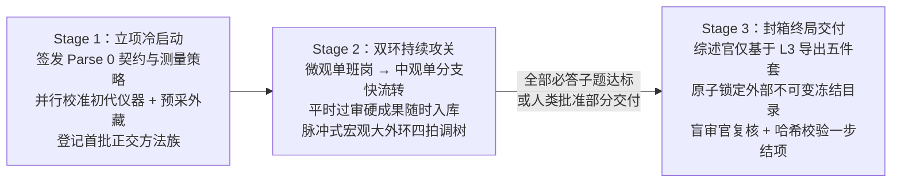
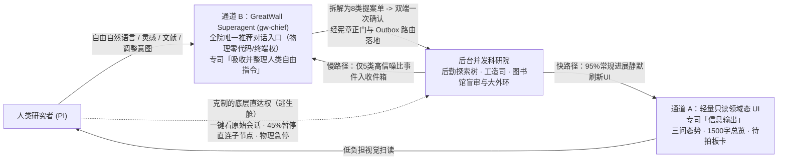
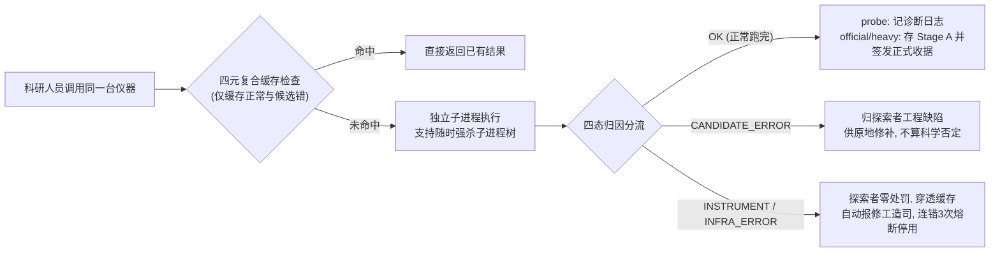
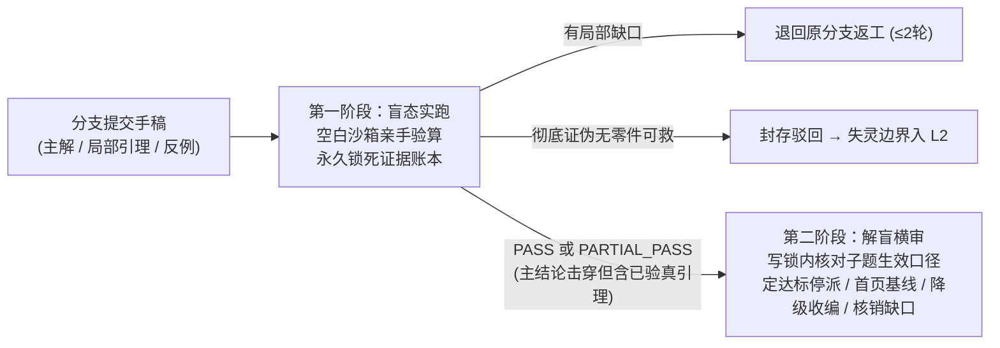
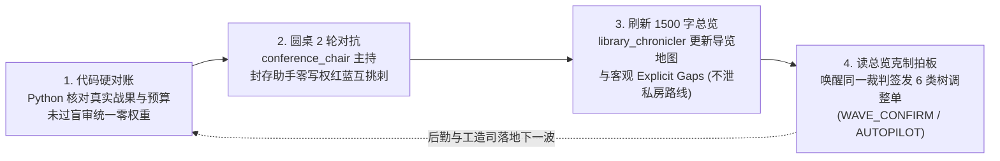

# GreatWall Agent (`v0.3.0-alpha.2`) 系统架构说明

> **版本与状态声明**：本架构说明对应 **`v0.3.0-alpha.2`** 整机大版本重构（**Apache 2.0 + DCO**）。代码已完成模块化重构、多轮审阅与全量本地自动化回归（Python **68** 项 0 失败、Node **54/54**、Doctor **8/8**），**但尚未在真实 DSH Desktop 环境下跑过长周期开放课题实测**。  
> **配套权威技术文档**：
> - `v0.3` 四大工程独立架构论文与精确 SQLite DDL：[`docs/agent_kb_v0_3/`](./docs/agent_kb_v0_3/agent_kb_v0_3_00_INDEX_总导航_三层职责分离与里程碑路线.md)
> - `v0.3.0-alpha.2` 一页式源码模块地图与工程红线：[`greatwall-v6up/MODULE_MAP.md`](./greatwall-v6up/MODULE_MAP.md)
> - 早期手写原点、`v0.2` 白皮书与历轮审计记录：[`docs/archive/README.md`](./docs/archive/README.md)

---

## 目录

- [0. 项目定位与真实源码地图](#0-项目定位与真实源码地图)
- [1. 设计哲学、三大原则与开源初心](#1-设计哲学三大原则与开源初心)
  - [1.1 为什么做这件事：现实痛点与开源空白](#11-为什么做这件事现实痛点与开源空白)
  - [1.2 对基座模型的清醒定位：服务科研人员的学术共同体](#12-对基座模型的清醒定位服务科研人员的学术共同体)
  - [1.3 GreatWall 三大根本原则与五组核心张力](#13-greatwall-三大根本原则与五组核心张力)
  - [1.4 核心学术与大厂实战思想渊源](#14-核心学术与大厂实战思想渊源)
  - [1.5 开源初心（Apache 2.0 + DCO）](#15-开源初心apache-20--dco)
- [2. 系统全景：三层运行闭环、全生命周期与十角色分权](#2-系统全景三层运行闭环全生命周期与十角色分权)
  - [2.1 系统架构全景图](#21-系统架构全景图)
  - [2.2 微 / 中 / 宏三层职责切分与全生命周期（Stage 1–3）](#22-微--中--宏三层职责切分与全生命周期stage-13)
  - [2.3 全院 10 角色权限总表与 8 套单源 Preset 映射](#23-全院-10-角色权限总表与-8-套单源-preset-映射)
- [3. 四大工程深度拆解](#3-四大工程深度拆解)
  - [3.1 设施工程（Infrastructure Engineering）：内外双界面底座与 Superagent 人机总控](#31-设施工程infrastructure-engineering内外双界面底座与-superagent-人机总控)
  - [3.2 仪器科学工程（Instrument Science Engineering / 工造司）](#32-仪器科学工程instrument-science-engineering--工造司)
  - [3.3 后勤工程（Logistics & Lineage Engineering）](#33-后勤工程logistics--lineage-engineering)
  - [3.4 图书馆工程（Library & Peer-Review Engineering）](#34-图书馆工程library--peer-review-engineering)
- [4. 核心工程契约（基于当前真实代码）](#4-核心工程契约基于当前真实代码)
  - [4.1 双层通信、鉴权与双端确认协议](#41-双层通信鉴权与双端确认协议)
  - [4.2 10 角色 × 44 个窄 MCP 工具契约总览](#42-10-角色--44-个窄-mcp-工具契约总览)
  - [4.3 仪器插件与四元缓存契约](#43-仪器插件与四元缓存契约)
  - [4.4 SQLite 持久化底座（26 组表 + 排雷视图 + 4 条硬触发器 + 无损迁移）](#44-sqlite-持久化底座26-组表--排雷视图--4-条硬触发器--无损迁移)
- [5. 已知技术债与当前坦诚局限](#5-已知技术债与当前坦诚局限)

---

## 0. 项目定位与真实源码地图

**GreatWall Agent（长城）** 是一套构建在开源 DeepSeek Harness（DSH）插件体系与 Python / SQLite 单写者内核之上的**长周期、多学派并发自主科研多智能体实验基座**。它的出发点不是硬编码解决某一道竞赛题，而是把学术界与工业界近期在自主科研和长程多智能体上的核心洞察——独立学派隔离、自适应短会话接力、空白沙箱实测盲审、仪器随课题演化、脉冲式宏观圆桌与综述、以及以人类注意力为核心的 Superagent 交互——整合成一座真正透明、可运行、可拆改的开放工程基座。

全部可运行源码位于 [`greatwall-v6up/`](./greatwall-v6up/)（完整模块边界与工程红线见 [`greatwall-v6up/MODULE_MAP.md`](./greatwall-v6up/MODULE_MAP.md)），`v0.3.0-alpha.2` 已彻底拆解历史千行级“上帝文件”：

```text
greatwall-v6up/
├── MODULE_MAP.md                        # v0.3.0-alpha.2 一页式源码边界、工程红线与验收命令
├── core_python/                         # Python 3.11+ 单写者真相内核与隔离执行器
│   ├── config.json                      # 时钟上限、保护期、圆桌节拍、瞬态退避与弹性锚点参数
│   ├── agents/                          # 10 份 v0.3 角色系统提示词模板
│   ├── prompts/holiday_prompts.yaml     # 29 条夜科学元反思启发题库
│   ├── evaluators/
│   │   ├── base_instrument.py           # 仪器标准取数 get_public_input() 与四态返回体协议校验
│   │   ├── isolated_runner.py           # 跨进程可取消隔离执行（杀子进程树）、四元复合缓存、Stage A 留存与校准引擎
│   │   └── examples/                    # 异构科研样例（几何反例 / Lean4 桩 / Pareto 仿真）
│   ├── mcp_server/
│   │   ├── db/                          # 模块化数据底座：enums / schema_base(19表) / schema_v03(新表、排雷视图与封存触发器) / migrations(v0.2无损升级)
│   │   ├── db_runtime.py & db_schema.py # 真只读连接、进程级单写者锁 (_SINGLE_WRITER_LOCK) 与薄门面
│   │   ├── tool_registry.py             # 10 角色 × 44 窄工具多角色单一契约源（支持按角色动态门禁）
│   │   ├── greatwall_core_mcp.py        # 双池并发（fast_pool / compute_pool）stdio JSON-RPC 2.0 入口与 $/cancelRequest 真取消
│   │   ├── control_plane_dispatch.py    # 30+ 控制面内部原语分发
│   │   ├── mcp_core_helpers.py & mcp_schema_docs.py # 鉴权、路径守卫、统一回执外壳与 Schema 枚举增强
│   │   ├── control_plane/               # 12 个无环单写者子域：effects_outbox / subproblem_locks / node_interventions /
│   │   │                                # proposals / wave_engine / delivery_freeze / blind_sandbox / workspace_sync /
│   │   │                                # lifecycle_ops / scheduler_rules / snapshot_queries / ui_projection
│   │   └── tools_*.py & triage_core.py  # 10 角色窄工具实现（tools_chief / tools_explorer_eval + pull / tools_companion /
│   │                                    # tools_logistics / tools_library_roles / tools_verifier + helpers / tools_works / tools_supervisory）
│   └── skills/                          # 主控 SOP 与共享探针台账 SKILL_LEDGER.json
├── dsh_plugin/                          # DSH (>= 0.2.2-rc.5) Cordis 插件与模块化三问前端
│   ├── package.json & cordis.patch.yml  # Cordis Bundle 与 8 套单源 Preset 注册清单
│   ├── icon.svg & locale/*.json         # 插件图标与中英双语本地化描述
│   ├── client_src/ + tools/build_client.mjs # 零第三方依赖模块化三问前端源码与构建器 → lib/client.js
│   ├── tools/doctor.mjs                 # 环境、Python↔Node 44 工具契约、8 套 Preset 与前端红线一键体检
│   ├── lib/
│   │   ├── index.js & config.js         # Cordis 极薄装配入口；动态探测 Schemastery（缺宿主回退 Standard Schema v1）
│   │   ├── runtime/                     # instance_lock(host.lock) / worker_slots(+1人类优先槽) / transient_retry / effects_consumer(Outbox)
│   │   ├── sessions/                    # human_takeover(45%暂停、source.rpcId 让权与 ctx.jobs 清理) / chief_runtime(Superagent与ActionCard)
│   │   ├── control_service.js & orchestrate_tool.js # 统一鉴权控制面（双端幂等确认）与极简 4 动作 CLI 入口
│   │   ├── orchestrator.js & orchestrator/ # 后台事件池主控 + 6 个编排子域（含 wave_conference_runner 四拍驱动）
│   │   ├── agent_session_host.js & host/   # ctx.agents.create/resume 宿主、10 角色模型绑定与阶段能力挂载
│   │   ├── pair_lifecycle.js / clock_and_turn_gap.js / read_isolated_sandbox.js
│   │   └── bridge/dsh_schema_adapter.js & mcp_bridge.js & console_routes.js
│   └── test/                            # Node 54 项全量回归（含 6 项跨进程真联调与 2 项假模型全链路沙盘）
└── tests/                               # Python 68 项全量回归、并发真取消、架构防腐门禁与 v0.2 旧库无损迁移夹具
```

---

## 1. 设计哲学、三大原则与开源初心

### 1.1 为什么做这件事：现实痛点与开源空白

当我真正用 AI 打过数学建模、算法或科研类比赛，很快发现一个非常棘手的现实：**仅靠现有 Agent Harness 自带的通用团队协作功能，几乎不可能照顾到彼此互斥的不同学派与不同解法。** 哪怕同时拉起多个子智能体，只要缺乏隔离与显式分流，不出几轮它们就会迅速趋同到同一个“表面容易写出代码、实则存在结构天花板”的局部解法里，多并发瞬间退化为昂贵的算力重播。

这背后有一个必须正面承认的底层前提：**我们必须默认，当前的基座大模型是一种学术品味（Academic Taste）非常弱的存在。** 它的符号推演带宽很高、预训练知识极其庞大，但一旦进入十小时级的长程开放任务，就会暴露出四类顽固倾向：

1. **长上下文注意力退化与“体面怠惰”**：对话拉长到十几万字后，模型不仅推理成本攀升，还会牢牢锚定在自己早期的局部直觉里，最终用极其流畅的学术辞令自我合理化，宣布“当前解已接近理论极限”并停止实质探索；
2. **高并发下的群体思维坍塌**：多个 Agent 如果直接共享未经审定的公共草稿板，谁先跑出一个能看的数字，其余分支立刻蜂拥跟风；
3. **工具损坏与科学失败混淆**：评测脚本读错字段、模拟器环境报错，如果没有结构化归因隔离，模型会直接把平台 Bug 当成“这个数学思路不行”而放弃真正有价值的突破；
4. **人类注意力被多并发窗口撕碎**：人类同时最多只能有效跟进 3 到 5 个活跃会话。当 6 条探索分支、盲审、仪器升级同时运转时，把所有后台细节和表单摊给人类，很快就会把研究者拖成疲惫不堪的“人肉路由器”。

同时，这里必须极其坦诚地交代一个**本项目目前压根也无法解决的重大问题**：**非标量科学任务的梯度缺失**。对于纯解析数学证明、构造性反例、多目标 Pareto 物理仿真或无客观打分器的机理探索，根本不存在一个单调递增的实数分数告诉搜索系统“这一步离真理更近了”。当前架构只是做到“不在接口层强制假设单一标量”，并用空白沙箱实测盲审、元反思与脉冲式圆桌做有限的替代，距离真正解决开放科学搜索的方向引导还有很长的路。

### 1.2 对基座模型的清醒定位：服务科研人员的学术共同体

既然基座模型是一位“推演带宽极高、知识面浩瀚，但学术品味薄弱、易脑雾、易怠惰与浮夸的科研新人”，整个系统的使命就**不应该是**充当监工、指望靠一堆脆弱的正则脚本或繁琐的行政公文去规训它（正如最初手稿 [`docs/archive/v0.2_architecture/手写project.md`](./docs/archive/v0.2_architecture/手写project.md) 里写的：如果仅靠正则清洗吹捧词就能做好学术审稿，人类科研共同体就不需要同行评议了）。

相反，本架构把整套系统定位为一座**服务一线科研探索者的扁平学术共同体**：
- **唯有 Science 与一线科研探索者本身是目的**，所有治理机构、数据库、沙箱和协议都只是脚手架；
- 替它挡住过早的群体噪声，给它可靠透明的实验仪器，在它容易陷入局部内卷时请外部视角敲醒它，在它上下文膨胀到神志不清前帮它把真实证据链与《科研遗嘱》安全交给下一代，并对它提交的硬核成果给予独立公正的实测审定。

### 1.3 GreatWall 三大根本原则与五组核心张力

经过从 `v0.1` 到 `v0.3` 的多轮推倒重来，项目正式确立了三条并列恪守的根本原则：

1. **第一性原理（First Principles）**：不迷信流行的多智能体套路或花哨算法，永远回到具体科研任务的本质约束出发——大模型在长程开放任务中究竟为什么退化、为什么趋同、为什么撒谎、为什么难收敛，针对真实病灶给出最直接的解法。
2. **钱学森《工程控制论》系统边界律（稳健性优先于防御性）**：
   > *“一个真正优秀的系统，并不一定是大量最优子系统的强行拼凑；相反，优秀的子系统之间往往存在难以解决的冲突，强行捏合反而会导致系统整体效能下降。因此很多优秀的系统往往是由那些并非最优、但配合良好的子系统构成的和谐整体。”*  
   我们追求的是**结构上的稳健性（Robustness）**，而非层层叠加补丁的**防御性（Defensiveness）**——用确定性代码守住并发一致性、隔离边界与流程底线，把真正的科学思考和探索自由还给模型与人类研究者。
3. **清晰自然语言表达原则（Clarity Without Jargon）**：不为了追求浅白而牺牲学术严谨性，但也坚决拒绝堆砌自造“黑话”来营造虚假的高级感——**凡是用自然语言讲不清楚的设计，本质上往往是架构本身还没想透。**

整座架构的每一个具体设计，都是在以下五组彼此拉扯的根本张力里反复做减法后找到的当下平衡点：
1. **确定性代码 vs. 大模型自主权**：状态跃迁、并发槽位、时钟采样、沙箱拦截、审稿锁和 Outbox 队列全由确定性代码与 SQLite 触发器死守；具体科学假设、推导、实验设计与学术评议完整交还给短会话模型。
2. **群体隔离（防趋同） vs. 知识共享（防重复踩坑）**：分支私有知识物理隔离；公共硬成果过了盲审随时独立入库，每代探索者前 37% 锁定内藏先独立撞墙，37% 问诊后再按三步结构主动翻阅；未验真半成品思路只在固定节拍的波次圆桌上受控碰撞。
3. **长程连续记忆 vs. 单会话上下文纯净度**：持久化真相全部归外部 SQLite 与 Git Worktree（有状态的搜索），模型会话短生命周期化（无状态的智能体），靠恒定大小的《2200 字前情提要》+ 亲笔《科研遗嘱》跨代接力。
4. **审稿严苛度 vs. 保护早期创意萌芽**：快速探针与正式凭证分离，仪器故障对探索者零处罚，盲审支持有限返工与主稿被拒时当场降级收编好引理，新学派、合体支线与人类种子分支享有 2 班岗成长保护期。
5. **人类掌控感 vs. 人类注意力稀缺性**：90% 日常协作收口给物理剥权的 **Superagent（`gw-chief`）** 与轻量只读 UI，同时克制保留一键直达原始会话、物理急停与 45% 暂停直连子节点对话/改码的逃生舱。

### 1.4 核心学术与大厂实战思想渊源

本架构吸收了多篇 2025–2026 自主科研论文与大厂公开工程实战的核心机理（完整溯源见 [`REFERENCES.md`](./REFERENCES.md) 与 [`docs/paper_study/README.md`](./docs/paper_study/README.md)）：

| 借鉴来源 | 在本系统中吸收的核心机制 | `v0.3.0-alpha.2` 主要落点 |
| :--- | :--- | :--- |
| **DeepSeek Super-agent** (`dsh-superagent-prototype`) | 人类注意力预算第一定律、Router-Worker 物理剥权、两阶段事件过滤、订阅直通 + `Handback` 越界退回、+1 人类优先槽、`Inline & Spill` + `Chain of Recall`、`PolicyChanged` 温和热传播、Outbox 副作用队列 | 设施工程 `gw-chief`、`runtime/effects_consumer.js`、`worker_slots.js`、`human_takeover.js`、`handback_to_chief` |
| **Google DeepMind Quantum Swarm** (`arXiv:2611.09822`) | 按“每题一目录”组织共享硬资产（随时合入经机器校验的最优解、可复用模块与死路笔记，设 $\ge 5\%$ 提升与 $\ge 20\%$ 精简基线门槛），叠加定期虚拟学术会议直接交锋未验真构想 | 图书馆工程四角色分权、两步达标与基线分离、宏观大外环脉冲式圆桌对抗 |
| **OpenAI `distributed_agent`** (`bioRxiv:2026.10.15.759436`) | 一线 Worker 严禁谈全局只交硬账本；归约写综述前先由代码对账、强制同时保留支持与反面证据、严禁按人头数打分、读完综述盯着 `Explicit Gaps` 定向派单 | 宏观大外环第一拍代码硬对账、第三拍《1500 字子题全局总览与客观缺口》、第四拍定向开拓 |
| **Cogentic** (`arXiv:2609.40324`) & **The Station v1/v2** (`2608.23691`, `2610.08927`) | 协调层无数学偏见；前 37% 隔离 + 外部专家反思与 29 条夜科学启发题；先锁不可逆 Stage 1 证据账本再解盲；子题达标自动冻结释放算力；多维 `tracks` | 0–37% 净室、37% 问诊、空白沙箱两阶段盲审、子题锁一即时停派、仪器多维 `tracks` |
| **SLA** (`2610.07625`) & **AgentDiscover** (`2610.05334`) | 有状态外部搜索 × 无状态短会话；代码故障与科学否定分离；按结构自主 Pull、工具回执路标、`<worktree>/tools/` 沉淀与顾问“三不给”红线 | 短会话接力、四态错误隔离、37–70% 三步自主翻库、伴随顾问红线 |
| **RQGM** (`2606.26294`) & **Audit the Scaffold** (`2609.34924`) | 版本域可比性、作弊样本沉淀为自声明金/毒校准集回归升版、Stage A 留存按需重评、优先投资可观测探针 | `isolated_runner.py` 校准与重评闭环、工造司五条耦合管道 |
| **OpenAI CDC Prompt** & **Diversity Collapse** (`2604.18005`) | 动态方法族谱与 `>50%` 聚拢分流、7 类结构漏洞红队清单、等价归约禁标完成、最低投入时间窗与诚实部分交付、严禁跨分支广播未审思路 | `method_families`、`EQUIVALENT_REDUCTION` 约束、盲审 7 查、三道停工锁 |

### 1.5 开源初心（Apache 2.0 + DCO）

坦白地说，作为一名数学系背景的发起者，我的工程技术能力有限，也一直缺少并肩协作的伙伴。但我真心觉得，把学术界这些前沿的多智能体科研想法真正做成开放基座，是一件太有意思、也太值得有人继续推下去的事——我不想看着它停在本地硬盘里慢慢沉寂，落得：

> *“章台柳，章台柳，昔日青青今在否？纵使长条似旧垂，也应攀折他人手。”*

如果这个仍在持续打磨的开源基座能帮到哪怕一位素未谋面的朋友——无论你是拿它辅助打一场比赛、拆出其中某个机制魔改自用，还是愿意提 Issue、改代码、一起把它打磨得更好，我都会非常开心。就像那句我一直很认同的话：

> *“假如我能使一颗心免于哀伤，那我便不虚此生。”*

因此，项目以 **Apache 2.0 + DCO** 完全开源，把全部思考、源码和坦诚的局限如实交给大家。

---

## 2. 系统全景：三层运行闭环、全生命周期与十角色分权

### 2.1 系统架构全景图


### 2.2 微 / 中 / 宏三层职责切分与全生命周期（Stage 1–3）

为了避免模块职责纠缠，GreatWall 将长程自主科研严格切分为**微观、中观、宏观大外环**三个层次，并串行贯通立项、攻关与交付三个阶段：



- **Stage 1（立项冷启动）**：`supervisory_committee` 签发不可随意涂改的 `Parse 0` 契约（按子题写死通关判据、测量策略、最低投入时间窗与预算上限；纯理论题支持声明 0 判定器开局）；确定性内核自动初始化各子题运行时状态；工造司校准初代仪器与对外采编员预采外藏 `[R###]` 并行推进；后勤登记首批正交方法族并为每条初始分支派发自带 2 班岗保护期的第 1 代节点。
- **Stage 2（双环持续攻关）**：微观与中观由后勤负责单分支高效率运转，平时硬成果过了空白沙箱盲审随时独立入库；每隔固定工作量节拍，图书馆主导一次宏观大外环四拍，统一处理跨学派碰撞、全局导览刷新与研究树宏观调整。
- **Stage 3（不可变冻结一步终核）**：当全部必答子题达标（`FULL`），或越过最低投入窗耗尽预算 / 人类显式叫停并批准部分交付（`PARTIAL_ON_BUDGET / PARTIAL_ON_HUMAN_STOP`）后，对内综述官仅基于已过审的 `L3` 导出五件套并原子锁定外部不可变冻结目录；盲审官只读该冻结副本复现验真无边界夸大，锁外算哈希、短写锁比对一致即一步原子结项。

### 2.3 全院 10 角色权限总表与 8 套单源 Preset 映射

系统通过 `cordis.patch.yml` 中的 **8 套单源 DSH Preset** 与 Python `tool_registry.py` 对全院 **10 个角色** 实施物理级最小权限裁剪：

| 角色名 | 对应 Preset | 归属工程 | 核心职责 | 外网 / 文件 / 终端权限 |
| :--- | :--- | :--- | :--- | :--- |
| **`gw-chief`**（Superagent） | `greatwall-chief` | 设施工程 | 唯一推荐人机主对接人：只读回忆链查账、零副作用预演、整理 8 类确认单 | 零外网 · 零文件写 · 零终端（启原生压缩，+1 人类优先槽） |
| **`supervisory_committee`** | `greatwall-db-only` | 设施/治理 | Stage 1 签发 `Parse 0` 契约与中途口径歧义仲裁 | 零外网 · 零代码写 · 零终端 |
| **`works_engineer`** | `greatwall-works` | 仪器科学 | 仪器开发、金/毒校准升版、反作弊加固与鉴别探针 | 零外网 · 仅写仪器目录 · 受限终端 |
| **`explorer`** | `greatwall-explorer` | 后勤工程 | 一线科研人员：单班岗独立探索、37% 后翻库、70% 写遗嘱交班 | 零外网 · 仅写本分支 Worktree · 70% 动态锁死写权与终端 |
| **`lineage_companion`** | `greatwall-companion` | 后勤工程 | 伴随助手：0% 写提要、37% 问诊、70% 核硬盘归档、封存后零写权参会 | 零外网 · 零代码写 · 零终端（封存后物理撤档案写权） |
| **`logistics_coordinator`** | `greatwall-db-only` | 后勤工程 | 开局建首批正交学派；常规分诊由控制面直落，仅疑难/聚拢异常按需拉起 | 零外网 · 零代码写 · 零终端 |
| **`external_surveyor`** | `greatwall-external-surveyor` | 图书馆 | 唯一对外采编员：检索外部公开资料，产出带阅读深度标注的 `[R###]` 卡 | **唯一可连外网** · 物理禁读院内任何成果 |
| **`library_chronicler`** | `greatwall-chronicler` | 图书馆 | 对内综述官：波次会后刷新 1500 字导览总览；Stage 3 组装终稿五件套 | 零外网 · 零终端 · 只读内藏与受控导出 |
| **`library_verifier`** | `greatwall-verifier` | 图书馆 | 盲审官：独立空白沙箱两阶段实跑盲审、降级收编与 Stage 3 冻结包终核 | 零外网 · 仅限现建现删空白沙箱读写与终端 |
| **`conference_chair`** | `greatwall-db-only` | 图书馆 | 圆桌主持裁判：主持波次 2 轮红蓝对抗，会后读最新总览签发 6 类树调整单 | 零外网 · 零文件读写 · 零终端 |

---

## 3. 四大工程深度拆解

### 3.1 设施工程（Infrastructure Engineering）：内外双界面底座与 Superagent 人机总控

> 完整设计论文与理论细节见 [`ARCH_PAPER_01_设施工程`](./docs/agent_kb_v0_3/ARCH_PAPER_01_设施工程_Infrastructure_Engineering.md)

设施工程是整座科研院的**内外双界面控制底座**：向内用确定性代码把多智能体的并发不确定性关进铁笼，向外保护人类最稀缺的注意力预算。

#### 1. 向内底座：两层物理分离、Outbox 恢复与进程单实例
- **Node 宿主执行层 ↔ Python 单写者内核**：上层薄 Node 插件对接 DSH 宿主（会话托管、槽位分配、同步路径守卫、鉴权路由与 UI 面板）；下层 Python 内核独占 SQLite WAL 单写者大闸（`BEGIN IMMEDIATE`），并拆分为 **快池（`fast_pool`）** 与 **耗时计算池（`compute_pool`）**，通过 `$/cancelRequest` 实时透传强杀底层计算子进程树，彻底根除慢计算阻塞暂停指令的队头阻塞。
- **持久化按需唤醒（`ctx.agents.resume`）**：充分利用 DSH 原生持久化会话日志，为伴随助手（`gw-comp-<node_id>`）、圆桌主席（`gw-chair-<conference_id>`）与总控分配确定性会话 ID——用完即 `dispose()` 释放内存，需要时按 ID 从磁盘原样重开，并通过 `agent/created` 钩子按数据库最新状态动态裁剪写工具；终结时严格执行“先 `dispose()`、再 `archiveSession()`”。
- **单机进程锁 + 事务后副作用队列（`runtime_effects`）**：坚持稳健性而非跨机房过度防御——启动时持有 `host.lock` 单机单实例锁杜绝双活幽灵抢单；所有业务状态变更与外部会话启停都在同一数据库事务内写入 `runtime_effects`（带幂等键、代数版本号与固定会话 ID），由 Node 消费循环带 60 秒租约认领执行，并在发首条指令前二次复核最新代数，崩溃重启后自动按固定 ID 认领或安全销毁。同时内置 408/429/5xx 指数退避重试与单待办 2 次无进展独立熔断器。
- **口径升版单一入口与时间线单调铁律**：彻底废除 `v0.2` 扫磁盘 `rulings/` 自动静默升版的旧暗门——磁盘编辑仅作草稿，**唯一生效入口是人类确认批准 `AMEND_RULING_DRAFT` 提案的写事务提交**（注明 `affected_question_ids`，仅更新受影响子题的 `active_spec_revision`，改 Q1 绝对不连坐 Q2），并向在途分支广播 `NOTIFY_POLICY_CHANGED` 温和热通知。全系统恪守**两条时间线单调铁律**：① 正在干的活认开工时的口径（不强杀在途分支与在审旧稿）；② 决定下一步调度的动作认写事务当下的最新生效口径。

#### 2. 向外界面：Superagent（`gw-chief`）对称双通道与事件生命周期四环节

- **两阶段院内事件过滤**：95% 高频结构化内部噪音（探针日志、常规交班、原地修 Bug、微量增量入库）直接止步于 SQLite 与右侧只读 UI；仅 5 类高信噪比信号（人类输入 / 里程碑 / 熔断阻断 / 子节点 `Handback` / 低频健康心跳）进入 `gw-chief` 收件箱并自然批处理。
- **宪章正门路由与自主档位**：`gw-chief` 将人类模糊、跨层的自然语言拆解为 8 类标准确认单（`control_proposals`，通过 DSH 原生 Action Card 与右侧 UI 双端幂等确认），严格路由至三大工程合法正门（新开 `HUMAN_SEEDED` 种子分支、投递工造司校准反例、派发外藏查新、批准波次调整、修订口径、热切换 `WAVE_CONFIRM` 波次确认档 $\leftrightarrow$ `AUTOPILOT` 夜间巡航档）。夜间档属于有边界委托授权，对修改口径、提前放弃、突破预算、授权部分交付这 4 类高危动作仍强制挂起等待人类逐次落签。
- **抗膨胀与零副作用预演**：`gw-chief` 主窗开启 DSH 原生自动压缩（`dsh-compaction-basic`），每次压缩或重启后经 `ctx.systemPrompt.context()` 注入弹性实时现况锚点卡，且所有只读查询遵循 `Inline & Spill` 与强制内联下一跳外键 ID 的 `Chain of Recall`（回忆链）；只做影响面预演（`chief_preview_impact`）、静默归因预汇总与轻量排雷，绝不擅自偷开重型分支。
- **+1 人类优先保留槽与 45% 直连逃生舱**：在 `maxWorkers` 之外永久保留 1 个专属槽位给人类交互防饿死；保留一键 `openSession` 查原对话、绕过大模型的物理急停，以及运行中节点 45% 暂停直连（`source.rpcId` 精准识别人类插话让权 + `ctx.jobs` 清理后台 Shell 作业 + 越界全局诉求调用 `handback_to_chief` 退回总控 + 交还托管时按主文件与 `tools/` 目录做 SHA-256 工件哈希对账）。

---

### 3.2 仪器科学工程（Instrument Science Engineering / 工造司）

> 完整设计论文与协议细节见 [`ARCH_PAPER_02_仪器科学工程`](./docs/agent_kb_v0_3/ARCH_PAPER_02_仪器科学工程_Instrument_Science_Engineering.md)



- **极薄通用容器与三档同码**：底层隔离执行容器零学科硬编码，支持判定器（`VERDICT`）、只读诊断探针（`PROBE`）与计算环境（`ENV`），并原生兼容纯理论题 0 判定器开局；同一份插件代码原生支持 `probe`（快速探索不污染正式账本）、`official`（受控凭证 `[Obs###]`）与 `heavy`（写事前预测、冻结快照异步排队）三档，指标原生采用多维 `tracks`。
- **自声明校准集无死锁升版与版本域诚实重评**：`VERDICT` 判定器每次上线与修补，必须在隐藏校准集（金样本 / 毒样本 / 格式退化样本）上 100% 匹配每条用例的自声明预期，彻底消灭修 Bug 死锁。每条观测永久绑定 `(instrument_id, version)`，升版后旧观测不覆写、同事务入重评队列按保存的 Stage A 原始产物执行 Stage B 重评，缺字段诚实标为 `INCOMPATIBLE`。
- **五条双向耦合管道**：工造司持续接收 ① 后勤 70% 交班痛点与重复轮子工单（沉淀入 `SKILL_LEDGER.json`）、② 盲审沙箱抓出的作弊样本反作弊单（`EXPLOIT`）、③ 宏观圆桌两派争执签发的定向鉴别探针单（`DISCRIMINATOR`）、④ 人类经 `gw-chief` 投递的边界反例纠偏单，并将新上线/升版仪器实时同步进《子题全局总览》与新节点器材清单。

---

### 3.3 后勤工程（Logistics & Lineage Engineering）

> 完整设计论文与理论细节见 [`ARCH_PAPER_03_后勤工程`](./docs/agent_kb_v0_3/ARCH_PAPER_03_后勤工程_Logistics_and_Lineage_Engineering.md)


- **自适应时钟与 70% 防偷懒硬锁**：有效窗口 `W = min(50万 Token, 模型物理窗口)`。无人干预时未满 70% 拒收提前交班以督促边界压测；硬锁严格服从四级优先级（① 人类急停/预算耗尽 > ② 人类 45% 接管后显式授权提前交班 > ③ 本子题最新口径已达标或全局不可能证明停工 > ④ 常规跑满 70%）。
- **树内私有两本账（跨分支物理不可见）**：每条分支各自维护只增不减的《全量死胡同档案（`lineage_dead_ends`）》与恒定 $\le 2200$ 字滚动改写的《前情提要（`lineage_briefings`）》，确保接力到第 50 代启动开销依然恒定且绝不丢失早期踩坑记忆。
- **中观六类快流转与局部引理拆交**：70% 交班落库后，常规 5 类去向（`CONTINUE`、`SUBMIT_BLIND_REVIEW`、`INPLACE_REPAIR` 最多 3 次、`SEAL_BARRIER`、`PAUSE_TO_READY_QUEUE`）由确定性控制面优先直落，仅开局建首批正交族谱、`>50%` 聚拢告警或 `LEVEL_3` 反常保护等疑难情形按需拉起无状态 `logistics_coordinator`。**活节点半路证出独立局部引理时，直接挂冻结快照拆交一次性盲审，绝不锁死正在继续推进的原分支**；缺引理挂起分支通过精确依赖（`L3-###` / `OBS:<instrument_id>:PASS`）与盲审 Stage 2 显式核销 `open_lemma_gaps` 双通道自动唤醒。
- **执行宏观护栏与三道停工锁**：新学派、合体分支与人类种子分支（`HUMAN_SEEDED`）默认享 2 班岗成长保护期；双供体合体单独建旁路支线只读挂载 `.greatwall_donors/<node_id>/` 并给有限验证预算，原纯血分支毫发无损。严格执行三道停工锁（锁一最新生效口径 `FULL_GOAL` 解或全局不可能证明即时停派；锁二满最低投入窗且大外环确认明确缺口穷尽置 `PAUSED_SATURATED` 待人拍板；锁三硬预算保险丝达线止新派且在跑自然收尾，另补全员阻塞自报 `ALL_BRANCHES_BLOCKED` 告警）。

---

### 3.4 图书馆工程（Library & Peer-Review Engineering）

> 完整设计论文与大厂实战出处见 [`ARCH_PAPER_04_图书馆工程`](./docs/agent_kb_v0_3/ARCH_PAPER_04_图书馆工程_Library_and_PeerReview_Engineering.md)

中央图书馆按职责物理拆分为 **4 个无状态短会话角色**（`external_surveyor`、`library_verifier`、`conference_chair`、`library_chronicler`），按“每道子题一独立目录”严格区分树内私有知识与图书馆全局硬知识：

#### 1. 平时随时入库：两阶段空白沙箱盲审与当场降级收编

- **先锁账本再解盲**：Stage 1 在现建现删的空白沙箱中按手稿提交口径实跑代码、变种子复现并排查 7 类学术漏洞，随后数据库触发器永久锁死《证据账本》；若主结论被击穿但局部引理已实测通过，裁定 `PARTIAL_PASS` 推进至 Stage 2。
- **两步独立判断 + 当场降级收编**：Stage 2 在单写者写锁内实时核对子题当前 `active_spec_revision`，将“是否跨过最新口径通关线即刻停派（哪怕仅比前任提升 2%）”与“是否刷新首页基线（提升 $\ge 5\%$ 或精简 $\ge 20\%$）”拆成两步独立判断；遇 `PARTIAL_PASS` 则裁定 `ACCEPT_NARROWED`，同事务写入 1 条 `L3_VERIFIED(PARTIAL_OR_LEMMA)` + 1 条 `L2_FAILURE_RECORD` 记录主命题失灵边界，并显式勾选 `fulfilled_gap_ids` 核销悬赏唤醒挂起分支；抓到钻旧仪器漏洞的手稿当场附发工造司 `EXPLOIT` 工单。

#### 2. 脉冲式宏观大外环四拍与 Stage 3 不可变冻结一步终核

- **波次节拍与防呆底线**：默认累计完成 `max(2, 活跃分支数 × 2)` 班岗触发一次大外环，绝不硬卡慢分支（有上代封存助手代参会，首代在跑则跳过且受保护期庇护）；已封存参会者少于 2 名时自动跳过第 2 拍直走综述与开拓。综述官发布的《1500 字子题全局总览》定性为高密度导览索引（完整悬赏分页查 `open_lemma_gaps`），严禁写入任何分支私有未验真算法路线，且综述官只读不越权核销悬赏。`WAVE_CONFIRM` 等待人类批准期间，健康纯血分支照常单线续班；调整单真正落地时复核分支最新状态，会议异常或驳回干净收口为 `CANCELLED / EXPIRED / FAILED`。
- **Stage 3 防“审 A 放 B”一步终核**：综述官仅基于已过审 `L3` 导出五件套并在工作区外原子锁定只读不可变冻结目录；盲审官只读该冻结副本复现验真无夸大，锁外算哈希、短写锁比对一致即一步原子置 `CLOSED_VERIFIED`，彻底杜绝“审过版本 A 却放行版本 B”。

---

## 4. 核心工程契约（基于当前真实代码）

### 4.1 双层通信、鉴权与双端确认协议
- **Node ↔ Python 通信**：长驻 `stdio JSON-RPC 2.0`，支持 `tools/call`（44 窄工具）、`control_plane/*`（30+ 内部原语）与 `$/cancelRequest` 跨进程实时取消；启动时通过 `control_plane/describe_contracts` 做全量跨层契约握手校验。
- **鉴权与单一授权源**：严格区分“对话让权（`source.rpcId` 识别人类插话自动暂停续推）”与“操作授权（8 类 `control_proposals` 须经 DSH 原生 Action Card 或鉴权 UI 按钮点击，带 `WHERE status = 'PENDING_HUMAN'` 乐观锁幂等落盘，绝不允许任何大模型 MCP 工具伪造 `caller: 'human_ui'`）”。

### 4.2 10 角色 × 44 个窄 MCP 工具契约总览

| 角色 | 工具数 | 核心窄工具清单（单一真源：`tool_registry.py`） |
| :--- | :---: | :--- |
| **`gw_chief`** | 5 | `chief_get_overview_snapshot`、`chief_trace_entity`、`chief_get_wave_digest`、`chief_preview_impact`、`chief_propose_control_action` |
| **`explorer`** | 7 | `run_isolated_eval`、`get_living_survey`（37% 后）、`query_library_catalog`（0–37% 仅外藏）、`get_library_entry`、`request_literature_survey`、`read_lineage_graph`（37% 后）、`handback_to_chief` |
| **`lineage_companion`** | 8 | 0% 全馆只读（`get_companion_context`、`get_living_survey`、`query_library_catalog`、`get_library_entry`）+ 阶段写（`save_lineage_briefing`、`record_reflection_and_unlock_pull`、`submit_node_handoff`；封存参会换挂 `submit_conference_statement`） |
| **`logistics_coordinator`** | 4 | `get_logistics_dashboard`、`register_method_family`、`triage_node`、`fork_branch` |
| **`works_engineer`** | 6 | `get_works_engineering_queue`、`register_question_instrument`、`upgrade_instrument_with_calibration`、`recompute_stage_b_only`、`update_skill_ledger`、`resolve_works_ticket` |
| **`external_surveyor`** | 2 | `get_survey_requests`（物理零内藏）、`publish_external_literature_card` |
| **`library_chronicler`** | 3 | `get_chronicler_snapshot`、`publish_living_survey`（硬限 `<=1500` 字）、`export_stage3_final_delivery` |
| **`conference_chair`** | 3 | `get_conference_dossier`、`record_conference_minutes`、`submit_conference_verdict` |
| **`library_verifier`** | 5 | `get_blind_manuscript`、`submit_stage1_blind_ledger`（含 `PARTIAL_PASS` 与可选 `exploit_ticket_payload`）、`get_unblinded_manuscript_and_peers`、`submit_stage2_unblind_verdict`（含 `ACCEPT_NARROWED` 同事务 L3+L2 与 `fulfilled_gap_ids`）、`propose_salvaged_lemma` |
| **`supervisory_committee`** | 4 | `get_compliance_snapshot`、`record_parse0_contract`、`record_compliance_alert`、`run_safe_graph_query` |

*(注：部分只读检索工具在 `explorer` 与 `lineage_companion` 间按角色动态门禁共享，全仓去重后共 44 个独立窄工具注册项。)*

### 4.3 仪器插件与四元缓存契约
```python
def evaluate(artifact: Any, spec: dict, tier: str) -> dict:
    # 必须通过 base_instrument.get_public_input(spec) 取数，缺键必抛 InstrumentInputError
    return {
        "status":  "OK" | "CANDIDATE_ERROR" | "INSTRUMENT_ERROR" | "INFRA_ERROR",
        "verdict": "PASS" | "FAIL" | "UNDECIDED" | None,   # PROBE 与非 OK 恒为 None
        "tracks":  dict[str, float | int | str | bool | None],
        "details": str,
    }
```
```text
cache_key = sha256(candidate_entry_sha256 + recursive_tools_dir_sha256 + spec_sha256(tier + data_slice_sha256) + instrument_sha256)
```

### 4.4 SQLite 持久化底座（26 组表 + 排雷视图 + 4 条硬触发器 + 无损迁移）
数据库隔离存于 `$PLUGIN_DATA/workspaces/<ws_hash>/greatwall.db`（开启 `WAL` 与 `PRAGMA foreign_keys = ON`），完整 DDL 见 [`agent_kb_v0_3_04`](./docs/agent_kb_v0_3/agent_kb_v0_3_04_数据模型与旧库迁移_精确SQLite_DDL与工具契约增量.md)：
- **核心既有表（19 组）**：`parse0_contract`（增 `autonomy_mode`）、`instruments`、`observations`、`probe_diagnostic_logs`、`async_eval_jobs`、`lineage_nodes`（增 `branch_kind` 含 `HUMAN_SEEDED`、保护期、合体预算、固定伴随 ID、封存时间与对账指纹）、`lineage_dead_ends`、`lineage_briefings`、`external_literature_cards`(+FTS5)、`internal_research_ledger`(+FTS5，增 `publish_tier` / `verified_spec_revision`)、`review_queue`、`pending_revalidation_queue`、`method_families`、`epistemic_edges`、`works_engineering_queue`（迁移放开 `DISCRIMINATOR`）、`survey_requests`、`compliance_alerts`、`saved_graph_queries`、`project_closure_state`（增 `frozen_delivery_dir_abs_path`）。
- **`v0.3` 新增表与视图（7 表 + 1 视图）**：`subproblem_runtime_state`（含子题级 `active_spec_revision` 与三道停工锁）、`node_interventions`、`runtime_effects`（含 `NOTIFY_POLICY_CHANGED`）、`open_lemma_gaps`、`control_proposals`（8 类动作 + `SUPERSEDED`）、`subproblem_living_surveys`（`<=1500` 字）、`wave_conferences`（含 `CANCELLED / EXPIRED / FAILED` 异常出口）、以及 `v_library_avoidance_radar` 排雷聚合只读视图。
- **四条数据库硬件级触发器 + 唯一部分索引**：① `trg_reviews_lock_stage1`（Stage 1 锁死后永久不可改）；② `trg_l3_require_verified_review` + `uq_l3_verified_review`（强制 L3 绑定同题双阶段通过审稿单且一单至多 1 条 L3）；③ `trg_obs_pending_reval_require_queue`（待重评联动）；④ `trg_nodes_lock_sealed_handoff`（封存后永久锁死时间戳、两栏正文、观测清单与候选路径）。
- **`v0.2.0-alpha.1` 无损升级**：`init_db()` 幂等执行增量建表、加列、重建 `works_engineering_queue` 放开 `DISCRIMINATOR`，并自动从 `review_queue.spec_revision` 回填老库既有 `L3` 的真实核验口径。

---

## 5. 已知技术债与当前坦诚局限

1. **真实 DSH Desktop 长时间课题实测尚未跑过**：`v0.3.0-alpha.2` 的核心代码已通过多轮审阅与全量本地自动化回归（Python **68** 项 0 失败、Node **54/54**、Doctor **8/8**），但尚未在真实大模型 + 真实 DSH Desktop 环境下完成跨小时的开放科研实跑验证（这是下一阶段头号任务）。
2. **应用层软沙箱仍无 OS 内核级强隔离**：当前桌面直跑沙箱依赖 `realpath` 路径规范化与命令同步拦截，尚无 Docker / WSL2 + cgroups 提供的硬内存/CPU/进程树配额与内核级网络隔离。
3. **核心多智能体科研假设尚待干净对照实证**：在零工程事故基线下，整套四大工程与脉冲式大外环相对单 Agent 裸跑的真实净收益、以及非标量科学任务的搜索方向引导问题，仍有待系统化的受控实验检验。
4. **单宿主与算力门槛**：当前深度运行在 DSH 插件生态之上，长周期高并发纯 API 消耗对个人研究者仍有较高成本压力（后续规划详见 [`ROADMAP.md`](./ROADMAP.md)）。
