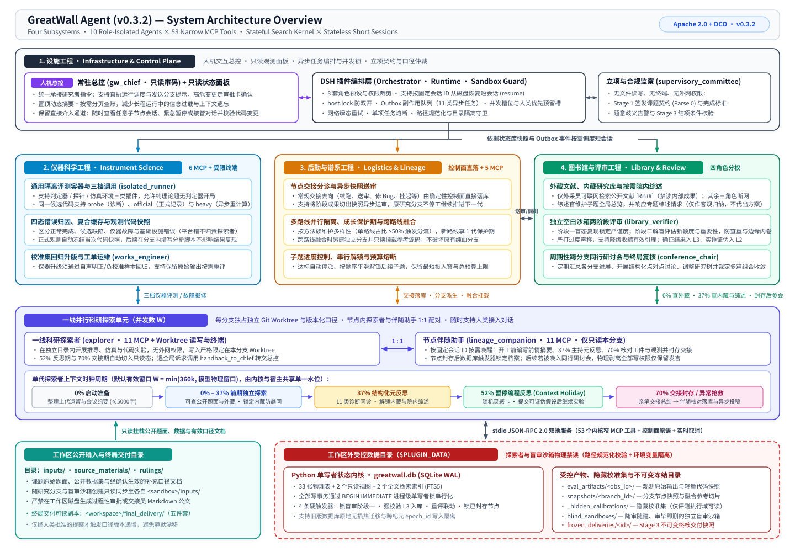
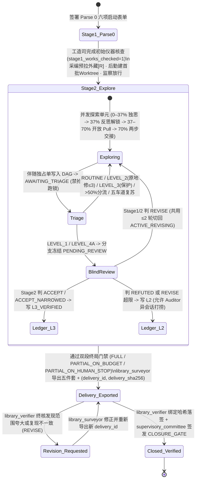
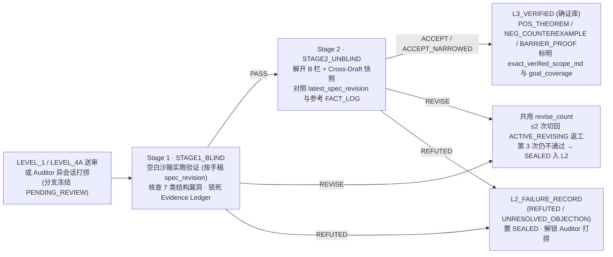

# GreatWall Agent (`v0.1-alpha`) 系统架构说明

> **版本与状态声明**：`v0.1-alpha`（早期实验性 Demo · **Apache 2.0 + DCO**）  
> **文档定位**：本文面向开源协作者、系统架构研究者与希望基于本项目二次改造的开发者，从设计哲学、四大工程的深度拆解、基于真实代码的接口契约，到坦诚可见的技术债与未解难题，完整还原 GreatWall Agent 的设计与实现细节。本项目目前仍处于极度不成熟的早期实验阶段，并非开箱即用的生产工具；后续演进构想与重构计划见 [`ROADMAP.md`](./ROADMAP.md)，全部论文、工程项目与公开技术生态溯源见 [`REFERENCES.md`](./REFERENCES.md)。

---

## 目录

- [0. 项目定位与仓库代码地图](#0-项目定位与仓库代码地图)
- [1. 设计哲学与开源动机](#1-设计哲学与开源动机)
  - [1.1 为什么做这件事：现实痛点与开源空白](#11-为什么做这件事现实痛点与开源空白)
  - [1.2 对基座模型的清醒定位：服务科研人员的学术共同体](#12-对基座模型的清醒定位服务科研人员的学术共同体)
  - [1.3 钱学森《工程控制论》与仍在摸索中的核心张力](#13-钱学森工程控制论与仍在摸索中的核心张力)
  - [1.4 核心文献与思想渊源概览](#14-核心文献与思想渊源概览)
  - [1.5 开源初心（Apache 2.0 + DCO）](#15-开源初心apache-20--dco)
- [2. 系统全景：四大工程、“一委三部”与三阶段闭环](#2-系统全景四大工程一委三部与三阶段闭环)
  - [2.1 全景架构图](#21-全景架构图)
  - [2.2 逻辑组织（一委三部）与四大工程映射](#22-逻辑组织一委三部与四大工程映射)
  - [2.3 端到端三阶段科研生命周期（Stage 1–3）](#23-端到端三阶段科研生命周期stage-13)
- [3. 四大工程深度拆解](#3-四大工程深度拆解)
  - [3.1 设施工程（Infrastructure Engineering）](#31-设施工程infrastructure-engineering)
  - [3.2 仪器科学工程（Instrument Engineering）](#32-仪器科学工程instrument-engineering)
  - [3.3 后勤工程（Logistics & Lineage Engineering）](#33-后勤工程logistics--lineage-engineering)
  - [3.4 图书馆工程（Library & Peer-Review Engineering）](#34-图书馆工程library--peer-review-engineering)
- [4. 接口契约（基于当前真实代码）](#4-接口契约基于当前真实代码)
  - [4.1 人机与主控入口契约（DSH Tool & Console HTTP）](#41-人机与主控入口契约dsh-tool--console-http)
  - [4.2 编排内核 ↔ Python 真相内核（stdio JSON-RPC 2.0）](#42-编排内核--python-真相内核stdio-json-rpc-20)
  - [4.3 七大角色 × 32 个窄 MCP 工具精确契约](#43-七大角色--32-个窄-mcp-工具精确契约)
  - [4.4 仪器插件与校准集扩展契约](#44-仪器插件与校准集扩展契约)
  - [4.5 SQLite 持久化 Schema 与触发器契约](#45-sqlite-持久化-schema-与触发器契约)
- [5. 已知技术债与当前局限](#5-已知技术债与当前局限)

---

## 0. 项目定位与仓库代码地图

**GreatWall Agent（长城）** 是一套构建在开源 DeepSeek Harness（DSH）插件体系与 Python/SQLite 状态内核之上的**长周期、多学派并发自主科研多智能体实验基座**。它的出发点不是硬编码解决某一道竞赛题，而是尝试把学术界近期在自主科学发现方向上的关键思路——独立学派并发分流、强制元反思、隔离沙箱同行评审、评测工具随同演化、短会话无状态托管——落地为一个可以真实运行、调试和拆改的开源基座。希望利用DSH的开放性，构建出一个兼容不同已有科学工具、持续改进的社区生态。

当前全部可运行源码位于 [`greatwall-v6up/`](./greatwall-v6up/)（总计约 1.8 万行代码，不计测试与文档）：

```text
greatwall-v6up/
├── core_python/                         # Python 3.11+ 单写者真相内核与隔离执行器（~10.8k 行）
│   ├── config.json                      # 时钟上限、并发槽位、学派分流与熔断阈值配置
│   ├── agents/                          # 7 类角色的运行态 System Prompt 模板
│   ├── prompts/holiday_prompts.yaml     # 29 条夜科学元反思启发题库
│   ├── evaluators/
│   │   ├── base_instrument.py           # 仪器标准取数 get_public_input() 与返回体协议校验（113 行）
│   │   ├── isolated_runner.py           # 跨进程隔离执行、四元复合缓存、Stage A 持久化与校准引擎（721 行）
│   │   └── examples/                    # 异构科研样例（几何反例 / Lean4 桩 / Pareto 仿真）
│   ├── mcp_server/
│   │   ├── db_schema.py                 # 外部隔离路径解析、19 表 + 2 FTS5 + 9 触发器 DDL（967 行）
│   │   ├── control_plane_service.py     # Single-Writer 事务状态机、快照与 UI 投影（2,702 行）
│   │   ├── greatwall_core_mcp.py        # stdio JSON-RPC 2.0 入口、32 工具与 15 内部原语分发（842 行）
│   │   ├── mcp_core_helpers.py          # 统一回执外壳、JIT 路标、脱敏与复合指纹（366 行）
│   │   ├── mcp_schema_docs.py           # 工具 JSON Schema 枚举/约束自动增强（335 行）
│   │   ├── tools_explorer.py            # explorer 5 个工具实现（934 行）
│   │   ├── tools_companion.py           # lineage_companion 4 个工具实现（634 行）
│   │   ├── tools_logistics.py           # logistics_coordinator 5 个工具实现（883 行）
│   │   ├── tools_library.py             # library_surveyor(3) + library_verifier(5)（1,030 行）
│   │   ├── tools_works.py               # works_engineer 6 个工具实现（689 行）
│   │   └── tools_supervisory.py         # supervisory_committee 4 个工具实现（390 行）
│   └── skills/                          # 主控 SOP 与共享探针台账 SKILL_LEDGER.json
├── dsh_plugin/                          # DSH (0.2.2-rc.x) Cordis 插件与控制台前端（~7.0k 行）
│   ├── package.json & cordis.patch.yml  # Cordis Bundle 注册清单
│   ├── presets/                         # 6 套子角色专用 DSH Agent Presets
│   ├── lib/
│   │   ├── index.js                     # Cordis 注入入口与 greatwall_orchestrate (11 动作) 注册（479 行）
│   │   ├── orchestrator.js              # 插件编排内核、单待办熔断器与公平并发调度（1,472 行）
│   │   ├── agent_session_host.js        # ctx.agents.create() 封装与显式模型绑定解析（985 行）
│   │   ├── pair_lifecycle.js            # 单节点探索者 + 伴随助手暂停续传与交接驱动（547 行）
│   │   ├── clock_and_turn_gap.js        # TokenMeter 水位采样与 37%/70% 回合间隙控制（276 行）
│   │   ├── read_isolated_sandbox.js     # 双向隔离路径规范化与 Shell/写操作同步 Guard（486 行）
│   │   ├── presets.js                   # 6 套角色 Preset 安装与热注册（414 行）
│   │   ├── prompts.js                   # 7 角色路由表、32 工具白名单与平台 Shell 解析（178 行）
│   │   ├── mcp_bridge.js                # Node ↔ Python stdio JSON-RPC 2.0 客户端桥接（290 行）
│   │   ├── console_routes.js            # 控制台鉴权 HTTP 路由 /api/greatwall.*（380 行）
│   │   ├── client.js                    # DSH 右侧栏 React 指挥舱前端原型（1,064 行）
│   │   └── blackbox_projection.js / fact_log_middleware.js / telemetry.js / skillpack.js
│   └── test/                            # Node 单测与假模型全链路沙盘测试
└── tests/                               # Python P0–P4 契约、触发器、执行器与回归测试
```

---

## 1. 设计哲学与开源动机

### 1.1 为什么做这件事：现实痛点与开源空白

当我真正用 AI 打过数学建模、算法或科研类比赛，很快发现一个非常棘手的现实：**仅靠现有 Agent Harness 自带的通用团队协作功能，几乎不可能照顾到彼此互斥的不同学派与不同解法。** 哪怕同时拉起多个子智能体，只要缺乏隔离与显式分流，不出几轮它们就会迅速趋同到同一个“表面容易写出代码、实则存在结构天花板”的局部解法里，多并发瞬间退化为昂贵的算力重播。

这背后有一个必须正面承认的底层前提：**我必须默认，当前的基座大模型是一种学术品味（Academic Taste）非常弱的存在（哪怕是Claude也是如此）。** 它的符号推演带宽很高、预训练知识极其庞大，但一旦进入十小时级的长程开放任务，就会暴露出三类顽固倾向：
1. **长上下文注意力退化与“体面怠惰”**：对话拉长到数十万 Token 后，模型不仅推理成本二次方上升，还会牢牢锚定在自己早期的局部直觉里，最终用极其流畅的学术辞令自我合理化，宣布“当前解已接近理论极限”并停止实质探索；
2. **高并发下的群体思维坍塌**：多个 Agent 如果共享一个未经审定的公告板，早期谁先跑出一个能看的结果，其余分支立刻蜂拥跟风；
3. **工具损坏与科学失败混淆**：评测脚本读错字段、模拟器环境报错，如果没有结构化归因隔离，模型会直接把平台 Bug 当成“这个数学思路不行”而放弃真正有价值的突破。

放到更大的行业与学术背景里看，这一方向也存在明显的空白：
- 大规模多智能体并行科研已经展现出惊人潜力——例如 OpenAI 用 64 并发 Agent 推进圈双覆盖猜想（CDC），乃至用上千个去中心化 Agent 协作探索 Navier-Stokes 方程的奇点/爆破问题；
- 但市场上真正跑通的同类系统绝大多数是闭源的；开源社区则大多聚焦在某一个具体领域的专用插件（比如 Lean 形式化证明工具链），或者是面向通用软件工程的 Workflow 与通用多智能体编排框架；
- 而在学术界，近两年已经出现了不少极具创新性与代表性的探索——如 *The Station*、*AgentDiscover*、*Cogentic*、*Stateless Language Agents (SLA)*、*Red Queen Gödel Machine (RQGM)* 和 *Audit the Scaffold*。它们各自打磨出了很有价值的机制，却缺少一个把这些前沿思路真正组装落地、供人持续改造的开放工程基座。

同时，这里必须极其坦诚地交代一个**本项目目前压根也无法解决的重大问题**：**非标量科学任务的梯度缺失**。对于纯解析数学证明、构造性反例、多目标 Pareto 物理仿真或无客观打分器的机理探索，根本不存在一个单调递增的实数分数告诉搜索系统“这一步离真理更近了”。这不是靠多写几个工具接口就能解决的——当前架构最多只是做到“不在接口层强制假设单一标量”，并用同行实测盲审和元反思做极其有限的替代，距离真正解决开放科学搜索的方向引导还有很长的路（这方面想了解的可以读读"Can AI Agents Make Open-Ended Scientific Discovery? Evidence from Station"[arXiv：2610.08927]）

### 1.2 对基座模型的清醒定位：服务科研人员的学术共同体

既然基座模型是一位“推演带宽极高、知识面浩瀚，但学术品味薄弱、易脑雾、易怠惰与浮夸的科研新人”，整个系统的使命就**不应该是**充当监工、指望靠一堆脆弱的正则脚本或繁琐的行政公文去规训她（正如初始手稿 [`docs/architecture/手写project.md`](./docs/architecture/手写project.md) 里写的：如果仅靠正则清洗吹捧词就能做好学术审稿，人类科研共同体就不需要同行评议了）。

相反，本架构把整套系统定位为一座**服务一线科研探索者的学术共同体**：
- **唯有 Science 与一线科研探索者本身是目的**，所有治理机构、数据库、沙箱和协议都只是脚手架；
- 替她挡住过早的群体噪声，给她可靠透明的实验仪器，在她容易陷入局部内卷时请外部视角敲醒她，在她上下文膨胀到神志不清前帮她把真实证据链与“科研遗嘱”安全交给下一代，并对她提交的硬核成果给予独立公正的实测审定。

### 1.3 钱学森《工程控制论》与仍在摸索中的核心张力

经过多轮实战和推倒重来，项目反复验证了钱学森《工程控制论》中的那条准则：

> *“一个真正优秀的系统，并不一定是大量最优子系统的强行拼凑；相反，优秀的子系统之间往往存在难以解决的冲突，强行捏合反而会导致系统整体效能下降。因此很多优秀的系统往往是由那些并非最优、但配合良好的子系统构成的和谐整体。”*

必须诚实地说：**我们至今并不认为自己已经摸清了这类系统最终、最完美的“核心工程边界”究竟划在哪里。** 恰恰相反，整个 `v0.1-alpha` 的演进史，就是在以下四组彼此拉扯的根本张力里不断试错、做减法和找当下平衡点的过程：

1. **确定性代码 vs 大模型自主权的张力**：
   - 把太多判断交给大模型（例如设立常驻总管 Agent 靠聊天管全局），几十轮后必然熵增溃决、满地过程 `.md` 公文；
   - 反过来把太多科学判断写死成确定性脚本（例如硬编码赛题误差门槛、用正则判论文质量），系统一离开特定竞赛题就当场瘫痪。
   - **当下的折中**：状态跃迁、并发槽位、时钟采样、沙箱拦截、审稿锁和队列熔断全由确定性代码与 SQLite 触发器死守；而具体科学假设、推导、实验设计与学术评议完整交还给短生命周期模型会话。
2. **群体隔离（防同化） vs 知识共享（防重复造轮子）的张力**：
   - 完全共享内存会导致全体并发分支几轮内被同一个平庸假说同化；完全隔绝又会让不同分支反复踩进同一个死胡同。
   - **当下的折中**：同一门派内部靠私有谱系接力，跨门派物理不可互看；公共知识统一经中央图书馆流转，且每代探索者前 `37%` 上下文窗口锁定内藏 `L3/L2`（只开放外部参考 `[R###]`），逼其先独立撞一次墙再解锁共享。
3. **长程连续记忆 vs 单会话上下文纯净度的张力**：
   - 让单个 Agent 连续跑十几小时必然陷入注意力脑雾；每次全新冷启动又容易丢失前人踩过的坑与微妙直觉。
   - **当下的折中**：持久化研究状态全部归外部 SQLite WAL 与 Git Worktree（有状态的搜索），所有角色会话短生命周期化（无状态的智能体），用定额 `<=2200` 字滚动重压缩看板 + 探索者退场前亲笔《科研遗嘱》在代际间传递高信噪比压缩信息。
4. **防作弊防幻觉的严苛度 vs 保护早期创意萌芽的张力**：
   - 评审太松会被大模型的流利辞令骗进一堆伪结论；开局测试太严苛又会直接扼杀尚未打磨好的高潜力路线，只剩下最保守的平庸解存活。
   - **当下的折中**：把诊断（`probe`）与正式凭证（`official`）同码分层，将工具报错与科学失败物理隔开，审稿引入 `REVISE` 返工通道与 `LEVEL_3` 偏科保护线，同时用空白沙箱实跑守住 `L3` 入库底线。

5. **权限收紧（防越权作弊） vs 权限放开（便于执行与修正）的张力**：
   - 权限给得太大，模型很容易越界直接下场改东西——调度者亲自改代码、探索者跨目录偷看答案或动评测脚本、辅助角色抢跑干主活，职责边界与安全防线瞬间失效；
   - 权限收得太死，系统又会变得极其僵硬——角色一遇到小卡点就改不动、测不了（例如盲审官没 Shell 只能瞪眼猜公式，或者探索者连公开题面和必要工具都碰不到），动辄卡死且极难运转。
   - **当下的折中**：按岗位切分最小必要工具面并配合目录隔离——后勤与监察保持 0 原生工具纯走数据库，伴随单向只读，探索者与工造司的写权分别锁在各自 Worktree 与仪器目录内，盲审官则在现建现删的空白临时沙箱里保留只读与 Shell 验算权，试图在“防越界”和“能把活干成”之间卡出一条够用的缝隙。

### 1.4 核心文献与思想渊源概览

本架构在设计上吸收了多篇 2025–2026 自主科研论文与公开规范的核心机理，并结合 DSH 插件体系做了工程落地（完整的原作者问题、吸收机制、代码落点、演进路线图前沿参考与公共链接详见 **[`REFERENCES.md`](./REFERENCES.md)**）：

| 借鉴来源 | 在本系统中吸收的核心机制 | 当前 `v0.1-alpha` 主要落点 |
|---|---|---|
| **Cogentic** (`arXiv:2609.40324`) | 协调层严守 `No Mathematical Opinion`；单篇+跨篇两阶段对抗审稿；独立 `Auditor` 抽取引理异会话复验 | 后勤/监察零偏见调度；两阶段盲审与 `propose_salvaged_lemma` |
| **The Station v1/v2** (`2608.23691`, `2610.08927`) | 初期学徒隔离防跟风；`37%` 强制外部专家元反思（11 类题库 + 29 条夜科学题）；先锁不可逆 `Evidence Ledger` 再裁决；五车道停滞复苏；无标量多轨道 `tracks` | `0–37%` 内藏锁定、伴随 `REFLECT_37`、`trg_reviews_lock_stage1`、`dispatch_stagnation_five_lanes`、仪器 `tracks` |
| **Stateless Language Agents (SLA)** (`2610.07625`) | “有状态的搜索 + 无状态的智能体”；严格区分代码执行报错与科学负结果；`Retained Candidate` 物理快照与声明式探索准则 | 短生命周期会话托管、四态错误隔离、后勤 `LEVEL_2` 快照原地修补 |
| **AgentDiscover** (`2610.05334`) | 探索者按需定向 Pull 历史库；每次工具返回附带确定性 `next_step_guidance` 路标；事前预测 `linguistic_prediction`；`<worktree>/tools/` 资产跨代持久化；过程顾问“三不给”禁令 | `37–70%` 两级 Pull、统一回执外壳、`run_isolated_eval`、伴随顾问红线 |
| **RQGM & Audit the Scaffold** (`2606.26294`, `2609.34924`) | 仅在同一仪器版本内比较指标；错放与漏洞用例沉淀为校准集回归升级；保留原始产物按需重评；工造司优先投资可观测探针 | `isolated_runner.py` 版本域隔离与校准引擎、`recompute_stage_b_only`、共享 `PROBE` 探针 |
| **OpenAI CDC Prompt** | 按核心数学思想归类的动态方法族谱；聚拢超半数强制正交分流；等价归约不算完成；7 类结构漏洞红队清单；最短投入时间 + 诚实部分交付 | `method_families` 与 `>50%` 聚拢分流、`EQUIVALENT_REDUCTION` 约束、盲审 7 查、双段终局门禁 |

### 1.5 开源初心（Apache 2.0 + DCO）

坦白地说，作为一名数学系背景的发起者，我的工程技术能力非常有限，也一直缺少并肩协作的伙伴。我不知道自己还能把这套东西独自做多久，也不知道它最终能跑出怎样的实战效果。但我真心觉得，把学术界这些前沿的多智能体科研想法真正做成开放基座，是一件太有意思、也太值得有人继续推下去的事——我不想看着它停在本地硬盘里慢慢沉寂，落得：

> *“章台柳，章台柳，昔日青青今在否？纵使长条似旧垂，也应攀折他人手。”*

如果这个极度粗糙的 `v0.1-alpha` 能帮到哪怕一位素未谋面的朋友——无论你是拿它辅助打一场比赛、拆出其中某个机制魔改自用，还是愿意提 Issue、改代码、一起把这个插件和基座打磨得更好，我都会非常开心。就像那句我一直很认同的话：

> *“假如我能使一颗心免于哀伤，那我便不虚此生。”*

因此，项目以 **Apache 2.0 + DCO** 完全开源，把全部思考、源码和满身的技术债如实交给大家。

---

## 2. 系统全景：四大工程、“一委三部”与三阶段闭环

### 2.1 全景架构图

系统在逻辑治理上呈现扁平制衡的**“一委三部 + 基层科研探索群”**，在软件架构上彻底收口为四个正交的工程子系统——**设施工程、仪器科学工程、后勤工程、图书馆工程**。



> 关于图中“外围人机接入面”的边界说明：与人类直接对话的**主控会话（Primary Session）**由大模型驱动，它不是确定性调度器；它只是通过 `greatwall_orchestrate` 工具向后台确定性的**插件编排内核（Orchestrator）**发指令。右侧栏指挥舱面板（`client.js`）同样只是挂载在编排内核外侧的早期观测原型。

### 2.2 逻辑组织（一委三部）与四大工程映射

| 工程划分 | 对应逻辑机构 / 角色 | 解决什么问题 | 核心源码模块 |
|---|---|---|---|
| **1. 设施工程** | 插件编排内核（Orchestrator）<br>监察委员会（一委：`supervisory_committee`）<br>外围人机接入（Prototype） | 扁平会话拉起与销毁、模型绑定与窗口适配、单待办熔断、版本化裁决同步、双向隔离沙箱、SQLite 单写者真相库、流程合规与终局核签 | [`orchestrator.js`](./greatwall-v6up/dsh_plugin/lib/orchestrator.js)、[`agent_session_host.js`](./greatwall-v6up/dsh_plugin/lib/agent_session_host.js)、[`read_isolated_sandbox.js`](./greatwall-v6up/dsh_plugin/lib/read_isolated_sandbox.js)、[`presets.js`](./greatwall-v6up/dsh_plugin/lib/presets.js)、[`db_schema.py`](./greatwall-v6up/core_python/mcp_server/db_schema.py)、[`control_plane_service.py`](./greatwall-v6up/core_python/mcp_server/control_plane_service.py)、[`tools_supervisory.py`](./greatwall-v6up/core_python/mcp_server/tools_supervisory.py) |
| **2. 仪器科学工程** | 工造司（一部：`works_engineer`） | 科研仪器/诊断探针/计算环境供给、三档同码执行、四态错误隔离（判不了不判负）、四元复合缓存、校准集回归升版与工单闭环 | [`base_instrument.py`](./greatwall-v6up/core_python/evaluators/base_instrument.py)、[`isolated_runner.py`](./greatwall-v6up/core_python/evaluators/isolated_runner.py)、[`tools_works.py`](./greatwall-v6up/core_python/mcp_server/tools_works.py) |
| **3. 后勤工程** | 后勤工作部（二部：`logistics_coordinator`）<br>一线探索单元（`explorer` ◄─1:1─► `lineage_companion`） | 单节点自适应上下文时钟（`37% / 70%`）、伴随单节点挂起续传、谱系 DAG 与死胡同归档、定额重压缩看板、六类分诊、动态族谱与 `>50%` 无豁免分流、五车道复苏 | [`pair_lifecycle.js`](./greatwall-v6up/dsh_plugin/lib/pair_lifecycle.js)、[`clock_and_turn_gap.js`](./greatwall-v6up/dsh_plugin/lib/clock_and_turn_gap.js)、[`tools_explorer.py`](./greatwall-v6up/core_python/mcp_server/tools_explorer.py)、[`tools_companion.py`](./greatwall-v6up/core_python/mcp_server/tools_companion.py)、[`tools_logistics.py`](./greatwall-v6up/core_python/mcp_server/tools_logistics.py) |
| **4. 图书馆工程** | 中央图书馆（三部：`library_surveyor` + `library_verifier`） | 外藏 `[R###]` 采编与无解诚实结案、内藏 `L3/L2` 管理、空白沙箱两阶段实测盲审、`Auditor` 异会话打捞、非连坐引用图、Stage 3 五件套与版本绑定终核 | [`tools_library.py`](./greatwall-v6up/core_python/mcp_server/tools_library.py) |

### 2.3 端到端三阶段科研生命周期（Stage 1–3）

任何科学任务在系统内都收敛为三个清晰的宏观阶段（单会话 `37%` 元反思与全局停滞五车道均属于 Stage 2 内部运转机制）：



1. **Stage 1（Parse 0 启动对齐与初始化）**：
   - 开跑前由主控协助人类在 2 分钟内确认并签发 **Parse 0 六项启动表单**（落入 `parse0_contract`）：① 问题陈述与“什么算完成”（明确部分成果、严格证伪/反例是否算完成）；② 子题划分与可选策略题序 `question_order`（默认空，全子题并行）；③ 已有仪器、校准样本与指标方向（**允许全部留空**，支持 0 判定器开放课题）；④ 已知候选思路提示（可留空）；⑤ 总预算与最短投入时间 `min_commitment_window`；⑥ 预期交付形态。
   - 随后编排内核依次完成四项确定性初始化：① 唤醒 `works_engineer` 履行初始仪器核查责任并落标 `stage1_works_checked = 1`；② 唤醒 `library_surveyor` 预采编外藏 `[R###]` 先验卡；③ 唤醒 `logistics_coordinator` 建首批探索分支、Git Worktree 并挂载只读公开 `inputs/`；④ `supervisory_committee` 核验 Parse 0 已签并写 `compliance_alerts` 放行。
2. **Stage 2（无人值守高并发探索、盲审与工具协同演化）**：
   - 多路一线探索单元沿各自上下文压力时钟独立推进，在 `37%` 完成元反思解锁图书馆、`70%` 完成两步交接；后勤执行分诊与多样性分流；图书馆在独立空白沙箱内实跑验证手稿；工造司运维仪器与诊断探针；监察委巡检合规并在遇根本题意歧义时亮 `ALERT_AMBIGUOUS_SPEC` 红灯同时按原口径继续跑完。
3. **Stage 3（终局汇编、五件套封箱与版本哈希绑定两步核签）**：
   - 只有通过 `check_stage2_closure_gate`（`FULL` 全必答子题皆有活跃 `FULL_GOAL` `L3`；或越过 `min_commitment_window` 且预算耗尽触发 `PARTIAL_ON_BUDGET`；或人类通过控制面写入不可伪造的 `human_stop_requested_at` 触发 `PARTIAL_ON_HUMAN_STOP`）方进入 Stage 3；
   - `library_surveyor` 仅以已审 `L3` 与精确剩余缺口导出五件套至 `<workspace>/final_delivery/`（① 正式研究报告；② 最小可运行复现套件；③ 阻碍证明与否定清单；④ 谱系探索路线图；⑤ 后续研究断点笔记），同事务签发 `(latest_delivery_id, latest_delivery_sha256)` 置为 `DELIVERY_EXPORTED` 并重置 `verifier_final_audit_passed = 0`；
   - 编排内核随即唤醒 `library_verifier` 经 `STAGE3_FINAL_AUDIT:<delivery_id>` 逐条核验正文未夸大任何 `L3` 成立边界且复现脚本一致（不通过置 `REVISION_REQUESTED` 并写 `verifier_revision_notes` 退回重导），最后由 `supervisory_committee` 核验绑定哈希一致后正式晋升 `CLOSED_VERIFIED`（防止审过报告 A 却放行重导出的报告 B）。

---

## 3. 四大工程深度拆解

### 3.1 设施工程（Infrastructure Engineering）

设施工程负责一切跨业务部门的底座机制：运行时编排、模型与队列守卫、隔离沙箱与权限矩阵、SQLite 单写者真相库、监察委员会与外围人机接口。

#### 1. 两层物理架构与进程通信边界
- **上层 · DSH Cordis 插件（`greatwall-v6up/dsh_plugin/`）**：采用 ESM JavaScript 编写，零修改 DSH 原生 `app.asar`，通过 `export const inject = ['tools', 'systemPrompt', 'agents', 'sessionProjections', 'tokenMeter', 'sessionQuery']` 注入宿主能力；
- **下层 · Python 3.11+ 状态机与隔离内核（`greatwall-v6up/core_python/`）**：零第三方强依赖（标准库即可跑通控制面与 SQLite），通过 `stdio JSON-RPC 2.0`（`mcp_bridge.js`）与插件通信；
- **分级超时对齐**：常规元数据与只读轮询默认短超时（`60s`），而 `run_isolated_eval` 与校准集回归实跑显式配置长超时（`300s`），避免 Node 侧先断链而 Python 子进程仍在写库造成状态错位。

#### 2. 插件编排内核（Orchestrator）的六项确定性机制
1. **无 Root 扁平并发与两类会话生命周期**：
   - 系统不走宿主原生父子派单树（规避 `maxDepth = 1` 与子代理并发上限），由 `agent_session_host.js` 直接调 `ctx.agents.create()` 拉起平级独立会话；
   - **5 类治理角色（一次性短会话）**与**单节点探索单元（节点内保活伴随）**的清理边界严格不同：
     ```js
     // 模式 A：5 类治理短会话 —— 执行完毕立即销毁并清理临时盲审沙箱
     if (isOneShotGovernanceRole(role)) {
       try {
         await handle.agent.followup(startupManifest)
         await handle.agent.whenIdle()
       } finally {
         await handle.dispose()
         if (role === 'library_verifier') await cleanupBlindSandbox(roleSandboxAbsPath)
       }
     }
     // 模式 B：单节点探索单元 —— finally 包裹整个节点生命周期 (PRE_SPAWN -> REFLECT_37 -> HANDOFF_70)
     try {
       await driveExplorerCompanionPair(nodeId, explorerHandle, companionHandle)
     } finally {
       await explorerHandle.dispose()
       await companionHandle.dispose() // 节点结束即销毁，严禁跨代常驻
     }
     ```
2. **显式模型绑定解析链与拒启门禁**：
   - `start` 前必须按**「显式启动参数 > `callerAgent.options` > 主控会话事件流（`model/selection` / `request/context`） > 插件配置」**解析权威 `{ provider, model, modelPhysicalWindow }`（因为 DSH UI 手动切模型只写会话事件流，不写 `agent.options`）；
   - 解析失败直接拒启 **`MISSING_MODEL_BINDING`**，严禁传空 `agentOptions` 导致子会话静默跌落到未授权模型渠道。
3. **自适应有效上下文窗口**：
   - 有效窗口取 **`W = min(500,000, modelPhysicalWindow)`**，由宿主连同 `pressure_tokens` 原子同步至 SQLite `lineage_nodes.effective_context_window`，JS 编排内核与 Python MCP 共享同一份 `W` 计算 `pressure_pct = pressure_tokens / W`——既将 1M 大窗口封顶在 `500k` 控制成本，又避免 128k/272k 小窗口按 500k 算 `70% = 350k` 从数学上永远无法到达。
4. **单条待办项级治理熔断器（`GovernanceItemCircuitBreaker`）**：
   - 如果对“整条队列的待办集合”算指纹，会双向出错：分步推进中的单张工单（第 1 轮复现、第 2 轮加校准集、第 3 轮修补）会被误杀；而一张彻底卡死的工单 `A` 又会被其他工单 `B/C` 进出掩盖，永远逃逸熔断；
   - 因此编排内核针对 `works:queue`、`survey:pending`、`logistics:triage`、`logistics:stagnation` **按单条待办 ID（`ticket_id` / `req_id` / `node_id`）独立追踪可核验客观进展**（如是否结案、关联仪器是否产出新版本/校准变更、节点是否脱离 `AWAITING_TRIAGE`；其他工单进出绝不替它重置，纯文本复述不算进展）；同一待办连续 2 次无客观进展即**仅将该条待办挂起熔断并上报告警**（不连坐同队列其他健康项，状态产生客观变化或人工 `resume` 时复位）。
5. **版本化公开裁决（`spec_revision`）与精准终止（`abort_node`）**：
   - 彻底禁止向运行中会话池广播实时干预指令（防止踢醒休眠保活中的只读伴随、击穿盲审隔离或制造双真源冲突）；
   - 人类澄清题意或追加约束时，将《补充裁决文档》写入工作区公开 `rulings/` 目录，编排内核自动递增 `parse0_contract.latest_spec_revision` 并将最新摘要同步至 SQLite（供 0 原生工具的后勤和监察通过 DB 视图读取）；
   - 每个探索节点创建时锁定自身 `lineage_nodes.spec_revision`：旧节点按原口径自然跑完，新节点绑定最新口径；唯有当人类明确执行 **`pause → 补裁决文档 → abort_node(node_id) → resume`** 时，才精准销毁跑偏探索者与私有伴随并标终态 `CLOSED` 释槽。
6. **SQLite 单真源防僵尸**：
   - 探索循环每轮续推前借 `control_plane/sync_pressure` 顺带核查 SQLite 实时 `node_status`，节点一旦已被外部关闭或中止，立即停机销毁探索者与伴随释放槽位；待交接/待抢救状态唯一落 SQLite `lineage_nodes.pending_handoff_mode`，消除内存双账本。

#### 3. 双向隔离沙箱与角色权限规划（`read_isolated_sandbox.js` & `presets.js`）
隔离机制严格区分两个方向：
- **开放外部 $\to$ 内部**：工作区公开输入目录（`inputs/`、`source_materials/`、`problem_pack/`、`data/`、`rulings/`、`attachments/` 等及顶层公开文档）对有文件权限的角色只读开放；`fork_branch` 与构建盲审沙箱时，同步挂载对应 `spec_revision` 的公开输入至 `<sandbox>/inputs/`；
- **严防内部 $\to$ 外部**：所有数据库、Stage A 产物、物理快照、隐藏校准集与临时盲审沙箱全部外置在工作区之外的 `$PLUGIN_DATA/workspaces/<ws_hash>/`；通过目录外置 + 环境变量清理 + `read_isolated_sandbox.js` 同步拦截实现应用层防线：
  - 基于节点 `cwd` 执行 `resolveCanonicalTarget()`（`fs.realpathSync` 逐层解析最深存在祖先并做 Windows 小写规范化），阻断 `../` 与符号链接逃逸；
  - 拦截一切过程性 `.md` 公文写入（`PROCESS_MD_FORBIDDEN_RE`：`HANDOFF*.md`、`*_AUDIT.md`、`*_CLOSURE.md`、`REVIEW*.md` 等）；
  - 拦截访问受控路径特征词（`PROTECTED_TOKEN_RE`：`greatwall.db*`、`_hidden_calibrations`、`eval_artifacts`、`blind_sandboxes`、`final_delivery` 等）；
  - 盲审沙箱物理禁写（`SHELL_WRITE_RE`）、禁外网（`VERIFIER_NETWORK_CMD_RE`）；探索者在 `70%` 遗嘱回合通过动态 `isReadonly()` 回调瞬时锁写与 Shell；
  - 合法放行 DSH 自身只读溢出文件 `os.tmpdir()/dsh-spill-*`，并在 Windows 盘符路径解析正则中携带左边界断言防止误切 `https://` 等 URL。

在受控沙箱内部，7 类角色映射到 **6 套 DSH Agent Presets**（`presets.js`），按岗位需求分配最小原生工具集（不以防泄密为由剥夺盲审官在独立空白沙箱内跑代码验算的能力）：

| 角色契约 | DSH Preset | 默认推理强度 | 允许原生工具（`win32→pwsh`, 非 `win32→bash`） | 沙箱与读写边界 | MCP 工具数 |
|---|---|:---:|---|---|:---:|
| `explorer` | `greatwall-explorer` | `high` | `read`, `write`, `edit`, `read_image`, `glob`, `grep`, Shell | 写权锁死本分支 Worktree；只读公开 `inputs/`；禁 DB/隐藏集/`evaluators/`/他脉/外网 | 5 |
| `lineage_companion` | `greatwall-companion` | `medium` | `read`, `glob`, `grep` | 单向只读配对探索节点 Worktree 与公开输入区；禁写、禁 Shell | 4 |
| `logistics_coordinator` | `greatwall-db-only` | `low` | `[]`（0 原生工具） | 纯 SQLite 状态机视图驱动 | 5 |
| `library_surveyor` | `greatwall-surveyor` | `high` | `read`, `read_image`, `glob`, `grep`, `web_search`, `web_fetch` | 公开输入区、外部文献/PDF 读取与 Stage 3 汇编 | 3 |
| `library_verifier` | `greatwall-verifier` | `high` | `read`, `glob`, `grep`, **Shell** | 每次现建独立空白目录 `blind_sandbox_<review_id>/`（含只读公开 `inputs/`）；0 写权、禁外网、禁 DB/B 栏/隐藏集/探索 Worktree | 5 |
| `works_engineer` | `greatwall-works` | `medium` | `read`, `write`, `edit`, `read_image`, `glob`, `grep`, Shell | 锁定 `evaluators/`、`skills/` 与公开输入区；严禁修改分支 Worktree | 6 |
| `supervisory_committee` | `greatwall-db-only` | `low` | `[]`（0 原生工具） | 纯只读数据库审计视图 | 4 |

#### 4. SQLite 单写者真相库与三道数据库硬不变量
数据库启用 `PRAGMA journal_mode=WAL; PRAGMA foreign_keys=ON;`，全部写操作经 `BEGIN IMMEDIATE`（`rw_immediate_tx`）串行落库，核心数据按“唯一真相表 vs 派生查询视图”分离（真相永只追加不篡改，视图可从真相无损重建），并在内核层用 **3 条业务硬触发器 + 1 条唯一部分索引** 死守关键不变量：
1. `trg_reviews_lock_stage1`：一旦 `review_queue.stage1_locked_at IS NOT NULL`，任何试图篡改 `stage1_ledger_json` 或锁定时间的 `UPDATE` 直接 `ABORT`（保证解盲后不可倒改盲态证据账本）；
2. `trg_l3_require_verified_review` + `uq_l3_verified_review`：插入 `internal_research_ledger(ledger_type='L3_VERIFIED')` 时，强校验 `verified_review_id` 在 `review_queue` 中存在**同 `question_id`、双阶段均已锁定且终判为 `ACCEPT / ACCEPT_NARROWED`** 的记录，配套唯一部分索引从内核层封死“无单入库”、“Q2 借用 Q1 审稿单串题”与“一单多插 `L3`”；
3. `trg_obs_pending_reval_require_queue`：观测更新为 `PENDING_REVALIDATION` 时，强校验同事务已在 `pending_revalidation_queue` 插入对应活跃重评行，杜绝观测被孤立作废。

#### 5. 监察委员会（一委：`supervisory_committee`）
- **超然流程哨兵**：0 原生工具、推理强度 `low`、单次唤醒 `<=5` 步，严守“零科学偏见、零磁盘 `.md` 公文”，所有检查与告警仅写 `compliance_alerts`；
- **核心职能**：① 核验 Parse 0 已签发（`PARSE0_GATE`）；② 监控 `UNHEALTHY` 熔断仪器与学派聚拢分流响应；③ 无人值守期发现原始题意根本歧义时写入 **`ALERT_AMBIGUOUS_SPEC`** 亮红灯留待人类事后裁决，同时**严禁挂起停摆，维持当前口径续跑**；④ 校验双段终局门禁（强核验控制面写入的真实 `human_stop_requested_at`，绝不轻信 Agent 自传 `human_aborted=true` 绕过最短投入窗）并在版本哈希一致后签发 `CLOSURE_GATE(PASSED)`。

#### 6. 外围人机接入与观测原型（`console_routes.js` & `client.js`）
- 主控会话通过 `greatwall_orchestrate` 操控后台编排内核；
- 右侧栏「长城科研指挥舱」挂载于 DSH `ctx.connection.fetch` 鉴权围栏内，通过 `GET /api/greatwall.status` 与 `POST /api/greatwall.control` 展示活跃状态、谱系 DAG、节点看板/反思/遗嘱、会话黑匣子轨迹与 Worktree 文件源码，并提供紧急按钮。该层目前为无构建链手写 JSX 的早期原型，易用性较弱。

---

### 3.2 仪器科学工程（Instrument Engineering）

仪器科学工程由**工造司（`works_engineer` / `tools_works.py`）**与通用隔离执行容器（[`base_instrument.py`](./greatwall-v6up/core_python/evaluators/base_instrument.py)、[`isolated_runner.py`](./greatwall-v6up/core_python/evaluators/isolated_runner.py)）构成。

#### 1. 第一性定位：仪器与可观测性提供商
工造司不是给每道科学题硬捏一个标量分数的“判官”，而是实验室里的**仪器科**：
- **通用容器零领域硬编码**：是否需要参考基线、某题是否允许全零解、物理误差容差怎么算，全部由课题仪器插件自行实现；纯理论或开放课题允许 0 个 `VERDICT` 判定器开局；
- **Stage 1 统一初始仪器核查责任**：进入 Stage 1 时统一唤醒 `works_engineer` 核查 `parse0_contract.initial_instruments_json`——非空则锻造、校准并注册全部初始仪器（若多台仪器中途某台失败，恢复仅续做未完成项）；为空则调用 `get_works_engineering_queue` 确认无待建仪器并正常退出，由控制面核验 SQLite 状态后置 `stage1_works_checked = 1`；
- **日常工作优先级**：① 修复 `INSTRUMENT_ERROR / INFRA_ERROR` 故障并经 `resolve_works_ticket` 闭合 `PAIN_POINT / DUPLICATE_TOOL / EXPLOIT` 工单（队列 `status` 统一置 `RESOLVED`，具体 `resolution ['RESOLVED'|'WONTFIX'|'DUPLICATE']` 与说明记入 `payload_json` 供审计） $\to$ ② 扩张科研可观测性探针（把黑盒模拟器拆出分种子耗时、长尾分位、守恒残差谱等诊断维度） $\to$ ③ 加固防作弊与收编多分支重复手造的实用脚本。

#### 2. 统一仪器抽象与三档同码执行
所有验证器、诊断探针与仿真环境统一分为三类 `instrument_role`：`VERDICT`（产出正式 `verdict` 与 `[Obs###]`）、`PROBE`（只读诊断剖面，`verdict` 恒为 `None`）、`ENV`（运行时与基准数据集）。全部实现唯一协议：
```python
evaluate(artifact, spec, tier) -> {
    "status":  "OK" | "CANDIDATE_ERROR" | "INSTRUMENT_ERROR" | "INFRA_ERROR",
    "verdict": "PASS" | "FAIL" | "UNDECIDED" | None,
    "tracks":  dict[str, float | int | str | bool | None],  # 0..N 条多维轨道，不假设单一标量
    "details": str                                          # 面向探索者的结构化诊断文本
}
```
- **统一取数与加载**：平台输入唯一放置在 `spec["public_input"]`，通过 `get_public_input(spec)` 安全读取（缺键必抛 `InstrumentInputError` $\to$ `INSTRUMENT_ERROR`，绝不静默判 0 分）。Python 候选模块默认用 `runpy.run_path(cand_file, run_name="_gw_candidate")` 加载调用 `run(public_input)`，避免误触发 `if __name__ == "__main__":` 且绝不靠正则解析 `stdout` 判分；`.lean` / 反例 JSON 等由仪器插件按自身 `artifact_schema` 执行。
- **同一份代码三档调用**：
  - `probe`（快速探索档）：挂载公开/开发样例高频调试，只写 `probe_diagnostic_logs`，**不记入 `observations`**；
  - `official`（正式受控凭证档）：在隔离执行域运行并记正式 `[Obs###]`——有隐藏/保留集的课题跑隔离保留集；无隐藏集的开放数值发现题跑固定公开配置 + 多种子复现集（允许返回 `OK + UNDECIDED`，由后续盲审沙箱做独立变种子扰动复现）；
  - `heavy`（可选高级异步重型档）：调用前必填事前预期 `linguistic_prediction`，入队 `async_eval_jobs` 同步冻结候选文件与 `<worktree>/tools/` 快照及原仪器版本，支持重启续跑与凭 `job_id` 幂等取回（常规科研以 `probe` + `official` 为主力）。

#### 3. 四态错误物理隔离与四元复合缓存

| 返回 `status` | 精确归因 | 平台确定性动作 |
|---|---|---|
| `OK` | 仪器健康跑完并给出有效观测 | 按 `verdict` 映射为 `VALID_PASS` / `MEASURED_REJECTION` / `VALID_UNDECIDED` 入账 |
| `CANDIDATE_ERROR` | 候选自身语法错、崩溃、缺入口、超时 | 归探索者工程缺陷（后勤可判 `LEVEL_2` 原地修补上限 3 次），不计入科学否定 |
| `INSTRUMENT_ERROR` | 仪器自身异常、漏读 `public_input`、违约 | **零处罚探索者**（不打 0 分、不扣修补配额、不增停滞计数、穿透缓存）；同事务自动开单工造司；连续出错 3 次自动熔断置 `UNHEALTHY` |
| `INFRA_ERROR` | 进程/磁盘/RPC 超时等底座异常 | 同样**零处罚探索者**、穿透缓存允许重试并记录系统告警 |

幂等缓存键采用**四元复合指纹**：
```text
cache_key = sha256(
  candidate_entry_sha256
  + recursive_tools_dir_sha256          // 覆盖分支 <worktree>/tools/ 全部辅助模块
  + spec_sha256(tier + data_slice_sha256) // 严防 probe/official/heavy 跨档串用
  + instrument_sha256
)
```

#### 4. 校准集回归升版、版本域隔离与工具台账
- **上线与升版唯一门控**：`PROBE` / `ENV` 可免配校准集；`VERDICT` 注册与升版必须附带独立校准集并在独立子进程逐条实跑，**100% 匹配每条用例自声明的 `(expected_status, expected_verdict)`**（如空文件预期 `CANDIDATE_ERROR + None`、作弊毒样本预期 `OK + FAIL`、合法金样本预期 `OK + PASS`）即直接激活/升版——修 Bug 或封堵刷分只需先把复现用例加入校准集再修代码，绝不要求修 Bug 补丁在旧指标上“赢分”。
- **版本域可比性与诚实重评**：所有 `[Obs###]` 永久绑定 `(instrument_id, instrument_version)` 不可跨版本混排；每次 `official / heavy` 将 Stage A 候选输出持久化至 `$PLUGIN_DATA/.../eval_artifacts/<obs_id>/stage_a_output.json`。升版后旧观测标待重评并入 `pending_revalidation_queue`，工造司调 `recompute_stage_b_only` 按新版重算：**永久保留旧收据不覆盖**（置 `SUPERSEDED_REVALIDATED`），重评成功生成绑定新版且经 `revalidated_from_obs_id` 关联的新 `[Obs###]`；若旧产物缺新字段或输入规格已变，诚实将旧收据与队列项置 `INCOMPATIBLE` 结案。
- **共享工具台账（`SKILL_LEDGER.json`）**：多分支重复手造的辅助脚本由工造司收编为共享只读探针，经可执行与文件实存校验后登记 `skill_id`（`^[a-z0-9_]+$`）、`applicable_scope`、`version`、原始成败计数、`verified_artifact_rel_path` 与 `rollback_pointer`。

---

### 3.3 后勤工程（Logistics & Lineage Engineering）

后勤工程由**后勤工作部（`logistics_coordinator`）**与基层**一线科研探索单元（`explorer` ◄─1:1─► `lineage_companion`）**组成，负责单节点探索质量、代际记忆传承、分诊快照与高并发学派多样性治理。

#### 1. 单节点同会话伴随（方案 A）与四幕生命周期
宿主在单个探索节点 `node_id` 生命周期内，为 `explorer` 配对创建**唯一一个**开启 `keepAliveAfterIdle` 的 `lineage_companion` 会话——它依次承接 `PRE_SPAWN`（写行前看板后暂停）$\to$ `REFLECT_37`（续传元反思后暂停）$\to$ `HANDOFF_70`（续传核对单写落库），**节点结束即随探索者一同销毁，严禁跨代常驻**（既让伴随在 70% 验收时天然记得行前看板与 37% 探索者承诺，又杜绝跨代记忆漂移；遇宿主重启或断线则自动按 `node_id` 从 SQLite 冷启动兜底）。

沿自适应上下文压力时钟 `pressure_pct = pressure_tokens / W`（`W = min(500k, model_physical_window)`），单个探索节点走完四幕节律：
1. **第一幕 `0% – 37%`（独思净室）**：
   - 启动仅 Push `<=2200` 字《谱系状态看板》、上代《遗嘱》、子题契约、`<worktree>/tools/` 清单，并开放只读公开 `inputs/` 与图书馆左翼**外藏 `[R###]`**；
   - **物理锁定公共内藏 `L3/L2` 与本脉深层 DAG / `lineage_dead_ends`**，让探索者先带着自身独立视角撞一次真墙，防止开局直接跟风抄作业。
2. **第二幕 `37%`（回合间隙情报赋能型元反思，无 `eval_count` 门槛）**：
   - 水位达 `>= 0.37 && first_reflection_unlocked == 0` 即触发（纯解析推导 `eval_count == 0` 同样触发）。当前工具正常返回后，控制面在回合间隙暂停探索者并续传伴随进入 `REFLECT_37`；
   - 伴随先调 `get_companion_context(mode="REFLECT_37")` 同步拉取探索者去思维链轨迹摘要、**本脉 `lineage_dead_ends` 摘要、同题中央图书馆 `L3/L2` 目录卡摘要**及从 `holiday_prompts.yaml` `#1–#28` 随机抽取的 1–2 道夜科学题；
   - 伴随切换为外部严苛领域学者（**临床诊断师 + 避坑情报员**），与探索者完成 `<=2` 轮、`<=300` 字短问答：允许输出① 事实盲区诊断（必查 Station 第 7 类 `Attractor Tasks` 引力任务/路灯效应 + 1 项对症元反思）、② 最多 **2 条**高度相关的 `[L2/L3]` 或死胡同编号指针（不代读塞爆全文）、③ 1 道夜科学追问；**严守三不给红线**（绝不给算力配额、方案排序表或算法/公式/代码），下一步决定权 100% 归探索者；
   - 问答结束当场调用 `record_reflection_and_unlock_pull` 置 `first_reflection_unlocked = 1` 解锁内藏，伴随重新挂起，探索者恢复推进。
3. **第三幕 `37% – 70%`（开放定向 Pull 攻坚）**：
   - 探索者自由两级检索全馆两翼（`[R###]` + `L3` + `L2`）并调用 `read_lineage_graph(view="nodes"|"dead_ends")` 查阅本门派私有 DAG 与历代死胡同全表，硬性深推至 `70%`（不设模糊提前交接开关）。
4. **第四幕 `70%` 两步清醒交接（及 `<70%` 意外断线抢救）**：
   - **Step 1（亲笔总结与遗嘱归探索者，先落库后销毁）**：水位达 `>= 0.70` 时，控制面写 `pending_handoff_mode = 'HANDOFF_70'`，通过动态 `isReadonly()` 锁住写工具与 Shell，向仍清醒的探索者发出最后一轮只读纯文本指令，令其亲笔总结核心成果、反常线索并撰写《科研遗嘱》（下一步最小鉴别实验、关键怀疑点与判定翻转条件）；**控制面必须先将探索者亲笔原文可靠持久化至 SQLite `lineage_nodes.will_md` 后才允许 `dispose()` 探索者**；
   - **Step 2（客观核对与独占单写归伴随）**：续传伴随进入 `HANDOFF_70`（若中途重启，`will_md` 非空即原样交冷启动伴随续做 Step 2；为空则转 `CRASH_RECOVERY` 并如实标明原文缺失），对照亲笔遗嘱、Worktree Diff 与客观 `[Obs###]`，去人称拆分 `<2000` 字 A/B 双栏手记（A 栏客观实测供盲审，B 栏主观猜想与遗嘱 Stage 1 屏蔽）、必填 `<100` 字纯机制 `mechanism_summary`、`evidence_grade`（`NONE / ARTIFACT_ONLY / MEASURED`）与本代结构化 `dead_ends`，独占调用 `submit_node_handoff` 落库置 `AWAITING_TRIAGE` 后销毁。服务端防静默吞稿：仅内容完全一致才返 `idempotent_skip: true`，对已闭环节点写入不同新内容必硬报 **`ERR_LOCKED`**；
   - **异常 `<70%` 断线抢救（`CRASH_RECOVERY`）**：只要非一字未产空崩溃（`is_empty_crash == false`），哪怕未满 `37%` 且无数值 `Obs`，只要留有推导稿、反例脚本或阶段代码，一律抢救写入正式 DAG 页置 `AWAITING_TRIAGE`。

#### 2. 真相归档与有限看板解耦
- **历代全量只增不忘 $\to$ `lineage_dead_ends`**：伴随每次交接将本代排除边界按 `SCIENTIFIC_REFUTATION / IMPL_FAILURE / ENV_FAILURE` 追加写入，跨门派物理隔离，第 30 代过 37% 仍可查第 1 代记录；
- **启动扉页摘要 $\to$ `lineage_briefings`（`<= 2200` 字定额滚动重压缩）**：伴随在下代启动前以 $O(1)$ 输入（仅读旧看板 + 刚退场这一页最新手记）执行定额重写 $\text{Rewrite}_{\le 2200}$（绝非字符串累加，服务端硬限总长 `<= 2200` 绝不静默切片）：段 1 锁定核心机制、段 2 合并覆写最新前提/快照与置顶活跃 `REVISE` 异议、段 3 覆盖刷新当前未解矛盾、段 4 仅留当前最相关 Top-K 死胡同并附全表条数索引、段 5 整体替换为最新《科研遗嘱》。

#### 3. 后勤调度总管的六类分诊、分支依赖与学派分流
- **`AWAITING_TRIAGE` 禁抢跑硬锁**：节点处于待分诊且后勤尚未完成 `triage_node` 并刷新 `retained_candidate` 物理快照之前，编排内核严禁为该分支启动下代探索者。
- **六类精确认知分诊**（先过滤全部平台错误，零处罚）：

| 分诊类别 | 适用科学情形 | 确定性动作与分支去向 |
|---|---|---|
| `ROUTINE_CONTINUATION` | 正常渐进探索与局部排除 | 保持 `ACTIVE`，刷新看板派生下代 |
| `LEVEL_1` | 产出与主张形态匹配的可核验载体 | 备份 `retained_candidate` 物理快照，分支置只读冻结 `PENDING_REVIEW` 送盲审 |
| `LEVEL_2` | `CANDIDATE_ERROR` 导致科学假说尚未被真实检验 | 锁定方向禁止换路，从物理快照恢复原地修补（上限 3 次）；满 3 次仍败写本脉 `dead_ends(IMPL_FAILURE)` 回退健康祖先（**不入图书馆 `L2`**） |
| `LEVEL_3` | 主指标暂低或无单一标量，但呈罕见守恒律/结构反常/Pareto 单维优势 | 防伪迹双检后单开受保护支线深查 |
| `LEVEL_4A` | 构造出严密反例或路径不可行《结构阻碍证明》 | 同事务冻结 `PENDING_REVIEW` 送盲审：返 `REVISE` 切回 `ACTIVE_REVISING` 补证；终判 `ACCEPT*`（入 `L3`）、`REFUTED`（入 `L2`）或 `REVISE` 超限才 `SEALED` |
| `LEVEL_4B` | 卡在暂未攻克的定理级缺失引理或未就绪前置 | 登记 `reopen_condition` 暂停进 `Ready Queue`，允许图书馆 `Auditor` 按需打捞残骸中的局部引理 |

- **两机制极简依赖**：仅支持 Parse 0 可选全局 `question_order` 与分支级确定性 `requires`（仅限活跃 `L3-###` 或 `OBS:<inst_id>:PASS`，**只锁声明它的单分支，绝不跨分支并集锁死整题**；若运行期前置 `L3` 被撤回，仅标 `premise_revoked = true` 待自然交接转 `LEVEL_4B`，不强杀在跑会话）。
- **动态方法族谱、无豁免分流与五车道复苏**：后勤据 `<100` 字纯机制 `mechanism_summary` 维护 `method_families`；探索槽位（默认 `6`，硬上限 `10`）先按子题、再按学派公平分配；任意子题一旦满足 **`branch_count_in_family >= 2 && share > 0.50`**，编排内核立刻发 `FAMILY_CONCENTRATION` 强制 `fork_branch(fork_mode="orthogonal")` 正交分流（**绝不设高产豁免后门**）；跨学派 `cross_pollinate` 仅在双方各自至少有 `>=1` 条 `L3` 后放行；全局连续非突破达停滞阈值（默认 `8` 次）或全线阻塞时，调 `dispatch_stagnation_five_lanes` 强制编入 `EXPLORATION / EXPLOITATION / REVIVAL / UNDERSTANDING / STRATEGY` 五互斥车道破局。

---

### 3.4 图书馆工程（Library & Peer-Review Engineering）

图书馆工程由**外藏采编 & Stage 3 撰稿馆员（`library_surveyor`）**与**隔离沙箱实测盲审官（`library_verifier`）**分权运作（[`tools_library.py`](./greatwall-v6up/core_python/mcp_server/tools_library.py)），既是跨门派唯一合法交流枢纽，也是科学质量与终局诚实度的总闸门。

#### 1. 两翼物理分表与诚实无解查新
两张独立物理表共用统一的两级按需检索（`query_library_catalog` 扫 `<=350` 字目录卡 $\to$ `get_library_entry` 按 ID 拉全文，避免上下文被长文献淹没）：
- **左翼 · 外藏表 `external_literature_cards` (`[R###]`)**：
  - `0%` 起全程开放，明确标定为**“带来源出处但未经本系统独立复验的外部参考摘要”**（学术正确性由引用作者与盲审实证核查）；入库强校验 `read_depth`（`full_text / specified_sections / abstract_only`）、5 枚举 `support_scope` 与 `60–1500` 字符独立 `abstract_md`；
  - **区分“馆员完成查新”与“图书馆获得文献”**：若委托资料客观不存在或违背合规边界，馆员在同一入口传 **`outcome = "UNAVAILABLE_REPORT"`** 与 `unavailable_reason_md`——**不向 `external_literature_cards` 插入任何伪 `[R###]` 卡、不强迫虚填 `read_depth`**，仅将对应 `survey_requests` 置为 `CLOSED_UNAVAILABLE` 并保存已查范围与不可得原因。
- **右翼 · 内藏表 `internal_research_ledger`**：`37%` 元反思后解锁，分两类：
  - **`L3_VERIFIED`（确证库）**：同时收录正向定理/算法（`POS_THEOREM`）、通过盲审实测的严格构造反例（`NEG_COUNTEREXAMPLE`）与结构阻碍证明（`BARRIER_PROOF`），并强制标注 `goal_coverage`（`FULL_GOAL | PARTIAL_OR_LEMMA | EQUIVALENT_REDUCTION`）；
  - **`L2_FAILURE_RECORD`（否定雷达）**：保持高度纯净，只收录 `REFUTED`（实锤证伪/致命反例）与 `UNRESOLVED_OBJECTION`（经最多 2 轮 `REVISE` 返工仍未解异议）；**一切代码崩溃、修补超限与环境报错严禁入 `L2`**。

#### 2. 四轨可核验送审准入
后勤在 `LEVEL_1 / LEVEL_4A` 送审时只检查“材料形式与主张类型是否匹配”，通吃四类异构科研产物：

| 科学主张形态 | 送审必需可核验载体 | 盲审沙箱复核方式 |
|---|---|---|
| **数值 / 物理仿真 / 优化** | 合法 `official` / `heavy` `[Obs###]`（无隐藏集题附固定配置多种子 `[Obs###]`）+ 脱敏核心代码 | 沙箱复跑代码，执行独立变种子或扰动边界复现 |
| **形式化定理证明** | 证明检查器（如 Lean 4 `lake build`）`PASS` 凭证 + 完整源码 | 核对原命题防篡改、`#print axioms` 公理审计并实跑编译 |
| **构造性反例** | 具体反例对象参数/数据 + 最小可运行复核校验脚本 | 沙箱亲手运行校验脚本验算前提成立与目标破坏 |
| **纯解析数学推导** | 自包含分步推导正文 + 前提公理边界声明 + 极端特例自检说明 | 借助 Python/SymPy 逐行核验恒等式、边界特例与 7 类结构漏洞 |

#### 3. 空白沙箱两阶段实测盲审状态机与跨口径公正性
每次审稿唤醒全新 `library_verifier`，编排内核现建独立空白沙箱 `blind_sandbox_<review_id>/`，仅只读拷入手稿绑定 **`spec_revision`** 对应的公开 `inputs/`、A 栏文本、脱敏代码/证明/反例文件与 `[Obs###]`（0 写权、物理隔离 DB/B 栏/隐藏集/探索 Worktree/外网，审毕即删）：



- **跨口径公正性**：Stage 1 **严格按手稿绑定口径 `spec_revision = vK` 判定论证真伪**（绝不因人类在提交后追加新裁决 `vM > vK` 就把原前提下严密的推导冤判为 `REFUTED`）；若审稿时已存在更新口径 `vM`，仅在 Stage 2 的 `exact_verified_scope_md` 如实标明“成立于口径 `vK`”且**不得标为最新口径的 `FULL_GOAL`**；
- **参考性阅读遥测与非连坐引用图**：宿主写入的 `FACT_LOG(READ)` 在 Stage 2 仅作参考展示（严禁因作者未调读卡工具引用常规公理而机械拒稿）；手稿声明的 `declared_refs` 默认写入 `epistemic_edges` 为 **`MOTIVATING_REF`**（不传播级联撤回），唯有 Stage 2 盲审官经 `edge_type_overrides` 显式认证的 **`REQUIRED_PREMISE`** 才在前置被推翻时精准触发下游重审；
- **`Auditor` 废墟引理打捞**：仅限已闭/阻塞节点（服务端强校验原分支不处于 `ACTIVE_REVISING` 返工期），剥离重写为自包含命题后作为全新 `STAGE1_BLIND` 审稿单入队，强校验 **`session_id != proposer_session_id`** 走完整两阶段盲审。

#### 4. Stage 3 五件套导出与版本绑定终核
- `export_stage3_final_delivery` 严禁混入未过盲审的草稿；落盘五件套至 `<workspace>/final_delivery/` 时生成 `(latest_delivery_id, latest_delivery_sha256)`、置 `DELIVERY_EXPORTED` 并强制重置 `verifier_final_audit_passed = 0`；
- 编排内核唤醒 `library_verifier` 调用现有盲审工具（传入 `review_id = "STAGE3_FINAL_AUDIT:<delivery_id>"`）实跑复现脚本并逐条核对总报告未夸大任何被引 `L3` 的 `exact_verified_scope_md`：通过则写入 `verifier_audited_delivery_id / sha256` 落签；不通过则将 `project_closure_state.status` 置为 **`REVISION_REQUESTED`** 并写入 **`verifier_revision_notes`** 退回 `library_surveyor` 修正重导（产生新哈希重走终核）。

---

## 4. 接口契约（基于当前真实代码）

本节所有接口名称、参数、错误码与表结构均直接反射核自 [`greatwall-v6up/`](./greatwall-v6up/) 当前运行源码。

### 4.1 人机与主控入口契约（DSH Tool & Console HTTP）

1. **主控会话工具 `greatwall_orchestrate`**（[`dsh_plugin/lib/index.js`](./greatwall-v6up/dsh_plugin/lib/index.js)）—— 11 个控制动作：
   | Action | 核心作用 | 关键入参 |
   |---|---|---|
   | `init` | 签署 Parse 0 六项启动表单并初始化数据库 | `workspace_root`, `goal_and_completion_md`, `subquestions`, `question_order`, `initial_instruments`, `seed_families`, `total_budget`, `min_commitment_window_sec`, `delivery_spec_md`, `shared_inputs_rel_paths` |
   | `start` | 解析权威模型绑定并异步启动编排内核循环 | `workspace_root`, 可选 `provider`, `model`, `effective_context_window` |
   | `pause` / `resume` / `stop` | 暂停 / 恢复（自动同步 `rulings/`） / 停止编排循环 | `workspace_root` |
   | `human_stop` | 写入人类紧急叫停控制面真源时间戳 | `workspace_root`, 可选说明 `note` |
   | `abort_node` | 确定性中止单个探索节点并销毁伴随句柄 | `workspace_root`, `node_id` |
   | `submit_works_ticket` | 向工造司签发正式工单并立刻唤醒处理 | `workspace_root`, `question_id`, `ticket_type`, `payload` |
   | `sync_rulings` | 显式扫描 `rulings/` 更新 `spec_revision` 与摘要 | `workspace_root` |
   | `inspect` / `status` | 深度只读透视 SQLite 全态 / 查询编排摘要 | `workspace_root` |
2. **控制台鉴权 HTTP 路由**（[`dsh_plugin/lib/console_routes.js`](./greatwall-v6up/dsh_plugin/lib/console_routes.js)）：
   - `GET /api/greatwall.status`：查询活跃控制器或磁盘遥测、谱系 DAG Flow、五段看板/元反思/遗嘱、跨 cwd 会话黑匣子轨迹与 Worktree 文件源码；
   - `POST /api/greatwall.control`：执行 `pause / resume / stop / human_stop / abort_node`（强制 `allowFallback: false`，指定工作区不匹配绝不误杀隔壁工作区）。

### 4.2 编排内核 ↔ Python 真相内核（stdio JSON-RPC 2.0）

- **15 个内部 Single-Writer 控制面原语**（[`greatwall_core_mcp.py`](./greatwall-v6up/core_python/mcp_server/greatwall_core_mcp.py)）：
  - 启动与配置：`control_plane/init_parse0`、`control_plane/init_epoch`、`control_plane/mark_stage1_works_checked`、`control_plane/sync_public_rulings`；
  - 调度与水位：`control_plane/schedule_snapshot`、`control_plane/sync_pressure`、`control_plane/record_pending_handoff`、`control_plane/abort_node`、`control_plane/record_human_stop`；
  - 沙箱、遥测与工单：`control_plane/stage_blind_sandbox`、`control_plane/cleanup_blind_sandbox`、`control_plane/fact_edge`、`control_plane/submit_works_ticket`、`control_plane/recover_heavy_jobs`、`control_plane/ui_inspector`。
- **统一 MCP 工具回执外壳**：
  ```json
  {
    "ok": true,
    "tool": "<tool_name>",
    "state_snapshot": {
      "question_id": "Q1", "branch_id": "b_q1_famA", "node_id": "node_p1_n2",
      "node_status": "EXPLORING", "pressure_tokens": 192000,
      "effective_context_window": 500000, "pressure_pct": 0.384, "first_reflection_unlocked": 1
    },
    "data": {},
    "warnings": [],
    "next_step_guidance": "[JIT-Guidance] 服务端确定性生成的下一步提示"
  }
  ```
- **8 个结构化底层错误码常量**（[`db_schema.py`](./greatwall-v6up/core_python/mcp_server/db_schema.py)）：`ERR_AUTH`、`ERR_CONFLICT`、`ERR_EXECUTION`、`ERR_INVALID_INPUT`、`ERR_INVARIANT`、`ERR_LOCKED`、`ERR_NOT_FOUND`、`ERR_STORAGE`（控制面侧另含 `MISSING_MODEL_BINDING`、`HUMAN_STOP_NOT_RECORDED`）。

### 4.3 七大角色 × 32 个窄 MCP 工具精确契约

工具入口强制按会话角色校验白名单（核自 [`greatwall_core_mcp.py`](./greatwall-v6up/core_python/mcp_server/greatwall_core_mcp.py) 与 [`prompts.js`](./greatwall-v6up/dsh_plugin/lib/prompts.js)）：

| 角色 | 工具名称 | 必填入参 (`required`) | 可选入参 (`optional`) |
|---|---|---|---|
| **`explorer`** (5) | `[W] run_isolated_eval` | `node_id, question_id, instrument_id, tier, artifact_rel_path, linguistic_prediction, declared_refs` | `job_id` |
| | `[R] query_library_catalog` | `node_id, question_id, scope, keyword` | — |
| | `[R] get_library_entry` | `node_id, entry_id` | — |
| | `[W] request_literature_survey` | `node_id, question_id, topic_query, reason` | — |
| | `[R] read_lineage_graph` | `node_id, branch_id` | `target_node_id, view, saved_query_name` |
| **`lineage_companion`** (4) | `[R] get_companion_context` | `branch_id, node_id, mode` | — |
| | `[W] save_lineage_briefing` | `branch_id, node_id, sec1_mechanism, sec2_verified_baseline, sec3_bottleneck, sec4_dead_ends, sec5_immediate_will` | — |
| | `[W] record_reflection_and_unlock_pull` | `node_id, selected_categories, holiday_prompt_id, turns, verdict_3state` | — |
| | `[W] submit_node_handoff` | `node_id, branch_id, question_id, mechanism_summary, evidence_grade, column_a_facts_md, column_b_hypothesis_md, will_md, obs_ids, dead_ends, is_empty_crash` | `candidate_rel_path, tool_pain_point` |
| **`logistics_coordinator`** (5) | `[R] get_logistics_dashboard` | `question_id` | — |
| | `[W] register_method_family` | `question_id, family_id, mechanism_signature, orthogonal_contrast` | — |
| | `[W] triage_node` | `node_id, assigned_family_id, triage_level, action, rationale` | `barrier_proof_md, reopen_condition` |
| | `[W] fork_branch` | `question_id, fork_mode, target_family_id` | `parent_node_id, requires, new_mechanism_note, source_l3_id` |
| | `[W] dispatch_stagnation_five_lanes` | `question_id, lane_assignments` | — |
| **`library_surveyor`** (3) | `[R] get_survey_requests` | `question_id` | — |
| | `[W] publish_external_literature_card` | `question_id` | `outcome, ref_id, title, abstract_md, exact_preconditions_md, formulas_or_operators_md, read_depth, support_scope, source_citation, fulfilled_request_ids, unavailable_reason_md` |
| | `[W] export_stage3_final_delivery` | `delivery_mode, formal_paper_md, selected_l3_ids_by_question, remaining_gaps_by_question, reproduction_candidate_nodes` | — |
| **`library_verifier`** (5) | `[R] get_blind_manuscript` | `review_id` | — |
| | `[W] submit_stage1_blind_ledger` | `review_id, question_id, ledger_items, stage1_verdict` | `revision_or_refutation_reason, exact_refuted_scope_md` |
| | `[R] get_unblinded_manuscript_and_peers` | `review_id` | — |
| | `[W] submit_stage2_unblind_verdict` | `review_id, final_verdict` | `l3_entry_kind, goal_coverage, is_equivalent_reduction, title, abstract_md, exact_verified_scope_md, exact_refuted_scope_md, revision_requests, cross_draft_comparison_notes, cross_pollinate_nomination, edge_type_overrides` |
| | `[W] propose_salvaged_lemma` | `source_node_id, question_id, title, abstract_md, column_a_self_contained_proof_md, column_b_scope_notes_md, bound_obs_ids` | — |
| **`works_engineer`** (6) | `[R] get_works_engineering_queue` | `question_id` | — |
| | `[W] register_question_instrument` | `question_id, instrument_id, instrument_role, instrument_rel_path, artifact_schema, plugin_protocol_version` | `calibration_suite_rel_path, default_spec` |
| | `[W] upgrade_instrument_with_calibration` | `question_id, instrument_id, new_instrument_rel_path, calibration_suite_rel_path` | `artifact_schema, default_spec` |
| | `[W] recompute_stage_b_only` | `obs_id, question_id` | — |
| | `[W] update_skill_ledger` | `skill_id, applicable_scope, version, raw_success_count, raw_failure_count, verified_artifact_rel_path, rollback_pointer` | — |
| | `[W] resolve_works_ticket` | `ticket_id, resolution, resolution_note` | — |
| **`supervisory_committee`** (4) | `[R] get_supervisory_audit_snapshot` | — | — |
| | `[R] check_stage2_closure_gate` | `mode, human_aborted` | — |
| | `[W] record_compliance_check` | `stage, status, blocking_questions, notes` | — |
| | `[W] register_saved_graph_query` | `query_name, description, sql_select` | — |

### 4.4 仪器插件与校准集扩展契约

核自 [`base_instrument.py`](./greatwall-v6up/core_python/evaluators/base_instrument.py) 与 [`isolated_runner.py`](./greatwall-v6up/core_python/evaluators/isolated_runner.py)：
- **输入辅助**：`get_public_input(spec)` 校验 `spec` 与 `spec["public_input"]` 均为 `dict`，缺失即抛 `InstrumentInputError`；
- **返回体硬校验（`validate_instrument_result`）**：`status ∈ {OK, CANDIDATE_ERROR, INSTRUMENT_ERROR, INFRA_ERROR}`；`PROBE` 角色 `verdict` 恒为 `None`，`VERDICT` 角色在 `status == "OK"` 时 `verdict ∈ {PASS, FAIL, UNDECIDED}`，非 `OK` 时 `verdict` 恒为 `None`；`tracks` 值仅允许有限 `float / int / str / bool / None`；`details` 必为 `str`；
- **校准集 JSON**：用例数组，每条声明 `{"case_id", "expected_status", "expected_verdict", "artifact_rel_path", "public_input"}`。

### 4.5 SQLite 持久化 Schema 与触发器契约

核自 [`db_schema.py`](./greatwall-v6up/core_python/mcp_server/db_schema.py)：
- **19 张核心普通表**：`parse0_contract`, `instruments`, `observations`, `probe_diagnostic_logs`, `async_eval_jobs`, `lineage_nodes`, `lineage_dead_ends`, `lineage_briefings`, `external_literature_cards`, `internal_research_ledger`, `review_queue`, `pending_revalidation_queue`, `method_families`, `epistemic_edges`, `works_engineering_queue`, `survey_requests`, `compliance_alerts`, `saved_graph_queries`, `project_closure_state`（含 `OPEN / DELIVERY_EXPORTED / REVISION_REQUESTED / CLOSED_VERIFIED` 与 `verifier_revision_notes`）；
- **2 张 FTS5 虚表 + 6 条 FTS 同步触发器**：`external_literature_fts`、`internal_research_fts`；
- **3 条业务硬触发器 + 1 条核心唯一部分索引**：`trg_reviews_lock_stage1`、`trg_l3_require_verified_review`、`trg_obs_pending_reval_require_queue`、`uq_l3_verified_review`。

---

## 5. 已知技术债与当前局限

作为 `v0.1-alpha` 早期实验 Demo，本仓库当前到处都是尚未还清的技术债与开放性缺陷，以下全部如实摊开：

1. **数学系背景 + 中层 Vibe Coding 带来的“黑箱与上帝文件”债**  
   发起者为数学系背景，主要主导顶层构思与机制决策，而 `greatwall-v6up/` 下近 1.8 万行中层代码绝大部分经由 AI 辅助 Vibe Coding 生成，作者对底层实现细节的通盘梳理程度还远远不够。代码库中已堆积多个职责高度混杂的巨型文件：[`control_plane_service.py`](./greatwall-v6up/core_python/mcp_server/control_plane_service.py)（**2,702 行**，把事务、调度快照、沙箱装填、UI 投影揉在一处）、[`orchestrator.js`](./greatwall-v6up/dsh_plugin/lib/orchestrator.js)（**1,472 行**）、[`client.js`](./greatwall-v6up/dsh_plugin/lib/client.js)（**1,064 行**）、[`tools_library.py`](./greatwall-v6up/core_python/mcp_server/tools_library.py)（**1,030 行**）、[`agent_session_host.js`](./greatwall-v6up/dsh_plugin/lib/agent_session_host.js)（**985 行**），同时残留局部脏迹（如 `prompts.js` / `read_isolated_sandbox.js` 仍导出兼容旧名 `ALL_31_MCP_TOOLS`，`db_schema.py` 中 `idx_survey_status` 重复建索引）。

2. **多论文拼凑导致的融合不稳与核心假设尚未验证**  
   项目短期内借鉴了十余篇前沿论文与项目机制，概念密度极高、跨模块隐式交互密布，融合后的整体运行稳定性非常差。截至目前的实机测试，绝大部分请求与预算都消耗在控制面与工程事故排查中——**整套多智能体科研制度在零工程事故基线下相对单 Agent 裸跑到底有没有显著净收益，目前仍缺乏干净的受控实验验证。**

3. **整体稳定性不高、易用性差（解耦不足 + System Prompt / Guardrails / Tool Guidance 设计欠佳）**  
   - **高耦合**：系统模块边界仍不够干净，一处字段或流程微调往往牵动 SQLite DDL、Python MCP Schema、Node 路由表、7 份长 Prompt 模板与测试套件同步修改；
   - **提示词与护栏粗糙**：当前 7 套角色的 System Prompt 冗长且格式要求偏刚性，Guardrails 与服务端 `next_step_guidance`（Tool Guidance）设计水平有限，导致系统对基座模型的指令遵循度高度敏感，换用小参数或较弱模型时极易出现参数错位、死循环或状态卡滞。

4. **系统开放性极差（强绑定特定宿主）**  
   插件控制面深度耦合 `DeepSeek Harness (0.2.2-rc.x)` 的 Cordis 注入服务（`agents / tools / tokenMeter / sessionQuery / agentPresets / connection.fetch`），前端指挥舱 [`client.js`](./greatwall-v6up/dsh_plugin/lib/client.js) 直接依赖 DSH 内部 `window.__ModuleLoader__` 与 `--dsw-*` CSS 变量。目前缺乏抽象的跨宿主运行时适配层，无法独立运行，也难以迁移到其他 Agent Harness。

5. **未解的核心科学与运行难题：非标量梯度缺失、算力消耗与收敛性**  
   - **非标量梯度缺失**：纯数学证明、反例构造或开放机理探索缺乏客观标量反馈时如何有效引导搜索，本项目至今没有根本解法；
   - **高算力消耗与收敛性问题**：高并发、长周期、多轮盲审返工带来高昂的 Token 与时间成本；而这套多学派并行机制在真实开放科学问题上究竟是稳定收敛到真突破，还是更容易发散空转或陷入伪收敛，目前既缺乏理论分析也缺乏充分实测。

6. **安全性债务（应用层 Guard 远非内核级强隔离）**  
   当前桌面直跑沙箱的安全边界主要依赖 [`read_isolated_sandbox.js`](./greatwall-v6up/dsh_plugin/lib/read_isolated_sandbox.js) 的路径 `realpathSync` 校验与 Shell 关键字正则拦截（如 `VERIFIER_NETWORK_CMD_RE`、`SHELL_WRITE_RE`）。这只是应用层软防线，面对高阶脚本混淆、动态拼接命令或恶意代码并不具备 OS 内核级防逃逸能力（Docker / WSL2 容器级隔离目前尚未在代码中落地）。

7. **人机交互与观测层极度不成熟**  
   主控对话会话与后台编排内核的协作体验、以及无构建链手写 JSX 的右侧栏观测面板（[`client.js`](./greatwall-v6up/dsh_plugin/lib/client.js)）目前仅处于“勉强能看见部分状态”的简陋原型状态，缺乏顺滑的人机介入、直观的谱系调试与清晰的状态诊断能力。

---

> **配套阅读与后续演进**：全部学术论文、工程项目与公开技术生态的完整溯源详见 [`REFERENCES.md`](./REFERENCES.md)；关于本项目后续的解耦重构思路、未解难题与演进构想详见 [`ROADMAP.md`](./ROADMAP.md)。欢迎通过 Issue / PR 一起讨论与改进。
