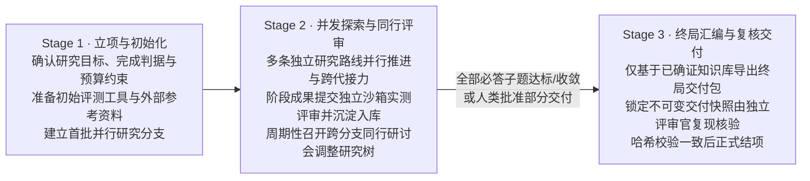
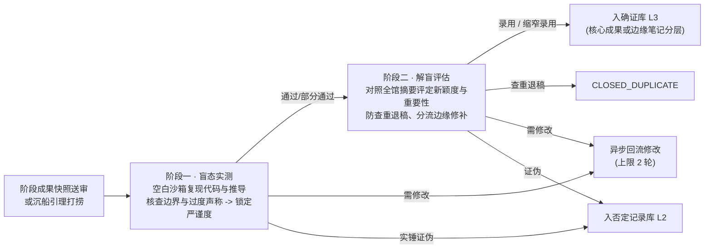

# GreatWall Agent (`v0.3.2`) 系统架构说明

> **版本与状态声明**：本架构说明对应现行版本 **`v0.3.2`**（**Apache 2.0 + DCO**）。  
> **文档定位**：本文面向开源协作者、系统架构研究者与希望基于本项目二次改造的开发者，从问题背景、设计原则、系统全景、四大核心子系统的工作机理、工程接口契约，到坦诚可见的技术债与当前局限，系统性地介绍 GreatWall Agent 的整体架构。  
> **配套阅读**：
>
> - 完整工程实施手册：[`docs/greatwall_v0_3_2_architecture_and_engineering_manual.md`](./docs/greatwall_v0_3_2_architecture_and_engineering_manual.md)
> - 四大子系统独立设计文档与精确 SQLite DDL：[`docs/agent_kb_v0_3/`](./docs/agent_kb_v0_3/README.md)
> - 源码模块边界与验收命令：[`greatwall-v6up/MODULE_MAP.md`](./greatwall-v6up/MODULE_MAP.md)
> - 学术与工程参考全索引：[`REFERENCES.md`](./REFERENCES.md) · 后续演进计划：[`ROADMAP.md`](./ROADMAP.md)

---

## 目录

- [0. 项目定位与代码结构](#0-项目定位与代码结构)
- [1. 问题背景、设计原则与核心矛盾](#1-问题背景设计原则与核心矛盾)
  - [1.1 行业与学术背景：为什么需要一个开放的长程科研基座](#11-行业与学术背景为什么需要一个开放的长程科研基座)
  - [1.2 非标量科学任务的挑战与我们的工程努力](#12-非标量科学任务的挑战与我们的工程努力)
  - [1.3 对基座模型的清醒定位：服务科研探索的扁平共同体](#13-对基座模型的清醒定位服务科研探索的扁平共同体)
  - [1.4 三大设计原则与五大系统矛盾](#14-三大设计原则与五大系统矛盾)
  - [1.5 开源初心（Apache 2.0 + DCO）](#15-开源初心apache-20--dco)
- [2. 系统全景：三阶段生命周期与十角色分权](#2-系统全景三阶段生命周期与十角色分权)
  - [2.1 系统架构全景图](#21-系统架构全景图)
  - [2.2 宏观三阶段生命周期（Stage 1–3）](#22-宏观三阶段生命周期stage-13)
  - [2.3 角色权限矩阵与最小权限隔离](#23-角色权限矩阵与最小权限隔离)
- [3. 四大核心子系统深度拆解](#3-四大核心子系统深度拆解)
  - [3.1 设施工程（Infrastructure Engineering）：运行底座与人机交互控制面](#31-设施工程infrastructure-engineering运行底座与人机交互控制面)
  - [3.2 仪器科学工程（Instrument Science Engineering）：隔离评测与可观测性](#32-仪器科学工程instrument-science-engineering隔离评测与可观测性)
  - [3.3 后勤与谱系工程（Logistics & Lineage Engineering）：探索周期与分支管理](#33-后勤与谱系工程logistics--lineage-engineering探索周期与分支管理)
  - [3.4 图书馆与评审工程（Library & Peer-Review Engineering）：知识库、同行评审与跨分支研讨](#34-图书馆与评审工程library--peer-review-engineering知识库同行评审与跨分支研讨)
- [4. 核心工程契约（基于当前真实代码）](#4-核心工程契约基于当前真实代码)
  - [4.1 跨进程通信、鉴权与双端确认协议](#41-跨进程通信鉴权与双端确认协议)
  - [4.2 10 角色 × 53 个内核窄 MCP 工具总览](#42-10-角色--53-个内核窄-mcp-工具总览)
  - [4.3 仪器插件、复合缓存与观测快照协议](#43-仪器插件复合缓存与观测快照协议)
  - [4.4 SQLite 持久化底座（33 张表 + 2 视图 + 4 条硬触发器）](#44-sqlite-持久化底座33-张表--2-视图--4-条硬触发器)
- [5. 已知技术债与当前坦诚局限](#5-已知技术债与当前坦诚局限)

---

## 0. 项目定位与代码结构

**GreatWall Agent（长城）** 是一套构建在开源 DeepSeek Harness（DSH）插件体系与 Python / SQLite 单写者状态内核之上的**长周期、多路线并发自主科研多智能体实验基座**。它的目标不是硬编码求解某一道特定题目，而是将近年来自主科研与长程多智能体系统中的关键方法论——多研究路线隔离并行、有界短会话接力、结构化元反思与暂停编程反思、可演化的隔离评测工具、独立沙箱同行评审、周期性跨分支研讨，以及保护人类注意力的常驻总控交互——整合成一座透明、可运行、可拆改的开放工程基座。

全部可运行源码位于 [`greatwall-v6up/`](./greatwall-v6up/)：

```text
greatwall-v6up/
├── MODULE_MAP.md                        # 模块边界、工程红线与验收命令
├── core_python/                         # Python 3.11+ 单写者状态内核与隔离评测执行器
│   ├── config.json                      # 有效上下文窗口、保护期、会议节拍与重试参数
│   ├── agents/                          # 10 类角色的系统提示词模板
│   ├── prompts/
│   │   ├── meta_reflection_categories.yaml # 11 类结构化元反思诊断目录（C01–C11）
│   │   └── holiday_prompts.yaml         # 52% 暂停编程反思阶段随机启发题库
│   ├── evaluators/
│   │   ├── base_instrument.py           # 仪器标准取数 get_public_input() 与四态返回体校验
│   │   ├── isolated_runner.py           # 跨进程可取消隔离执行、复合缓存、代码快照冻结与校准回归
│   │   └── examples/                    # 异构科研样例（几何反例 / Lean 4 验证桩 / Pareto 仿真）
│   ├── mcp_server/
│   │   ├── db/                          # 模块化数据底座（33 张表 + 2 FTS5 + 2 视图 + 4 条触发器 + 热迁移）
│   │   ├── db_runtime.py & db_schema.py # 真只读连接、进程级单写者锁与薄门面
│   │   ├── tool_registry.py             # 10 角色 × 53 内核窄 MCP 工具单一注册表
│   │   ├── greatwall_core_mcp.py        # 双池并发 stdio JSON-RPC 2.0 入口与 $/cancelRequest 取消
│   │   ├── control_plane_dispatch.py    # 30+ 控制面内部原语分发
│   │   ├── mcp_core_helpers.py & mcp_schema_docs.py # 鉴权、路径守卫、统一回执外壳与 Schema 文档
│   │   ├── control_plane/               # 控制面子域（运行安排、副作用队列、会议引擎、盲审沙箱、UI 投影等）
│   │   └── tools_*.py & triage_core.py  # 10 类角色窄工具实现与共享确定性分诊内核
│   └── skills/                          # 主控启动操作手册 (SKILL.md) 与共享探针台账 SKILL_LEDGER.json
├── dsh_plugin/                          # DSH (>= 0.2.2-rc.5) Cordis 插件与只读前端面板
│   ├── package.json & cordis.patch.yml  # 插件清单与 8 套单源角色 Preset 注册
│   ├── client_src/ + tools/             # 零依赖前端构建器、契约同步器与一键环境体检 (doctor.mjs)
│   ├── lib/
│   │   ├── index.js & config.js         # Cordis 装配入口与动态配置校验
│   │   ├── contracts.generated.json     # 由 Python 注册表自动生成的跨层契约快照
│   │   ├── runtime/                     # 进程锁 (host.lock)、槽位分配器、瞬态重试与 Outbox 消费者
│   │   ├── sessions/                    # 人类接管让权与常驻总控 (gw_chief) 运行时
│   │   ├── orchestrator.js & orchestrator/ # 后台事件池主控、三阶段派发与跨分支研讨会驱动
│   │   ├── agent_session_host.js & host/   # 会话托管（create/resume）、模型绑定、能力挂载与 52% 反思驱动
│   │   ├── pair_lifecycle.js / clock_and_turn_gap.js / read_isolated_sandbox.js
│   │   └── bridge/                      # MCP 桥接、Schema 适配器与鉴权 HTTP 路由
│   └── test/                            # Node 插件与跨进程联调回归测试
└── tests/                               # Python 状态机、隔离评测、触发器与热迁移回归测试
```

---

## 1. 问题背景、设计原则与核心矛盾

### 1.1 行业与学术背景：为什么需要一个开放的长程科研基座

当研究者尝试用大模型直接攻克数学建模、理论证明、算法设计或复杂仿真类开放课题时，很快会遇到一个共性瓶颈：**通用的多智能体聊天或软件工程编排框架，很难支撑十小时级、多路线并行的自主科学探索。** 即使同时启动多个子智能体，只要缺乏隔离与治理，它们往往会在几轮内迅速趋同到同一个“最容易写出代码、却存在结构天花板”的局部方案里，把并发算力退化为昂贵的重复劳动。

这背后的底层原因很现实：**当前的基座模型拥有极高的符号推演与编码带宽，但其学术品味（Research Taste）与长程自我纠偏能力依然薄弱。** 一旦进入长周期开放探索，模型会系统性地暴露出五类典型失效模式：

1. **长上下文退化与路径惯性**：会话上下文增长到数十万 Token 后，模型不仅推理成本剧增，还会被早期报错和局部修补锚定，难以跳出原有框架重新审视问题；
2. **高并发下的多样性坍塌（Diversity Collapse）**：若多个智能体随时共享未经核验的公共讨论区，先跑出局部结果的路线会迅速吸引其余分支跟风，扼杀异质想法；
3. **路灯效应（Streetlight Effect）与过度声称（Overclaiming）**：模型容易被容易量化的小瑕疵吸引，把大量算力耗在零测度退化点或微小数值容差上，或者把仅在特例上成立的结论夸大为一般定理；
4. **工程故障与科学失败混淆**：评测脚本损坏、代码语法错误与科学假设被证伪是完全不同的事件，混为一谈会导致有潜力的研究路线被误杀；
5. **人类注意力过载**：人类研究者同时最多只能有效跟进 3–5 个活跃对话。把后台数十个并发会话、报错和表单直接摊在界面上，很快会把研究者拖成疲惫的“人工调度员”。

放眼近年来的行业与学术进展，这一领域已经涌现出大量极具启发的探索，但仍然存在显著的开源空白（全部文献逐条溯源见 [`REFERENCES.md`](./REFERENCES.md)）：

- **工业界的大规模闭源探索**：OpenAI 展示了用 64 个并发智能体推进图论圈双覆盖猜想（CDC），以及用大规模去中心化智能体协作探索流体力学方程奇点问题；Google DeepMind 的 *Quantum Algorithms Swarm*（`arXiv:2611.09822`）证明了“已验证知识库（Verified Wiki）+ 定期跨团队研讨会（Conference）”的双轨协作能在复杂量子电路优化中贡献近四成的额外收益；Anthropic 工程博客与 DeepSeek Harness 团队的 *Super-agent* 架构则分别从外部状态解耦和人类注意力预算角度总结了长程多智能体的实战规律。但这些大规模科研系统大多闭源，或仅公开了局部提示词与设计笔记。
- **学术界的前沿机制创新**：近两年出现了一批高质量的专题研究，各自攻克了自主科研中的关键切片——
  - **开放发现与反路灯效应**：*The Station* v1/v2（`arXiv:2608.23691`, `arXiv:2610.08927`）系统实证了开放式科学发现中的路灯效应与早期跟风，提出了三维同行评审（Rigor / Novelty / Significance）、微型论文知识库、11 类元反思以及暂停执行的思考假期（Holiday）；*The Tasteful Agent*（`arXiv:2609.25804`）专门研究了智能体的科研品味评估。
  - **长程搜索与状态解耦**：*Stateless Language Agents (SLA)*（`arXiv:2610.07625`）确立了“有状态的外部搜索树 × 无状态的短生命周期会话”范式，并将代码错误与科学证伪分离；*AgentDiscover*（`arXiv:2610.05334`）探索了极简脚手架下的按需检索与工作区工具沉淀；*Diversity Collapse in MAS*（ACL 2026）与 *MAS Should Prioritize Concurrency Control*（ICML 2026）则从理论上剖析了群体趋同与共享状态并发写冲突的根因。
  - **严格验证与同行协作**：*Cogentic*（`arXiv:2609.40324`）提出了无数学偏见的调度层与独立隔离审稿机制；*ProofCouncil*（`arXiv:2607.09474`）研究了多篇互补局部证明的组合完备性核验；*Stanford Virtual Lab*（*Nature* 2025）与 *ColMAD* 分别在确定性结构化会议编排与非零和协作辩论上给出了简洁范式；*GPT-Rosalind (`distributed_agent`)* 强调先代码对账再归约综述、同时保留正反证据。
  - **评测工具协同演化**：*Red Queen Gödel Machine (RQGM)*（`arXiv:2606.26294`）与 *Audit the Scaffold*（`arXiv:2609.34924`）指出了评测器防作弊、版本域可比性与高分辨率诊断探针的重要性。
- **开源社区的现状**：现有开源工具大多要么聚焦单一垂直学科（如 Lean 4 形式化证明助手），要么面向通用软件工程工作流，**缺少一个把上述自主科研机制系统性整合、工程落地并可供研究者自由拆改的开放实验基座**。这正是 GreatWall Agent 的出发点。

### 1.2 非标量科学任务的挑战与我们的工程努力

在开始介绍架构之前，必须坦诚一个整个领域至今尚未根本解决的科学难题：**非标量开放科学任务的梯度缺失**。

在数值优化或排行榜竞赛里，目标函数是一个单调可比的实数分数，搜索算法天然知道“哪一步离最优更近”。但大量真实的科研问题——例如纯解析数学证明、构造性反例、多目标 Pareto 物理仿真、或没有预设打分器的机理探索——根本不存在单一标量分数。这也是为什么 *The Station* v2（`arXiv:2610.08927`）指出，当缺少明确标量梯度时，智能体极易滑向“容易测量却不重要”的边缘工作。

GreatWall 目前同样无法从理论上彻底解决非标量搜索的方向引导问题，但我们在工程架构上做了五项明确努力，确保系统**不强行假设单一标量目标**：

1. **允许无判定器开局**：课题立项契约（`Parse 0`）不强制要求提供自动打分器，纯理论证明或开放探索题可以 0 个 `VERDICT` 判定器直接启动，转而依靠诊断探针与同行评审推进；
2. **多维结构化观测协议**：统一仪器接口返回的 `tracks` 是任意维度的键值字典（而非单一 `score` 浮点数），允许同时记录守恒残差、边界误差、复杂度斜率、定性相变等多维物理/数学观测，且正式评测允许返回 `OK + UNDECIDED`；
3. **四类异构科研产物同等准入**：送审与入库不仅接纳“带评测分数的代码”，而是平等支持四类可核验载体——① 数值/仿真代码、② 形式化证明源码（如 Lean 4）、③ 构造性反例与校验脚本、④ 自包含的纯解析数学推导；
4. **正向成果与负向证伪同等入库**：经过独立沙箱实测的严格反例（`NEG_COUNTEREXAMPLE`）与路径不可行证明（`BARRIER_PROOF`）与正向定理享受同等的 `L3` 确证库地位；同时引入三维评审（严谨度 / 新颖度 / 重要性）将高严谨度但低重要性的边缘修补分流至边缘笔记，抑制路灯效应；
5. **开放题的多篇组合与饱和收敛**：对于无法由单一路径“一锤定音”的开放子题，支持将多篇互补局部引理拼齐后提交组合完备性终核，也允许在周期性同行研讨会上经充分论证后判定开放子题已达边际收益饱和并平滑转向后续子题。

### 1.3 对基座模型的清醒定位：服务科研探索的扁平共同体

既然基座模型是一位“推演与编码能力很强，但学术品味薄弱、容易在长上下文中迷失或陷入局部内卷的科研新人”，系统架构的使命就**不是**用繁琐的行政公文或脆弱的正则脚本去充当监工（正如项目早期笔记所言：如果靠正则就能做好审稿，人类科研界就不需要同行评议了）。

GreatWall 把自身定位为一座**服务一线科研探索者的扁平学术共同体**：

- **唯有科学问题与一线探索者本身是目的**，所有数据库、沙箱、评测容器、伴随助手、评审官与研讨会都是支撑它的脚手架；
- 系统的职责是：在探索初期替它挡住过早的群体噪声；给它可信赖、故障不连坐的实验仪器；在它陷入局部循环时通过结构化反思和暂停编程思考帮它跳出惯性；在上下文膨胀失真前帮它把真实证据与交接笔记安全传给下一代；并对它提交的阶段性成果给予独立、公正的同行检验。

### 1.4 三大设计原则与五大系统矛盾

经过多轮推倒重来与长程实机测试，本项目确立了三条核心设计原则：

1. **第一性原理（First Principles）**：不为了追热点而堆砌多智能体概念，每一项机制都必须对应真实科研运行中观察到的具体病灶（如上下文漂移、多样性坍塌、路灯效应、并发写冲突）。
2. **钱学森《工程控制论》系统边界律（稳健性优先于防御性）**：
   > *“一个真正优秀的系统，并不一定是大量最优子系统的强行拼凑；相反，优秀的子系统之间往往存在难以解决的冲突，强行捏合反而会导致系统整体效能下降。因此很多优秀的系统往往是由那些并非最优、但配合良好的子系统构成的和谐整体。”*  
   我们用确定性代码和数据库约束守住并发一致性、隔离边界与流程底线，追求结构上的**稳健性（Robustness）**而非层层打补丁的**防御性（Defensiveness）**，把真正的科学思考和探索自由还给模型与人类研究者。
3. **清晰自然语言表达原则（Clarity Without Jargon）**：保持学术与工程严谨性，同时拒绝用自造黑话和花哨包装词掩盖设计细节——**凡是用平实自然语言讲不清楚的机制，往往说明架构本身还没想透。**

整座架构的每一个具体取舍，本质上都是在解决以下**五大核心系统矛盾**：

1. **确定性控制 vs. 模型自主权**：状态跃迁、并发槽位、上下文时钟、沙箱隔离、审稿锁定与异步副作用队列必须由确定性代码与 SQLite 触发器严格执行，避免模型越权或竞态；但具体的科学假设、数学推导、实验设计与同行评议则完整交还给大模型自主发挥。
2. **分支隔离（防群体趋同） vs. 知识共享（防重复踩坑）**：不同研究分支的工作目录与失败记录物理隔离，每代探索者前 37% 上下文期间锁定内部知识库，先独立形成判断；37% 元反思后开放按需检索与院内专题综述；未经充分验证的半成品构想则仅在周期性同行研讨会上受控交流。
3. **长程连续记忆 vs. 单会话上下文纯净度**：所有持久化状态都归外部 SQLite 数据库与 Git Worktree（有状态的搜索），单个探索者会话则被严格限制在 `360k` 有效上下文内（无状态的短会话接力），通过定额滚动重写的前情摘要与亲笔交接总结完成跨代传递。
4. **评审严格度 vs. 保护早期创意萌芽**：快速诊断探针与正式观测记录分离；仪器故障对探索者零处罚；正式观测自动冻结代码快照，避免后续辅助脚本改动连坐拒绑；评审严打过度声称的同时支持降级收编有效引理；新路线、融合分支与人类种子分支享有 1 代成长保护期。
5. **人机协同 vs. 人类注意力稀缺性**：日常状态汇报收口到轻量只读观测面板，自由指令与科研讨论统一对接常驻总控 `gw_chief`；同时保留直接点开任意子会话、紧急暂停、或暂停接管具体分支直接对话与改码的直通入口。

### 1.5 开源初心（Apache 2.0 + DCO）

坦白地说，作为一名数学系背景的发起者，我的工程背景有限，也一直缺少并肩协作的伙伴。但我真心觉得，把学术界这些前沿的多智能体科研思路真正做成一个开放、透明、可运行、可拆改的实验基座，是一件非常有意思、也值得持续推进的事——我不想看着它停在本地硬盘里慢慢沉寂，落得：

> *“章台柳，章台柳，昔日青青今在否？纵使长条似旧垂，也应攀折他人手。”*

如果这个仍在打磨中的基座能帮到哪怕一位素未谋面的研究者或开发者——无论是拿来辅助攻克一道难题、拆出其中某个模块二次改造，还是愿意提 Issue、改代码、一起完善它——我都会非常开心。就像那句我一直很喜欢的话：

> *“假如我能使一颗心免于哀伤，那我便不虚此生。”*

因此，项目以 **Apache 2.0 + DCO** 完全开源，把全部架构思考、源码、真实踩坑记录与当前局限如实交给大家。

---

## 2. 系统全景：三阶段生命周期与十角色分权

### 2.1 系统架构全景图


### 2.2 宏观三阶段生命周期（Stage 1–3）

从宏观视角看，GreatWall 将一次完整的科研攻关划分为顺序推进的三个阶段：



- **Stage 1（立项与初始化）**：由人类研究者与系统共同签发课题契约（`Parse 0`），明确总目标、子题划分、可选的子题依赖顺序（`question_order`）、“什么算完成”、预算上限与最短投入时间窗；随后系统并行完成初始评测工具核查、外部公开文献预采以及首批不同研究路线的分支初始化。
- **Stage 2（并发探索、独立评审与周期性研讨）**：多路一线探索单元在各自隔离的 Git Worktree 内并行推进，沿有界上下文时钟跨代接力；阶段性成果可随时切出快照异步提交独立沙箱评审，通过后进入内部确证知识库；每隔一波节点完成后，系统召开一次跨分支同行研讨会，汇总进展、排查接口隐患、调整分支资源分配，并在子题达标或饱和时解锁后续子题。
- **Stage 3（终局汇编与不可变复核交付）**：当全部必答子题达标，或越过最短投入窗触发预算耗尽 / 人类显式批准部分交付时，断网的综述官仅基于内部确证库（`L3`）导出五件套交付物并锁定工作区外的不可变快照目录；独立评审官只读该冻结副本复现脚本并核查结论边界无夸大，哈希比对一致后正式结项。

### 2.3 角色权限矩阵与最小权限隔离

系统在插件配置中维护 **8 套单源 DSH Preset**，并与 Python 注册表（`tool_registry.py`）自动同步，对 **10 个逻辑角色** 实施物理级最小权限隔离：

| 角色名 | 对应 Preset | 所属子系统 | 核心职责 | 外网 / 本地文件 / 终端权限 |
| :--- | :--- | :--- | :--- | :--- |
| **`gw_chief`**（常驻总控） | `greatwall-chief` | 设施工程 | 人机主对接人：审阅状态与代码、直执运行调度、发分支提示、发起高危变更审批卡 | 无外网 · **仅只读文件** · 无文件写 · 无终端 |
| **`supervisory_committee`** | `greatwall-db-only` | 设施工程 | Stage 1 签发课题契约、运行期题意歧义告警与 Stage 3 结项条件核验 | 无外网 · 无文件读写 · 无终端 |
| **`works_engineer`** | `greatwall-works` | 仪器科学 | 评测工具与探针开发、校准集回归升版、故障修复与共享工具台账维护 | 无外网 · 仅写仪器目录 · 受限终端 |
| **`explorer`** | `greatwall-explorer` | 后勤与谱系 | 一线科研探索者：推导、编程、仿真、调用仪器、52% 反思假设与 70% 亲笔交接 | 无外网 · 仅写本分支 Worktree · 反思期与交接期切只读 |
| **`lineage_companion`** | `greatwall-companion` | 后勤与谱系 | 节点伴随助手：开工编摘要、37% 主持元反思、70% 核对工件封存交接、封存后代表本分支参会 | 无外网 · 仅只读本分支 Worktree · 无写权限 · 无终端 |
| **`logistics_coordinator`** | `greatwall-db-only` | 后勤与谱系 | 首批研究路线建档；常规交接由控制面直落，仅在路线聚拢告警或疑难节点时按需唤起 | 无外网 · 无文件读写 · 无终端 |
| **`external_surveyor`** | `greatwall-external-surveyor` | 图书馆与评审 | 唯一对外文献检索员：检索公开资料（自动改写 arXiv HTML 链接），产出带阅读深度标注的参考卡 | **唯一可联网** · 物理禁读院内任何文件与成果 |
| **`library_chronicler`** | `greatwall-chronicler` | 图书馆与评审 | 馆内综述与编纂官：维护子题全局总览、承接按需院内专题综述、导出 Stage 3 终局交付 | 无外网 · 无终端 · 只读内藏与受控导出 |
| **`library_verifier`** | `greatwall-verifier` | 图书馆与评审 | 独立盲审官：在临时空白沙箱内复现代码与推导、评估严谨度/新颖度/重要性、执行终局复核 | 无外网 · 仅限一次性空白沙箱只读与终端 |
| **`conference_chair`** | `greatwall-db-only` | 图书馆与评审 | 周期性同行研讨会主席：主持跨分支讨论、记录会议纪要并签发宏观研究树调整决策 | 无外网 · 无文件读写 · 无终端 |

---

## 3. 四大核心子系统深度拆解

GreatWall 的内部实现按照职责清晰地划分为四个正交子系统：**设施工程**、**仪器科学工程**、**后勤与谱系工程**、**图书馆与评审工程**。

---

### 3.1 设施工程（Infrastructure Engineering）：运行底座与人机交互控制面

> 详细设计文档：[`ARCH_PAPER_01_设施工程`](./docs/agent_kb_v0_3/ARCH_PAPER_01_设施工程_Infrastructure_Engineering.md)

设施工程解决两类基础问题：**向内**保证十个并发智能体在长程运行中不发生状态写冲突、沙箱越界、僵尸进程或跨轮串库；**向外**把复杂的后台运行态收敛为低噪音的人机协作界面。

#### 1. 双层进程架构与单写者真相库

系统在物理上分为两层：

- **上层 · DSH Cordis 插件（`dsh_plugin/`，ESM JavaScript）**：负责与宿主运行时对接、拉起或从磁盘恢复（`ctx.agents.resume`）各角色会话、挂载工具与沙箱守卫、采样上下文压力并驱动事件循环。
- **下层 · Python 状态内核与隔离执行器（`core_python/`，Python 3.11+）**：不依赖重型第三方框架，通过 `stdio JSON-RPC 2.0` 向插件暴露 53 个窄工具与 30+ 个控制面原语。内核采用双线程池分离设计——轻量元数据和查询走 `fast_pool`，耗时评测走 `compute_pool`，并支持通过 `$/cancelRequest` 实时终止底层评测子进程树。

所有持久化状态唯一保存在工作区之外的 SQLite 数据库（`$PLUGIN_DATA/workspaces/<ws_hash>/greatwall.db`，开启 `WAL` 与外键约束）。全部写操作经过进程级单写者锁与 `BEGIN IMMEDIATE` 事务串行提交，从根源上消除多智能体并发写冲突。

#### 2. 确定性运行时护栏

为了防止长程无人值守时出现隐蔽故障，插件编排层内置了六项确定性机制：

- **单实例进程锁与纪元隔离**：通过 `host.lock` 防止同一工作区被双开；每轮独立课题运行绑定递增的 `epoch_id`，阻断被误唤醒的历史旧会话串写新库。
- **异步副作用队列（Outbox）**：数据库事务提交后不直接阻塞等待外部动作，而是写入 `runtime_effects` 表，由后台消费者以 60 秒租约并发领取并执行（涵盖分支清理、会议唤醒、院内专题综述、人类通知等 11 类副作用），崩溃重启后可安全续跑。
- **显式模型绑定与自适应上下文窗口**：启动前按“显式参数 > 调用方选项 > 会话事件流 > 插件配置”解析权威模型绑定，缺失则直接拒启；有效上下文窗口取 `W = min(360,000, 模型物理窗口)`，并由宿主同步至 SQLite 供全院共享。
- **单项待办熔断与网络瞬态重试**：对 429/5xx 等临时接口波动执行指数退避重试（对 401、余额不足或内容拒答则立即失败不空耗）；治理队列按单条待办 ID 独立追踪客观进展，某条工单连续 2 次无进展时仅挂起该单项，不连坐同队列其他健康任务。
- **双向隔离沙箱（`read_isolated_sandbox.js`）**：公开输入目录（`inputs/`、`rulings/` 等）向授权角色只读开放；所有数据库、隐藏校准集、临时盲审沙箱与冻结交付目录全部放在工作区之外的 `$PLUGIN_DATA`，并在每次工具调用前执行 `realpath` 路径段规范化校验、目录越界拦截、过程性 `.md` 公文禁写（防止模型退化为靠写 Markdown 汇报代替写库），以及对 `explorer` 在 52% 反思期和 70% 交接期的动态只读锁定。
- **人类优先预留槽位**：在常规并发槽位 `maxWorkers` 之外保留 `+1` 人类优先槽，确保研究者人工种下的分支或紧急介入操作不必等待后台队列排空。

#### 3. 常驻总控（`gw_chief`）与人机交互界面

当后台同时运行多个研究分支时，直接让人类去盯每个子会话会迅速耗尽注意力。GreatWall 采用**“只读面板看全局 + 常驻总控做交互 + 直通子会话做兜底”**的三层交互：

- **只读观测面板**：在 DSH 侧栏中以结构化视图展示活跃分支、研究谱系、知识库与当前待决事项，过滤掉 95% 的底层过程噪音。
- **常驻总控 `gw_chief`**：单工作区绑定固定会话 ID，物理上禁止写文件和执行终端命令，但拥有只读源码审阅能力（`read/glob/grep`）和分页查账工具（`chief_read`）。每次推理前由宿主动态注入一份不超过 `1500` 字、永不压缩的实时状态摘要卡（含当前槽位、生效调度规则、置顶备忘与待决项），防止长对话压缩后失忆。
- **分级授权门禁**：通过校验真实人类发言的请求凭证（`Human-Mandate Gate`），人类在总控会话中一句话即可直接下达日常运行安排（如调整子题权重、限制单题分支数、温和暂停在途分支、随时强召跨分支同行研讨会 `open_wave_conference` 并注入特邀议题、给指定分支发送导师提示便签、或基于完整思路蓝图种下新分支），并通过四态回执如实跟踪落地进度；而对于修改课题口径、批准部分结题、开启新纪元等高影响操作，则必须生成正式审批卡（Action Card）经人类显式确认后生效。
- **人类接管与越界退回**：研究者随时可以点开任意探索者会话，在暂停后直接与它对话或手动修改其工作树代码（恢复托管时自动做 SHA-256 变更对账）；如果人类在某个子分支里提出了“改题”“停掉其他分支”等全局指令，探索者会调用 `handback_to_chief` 将诉求原样转交总控，绝不越权执行。

---

### 3.2 仪器科学工程（Instrument Science Engineering）：隔离评测与可观测性

> 详细设计文档：[`ARCH_PAPER_02_仪器科学工程`](./docs/agent_kb_v0_3/ARCH_PAPER_02_仪器科学工程_Instrument_Science_Engineering.md)

仪器科学工程由**工具工程师角色（`works_engineer`）**与**通用隔离评测容器（`isolated_runner.py`）**构成。它的定位不是给每道题硬造单一分数的“裁判”，而是实验室里的**仪器与测量部门**——负责把科学问题转化为可复现、可诊断、不易被钻空子的观测工具。

#### 1. 通用评测协议与三档调用

所有仪器插件分为三类角色：`VERDICT`（正式判定器，产出结论与观测记录）、`PROBE`（只读诊断探针，用于拆解运行耗时、误差分布或守恒残差等细粒度信息，不给通过/失败裁决）、`ENV`（仿真环境与基准数据）。三类插件遵循同一函数签名：

```python
evaluate(artifact, spec, tier) -> {
    "status":  "OK" | "CANDIDATE_ERROR" | "INSTRUMENT_ERROR" | "INFRA_ERROR",
    "verdict": "PASS" | "FAIL" | "UNDECIDED" | None,
    "tracks":  dict[str, float | int | str | bool | None],  # 多维结构化观测，不假设单一标量
    "details": str                                          # 面向探索者的诊断文本
}
```

平台数据统一通过 `base_instrument.get_public_input(spec)` 读取，候选代码在独立子进程中加载执行，不依赖脆弱的 `stdout` 正则解析。同一份候选代码支持三档调用：

- **`probe`（快速诊断档）**：高频调试用，仅记诊断日志，不污染正式观测账本；
- **`official`（正式受控档）**：在隔离执行域运行并签发正式观测编号 `[Obs-###]`，调用前探索者必须先填写可证伪的事前预期（`linguistic_prediction`）；
- **`heavy`（异步重计算档）**：适用于耗时较长的仿真或大规模验证，提交时冻结代码快照与当前仪器版本入队，支持断点续跑与凭 `job_id` 幂等取回。

#### 2. 四态错误归因、复合缓存与观测瞬间代码快照

在实际科研中，脚本崩了、仪器有 Bug 和科学假说被证伪是三件截然不同的事。容器在协议层强制区分四种返回状态：

| 返回状态 | 含义与归因 | 系统确定性处理 |
| :--- | :--- | :--- |
| `OK` | 仪器正常运行完毕 | 按 `verdict` 记为 `VALID_PASS`、`MEASURED_REJECTION` 或 `VALID_UNDECIDED` |
| `CANDIDATE_ERROR` | 候选代码语法错、崩溃或超时 | 归因于工程实现缺陷（可安排原地修补），不计入科学证伪 |
| `INSTRUMENT_ERROR` | 仪器自身报错或违反接口协议 | **对探索者零处罚**，不进缓存，自动向 `works_engineer` 报修；连续报错 3 次自动熔断置为 `UNHEALTHY` |
| `INFRA_ERROR` | 宿主进程、磁盘或超时等底座故障 | **对探索者零处罚**，穿透缓存允许重试并记录系统告警 |

在缓存与复现层面，系统同时维护两项保障：

- **四元复合缓存键**：由“候选入口哈希 + `tools/` 目录递归哈希 + 评测档位与数据切片哈希 + 仪器版本哈希”共同计算，杜绝跨档位或代码改动后的脏缓存命中；
- **观测瞬间轻量代码快照（`frozen_code_snapshot_path`）**：每次 `official / heavy` 评测启动时，同步将入口文件与本地 `tools/` 目录冻结复制到工作区外的观测快照目录（评测取消或失败时自动清理）。这样，探索者在完成主实验后继续在工作树里增写画图或后处理脚本，**不会破坏已签发观测的可复现性**，后续盲审官直接挂载该不可变快照复验即可。

#### 3. 校准集回归升版与工单闭环

- **自声明校准集门控**：任何 `VERDICT` 判定器的注册或升级，必须附带一组包含正样本（合法解）与负样本（已知作弊样本、退化样本、空文件）的校准集，在独立子进程中逐条实跑并 100% 匹配每条用例声明的预期状态与结论后才允许激活上线。
- **版本域隔离与按需重评**：每条 `[Obs-###]` 永久绑定签发时的 `(instrument_id, version)`，禁止跨版本直接混排对比；同时留存阶段 A 的原始输出，仪器升级后可仅重跑阶段 B 的评分逻辑生成新观测（旧记录标记为已替代但永不覆盖）。
- **防洪报修与精确结案**：全院各角色均可通过 `submit_works_ticket` 上报仪器故障或重复工具需求（同键合并、单会话限频防刷屏）；工程师修复并升级仪器时，只能显式结案本次真正解决的工单并写明处理说明，杜绝批量静默关单。

---

### 3.3 后勤与谱系工程（Logistics & Lineage Engineering）：探索周期与分支管理

> 详细设计文档：[`ARCH_PAPER_03_后勤工程`](./docs/agent_kb_v0_3/ARCH_PAPER_03_后勤工程_Logistics_and_Lineage_Engineering.md)

后勤与谱系工程管理两件事：**单条研究路线内部如何跨代接力而不丢记忆、不陷惯性**，以及**多条并行路线之间如何保持多样性并受控演化**。

#### 1. 单代探索者的有界生命周期（0% → 37% → 52% → 70%）

为了避免模型在几十万 Token 的长对话中注意力退化，每代探索者（`explorer`）的有效上下文窗口被限定在 `W = min(360,000, 模型物理窗口)` 内，并由一名专属的只读伴随助手（`lineage_companion`，按固定会话 ID 按需从磁盘恢复）1:1 配合完成完整生命周期：


- **0% 启动准备**：伴随助手读取旧前情摘要、上一代交接记录、异步审稿意见与最新同行研讨会纪要，以固定输入复杂度将其重写为不超过 `5000` 字的五段式行前摘要（核心机制、当前状态与审稿异议、未解矛盾、最相关失败边界、上代遗留建议），避免跨代信息无限膨胀。
- **0%–37% 前期独立探索**：探索者只能访问本分支工作树、公开题面与外部文献 `[R###]`，内部知识库（`L3/L2`）处于锁定状态，迫使其先带着自身独立视角完成第一轮推导与实验。
- **37% 结构化元反思**：上下文水位达到 37% 时（无论是否跑过评测仪器，纯理论推导同样触发），伴随助手被唤醒，对照 11 类元反思诊断目录（`C01–C11`，涵盖过度声称、局部吸引子陷阱、科研品味评估等）与本脉失败记录，与探索者进行最多 2 轮简短问答（每轮不超过 500 字）。伴随助手严守“只诊断和指路、不代给公式或代码”的边界；反思完成后当场解锁内部知识库与院内专题综述权限。
- **52% 暂停编程反思（Context Holiday）**：水位达到 52% 时，宿主临时将探索者切换为只读态（暂停写代码、终端和评测，最多 2 回合），并从启发题库中**随机抽取**一张本分支尚未用过的思考提示卡，引导探索者审视反常现象或寻找跨领域类比，通过 `submit_holiday_bet` 提交一条包含“反常/类比 + 可检验假设 + 证伪实验”的结构化假设。提交后当场结束反思回合、恢复全部工具权限进入实测验证，并在 70% 交接时由伴随助手客观核销该假设是被证实、证伪还是未测。
- **70% 交接封存与异常抢救**：水位达到 70% 时，探索者在只读态亲笔写下本代总结、已证实死胡同与留给下代的建议；随后由伴随助手核对工作树实际改动与客观观测 `[Obs-###]`，将“客观实测事实（A 栏）”与“主观猜想与建议（B 栏）”严格拆分后调用 `submit_node_handoff` 封存落库。若探索者在 70% 前因网络或额度中断，只要留有实质推导或代码，伴随助手同样执行抢救归档，确保工作不白费。

#### 2. 确定性交接分诊、异步快照投稿与分支多样性控制

- **确定性控制面直落与后勤清晰边界**：探索节点封存后的常态去向——包括常规续推下代（`ROUTINE_CONTINUATION`）、代码报错恢复快照原地修补最多 3 次（`LEVEL_2`，满 3 次只记本脉失败记录绝不污染图书馆 `L2`）、路线阻碍证明送审（`LEVEL_4A`）、缺定理级引理挂起并公开发布悬赏缺口待盲审自动唤醒（`LEVEL_4B`）——均由共享确定性内核（`triage_core.py`）在交接事务内一步落库；`logistics_coordinator` 收窄为专司 Stage 1 开局建首批正交路线、缺编补齐与两次研讨会间 `>50%` 聚拢应急分流，不再与研讨会主席在保护/融合/裁剪上撞权。
- **默认异步快照投稿与防“一稿两投”**：阶段成果在 70% 交接时默认通过 `manuscript_submissions` 切出只读快照异步提交盲审，原分支不冻结也不因阶段过审而被提前封存；内核同时硬拦截“已交非阻塞快照稿又叠加阻塞 `LEVEL_1`”的重复送审，自动归一化为续推下代，确保审稿意见通过 `pending_review_feedback_json` 平滑回流下代开工摘要。
- **多路线隔离、分支级前置依赖与旁路融合**：系统按底层研究机制维护方法族谱（`method_families`）。当同一子题下某条路线占比超过 `50%` 且分支数达到 2 条以上时，触发无豁免正交分流；新开辟路线、受保护支线（`PROTECTED`）、融合分支（`SYNTHESIS`）与人类种子分支统一享有 `1` 代成长保护期；后勤与研讨会开出的新分支均支持分支级精确前置依赖（`requires`：`L3-###` 或 `OBS:<id>:PASS`），只锁声明了未就绪前提的单条分支而不锁整题。需要将两条成熟路线优势融合时，系统新建独立的旁路融合分支，只读挂载参考源码至 `.greatwall_donors/` 并生成 `DONOR_MANIFEST.md`，原纯血分支毫发无损。

---

### 3.4 图书馆与评审工程（Library & Peer-Review Engineering）：知识库、同行评审与跨分支研讨

> 详细设计文档：[`ARCH_PAPER_04_图书馆工程`](./docs/agent_kb_v0_3/ARCH_PAPER_04_图书馆工程_Library_and_PeerReview_Engineering.md)

图书馆与评审工程是跨分支知识流转的唯一合法枢纽，也是科学质量与学术诚实度的总闸门。它由 **4 个权限物理隔离的角色** 分工协作：**外采员**（`external_surveyor`）、**评审官**（`library_verifier`）、**综述官**（`library_chronicler`）与**会议主席**（`conference_chair`）。

#### 1. 外藏文献、内藏研究库与按需院内专题综述

知识库采用物理分表与两级按需检索（先扫简短目录卡，再按编号拉取全文），防止长篇文献淹没上下文：

- **外部参考库（`external_literature_cards`，编号 `[R###]`）**：由全院唯一可联网的 `external_surveyor` 维护（其物理上禁止读取任何内部文件，杜绝成果外泄）。每张文献卡必须标注真实阅读深度（`full_text / specified_sections / abstract_only`），并明确标记为未经本系统独立复验的外部参考；若查无可靠资料，如实提交不可得报告，绝不编造虚假文献卡。
- **内部研究库（`internal_research_ledger`）**：仅在探索者完成 37% 元反思后开放，分为两类——
  - **确证库（`L3_VERIFIED`）**：收录经独立沙箱实测通过的正向定理/算法、严格构造反例与结构阻碍证明。每条记录完整保留作者署名、引用列表、观测编号、评分与随文公开的审稿意见；
  - **否定记录库（`L2_FAILURE_RECORD`）**：仅收录经实锤证伪的科学路径或多次返工仍未解决的实质异议，严格隔离纯工程代码崩溃。
- **零外网院内专题综述**：除维护每个子题的全局总览外，`library_chronicler` 还可响应探索者（37% 后）、伴随助手或总控发起的专题综述请求（`request_internal_survey`），经后台异步精读馆内相关条目后，交付带精确编号引用的客观综述报告，并严格遵守“不代出新点子、不下达路线指令、无编号不陈述”三条纪律。

#### 2. 独立空白沙箱中的两阶段同行评审

每次评审唤醒全新的无状态 `library_verifier`，由宿主现建一次性空白沙箱（仅只读拷入手稿绑定版本的公开输入、A 栏客观事实、观测冻结代码快照与证明文件，物理隔离数据库、B 栏主观猜想、探索者工作树与外网，审毕即删）：



- **阶段一（盲态实测，锁定严谨度）**：严格按照手稿提交时绑定的口径版本（`spec_revision`）实跑代码与核验推导，重点防范“用特例结论冒充一般定理”的过度声称。阶段一锁盘后，数据库触发器从底层禁止任何后续修改。若核心引理成立但主主张夸大，评审官可直接判为部分通过并在阶段二按真实成立边界降级收编（`ACCEPT_NARROWED`），避免把有价值的局部突破一棍子打死。
- **阶段二（解盲评估，防重复与抑制路灯效应）**：内核自动注入同题全馆摘要供横向比对，评定新颖度（`novelty`）与重要性（`significance`）：
  - 若新颖度过低（`<= 3`）且无实质精简，判定为重复退稿（`REJECT_DUPLICATE`）；
  - 若严谨度高但重要性低（`<= 4`，典型如只修补零测度退化点或微小数值容差），强制归入边缘笔记层（`MARGINAL_NOTE`），不刷新子题基线、不占据全局总览核心栏位，也不衍生新的悬赏缺口；
  - 剩余未决问题强制区分为“决定全局成败的承重缺口（`LOAD_BEARING`）”与“文末局限性说明（`IMPROVEMENT`）”，防止局部细节反客为主。

#### 3. 周期性跨分支同行研讨会与宏观调整

平时各研究分支独立探索、靠确证库单向共享已验真成果；每隔一波节点完成后，系统触发一次确定性编排的跨分支同行研讨会（借鉴 *Stanford Virtual Lab* 与 *ColMAD* 的非零和协作结构）：

1. **代码硬对账与议程生成**：先由确定性脚本统计各分支真实观测、入库记录与承重缺口，生成包含 3 道必答核心问题的会议议程；
2. **两轮结构化同行讨论**：唤醒各分支已封存的伴随助手（物理剥夺写权限，慢分支取上代快照不打断在跑探索者）进行两轮发言——第 1 轮如实披露本分支的失效边界与尚未验证的模块；第 2 轮强制点对点回应其他分支，执行接口排雷、协同互助或路灯效应预警；随后由 `conference_chair` 撰写完整纪要并自动提取各分支的个性化行动备忘；
3. **更新子题总览**：`library_chronicler` 将最新确证进展与反面证据写入核心总览，同时把边缘修补隔离到独立附录栏；
4. **宏观研究树调整与多模收敛**：`conference_chair` 严禁下场做具体数学推导微操，只签发宏观资源与路线决策（休眠停滞分支并打捞残骸引理、基于两路成熟成果建立融合分支、开辟新路线、保护潜力支线、委托工造司造鉴别实验、或提请人类拍板）；控制面按“先休眠腾槽 → 再建新分支 → 最后执行收敛检查”的顺序无损落盘。对于多篇局部成果已拼齐整题的情况，支持发起多篇组合完备性终核（`COMPOSITE_FULL_GOAL`）；对于开放探索题，支持在边际收益明显饱和时经论证收敛并解锁下一子题。

---

## 4. 核心工程契约（基于当前真实代码）

### 4.1 跨进程通信、鉴权与双端确认协议

- **Node ↔ Python 通信**：长驻 `stdio JSON-RPC 2.0`，承载 `tools/call`（53 个内核窄工具）、`control_plane/*` 控制面原语与 `$/cancelRequest` 跨进程实时取消；构建与启动期通过 `build_contracts.mjs` 与 `control_plane/describe_contracts` 校验双端契约 100% 一致。
- **鉴权与操作闭环**：区分人类对话接管（`source.rpcId`）、人类当面直执门禁（`Human-Mandate Gate`）与 4 类高危变更审批卡（支持 DSH 原生 Action Card 与鉴权 HTTP 控制台双端幂等确认）。

### 4.2 10 角色 × 53 个内核窄 MCP 工具总览

| 角色 | 授权工具数 | 窄工具清单（单一真源：`tool_registry.py`，Schema 版本 `0.3.2`） |
| :--- | :---: | :--- |
| **`gw_chief`** | 10 *(+1 宿主)* | `chief_get_overview_snapshot`、`chief_trace_entity`、`chief_read`、`chief_operate`、`chief_send_branch_note`、`chief_seed_branch`、`chief_preview_impact`、`chief_propose_control_action`；共享 `request_internal_survey`、`get_internal_survey_report` *(+宿主 `chief_get_node_recent_activity`)* |
| **`explorer`** | 11 | `run_isolated_eval`、`submit_holiday_bet`、`request_literature_survey`、`read_lineage_graph`、`handback_to_chief`；共享 `get_living_survey`、`query_library_catalog`、`get_library_entry`、`request_internal_survey`、`get_internal_survey_report`、`submit_works_ticket` |
| **`lineage_companion`** | 11 | `get_companion_context`、`save_lineage_briefing`、`record_reflection_and_unlock_pull`、`submit_node_handoff`、`submit_conference_statement`；共享 `get_living_survey`、`query_library_catalog`、`get_library_entry`、`request_internal_survey`、`get_internal_survey_report`、`submit_works_ticket` |
| **`logistics_coordinator`** | 5 | `get_logistics_dashboard`、`register_method_family`、`triage_node`、`fork_branch`；共享 `submit_works_ticket` |
| **`works_engineer`** | 6 | `get_works_engineering_queue`、`register_question_instrument`、`upgrade_instrument_with_calibration`、`recompute_stage_b_only`、`update_skill_ledger`、`resolve_works_ticket` |
| **`external_surveyor`** | 3 | `get_survey_requests`、`publish_external_literature_card`；共享 `submit_works_ticket` |
| **`library_chronicler`** | 6 | `get_chronicler_snapshot`、`publish_living_survey`、`get_internal_survey_task`、`publish_internal_survey_report`、`export_stage3_final_delivery`；共享 `submit_works_ticket` |
| **`conference_chair`** | 4 | `get_conference_dossier`、`record_conference_minutes`、`submit_conference_verdict`；共享 `submit_works_ticket` |
| **`library_verifier`** | 6 | `get_blind_manuscript`、`submit_stage1_blind_ledger`、`get_unblinded_manuscript_and_peers`、`submit_stage2_unblind_verdict`、`propose_salvaged_lemma`；共享 `submit_works_ticket` |
| **`supervisory_committee`** | 4 | `get_supervisory_audit_snapshot`、`check_stage2_closure_gate`、`record_compliance_check`、`register_saved_graph_query` |

*(注：部分只读检索、院内综述与报修工具跨角色共享，全仓去重后共 **53 个**内核 MCP 窄工具，另加宿主侧轨迹查看工具共 54 个。)*

### 4.3 仪器插件、复合缓存与观测快照协议

```python
def evaluate(artifact: Any, spec: dict, tier: str) -> dict:
    # 必须通过 base_instrument.get_public_input(spec) 读取平台数据
    return {
        "status":  "OK" | "CANDIDATE_ERROR" | "INSTRUMENT_ERROR" | "INFRA_ERROR",
        "verdict": "PASS" | "FAIL" | "UNDECIDED" | None,   # PROBE 与非 OK 恒为 None
        "tracks":  dict[str, float | int | str | bool | None],
        "details": str,
    }
```

```text
cache_key = sha256(candidate_entry_sha256 + recursive_tools_dir_sha256 + spec_sha256(tier + data_slice_sha256) + instrument_sha256)
frozen_code_snapshot_path = $PLUGIN_DATA/workspaces/<ws_hash>/eval_artifacts/<obs_id>/code_snapshot/
```

### 4.4 SQLite 持久化底座（33 张表 + 2 视图 + 4 条硬触发器）

数据库隔离存储于 `$PLUGIN_DATA/workspaces/<ws_hash>/greatwall.db`（开启 `WAL` 与外键约束），完整 DDL 见 [`agent_kb_v0_3_04`](./docs/agent_kb_v0_3/agent_kb_v0_3_04_数据模型与旧库迁移_精确SQLite_DDL与工具契约增量.md)：

- **核心业务表（19 张）**：课题契约（`parse0_contract`）、仪器与观测（`instruments`、`observations`、`probe_diagnostic_logs`、`async_eval_jobs`、`pending_revalidation_queue`、`works_engineering_queue`）、探索谱系（`lineage_nodes`、`lineage_dead_ends`、`lineage_briefings`、`method_families`、`epistemic_edges`）、图书馆与审稿（`external_literature_cards`、`internal_research_ledger`、`review_queue`、`survey_requests`）、合规与结项（`compliance_alerts`、`saved_graph_queries`、`project_closure_state`）。
- **三层治理与研讨表（7 张）**：`subproblem_runtime_state`、`node_interventions`、`runtime_effects`、`open_lemma_gaps`、`control_proposals`、`subproblem_living_surveys`、`wave_conferences`。
- **总控与运维表（6 张）**：`run_arrangements`、`operation_receipts`、`chief_pinned_notes`、`handback_records`、`epoch_archives`、`operator_runtime_slots`。
- **院内专题综述表（1 张）**：`internal_survey_requests`（与外网检索队列物理隔离）。
- **2 个只读视图 + 2 个 FTS5 全文索引 + 4 条防篡改触发器**：
  1. `trg_reviews_lock_stage1`：阶段一盲审账本与严谨度分数锁定后禁止任何篡改；
  2. `trg_l3_require_verified_review` + `uq_l3_verified_review`：确证库 `L3` 入库必须绑定同子题、双阶段已锁定的有效审稿单且一单仅限入库一次；
  3. `trg_obs_pending_reval_require_queue`：观测标为待重评时强制要求同事务入重评队列；
  4. `trg_nodes_lock_sealed_handoff`：已封存交接节点禁止静默覆写交接档案。

---

## 5. 已知技术债与当前坦诚局限

1. **受控对照实验尚未完成**：系统已通过全部自动化回归测试（Python 81 项、Node 64 项、Doctor 体检全绿）并正在开展多轮真实长程压测，但整套机制在控制预算与零工程事故基线下，相对单智能体裸跑的净收益与收敛效率，仍需要系统化的多课题对照实验验证。
2. **角色矩阵存在精简空间（特别是 `logistics_coordinator`）**：随着常规交接分诊已下沉为确定性代码直落（`triage_core.py`）、宏观调树归口给 `conference_chair`，`logistics_coordinator` 目前仅在首批路线建档、聚拢告警分流与极少数疑难节点时被唤起，职责已相当薄。后续版本值得评估将其彻底精简，合并进确定性控制面或由现有角色承接，以进一步降低系统复杂度。
3. **非标量开放任务的根本难题仍未解决**：虽然架构在接口与评审层面不再强制假设单一标量目标，但在缺乏客观梯度信号的纯理论与开放探索任务中，如何稳定发现真正高价值的研究方向、避免高算力空转，仍是整个领域的开放科学问题。
4. **应用层沙箱并非内核级强隔离**：当前本地直跑沙箱主要依靠路径规范化校验与 Shell 关键字守卫，属于应用层防线；面对复杂脚本混淆或恶意代码，尚未提供容器/微虚拟机级别的 OS 内核隔离。
5. **与单一宿主运行时深度耦合**：当前插件直接依赖 DeepSeek Harness（DSH）的 Cordis 服务与前端运行时机制，尚未抽象出跨宿主协议层（如 ACP 适配），难以零成本迁移至其他 Agent Harness。
6. **高算力成本与提示词敏感性**：多路线并行探索、周期性研讨会与独立盲审都会带来较高的 Token 消耗，且各角色对基座模型的指令遵循度依然较为敏感。
