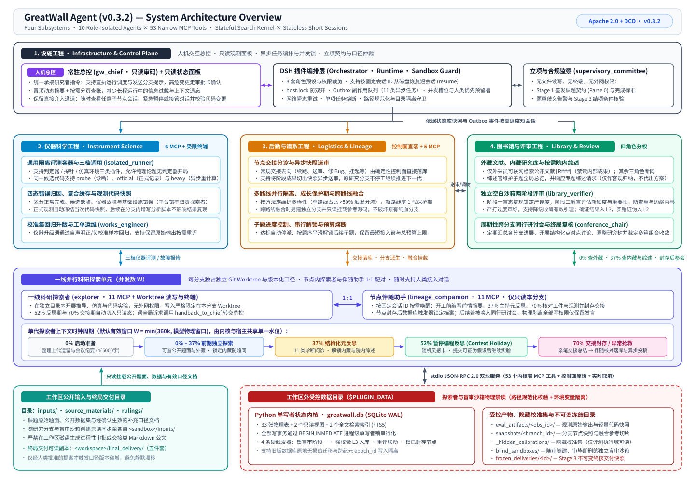
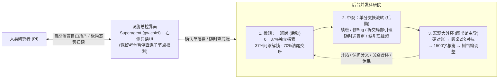

# GreatWall Agent（长城）

[English](./README_EN.md) | **简体中文**

[v0.3 实机验收与子题暂停、恢复说明](./docs/v03_runtime_acceptance.md)

> **面向长周期、多学派并发自主科学发现的开源多智能体实验基座**  
> **当前版本**：`v0.3.0-alpha.2`（整机架构大版本更新 · 代码与多轮审阅已收官，**尚未完成真实桌面长周期实测**，非开箱即用的生产工具）  
> **开源协议**：[Apache License 2.0](./LICENSE) + [DCO 1.1](./CONTRIBUTING.md#三许可证与-dcodeveloper-certificate-of-origin签署要求) ｜ **运行底座**：[DeepSeek Harness (DSH)](https://github.com/deepseek-ai/deepseek-harness) `>= 0.2.2-rc.5` × Python `3.11+` × [MCP](https://modelcontextprotocol.io)

---

> ⚠️ **坦诚的前置说明**  
> `v0.3.0-alpha.2` 完成了整座系统的架构大重构：确立了**第一性原理、钱学森《工程控制论》系统边界律、清晰自然语言表达**三大原则，落地了以 **Superagent（`gw-chief`）为唯一推荐人机主对接人**的双通道交互体系、**四大正交工程 × 10 角色物理分权**、**空白沙箱两阶段盲审与当场降级收编**、**脉冲式宏观大外环四拍（硬对账 $\to$ 圆桌对抗 $\to$ 1500 字导览总览 $\to$ 宏观树调整）**、**运行中节点 45% 暂停直连与工件哈希对账**，以及彻底消灭历史“上帝文件”的模块化代码库与前端。  
> 但我们必须同样坦诚地说明现状边界：**虽然代码已经过数轮交叉审阅并通过了全量本地自动化回归（Python 68 项测试 0 失败含 `v0.2` 真实旧库迁移、Node 54/54 含跨进程联调与假模型沙盘、Doctor 8/8），但目前尚未在真实 DSH Desktop 环境下完整跑过长周期开放课题实测**；此外，当前桌面直跑仍属应用层软沙箱（尚无容器/OS 内核级强隔离），整套多智能体科研制度相对单 Agent 裸跑的净收益也仍待干净的受控对照实验验证。  
> 我们以 **Apache 2.0 + DCO** 完全开源，希望把前沿 AI for Science 多智能体架构做成一座真正透明、可运行、可拆改、可共同演进的开放实验基座。

---

## 一、为什么做 GreatWall Agent？

把大语言模型放进持续十几个小时、多路并行的数学建模、算法优化或开放科学探索中，通用单智能体或简单堆叠的多代理框架很快会撞上四堵墙：

1. **聊得越长越糊涂，还会体面地提前摆烂**：对话拉长到十几万字后，模型会被早期直觉锁死，最后用流畅的学术辞令宣布“当前方案已接近极限”并停止实质探索。
2. **多路并发一开局就互相抄作业**：多个小组如果直接共享未验证的半成品草稿，谁先跑出一个能看的数字，大家立刻跟风涌过去，多并发瞬间退化成昂贵的重复劳动。
3. **测试脚本坏了被当成科学思路错了**：评测脚本漏读字段、模拟器报错或环境超时如果直接判 0 分，会把真正有价值的科学突破埋没在工程事故里。
4. **人类注意力被多并发窗口撕碎**：当 4–8 条研究分支、盲审、仪器升级同时运转时，人类同时最多只能有效跟进 3–5 个窗口；如果系统逼着人去满屏点按钮、当不同窗口之间的“人肉搬运工”，跑半小时人就精疲力竭。

**GreatWall Agent 的回答很朴素**：不靠堆砌花哨提示词去强求单个模型变成全能天才，而是把整座系统建造成一座**职责清晰、边界干净、服务一线科研探索者的学术共同体**——既支持纯解析数学推导与反例构造、形式化证明（如 Lean 4），也支持数值仿真、多目标优化和没有单一标量分数的开放机理探索。

---

## 二、系统全景与四大工程



整座系统在运行上严格切分为**微观、中观、宏观大外环**三层，所有并发的复杂度都被收口在人类研究者身后的 **Superagent（科研总控）** 与轻量只读界面之后：



在架构组织上，整座科研院收口为**四大正交工程**，全院 **10 个角色** 物理隔离权限，各司其职、互不越界：

| 四大工程 | 一句话定位 | 核心机制 |
| :--- | :--- | :--- |
| **1. 设施工程**<br>（底座与人机总控） | **系统的水电煤底座 + 人类唯一推荐对接入口** | **向内托底**：Node 插件执行层与 Python 单写者 SQLite 内核分离，用事务后副作用队列（Outbox）与单机进程锁保证崩溃重启不丢不乱。<br>**向外接人**：借鉴 DeepSeek Super-agent 范式，信息输出靠右侧极简只读 UI，自由指令全扔给零代码/零终端权的 **`gw-chief`（Superagent）** 整理为确认单路由落地；配 `+1` 人类优先槽防饿死，并克制保留一键查原始会话与 45% 暂停直连子节点对话/改码（含 SHA-256 工件对账）。 |
| **2. 仪器科学工程**<br>（工造司） | **实验室里可信、透明、可进化的测量仪器科** | 底层容器极薄，学科逻辑全部做插件；同一份仪器代码原生支持 **快速探针 / 正式凭证 / 重型异步** 三档调用；严格区分“代码错 / 科学否定 / 仪器故障 / 设施故障”，**仪器坏了绝不处罚探索者**；靠自声明金/毒校准集实现无死锁升版与版本域诚实重评；通过 5 条管道响应前线痛点、盲审反作弊、圆桌鉴别实验与人类专家投递的边界反例。 |
| **3. 后勤工程**<br>（一线探索与接力） | **井然有序的实验室轮班、记忆接力与快流转体系** | 科研人员与 1 对 1 专属助手走完 **0% $\to$ 37% $\to$ 70%** 一班岗：前 37% 屏蔽院内成果防跟风，37% 助手专家问诊后解锁全馆，70% 亲笔写遗嘱、助手核对硬盘归档为私有《全量死胡同档案》与《2200 字前情提要》。交班后常规去向由控制面确定性直落，支持**活节点顺手拆交局部引理送审而不锁死原分支**，忠实执行大外环下发的保护期、旁路双供体合体与三道停工锁。 |
| **4. 图书馆工程**<br>（知识枢纽与大外环） | **空白沙箱真伪法庭 + 脉冲式宏观演进中枢** | 拆分为 **4 个物理分权角色**：对外采编员（全院唯一联网、禁读内藏）、盲审官（绝对断网、独立空白沙箱实跑、主结论击穿但局部引理严密时当场降级收编）、圆桌主持裁判（零代码执行、两阶段主持对抗与读总览拍板）、对内综述官（绝对断网、写 1500 字导览总览与终局总论文）。硬成果过了盲审随时入库，跨过最新口径通关线即刻停派该子题；结项时经外部不可变冻结目录核签，彻底杜绝“审 A 放 B”。 |

---

## 三、核心文档导航

| 文档 | 内容定位 |
| :--- | :--- |
| **[`ARCHITECTURE.md`](./ARCHITECTURE.md)** | **系统架构总说明（推荐首读）**：设计哲学、三大根本原则、四大工程通俗拆解、核心流程图、真实代码地图与已知局限 |
| **[`docs/agent_kb_v0_3/`](./docs/agent_kb_v0_3/agent_kb_v0_3_00_INDEX_总导航_三层职责分离与里程碑路线.md)** | **`v0.3` 正式顶层架构论文集**：总纲 + 4 篇独立工程架构论文（设施 / 仪器 / 后勤 / 图书馆）+ 精确 SQLite DDL 与旧库迁移规范 |
| **[`greatwall-v6up/MODULE_MAP.md`](./greatwall-v6up/MODULE_MAP.md)** | **`v0.3.0-alpha.2` 一页式源码模块地图**：各模块目录边界、工程红线与本地一键验收命令 |
| **[`ROADMAP.md`](./ROADMAP.md)** | **问题清账本与未来路线图**：`v0.3` 已解决项清账、真实实跑/容器沙箱/`Harness²`/跨宿主生态等中长期演进构想 |
| **[`docs/dsh_development_handbook.md`](./docs/dsh_development_handbook.md)** | **DSH `0.2.2-rc.5` 工程开发实战手册**：客观记录 DSH 插件、Preset、Schema、会话托管与 Windows 避坑规范 |
| **[`docs/paper_study/README.md`](./docs/paper_study/README.md)** | **前沿文献研读库**：37 篇影响本项目设计的顶会论文、大厂博客（DeepMind / OpenAI / DeepSeek）与提示词深度中文综述 |
| **[`docs/archive/README.md`](./docs/archive/README.md)** | **历史演进与设计归档馆**：完整留存最初的《手写 project》、`v0.2` 早期白皮书、交接手册与历轮测试审计报告，展示完整思考脉络 |
| **[`REFERENCES.md`](./REFERENCES.md)** & **[`CONTRIBUTING.md`](./CONTRIBUTING.md)** | 完整学术参考文献溯源与开源协作指南（Apache 2.0 + DCO 1.1） |

---

## 四、快速上手与本地验证

### 1. 环境依赖
- **DeepSeek Harness (DSH)**：`>= 0.2.2-rc.5 < 0.3.0-0`
- **Node.js**：`>= 22.19.0` 或 `>= 24.0.0`
- **Python**：`>= 3.11`（内核仅依赖 Python 标准库；具体科研课题按需安装 `numpy` / `scipy` / `sympy` / `lean` 等）

### 2. 克隆并挂载至 DSH Profile

```bash
git clone https://github.com/Qingzhu093/greatwall-agent.git
```

在 `~/.dsh/profiles/desktop/package.json`（或对应 Web Profile）中以本地软链挂载 `greatwall-v6up/dsh_plugin` 并加入 `dsh.profile.bundles`：

```json
{
  "dependencies": {
    "dsh-greatwall-v6up": "link:/path/to/greatwall-agent/greatwall-v6up/dsh_plugin"
  },
  "dsh": {
    "profile": {
      "bundles": ["...其他 bundles...", "dsh-greatwall-v6up"]
    }
  }
}
```

挂载完成后，在 DSH 会话预设中选择 **「长城 · 科研总控 (`gw-chief`)」** 即可开始人机协同科研（CLI/自动化场景亦保留极简 4 动作入口 `greatwall_orchestrate`）。

### 3. 本地一键验证

```powershell
# 1. Python 全量单元测试、v0.2 旧库无损迁移、并发真取消与架构防腐门禁
Set-Location greatwall-v6up
python -m unittest discover -s tests -p "test_*.py" -v

# 2. 前端模块化构建、Node 全量单测（含假模型端到端沙盘）与 Doctor 契约体检
Set-Location dsh_plugin
npm run build:client && npm test && npm run doctor
```

---

## 五、仓库目录结构

```text
greatwall-agent/
├── README.md                       # 项目总览与快速入口（本文档）
├── README_EN.md                    # English Overview
├── ARCHITECTURE.md                 # v0.3 系统架构总说明（设计哲学、三大原则、四大工程与代码地图）
├── ROADMAP.md                      # 问题清账本与中长期演进路线图
├── REFERENCES.md                   # 学术论文、工程博客与开源生态完整溯源
├── CONTRIBUTING.md                 # 贡献指南与 DCO 1.1 签署规约
├── LICENSE & NOTICE                # Apache License 2.0 协议正文与第三方归属声明
├── greatwall-v6up/                 # v0.3.0-alpha.2 核心可运行源码（模块化拆分、零上帝文件）
│   ├── MODULE_MAP.md               # 一页式源码边界、工程红线与验收命令
│   ├── core_python/                # Python 单写者真相内核（db/、12 个控制面子域、10 角色 44 窄工具与隔离执行器）
│   ├── dsh_plugin/                 # DSH Cordis 插件（8 套 Preset、runtime/、sessions/、orchestrator/、client_src/）
│   └── tests/                      # Python 全量回归套件与 v0.2.0-alpha.1 真实旧库迁移夹具
└── docs/
    ├── agent_kb_v0_3/              # v0.3 正式顶层架构论文集（总纲 + 4 篇工程论文 + 精确 SQLite DDL）
    ├── dsh_development_handbook.md # DSH 0.2.2-rc.5 底层工程开发实战手册
    ├── paper_study/                # 37 篇前沿论文与大厂实战深度研读库
    ├── assets/                     # 系统架构图资产
    └── archive/                    # 历史演进与设计归档馆（手写原点、v0.2 白皮书、交接手册与历轮审计记录）
```

---

## 六、参与贡献与开源协议

我们诚挚欢迎任何形式的 Issue、讨论与 PR——无论是真机长周期实测反馈、容器强隔离沙箱、三问前端视觉打磨、新学科 MCP/Skill 插件，还是关于多智能体科研方法论的实证探讨。提交前请阅读 [`CONTRIBUTING.md`](./CONTRIBUTING.md) 并使用 `git commit -s` 完成 DCO 签署。

本项目基于 **[Apache License 2.0](./LICENSE)** 开源，第三方引用与归属声明见 **[`NOTICE`](./NOTICE)**。
