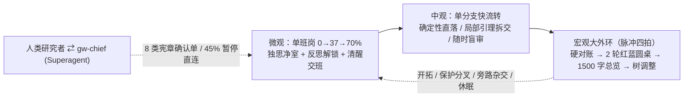

# GreatWall Agent（长城）

[English](./README_EN.md) | **简体中文**

[v0.3 实机验收与子题暂停、恢复说明](./docs/v03_runtime_acceptance.md)

> **面向长周期、多学派并发自主科学发现的开源多智能体实验基座**  
> **版本状态**：`v0.3.0-alpha.1`（整机架构大版本升级 · **Superagent `gw-chief` × 10 角色 44 窄工具 × 宏观大外环四拍 × 45% 人工接管 × 模块化三问前端** · **非开箱即用的生产工具**）  
> **开源协议**：[Apache License 2.0](./LICENSE) + [DCO 1.1](./CONTRIBUTING.md#三许可证与-dcodeveloper-certificate-of-origin签署要求) ｜ **运行底座**：[DeepSeek Harness (DSH)](https://github.com/deepseek-ai/deepseek-harness) `>= 0.2.2-rc.5` × Python `3.11+` × [MCP](https://modelcontextprotocol.io)

---

> ⚠️ **坦诚的前置说明**  
> 本项目已正式完成 **`v0.3.0-alpha.1`** 整机架构大重构：围绕 **Superagent 人机总控（`gw-chief`）与双端幂等确认单、四大工程 10 角色 × 44 窄工具 × 8 套单源 Preset 物理分权、宏观大外环四拍脉冲（代码硬对账 → 2 轮封存伴随红蓝圆桌 → `<=1500` 字全局总览 → 宏观树调整）、45% 运行中节点人工接管与 SHA-256 工件对账、子题级口径防连坐、Stage 3 外部不可变冻结一步原子终签、以及零依赖模块化前端（`client_src/ -> lib/client.js`）** 完成了全栈重塑并彻底消除历史“上帝文件”。当前已通过全量自动化回归与契约验收（Python **`60/60`** 含 `v0.2.0-alpha.1` 真实旧库无损迁移夹具、Node **`48/48`** 含 L2 零费用全链路假模型沙盘、Doctor **`8/8`**）。  
> 同时我们仍坦诚保留以下现状边界：桌面端直跑仍属应用层软沙箱（尚无容器/OS 内核级强隔离），`v0.3.0-alpha.1` 尚待在真实 DSH Desktop 上完成长时间开放课题实跑，且整套多智能体科研制度尚未在零工程事故基线下完成充分的受控对照实验（详见 [`docs/agent_kb_v0_3/`](./docs/agent_kb_v0_3/agent_kb_v0_3_00_INDEX_总导航_三层职责分离与里程碑路线.md) 与 [`ARCHITECTURE.md §5`](./ARCHITECTURE.md#5-已知技术债与当前局限)）。  
> 我们以 **Apache 2.0 + DCO** 完全开源，希望把前沿 AI for Science 多智能体架构思路真正做成可运行、可拆改、可共同演进的开放实验基座，欢迎任何拆解、复现、批评与协作。

---

## 为什么做 GreatWall Agent？

在把大语言模型推向十小时级、多路并行、无人值守的数学建模与开放科学探索时，通用单智能体或简单的父子多代理框架往往会迅速撞上三堵墙：

1. **长上下文注意力退化与“体面怠惰”**：对话拉长到数十万 Token 后，模型被早期直觉锚定，用流畅的学术辞令宣布“已接近理论极限”并停止实质探索；
2. **高并发下的群体思维坍塌**：多个分支若共享未经审定的公告板，几轮之内就会蜂拥向同一个表面好写、实则存在结构天花板的局部方案；
3. **工具损坏与科学失败混淆**：评测脚本报错、数据键位缺失或环境异常若直接折算为 0 分，会把真正有价值的科学突破埋没在工程事故里。

**GreatWall Agent** 试图借鉴学术界近期多项自主科研前沿成果（*Cogentic*、*The Station*、*SLA*、*AgentDiscover*、*RQGM*、*Audit the Scaffold* 等，完整溯源见 [`REFERENCES.md`](./REFERENCES.md)），构建一座**服务一线科研探索者的扁平学术共同体**——兼容纯解析数学推导与构造反例、形式化定理证明（如 Lean 4）、多保真数值仿真、多目标 Pareto 优化以及无客观标量尺度的开放机理探索。

---

## 系统全景与四大工程


### 三层闭环科研流程（微观单班岗 × 中观快流转 × 宏观大外环）



在软件与组织架构上，系统严格收口为**四大正交工程**，全院 **10 大角色 × 44 个窄 MCP 工具** 通过 **8 套单源 DSH Preset** 实现物理级权限隔离：

| 工程划分 | 对应逻辑机构 / 角色 | 核心机制（`v0.3.0-alpha.1` 已实现） |
| :--- | :--- | :--- |
| **1. 设施工程** | Superagent 总控 (`gw_chief`)<br>编排内核 (`Orchestrator`) & 统一控制面 (`ControlService`)<br>监察委员会 (`supervisory_committee`)<br>三问极简工作台 (`client_src/`) | 独立 `greatwall-chief` Preset（零代码写/零终端/零外网，启 `dsh-compaction-basic` + 弹性现况锚点卡 `min(hardCap, max(400, 180 + 100*N))`）；**DSH 原生 `actionCards` + 右侧 UI 双端幂等确认单**；持久化事务 Outbox (`runtime_effects`) 租约消费与热注入 `NOTIFY_POLICY_CHANGED`；`host.lock` 防双活 + `maxWorkers + 1` 人类优先保留槽 + 429/5xx 指数退避；**45% 暂停直连与 `source.rpcId` 人类插话让权 + `ctx.jobs` 清理 + SHA-256 工件对账**；子题级 `active_spec_revision` 防连坐（废除扫盘静默升版）；双池并发 + `$/cancelRequest` 真取消 + `v0.2` 旧库无损迁移 |
| **2. 仪器科学工程** | 工造司 (`works_engineer`)<br>隔离执行容器 (`isolated_runner.py`) | 统一 `evaluate(artifact, spec, tier)` 三档同码协议（`probe / official / heavy`）；四态物理隔离（`INSTRUMENT_ERROR / INFRA_ERROR` 零处罚、不判负、自动开单熔断）；四元复合缓存与独占暂存原子领号；自声明预期校准集无死锁回归升版；在途旧观测自动入重评队列；打通前线痛点 / 盲审 `EXPLOIT` / 圆桌 `DISCRIMINATOR` / 人类经总控投递等多条工单管道 |
| **3. 后勤工程** | 后勤分诊 (`logistics_coordinator`)<br>探索者 (`explorer`) ◄─1:1─► 伴随 (`lineage_companion`) | 确定性会话 ID `gw-comp-<node_id>` 按需 `ctx.agents.resume` 唤醒（不跨代常驻）；`0–37%` 独思净室（开外藏 `[R###]`、锁内藏）→ `37%` 反思解锁全馆与《子题全局总览》→ `70%` 亲笔《科研遗嘱》与伴随单写 DAG；**常规 5 类去向控制面确定性直落 + 活节点独立拆交 `local_lemma_submissions` 一次性盲审**；2 班岗成长保护期、旁路双供体只读挂载（`.greatwall_donors/`）与 `handback_to_chief` 越界退回守则 |
| **4. 图书馆工程** | 对外采编 (`external_surveyor`)<br>盲审官 (`library_verifier`)<br>圆桌主席 (`conference_chair`)<br>对内综述与终稿官 (`library_chronicler`) | **四角色物理分权**（仅 `external_surveyor` 唯一连外网且禁读院内成果；其余三角色绝对零外网）；四重 Fail-Closed 独立空白盲审沙箱；**Stage 1 新增 `PARTIAL_PASS` + Stage 2 `ACCEPT_NARROWED` 同事务收编 L3+L2**；**悬赏缺口 (`open_lemma_gaps`) 自动核销唤醒 `BLOCKED_L4B`**；**脉冲式宏观大外环四拍**（代码硬对账 → 封存伴随零写权 2 轮圆桌 → `<=1500` 字《子题全局总览》→ 主席 6 类树调整，单分支自动退化跳过互辩）；**Stage 3 外部只读不可变冻结目录 + 锁外哈希比对一步原子结项** |

---

## 核心文档导航

| 文档 | 内容定位 |
| :--- | :--- |
| **[`docs/agent_kb_v0_3/`](./docs/agent_kb_v0_3/agent_kb_v0_3_00_INDEX_总导航_三层职责分离与里程碑路线.md)** | **`v0.3` 权威顶层架构套件**：总纲 + 四大工程架构论文（设施 / 仪器 / 后勤 / 图书馆）+ 精确 SQLite DDL 与旧库迁移规范 |
| **[`greatwall-v6up/MODULE_MAP.md`](./greatwall-v6up/MODULE_MAP.md)** | **`v0.3.0-alpha.1` 一页式源码模块地图**：各模块目录职责、7 条工程红线与全量验收/自检命令 |
| **[`ARCHITECTURE.md`](./ARCHITECTURE.md)** | 设计哲学、钱学森《工程控制论》核心张力与 `v0.2` 演进背景（顶部已链接最新 `v0.3` 权威文档） |
| **[`ROADMAP.md`](./ROADMAP.md)** | 问题清账本与中长期演进构想（容器强沙箱、`Harness²` 工造司进化、科研标准插座与开放实验议题） |
| **[`REFERENCES.md`](./REFERENCES.md)** | 全部影响架构或路线图的学术论文、工程博客、开源项目与开放协议完整溯源 |
| **[`docs/paper_study/README.md`](./docs/paper_study/README.md)** | 前沿文献与背景知识研读库（37 篇核心论文、工程博客与官方提示词的中文深度精读综述与配图） |
| **[`CONTRIBUTING.md`](./CONTRIBUTING.md)** | 开源协作切入指南、Apache 2.0 + DCO 1.1（`git commit -s`）签署流程与 PR 规范 |
| [`greatwall-v6up/dsh_plugin/README.md`](./greatwall-v6up/dsh_plugin/README.md) | DSH `0.2.2-rc.5` 插件包说明、8 套 Preset 清单、前端构建与自检指南 |

---

## 快速上手

### 1. 环境依赖
- **DeepSeek Harness (DSH)**：`>= 0.2.2-rc.5 < 0.3.0-0`
- **Node.js**：`>= 22.19.0` 或 `>= 24.0.0`
- **Python**：`>= 3.11`（控制面仅依赖 Python 标准库；科研课题按需安装 `numpy` / `scipy` / `sympy` / `lean` 等）

### 2. 克隆并挂载至 DSH Profile

```bash
git clone https://github.com/Qingzhu093/greatwall-agent.git
```

在 `~/.dsh/profiles/desktop/package.json`（或对应 Web Profile）中通过本地软链挂载 `greatwall-v6up/dsh_plugin` 并加入 `dsh.profile.bundles`：

```json
{
  "dependencies": {
    "dsh-greatwall-v6up": "link:/path/to/greatwall-agent/greatwall-v6up/dsh_plugin"
  },
  "dsh": {
    "profile": {
      "bundles": ["...其他 bundles...", "dsh-greatwall-v6up"]
    }
  }
}
```

挂载完成后，在 DSH 会话预设中选择 **「长城 · 科研总控 (`gw-chief`)」** 即可开始人机协同科研（自动化/Headless 场景亦保留极简 4 动作入口 `greatwall_orchestrate`）。

### 3. 本地一键验证

```powershell
# 1. Python 60 项全量单测、v0.2 无损迁移、并发真取消与防腐门禁
Set-Location greatwall-v6up
python -m unittest discover -s tests -p "test_*.py" -v

# 2. 前端模块化构建、Node 48 项单测/L2 全链路沙盘与 Doctor 8 项契约体检
Set-Location dsh_plugin
npm run build:client && npm test && npm run doctor
```

---

## 仓库目录结构

```text
greatwall-agent/
├── README.md                  # 项目总览与快速入口（本文档）
├── README_EN.md               # English Overview
├── ARCHITECTURE.md            # 设计哲学、工程控制论张力与历史演进说明
├── ROADMAP.md                 # 未解难题、演进方向与开放研究议题
├── REFERENCES.md              # 学术论文、工程博客与开源生态完整溯源
├── CONTRIBUTING.md            # 贡献指南与 DCO 1.1 签署规约
├── LICENSE & NOTICE           # Apache License 2.0 协议正文与第三方归属声明
├── greatwall-v6up/            # v0.3.0-alpha.1 核心可运行源码（全模块化、零上帝文件）
│   ├── MODULE_MAP.md          # v0.3.0-alpha.1 一页式源码边界与验收地图
│   ├── core_python/           # Python Single-Writer 内核：db/、12 个 control_plane 子域、44 窄工具、隔离执行器与 10 份角色模板
│   ├── dsh_plugin/            # DSH (0.2.2-rc.5+) Cordis 插件：8 套单源 Preset、runtime/、sessions/、orchestrator/、client_src/ 与 48 项测试
│   └── tests/                 # Python 60 项全量回归、并发/取消、架构门禁与 v0.2 旧库迁移夹具
└── docs/
    ├── agent_kb_v0_3/         # v0.3 顶层架构总纲、4 篇工程架构论文与精确 SQLite DDL 规范
    ├── paper_study/           # 37 篇前沿论文与工程博客深度研读库
    └── assets/                # 系统架构图资产
```

---

## 当前主要局限

- **应用层软沙箱局限**：当前桌面直跑沙箱依赖路径规范化与命令拦截，尚无 Docker / WSL2 + cgroups 的 OS 内核级资源限额与强隔离；
- **真实桌面长时间课题实跑待深化**：`v0.3.0-alpha.1` 已通过 60 项 Python、48 项 Node（含 L2 零费用全链路沙盘）与 8 项 Doctor 契约验收，接下来需要在真实 DSH Desktop 环境下开展多子题长程课题的端到端压测与调优；
- **核心科研假设尚待干净对照实证**：多智能体制度相比单 Agent 裸跑在开放科研任务上的净收益、以及非标量科学任务的梯度引导难题，仍在持续验证探索中。

---

## 参与贡献与开源协议

我们诚挚欢迎任何形式的 Issue、讨论与 PR——无论是三问工作台 UI/UX 优化、容器强沙箱、新学科 MCP/Skill 插件，还是关于多智能体科研方法论的实证探讨。提交前请先阅读 [`CONTRIBUTING.md`](./CONTRIBUTING.md) 并使用 `git commit -s` 完成 DCO 签署。

本项目基于 **[Apache License 2.0](./LICENSE)** 开源，第三方引用与归属声明见 **[`NOTICE`](./NOTICE)**。
