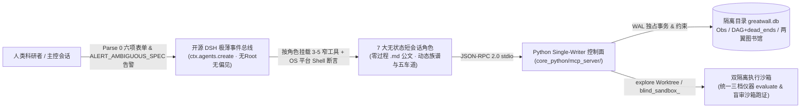

# 长城科研共同体 V6-Up (v3.0) · GreatWall Agent

> 面向长周期、高并发、无人值守通用 **AI for Science**（科学计算、物理仿真、数学推导与形式化发现）的 **DeepSeek Harness (`0.2.2-rc.3`) × Python Single-Writer 控制面 × 双隔离沙箱** 多智能体科研协同系统。  
> **当前版本状态（2026-11-21 第四轮复盘后）**：
> - **顶层架构与知识库（v3.0 已定版）**：已完成去竞赛过拟合大重构与全套工程契约闭环（见 [`PROJECT.md`](PROJECT.md)、[`04` 顶层专报](docs/architecture/04_十三篇前沿论文深度解惑与V6Up架构融合专报.md)、[`09` 工程交接说明书](docs/architecture/09_V6Up_v2.2_实施侧工程交接与系统开发总说明书.md) 及 [`docs/agent_kb/`](docs/agent_kb/00_INDEX_Agent知识库总导航与必读映射.md)）。
> - **代码实现底座（[`greatwall-v6up/`](greatwall-v6up/)）**：当前代码停留在 `3dfa211`（v2.2 基线 + 第 4 轮应急门禁修复），**待按 [`09` 说明书](docs/architecture/09_V6Up_v2.2_实施侧工程交接与系统开发总说明书.md) 进入 P0–P4 的 v3.0 重构落地**。系统仍处实验验证期，暂不建议外部直接下载用于生产。

---

## 一、核心设计思想与 v3.0 架构全景

以**开源 DSH `ctx.agents.create()` 确定性极薄事件总线**串联**“一委三部 + 1 对 1 探索伴随单元”**，遵循 **3 真相（`Obs` / 谱系 `DAG + lineage_dead_ends` / 中央图书馆内外两翼）+ 2 视图（增量看板 & A 档图检索）+ 沙箱平权 + 科研仪器科三档四态校准**，根除长周期科研中的集体跟风坍缩、竞赛硬编码过拟合与平台报错冤案：



### 1. 七大角色契约与沙箱平权矩阵（v3.0）

每个被拉起的节点都是主工作区下的无状态短会话（经 `agentCtx.tools.restrict()` + OS DACL + `realpathSync` 物理隔离，仅持有 **3–5 个窄 MCP 工具**）：

| 角色 ID | 职能定位 | 隔离沙箱与原生工具边界 | 核心制度保障（v3.0） |
| :--- | :--- | :--- | :--- |
| `explorer` | 前沿探索者 | 独立 Git Worktree + `read/write/edit/glob/grep` + 平台 Shell（`win32->pwsh`, 非`win32->bash`）；**禁读 DB / 隐藏集 / 他脉 / 禁网** | `0–37%` 极简推进（仅查外藏 `[R###]` + 自主 `pwsh` 与三档仪器）；`37%` 后解锁内藏 `L3/L2` 与深层谱系 |
| `lineage_companion` | 1 对 1 伴随助手 | 单向只读配对探索节点的 Worktree（禁写、禁 Shell） | `37%`（**废除 `eval_count>=1` 阻塞**）2 轮夜科学元反思当场解锁内藏；`70%` 单写 DAG（`<100` 字 `mechanism_summary` + `evidence_grade`）+ 只追加 `lineage_dead_ends` + `<=2200` 字增量看板 |
| `library_verifier` | 沙箱实测盲审 & 打捞 | **每次唤醒挂载独立空白临时盲审沙箱 `blind_sandbox_<review_id>/`**，开放 `read/glob/grep` + 平台 Shell/SymPy/Lean 4；**OS 物理隔离 DB / B 栏 / 隐藏集 / 原 Worktree** | 两阶段盲审：Stage 1 盲态跑证复算 -> Stage 2 解盲对比；三态裁决：`ACCEPT*`（含确证反例/障碍入 `L3` 并标 `goal_coverage`）、`REVISE`（Stage 1/2 共用 `<=2` 轮返工，禁 `Auditor` 插手）、`REFUTED`（入 `L2` 解锁打捞） |
| `works_engineer` | 工造司 · 科研仪器科 | 锁定 `evaluators/` 与 `skills/` + 平台 Shell（严禁篡改研究 Worktree） | 剥离判官权力，回归仪器提供商；统一 `evaluate(artifact, spec, tier)`（`probe/official/heavy`）；`INSTRUMENT_ERROR/INFRA_ERROR` 零处罚并自动熔断；按案例自声明预期 `(expected_status, expected_verdict)` 校准升级 |
| `logistics_coordinator` | 后勤调度总管 | **`0` 原生工具**（纯 DB 状态机驱动） | 机制归类；同题任一学派 `branch_count>=2 && share>50%` **无豁免刚性正交打散**；分支级确定性 `requires`（不跨分支取并集）；按主张匹配可核验载体（废除 `passed=1` 死锁）；四级分诊与五车道停滞复苏 |
| `library_surveyor` | 外藏采编 & Stage 3 整编 | Web 查新 / 文献 PDF 只读 + 3 MCP 工具 | 采编左翼外藏 `[R###]`（明确标注“未复验外部参考摘要”，校验 `support_scope` 5 枚举与摘要长度）；Stage 3 仅组装已审 `L3` 与精确剩余缺口 |
| `supervisory_committee` | 监察委员会 | **`0` 原生工具**（纯只读 DB 视图，零磁盘 `.md` 写入） | 核验 Parse 0 六项表单；无人值守口径歧义后台亮红灯 `ALERT_AMBIGUOUS_SPEC` **按原口径续跑不停机**；CDC 双段终局锁（`FULL` 要求必答子题 `goal_coverage="FULL_GOAL"` `L3>=1`；人类叫停支持 `PARTIAL_ON_HUMAN_STOP`） |

### 2. v3.0 相比 v2.2 的关键纠偏
- **废除竞赛特例硬编码**：取消全题强建基线、全局 `<5%` 误差门禁、底座一刀切拦截全零/常数解、AST `Q3 second_pass` 黑名单与 `[Local-Sweep]` 教条；支持无隐藏集开放数值发现通过固定配置+多种子 `official`/`heavy` 送审并由盲审沙箱扰动复现。
- **判不了绝不判负**：将平台/仪器自身崩溃（`INSTRUMENT_ERROR` / `INFRA_ERROR`）与候选报错（`CANDIDATE_ERROR`）、科学否定（`MEASURED_REJECTION`）物理隔离；工程修补失败仅写本脉 `lineage_dead_ends`，不污染图书馆 `L2`。
- **G3 看板解耦与无连坐引用**：只追加表 `lineage_dead_ends` 承担历代死胡同记忆，看板维持增量更新与 `<= 2200` 字单一上限；引用边默认 `MOTIVATING_REF`，仅 Stage 2 显式认证的 `REQUIRED_PREMISE` 才传播级联撤回。

---

## 二、仓库目录结构

```text
.
├── README.md                  # 项目总览与状态说明（本文档）
├── PROJECT.md                 # V6-Up v3.0 顶层架构与目录总入口
├── greatwall-v6up/            # 【工程代码仓】（当前为 v2.2 基线，待按 09 说明书推进 P0–P4 升级至 v3.0）
│   ├── core_python/           # Python Single-Writer 控制面、MCP Server、隔离评测器与角色模板
│   │   ├── agents/            # 7 大角色运行态提示词契约 (.md)
│   │   ├── evaluators/        # 物理隔离评测执行器 (isolated_runner.py)
│   │   ├── mcp_server/        # 模块化 MCP 工具、SQLite WAL Schema、参数校验与服务实现
│   │   ├── prompts/           # 29 条夜科学元反思提示库 (holiday_prompts.yaml)
│   │   ├── skills/            # 主控科研 SOP (SKILL.md) 与技能台账 (SKILL_LEDGER.json)
│   │   └── config.json        # 运行时核心参数表
│   ├── dsh_plugin/            # DeepSeek Harness (0.2.2-rc.3) 插件本体
│   │   ├── lib/               # 编排器、会话宿主、Preset 注册、沙箱、遥测与右侧栏控制台
│   │   ├── presets/           # 子角色 Preset 定义文件
│   │   ├── test/              # DSH SDK E2E 与 Hard Gates 测试 (.test.mjs)
│   │   ├── cordis.patch.yml   # DSH Bundle 补丁与 @deepseek-ai/dsh-agent-preset 声明
│   │   └── package.json       # 插件清单与 dsh.client 入口声明
│   └── tests/                 # Python 契约、触发器、沙箱与 Round 4 门禁单测 (test_*.py)
└── docs/                      # 【顶层定稿、知识库与多轮实机审计档案】
    ├── architecture/          # 第一性手稿、13 篇论文融合专报 (04)、演进思辨 (05) 与 v3.0 工程交接说明书 (09)
    ├── agent_kb/              # v3.0 全套 7 份中层实施与 Prompt 零缩水直抄知识库 (00–06)
    ├── round2_audit/          # 第二轮实机全链路复盘与专项审计报告
    └── round4_audit/          # 第四轮实测对齐审计、原文溯源决策对照与用户批注原件
```

> 注：`.agents/`、`archive/`（含 `v2.2` 顶层设计全量备份）及运行期 `*.db` / `worktrees/` 均通过 [`.gitignore`](.gitignore) 保留在本地工作区，不纳入 GitHub 公共主线；旧版 V4 快照保留在远端 `archive/v4` 分支。

---

## 三、环境要求、挂载与当前基线测试

### 1. 前置依赖
- **DeepSeek Harness (DSH)**：`>= 0.2.2-rc.3 < 0.3.0-0`
- **Node.js**：`>= 22.19.0` 或 `>= 24.0.0`
- **Python**：`>= 3.11`（控制面仅依赖标准库；科研课题按需使用 `numpy`/`scipy`/`sympy`/`lean` 等）

### 2. 挂载至 DSH Desktop Profile
在 `~/.dsh/profiles/desktop/package.json` 中通过本地软链挂载 `greatwall-v6up/dsh_plugin` 并加入 `dsh.profile.bundles`（详见 [`greatwall-v6up/dsh_plugin/README.md`](greatwall-v6up/dsh_plugin/README.md)）：

```json
{
  "dependencies": {
    "dsh-greatwall-v6up": "link:/path/to/greatwall-v6up/dsh_plugin"
  },
  "dsh": {
    "profile": {
      "bundles": ["...其他 bundles...", "dsh-greatwall-v6up"]
    }
  }
}
```

### 3. 当前基线（`3dfa211`）自动化自检
在仓库根目录使用 PowerShell 7 (`pwsh`) 或对应 Shell 运行现有测试套件（待后续 P0–P4 改造同步扩充 v3.0 测试）：

```powershell
# 1. 运行 Python 控制面与门禁单元测试 (4 套 test_*.py)
python -m unittest discover -s "./greatwall-v6up/tests" -p "test_*.py" -v

# 2. 运行 DSH SDK E2E 与 Round 4 Hard Gates 测试 (2 套 .test.mjs)
node --test --test-reporter=spec --test-force-exit --test-timeout=20000 `
  "./greatwall-v6up/dsh_plugin/test/dsh_orchestrator_e2e.test.mjs" `
  "./greatwall-v6up/dsh_plugin/test/round4_hard_gates.test.mjs"
```

---

## 四、权威文档导航（v3.0）

- **全局总入口**：[`PROJECT.md`](PROJECT.md)
- **第一性思想原点**：[`docs/architecture/手写project.md`](docs/architecture/手写project.md)
- **顶层架构总纲（v3.0 定稿）**：[`docs/architecture/04_十三篇前沿论文深度解惑与V6Up架构融合专报.md`](docs/architecture/04_十三篇前沿论文深度解惑与V6Up架构融合专报.md)
- **工程交接与 P0–P4 施工总说明书**：[`docs/architecture/09_V6Up_v2.2_实施侧工程交接与系统开发总说明书.md`](docs/architecture/09_V6Up_v2.2_实施侧工程交接与系统开发总说明书.md)
- **Agent 制度与 Prompt 零缩水直抄知识库**：[`docs/agent_kb/00_INDEX_Agent知识库总导航与必读映射.md`](docs/agent_kb/00_INDEX_Agent知识库总导航与必读映射.md)
- **演进思辨与第 4 轮复盘**：[`docs/architecture/05_V6Up架构演进思辨与文献取舍絮语集.md`](docs/architecture/05_V6Up架构演进思辨与文献取舍絮语集.md) · [`docs/round4_audit/`](docs/round4_audit/01_交顶层设计者_原文对照与架构讨论稿_对齐版.md)
- **DSH 插件模块说明**：[`greatwall-v6up/dsh_plugin/README.md`](greatwall-v6up/dsh_plugin/README.md)
