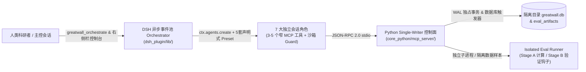

# 长城科研共同体 V6-Up (v2.2) · GreatWall Agent

> 面向长周期、高复杂度科学计算、数学建模与数值求解（AI for Science）的 **DeepSeek Harness (`0.2.2-rc.3`) × Python Single-Writer 控制面** 多智能体科研协同系统。  
> **状态说明**：核心架构改造、模块化拆分、DSH `0.2.2-rc.3` 声明式 Preset 适配与右侧栏「长城控制台」已落地并通过单元/SDK E2E 门禁，目前正处于 DSH 桌面端真题联调与实战测试阶段，完全不建议使用和下载，因为非常不稳定。

---

## 一、核心设计思想与架构全景

系统采用**双层解耦与单写并发控制面（Single-Writer Control Plane + External Event Pool）**，让擅长数值与代码演绎的探索分支与严苛的验证、盲审、治理制度彻底隔离：



### 1. 七大标准角色与 31 个单一职责窄工具

每个被拉起的节点都是主工作区下的一等独立 DSH 会话（可直接在 UI 列表中点开对话纠偏或由右侧栏控制），只持有 **3–5 个窄 MCP 工具** 及受控原生工具集：

| 角色 ID | 职能定位 | 挂载 Preset | 权限特征与工具规模 |
| :--- | :--- | :--- | :--- |
| `explorer` | 前沿探索者 | `greatwall-explorer` | 隔离 Git Worktree 读写与 Shell + 5 MCP 工具（禁网络、禁压缩、禁读全局库/基线） |
| `lineage_companion` | 1 对 1 伴随助手 | `greatwall-companion` | 只读配对 Worktree + 4 MCP 工具（37% 夜科学反思、`<=2` 轮质询、去思维链黑匣子提炼） |
| `library_verifier` | 两阶段盲审裁判 | `greatwall-verifier` | **物理 0 原生工具净室** + 5 MCP 工具（Stage 1 盲审对账 → Stage 2 解盲对比） |
| `works_engineer` | 工造司工程师 | `greatwall-works` | `evaluators/hooks` 与 `baselines` 锻造 + 5 MCP 工具（`RQGM` 正负对照池与 `Q_P` 门禁） |
| `logistics_coordinator` | 后勤调度总管 | `greatwall-governance` | 只读 Worktree + 5 MCP 工具（分支派发、`depends_on_questions` 依赖锁、四级分诊、五车道破局） |
| `library_surveyor` | 采编查新与终审交付 | `greatwall-governance` | Web 查新 + 只读文件 + 3 MCP 工具（按 `fulfilled_request_ids` 精确核销、Stage 3 终稿导出） |
| `supervisory_committee` | 监察审计委员会 | `greatwall-governance` | 只读审计 + 4 MCP 工具（Stage 2 闭环合规审查、孤立技能台账与安全图查询） |

### 2. 关键机制保障

- **500k 真实上下文时钟 & `concludeTurn` 回合间隙控制流**：优先采样 `sessionProjections(['contextPressure'])`（兜底 `tokenMeter.measure()`），结合 `agent/pre-step` 与 `tools/result` 追帧同步至 SQLite；到达 `37%`（且首测完成）或 `70%` 时切断当前回合，交由伴随助手在回合间隙接手元反思或黑匣子交接。
- **方案 A 混合路径隔离沙箱**：通过 `fs.realpathSync()` 最深祖先解析彻底拦截 `..` 逃逸、`$env:` 读取、兄弟分支越界、`python -c sqlite3` 偷读，并从底层阻断向工作区写入无关过程文档。
- **右侧栏「长城控制台」**：内置 DSH Web/Desktop 插件客户端（`dsh_plugin/lib/client.js`）与 Connection 鉴权路由，实时展示子题 L3 进展、依赖锁状态、`500k` 压力条，并支持 UI 一键暂停/恢复/停止与节点定向 `intervene`。

---

## 二、仓库目录结构

```text
.
├── README.md                  # 项目总览（本文档）
├── PROJECT.md                 # 系统总体架构设计与目标纲领
├── greatwall-v6up/            # 【核心工程主体】
│   ├── core_python/           # Python Single-Writer 控制面、31 窄工具 MCP 与隔离评测器
│   │   ├── agents/            # 7 大标准角色原典提示词契约 (.md)
│   │   ├── evaluators/        # Stage A/B 双阶段物理隔离评测器 (isolated_runner.py)
│   │   ├── mcp_server/        # 模块化拆分的 MCP 控制面、SQLite WAL Schema、工具实现
│   │   ├── prompts/           # 29 条夜科学元反思提示库 (holiday_prompts.yaml)
│   │   ├── skills/            # 主控科研 SOP (SKILL.md) 与技能台账 (SKILL_LEDGER.json)
│   │   └── config.json        # v2.2 权威参数表（500k 窗口 / 37% / 70% 水位等）
│   ├── dsh_plugin/            # DeepSeek Harness (0.2.2-rc.3) 插件本体
│   │   ├── lib/               # 编排器、会话宿主、5 套 Preset、沙箱、遥测与右侧栏控制台
│   │   ├── presets/           # 本地随附的 5 套子角色 Preset 定义文件
│   │   ├── test/              # DSH SDK 0.2.2-rc.3 零 Mock E2E 与 Hard Gates (#2–#7)
│   │   ├── cordis.patch.yml   # DSH Bundle 补丁与 5 套 @deepseek-ai/dsh-agent-preset 声明
│   │   └── package.json       # 插件清单与 dsh.client 入口声明
│   └── tests/                 # 15 项 Python 契约、触发器、沙箱与 Round 4 门禁单元测试
└── docs/                      # 【架构设计、知识库与历史审计】
    ├── architecture/          # 顶层融合专报、思辨集、实机复盘与工程交接规范 (04/05/06/09)
    ├── agent_kb/              # 一委三部制度详则、文献行号索引与 Prompt 模板库 (00–06)
    └── round2_audit/          # 第二轮测试全链路复盘与专项审计报告
```

> 注：早期 `.agents/` 过程记录与 `archive/` 已保留在本地工作区（并通过 `.gitignore` 排除），GitHub 主线仅维护干净源码与核心文档；旧版 V4 历史快照已备份至远端分支 `archive/v4`。

---

## 三、环境要求与本地挂载运行

### 1. 前置依赖

- **DeepSeek Harness (DSH)**：`>= 0.2.2-rc.3 < 0.3.0-0`
- **Node.js**：`>= 22.19.0` 或 `>= 24.0.0`
- **Python**：`>= 3.11`（仅依赖标准库 + 科研课题自身按需使用的 `numpy`/`scipy`/`sympy` 等）

### 2. 挂载至 DSH Desktop Profile

在 `~/.dsh/profiles/desktop/package.json` 中通过本地软链添加依赖并加入 `dsh.profile.bundles`：

```json
{
  "dependencies": {
    "dsh-greatwall-v6up": "link:/path/to/greatwall-v6up/dsh_plugin"
  },
  "dsh": {
    "profile": {
      "bundles": [
        "...其他官方或个人 bundles...",
        "dsh-greatwall-v6up"
      ]
    }
  }
}
```

重启 DSH Desktop 后即可启用：

1. 在主控对话中直接调用 `greatwall_orchestrate(action="start", workspace_root="...", goal_md="...", required_questions=["Q1", ...])` 非阻塞启动后台科研池；
2. 打开右侧栏新建 Tab 页中的 **「长城控制台」** 实时查看推进状态、水位与下发干预；
3. 或使用 `action="status" | "pause" | "resume" | "stop" | "intervene"` 随时调控。

---

## 四、自动化测试验证

在仓库根目录执行以下两套全量自检（需本机 Node >= 22 与 Python >= 3.11）：

```powershell
# 1. 运行 15 项 Python 契约与控制面单测
python -m unittest discover -s "./greatwall-v6up/tests" -p "test_*.py" -v

# 2. 运行 9 项 DSH SDK E2E 与 Hard Gates (#2–#7) 测试
node --test --test-reporter=spec --test-force-exit --test-timeout=20000 `
  "./greatwall-v6up/dsh_plugin/test/dsh_orchestrator_e2e.test.mjs" `
  "./greatwall-v6up/dsh_plugin/test/round4_hard_gates.test.mjs"
```

---

## 五、相关文档导航

- 总体愿景与构想：[`PROJECT.md`](PROJECT.md)
- 实施侧开发总说明与工程规范：[`docs/architecture/09_V6Up_v2.2_实施侧工程交接与系统开发总说明书.md`](docs/architecture/09_V6Up_v2.2_实施侧工程交接与系统开发总说明书.md)
- 十三篇前沿论文架构融合专报：[`docs/architecture/04_十三篇前沿论文深度解惑与V6Up架构融合专报.md`](docs/architecture/04_十三篇前沿论文深度解惑与V6Up架构融合专报.md)
- Agent 制度与 Prompt 知识库总导航：[`docs/agent_kb/00_INDEX_Agent知识库总导航与必读映射.md`](docs/agent_kb/00_INDEX_Agent知识库总导航与必读映射.md)
- DSH 插件模块说明：[`greatwall-v6up/dsh_plugin/README.md`](greatwall-v6up/dsh_plugin/README.md)
