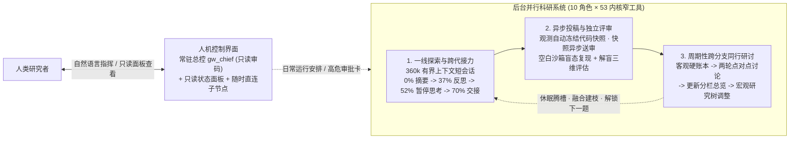

# GreatWall Agent（长城）

[English](./README_EN.md) | **简体中文**

> **面向长周期、多路线并发自主科学发现的开源多智能体实验基座**  
> **当前版本**：`v0.3.2`（已完成架构落地与自动化回归验证，正在开展新一轮真实桌面长程测试，非开箱即用的生产工具）  
> **开源协议**：[Apache License 2.0](./LICENSE) + [DCO 1.1](./CONTRIBUTING.md#三许可证与-dcodeveloper-certificate-of-origin签署要求) ｜ **运行底座**：[DeepSeek Harness (DSH)](https://github.com/deepseek-ai/deepseek-harness) `>= 0.2.2-rc.5` × Python `3.11+` × [MCP](https://modelcontextprotocol.io)

---

> ⚠️ **坦诚的前置说明**  
> GreatWall Agent 处于持续实测与迭代阶段。当前 `v0.3.2` 已通过全量自动化回归测试（Python **81** 项、Node **64** 项、环境与契约体检全绿），并正在真实 DeepSeek Harness Desktop 环境下进行长周期多子题测试。  
> 但我们依然坦诚交代现状边界：整套多智能体科研制度在等预算受控基线下相对单智能体裸跑的净收益，尚待更多真实课题的对照实验验证；本地直跑沙箱目前仍属应用层软防线（尚未接入 Docker / WSL2 容器级内核隔离）。  
> 我们以 **Apache 2.0 + DCO** 完全开源，希望把近年来自主科研与长程多智能体方向的关键工程机制整合成一座透明、可运行、可拆改的开放实验基座。

---

## 一、为什么做 GreatWall Agent？

把大语言模型直接放进持续十几个小时、多路并行的数学推导、算法构造或开放科学探索中，通用单智能体或简单的多代理协作框架很快会遇到五个共性难题：

1. **长上下文退化与路径惯性**：对话拉长到数十万 Token 后，模型不仅推理变慢，还会被早期局部报错与修补轨迹锚定，难以跳出既有框架重新审视问题。
2. **高并发下的多样性坍塌**：多个子智能体如果随时共享未经核验的公共讨论区，谁先跑出一个能看的局部结果，其余分支就会迅速跟风，并发算力退化为昂贵的重复劳动。
3. **路灯效应（Streetlight Effect）与过度声称**：一旦主干定理其实已经证出，而评测器对某个零测度退化点或微小浮点容差给出显眼报错，缺乏多维价值评判的系统就会把全部算力吸进边角细节里空转，迟迟无法收敛推进到下一题。
4. **工程故障与科学失败混淆、投稿摩擦过高**：评测脚本自身报错不该归责探索者；而送审即冻结分支、或改写一个辅助分析脚本就导致历史观测无法绑定，会直接让共享知识库空转。
5. **人类注意力过载**：人类研究者同时最多只能有效跟进 3–5 个活跃对话；把十几个后台会话与繁琐表单直接摊在界面上，很快会把研究者拖成疲惫的“人工调度员”。

**GreatWall Agent 的思路很朴素**：不指望靠提示词把单个模型变成全能天才，而是把整套系统建造成一座**职责清晰、边界干净、服务一线科研探索者的扁平学术共同体**——既支持纯解析数学推导、构造性反例与形式化证明（如 Lean 4），也支持数值仿真、多目标优化和没有单一标量分数的开放机理探索。

---

## 二、系统全景与四大子系统


整座系统由后台并发科研引擎与前端人机总控界面协同运转，所有底层状态与调度复杂度都收敛在常驻总控 **`gw_chief`** 与侧栏只读面板之后：



系统内部划分为四个正交子系统，全院 **10 个角色** 实施物理级最小权限隔离：

| 四大子系统 | 一句话定位 | 核心工程机制 |
| :--- | :--- | :--- |
| **1. 设施工程**<br>（运行底座与人机总控） | **确定性并发底座 + 低噪音人机协作总控** | **向内托底**：Node 插件层与 Python 单写者 SQLite（33 张表）分离，具备双线程池与实时取消、11 类并发 Outbox 副作用队列、`host.lock` 防双开、`epoch_id` 跨轮隔离，以及按路径段精确校验的双向隔离沙箱。<br>**向外接人**：常驻总控 **`gw_chief`** 配备置顶动态摘要卡、分页查账与只读审码能力，受人类授权门禁保护，支持当面直执运行安排、发分支便签、完整蓝图种枝与四态诚实回执；保留 `+1` 人类优先槽与直连子节点改码对账。 |
| **2. 仪器科学工程**<br>（评测与可观测性） | **可信、透明、带代码快照的实验室仪器部门** | 极薄通用容器支持判定器 / 诊断探针 / 仿真环境三类插件与 `probe / official / heavy` 三档同码调用（纯理论题允许 0 判定器开局）；严格区分四态归因，平台故障对探索者零处罚；正式观测瞬间自动冻结当次代码快照（`frozen_code_snapshot_path`），解除后续写分析脚本的交接束缚；通过自声明正/负校准集回归升版并执行精确工单结案。 |
| **3. 后勤与谱系工程**<br>（探索周期与分支管理） | **有界短会话接力、结构化反思与分支多样性保护** | 探索者与专属只读伴随助手在 `360k` 有界窗口内按 `0% → 37% → 52% → 70%` 推进：0% 伴随整理 `<= 5000` 字行前摘要；前 37% 独立探索防趋同；37% 开展 11 类结构化元反思（含科研品味评估）并解锁内部知识库；52% 进入短时只读暂停编程反思，随机抽取跨界灵感卡并登记假设后切出（兼顾原主线收口，重大新假设可标 `UNTESTED` 留待下代）；70% 两步交接封存并支持默认异步快照投稿（原分支不停工）；维护方法族多样性、1 代成长保护期、旁路融合挂载与子题依赖平滑解锁。 |
| **4. 图书馆与评审工程**<br>（知识库、评审与研讨） | **确证知识库 + 独立沙箱同行评审 + 跨分支研讨会** | 物理分权 **4 角色**：`external_surveyor`（唯一可联网检索外部参考 `[R###]`，禁读内部成果）、`library_verifier`（每单现建一次性空白沙箱：阶段一盲态复现锁定严谨度并严打过度声称；阶段二解盲评定新颖度与重要性，查重退稿并将低重要性边缘修补分流至 `MARGINAL_NOTE`）、`library_chronicler`（断网维护分栏总览、承接按需院内专题综述、导出 Stage 3 不可变冻结五件套）、`conference_chair`（主持两轮非零和点对点跨分支研讨会，严禁微观数学微操，按“先休眠腾槽 → 再建枝融合 → 后收敛解锁”三阶段执行宏观调整）。 |

---

## 三、核心文档导航

| 文档 | 内容定位 |
| :--- | :--- |
| **[`ARCHITECTURE.md`](./ARCHITECTURE.md)** | **系统架构总说明（推荐首读）**：行业与学术背景、非标量任务探索、三大原则与五大矛盾、四大子系统深度拆解与工程契约 |
| **[`docs/agent_kb_v0_3/`](./docs/agent_kb_v0_3/README.md)** | **四大子系统独立架构说明书与精确 SQLite DDL**：零前提自然语言详述每个子系统的条条框框、状态机、表结构与工具契约 |
| **[`docs/greatwall_v0_3_2_architecture_and_engineering_manual.md`](./docs/greatwall_v0_3_2_architecture_and_engineering_manual.md)** | **`v0.3.2` 完整工程施工手册**：面向代码实施与联调验收的完整技术规范 |
| **[`greatwall-v6up/MODULE_MAP.md`](./greatwall-v6up/MODULE_MAP.md)** | **源码模块地图**：各目录边界、工程红线与本地一键验收命令 |
| **[`ROADMAP.md`](./ROADMAP.md)** | **演进路线图与问题清账本**：已解决项、下一步实测与容器强隔离计划、角色精简与开放生态构想 |
| **[`docs/dsh_development_handbook.md`](./docs/dsh_development_handbook.md)** | **DSH `0.2.2-rc.5` 插件开发手册**：客观记录 DSH 插件、Preset、Schema、会话托管与 Windows 排坑规范 |
| **[`docs/paper_study/README.md`](./docs/paper_study/README.md)** | **前沿文献研读库**：影响本项目设计的 37+ 篇论文与工程报告中文研读笔记 |
| **[`REFERENCES.md`](./REFERENCES.md)** & **[`CONTRIBUTING.md`](./CONTRIBUTING.md)** | 完整学术与工程溯源索引、开源协作指南（Apache 2.0 + DCO 1.1） |

---

## 四、快速上手与本地验证

### 1. 环境依赖
- **DeepSeek Harness (DSH)**：`>= 0.2.2-rc.5 < 0.3.0-0`
- **Node.js**：`>= 22.19.0` 或 `>= 24.0.0`
- **Python**：`>= 3.11`（内核仅依赖 Python 标准库；具体科研课题按需安装 `numpy` / `scipy` / `sympy` / `lean` 等）

### 2. 克隆并挂载至 DSH Profile

```bash
git clone https://github.com/Qingzhu093/greatwall-agent.git
```

在 `~/.dsh/profiles/desktop/package.json`（或对应 Web Profile）中以本地软链挂载 `greatwall-v6up/dsh_plugin` 并加入 `dsh.profile.bundles`：

```json
{
  "dependencies": {
    "dsh-greatwall-v6up": "link:/path/to/greatwall-agent/greatwall-v6up/dsh_plugin"
  },
  "dsh": {
    "profile": {
      "bundles": ["...其他 bundles...", "dsh-greatwall-v6up"]
    }
  }
}
```

挂载完成后，通过 `greatwall_orchestrate` 完成 `init -> start` 启动，随后在 DSH 左侧栏打开常驻 **「长城 · 科研总控 (`gw_chief`)」** 与右侧状态面板即可开展人机协同科研。

### 3. 本地一键验证

```powershell
# 1. Python 全量单元测试（81 项，含旧库无损热迁移、并发取消与触发器校验）
Set-Location greatwall-v6up
python -m unittest discover -s tests -p "test_*.py" -v

# 2. 前端构建、Node 全量单测（64 项含假模型端到端沙盘）与跨层契约体检
Set-Location dsh_plugin
npm run build:client && npm test && npm run doctor
```

---

## 五、仓库目录结构

```text
greatwall-agent/
├── README.md                       # 项目总览与快速入口（本文档）
├── README_EN.md                    # English Overview
├── ARCHITECTURE.md                 # 系统架构总说明
├── ROADMAP.md                      # 问题清账本与中长期演进路线图
├── REFERENCES.md                   # 学术论文、工程报告与开源生态完整溯源
├── CONTRIBUTING.md                 # 贡献指南与 DCO 1.1 签署规约
├── LICENSE & NOTICE                # Apache License 2.0 协议正文与第三方归属声明
├── greatwall-v6up/                 # 核心可运行源码
│   ├── MODULE_MAP.md               # 源码边界、工程红线与验收命令
│   ├── core_python/                # Python 单写者内核（33 表 db/、控制面子域、10 角色 53 窄工具、元反思与反思题库）
│   ├── dsh_plugin/                 # DSH Cordis 插件（8 套 Preset、runtime/、sessions/、host/、orchestrator/、client_src/）
│   └── tests/                      # Python 全量回归套件（81 项）
└── docs/
    ├── greatwall_v0_3_2_architecture_and_engineering_manual.md # 完整工程施工手册
    ├── agent_kb_v0_3/              # 四大子系统独立架构说明书与精确 SQLite DDL
    ├── dsh_development_handbook.md # DSH 0.2.2-rc.5 插件开发手册
    ├── paper_study/                # 前沿文献与工程报告深度研读库
    ├── assets/                     # 系统架构图资产
    └── archive/                    # 历史演进与设计归档（早期手稿、v0.2 文档与历轮审计记录）
```

---

## 六、参与贡献与开源协议

欢迎任何形式的 Issue、讨论与 PR——无论是真实长程实测反馈、容器强隔离沙箱、只读面板打磨、新学科 MCP / Skill 插件，还是关于多智能体科研方法论的实证探讨。提交前请阅读 [`CONTRIBUTING.md`](./CONTRIBUTING.md) 并使用 `git commit -s` 完成 DCO 签署。

本项目基于 **[Apache License 2.0](./LICENSE)** 开源，第三方引用与归属声明见 **[`NOTICE`](./NOTICE)**。
