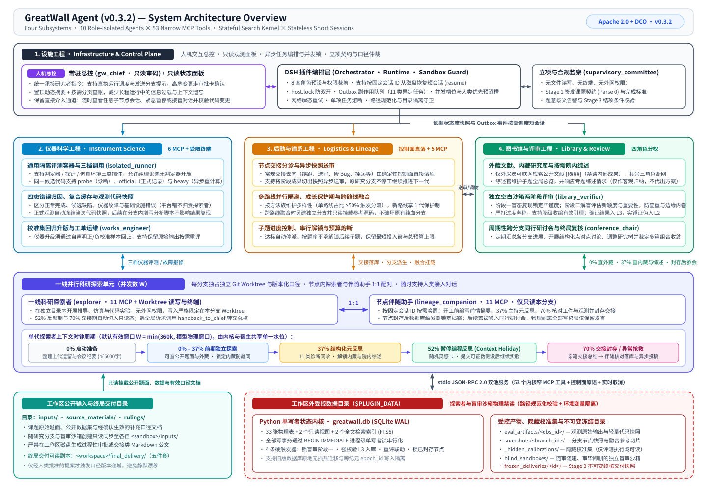
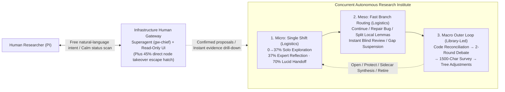

# GreatWall Agent

**English** | [简体中文](./README.md)

> **An open-source multi-agent experimental testbed for long-horizon, multi-school concurrent autonomous scientific discovery**  
> **Release Status**: `v0.3.0-alpha.2` (Major Architecture Upgrade · Code & multi-round reviews complete, **live long-horizon Desktop soak runs not yet executed**, not a production-ready tool)  
> **License**: [Apache License 2.0](./LICENSE) + [DCO 1.1](./CONTRIBUTING.md#三许可证与-dcodeveloper-certificate-of-origin签署要求) ｜ **Runtime Stack**: [DeepSeek Harness (DSH)](https://github.com/deepseek-ai/deepseek-harness) `>= 0.2.2-rc.5` × Python `3.11+` × [MCP](https://modelcontextprotocol.io)

---

> ⚠️ **Candid Upfront Notice**  
> `v0.3.0-alpha.2` is a full architectural overhaul built around three foundational principles—**First Principles**, **Tsien's *Engineering Cybernetics* system boundary law**, and **Clarity Without Jargon**. It introduces a **Superagent (`gw-chief`) single human point-of-contact**, **four orthogonal engineering pillars across 10 physically privilege-separated roles**, **independent blank-sandbox two-stage blind peer review with in-place lemma salvage**, a **4-beat pulsed Macro Wave Conference**, **45% live-node human takeover with SHA-256 artifact reconciliation**, and a fully modularized codebase and UI with no legacy god files.  
> At the same time, we state our boundaries candidly: **while the code has undergone multiple review rounds and passes the full local automated regression suites (Python 68 tests / 0 failures incl. a real `v0.2` SQLite migration fixture, Node 54/54 incl. cross-process & mock-model E2E pipelines, Doctor 8/8), it has not yet been run end-to-end on long-horizon open scientific problems in live DSH Desktop**. Desktop execution still relies on an application-level soft sandbox (no OS/container resource isolation yet), and controlled empirical ablations against bare single-agent baselines remain ahead.  
> Open-sourced under **Apache 2.0 + DCO** so researchers and engineers can inspect, hack, test, and evolve frontier AI-for-Science multi-agent systems together.

---

## 1. Why GreatWall Agent?

When pushing LLMs into 10-hour-scale, multi-branch mathematical modeling, algorithm design, or open-ended scientific discovery, single agents or naive parent-child swarms quickly hit four structural walls:

1. **Long-Context Fog & "Polite Laziness"**: Past hundreds of thousands of tokens, models anchor on early intuitions and smoothly declare "approaching the theoretical limit" instead of pushing deeper.
2. **Instant Groupthink Under Concurrency**: If parallel branches share unverified drafts, everyone flocks to the first plausible number, turning concurrency into expensive repetition.
3. **Conflating Broken Scripts with Scientific Failure**: If a buggy evaluator or environment timeout scores `0`, genuine breakthroughs get thrown away as failed science.
4. **Human Attention Collapse**: Humans can effectively track at most 3–5 concurrent sessions. Exposing 8 active branches, peer reviews, and tool queues directly as dozens of tabs turns the researcher into a fatigued human message-router.

**GreatWall Agent** responds by organizing LLMs into a **flat, privilege-separated academic community serving front-line explorers**—supporting pure analytical math and counterexample construction, formal theorem proving (e.g., Lean 4), multi-fidelity numerical simulation, Pareto optimization, and open-ended mechanistic discovery without scalar scores.

---

## 2. System Overview & Four Core Pillars



The system separates autonomous research into **Micro, Meso, and Macro** loops, hiding concurrency behind a single recommended **Superagent (`gw-chief`)** and a lightweight read-only status UI:



Under the hood, the institute is structured into **four orthogonal engineering pillars** covering **10 physically isolated roles**:

| Engineering Pillar | Plain-Language Role | Key Mechanisms (`v0.3.0-alpha.2`) |
| :--- | :--- | :--- |
| **1. Infrastructure**<br>(Base & Human Gateway) | **Reliable runtime bedrock + single human point-of-contact** | **Inward bedrock**: Thin Node DSH plugin + Python Single-Writer SQLite kernel, transactional Outbox (`runtime_effects`), and single-instance host lock for crash recovery.<br>**Outward human interface**: Inspired by DeepSeek Super-agent—read-only domain-state UI for output; permission-stripped **`gw-chief` (Superagent)** to organize free-form human instructions into 8 confirmation proposal types; `+1` human-priority slot; and a restrained escape hatch for viewing raw sessions or pausing a live node at 45% to chat/edit code with SHA-256 artifact reconciliation. |
| **2. Instrumentation Science**<br>(Works) | **Trustworthy, transparent, evolving lab instruments** | Ultra-thin isolated runner with domain logic in plugins; same instrument code supports **probe / official / heavy** tiers; 4-state error isolation (**instrument bugs never penalize explorers**); 4-tuple composite caching; self-declared gold/poison calibration suites for deadlock-free upgrades; 5 coupled ticket pipelines (front-line pain, verifier anti-exploit, conference discriminators, human counterexamples, and live survey sync). |
| **3. Logistics**<br>(Front-Line Shifts) | **Disciplined shift rotation, private memory & fast branch routing** | Each explorer pairs 1:1 with a dedicated companion through **0% $\to$ 37% $\to$ 70%**: internal archives stay locked during 0–37% to prevent groupthink, unlock after 37% expert reflection, and seal at 70% into a private dead-end ledger and `<=2200`-char rolling briefing. Routine handoffs route deterministically; **active branches can submit standalone local lemmas for blind review without locking the branch**; enforces 2-shift growth protection, sidecar dual-donor read-only mounting, and three stopping locks. |
| **4. Library**<br>(Truth Court & Macro Loop) | **Blank-sandbox peer-review court + pulsed macro steering** | Split into **4 physically isolated roles**: External Surveyor (sole internet access, blocked from internal work), Blind Verifier (offline, fresh blank sandbox, atomic `ACCEPT_NARROWED` L3+L2 salvage), Conference Chair (no code execution, runs 2-round debate and signs macro tree adjustments), and Chronicler (offline, maintains one `<=1500`-char Living Survey index per subproblem and Stage 3 final bundle). Stage 3 verifies an external immutable frozen snapshot before atomic one-step closure. |

---

## 3. Documentation Map

> **Note**: In-depth architecture papers and literature reviews are currently authored in Simplified Chinese.

| Document | Scope |
| :--- | :--- |
| **[`ARCHITECTURE.md`](./ARCHITECTURE.md)** | **Master System Architecture (Start Here)**: Philosophy, three core principles, four pillars in plain language, clean flowcharts, real code map & candid limitations |
| **[`docs/agent_kb_v0_3/`](./docs/agent_kb_v0_3/agent_kb_v0_3_00_INDEX_总导航_三层职责分离与里程碑路线.md)** | **Authoritative `v0.3` Architecture Suite**: Master index, 4 engineering papers (Infrastructure / Instrumentation / Logistics / Library), and exact SQLite DDL & migration spec |
| **[`greatwall-v6up/MODULE_MAP.md`](./greatwall-v6up/MODULE_MAP.md)** | **`v0.3.0-alpha.2` One-Page Code Map**: Directory boundaries, engineering redlines, and verification commands |
| **[`ROADMAP.md`](./ROADMAP.md)** | **Problem Ledger & Future Roadmap**: What `v0.3` resolved, and open challenges ahead (live Desktop soak runs, container sandboxes, `Harness²`, ACP/heterogeneous models) |
| **[`docs/dsh_development_handbook.md`](./docs/dsh_development_handbook.md)** | **DSH `0.2.2-rc.5` Engineering Handbook**: Objective reference for Cordis bundles, Presets, RC5 Schema, session hosting, and Windows pitfalls |
| **[`docs/paper_study/README.md`](./docs/paper_study/README.md)** | **Frontier Literature Archive**: 37 in-depth Chinese reviews of papers and engineering posts (DeepMind, OpenAI, DeepSeek, etc.) |
| **[`docs/archive/README.md`](./docs/archive/README.md)** | **Historical Design & Audit Archive**: Preserves the original handwritten manifesto, `v0.2` whitepapers, handover manual, and prior audit logs |
| **[`REFERENCES.md`](./REFERENCES.md)** & **[`CONTRIBUTING.md`](./CONTRIBUTING.md)** | Complete bibliography and contribution guide (Apache 2.0 + DCO 1.1) |

---

## 4. Quick Start & Local Verification

### 1. Prerequisites
- **DeepSeek Harness (DSH)**: `>= 0.2.2-rc.5 < 0.3.0-0`
- **Node.js**: `>= 22.19.0` or `>= 24.0.0`
- **Python**: `>= 3.11` (control plane uses standard library only; install `numpy` / `scipy` / `sympy` / `lean` per domain task)

### 2. Clone and Mount into a DSH Profile

```bash
git clone https://github.com/Qingzhu093/greatwall-agent.git
```

Link `greatwall-v6up/dsh_plugin` inside `~/.dsh/profiles/desktop/package.json` (or your Web Profile) and add it to `dsh.profile.bundles`:

```json
{
  "dependencies": {
    "dsh-greatwall-v6up": "link:/path/to/greatwall-agent/greatwall-v6up/dsh_plugin"
  },
  "dsh": {
    "profile": {
      "bundles": ["...other bundles...", "dsh-greatwall-v6up"]
    }
  }
}
```

Select the **`长城 · 科研总控 (gw-chief)`** preset in DSH to start interactive research orchestration (a minimalist 4-action `greatwall_orchestrate` tool is retained for CLI/headless automation).

### 3. Local Verification

```powershell
# 1. Python unit tests, v0.2 lossless migration, concurrency/cancel & architecture contracts
Set-Location greatwall-v6up
python -m unittest discover -s tests -p "test_*.py" -v

# 2. Modular frontend build, Node unit & scripted L2 E2E tests, and Doctor checks
Set-Location dsh_plugin
npm run build:client && npm test && npm run doctor
```

---

## 5. Repository Structure

```text
greatwall-agent/
├── README.md                       # Chinese overview
├── README_EN.md                    # English overview (this file)
├── ARCHITECTURE.md                 # v0.3 master architecture guide
├── ROADMAP.md                      # Problem ledger & future evolution roadmap
├── REFERENCES.md                   # Complete academic & engineering bibliography
├── CONTRIBUTING.md                 # Contribution guidelines & DCO 1.1 sign-off
├── LICENSE & NOTICE                # Apache License 2.0 & third-party notices
├── greatwall-v6up/                 # v0.3.0-alpha.2 modular runnable codebase
│   ├── MODULE_MAP.md               # One-page module map & verification commands
│   ├── core_python/                # Python Single-Writer kernel (db/, 12 control_plane subdomains, 10 roles / 44 tools)
│   ├── dsh_plugin/                 # DSH Cordis plugin (8 Presets, runtime/, sessions/, orchestrator/, client_src/)
│   └── tests/                      # Python regression suite & v0.2.0-alpha.1 migration fixture
└── docs/
    ├── agent_kb_v0_3/              # Authoritative v0.3 architecture papers & SQLite DDL
    ├── dsh_development_handbook.md # DSH 0.2.2-rc.5 engineering handbook
    ├── paper_study/                # 37 frontier literature reviews
    ├── assets/                     # Architecture diagram assets
    └── archive/                    # Historical manifesto, v0.2 whitepapers & audit history
```

---

## 6. Contributing & License

Issues, discussions, and PRs are warmly welcome—from live Desktop soak testing and OS/container sandboxes to UI polish, new domain MCP/Skill plugins, and empirical studies on multi-agent scientific discovery. Please read [`CONTRIBUTING.md`](./CONTRIBUTING.md) and sign commits with `git commit -s` (DCO 1.1).

Licensed under **[Apache License 2.0](./LICENSE)**. Third-party attributions are listed in **[`NOTICE`](./NOTICE)**.
