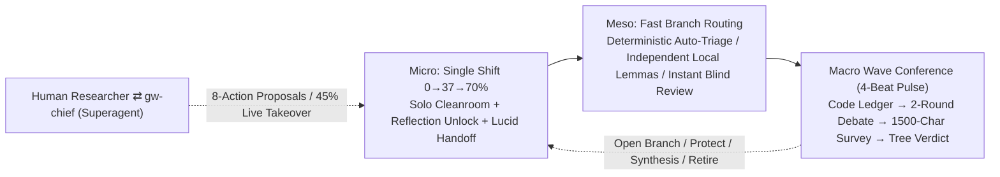

# GreatWall Agent

**English** | [简体中文](./README.md)

> **An open-source multi-agent experimental base for long-horizon, multi-school concurrent autonomous scientific discovery**  
> **Release Status**: `v0.3.0-alpha.1` (Major Architecture Upgrade · **Superagent `gw-chief` × 10 Roles / 44 Tools × Macro Wave Conference × 45% Human Takeover × Modular Three-Questions UI** · **Not a production-ready tool**)  
> **License**: [Apache License 2.0](./LICENSE) + [DCO 1.1](./CONTRIBUTING.md#三许可证与-dcodeveloper-certificate-of-origin签署要求) ｜ **Runtime Stack**: [DeepSeek Harness (DSH)](https://github.com/deepseek-ai/deepseek-harness) `>= 0.2.2-rc.5` × Python `3.11+` × [MCP](https://modelcontextprotocol.io)

---

> ⚠️ **Candid Upfront Notice**  
> This project has completed the full **`v0.3.0-alpha.1`** architectural overhaul: introducing the physically permission-stripped **Superagent (`gw-chief`)** with dual-channel idempotent confirmation cards, **10 roles × 44 narrow MCP tools × 8 single-source DSH Presets**, the **4-beat Macro Wave Conference** (deterministic ledger reconciliation → 2-round sealed-companion debate → `<=1500`-char Living Survey → macro tree verdict), **45% live-node human takeover with SHA-256 artifact reconciliation**, **per-subproblem `active_spec_revision` isolation**, **Stage 3 immutable frozen-directory one-step closure**, and a **zero-dependency modular frontend (`client_src/ -> lib/client.js`)** while eliminating all legacy god files. It passes the full automated suite (Python **`60/60`** including a real `v0.2.0-alpha.1` SQLite lossless migration fixture, Node **`48/48`** including L2 zero-cost end-to-end scripted pipelines, and Doctor **`8/8`**).  
> Key limitations remain candidly documented: desktop execution still relies on application-level sandboxing rather than OS/container isolation, long-horizon soak runs on live DSH Desktop are next in line, and controlled empirical ablations against bare single-agent baselines remain ongoing (see [`docs/agent_kb_v0_3/`](./docs/agent_kb_v0_3/agent_kb_v0_3_00_INDEX_总导航_三层职责分离与里程碑路线.md) and [`ARCHITECTURE.md §5`](./ARCHITECTURE.md#5-已知技术债与当前局限)).  
> We open-source it under **Apache 2.0 + DCO** to turn frontier AI for Science multi-agent architectures into a runnable, hackable, and co-evolvable experimental testbed.

---

## Why GreatWall Agent?

When pushing LLMs toward 10-hour-scale, multi-branch, unattended mathematical modeling and open-ended scientific exploration, generic single agents or naive parent-child multi-agent frameworks quickly hit three walls:

1. **Long-Context Attention Degradation & "Polite Laziness"**: Once a conversation stretches to hundreds of thousands of tokens, the model anchors on early intuitions and declares "approaching the theoretical limit" in fluent academic prose, halting real exploration.
2. **Groupthink Collapse Under High Concurrency**: When multiple branches share an unvetted bulletin board, they converge within a few rounds onto whichever local solution is easiest to write rather than breaking structural ceilings.
3. **Conflating Tool Failures with Scientific Failures**: If evaluation script bugs, missing data keys, or environment glitches are directly scored as `0`, genuine scientific breakthroughs get buried under engineering noise.

**GreatWall Agent** draws inspiration from recent frontier research in autonomous science (*Cogentic*, *The Station*, *SLA*, *AgentDiscover*, *RQGM*, *Audit the Scaffold*, etc.; full bibliography in [`REFERENCES.md`](./REFERENCES.md)) to build a **flat academic community serving front-line researchers**—supporting pure analytical math and counterexample construction, formal theorem proving (e.g., Lean 4), multi-fidelity numerical simulation, multi-objective Pareto optimization, and open-ended mechanistic discovery without scalar metrics.

---

## System Overview & Four Core Pillars


### Three-Layer Closed-Loop Research Workflow (Micro × Meso × Macro)



In software implementation, the system converges into **four orthogonal engineering pillars**, with **10 roles × 44 narrow MCP tools** mapped onto **8 single-source DSH Presets** enforcing physical privilege separation:

| Engineering Pillar | Logical Role / Organ | Core Mechanisms (`v0.3.0-alpha.1` Implemented) |
| :--- | :--- | :--- |
| **1. Infrastructure** | Superagent (`gw_chief`)<br>Orchestrator & `ControlService`<br>Supervisory Committee (`supervisory_committee`)<br>Modular Three-Questions UI (`client_src/`) | Standalone `greatwall-chief` Preset (zero write / shell / web, native `dsh-compaction-basic` + elastic live anchor card `min(hardCap, max(400, 180 + 100*N))`); **DSH native `actionCards` + sidebar idempotent proposal sign-off**; transactional SQLite Outbox (`runtime_effects`) with lease recovery & `NOTIFY_POLICY_CHANGED` hot injection; `host.lock` single-instance guard + `maxWorkers + 1` human-priority reserved slot + 429/5xx exponential retry; **45% live pause/takeover via `source.rpcId` + `ctx.jobs` cleanup + SHA-256 artifact reconciliation**; per-subproblem `active_spec_revision` isolation; dual-pool concurrency, `$/cancelRequest` & lossless `v0.2` migration |
| **2. Instrumentation Science** | Works Engineer (`works_engineer`)<br>Isolated Runner (`isolated_runner.py`) | Unified `evaluate(artifact, spec, tier)` 3-tier same-code protocol (`probe / official / heavy`); 4-state physical isolation (`INSTRUMENT_ERROR / INFRA_ERROR` incur zero penalty and auto-open repair tickets); 4-tuple composite caching & atomic per-request staging; self-declared calibration regression upgrade; auto-queuing of in-flight observations on upgrade; coupled ticket pipelines for front-line pain points, verifier `EXPLOIT`, conference `DISCRIMINATOR`, and human counterexample requests |
| **3. Logistics** | Logistics Coordinator (`logistics_coordinator`)<br>Explorer (`explorer`) ◄─1:1─► Companion (`lineage_companion`) | Deterministic `gw-comp-<node_id>` on-demand `ctx.agents.resume` (no cross-generation memory leak); `0–37%` solo cleanroom (external `[R###]` open, internal locked) → `37%` reflection unlock of internal archive & Living Survey → `70%` handwritten *Research Will* + companion single-write DAG; **deterministic auto-triage for routine 5-way routes + independent one-shot `local_lemma_submissions` without blocking active branches**; 2-shift growth protection, `.greatwall_donors/` read-only dual-donor mounting, and `handback_to_chief` scope boundary |
| **4. Library** | External Surveyor (`external_surveyor`)<br>Blind Verifier (`library_verifier`)<br>Conference Chair (`conference_chair`)<br>Chronicler (`library_chronicler`) | **4-role physical separation** (`external_surveyor` is the sole internet-connected role and is physically blocked from internal archives); 4-layer Fail-Closed ephemeral blind sandbox; **Stage 1 `PARTIAL_PASS` + Stage 2 `ACCEPT_NARROWED` atomic L3+L2 recording**; automatic `open_lemma_gaps` fulfillment waking `BLOCKED_L4B` branches; **4-beat Macro Wave Conference** (code reconciliation → sealed-companion zero-write 2-round debate → `<=1500`-char Living Survey → 6-action tree verdict, auto-skipping debate when `<2` participants); **Stage 3 immutable frozen-directory export with off-lock SHA-256 verification and atomic one-step closure** |

---

## Documentation Navigation

> **Note**: Detailed architecture papers and bibliography documents are currently written in Simplified Chinese while bilingual translations are prepared.

| Document | Scope |
| :--- | :--- |
| **[`docs/agent_kb_v0_3/`](./docs/agent_kb_v0_3/agent_kb_v0_3_00_INDEX_总导航_三层职责分离与里程碑路线.md)** | **Authoritative `v0.3` Architecture Suite**: master index, 4 engineering papers (Infrastructure / Instrumentation / Logistics / Library), and exact SQLite DDL & migration spec |
| **[`greatwall-v6up/MODULE_MAP.md`](./greatwall-v6up/MODULE_MAP.md)** | **`v0.3.0-alpha.1` One-Page Module Map**: domain boundaries, 7 hard engineering redlines, and full verification commands |
| **[`ARCHITECTURE.md`](./ARCHITECTURE.md)** | Design philosophy, engineering cybernetics tensions, and `v0.2` historical context (linked to `v0.3` specs at the top) |
| **[`ROADMAP.md`](./ROADMAP.md)** | Problem ledger and future evolution plans (container strong sandboxes, `Harness²`, open research questions) |
| **[`REFERENCES.md`](./REFERENCES.md)** | Complete bibliography of academic papers, engineering blogs, open-source projects, and protocols |
| **[`docs/paper_study/README.md`](./docs/paper_study/README.md)** | Frontier Paper Study Archive (37 in-depth Chinese reviews & figures covering the literature in `REFERENCES.md`) |
| **[`CONTRIBUTING.md`](./CONTRIBUTING.md)** | Contribution guide, Apache 2.0 + DCO 1.1 (`git commit -s`) sign-off requirements, and PR guidelines |
| [`greatwall-v6up/dsh_plugin/README.md`](./greatwall-v6up/dsh_plugin/README.md) | DSH `0.2.2-rc.5` plugin setup, 8 single-source Presets, modular client build, and doctor guide |

---

## Quick Start

### 1. Prerequisites
- **DeepSeek Harness (DSH)**: `>= 0.2.2-rc.5 < 0.3.0-0`
- **Node.js**: `>= 22.19.0` or `>= 24.0.0`
- **Python**: `>= 3.11` (control plane uses only the Python standard library; install domain libraries such as `numpy` / `scipy` / `sympy` / `lean` as needed)

### 2. Clone and Mount into a DSH Profile

```bash
git clone https://github.com/Qingzhu093/greatwall-agent.git
```

Mount `greatwall-v6up/dsh_plugin` via a local link in `~/.dsh/profiles/desktop/package.json` (or your Web Profile) and add it to `dsh.profile.bundles`:

```json
{
  "dependencies": {
    "dsh-greatwall-v6up": "link:/path/to/greatwall-agent/greatwall-v6up/dsh_plugin"
  },
  "dsh": {
    "profile": {
      "bundles": ["...other bundles...", "dsh-greatwall-v6up"]
    }
  }
}
```

Select the **`长城 · 科研总控 (gw-chief)`** preset in DSH to start interactive research orchestration (a minimalist 4-action `greatwall_orchestrate` tool is also retained for CLI/headless automation).

### 3. Local Verification

```powershell
# 1. Python 60-test suite (v0.2 lossless migration, concurrency/cancel, contracts)
Set-Location greatwall-v6up
python -m unittest discover -s tests -p "test_*.py" -v

# 2. Modular client build, Node 48-test suite (incl. L2 E2E pipelines) & Doctor 8/8
Set-Location dsh_plugin
npm run build:client && npm test && npm run doctor
```

---

## Repository Structure

```text
greatwall-agent/
├── README.md                  # Chinese overview & quick entry
├── README_EN.md               # English overview & quick entry (this file)
├── ARCHITECTURE.md            # Design philosophy, cybernetic tensions & evolution notes
├── ROADMAP.md                 # Open problems, roadmap & research questions
├── REFERENCES.md              # Academic papers, engineering blogs & open-source references
├── CONTRIBUTING.md            # Contribution guidelines & DCO 1.1 sign-off rules
├── LICENSE & NOTICE           # Apache License 2.0 & third-party attribution notices
├── greatwall-v6up/            # v0.3.0-alpha.1 modular runnable source (zero god files)
│   ├── MODULE_MAP.md          # v0.3.0-alpha.1 one-page module map & verification commands
│   ├── core_python/           # Python Single-Writer kernel: db/, 12 control_plane subdomains, 44 tools, runner & 10 role prompts
│   ├── dsh_plugin/            # DSH (0.2.2-rc.5+) Cordis plugin: 8 Presets, runtime/, sessions/, orchestrator/, client_src/ & 48 tests
│   └── tests/                 # Python 60-test suite & v0.2.0-alpha.1 lossless migration fixture
└── docs/
    ├── agent_kb_v0_3/         # v0.3 master index, 4 engineering papers & exact SQLite DDL spec
    ├── paper_study/           # 37 in-depth literature reviews
    └── assets/                # Architecture diagram assets
```

---

## Current Limitations

- **Application-Layer Soft Sandbox**: The current desktop sandbox relies on path normalization and command interception, lacking OS-kernel resource limits and isolation (Docker / WSL2 + cgroups).
- **Live DSH Desktop Long-Run Soak Pending**: All 60 Python, 48 Node (including scripted L2 E2E pipelines), and 8 Doctor checks pass; multi-hour real-world Desktop soak runs are the next validation milestone.
- **Controlled Empirical Validation Pending**: Net gains of the multi-agent governance protocol over bare single-agent baselines on open-ended tasks—and gradient guidance for non-scalar scientific problems—remain under active investigation.

---

## Contributing & License

We warmly welcome issues, discussions, and pull requests—from Three-Questions UI polish and container sandboxes to new domain MCP/Skill plugins and empirical studies on multi-agent scientific discovery. Please read [`CONTRIBUTING.md`](./CONTRIBUTING.md) and sign your commits with `git commit -s` (DCO 1.1).

This project is licensed under the **[Apache License 2.0](./LICENSE)**. Third-party attributions are listed in **[`NOTICE`](./NOTICE)**.
