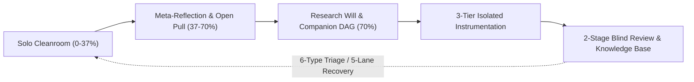

# GreatWall Agent

**English** | [简体中文](./README.md)

> **An open-source multi-agent experimental base for long-horizon, multi-school concurrent autonomous scientific discovery**  
> **Release Status**: `v0.1.0-alpha.2` (Early Experimental Demo · **Not a production-ready tool**)  
> **License**: [Apache License 2.0](./LICENSE) + [DCO 1.1](./CONTRIBUTING.md#三许可证与-dcodeveloper-certificate-of-origin签署要求) ｜ **Runtime Stack**: [DeepSeek Harness (DSH)](https://github.com/deepseek-ai/deepseek-harness) `>= 0.2.2-rc.5` × Python `3.11+` × [MCP](https://modelcontextprotocol.io)

---

> ⚠️ **Candid Upfront Notice**  
> This project is currently at a very early **`v0.1.0-alpha.2`** experimental stage. The codebase (~18k LOC) still carries noticeable technical debt, tightly coupled large files, application-level soft-sandbox security limitations, and a rough prototype UI. Moreover, the multi-agent research governance mechanisms have not yet undergone clean controlled ablation experiments under zero engineering-incident baselines (see [`ARCHITECTURE.md §5`](./ARCHITECTURE.md#5-已知技术债与当前局限) for full details).  
> We are open-sourcing it now under **Apache 2.0 + DCO** to turn frontier AI for Science multi-agent architectures into a runnable, hackable, and co-evolvable experimental testbed. Dissections, reproductions, critiques, and collaborations are warmly welcomed.

---

## Why GreatWall Agent?

When pushing LLMs toward 10-hour-scale, multi-branch, unattended mathematical modeling and open-ended scientific exploration, generic single agents or naive parent-child multi-agent frameworks quickly hit three walls:

1. **Long-Context Attention Degradation & "Polite Laziness"**: Once a conversation stretches to hundreds of thousands of tokens, the model anchors on early intuitions and declares "approaching the theoretical limit" in fluent academic prose, halting real exploration.
2. **Groupthink Collapse Under High Concurrency**: When multiple branches share an unvetted bulletin board, they converge within a few rounds onto whichever local solution is easiest to write rather than breaking structural ceilings.
3. **Conflating Tool Failures with Scientific Failures**: If evaluation script bugs, missing data keys, or environment glitches are directly scored as `0`, genuine scientific breakthroughs get buried under engineering noise.

**GreatWall Agent** draws inspiration from recent frontier research in autonomous science (*Cogentic*, *The Station*, *SLA*, *AgentDiscover*, *RQGM*, *Audit the Scaffold*, etc.; full bibliography in [`REFERENCES.md`](./REFERENCES.md)) to build a **flat academic community serving front-line researchers**—supporting pure analytical math and counterexample construction, formal theorem proving (e.g., Lean 4), multi-fidelity numerical simulation, multi-objective Pareto optimization, and open-ended mechanistic discovery without scalar metrics.

---

## System Overview & Four Core Pillars


### Minimalist Closed-Loop Research Workflow



Logically, a deterministic external orchestration kernel coordinates a flat check-and-balance governance model (**1 Supervisory Committee + 3 Functional Ministries + Front-line Exploration Units**). In software implementation, it converges into four orthogonal engineering pillars:

| Engineering Pillar | Logical Role / Organ | Core Mechanisms (`v0.1.0-alpha.2` Implemented) |
| :--- | :--- | :--- |
| **1. Infrastructure** | Orchestrator Kernel (`Orchestrator`)<br>Supervisory Committee (`supervisory_committee`)<br>Console UI Prototype (`Console UI`) | Rootless flat short-session scheduling (`ctx.agents.create()`); explicit model-binding startup gate; adaptive context window `W = min(500k, model_ctx)`; 2-strike no-progress circuit breaker per todo item; versioned public rulings (`spec_revision`); bidirectional isolation sandboxes; SQLite WAL Single-Writer truth store (19 tables + 2 FTS5 + 3 hard business triggers) |
| **2. Instrumentation Science** | Works Engineer (`works_engineer`)<br>Isolated Runner (`isolated_runner.py`) | Unified `evaluate(artifact, spec, tier)` 3-tier same-code protocol (`probe / official / heavy`); 4-state physical isolation (`INSTRUMENT_ERROR / INFRA_ERROR` incur zero penalty and auto-open repair tickets); 4-tuple composite caching; self-declared calibration set regression; version-domain comparability & on-demand re-evaluation |
| **3. Logistics** | Logistics Coordinator (`logistics_coordinator`)<br>Explorer (`explorer`) ◄─1:1─► Companion (`lineage_companion`) | Single-node same-session companion pause/resume (non-cross-generation); `0–37%` solo cleanroom (internal archive locked, external `[R###]` open) → `37%` intelligence-driven meta-reflection & 29-question Night Science unlock → `37–70%` open Pull → `70%` handwritten *Research Will* before companion single-writes DAG; `<=2200`-char fixed-quota re-compressed board + full `lineage_dead_ends`; 6-type triage, `>50%` mandatory school divergence & 5-lane recovery |
| **4. Library** | External Surveyor (`library_surveyor`)<br>Sandbox Blind Verifier (`library_verifier`) | External `[R###]` (including honest `UNAVAILABLE_REPORT` closure without fabricating cards) & internal `L3/L2` physical table split; 4-track verifiable submission gate; 2-stage blind review in clean ephemeral sandbox (`STAGE1_BLIND` irreversible ledger lock → `STAGE2_UNBLIND` 3-state routing); cross-session `Auditor` salvage; non-guilt-by-association `MOTIVATING_REF` citations; Stage 3 5-artifact export & `(delivery_id, delivery_sha256)` two-step final check |

All 7 roles access **32 single-responsibility narrow tools** strictly via role-whitelisted **MCP (`stdio JSON-RPC 2.0`)**, enforcing zero intermediate `.md` clutter in the workspace—all process state is persisted in the Single-Writer SQLite store.

---

## Documentation Navigation

> **Note**: Detailed architecture, roadmap, and bibliography documents are currently written in Simplified Chinese while we prepare bilingual translations.

| Document | Scope |
| :--- | :--- |
| **[`ARCHITECTURE.md`](./ARCHITECTURE.md)** | Design philosophy, deep dive into the 4 pillars, exact contracts for 32 narrow tools & 19 SQLite tables, and §5 known technical debt |
| **[`ROADMAP.md`](./ROADMAP.md)** | Problem ledger and P0–P3 evolution plans (UI & `SuperAgent` controller, decoupling, container strong sandboxes, `Harness²`, dual-track KB, open research issues) |
| **[`REFERENCES.md`](./REFERENCES.md)** | Complete bibliography of academic papers, engineering blogs, open-source projects, and open protocols (`✅ Implemented` vs `🗺️ Roadmap`) |
| **[Round 7 Experimental Report / Paper (PDF)](./docs/round7_report/V6Up_第7轮实机测试科研实验报告.pdf)** | Full empirical report & technical paper (with [LaTeX source](./docs/round7_report/main.tex), [`references.bib`](./docs/round7_report/references.bib), and figures) providing telemetry data, real-run evaluation, and research background |
| **[`CONTRIBUTING.md`](./CONTRIBUTING.md)** | Contribution guide, Apache 2.0 + DCO 1.1 (`git commit -s`) sign-off requirements, and PR guidelines |
| [`greatwall-v6up/dsh_plugin/README.md`](./greatwall-v6up/dsh_plugin/README.md) | DSH `0.2.2-rc.5` plugin migration guide and Preset details |

---

## Quick Start

### 1. Prerequisites
- **DeepSeek Harness (DSH)**: `>= 0.2.2-rc.5 < 0.3.0-0`
- **Node.js**: `>= 22.19.0` or `>= 24.0.0`
- **Python**: `>= 3.11` (the control plane relies solely on the Python standard library; install `numpy` / `scipy` / `sympy` / `lean`, etc., per research domain)

### 2. Clone and Mount into a DSH Profile

Clone this repository:

```bash
git clone https://github.com/Qingzhu093/greatwall-agent.git
```

Mount `greatwall-v6up/dsh_plugin` via a local link in `~/.dsh/profiles/desktop/package.json` (or your Web Profile) and add it to `dsh.profile.bundles`:

```json
{
  "dependencies": {
    "dsh-greatwall-v6up": "link:/path/to/greatwall-agent/greatwall-v6up/dsh_plugin"
  },
  "dsh": {
    "profile": {
      "bundles": ["...other bundles...", "dsh-greatwall-v6up"]
    }
  }
}
```

> See [`greatwall-v6up/dsh_plugin/README.md`](./greatwall-v6up/dsh_plugin/README.md) for detailed DSH `0.2.2-rc.5` setup and upgrade notes.

---

## Repository Structure

```text
greatwall-agent/
├── README.md                  # Chinese overview & quick entry
├── README_EN.md               # English overview & quick entry (this file)
├── ARCHITECTURE.md            # v0.1.0-alpha architecture, code map, exact contracts & known limitations
├── ROADMAP.md                 # Open problems, P0–P3 evolution roadmap & research questions
├── REFERENCES.md              # Academic papers, engineering blogs & open-source references
├── CONTRIBUTING.md            # Contribution guidelines & DCO 1.1 sign-off rules
├── LICENSE & NOTICE           # Apache License 2.0 & third-party attribution notices
├── greatwall-v6up/            # Core runnable source (~18k LOC)
│   ├── core_python/           # Python Single-Writer control plane, 32 narrow tools, isolated runner & 7 role templates
│   ├── dsh_plugin/            # DSH (0.2.2-rc.5+) Cordis plugin, orchestrator, bidirectional sandboxes & cockpit UI prototype
│   └── tests/                 # Python unit tests & regression suite
└── docs/                      # Architecture diagram assets (assets/), historical whitepapers & R&D archives
```

---

## Current Limitations (Full List in `ARCHITECTURE.md §5`)

- **Coupling & Large-File Debt**: Several thousand-line modules (e.g., `control_plane_service.py`, `orchestrator.js`, `client.js`) need domain-driven splitting and decoupling.
- **Application-Layer Soft Sandbox**: The current desktop sandbox relies on path normalization and command interception, lacking OS-kernel resource limits and isolation (Docker / WSL2 + cgroups).
- **Single-Host Coupling & Prototype UI**: Tightly bound to DSH Cordis service APIs, with a rough right-sidebar cockpit and controller UX.
- **Controlled Empirical Validation Pending**: Net gains of the multi-agent governance protocol over bare single-agent baselines on open-ended tasks—and gradient guidance for non-scalar scientific problems—remain under active investigation.

---

## Contributing & License

We warmly welcome issues, discussions, and pull requests—from UI/UX improvements, host decoupling, and container sandboxes to new domain MCP/Skill plugins and empirical studies on multi-agent scientific discovery. Please read [`CONTRIBUTING.md`](./CONTRIBUTING.md) and sign your commits with `git commit -s` (DCO 1.1).

This project is licensed under the **[Apache License 2.0](./LICENSE)**. Third-party attributions are listed in **[`NOTICE`](./NOTICE)**.
