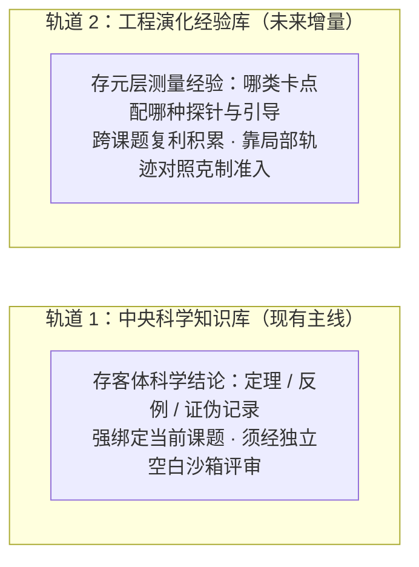

# GreatWall Agent 演进路线图：问题清账本与未来构想（ROADMAP）

> **版本基线**：接续 [`ARCHITECTURE.md`](./ARCHITECTURE.md)（`v0.3.2` · **Apache 2.0 + DCO**）  
> **文档定位**：本文是一份坦诚的**问题清账本与中长期演进构想**。先如实记录从 `v0.2` 演进到 `v0.3.2` 已经解决的核心工程问题，再摊开眼下真正尚未解决、接下来最值得投入精力的挑战与方向。

---

## 0. 已解决项清账与下一步优先级

| 历史痛点 | 已落地的工程解法 | 当前状态 |
| :--- | :--- | :---: |
| **上帝文件与并发状态撕裂** | Python 拆分为模块化 `db/` + 无环控制面子域 + 10 角色窄工具；Node 拆分为 `runtime / sessions / host / orchestrator` 与零依赖 `client_src/`；落地 `runtime_effects` 持久化 Outbox、`host.lock` 单实例锁与 `ctx.agents.resume` 磁盘恢复 | ✅ 已解决 |
| **人机运维僵死与注意力过载** | 落地常驻总控 **`gw_chief`**（置顶动态摘要卡 + 分页查账 + 只读审码 + `Human-Mandate Gate`）、版本化运行安排 `run_arrangements`、四态操作回执 `operation_receipts`、分支指导便签、蓝图种枝与 `epoch_id` 跨轮隔离 | ✅ 已解决 |
| **目录哈希连坐与知识库空转** | 正式观测瞬间自动冻结代码快照 `frozen_code_snapshot_path`，解除后续写分析脚本的连坐束缚；70% 交接默认支持异步快照投稿（原分支不停工）；补齐馆藏署名、引用、公开审稿意见与零外网院内专题综述服务 | ✅ 代码与 81+64 回归全绿，长程实测中 |
| **边角料路灯效应与多篇组合死锁** | 独立空白沙箱两阶段评审引入严谨度 / 新颖度 / 重要性三维评分（低新颖度查重退稿，低重要性分流至 `MARGINAL_NOTE`）；全局总览物理隔离边缘附录；支持多篇 `L3` 组合完备性终核与开放题饱和收敛解锁后续子题 | ✅ 代码与 81+64 回归全绿，长程实测中 |
| **研讨会满槽死锁与长窗口惯性** | 同行研讨会升级为非零和两轮点对点结构化讨论与三阶段无损拓扑执行（先休眠腾槽 → 再建枝融合 → 后收敛）；单代探索窗口收紧至 `360k`，配备 11 类元反思（含科研品味）与 52% 暂停编程反思（随机抽卡 + 提交假设即干净结回） | ✅ 代码与 81+64 回归全绿，长程实测中 |

下一步按 **四档优先级** 推进：

| 优先级 | 阶段定位 | 核心目标 |
| :---: | :--- | :--- |
| **P0** | **真实长程实测 + 容器强隔离沙箱 + 角色精简评估** | 在真实 DSH Desktop 与真实大模型上跑通多题递进与开放科研长程实测，检验反路灯评审、52% 暂停反思、院内专题综述与跨分支研讨会的真实效果；推进 Docker / WSL2 + cgroups 容器级强隔离；评估彻底精简 `logistics_coordinator` 角色以降低系统复杂度。 |
| **P1** | **等预算科学受控对照实验** | 在零工程事故的稳态底座上开展对照实验，量化验证隔离并行、三维评审、暂停编程反思与周期性同行研讨会相对单智能体裸跑究竟带来多大净收益，并据此做客观减法或调优。 |
| **P2** | **仪器科学演进（吸收 *Harness²*）与上下文效率优化** | 在完整保留现有隔离评测与校准底座的前提下，引入局部轨迹对比（Mini-Probe）与“科学知识库 × 工程演化库”双轨分离；探索程序化工具调用（PTC）与观测延迟折叠降低长程 Token 消耗。 |
| **P3** | **开放科研生态、跨宿主协议与异构模型群** | 构建基于 MCP / Agent Skills / Lean 4 的标准科研工具插座；调研 **ACP（Agent Client Protocol）** 等跨宿主协议打破单一宿主耦合；探索按角色混编的异构模型群与跨家族交叉评审。 |

---

## 1. P0 头号任务：长程真机实测、容器强隔离与架构减法

### 1.1 真实桌面长程实测重点
自动化单测无法完全替代十小时级的真实模型动力学检验。当前真实长程测试重点观察四项指标：
- **反路灯收敛效率**：在串行多子题（`Q1 → Q2 → Q3 → Q4`）任务上，三维评审能否及时把零测度边角修补挡在 `MARGINAL_NOTE`，研讨会能否顺利通过多篇组合终核或开放饱和收敛及时转入下一子题；
- **异步知识流活力**：70% 交接的观测绑定率、异步快照投稿频率以及院内专题综述是否真正提升了后续探索者的起步质量；
- **52% 暂停编程反思的破局率**：统计真实轨迹中 `holiday_bet_json` 的 `CONFIRMED / FALSIFIED / UNTESTED` 分布，评估短时停码与随机灵感卡是否有效帮助探索者跳出局部吸引子；
- **跨分支研讨会的实效**：观察第 2 轮强制点对点回复能否稳定产出真实的接口排雷与跨路线融合突破。

### 1.2 从应用层软沙箱迈向容器级强隔离
当前本地直跑沙箱依赖路径规范化校验与 Shell 关键字拦截，属于应用层防线，无法从操作系统内核层阻止失控脚本耗尽 CPU/内存或绕过命令检查。后续计划引入基于 **Docker / WSL2（或轻量 MicroVM）** 的强隔离执行后端，通过 cgroups 为每个探索节点与盲审沙箱施加硬性的 CPU、内存、磁盘、进程数上限，并用网络命名空间对所有无外网角色实施物理断网。

### 1.3 角色矩阵精简评估（`logistics_coordinator`）
随着常规交接分诊已下沉为确定性内核（`triage_core.py`）直落、宏观调树归口给 `conference_chair`，`logistics_coordinator` 目前仅承担首批路线建档、聚拢分流与极少数疑难节点兜底，职责已高度收窄。后续版本将评估将其彻底精简并入控制面与现有角色，进一步减少提示词维护与调度链路复杂度。

---

## 2. P1 科学实证：三个必须用数据回答的问题

1. **多智能体协同机制的真实净收益有多大？**  
   在完全相同的 Token 与时间预算下，对比「单智能体裸跑」vs.「多分支隔离 + 异步知识库」vs.「完整开启周期性同行研讨会与跨路线融合」，量化检验在数学推导、算法优化与开放机理探索三类题型上的真实收益与适用边界。
2. **上下文窗口上限与反思触发节拍是否最优？**  
   对比 `256k / 360k / 500k` 有效窗口下的代际迭代效率与突破密度，评估“按上下文百分比触发”与“按语义步长触发”在不同模型家族下的稳定性差异。
3. **非标量科学任务的梯度缺失问题**  
   在纯解析证明与开放机理探索等缺少自动标量打分器的领域，如何将形式化证明器（如 Lean 4）、符号计算交叉验证与跨家族多模型评审更好地结合起来，是整个自主科研领域共同的前沿课题。

---

## 3. P2 仪器科学演进与上下文效率优化

无论未来如何演进，现有仪器科学工程的三档同码协议、四态归因隔离、观测代码快照、四元复合缓存与自声明校准集回归必须完整保留。在此基础上，借鉴 *Harness²*（`arXiv:2610.14224`）补齐两项短板：

- **一阶归零防过拟合**：切换新课题时，旧课题特化的临时脚本归零，避免形成错误先验；
- **局部轨迹对照（Mini-Probe）**：新探针上线前，拿触发报修的原始失败快照跑轻量对照，确认探索者真能调用并看清盲区再正式合入；
- **上下文效率升级**：探索程序化工具调用（PTC）减少高频试探往返，并探索观测结果的延迟折叠机制降低长程上下文膨胀。

---

## 4. P3 开放生态、跨宿主协议与异构模型群

1. **标准科研工具插座（MCP / Agent Skills）**：让领域研究者无需读懂 GreatWall 内部源码，只需挂载标准 MCP Server、一份 `SKILL.md` 或仪器插件，即可即插即用 Lean 4 形式化验证生态以及社区开源的生物、化学、物理与数据分析技能库（如 Biomni、`scientific-agent-skills`）。
2. **打破单一宿主耦合**：保持清晰的宿主适配层，调研 **ACP（Agent Client Protocol）** 与其他开源 Agent Harness 的适配路径，降低个人研究者与学生的长周期算力与环境门槛。
3. **异构模型群（Heterogeneous LLM Swarm）**：探索按岗位混编模型（强推理模型负责一线攻坚与独立盲审，高性价比轻量模型负责伴随归档、专题综述与日常路由），并用跨家族多模型交叉评审打破单一模型的同源盲区。

---

## 5. 欢迎认领的协作方向

无论你想拆出其中某个机制二次改造，还是愿意一起推进以下方向，都欢迎通过 Issue 或 PR 交流：
- 真实长程科研实测反馈与只读面板体验打磨；
- Docker / WSL2 + cgroups 容器级强隔离执行后端；
- `logistics_coordinator` 角色精简与控制面进一步瘦身；
- Lean 4、领域 MCP/Skills 插件、ACP 跨宿主适配与异构模型路由；
- 等预算受控对照实验与 *Harness²* 局部轨迹对照探索。
