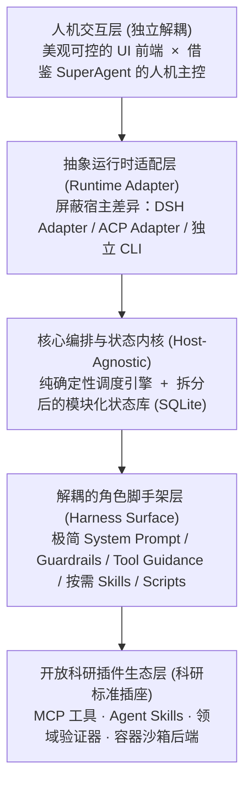
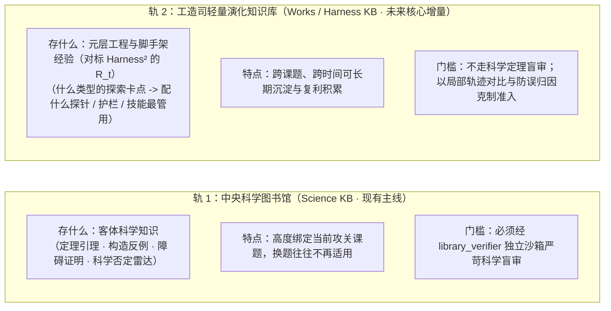

# GreatWall Agent 演进路线图：未解难题、前沿想法与开放研究议题（ROADMAP）

> **版本基线**：接续 [`ARCHITECTURE.md`](./ARCHITECTURE.md)（`v0.1-alpha` · **Apache 2.0 + DCO**）  
> **文档定位**：本文与其说是一份按季度排期的产品路线图，不如说是一份坦诚的 **Problems, Ideas & Open Questions（问题清账本与演进构想池）**。`v0.1-alpha` 目前只是一个极度不成熟的早期实验 Demo，浑身上下都是尚未解决的工程硬伤与悬而未决的科研假设。本文不画商业大饼，也不承诺一定能在某个时间点全部做完，而是把“现在究竟卡在哪里、哪些方向值得认真投入、哪些新论文值得吸收（同时绝不能丢掉现有优点）”如实摊开，既作为后续迭代的坐标，也方便对这个方向感兴趣的开源协作者直接找到切入点。

---

## 目录

- [0. 现状锚点与演进优先级总览](#0-现状锚点与演进优先级总览)
- [1. 使用体验与人机中枢重构：UI 美术交互、SuperAgent 主控与算力困境](#1-使用体验与人机中枢重构ui-美术交互superagent-主控与算力困境)
  - [1.1 UI 的美术与交互重构](#11-ui-的美术与交互重构)
  - [1.2 重点方向：重塑当前鸡肋的主控层——借鉴 DSH `SuperAgent` 范式](#12-重点方向重塑当前鸡肋的主控层借鉴-dsh-superagent-范式)
  - [1.3 宿主视野局限与纯 API 算力死结](#13-宿主视野局限与纯-api-算力死结)
- [2. 设施工程演进：深度解耦、全面开放与稳定底座](#2-设施工程演进深度解耦全面开放与稳定底座)
  - [2.1 重点方向：对整个系统动大手术——深度解耦与拆解高耦合底座](#21-重点方向对整个系统动大手术深度解耦与拆解高耦合底座)
  - [2.2 重点方向：科研底座面向更广泛的开放性（“科研标准插座”与多维开放）](#22-重点方向科研底座面向更广泛的开放性科研标准插座与多维开放)
  - [2.3 稳定性与强隔离沙箱建设（从“卡死宿主机”教训出发）](#23-稳定性与强隔离沙箱建设从卡死宿主机教训出发)
  - [2.4 上下文时钟短窗口瑕疵与一线科研执行模式探索（PTC / `ObservationPack`）](#24-上下文时钟短窗口瑕疵与一线科研执行模式探索ptc--observationpack)
  - [2.5 全局算力调度与收敛控制（借鉴 `The Station` 监督与冻结机制）](#25-全局算力调度与收敛控制借鉴-the-station-监督与冻结机制)
  - [2.6 工具易用性与底层引导体系重构](#26-工具易用性与底层引导体系重构)
- [3. 仪器科学工程演进：守正补短，引入 `Harness²` 驱动工造司进化](#3-仪器科学工程演进守正补短引入-harness²-驱动工造司进化)
  - [3.1 第一铁律：绝不能在引入新机制时丢掉现有工造司的核心优点](#31-第一铁律绝不能在引入新机制时丢掉现有工造司的核心优点)
  - [3.2 现有工造司真正卡住的四个短板](#32-现有工造司真正卡住的四个短板)
  - [3.3 `Harness²` 与 AI for Science 在工造司的精准合体构想](#33-harness²-与-ai-for-science-在工造司的精准合体构想)
- [4. 后勤工程演进：三大悬而未决的核心机制之问](#4-后勤工程演进三大悬而未决的核心机制之问)
  - [4.1 夜科学（Night Science）真的落地生效了吗？](#41-夜科学night-science真的落地生效了吗)
  - [4.2 探索节律时钟之争：离散 Tick 还是上下文窗口百分比？](#42-探索节律时钟之争离散-tick-还是上下文窗口百分比)
  - [4.3 后勤总管效用存疑与群体协作拓扑（严格隔离 vs 小组讨论）](#43-后勤总管效用存疑与群体协作拓扑严格隔离-vs-小组讨论)
- [5. 图书馆工程演进：迈向“科学知识库 × 工程演化库”双轨大方向](#5-图书馆工程演进迈向科学知识库--工程演化库双轨大方向)
- [6. 致开源协作者：欢迎认领的开放方向](#6-致开源协作者欢迎认领的开放方向)

---

## 0. 现状锚点与演进优先级总览

在 [`ARCHITECTURE.md §5`](./ARCHITECTURE.md#5-已知技术债与当前局限) 中，我已经把当前 `v0.1-alpha` 暴露出的技术债如实摊开：虽然阶段 1 已完成后端千行上帝文件拆解与跨层契约防腐门禁，但依然存在前端原型简陋、软沙箱无资源限额、对 DSH 原生能力挖掘不充分，以及**整套多智能体科研制度尚未在零工程事故基线下跑出过一次干净的受控对比实验**等硬伤。

遵循钱学森《工程控制论》的克制原则，后续演进最忌讳“旧问题还没修稳，又把几篇新论文一口气硬塞进代码库”。因此，本文虽然涵盖了大量从底层止血到前沿探索的构想，但在实际推进上坚持严格的四层优先级节奏：

| 优先级 | 阶段定位 | 核心目标（先立后破，绝不贪大求全） |
| :---: | :--- | :--- |
| **P0** | **止血、解耦与干净基线实证** | 巩固阶段 1 后端模块化拆解与契约门禁；补齐容器/资源限额沙箱（杜绝子节点拖死宿主机）；在零工程事故下跑通干净的对照实验，先验证长城这套多智能体制度相对单 Agent 裸跑究竟有没有净收益。 |
| **P1** | **人机体验与底层易用性重构** | 重做 UI 美术与交互；借鉴 DSH `SuperAgent` 重塑鸡肋主控；按脚手架分层重构 `System Prompt / Tool Guidance / Guardrails`；优化探索者执行模式（PTC / `ObservationPack`）与短窗口适配。 |
| **P2** | **工造司守正升级与双轨知识探索** | 在**完整保留现有工造司全部优势**的前提下，吸收 `Harness²` 思路引入“双信号驱动 + 局部轨迹对比（Mini-Probe）+ 工造司跨课题轻量经验库”，形成工造司层面的工具级 RSI 闭环。 |
| **P3** | **全面开放生态与前沿开放研究** | 构建“科研标准插座”（MCP / Agent Skills / Plugin / Lean 4 / Biomni / 开源科学技能库）；推进 ACP 与跨宿主适配、异构模型群、全局收敛调度，以及开放 Verifier 真空与后勤群体拓扑的系统性实验。 |

---

## 1. 使用体验与人机中枢重构：UI 美术交互、SuperAgent 主控与算力困境

一套面向长周期科研的系统，如果人用起来极其别扭、看不清里面发生了什么、干预起来又笨重，即便后台机制再精巧也难以真正投入日常研究。目前在使用层面上暴露出三块非常现实的短板：

### 1.1 UI 的美术与交互重构

当前挂载在 DSH 右侧栏的「长城科研指挥舱」（[`greatwall-v6up/dsh_plugin/lib/client.js`](./greatwall-v6up/dsh_plugin/lib/client.js)）仅是一个无构建链、手写 JSX 的早期观测原型。它最大的问题不仅是工程简陋，更在于**美术设计很差、交互体验也存在很大问题**：
- **美术层面**：视觉层级杂乱、排版生硬、状态区分缺乏直觉反馈，长时间盯屏追踪几十个节点与审稿单时极易视觉疲劳；
- **交互层面**：目前只是把后台 SQLite 状态机械地堆在面板里，缺少围绕科研决策流设计的交互路径——例如“顺着一条分支一键回溯其看板 → 37% 反思 → 遗嘱 → 盲审 Evidence Ledger → 代码 Diff”、“异常熔断或口径红灯出现时高亮直达根因节点并一键辅助处理”、“多子题并发态势的一屏总览与钻取”。

后续希望把观测前端从粗糙原型演进为真正美观、顺手、独立可维护的科研交互控制台。

### 1.2 重点方向：重塑当前鸡肋的主控层——借鉴 DSH `SuperAgent` 范式

**当前的主控设计实在太鸡肋了。**

在现有 `v0.1-alpha` 里，直接面向人类的主控会话（Primary Session）处于一个非常尴尬的夹心位置：
- 它被要求不能越权干预底层的科学探索与同行盲审，这是对的；
- 但同时，它手头仅握着 `greatwall_orchestrate` 那 11 个偏底层的工程控制动作（`init / start / pause / resume / abort_node / sync_rulings / inspect ...`），既缺乏对全局科研进展的深度理解与主动洞察，又经常在异常发生时变成一个笨拙的“命令转发器”——人类想澄清一个边界条件、排查一个卡死分支、或调整研究重心时，交互链路非常割裂，甚至在系统偶发卡顿时会诱发主控越界绕开编排器自己下场干活。

因此，**借鉴 DSH 的 `SuperAgent` 范式重塑面向人类的主控层**，是本项目一个非常明确且关键的演化方向：
- **明确是“借鉴”而非照搬**：我们不需要一个破坏扁平制衡、重新变成全能独裁总管的巨无霸 Agent，而是要借鉴 `SuperAgent` 在**人机交互中枢、全局态势感知、意图转译与长期伴随协作**上的设计哲学；
- **理想中的新主控职责**：
  1. **做人类的“科研首席助理”，而非底层 CLI 传话筒**：自动消化后台海量的 `L3/L2` 进展、熔断告警、`ALERT_AMBIGUOUS_SPEC` 口径红灯与分支停滞态势，用人类研究者听得懂的科学语言汇报“现在卡在哪个数学/物理环节、需要人类拍哪一个板”；
  2. **把自然语言意图无损翻译为制度化控制动作**：当人类给出阶段性澄清或调整研究重点时，由主控自动起草结构化的版本化《补充裁决文档》、精准建议哪些严重跑偏的节点需要 `abort_node`、哪些旧节点可保留自然跑完；
  3. **把关 Parse 0 与终局交付体验**：在开跑前通过高质量苏格拉底式对话帮人类把“什么算完成、哪些证伪算结题、需不需要初始仪器”问透；在 Stage 3 交付后陪人类一起抽查证据链、追踪断点笔记，真正形成人与多智能体共同体之间的顺畅界面。

### 1.3 宿主视野局限与纯 API 算力死结

这里必须非常坦诚地交代一个绕不开的现实困境：**宿主选择受限与算力成本几乎无解。**

- **算力痛点**：长周期（十小时级）、高并发、带两阶段盲审的自主科研如果全程走纯 API 按 Token 计费，对个人开发者和学生群体而言成本极高；
- **早期设想与权限壁垒**：项目最初本打算基于 **ChatGPT** 或 **Antigravity** 生态进行二次开发，这样可以直接复用现成的订阅额度，大幅降低个人探索门槛；但实际摸索下来发现这些闭源客户端开放给外部编排的底层权限太少，以我目前有限的工程技术力，不知道该如何绕开权限墙去实现隔离 Worktree、独立空白盲审沙箱和无 Root 并发调度。同时，此前我也完全没有接触过 **Claude Code**，真正上手接触并拆过源码的开源 Agent Harness 只有 **DSH**，因此才选择了基于 DSH Cordis 插件起步；
- **后续开放探索**：听说 DSH 本身支持更原生的子 Agent 委派机制，社区也在推进 **ACP（Agent Client Protocol）** 这类标准化协议——这些方向我目前还没有系统了解过，但它们极有可能是打破“单宿主锁死”和探索更灵活算力接入的关键钥匙，非常期待后续学习调研并邀请社区熟悉这些协议的开发者共同推进。

---

## 2. 设施工程演进：深度解耦、全面开放与稳定底座

设施工程是整套长城系统的地基。回头审视 `v0.1-alpha`，地基层面最迫切的两座大山是**“系统解耦程度太低”**与**“科研底座必须走向更广泛的开放”**，紧随其后的是**稳定性/强沙箱**、**一线执行模式**与**全局收敛调度**。

### 2.1 重点方向：对整个系统动大手术——深度解耦与拆解高耦合底座

**整个系统的解耦程度太低，这是目前制约稳定性、迭代速度和社区协作的最大工程病灶。**

现在的代码库虽然在文档上划出了四大工程，但在早期版本里曾存在严重的“牵一发而动全身”（目前阶段 1 已完成后端结构拆解与契约门禁，但中高层解耦仍需持续推进）：
- **上帝文件拆解进展与剩余项**：原 2,702 行 `control_plane_service.py` 已拆分为 [`control_plane/`](./greatwall-v6up/core_python/mcp_server/control_plane/) 下 6 个无环子域，原 1,472 行 [`orchestrator.js`](./greatwall-v6up/dsh_plugin/lib/orchestrator.js) 已拆出 4 个 [`orchestrator/`](./greatwall-v6up/dsh_plugin/lib/orchestrator/) 子模块，原 1,030 行 `tools_library.py` 已拆分为 `tools_surveyor.py` / `tools_verifier.py`，[`agent_session_host.js`](./greatwall-v6up/dsh_plugin/lib/agent_session_host.js) 已拆出 [`host/model_binding.js`](./greatwall-v6up/dsh_plugin/lib/host/model_binding.js)；但前端 [`client.js`](./greatwall-v6up/dsh_plugin/lib/client.js)（1,064 行）仍待阶段 2 模块化重写；
- **跨层契约同步与剩余耦合**：32 窄工具的名称、角色白名单、只读禁写与长耗时集合已收口至单一契约源 [`tool_registry.py`](./greatwall-v6up/core_python/mcp_server/tool_registry.py)，并通过 `control_plane/describe_contracts`、[`test_architecture_contracts.py`](./greatwall-v6up/tests/test_architecture_contracts.py) 与 [`tools/doctor.mjs`](./greatwall-v6up/dsh_plugin/tools/doctor.mjs) 实现自动化防腐；但更深层的业务状态字段演进与 7 份长 Prompt 模板之间仍存在较高的手改同步成本；
- **清晰划分与 DSH 宿主层的协作边界**：我们的原则是**绝不侵入修改 DSH 原生工具与宿主正常功能，同时充分依托 DSH 繁荣的 Cordis 插件生态（Preset、UI 原语、原生工具与生态分发）做好协作与推广**；在此前提下，把纯科研状态机逻辑与宿主胶水层边界划清，既便于第三方开发者在 DSH 插件内顺畅协作，也为未来按需扩展其他运行时留出余地。

**深度解耦的重构目标**，是把整套底座彻底切分成边界干净、契约单一的独立层次：

具体推进路径包括：
1. **拆解上帝文件（阶段 1 后端已完成，前端 `client.js` 待阶段 2）**：已将 `control_plane_service.py` 拆分为 6 个 `control_plane/` 无环子域、将 `orchestrator.js` 拆出 4 个派发与熔断子模块、将 `tools_library.py` 按角色拆为 `tools_surveyor.py` / `tools_verifier.py`、将 `agent_session_host.js` 拆出 `host/model_binding.js`；下一步聚焦前端模块化重构；
2. **单一契约源（阶段 1 32 窄工具已收口）**：已建立 `tool_registry.py`、`control_plane/describe_contracts` 与 `test_architecture_contracts.py` 跨层门禁；后续继续推进状态字段与脚手架片段的声明式同步；
3. **分离“制度骨架”与“角色脚手架”（待推进）**：让底层状态机只守住极少数硬不变量，把角色行为引导拆成可独立演进、可热替换的轻组件（与 §2.6 和 §3.3 呼应）。

### 2.2 重点方向：科研底座面向更广泛的开放性（“科研标准插座”与多维开放）

长城从第一天起就不想做成一个封闭的“自嗨式科研框架”，而是想成为一个**能不断插接社区最新科学工具、领域验证器、不同宿主与不同模型的开放科研基座**。这方面是未来极其重要、必须着重投入的演进主线，涵盖四个维度的全面开放：

#### 1. 科学工具与学科生态开放：打造“科研标准插座”
- **全面拥抱开放标准**：进一步打磨通用科学底座，全面基于 **MCP（Model Context Protocol）**、**Agent Skills** 与 **Plugin** 标准，构建可热插拔的**“科研标准插座”**——让领域研究者无需读懂长城内部 1.8 万行源码，只要按标准接入一个 MCP Server、一份 `SKILL.md` 或一个符合协议的仪器插件，就能立刻把新学科能力挂进科研共同体；
- **跨学科生态兼容与借鉴**：
  - 重点借鉴 **Biomni**、**Virtual Lab** 等领域专用科研调度框架在跨学科角色分工与科学工具链编排上的实践经验；
  - 深度接入 **Lean 4** 等形式化数学与定理证明生态（从当前的验收桩进化为开箱即用的形式化证明验证与公理审计插件）；
  - 积极兼容 **K-Dense-AI**、**Claude-scientific-skills** 等社区开源科学技能库，实现生物、化学、物理、数学、数据分析等跨学科工具链的即插即用。

#### 2. 直面开放科研的核心验证瓶颈：Ground-Truth Verifier 真空
- 在把底座向真实科研全面开放时，会迎头撞上一个极其前沿且根本的硬骨头：**在开放问题和真实前沿科研中，普遍缺少廉价的 Ground-Truth Verifier，导致科研验证成本极高**（哪怕是写一个可靠的物理仿真校验器、或者人工核对一段几十页的数学推导，成本都远超常规软件单元测试）。
- 后续不仅需要引入更多元的专用科研验证机制（形式化证明检查器、符号计算交叉验证、多保真仿真对照、统计显著性与复现核验），更需要持续探索**面向开放性问题的科研验证新机制**（例如结合盲审沙箱实跑、多模型对抗审稿与 §3.3 的行为对比思路）——这是整个 AI for Science 领域共同面对的前沿深水区。

#### 3. 宿主与运行时开放（深耕 DSH 插件生态 × 预留跨宿主适配）
- **立足并善用 DSH 繁荣的插件生态**：不侵入修改 DSH 原生工具与正常功能，而是更充分地发挥 DSH Cordis 插件体系、标准 UI 原语、Schemastery 配置项、多槽位扩展与原生子 Agent 委派等架构优势，让 GreatWall 成为 DSH 生态中易于安装、调试和社区推广的标准科研插件；
- **保持清晰的宿主适配边界**：在用好 DSH 能力的同时，将宿主胶水层收敛到清晰精简的适配接口（会话创建/续传/销毁、工具拦截、Token 水位采样、工作区文件挂载），为后续调研并按需适配 **ACP（Agent Client Protocol）** 等开放标准预留空间。

#### 4. 模型层开放：摆脱单一模型依赖，迈向异构模型群（Heterogeneous LLM Swarm）
- **现状痛点**：目前整套系统几乎完全基于 **DeepSeek Flash** 实测运行；一旦切换其他厂商的模型，或者试图构建**异构模型群**，立刻会面临工具调用风格迥异、提示词敏感度剧烈波动、成本与速度失衡等一大堆难题；
- **未来方向**：
  - 探索**按岗位异构混编**：前沿强推理模型主攻一线攻坚与 Stage 1/2 严苛盲审，高性价比轻量模型承担伴随整理、日志归约与低延迟流程巡检，同时用**跨家族多模型交叉盲审**打破单一模型家族的同源认知盲区；
  - 直面跨模型迁移时的脚手架适配难题（例如为某模型调优的提示词与工具策略迁移到另一模型时可能出现触发率衰减），探索更模型无关（Model-Agnostic）的底层 Tool Schema 与护栏设计；
  - 借鉴 **`Ouroboros`** 提出的威胁模型：在支持多模型路由的同时，把模型选择权与预算限额死死锁定在不可被 Agent 自修改的外部控制面，防止失控会话将流量路由至未授权的高价或弱约束通道。

### 2.3 稳定性与强隔离沙箱建设（从“卡死宿主机”教训出发）

**当前系统的运行稳定性依然非常脆弱，沙箱建设更是个老大难问题。**

- **血淋淋的真实教训**：在目前唯一一次跑通的完整测试样例中途，就发生了一个极其危险的事故——**某个探索子节点自己写并运行了一段 Python 脚本，直接把我的整台宿主机电脑卡死了。**
- 这件事彻底暴露了当前桌面直跑沙箱的致命弱点：[`read_isolated_sandbox.js`](./greatwall-v6up/dsh_plugin/lib/read_isolated_sandbox.js) 的路径规范化与 Shell 正则拦截只是**应用层软防线**——它既防不住高阶脚本混淆或动态拼接绕过，更完全管不住探索代码在宿主机上失控吃光内存、打满 CPU、衍生孤儿进程树或把磁盘写爆。
- **后续演进方向**：
  1. **向 OS / 容器级强沙箱演进**：优先落地基于 **Docker / WSL2（或轻量 MicroVM）** 的真正隔离执行环境，通过 cgroups 对每个探索节点与盲审沙箱施加硬性的 **CPU、内存、磁盘配额、进程数上限与超时强杀**，并对探索与盲审容器实施真正的网络命名空间物理断网；
  2. **借鉴 `Ouroboros` 的操作安全边界**：将进程监督、预算看门狗与紧急强杀（`/panic`）彻底下沉到不可被智能体触碰的宿主机监督层，确保无论子节点跑出什么死循环或内存炸弹，宿主机始终稳如泰山、一键可杀。

### 2.4 上下文时钟短窗口瑕疵与一线科研执行模式探索（PTC / `ObservationPack`）

1. **自适应上下文窗口的边缘瑕疵**：
   - 虽然现在把上下文基准改为了自适应有效窗口 `W = min(500k, model_physical_window)`，但在实际接入**第三方中转站 API**或部分**上下文窗口极短的模型**时，依然存在明显瑕疵：一方面中转站未必可靠暴露真实有效窗口（甚至存在服务端静默截断），另一方面窗口极短时，启动看板 + 工具 Schema + 一两轮长日志输出就可能直接逼近 `37%` 乃至 `70%`，导致节点尚未展开实质探索就被迫反思和交接。后续需要更鲁棒的窗口配置/探测兜底，以及面向短窗口模型的载荷自动瘦身机制。
2. **一线科研探索者的执行模式升级**：
   - **引入 PTC（Programmatic Tool Calling）探索**：常规单轮“思考 → 调一次工具 → 等返回 → 再思考”的模式在高频参数试探、批量数据探查与多步验算中往返开销极大，后续可评估引入程序化工具调用（PTC），让探索者在受控沙箱内用短脚本一次性编排批处理探索逻辑，减少无意义的模型往返；
   - **参考 `SoL-Pi` 引入 `ObservationPack`（观测延迟折叠）**：长程科研中最大的隐性上下文杀手，是那些动辄十几 KB 的日志、报错堆栈或长文件读取输出——它们在刚产生的 1–2 轮内对推理极其关键，但到第 3 轮以后就成了每轮重复传输的“幽灵包袱”。`SoL-Pi` 提出的 **`ObservationPack`** 给出了一条极优雅的工程解法：**对大体积工具输出先完整保留前 2 轮（零信息损失），从第 3 轮起自动折叠为“稳定可回读句柄 + 约 1 KB 首尾摘要”，需要细节时随时按句柄分页取回**。这种机制与长城短会话科研探索高度契合，值得优先验证落地。

### 2.5 全局算力调度与收敛控制（借鉴 `The Station` 监督与冻结机制）

目前虽然有了两级公平并发槽位调度与 `>50%` 学派分流，但在多子题并行攻关时，**全局层面的算力调度与收敛控制依然很不成熟**——容易出现某些相对容易的子题已经产出扎实结论却仍在消耗槽位做边际微调，或者全局陷入久攻不下却缺乏更高视角的算力重配。

后续计划参照 **`The Station` 开放式探索扩展版（v2）** 的设计思路，探索引入 **Supervisor + 周期性 Meta-Reflection** 机制：
- 周期性审视各个子题的收敛状态、证据密度与推进斜率；
- **已达标子题自动冻结其 Worktree 并释放算力额度**，将宝贵的并发探索槽位与预算集中倾斜给尚未突破的高阻力子题，确保全局有限算力始终汇聚在当前最具价值、最需攻坚的方向上。

### 2.6 工具易用性与底层引导体系重构

当前底层工具调用的易用性仍有很大提升空间，尤其是直接决定模型行为稳定性的三块基石——**`System Prompt`、`Tool Guidance`、`Guardrails`**——目前写得既冗长又略显生硬，在非旗舰模型上容易引发传参错误、死循环或忽视关键边界。这部分既属于设施层的易用性建设，也将与第 3 章借鉴 `Harness²` 的脚手架分层重构直接打通。

---

## 3. 仪器科学工程演进：守正补短，引入 `Harness²` 驱动工造司进化

仪器科学工程（工造司）与当下最火的 **Harness RSI（脚手架递归自我改进）** 高度相关，也是整套长城架构里最具想象空间的一块拼图。但在思考怎么把前沿 Harness RSI 接进工造司之前，必须先立下一条死规矩。

### 3.1 第一铁律：绝不能在引入新机制时丢掉现有工造司的核心优点

**千万不能光顾着引入一个时髦的新机制，反而把工造司原本辛辛苦苦打磨出来的核心优点给丢掉了！**

以下四项经过多轮血泪复盘确立的工造司底座优势，在未来任何演化中都**必须完整保留、一条不动**：
1. **统一三档同码仪器协议（`probe / official / heavy`）**：开发快速试探与正式受控凭证跑同一份仪器代码，彻底消灭“自测全过、正式全挂”的两张皮；
2. **四态物理隔离（“判不了，绝不准判负”）**：`INSTRUMENT_ERROR` 与 `INFRA_ERROR` 绝对不折算为 0 分或科学否定、不处罚探索者、穿透缓存并自动开单熔断；
3. **四元复合缓存与版本域可比性**：不同仪器版本的观测严禁跨版本混排，Stage A 产物外部持久化支持按需重评且缺字段诚实标 `INCOMPATIBLE`；
4. **严密的校准集回归门禁（Calibration Suite）**：`VERDICT` 判定器上线与升版必须 100% 跑过自声明预期的金/毒/格式校准用例，既守住防 Reward Hacking 底线，又确保修 Bug 不被“旧指标必须赢分”卡死。

### 3.2 现有工造司真正卡住的四个短板

既然仪器底座已经如此扎实，为什么在实际运行中还是会觉得“耦合重、底层工具调不稳、工造司怎么搞才真正有效没头绪”？把问题剥开来看，短板精准卡在**“仪器代码之外的那层交互与演化闭环”**上：

| 短板 | 现状描述 | 带来的直接后果 |
|---|---|---|
| **局限 1：重仪器本体，轻“探索者如何用稳工具”的基层脚手架** | 把 `evaluators/` 打磨得很标准，但探索者怎么发现、调用、处理仪器和 Shell，主要靠静态百字速查表 + 冗长常驻 Prompt + `next_step_guidance`。 | 课题一复杂、工具一多，常驻 Prompt 越塞越重（到处耦合）；探索者依然频繁传错参或报错后不知该换什么维度，调用稳定性差。 |
| **局限 2：只有“仪器准不准”的校准回归，没有“工具到底有没有用”的效用闭环** | 校准集能 100% 保证“仪器本身没写错 Bug、不会被作弊”；但它测不出一个新造的 `PROBE` 探针或新收编的 Skill 交到探索者手里后，到底帮人看清了盲区，还是根本调不动、用完更晕。 | 仪器科迭代缺乏来自“探索者真实行为轨迹”的因果反馈，工具层 RSI 落不了地。 |
| **局限 3：`SKILL_LEDGER.json` 只是静态冷台账，工造司没有演化记忆** | 台账里只记 `skill_id`、`version` 和冷冰冰的成败数字；中央图书馆 `L3/L2` 又只存科学猜想和数学反例。 | 工造司跑了几十小时后，依然没攒下“遇到某类科研死锁时配什么探针/护栏最有效、哪些改法有副作用”的经验，每次接工单都像第一天上班凭直觉从头猜。 |
| **局限 4：“主动造探针”缺少与一线需求对齐的防自嗨机制** | 制度鼓励工造司“扩张可观测性”，但若缺乏一线轨迹约束，LLM 扮演的 `works_engineer` 极易陷入自嗨。 | 闭门造出一堆看起来很高级、但一线探索者根本不调或调不动的监控探针（好工具往往是科研人员现场急需时逼出来的，而不是闭门想出来的）。 |

### 3.3 `Harness²` 与 AI for Science 在工造司的精准合体构想

近期读到的一批 Harness RSI 论文中，**[`Harness²: Recursive Agent Harnessing for an Open World`](https://arxiv.org/abs/2610.14224)** 对长城最具实质性参考价值。它精准剖析了开放世界脚手架演化的两大张力——**反馈真空张力（Verification Vacuum，无 Ground-Truth Verifier 时如何评估改动）**与**特化与泛化张力（Specialization vs. Transferability，把上一题的特化细节直接继承到下一题会变成错误锚点——这正是长城此前踩过的“竞赛过拟合”大雷！）**；同时也用扎实对照实验敲响了警钟：**纯文本策略记忆检索易导致负迁移（ReasoningBank 掉分），而缺乏行为对比与经验库支撑的“裸改”（Direct Refinement）即便是顶级模型也会直接改坏原本正常的脚手架。**

更重要的是，`Harness²` 的思路与长城工造司天然互补——**不是用它替换现有工造司，而是用它最精华的几块构件，精准补齐上面那四个短板**：

#### 1. 借用 `Harness²` 的 8 大脚手架表面与“最廉价有效组件映射梯队”，理顺底层交互层
`Harness²` 将脚手架拆为 8 个正交表面：**`System Prompt`、`Guardrails`、`Memory`（对应长城的真相与视图）、`Skills`、`Tool Guidance`、`Scripts`、`Subagents`（长城已借鉴 SLA 用无状态短会话做得较扎实）、`Plugin`**。
- 这一拆分直接照出了长城目前最弱的三块：**`System Prompt`、`Tool Guidance`、`Guardrails`**；
- 后续应引入其**“故障到最廉价有效组件的映射梯队”**来解耦引导层：普通调用规范进精简常驻指导 $\to$ 机械易错的校验/解析封装成确定性 `Scripts` $\to$ 特定场景的专家规程做成按需加载、零闲置开销的 `Skills` $\to$ 只有在“文字规则被反复无视”的铁证下，才动用 `Plugin` 硬拦截钩子。

#### 2. 给工造司装上防自嗨的“双需求信号监听器”
工造司不再凭空“主动造高级监控探针”，而是紧盯来自一线探索的两种客观信号：
- **痛点信号（Pain）**：某个分支在同一个工具上连续报错，或者在探索者的《科研遗嘱》中明确写到“缺少 XX 维度的观测能力导致卡死”；
- **复用信号（Emergence）**：一线 `explorer` 在自己的 `<worktree>/tools/` 里手搓了一个脚本解决了真问题，且该节点后续取得了实质进展或被其他思路借鉴复用。

#### 3. 用“局部轨迹对比（Mini-Probe）”补齐校准集的效用盲区
这里要严格分清两类检验，绝不互相替代：
- **仪器本体准不准** $\to$ 继续死守现有的**校准集回归**（零妥协）；
- **新造的 `PROBE` 探针、`SKILL.md` 或 `Tool Guidance` 对探索者到底有没有用** $\to$ 借鉴 `Harness²` 的 **Propose（INV 流程视角 / DOM 领域视角分离）→ 受控 Probe 行为对比 → 证据锚定 Compose** 思想，在长城的预算现实下做极简的**“局部轨迹对比（Mini-Probe）”**：
  - 上线前，拿触发该工单的那一页失败/卡死节点快照，在相同模型与沙箱条件下跑几步轻量对照探测；
  - **只验证一件事**：“探索者真的把新探针/引导调起来了，且原本卡死的盲区被看清了”；
  - 严守 `Harness²` 的克制纪律：必须引用具体轨迹时刻做判断，严禁凭空问 LLM“怎么改更好”；对单次偶发错误（`1/k`）保持高度克制；一旦导致空输出或毫无可见改善，直接 **`KEEP_BASE`** 放弃推送，不往系统里塞无效废话。

#### 4. 一阶归零防过拟合 + 二阶跨课题经验复利（接轨图书馆双轨方向）
吸收 `Harness²` 最反直觉也最救命的一条铁律：**当一个科研课题结束、切换至新课题时，高度特化的执行脚手架必须归零重来（从 $\mathcal{H}_0$ 起步），绝不把旧课题的私有工作区映射硬塞给新课题**，彻底根治跨课题过拟合。

真正跨课题、跨时间传递并复利积累的，是二阶的**工造司演化经验**（对应 `Harness²` 的改进经验库 $\mathcal{R}_t$）：并且严格防范“归因谬误”——一个分支最终成功了，不代表工造司塞进去的每一条改动都起了作用，必须经过清晰的对比证据裁决（有效 / 有害 / 无感 / `confounded` 混淆），宁缺毋滥。若未来允许工造司演化更高权限的共享脚本或脚手架组件，也可轻量参考 `Ouroboros` 的安全门禁思路，确保自演化绝不侵蚀核心安全边界。

---

## 4. 后勤工程演进：三大悬而未决的核心机制之问

后勤工程（一线探索单元 + 一对一伴随 + 后勤调度总管）承载了长城最具特色的一组机制设计。但实话实说，由于前几轮测试大多折损在设施层故障里，后勤层有三个非常根本的问题，**至今都还打着巨大的问号**：

### 4.1 夜科学（Night Science）真的落地生效了吗？
虽然系统已经完整收录了 `The Station` 的 29 条 `holiday_prompts.yaml`，并设计了 `37%` 回合间隙伴随抽样追问机制，但我至今**还没有逐条核查过真实运行轨迹里的细节**——探索者在 `37%` 被问到夜科学问题时，到底是真的跳出了局部思维锚定、产生了非线性的新猜想，还是只是礼貌地回复了两句漂亮话，转头继续在原来的微调死胡同里原地打转？这是一个必须通过细粒度轨迹审计来核实的问题。

### 4.2 探索节律时钟之争：离散 Tick 还是上下文窗口百分比？
目前长城舍弃了 `The Station` 原论文里的离散 **Tick**，将其大幅简化为了**自适应上下文窗口百分比（`37%` 反思 / `70%` 交接）**。这个简化在工程实现上很清爽、也能天然防止长上下文脑雾，但它本身也是一个悬而未决的设计抉择：
- **窗口百分比的隐患**：在短窗口/中转站场景下容易过早撞线；而在大窗口模型面对相对简单的子题时，硬性要求跑满 `70%` 又可能诱发“为了凑时长而过度微调、把已经对的解改坏”的反作用力；
- **离散 Tick 的难题**：更贴近科研逻辑推进步长，但面对异构科研任务（纯解析数学推导 vs 多保真数值实验），究竟什么才算“1 个 Tick”同样极难统一界定。

究竟是坚持窗口百分比（配合可按课题调节的窗口上限）、切回某种语义 Tick，还是采用两者的混合门控，必须留待干净基线跑通后做实证比较。

### 4.3 后勤总管效用存疑与群体协作拓扑（严格隔离 vs 小组讨论）
这是后勤工程里**最大、也最核心的一个开放问题**：
- **后勤总管真的发挥作用了吗？** 目前这套六类分诊、动态方法族谱登记、`>50%` 无豁免强制正交分流以及五车道停滞复苏，在纸面上逻辑严密，但在真实开放科学难题上，后勤调度总管究竟是实打实地拉高了探索深度，还是在制造额外的调度损耗？**目前完全存疑，亟待校验和动态调整。**
- **严格隔离 vs 小组讨论的张力**：长城当前为了严防高并发群体思维坍塌，采取了“门派间物理隔离 + 仅通过中央图书馆单向异步流转”的强隔离范式；但我也看到不少前沿论文和实战案例显示，**适度的“小组讨论 / 局部多 Agent 辩论与共享白板”在激发灵感和纠错上效果非常好**。究竟什么时候该死守隔离、什么时候该允许小范围同行讨论碰撞，目前不得而知，是后续最值得做对照实验的群体智能拓扑议题。

---

## 5. 图书馆工程演进：迈向“科学知识库 × 工程演化库”双轨大方向

图书馆工程是整个系统真正意义上的长期记忆中枢，也是后续演进中一项分量极重的工作。不过实话实说，这个方向的具体形态我自己目前还很难完全把握准，因此这里不急着把底层细节写死，而是先立住最核心的**宏观大方向**：

### 5.1 核心演进方向：效仿 `Harness²`，确立“科学库 × 工程演化库”双轨分离

现有的中央图书馆只存科学内容；顺着第 3 章工造司演进的脉络，未来图书馆工程最清晰的大方向，是将**客体科学知识**与**元层工程演化经验**彻底分轨建设，让两类性质完全不同的知识各得其所：

- **中央科学图书馆（Science KB）**继续聚焦于“守住当前课题的科学真实性”，服务一线探索者之间的免证引用、避坑与 Stage 3 诚实交付；
- **工造司轻量知识库（Works / Harness KB）**则专门面向工造司自身，让系统在跑过一道又一道不同学科的课题后，能够真正把“怎么造好探针、怎么写稳工具引导、怎么避开某类执行死锁”的工程智慧留存下来，使系统越跑越稳、越用越顺手。

### 5.2 留白与开放探索问题

围绕这套双轨知识体系，还有不少大方向问题目前仍在摸索中、暂不强行定死实现：
- **长期防膨胀与防过期**：随着跨课题运行时间拉长，工程经验库必然面临条目膨胀、相似经验重叠、以及底层模型换代后旧经验过时失效的问题，未来该如何实现轻量的去重、合并、时效淘汰与高信噪比检索？
- **防跨课题污染的边界**：如何在“鼓励跨课题复用好探针与好引导”与“严防把上一道题的私有假设错误锚定到新课题”之间拿捏好尺度？
- **两座库之间的轻协作**：除了各自独立运转，未来科学图书馆里频繁出现的某类“审稿退修模式”或“结构漏洞类型”，是否也应该以某种极轻量的方式反哺给工造司演化库？

这些大方向问题留待后续实践慢慢长出答案。

---

## 6. 致开源协作者：欢迎认领的开放方向

如 [`ARCHITECTURE.md §1.5`](./ARCHITECTURE.md#15-开源初心apache-20--dco) 所言，我个人背景偏数学、工程技术力有限，这份 `ROADMAP.md` 里列出的绝大部分问题靠我一个人短期内都很难彻底啃完。如果你对“用多智能体做长周期自主科学发现”这件事本身抱有好奇，无论你想直接拆走某块机制魔改，还是愿意一起把下面任意一个开放方向往前推一步，都非常欢迎通过 Issue 或 PR 交流：

- **前端与人机体验**：重塑指挥舱 UI 的美术视觉与谱系调试交互；探索借鉴 `SuperAgent` 的新一代科研主控层；
- **系统解耦与强隔离基础设施**：拆解千行级上帝文件；将桌面软沙箱升级为带 cgroups 资源硬限额的 Docker / WSL2 容器沙箱；
- **开放标准与跨宿主生态**：调研与接入 **ACP 协议**、跨 Harness 适配层、多模型/异构模型群路由，以及基于 **MCP / Agent Skills / Lean 4 / 开源科学技能库** 的“科研标准插座”；
- **工造司 RSI 与双轨知识库**：探索 `Harness²` 的轻量局部轨迹对比（Mini-Probe）与工造司跨课题演化经验库；
- **受控实验与科学方法论验证**：验证夜科学实效、对比“窗口百分比 vs 离散 Tick”、以及设计“严格隔离 vs 局部小组讨论”的受控实验，一起弄清这套制度真正的科学边界在哪里。
