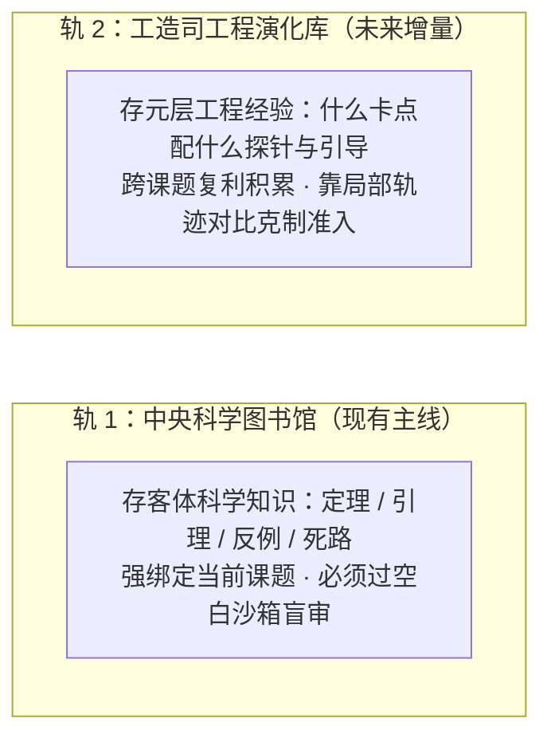

# GreatWall Agent 演进路线图：清账本、未解难题与未来构想（ROADMAP）

> **版本基线**：接续 [`ARCHITECTURE.md`](./ARCHITECTURE.md)（`v0.3.0-alpha.2` · **Apache 2.0 + DCO**）  
> **文档定位**：本文不是画大饼的商业排期表，而是一份坦诚的 **「问题清账本与中长期演进构想池」**。我们先把 `v0.3.0-alpha.2` 已经啃下来的核心硬骨头如实销账，再把眼下真正还没解决、接下来最值得投入精力的现实挑战清清楚楚摊开，方便自己把握节奏，也方便开源协作者一眼找到最感兴趣的切入点。

---

## 0. `v0.2 → v0.3` 已解决项清账与下一步优先级

在上一版路线图（`v0.2.0-alpha.1`）里，我们曾痛批系统存在五大工程与架构短板。在 **`v0.3.0-alpha.2`** 整机大重构中，其中五项核心结构短板已经落地清账：

| 过往核心痛点 | `v0.3.0-alpha.2` 已落地的解法 | 当前真实状态 |
| :--- | :--- | :---: |
| **主控鸡肋、人机交互割裂** | 吸收 DeepSeek Super-agent 范式，落地物理剥权的 **`gw-chief`（Superagent）** + DSH 原生 Action Card / 右侧只读 UI 双端确认 + `+1` 人类优先槽 + 45% 暂停直连子节点与 `handback_to_chief` 退回 | 代码与自动化测试已收官，**待真机实跑打磨体验** |
| **上帝文件与前端难以维护** | Python 按 `db/` + 12 个无环控制面子域 + 10 角色窄工具拆分；Node 按 `runtime/`、`sessions/`、`orchestrator/` 拆分；前端彻底拆分为零依赖 `client_src/` 三问模块化工作台 | ✅ 已清账 |
| **宏观收敛、分叉与融合机制缺失** | 彻底删掉旧“五车道”，落地图书馆四角色物理分权 + **脉冲式宏观大外环四拍**（代码硬对账 $\to$ 封存伴随 2 轮圆桌对抗 $\to$ 1500 字导览总览 $\to$ 宏观树调整），并落地子题级达标即时停派与口径防连坐 | 代码与沙盘已收官，**待真机等预算对照验证** |
| **数据库状态与会话启停撕裂** | 落地持久化 SQLite 事务后副作用队列（`runtime_effects`）、`host.lock` 单机进程锁与 DSH 原生 `ctx.agents.resume` 按需冷恢复 | 代码与单测已收官，**待真机重启压测** |
| **老版本迁移与双入口打架** | 废除扫磁盘自动升版暗门，落地 `v0.2.0-alpha.1` 真实旧库无损升级脚本与子题级 `active_spec_revision` 单一真源 | ✅ 已清账 |

在此基础上，接下来遵循钱学森《工程控制论》的克制原则，按 **四档优先级** 扎实推进：

| 优先级 | 阶段定位 | 核心目标（先实测站稳，再向外扩张） |
| :---: | :--- | :--- |
| **P0** | **真实桌面长周期实测 + 容器强隔离沙箱** | **头号任务**：在真实 DSH Desktop + 真实大模型上跑通多道不同学科的开放科研长程实测，把纸面和假模型沙盘测不出来的真实 Prompt 漂移、UI 交互毛刺与极端边界全暴露出来并修稳；同步推进 Docker / WSL2 + cgroups 容器级强隔离，杜绝失控脚本拖死宿主机。 |
| **P1** | **干净基线的科学受控对照实验** | 在零工程事故的稳态底座上，开展等预算受控对照实验：实证验证大外环圆桌、37% 夜科学问诊、多学派隔离分流相对单 Agent 裸跑究竟带来多大净收益，并据此对后勤与大外环做客观减法或调优。 |
| **P2** | **工造司守正升级（`Harness²`）与双轨知识库** | 在**完整保留现有工造司四项底座优势**的前提下，吸收 `Harness²` 思路引入“双信号驱动 + 局部轨迹对比（Mini-Probe）+ 跨课题工程演化经验库”，补齐工具效用闭环，同时优化一线探索者的执行效率（PTC / `ObservationPack` 延迟折叠）。 |
| **P3** | **科研标准插座、跨宿主生态与异构模型群** | 构建基于 MCP / Agent Skills / Lean 4 / 开源科学技能库的“科研标准插座”；调研 **ACP（Agent Client Protocol）** 打破单宿主锁死；探索按岗位混编的异构模型群与跨家族交叉盲审。 |

---

## 1. P0 头号任务：从“代码收官”走向“真机长跑稳态”与“容器强沙箱”

### 1.1 真实 DSH Desktop 端到端长周期实测（尚未跑过）
`v0.3.0-alpha.2` 虽然通过了完整的本地单元测试与假模型全链路沙盘，但真实科研中的不确定性远高于模拟环境。接下来必须重点实测四类真实场景：
- **长周期人机共创体检**：连续跑 4–8 小时开放课题，实际检验 `gw-chief` 的两阶段事件过滤是否真的不烦人、Compacting 压缩后靠 400 字动态锚点与回忆链能否一秒精准查到底账、45% 暂停直连改码重启后对账是否丝滑；
- **脉冲式大外环实战表现**：观察 2 轮圆桌对抗是否真的能撞出跨学派互补方案与鉴别实验，还是容易流于客套；检查 1500 字《子题全局总览》对 37% 后探索者的真实导览帮助；
- **前端视觉与交互持续打磨**：虽然 `client_src/` 已完成模块化拆分，但作为科研人员长时间盯屏的作战窗，视觉质感、信息密度与异常高亮动线仍需在真实使用中持续抛光。

### 1.2 从“应用层软沙箱”迈向“OS / 容器级强隔离”
当前桌面直跑沙箱依赖路径规范化与 Shell 同步拦截，属于应用层软防线——早年实测中曾发生过探索子节点写出失控 Python 脚本直接把宿主机卡死的真实教训。
- **演进目标**：引入基于 **Docker / WSL2（或轻量 MicroVM）** 的强隔离执行后端，通过 cgroups 为每个探索节点与盲审沙箱施加硬性的 **CPU、内存、磁盘配额、进程数上限与超时强杀**，并用网络命名空间对所有零外网角色实施物理级断网，让宿主机始终稳如泰山。

---

## 2. P1 科学实证：三个必须用真实数据回答的根本之问

在把底座跑稳之后，我们必须老老实实回答三个至今仍打着问号的科学方法论问题（不靠拍脑袋，靠真实轨迹审计与等预算对照实验说话）：

1. **多智能体制度与宏观大外环的真实净收益有多大？**
   - 在完全相同的 Token 与时间预算下，对比「单 Agent 裸跑」vs.「多分支独立隔离」vs.「开启脉冲式宏观大外环圆桌与旁路合体」，量化检验在数学建模、算法优化与机理探索三类题型上的真实收益与适用边界。
2. **37% 夜科学问诊（Night Science）与自适应上下文时钟真的最优吗？**
   - 逐条审计真实轨迹：37% 被抛入夜科学启发题时，探索者是真的跳出了局部思维锚定，还是礼貌敷衍两句继续原地微调？
   - 面对第三方中转站 API 或短窗口模型时，如何更鲁棒地探测有效窗口，并评估“上下文百分比时钟 vs. 语义步长 Tick”的长期表现。
3. **非标量科学任务的梯度缺失与 Ground-Truth Verifier 真空**
   - 在纯解析证明、开放机理探索等缺少廉价打分器的深水区，如何把形式化证明器（Lean 4）、符号计算交叉验证与多模型对抗审稿更好地结合起来，是整个 AI for Science 领域共同的前沿课题。

---

## 3. P2 仪器科学演进：守正补短，吸收 `Harness²` 迈向“科学库 × 工程演化库”双轨

### 3.1 第一铁律：绝不丢掉现有工造司的四项底座优势
无论未来怎么演进，现有工造司的三档同码协议、四态物理隔离（仪器故障零处罚）、四元复合缓存与版本域隔离、以及自声明校准集回归门禁必须 100% 完整保留。

### 3.2 精准补齐短板：工具效用闭环与双轨知识库
现有校准集能保证“仪器本身没写错”，但测不出“新造的探针或引导词交到探索者手里到底管不管用”；同时工造司跑完十道课题后还没有把“遇到哪类卡点配什么探针最有效”的工程经验沉淀下来。借鉴 **`Harness²`**（`arXiv:2610.14224`），未来演进方向非常清晰：

- **一阶归零防过拟合**：切换新课题时，旧课题特化的私有脚本与脚手架必须归零重来，绝不形成错误锚点；
- **局部轨迹对比（Mini-Probe）**：新探针或新引导上线前，拿触发工单的那一页失败快照跑几步轻量对照，亲眼确认探索者真能调起来且看清了盲区才放行，否则 `KEEP_BASE`；
- **一线执行效率升级**：同步探索 **PTC（程序化工具调用）** 减少高频试探往返，以及借鉴 **`SoL-Pi` 的 `ObservationPack`（观测延迟折叠）**——大体积工具输出前 2 轮完整保留，第 3 轮起自动折叠为可读句柄 + 精简摘要，大幅降低长程上下文膨胀。

---

## 4. P3 开放生态：科研标准插座、跨宿主协议与异构模型群

1. **科研标准插座（MCP / Agent Skills / Plugin）**：让领域研究者无需读懂 GreatWall 内部源码，只需按标准挂接一个 MCP Server、一份 `SKILL.md` 或一个仪器插件，就能即插即用 **Lean 4** 形式化验证生态以及社区开源的生物、化学、物理、数据分析科学技能库（如 Biomni / Virtual Lab / scientific-agent-skills）。
2. **突破单宿主与纯 API 算力困境**：在深耕 DSH Cordis 插件生态的同时，保持清晰的宿主适配边界，后续调研 **ACP（Agent Client Protocol）** 等开放标准以探索跨宿主兼容与更灵活的算力接入方案，降低个人开发者与学生的长周期科研成本。
3. **异构模型群（Heterogeneous LLM Swarm）**：摆脱单一模型依赖，探索按岗位混编（前沿强推理模型主攻一线攻坚与严苛盲审，高性价比轻量模型承担伴随归档、总览梳理与路由整理），并用跨家族多模型交叉盲审打破单一模型的同源认知盲区。

---

## 5. 致开源协作者：欢迎认领的开放方向

如果你对“用多智能体做长周期自主科学发现”抱有好奇，无论你想拆走其中某个机制魔改自用，还是愿意一起推进下面任意方向，都非常欢迎通过 Issue 或 PR 交流：

- **真机实测与体验打磨**：在真实 DSH Desktop 上跑开放课题，反馈 `gw-chief` 交互体验、圆桌实效与三问前端 UI 改进；
- **强隔离基础设施**：将应用层软沙箱升级为带 cgroups 硬限额的 Docker / WSL2 容器沙箱；
- **科研生态与开放协议**：接入 Lean 4、领域 MCP/Skills 插件、ACP 跨宿主适配与异构模型路由；
- **方法论实证与工具 RSI**：参与受控对照实验设计，或共同探索 `Harness²` 局部轨迹对比、双轨知识库与 `ObservationPack` 延迟折叠。
