# 长城 Agent V4：总体架构与工程技术规范全编（整合定稿版）

> **版本定位**：本文档为长城 Agent V4 的**终极整合定稿技术规范**。  
> **文档来源与整合基准**：无损整合并彻底裁决了《12_V4总体架构_研究纲领与知识演化.md》、《13_V4设计依据_原文核对与裁决.md》、《14_V4修订_共同演化_自主提问_单模型工作树.md》以及《14_项目交接档案_Handoff.md》，并深度吸收了 00–07 号讨论、实战 V1/V2/V3 历史档案教训及本地相关权威论文（Co-Scientist, Station, Cogentic, CDC, Lehman2011, Diversity Collapse, Local Optima, Fork-and-Flush, ARI 复评等）。  
> **最高裁决原则**：凡前序讨论或历史草案与本文档冲突者，一律以本文档为准；消除所有补丁碎片，确保**全景覆盖、零信息丢失、概念闭环、工程可落地**。

---

## 目录

- [第一篇：使命定义、系统定位与根本范式演变](#第一篇使命定义系统定位与根本范式演变)
  - [1. 核心定义与系统定位](#1-核心定义与系统定位)
  - [2. 两种验证情境与科学产出定义](#2-两种验证情境与科学产出定义)
  - [3. 自主探索与人机协作的统一治理](#3-自主探索与人机协作的统一治理)
  - [4. 历史版本遗产清算：继承与坚决拒绝清单](#4-历史版本遗产清算继承与坚决拒绝清单)
- [第二篇：科学本体与知识演化制度](#第二篇科学本体与知识演化制度)
  - [5. 十四大核心科学本体对象字典与字段规范](#5-十四大核心科学本体对象字典与字段规范)
  - [6. 四维知识视图：Record / Ledger / Archive / Lineage](#6-四维知识视图record--ledger--archive--lineage)
  - [7. 细粒度主张准入、复现验证与撤回依赖传播](#7-细粒度主张准入复现验证与撤回依赖传播)
  - [8. 去中心化信用计量与防自刷机制](#8-去中心化信用计量与防自刷机制)
- [第三篇：研究组织中枢与三器官架构](#第三篇研究组织中枢与三器官架构)
  - [9. 三器官分权与确定性内核架构](#9-三器官分权与确定性内核架构)
  - [10. 三套独立货币与清算体系](#10-三套独立货币与清算体系)
  - [11. 粗野评价与后继生长权下放机制](#11-粗野评价与后继生长权下放机制)
- [第四篇：双向耦合的研究循环与理论独立性](#第四篇双向耦合的研究循环与理论独立性)
  - [12. 五大发现循环的动作语义与跳转图谱](#12-五大发现循环的动作语义与跳转图谱)
  - [13. Theory 循环的绝对独立地位与生存保障](#13-theory-循环的绝对独立地位与生存保障)
  - [14. 跨循环交接契约与“发现桥接要求”](#14-跨循环交接契约与发现桥接要求)
- [第五篇：动态演化与红黑皇后对抗闭环](#第五篇动态演化与红黑皇后对抗闭环)
  - [15. 研究对象与研究手段的共同演化机制](#15-研究对象与研究手段的共同演化机制)
  - [16. 评判器四角色分立与红黑皇后对抗闭环](#16-评判器四角色分立与红黑皇后对抗闭环)
  - [17. Frozen 与 Live 双测试集体系](#17-frozen-与-live-双测试集体系)
- [第六篇：子 Agent 自主提问、研究纲领与方法广度治理](#第六篇子-agent-自主提问研究纲领与方法广度治理)
  - [18. 子 Agent 独立提问权与问题池治理](#18-子-agent-独立提问权与问题池治理)
  - [19. 开局方法多样性与 Registry 权威登记簿](#19-开局方法多样性与-registry-权威登记簿)
  - [20. 定理级阻塞（Theorem-Strength Gap）与去伪存真](#20-定理级阻塞theorem-strength-gap与去伪存真)
  - [21. 扁平隔离的初级探索者席位（Unbound Junior）](#21-扁平隔离的初级探索者席位unbound-junior)
- [第七篇：工作现场、Fork-and-Flush 与四重隔离工程](#第七篇工作现场fork-and-flush-与四重隔离工程)
  - [22. Fork-and-Flush 正式研究算子与三种交接强度](#22-fork-and-flush-正式研究算子与三种交接强度)
  - [23. Git Worktree 物理布局与随时可见的研究树](#23-git-worktree-物理布局与随时可见的研究树)
  - [24. 四重隔离防火墙技术标准](#24-四重隔离防火墙技术标准)
- [第八篇：单模型工作环境与资源分派规范](#第八篇单模型工作环境与资源分派规范)
  - [25. 单模型默认配置下的角色分化原理](#25-单模型默认配置下的角色分化原理)
  - [26. 多样性的真实来源与多角度检验](#26-多样性的真实来源与多角度检验)
  - [27. 物理配额、并发调度与限流容灾](#27-物理配额并发调度与限流容灾)
- [第九篇：元反思与跨代错误模式学习（Meta Patterns）](#第九篇元反思与跨代错误模式学习meta-patterns)
  - [28. 元反思阶段（Meta Reflection Phase）进出协议](#28-元反思阶段meta-reflection-phase进出协议)
  - [29. Meta Patterns 跨代模式审查与错误闭环](#29-meta-patterns-跨代模式审查与错误闭环)
- [第十篇：去表象评审与实质查新体系](#第十篇去表象评审与实质查新体系)
  - [30. 去表象规格提取与主张—证据对照表](#30-去表象规格提取与主张证据对照表)
  - [31. 实质科学查新协议（破除标题检索陷阱）](#31-实质科学查新协议破除标题检索陷阱)
  - [32. Reviewer 问责机制与防误杀校准](#32-reviewer-问责机制与防误杀校准)
- [第十一篇：人机协作治理与验证经济学](#第十一篇人机协作治理与验证经济学)
  - [33. 五大人机治理对象语义与数据模型](#33-五大人机治理对象语义与数据模型)
  - [34. 分级授权与人类注意力预算信封](#34-分级授权与人类注意力预算信封)
  - [35. 四大验证经济学领域适配](#35-四大验证经济学领域适配)
- [第十二篇：系统交付信封、评估假说与演进路线](#第十二篇系统交付信封评估假说与演进路线)
  - [36. 五件套统一交付信封规范](#36-五件套统一交付信封规范)
  - [37. 三大核心科研假说（H1/H2/H3）与消融设计](#37-三大核心科研假说h1h2h3与消融设计)
  - [38. V4.0 ~ V4.3 能力门分阶段演化矩阵](#38-v40--v43-能力门分阶段演化矩阵)
  - [39. 十四大失败模式与纵深防御矩阵](#39-十四大失败模式与纵深防御矩阵)

---

# 第一篇：使命定义、系统定位与根本范式演变

## 1. 核心定义与系统定位

**长城 Agent（Great Wall Agent V4）是一个在明确使命和资源预算边界内，自主提出问题、组织假设推导、检验机制解释、积累可继承科学知识，并能跨执行者换代与长程上下文持续推进的 AI for Science 研究系统。**

### 根本范式转变
过去的多智能体代码系统以“执行者”和“当前任务会话”为中心，导致一旦会话溢出、执行者崩溃或遭遇性能停滞，整个研究过程立即归零。长城 Agent V4 实现三大根本转向：
1. **研究纲领作为长期主体**：Agent 个体、执行会话、代码实现均是可以更换、随时生灭的消耗品；长期真正延续、跨越代际演进的是**研究纲领（Research Program）**。
2. **带条件与证据的成果为最小积累单位**：系统的积累单位不是裸代码脚本，也不是未经核验的自然语言闲聊，而是严格绑定了前提条件、形式化反例与可追溯证据链的**知识对象（Knowledge Artifacts）**。
3. **手段与对象的协同演化**：系统不仅演化求解器，同时演化测量工具、评判标准、任务分解与提问方式。

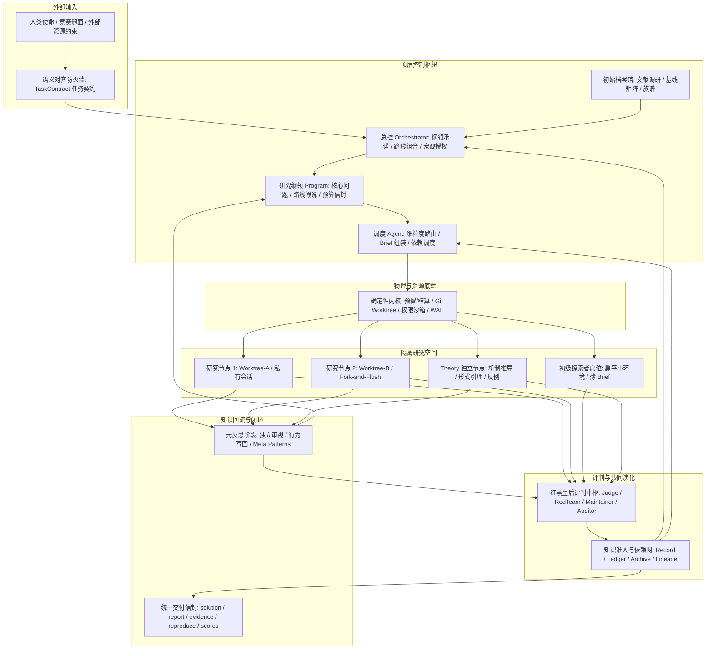

## 2. 两种验证情境与科学产出定义

长城 Agent V4 拒绝用单一的“万能标量分数”抹平科研与工程任务的本质差异，明确区分两种验证情境：

### 2.1 目标明确、验收可计算的情境（V4.0 核心阵地）
- **适用场景**：算法竞赛（如 ACM/ICPC、Kaggle、CUMCM 等）、数学优化、编译器调优、有确定性验证器的干实验任务。
- **验收机制**：确定性测试器（Test Runner / Script）执行验证，通过代码执行、内存/时间硬指标、断言检查获得客观通过率与性能标量。
- **科学附加要求**：不仅要求跑出更高分，必须输出算法机制解释、复杂度不变量、适用边界与失效反例。

### 2.2 问题开放、价值无法直接算分的情境（V4.1~V4.3 演化空间）
- **适用场景**：开放科学发现、复杂机制探索、社会经济与多主体仿真、数学猜想证明。
- **验收机制**：混合验收机制。包括：
  1. 形式化逻辑/引理检查（Lean / Isabelle 或符号系统验证）；
  2. 经验证伪探针（寻找竞争假说的区分性反例）；
  3. 结构化同行评审（Rubric-based Double-Blind Review）；
  4. 历史再发现恢复协议（Re-discovery Protocol，对齐已知科学发现基准）。

### 2.3 科学产出的硬性标准
无论处于哪种情境，任何声称“完成研究”的产出，必须使第三方独立读者能够清晰回答：
1. **究竟解决了什么具体科学/算法问题？**
2. **得出该结论的经验证据或推导依据是什么？**
3. **该结论在哪些严格数学/实验条件下成立？在哪些条件下失效？**
4. **如何完整复现这一结果？**
5. **该成果为后继研究打开了什么新的子问题或提供了什么可用工具？**

运行时长、并发 Agent 数量、生成的文档总字数、内部自评的 Elo 分数，均严禁替代上述答案。

## 3. 自主探索与人机协作的统一治理

自主（Autonomous）与协作（Collaborative）不是两个割裂的产品形态，而是同一架构在不同**授权策略（Delegated Policy）**下的运行表现：

| 模式 | 运行边界 | 人类角色 | 升级条件 | 交付底线 |
|---|---|---|---|---|
| **自主模式 (Autonomous)** | 在预先锁定的任务契约（TaskContract）与资源信封（Budget Envelope）内全闭环运行 | 离线委托人与最终成果审阅者 | 预算耗尽、不可逆高危操作、发现任务契约内部无法自洽的逻辑矛盾 | 即使预算用尽未达成终极目标，也必须交付当前最强成果、失败边界与未决依赖，严禁将“超时/超额中断”包装为“成功” |
| **协作模式 (Collaborative)** | 人类作为具备特定署名（Actor ID）的特殊研究节点，随时注入假设、质疑或引导 | 在线同行与最高授权实体 | 人类输入被作为“高优先级待验假说”处理，而非全知全能的免检事实 | 人类的假设必须与 Agent 的假设一样经过去表象验证与实测核验；人类修改目标时触发任务契约版本升级 |

## 4. 历史版本遗产清算：继承与坚决拒绝清单

长城 Agent 历经 V1（纯 Prompt Skill）、V2（实战竞赛引入清栈与盲评）、V3（AFEVA 7 节点与 MAP-Elites 实战）、设计系统（45/45 Mock 测试编排）与 0.1 草案。V4 对历史资产进行彻底清算：

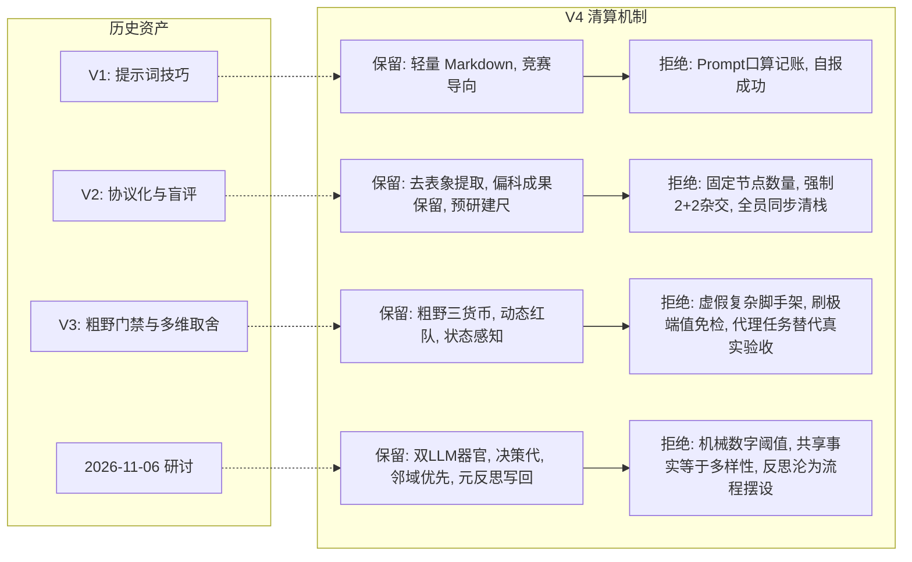

---

# 第二篇：科学本体与知识演化制度

## 5. 十四大核心科学本体对象字典与字段规范

为彻底解决历史设计中“仅有抽象概念无数据结构”的断层问题，V4 统一定义十四大核心科学对象。所有对象在物理上均以带有标准 YAML Frontmatter 的 Markdown 文档呈现。

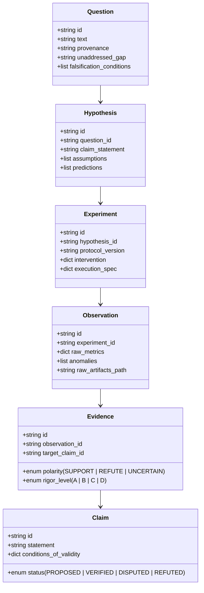

### 5.1 对象规范字典与核心字段

| 编号 | 对象名 (Entity) | 科学语义与最低存在条件 | 核心字段规范 (YAML Schema) |
|---|---|---|---|
| 01 | **TaskContract** | 任务权威契约。定义外部客观限制，严禁模型自行修改题意。 | `contract_version`, `verbatim_requirements`, `formal_definitions`, `constraints` (时空/算力/接口), `acceptance_criteria` (script/rubric), `open_questions` |
| 02 | **Question** | 待解决的不确定性、疑问或机制盲点。 | `id` (Q-xxx), `text`, `source_type` (INITIAL \| ANOMALY \| META \| SUBAGENT), `provenance_node`, `gap_description`, `falsification_criteria` |
| 03 | **Hypothesis** | 具有可区分性、可反驳性的候选机制主张。 | `id` (H-xxx), `question_id`, `statement`, `prerequisites`, `mechanistic_explanation`, `discriminative_predictions`, `parent_lineage` |
| 04 | **Experiment** | 带有版本、受控干预、确定性测量协议的检验行动。 | `id` (E-xxx), `target_hypothesis_id`, `protocol_version`, `worktree_commit`, `intervention_variables`, `control_variables`, `resource_envelope` |
| 05 | **Observation** | 单次实验或运行的客观记录与原始数据映射。 | `id` (O-xxx), `experiment_id`, `execution_success` (bool), `raw_metrics` (Pareto指标), `observed_anomalies`, `raw_logs_ref` |
| 06 | **Evidence** | 将观察结果与特定断言相连的因果判定凭证。 | `id` (EV-xxx), `observation_id`, `target_claim_id`, `support_polarity` (SUPPORT \| REFUTE \| AMBIGUOUS), `evidence_level` (A~D), `confounding_factors` |
| 07 | **Claim** | 范围极其明确、证据支撑完备的最小知识断言。 | `id` (C-xxx), `statement`, `validity_domain` (适用条件矩阵), `supporting_evidence_ids`, `counter_examples`, `lifecycle_status` (PROPOSED \| VERIFIED \| CONTESTED \| RETRACTED) |
| 08 | **Explanation** | 现象背后的因果机制阐述与替代竞争解释分析。 | `id` (EXP-xxx), `observed_phenomenon`, `underlying_mechanism`, `competing_explanations`, `distinguishing_tests` |
| 09 | **Theory** | 相互自洽的定义、不变量、机制/定理与预测系统。 | `id` (T-xxx), `formal_axioms`, `invariants`, `theorems_or_lemmas`, `deductive_predictions`, `falsification_frontier` |
| 10 | **Method** | 算法、推导范式、技术实现、接口契约与失效条件。 | `id` (M-xxx), `name`, `algorithmic_family`, `interface_signature`, `preconditions`, `known_failure_modes`, `worktree_ref` |
| 11 | **Artifact** | 代码、二进制、数据切片、证明脚本等版本化实体。 | `id` (ART-xxx), `type` (CODE \| DATA \| PROOF \| MODEL), `content_hash` (SHA256), `worktree_path`, `frozen_version` |
| 12 | **Paper** | 组织严密、自包含的研究论证与结论报告。 | `id` (P-xxx), `title`, `abstract`, `structured_claims` (映射到C-xxx), `evidence_atlas`, `reproducibility_manifest`, `limitations` |
| 13 | **Review** | 针对特定成果版本的独立同行评议与反思。 | `id` (REV-xxx), `target_artifact_id`, `reviewer_role` (Judge/RedTeam/Maintainer/Auditor), `findings`, `unverified_gaps`, `recommendation` |
| 14 | **Program** | 跨代际、跨节点生长的长期研究纲领。 | `id` (PRG-xxx), `core_mission`, `theoretical_commitments`, `active_routes`, `budget_allocated`, `budget_consumed`, `exit_conditions` |

## 6. 四维知识视图：Record / Ledger / Archive / Lineage

知识积累严禁复制四份物理文件，而是基于统一的数据底盘提供**四种职责各异的视图（Views）**：

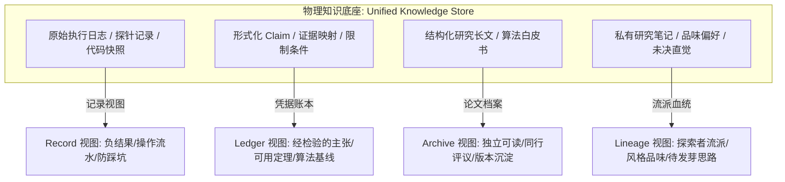

1. **Record（记录视图）**：记录所有发生过的运行流水、参数配置、崩溃反例与负结果。**准入标准：只要真实发生即可存入**。核心作用是防止系统在不同分支上重复踩入已知死胡同。
2. **Ledger（证据账本）**：收录经过严格复验、适用条件清晰的 Claim 和 Method。**准入标准：通过形式化验证或基准测试通过**。是其他节点进行组合（Composition）与跨族复用的唯一法定依据。
3. **Archive（正式档案馆）**：汇编为完整学术论文/白皮书的高价值研究集。**准入标准：通过 Review 准入协议，主张-证据闭环无断裂**。供人类与新代总控理解全局学术进展。
4. **Lineage（流派血统视图）**：挂载于特定方法族谱分支下的私有工作笔记与未成熟直觉。**准入标准：作者节点私有**。在连续交接时可继承，但在 Fork-and-Flush 时受控隔离，防止先验偏见污染新分支。

## 7. 细粒度主张准入、复现验证与撤回依赖传播

### 7.1 针对 Claim 独立准入（破除“整文打分一票否决”）
- 严禁采用“论文综合得分 ≥ 6 则全部入库，否则全部丢弃”的粗糙机制。
- 一篇最终因综合性能不佳而被拒绝的论文中，其包含的**独立正确引理、高保真反例构造或局部加速算子**，只要满足去表象核验，均可独立赋予 Claim ID 入驻 Ledger。

### 7.2 四级复现阶梯（Reproduction Ladder）
任何写入 Ledger 的主张必须显式标注其复现等级：
- **L1：同环境重跑（Deterministic Re-run）**：相同硬件、相同 Seed、相同环境配置下完全复现。
- **L2：扰动条件复现（Perturbation Invariance）**：更换随机种子、改变数据切片顺序或输入微小噪声后依然稳定。
- **L3：独立实现复现（Independent Re-implementation）**：由另一个隔离节点根据 Method 规范独立编写代码复现。
- **L4：形式化证明（Formal Verification）**：通过符号计算或形式化证明检查器（如 Lean/Z3）验证逻辑无漏洞。

### 7.3 撤回（Retraction）与依赖树动态传播
当红队或审计器证明某项底层主张 $C_0$ 错误并触发 Retraction 时，系统依照依赖图自动触发连锁响应：

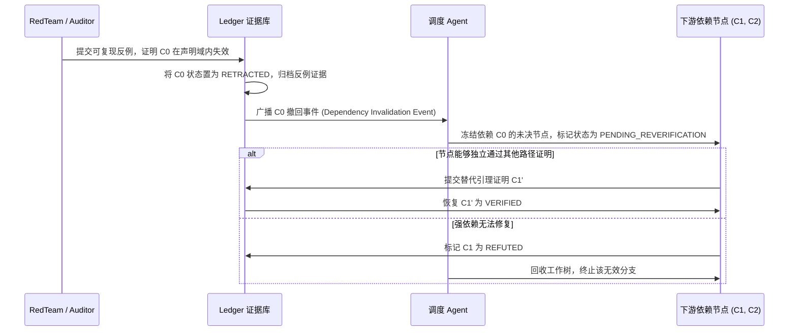

## 8. 去中心化信用计量与防自刷机制

系统拒绝建设可以被 LLM 轻易“互刷”的纯引用计数学术排行榜。探索信用（Exploration Credit）的计量遵循**实际有效贡献原则**：
1. **严格区分四种互动类型**：
   - 仅仅“读取”（Read）某成果：贡献度为 0。
   - 在论文中“引用”（Cite）某成果：贡献度为 0（严禁互引买分）。
   - 在行动中“直接复用”（Reuse）：记录调用日志。
   - 复用后“产生了经过 Trust 验证的下游有效突破”（Downstream Impact）：此时溯源给源成果赋予探索信用。
2. **负结果与评判漏洞发现享有等权信用**：发现一个关键定理级阻塞或构建出击溃假说的反例，其获得的探索信用等同于正向改进。

---

# 第三篇：研究组织中枢与三器官架构

## 9. 三器官分权与确定性内核架构

长城 Agent V4 坚决贯彻“**大模型做认知判断，确定性代码做状态与资源强制**”的权责划分。

```mermaid
flowchart TD
    subgraph 认知中枢: 双大模型器官
        ORCH[总控 Orchestrator<br/>大模型长上下文 8-10k<br/>频率: 决策代触发<br/>职责: 纲领承诺/大方向裁决]
        SCHED[调度 Agent Scheduler<br/>大模型短上下文 2-4k<br/>频率: 动作级触发<br/>职责: 排队路由/Brief组装/依赖检查]
    end

    subgraph 评价中枢: 评判器系统
        EVAL[评判器系统 Evaluator<br/>独立上下文 / 盲评审批<br/>职责: 真实性门禁/Pareto排序/版本维护]
    end

    subgraph 物理约束: 确定性工具内核 (Deterministic Engine)
        WAL[预写式事件日志 WAL]
        LEDGER[物理预算总账本]
        LOCK[文件/状态读写并发锁]
        WT_MGR[Git Worktree 生命周期引擎]
        SANDBOX[沙箱进程与超时监控 Watchdog]
    end

    ORCH -->|下发 Program 授权信封| SCHED
    SCHED -->|提交 Action 申请| WAL
    WAL --> LEDGER
    LEDGER -->|核验预算额度| WT_MGR
    WT_MGR -->|挂载工作目录| SANDBOX
    SANDBOX -->|执行产出提交| EVAL
    EVAL -->|评分与反例上报| ORCH
    EVAL -->|准入更新| SCHED
```

### 9.1 权责边界与禁止跨权规范

| 责任主体 | 构成本质 | 核心输入 | 有权决定 | 坚决无权决定（越权阻断） |
|---|---|---|---|---|
| **总控 Orchestrator** | 大模型 (长上下文) | 任务契约、各 Program 进展快照、关键争议、全系统预算投影 | 批准/终止研究纲领、跨路线宏观资源调配、重大路线转向、任务歧义裁定 | 严禁直接下场写业务代码；严禁伪造测试结果；严禁绕过调度内核私自创建未记账任务 |
| **调度 Agent** | 大模型 (短上下文) | 当前授权信封、就绪队列、节点后继提案、依赖图谱、物理资源状态 | 动作级队列调度、后继候选路由、为研究节点装配定制化 Brief | 严禁篡改总控设定的纲领目标；严禁擅自提高总预算上限；严禁对科学假设的正确性做终局背书 |
| **评判器系统** | 大模型组合 + 确定性脚本 | 待审产物、客观证据、评判协议 (Frozen/Live)、已知反例库 | 裁定有效性 (Pass/Fail)、计算多维质量向量、准入或驳回知识入库 | 严禁自行给喜爱的方案追加探索预算；严禁因方案不符合审美而否决其经验证的正确性 |
| **确定性内核** | 纯 Python/Shell 规则引擎 | 经数字签名的系统事件、资源请求、物理锁状态 | 扣减/冻结物理预算、创建/注销 Worktree、强制终止超时进程、生成权威不可篡改审计日志 | 绝不参与任何自然语言语义判断；绝不基于主观推断放行越权操作 |

## 10. 三套独立货币与清算体系

系统内三种评估维度彻底绝缘，分别建账，**严禁跨账抵扣**：

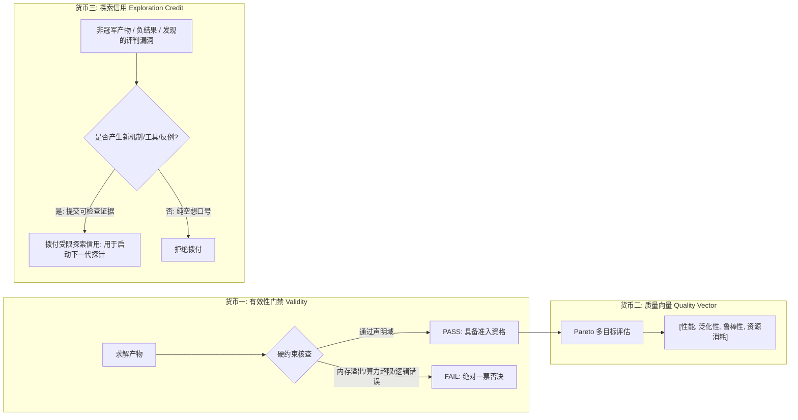

1. **有效性（Validity）**：针对声明域的二元门禁（Pass / Fail / Unknown）。新颖性无论多高，发生数值溢出、违规越界或逻辑断裂一律判定为无效，**新颖性绝不能抵扣错误**。
2. **质量（Quality）**：基于有效产物的 Pareto 多维向量，包含运行速度、内存峰值、预测方差、边界鲁棒性等。不强行加权为单一标量，允许在不同维度展现特长。
3. **探索信用（Exploration Credit）**：专为非冠军路线设立的“生命线预算”。用于资助具备新机制、揭示了深刻反例但暂未夺冠的分支。探索信用**只能用于抵扣该分支后续探针的计算额度，严禁加计入最终比赛总分**。

## 11. 粗野评价与后继生长权下放机制

### 11.1 粗野评价（Brutal Evaluation）与缓刑机制
- **容忍度**：宽容容忍代码结构激进、缺少优雅封装、甚至在非关键场景严重偏科（例如在稠密图上表现平平但在稀疏图上带来一个数量级突破）。
- **零容忍**：零容忍将错误结果冒充正确；零容忍突破题面设定的物理内存/运行时间硬性上限。
- **缓刑机制的本质**：某节点虽然综合分未达标，但揭示了一个有价值的数学不变量。该节点不被评为冠军，但该机制被提取为独立 Claim，该路线获得继续研究的“缓刑额度”，绝不是正确性门禁打折。

### 11.2 后继生长权下放（Delegated Continuation）
为打破历史设计中“总控必须逐个批准每一个子节点动作”的吞吐量瓶颈：
- 总控对每个批准的研究纲领签署一份**可撤销的授权契约（Delegated Charter）**，明确本纲领允许调用的总 Token 预算、并发 Worktree 槽位数与探索边界。
- 在授权契约范围内，研究节点结束时提出的邻域变体分支、连续交接或低成本探针，**调度 Agent 配合内核直接审核放行，即时挂载 Worktree 运行**，无需等待总控唤醒。
- 只有触发以下事件时，强制升级上报总控裁决：
  1. 拟开辟跨越原方法族的正交新纲领；
  2. 申请增加总预算信封；
  3. 核心定理级假设被红队证实证伪。

---

# 第四篇：双向耦合的研究循环与理论独立性

## 12. 五大发现循环的动作语义与跳转图谱

长城 Agent V4 将研究行为解构为五大离散循环。循环是研究动作的语义原语，而非僵化的物理流水线，节点根据研究现场随时跳转。

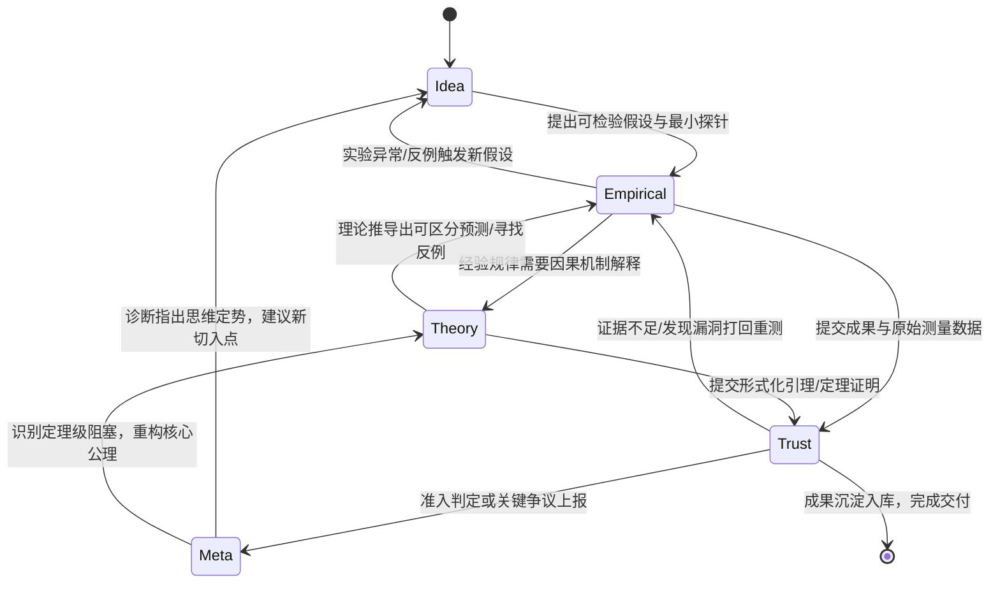

| 循环名称 | 核心输入 | 核心研究动作 | 交付与交接产物 |
|---|---|---|---|
| **Idea** | Question、已知结果、文献图谱、反例 | 提假设、寻找邻域结构变化、构造竞争性解释 | Hypothesis + 最小代价区分性检验方案 |
| **Empirical** | 假设/预测、具体方法、基线配置 | 编码实现、消融实验、性能剖析、反例挖掘 | Experiment + Observation + 原始度量日志 |
| **Theory** | 核心问题、经验异常、数学对象、公理假设 | 符号推导、提取守恒量/不变量、形式化证明、因果建模 | Explanation / Theory / Method + 待验命题 |
| **Trust** | Claim 候选、原始观测、可复现代码、测试集 | 真实性审查、红队攻击、代码与推导去表象核对 | Review + 准入判定 (Ledger) + 依赖拓扑更新 |
| **Meta** | 一段跨节点研究轨迹、预算报表、历史错误 | 审查思维局限、判定是否陷入局部陷阱、学习错误模式 | 有明确负责主体的 Write-back 修改指令 |

## 13. Theory 循环的绝对独立地位与生存保障

### 13.1 彻底否决“Theory 是 Empirical 的后半段”
在长城 Agent V4 中，**Theory 必须是一个与 Empirical 并列的独立一级循环**。如果强制要求先做实验再写理论解释，系统将不可避免地退化为只擅长“事后诸葛亮式讲故事”的调参黑盒。

### 13.2 Theory 的生存机制与预算保障
1. **独立立项与独立预算通道**：总控设立专门的“机制理解与形式化推导”预算通道，理论研究节点不需要为了争取计算资源而伪造跑分成绩。
2. **理论成果的合法形态**：引理证明、结构不变量提取、搜索空间下界证明、已知方法的不可行性定理（Impossibility Result），均是与高分算法等权的高价值成果。
3. **理论反哺的硬约束**：理论方向不能沦为空谈。获得持续注资的理论纲领必须满足：
   - 能够证明现有某个大类的搜索空间冗余性，从而实质性收缩经验搜索分支；或
   - 给出至少两项具有明确排他性的经验预测，指导 Empirical 节点进行验证。

## 14. 跨循环交接契约与“发现桥接要求”

循环交接严禁使用模糊的“会话总结摘要”，必须满足**可行动交付契约（Actionable Handoff Contract）**：

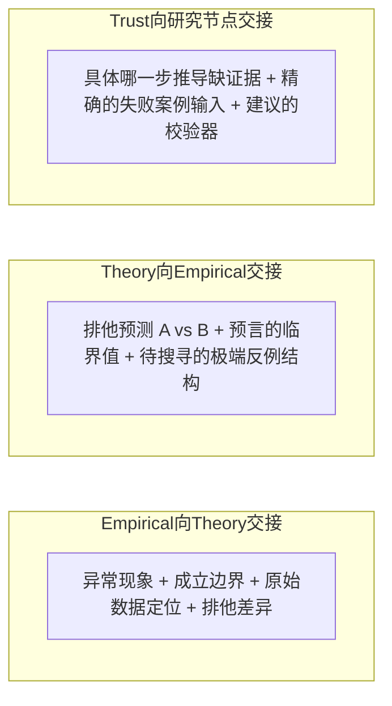

### 发现桥接声明（Discovery Bridging Requirement）
任何关键阶段性成果从一个循环进入下一循环时，必须在 Markdown 头部附带一段 200 字以内的“桥接声明”，明确回答：
> **“当前这项成果的确认，使得以前不可行的什么新问题/新操作/新验证在逻辑上变为了可能？”**  
若无法回答此问题，该成果直接归档为 Standalone Observation，不触发后续昂贵流程。

---

# 第五篇：动态演化与红黑皇后对抗闭环

## 15. 研究对象与研究手段的共同演化机制

吸收《Avoiding Local Optima in Agentic Self-Improvement》（arXiv:2609.34924）的核心数学结论：在固定脚手架与固定评价准则下，智能体的持续自我改进必然陷入局部最优。真正的跃迁必须依赖**研究对象与研究手段的共同演化**。

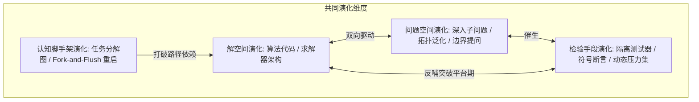

## 16. 评判器四角色分立与红黑皇后对抗闭环

红黑皇后对抗闭环绝非抽象口号，而是由四个职责物理隔离的 Agent 角色构成的持续进化系统：

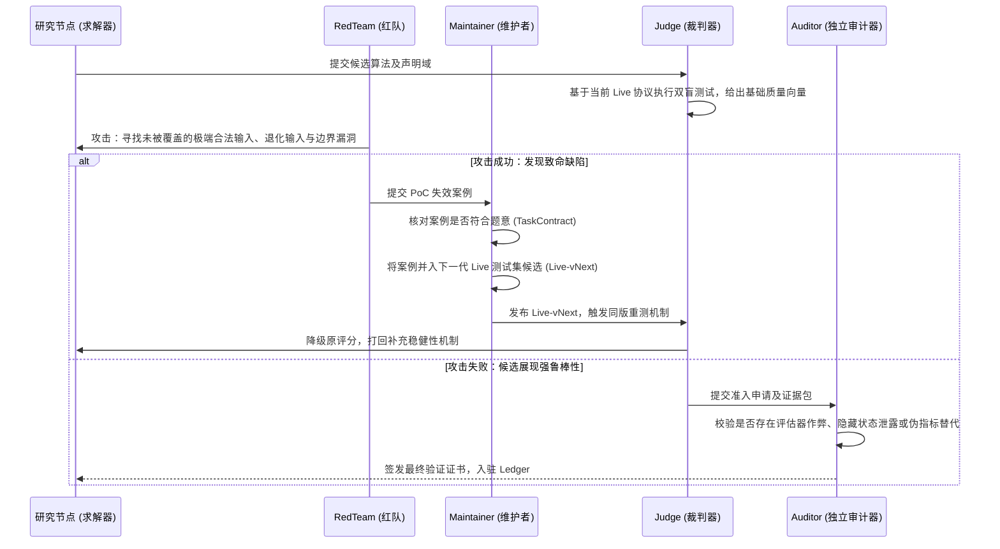

### 四角色职责防火墙
1. **Judge（裁判器）**：严格按照当前生效的评测协议执行无偏测量。盲作者、盲会话历史，禁止阅读作者的自夸性叙述。
2. **RedTeam（红队）**：专职寻找让现有候选方案崩溃、超时、内存暴涨或产生逻辑矛盾的极端合法测试样例；专职审查评测器是否存在“无法区分两种本质机制”的测量漏洞。
3. **Maintainer（维护者）**：负责评判尺度的版本迭代。接收红队案例并严格对照 TaskContract 审核。符合题意者吸收入 Live 测试集，发布带有语义版本号的 `eval-vX.Y`。**维护者严禁代替选手修改代码**。
4. **Auditor（独立审计器）**：跳出评测日常流程，专职核查“测试集是否悄悄偏离了任务初衷”、“评测器是否存在泄漏给选手的隐藏状态”、“是否存在用耗时微小变化冒充节能等假指标”。**拥有冻结争议成绩并启动全链复核的最高否决权**。

## 17. Frozen 与 Live 双测试集体系

为兼顾“可比较的科学锚点”与“动态演化的压力测试”，V4 建立严格的双轨测试集体系：

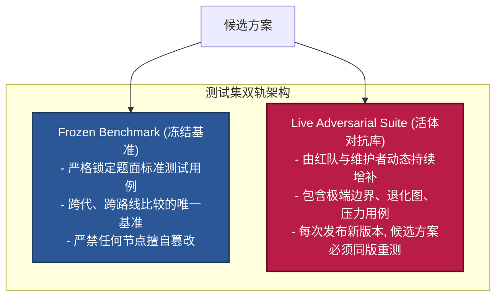

### 同版重测铁律（Same-Version Retest Rule）
严禁将昨日在简单 Live-v1 上跑出的分数，与今日在困难 Live-v2 上跑出的分数直接做排序对比！当 Maintainer 发布新版 Live 测试集时，所有处于竞争前沿的候选方案必须在新的 Live 版本上重新运行测评，更新其质量向量。

---

# 第六篇：子 Agent 自主提问、研究纲领与方法广度治理

## 18. 子 Agent 独立提问权与问题池治理

在 V4.0 中，**子 Agent 必须全面行使独立科学提问权**，彻底破除“下级节点只配填执行工单”的从属地位。

### 18.1 结束协议与独立问题札记（Problem Note）
研究节点在归档工作时，必须强制交付三件套：
$$\text{Node Delivery} = \langle \text{Research Artifact}, \text{Independent Problem Note}, \text{Continuation Proposal} \rangle$$

**独立问题札记必须先于后继提案生成**。其标准论文讨论格式为：
1. **新发现的疑问是什么？**
2. **该疑问是由本节点的哪条具体实验异常或数学推导催生的？**
3. **为什么现有理论或当前纲领无法解释该疑问？**
4. **什么样的排他性证据可以回答该疑问？**
5. **该疑问与整个系统的总任务使命有何因果关联？**

### 18.2 公共问题池的管理铁律
1. **作者原问题保留署名与版本**：总控与调度可以给问题加标签、建关联，但**严禁修改原问题的字面提问内容**。
2. **去重只做关联，禁止暴力合并**：文字看似相似、但在不同数学结构或假设下提出的两个问题，严禁合二为一。
3. **自主探针权**：节点可直接动用其预留的基础探索信用，针对自己提出的问题就地挂载轻量 Worktree 展开 1~2 次快速探针，无需等待中央层层审批。

## 19. 开局方法多样性与 Registry 权威登记簿

根据 OpenAI CDC 任务设计规范，开局探索必须建立**实质性的方法广度**，绝不能由总控的单一审美垄断开局。

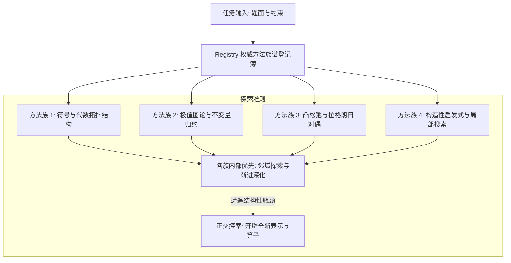

### 19.1 Registry 权威结构字典（`registry/families.md`）
每一个方法族在登记簿中包含：
- `family_id`：方法族唯一标识符；
- `core_mathematical_philosophy`：底层数学/计算哲学；
- `primary_invariants`：依赖的核心不变量或数学对象；
- `algorithmic_machinery`：核心算子与推导路径；
- `known_vulnerabilities`：天然理论软肋与已知失效边界；
- `active_nodes`：当前挂载在这一族谱下的 Worktree 节点列表。

### 19.2 邻域探索与正交探索的动态平衡
- **邻域探索（Neighborhood Search，默认优先）**：保留主干不变量与问题表示，仅改变一个关键假设、边界条件或局部优化算子。绝大部分实质突破来自于邻域的深刻技术创新。
- **正交探索（Orthogonal Search，条件触发）**：完全推倒现有表示，引入全新的数学工具体系。**触发条件**：当前方法族被证实陷入“定理级阻塞”，或连续两代邻域探针收益递减至阈值以下。

## 20. 定理级阻塞（Theorem-Strength Gap）与去伪存真

严禁将“没有进展”包装为“正在深入”。系统部署**伪完成度识别清单**与**定理级阻塞阻断机制**。

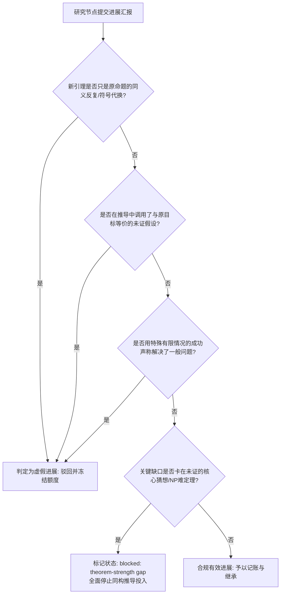

### 解除 Blocked 的绝对门槛
一旦节点被标记为 `blocked: theorem-strength gap`，该分支即刻休眠回收。**重开该分支必须满足实质性充要条件**：
必须由某个节点提交了**全新的数学不变量、新的形式化构造工具、或外部引入的严格引理证明**，并清晰论证该新工具如何精准击碎原阻塞点。仅仅提供更长的 Prompt、调高采样温度或换个名字，一律禁止重开。

## 21. 扁平隔离的初级探索者席位（Unbound Junior）

根据《Diversity Collapse in Multi-Agent LLM Systems》（ACL 2026 Findings）的实验发现：多智能体系统的多样性坍塌并非来自智能体资历本身，而是来自**“层级权威结构（Leader-Led Hierarchy）”的同化压迫**。

长城 Agent V4 在工程上设立**受保护的初级探索者席位**：
1. **物理小环境隔离**：在每个决策周期常驻 1~2 个初级探索者席位，置于扁平隔离环境中运行。
2. **阻断资深叙事污染**：初级探索者严禁阅读总控 Orchestrator 撰写的“主流路线宏大故事”，也不阅读当前冠军方案的完整自辩，只给予原始任务契约与去表象事实。
3. **高多样性配置**：在模型接口允许范围内配置较高的探索采样参数，鼓励构造边缘反例与新颖表示。
4. **席位保护与非永久保护**：系统保护的是“探索席位与探索能力”，而不是某一个特定的 Agent。若某个初级探索节点长期无法交付可检查成果，系统重置其上下文或换用新会话，但绝不将探索席位裁剪合并为冠军优化席位。

---

# 第七篇：工作现场、Fork-and-Flush 与四重隔离工程

## 22. Fork-and-Flush 正式研究算子与三种交接强度

吸收《Fork-and-Flush》（arXiv:2610.07447）的研究发现：在长程任务中，模型的停滞主要由于长上下文中的路径依赖与认知惯性。通过保留工作空间、清空对话历史并分叉执行，能显著突破局部平台。

长城 Agent V4 将其升级为正式系统算子，形式化定义为：
$$(W, C) \xrightarrow{\text{Fork-and-Flush}} \left\{ (W_1, \emptyset), (W_2, \emptyset), \dots, (W_k, \emptyset) \right\}$$

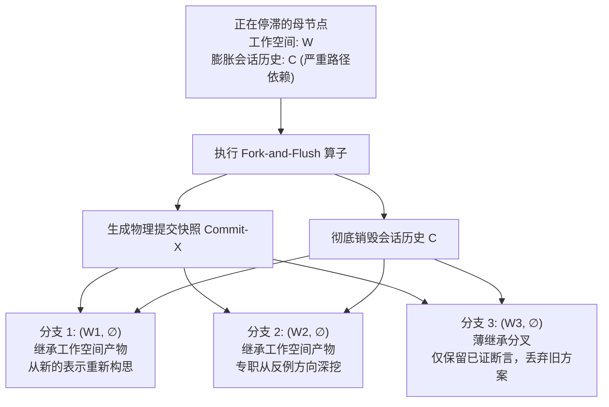

### 三种交接强度的严格界定

| 交接模式 | 继承的物理内容 | 丢弃与隔离的内容 | 适用科研场景 |
|---|---|---|---|
| **连续交接 (Continuous Handoff)** | 产物目录、短 Handoff 备忘录、父节点未决问题与建议 | 丢弃超过 3 轮以上的细碎中间工具调用原生日志 | 方向明确且持续处于上升期，仅为缓解 Token 膨胀 |
| **工作空间清栈 (Workspace Flush)** | 代码、数据、产物快照、环境锁定依赖文件（完全保留物理工作区 $W$） | **彻底清空会话上下文 $C \to \emptyset$**，不向新 Agent 注入历史推导过程与闲聊 | 遭遇局部停滞，需要新 Agent 在已有代码基础上换脑筋审视 |
| **薄继承分叉 (Thin-Inheritance Fork)** | 仅继承官方题面、基线数据和经 Ledger 验证的核心 Claim，挂载全新空 Worktree | 丢弃父节点的所有代码实现、丢弃父节点的研究建议与品味叙事 | 当前技术路线陷入死胡同，必须彻底斩断路径依赖，完全从零探索 |

## 23. Git Worktree 物理布局与随时可见的研究树

### 23.1 规范物理目录结构
```text
D:/Documents/deepseek harness/research_runtime/
├── contract/                       # [只读] 版本化任务契约 (TaskContract) 与授权信封
├── archive/                        # [只读] 经正式准入的学术成果、论文与白皮书库
├── registry/                       # [核心登记] 方法族谱、节点拓扑、依赖关系权威账本
│   ├── families.md                 # 方法族谱元数据登记
│   └── state_graph.json            # 节点与依赖 DAG 机器账本
├── board.md                        # [自动渲染] 面向人类/总控的全局研究树与状态大盘
├── baselines/                      # [只读] 权威基准代码与黄金测试数据集入口
├── worktrees/                      # [物理隔离工作区] 每个活跃节点独占一个物理目录
│   ├── node-01-exact/              # 节点 1 私有工作树 (代码, 局部实验日志, 草稿)
│   ├── node-02-approx/             # 节点 2 私有工作树
│   └── node-03-junior/             # 初级探索者独占小环境
├── evaluator-workspaces/           # [评判器专属] 求解节点绝对不可写入的隔离评测目录
│   ├── eval-frozen/                # 绝对锁定的官方测试运行器
│   └── eval-live-v3/               # 当前生效的动态红队对抗测试套件
├── releases/                       # 阶段性里程碑、工具与候选方案发布包
└── events/                         # 预写式事件日志 (WAL: Write-Ahead Logs)
    └── 20261106_system.jsonl       # 严格按时序记录的不可篡改系统状态流
```

### 23.2 随时可见的研究树大盘（`board.md` 渲染标准）
大盘必须定时由 `state_graph.json` 自动生成，严禁人工或 LLM 凭记忆随意手写。示意渲染规范：

```text
========================================================================================
长城 AGENT V4 全局动态研究树 (更新时间: 2026-11-06 23:45:12 | 状态: 运行中)
总预算信封: 500,000 Tokens (已消耗: 184,200 | 预留: 45,000 | 剩余有效: 270,800)
========================================================================================
[PRG-01] 组合优化全局求解纲领 (负责人: Orchestrator)
├─┬ [Node-01] 精确分支限界族 (active) [WT: worktrees/node-01] [Eval: frozen-v1]
│ │  ├─ 核心主张: 利用拉格朗日乘子收缩界限 | 状态: 进展稳定 (Pareto: speed=12.4s, err=0.0%)
│ │  └─ 独立提问: Q-07 "稠密约束矩阵下的分解开销能否被稀疏核抵消？"
│ └─ [Node-04] (从 Node-01 执行 Fork-and-Flush) (active) [WT: worktrees/node-04]
│    └─ 核心任务: 探索基于局部连通性的快速松弛 | 预算锁定: 15,000 Tokens
├─┬ [Node-02] 谱图分解与近似构造 (active) [WT: worktrees/node-02] [Eval: live-v2]
│ └─ 核心主张: 利用拉普拉斯特征向量划分 | 遇到阻塞: blocked: theorem-strength gap (等待引理证明)
└─┬ [Node-03] 初级探索者受保护席位 (active) [WT: worktrees/node-03] [薄Brief模式]
  └─ 独立产物: 提交了极端退化反例 (反例已获 RedTeam 核验，入选 Live-v3 候选)
----------------------------------------------------------------------------------------
[EVAL-STATUS] 当前评测版本: Live-v2 (候选更新: Live-v3 正在 evaluator-workspaces/eval-live-v3 影子验证)
========================================================================================
```

## 24. 四重隔离防火墙技术标准

1. **文件系统隔离（Filesystem Isolation）**：每个研究节点的工作树严格限定在 `worktrees/node-xxx/` 之内。共享的基线库与知识库以**物理只读挂载**方式暴露，底层工作树发生冲突时直接由内核隔离销毁。中间文件必须带有唯一节点 ID 前缀，严禁多节点共用临时路径。
2. **执行沙箱隔离（Sandbox Execution Isolation）**：代码运行在独立的子进程或沙箱容器中，网络请求默认阻断。由外部 Watchdog 看门狗实施严格的时钟中断与内存封顶强杀机制。
3. **上下文边界隔离（Context Boundary Isolation）**：新 Agent 启动时，其 Context 仅由调度 Agent 根据白名单 Brief 装配。**严禁自动向子节点投喂兄弟节点的完整聊天历史、总控的情感化自述或未脱敏的评审自辩**。
4. **知识准入隔离（Epistemic Admission Isolation）**：私有工作树中的草稿与猜想仅视为“节点内部未证实状态”，未经 Trust 评判器裁决签署，物理上无法写入 `archive/` 或被其他节点引用。

---

# 第八篇：单模型工作环境与资源分派规范

## 25. 单模型默认配置下的角色分化原理

长城 Agent V4 破除“必须依赖多种不同厂商模型互相对抗系统才能成立”的脱离实际假定，**默认全面适配用户当前配额充足的单一模型环境（如 Gemini 3.8 Flash）**。

### 异构幻觉的破除与角色分化方程
多个相同权重的大模型并非统计独立的专家。单纯在 Prompt 里写“你是一个资深数学家”和“你是一个挑剔的评审者”，无法消除模型家族固有的认知盲区与先验偏见。

在单模型环境下，**真实的分化来自于不同的物理工作条件**：
$$\text{Role Instance} = \mathcal{M}_{\text{base}} \Big( \text{Task Contract}, \text{Distinct Context Window}, \text{Specific Tool Permissions}, \text{Isolated Storage}, \text{Objective Evaluation Criteria} \Big)$$

| 角色 | 赋予的差异化工作条件 | 期望的有效输出标准 |
|---|---|---|
| **总控 Orchestrator** | 宏观全景视图、各分支 Pareto 向量、跨路线冲突摘要、**禁止直接调用求解工具** | 纲领授权契约、宏观预算分配、重大方向裁决 |
| **调度 Agent** | 结构化任务就绪队列、资源空闲槽位、**禁止介入学术真伪推理** | 严格符合 Schema 的派送指令与依赖拓扑更新 |
| **研究节点 (Worker)** | 独占物理 Worktree、专属 Brief、可执行的推导/代码工具链 | 经执行验证的代码/推导、原始测量数据、独立问题札记 |
| **初级探索者 (Junior)** | 剥离权威叙事的极薄 Brief、高采样温度、探索小环境 | 探索性探针产物、极端反例用例构造 |
| **红队 (RedTeam)** | 只有被测方案的可执行入口、严格题面、**剥离作者的所有解说性论证** | 可稳定复现被测方案崩溃的合法输入用例 |
| **独立审计器 (Auditor)** | 完整的运行日志、代码 Diff、题面契约、**拥有冻结权限** | 判定是否存在作弊、隐藏状态泄露或假指标替代 |

## 26. 多样性的真实来源与多角度检验

在单模型下，多样性不再靠“换人设”这种语言表象，而是依靠**可验证的物理差异与互验机制**：
1. **数学表示的多样性**：同一问题，强制一号节点采用矩阵代数视角，二号节点采用图连通性与组合极值视角，三号节点采用动态规划状态转移视角。
2. **证据闭环的工具互验**：不仅依靠 LLM 自审，引入确定性的符号断言检查器（如 SymPy）、形式化求解器或离散数值暴力穷举作为硬裁判。
3. **反向求证机制**：指派专属节点专门负责“证明当前最佳方案在某些极端输入下必然不成立”，形成正反命题对撞。

## 27. 物理配额、并发调度与限流容灾

1. **预留与结算机制（Reserve-and-Commit）**：调度 Agent 在唤醒一个研究节点前，必须先在内核总账中锁定该节点声明的预留预算（Reserved Budget）。若全局可用余额不足，节点进入挂起等待队列，严禁超额并发导致系统崩盘。
2. **API 限流（Rate Limit / 429）无损容灾**：遇到平台 429 限流或网络异常中断，内核守护进程自动捕获异常，冻结受影响节点的 Worktree 与上下文快照，进入指数退避（Exponential Backoff）。恢复后精确从断点重新拉起，绝不将整个系统重置归零。

---

# 第九篇：元反思与跨代错误模式学习（Meta Patterns）

## 28. 元反思阶段（Meta Reflection Phase）进出协议

为杜绝传统智能体“在反思中逃避做事”或“反思沦为无病呻吟的闲聊”，V4 将元反思定义为**严格受控的有限状态机阶段**。

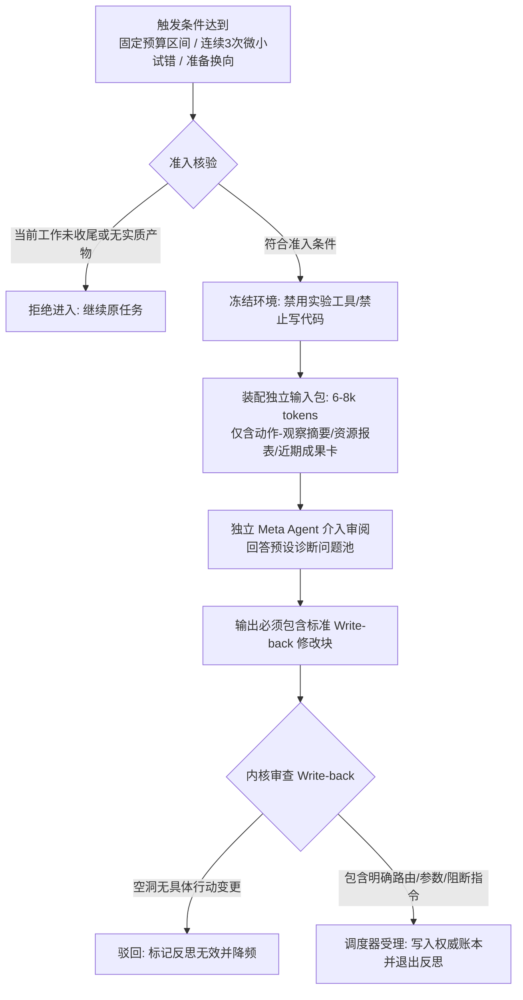

### 反思阶段核心问题池（精选自 Station 与实践沉淀）
1. **是否陷入吸引子陷阱（Attractor Trap）？** 节点是否在反复对某个次要参数进行微调，从而逃避对核心算法缺陷的直面审视？
2. **是否存在过度概括（Overgeneralization）？** 节点是否因为一次实验偶然失败，就轻率宣布整整一个方法族彻底不可行？
3. **评价标尺是否奖励了错误目标？** 当前指标的提升是否掩盖了代码对特定数据分布的严重过拟合？
4. **当前方向何时该坚持、何时该果断放弃？** 必须给出清晰的“判决性检验指标”，明确在何种反例出现时立刻终止本纲领。

## 29. Meta Patterns 跨代模式审查与错误闭环

吸收《Cogentic》（arXiv:2609.40324）中 Process Advisor 的精髓，V4 设立**跨节点、跨代际的 Meta Patterns 错误模式学习机制**：

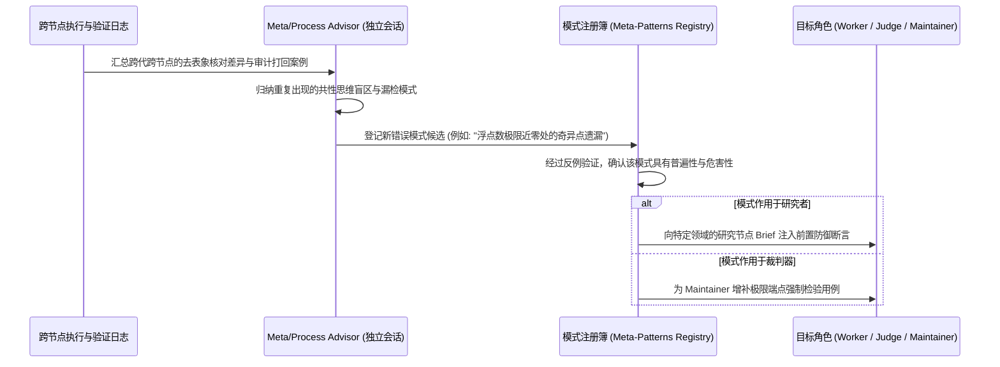

### 错误模式实战闭环案例
- **案例 A（代数推导链漏洞）**：单稿验证器常常对长达数十行的符号化简直接放行，导致隐藏符号错误。Meta Patterns 识别该现象后，自动生成规约规则：**强制要求长推导必须切分为长度不超过 5 步的中间引理，并强制调用 SymPy 进行局部符号等价性验证**。
- **案例 B（循环论证陷阱）**：研究节点在证明某猜想时，常常隐式使用了与该猜想等价的另一命题。Meta Patterns 沉淀该模式后，在评审协议中强制加入**“前提与结论等价性审计项”**，彻底终结掩耳盗铃。

---

# 第十篇：去表象评审与实质查新体系

## 30. 去表象规格提取与主张—证据对照表

彻底吸收并正本清源实战 V2 的去表象规格书机制。评审任何研究成果时，**严禁直接由大模型通读作者撰写的流畅报告后直接打分**，必须由独立的机制核对者先行提取**主张—证据对照表（Claim-Evidence Matrix）**：

```mermaid
flowchart LR
    REPORT[作者提交的华丽学术报告] --> EXTRACTOR[独立机制核对者<br/>(只读源码, Diff, 运行日志, 测量数据)]
    EXTRACTOR --> MATRIX[生成: 主张-证据对照表]
    MATRIX --> JUDGE[评审裁决器 Judge]
    REPORT -.->|作为叙述辅助| JUDGE
```

### 主张—证据对照表（Claim-Evidence Matrix）规范模板

| 编号 | 作者宣称的学术/算法主张 | 实际工程与代码实现机制 (去表象核验) | 原始数据与日志定位凭证 | 裁定结果与严苛缺口 (Verdict & Gaps) |
|---|---|---|---|---|
| C-01 | “引入了动态自适应自抗扰控制机制” | 代码中实际仅为一个简单的常数阈值 `if-else` 分支，未检测到任何状态观测器或动态扰动补偿 | `src/controller.py` L45-L52 | **【伪装概念】** 核心机制未实现，驳回其学术声称，仅按常数阈值评估基准表现 |
| C-02 | “相较于基线方案，整体运行能耗降低 45%” | 测量日志显示仅为单次运行时间缩短，未记录实际功率或计算吞吐；经复核该缩短来自于提前终止了精度计算 | `logs/benchmark_run.csv` 行 102-140 | **【代理指标污染】** 严禁用时间或牺牲精度的截断替代真实能耗，主张不成立 |
| C-03 | “在所有测试图类上算法收敛速度均优于 SOTA” | 实际仅在稀疏二分图上收敛加快；在完全图和稠密随机图上遭遇死循环并超时强杀 | `eval/stress_suite_results.json` | **【过度概括】** 限制其适用条件仅在“稀疏图”有效，全场景优越性主张被直接反驳 |

## 31. 实质科学查新协议（破除标题检索陷阱）

针对《Evaluating Sakana's AI Scientist》（arXiv:2502.14297）所揭示的“智能体用 superficial 关键词匹配轻率宣称所有想法均为全球首创”的致命漏洞，V4 确立**实质科学查新协议**：
1. **去表象概念展开**：查新检索严禁直接使用作者自创的华丽算法名称，必须根据去表象后提炼出的**底层数学不变量、输入输出结构、核心优化算子与具体约束条件**，生成跨领域、同义术语检索集。
2. **机制级最近邻对比**：查新输出必须明确列出至少 2~3 篇机制最接近的已有学术文献，并逐行对照列出：“已有工作的核心假设是什么”、“本次提出的改动实质差异在哪个算子”，严禁仅读摘要就妄下论断。
3. **查新结论的审慎分级**：系统只允许给出以下四种受控结论：
   - `KNOWN_METHOD`（已有完全相同的方法与证明）；
   - `NEW_CONDITIONS`（已有经典方法在全新极端约束条件下的应用）；
   - `GENUINE_NOVELTY_WITHIN_SCOPE`（在检索声明的已知范围内具备实质机制差异）；
   - `INSUFFICIENT_RETRIEVAL`（检索受限，暂无法下定论，严禁宣称首创）。

## 32. Reviewer 问责机制与防误杀校准

1. **拒稿必须伴随可检验的反例证据**：评审器严禁给出诸如“实验不够充分”、“理论不够优雅”等空泛模棱两可的套话。**任何重大负面评审意见，必须精准指向某条 Claim ID，并提供可执行的代码反例、逻辑断裂行号或数学反驳**。
2. **已知基线双向校准**：维护者定期向评判池中掺入“已知存在隐藏错误的方案”与“已知完全正确但写作朴实无华的方案”，以此对 Reviewer 进行灵敏度与特异度盲测校准。凡无法识别明显数学漏洞、或对正确方案产生严重误杀的 Reviewer 会话，直接注销重置。

---

# 第十一篇：人机协作治理与验证经济学

## 33. 五大人机治理对象语义与数据模型

为确保人类在长程系统中既能发挥战略监督作用，又不会被海量琐碎信息彻底淹没，V4 在顶层治理中确立五大核心治理对象：

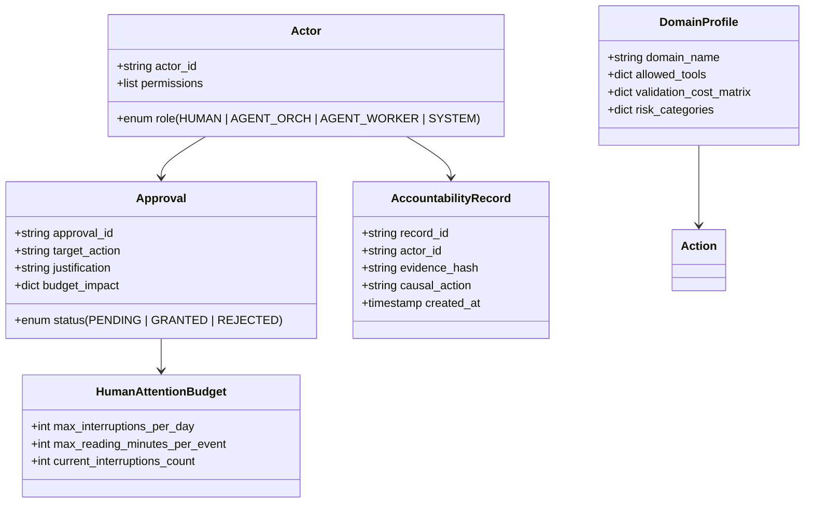

## 34. 分级授权与人类注意力预算信封

系统对所有研究行为执行严密的分级授权管理，严格受控于人类注意力预算（HumanAttentionBudget）：

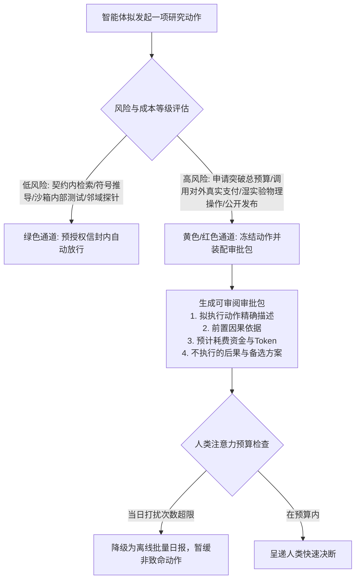

### 沉默原则（Principle of Silence）
人类的沉默绝不默认等于批准！若高风险动作在设定时限内未获得人类显式签名授权，系统自动挂起该动作，自主转向其他已获授权的研究路径，严禁假借超时之名擅自放行。

## 35. 四大验证经济学领域适配

长城 Agent V4 明确承认不同科研领域存在截然不同的**验证经济学边界**，严禁将干实验的调度模式盲目套用到物理实验中：

| 领域类型 | 证据获取主要成本与延迟 | 对长城 Agent 架构的核心影响与特化设计 |
|---|---|---|
| **算法与干计算实验** | 计算机 CPU/GPU 计算时间；反馈速度通常秒级到小时级 | 充分并发；多路线小探针并行试错；依靠 Frozen 锚点同版重测；Theory 与 Empirical 深度并行 |
| **数学与形式化证明** | 符号系统与定理证明器（Lean）搜索极度昂贵，但证明核验极其廉价（秒级） | 推行自然语言直觉与形式化命题严格对齐；长推导切片化；重点防范循环论证与等价命题代换 |
| **数据科学与数模竞赛** | 数据切分混杂、过拟合风险极高；评估需要平衡精度、复杂度与解释力 | 强制划分 Train/Dev/Holdout，严防测试集穿越；因果解释必须伴随机制消融，禁止仅凭相关性断言 |
| **湿实验与实物化学/生物** | 试剂消耗极高、机器排期长、周期以天计、存在不可逆物理安全风险 | **自主探索与物理执行彻底剥离**；仅允许生成高度收敛的实验协议设计批次；物理执行必须人类显式介入签名 |

---

# 第十二篇：系统交付信封、评估假说与演进路线

## 36. 五件套统一交付信封规范

无论处于竞赛模式还是长程科研模式，长城 Agent V4 最终向用户交付的产物统一封装在自包含的规范信封内：

```text
deliverable/
├── solution/                       # 最终工程解: 可执行源码、依赖锁、二进制、模型权重映射
├── report.md                       # 核心研究报告: 独立可读的科学/竞赛论文 (含方法、论证、限制)
├── evidence/                       # 证据全集: 完整度量指标图谱、原始运行日志、去表象核查单
├── reproduce/                      # 绝对可复现套件: 一键执行脚本 (reproduce.sh)、Docker环境镜像清单
└── scores.json                     # 终审度量矩阵: Frozen基准分、Live对抗分、Pareto质量多维向量
```

### 交付终局的三种状态显式标注
1. **TASK_COMPLETED（圆满完成）**：严格达成了 TaskContract 中定义的所有验收指标，并通过了 Auditor 审计。
2. **BUDGET_EXHAUSTED（预算耗尽交付）**：在额定资源信封耗尽前未达成终极指标，但系统交付当前探索出的最佳有效解、失败边界与完整反例库。
3. **CRITICAL_BLOCKED（关键阻塞终结）**：发现了任务本身存在不可调和的逻辑矛盾，或所有主流路线均撞上未证的定理级天花板，系统如实交付阻塞证明。

## 37. 三大核心科研假说（H1/H2/H3）与消融设计

长城 Agent V4 的架构不仅用于解决具体工程任务，其自身的设计原则构成了一套严谨的科学探索命题：

| 假说编号 | 待证核心科学设计主张 | 严苛证伪边界（出现何种情况说明假说不成立） | 架构消融对比组设计 |
|---|---|---|---|
| **H1：条件化成果继承假说** | 在相同总算力成本下，对非冠军成果进行条件化核验、反例提取与组合，比“只跟随全局最佳方案优化”能够催生更多有效突破。 | 如果由于维护证据账本和跨族组合的协调开销过大，导致其最终成果反而低于单纯暴力迭代冠军路线的基线；或错误的负结果导致了无益的广泛停滞。 | **消融组 A**：完全移除 Ledger 机制，采用纯贪心算法，每一代只将当前综合得分最高的单一点位作为父节点进行变异。 |
| **H2：选择性上下文注入假说** | 按阶段实行共享事实、延迟注入父辈偏见与路线审美的选择性注入，能够显著提升分支多样性并遏制认知坍塌。 | 如果即使严格隔离了父辈偏见，同模型智能体在独立小环境依然因基础权重共性自发陷入同质化搜索，且隔离增加了重复尝试的计算浪费。 | **消融组 B**：完全开放所有上下文，所有节点随时无损阅读系统内所有历史讨论与冠军自辩全量日志。 |
| **H3：有行为写回的元反思假说** | 强制执行包含物理 Write-back 指令的独立元反思，比无反思或仅有自然语言总结的漫谈，能显著提高有效换向率并打破局部最优。 | 如果元反思阶段的介入仅仅打断了正常计算流程，增加了 Token 损耗，但在后续行动中并没有带来实质性的搜索路径拓宽或策略改变。 | **消融组 C**：移除有闭环写回的 Meta Agent，退化为仅定期生成纯文本总结但不修改任何系统参数与路由的被动日志。 |

## 38. V4.0 ~ V4.3 能力门分阶段演化矩阵

长城 Agent 坚持按**客观能力门槛（Capability Gates）**稳步推进，坚决反对不切实际的空想大跃进：

```mermaid
gantt
    title 长城 Agent V4 能力门阶段演进路线
    dateFormat  YYYY-MM
    section V4.0 可验证竞赛与算法系统
    确定性任务契约与去表象机制           :active, 2026-11, 2026-12
    三器官分权与Git Worktree单模型闭环    :active, 2026-11, 2027-01
    Fork-and-Flush与红黑皇后对抗        :active, 2026-12, 2027-01
    section V4.1 开放科学纲领系统
    自主提出开放性科学问题与多流派竞争    :2027-02, 2027-04
    Theory 循环长期互馈与再发现协议     :2027-03, 2027-05
    section V4.2 跨纲领知识沉淀
    多纲领长期知识库与依赖撤回广播       :2027-05, 2027-07
    Meta-Patterns 跨代错误模式自适应修复 :2027-06, 2027-08
    section V4.3 物理世界与实物设施接入
    外部受限执行设施与湿实验协议接入     :2027-09, 2027-12
```

- **V4.0（可验证竞赛与算法系统，当前核心承诺）**：落地于算法竞赛、数学建模、确定性求解任务。全面打通任务契约、Git Worktree 隔离、单模型多角色分化、Fork-and-Flush 算子、子 Agent 独立提问、红黑皇后评测演化及五件套标准交付。
- **V4.1（开放科学纲领系统）**：放开在授权领域内的自主开题与立论权限。Theory 循环与 Empirical 循环实现长期深水区互馈，具备应对非标量开放科学评价的能力。
- **V4.2（跨纲领知识沉淀与自修正网络）**：建立多项目、多任务共享的长期元知识库，实现跨项目经验迁移与深层错误模式（Meta Patterns）的自动识别与自愈。
- **V4.3（物理世界设施接入）**：接入外部复杂实物实验接口与硬件设施，实现严谨分级授权下的人机混合科学探索大闭环。

## 39. 十四大失败模式与纵深防御矩阵

| 编号 | 经典失败模式 (Failure Mode) | 真实破坏机理与隐蔽信号 | 长城 Agent V4 纵深防御与阻断技术 |
|---|---|---|---|
| 01 | **测量装置污染与泄漏** | 求解节点逆向利用了测试器的隐藏变量或漏洞，分数暴涨但真实泛化为零 | 严格隔离评测目录；Auditor 专职审查输入输出泄漏；Frozen 严格实施访问控制 |
| 02 | **评审同源共识与偏见** | 单模型由于相同知识权重，在评审中共同对某种隐藏逻辑漏洞视而不见 | 盲作者、盲自夸；强制执行去表象规格提取；引入确定性符号/断言工具互验 |
| 03 | **Live 移动球门与混排** | Maintainer 更新了更难的测试用例，系统拿新分数与旧分数直接比大小 | 同版重测铁律（Same-Version Retest Rule）；分数必须与 `eval-version` 严格绑定 |
| 04 | **Frozen 测试集过拟合** | 节点反复探测 Frozen 返回值，将其作为隐式梯度进行超参数过拟合 | 严格限制对 Frozen 的调用频次与预算；常规迭代依靠 Live，终审方可触发 Frozen |
| 05 | **知识档案馆信息爆炸** | 节点为了凑数量狂写无用论文，检索开销超过有用价值，造成严重的上下文污染 | 建立细粒度 Claim 准入机制；普通日志沉淀为 Record；只有高质量经核验成果方可入 Archive |
| 06 | **私有笔记固化错误** | 已被反驳撤回的旧结论，以“个人品味”名义在私有 Lineage 中隐蔽传播 | 继承与发芽时强制核验依赖图谱；撤回事件全网广播，污染节点强制复算 |
| 07 | **元反思沦为系统逃避** | 智能体在面对深水区工程难题时，频繁进入元反思以伪造思考动作 | 反思阶段实施严格限时限 Token；强制交付 Write-back 块；连续无行为改变强制降频 |
| 08 | **总控过早收敛与贪婪** | 少数上手快的平凡路线过早吃满全部算力，杀死了具备大潜力的前沿路线 | 设立受保护的初级探索者独立小环境；预留专属承诺额度，慢节点在途中严禁强杀 |
| 09 | **调度 Agent 职能越界** | 调度器在组装 Brief 时私自添加了个人审美偏向，悄悄改变了原定研究问题 | 实施输入输出严格 Schema 校验；Brief 的改动必须带有显式溯源标注，违规自动报错 |
| 10 | **长上下文腐坏与失真** | 随着多轮聊天滚动，原任务的硬性数学假设被模型在摘要中悄悄“吃掉” | 建立 TaskContract 物理防火墙，不可变只读挂载；关键约束以不变锚点逐轮重新注入 |
| 11 | **探索信用套利黑客** | 节点通过微小重命名、反复提交已知负结果骗取系统的探索预算 | 严格核查产物的新颖性与工具可用性；探索信用必须绑定明确的后续检验目标 |
| 12 | **理论研究空洞装饰化** | 节点撰写宏大数学公式，但没有任何一项能够产生经验性区分预测 | Theory 循环必须满足“发现桥接要求”，产出必须包含可反驳预测或收缩经验搜索空间 |
| 13 | **计算资源失控雪崩** | 盲目并发、频繁重试或红队过度攻击瞬间耗尽用户物理账户所有配额 | 确定性内核实施严格预留与扣减机制（Reserve-and-Commit）；超额请求硬件级抛出异常 |
| 14 | **人类注意力彻底透支** | 智能体事无巨细向人类汇报打扰，导致人类最终直接点击全部同意失去监管 | 实施分级授权与人类注意力信封（HumanAttentionBudget）；低风险操作预授权全自动放行 |

---

# 附录：核心术语中英权威对照表

| 中文术语 | 英文权威对应 | 系统内严格语义界定 |
|---|---|---|
| **研究纲领** | **Research Program** | 跨越 Agent 个体与代际的长期研究实体，承载核心问题、假说组合与预算承诺 |
| **任务契约** | **TaskContract** | 固化外部题面、硬性约束与验收标准的只读权威规范，严禁模型自行篡改 |
| **去表象规格书** | **De-superficialized Spec** | 剥离作者所有自夸与修辞后，直接映射到源码、执行轨迹与度量上的真实机制核验单 |
| **主张—证据对照表** | **Claim-Evidence Matrix** | 针对每一个细粒度学术主张与其背后原始经验数据对应关系的判定矩阵 |
| **红黑皇后对抗** | **Red-Black Queen Co-evolution** | 求解方案（研究节点）与评测手段（RedTeam/Maintainer）双向促进共同演化的闭环机制 |
| **定理级阻塞** | **Theorem-strength Gap** | 阻碍路线继续推进的深水区本质障碍，必须依靠新不变量或新理论方可重开 |
| **工作空间清栈** | **Fork-and-Flush** | 保留物理代码与产物工作区 $W$，彻底清空对话上下文 $C \to \emptyset$，消除路径依赖的重开算子 |
| **初级探索者席位** | **Unbound Junior Seat** | 处于扁平拓扑、无权威压迫、使用极薄 Brief 与高多样性设置的受保护探索机制 |
| **跨代错误模式** | **Meta Patterns** | 由 Process Advisor 跨代际、跨节点归纳提取的系统性共性逻辑漏洞与防御规则 |
| **发现桥接要求** | **Discovery Bridging** | 阶段性成果流入下一循环前，必须明确阐述其为后续打开了何种新问题或新工具的硬约束 |
| **冻结/活体测试集** | **Frozen / Live Suite** | 用于跨代纵向比较的绝对不变基准（Frozen）与持续动态增补反例的压力测试套件（Live） |

---
*全编整合完毕。本文档为长城 Agent V4 系统的唯一全局技术规范权威基准。*
