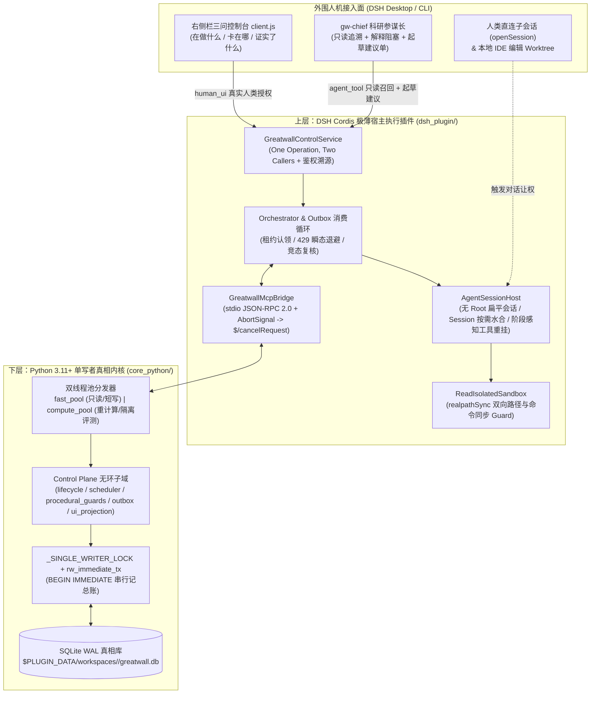
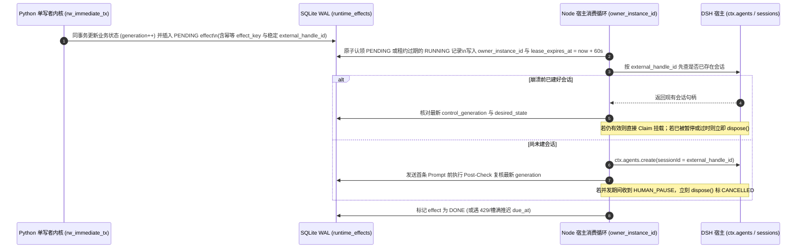
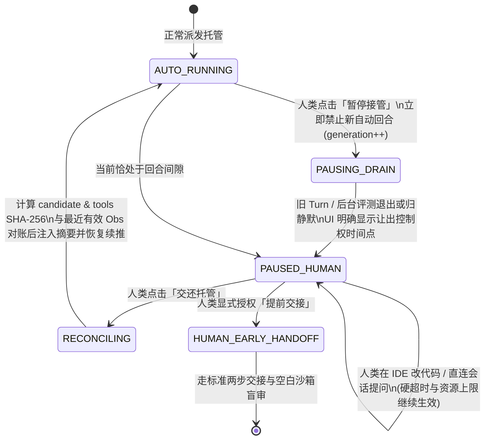

# GreatWall Agent 设施工程架构论文（Infrastructure Engineering）

> **系统版本**：GreatWall Agent `v0.3` 终态架构定稿  
> **文档性质**：零前提、自包含子系统架构论文（Architecture Paper）。任何未接触过历史讨论的架构师或工程师，仅凭本文即可完整理解设施工程的目标形态、核心模块拆解、运行状态机、全院角色沙箱权限矩阵、精确数据与接口契约、学术溯源及验收标准。

---

## 摘要（Abstract）

长周期自主科研多智能体系统面临五类经典的系统级失效：**共享状态并发撕裂**、**宿主进程崩溃后的孤儿会话与重复派发**、**常驻内存会话的句柄泄漏与重启失忆**、**安全隔离与科研执行便利的两难**，以及**无人值守与人工深度介入的冲突**。GreatWall Agent 的**设施工程（Infrastructure Engineering）**是承载仪器科学、后勤探索与图书馆三大业务部门的确定性底座。本文完整定义了设施工程的终态架构：采用**“上层 DSH Cordis 极薄宿主执行层 × 下层 Python 并发计算与 SQLite 单写者真相内核”**双层分离架构；在逻辑上严格拆分**科学判定层、设施调度层与权限授权层**；依托 DSH 原生持久化 **Session Event Log** 实现确定性 `sessionId` 的**按需水合唤醒（On-Demand Hydration）与阶段感知工具重挂**；以带租约与稳定外部标识的 **Transactional Outbox（`runtime_effects`）** 消除数据库与宿主会话的崩溃撕裂；以**“立即止血 $\to$ 透明收尾 $\to$ 工件哈希对账 $\to$ 交还或授权提前交接”**状态机实现可验证的人机协同；并通过**双向隔离沙箱**与**物理分权 Preset 矩阵**在安全边界与科研效率间建立确定性平衡。

---

## 1. 第一性问题定义与设计哲学

### 1.1 设施工程解决什么问题，不解决什么问题
设施工程是全院的**操作系统与水电煤底座**。它遵循钱学森《工程控制论》的边界克制原则与 `Cogentic` 的 **`No Mathematical Opinion`** 铁律：
- **它负责**：进程与会话生命周期托管、基于 DSH Session Log 的按需水合与归档、模型绑定与上下文窗口计量、SQLite 单写者强一致事务、崩溃后的幂等恢复、双向目录与命令安全沙箱、以及人类与系统之间的鉴权控制面。
- **它绝不负责**：任何具体科学假说的优劣判断、数学推导或学科指标硬编码。

### 1.2 三层正交职责分离（核心架构律）
设施工程强制把三个不同层级的问题解耦到独立状态机与独立真相源中，杜绝状态混杂：

| 逻辑层级 | 回答的根本问题 | 唯一裁判者 | 持久化真相源 |
| :--- | :--- | :--- | :--- |
| **层 1 · 科学判定层** | 某项科学结果是否可信？某子题是否已解出？ | 图书馆盲审官 + 仪器插件 | `observations`、`review_queue`、`internal_research_ledger` |
| **层 2 · 设施调度层** | 机器此刻还该不该给该子题或节点派工？ | Python 单写者内核 + Node 执行器 | `subproblem_runtime_state`、`lineage_nodes`、`runtime_effects` |
| **层 3 · 权限决策层** | 谁有权改变题面、接管现场、提前交接或批准交付？ | `GreatwallControlService` 鉴权控制面 | `node_interventions`、`control_proposals`、`project_closure_state` |

---

## 2. 系统全貌与核心子系统拆解

### 2.1 双层物理拓扑图

### 2.2 核心子模块拆解与源码映射

| 子系统 | 物理模块路径 | 核心职责与硬边界 |
| :--- | :--- | :--- |
| **插件装配与配置** | `dsh_plugin/lib/index.js`、`config.js`、`presets.js`、`skillpack.js` | Cordis 4.1.0 入口；导出零依赖 Standard Schema v1 `Config`；从单源 `cordis.patch.yml` 派生角色 Preset；插件卸载经 `ctx.effect` 返回异步 Promise 全量回收子会话与 Python 子进程 |
| **统一控制面与鉴权** | `dsh_plugin/lib/control_service.js`、`orchestrate_tool.js`、`console_routes.js` | 收口 `agent_tool` 与 `human_ui` 双入口；按工作区串行互斥锁防并发 `init/start` 竞态；区分 A 级只读/起草动作与 B 级必须绑定真实人类授权的高危动作 |
| **会话宿主与按需水合** | `dsh_plugin/lib/agent_session_host.js`、`host/model_binding.js`、`host/capability_mount.js`、`bridge/dsh_schema_adapter.js` | 直接调用 `ctx.agents.create()` 拉起平级独立会话；依托 DSH 磁盘持久化 Session Log 实现确定性 `sessionId` 的**按需水合（`resolveAgent`）**与 `agent/created` 阶段感知工具重挂；按四级优先级解析权威模型绑定（缺失即拒启 `MISSING_MODEL_BINDING`）；RC5 严格 Schema 子集无损适配（Fail-Closed）；先 `dispose()` 再原生 `archiveSession()` |
| **双向隔离沙箱** | `dsh_plugin/lib/read_isolated_sandbox.js` | 外部公开输入（`inputs/`、`rulings/`）只读入内；严防内部逃逸至工作区外 `$PLUGIN_DATA` 数据库、隐藏校准集与他脉 Worktree；基于 `realpathSync()` 校验路径，拦截过程性 `.md` 公文，支持动态 `isReadonly()` 瞬时锁写 |
| **JSON-RPC 桥与双池内核** | `dsh_plugin/lib/mcp_bridge.js`、`core_python/mcp_server/greatwall_core_mcp.py`、`db_runtime.py` | Node $\leftrightarrow$ Python `stdio JSON-RPC 2.0`；`fast_pool` 与 `compute_pool` 双池防队头阻塞；`AbortSignal` 透传 `$/cancelRequest` 强杀隔离评测子进程树并在写锁内二次复核防幽灵落库 |
| **真相库与流程守卫** | `core_python/mcp_server/db_schema.py`、`control_plane/` | 承载核心表、FTS5 索引与数据库硬件级触发器；集中执行机械流程合规检查、Outbox 排单、子题收敛状态结算与单待办熔断（`GovernanceItemCircuitBreaker`） |

### 2.3 全院角色 Preset 与物理权限隔离矩阵

依托 DSH `cordis.patch.yml` 单源声明，所有角色按最小权限原则物理裁剪原生工具与网络能力：

| 归属工程 | 角色契约 | 会话生命周期模式 | 原生工具（`win32->pwsh`, 非 `win32->bash`） | 外网权限 | 物理沙箱与读写边界 |
| :--- | :--- | :--- | :--- | :---: | :--- |
| **设施工程** | `gw-chief`（参谋长） | 持久只读/起草会话 | `[]`（0 原生读写/Shell） | ❌ | 仅只读召回全院状态/转录与起草 `control_proposals` |
| **仪器科学** | `works_engineer` | 按工单一次性短会话 | `read/write/edit/read_image/glob/grep`, Shell | ❌ | 锁定 `evaluators/`、`skills/` 与公开输入区；禁触分支 Worktree |
| **后勤工程** | `explorer` | 单节点一次性会话 | `read/write/edit/read_image/glob/grep`, Shell | ❌ | 写权锁死本分支 Worktree；只读 `inputs/` 与次供体 `.greatwall_donors/`；`70%` 瞬时锁只读 |
| **后勤工程** | `lineage_companion` | **单节点确定性 `gw-comp-<node_id>` 按需水合**（`0/37/70%/圆桌` 复用后归档，绝不跨代） | `read/glob/grep` | ❌ | 单向只读配对 Worktree；`0%` 起全馆只读 Pull；`70%` 封存后重挂卸掉看板写工具、切圆桌发言工具 |
| **后勤/治理** | `logistics_coordinator` *(渐进精简)* | 事件驱动无状态短会话 | `[]`（0 原生工具） | ❌ | 纯 SQLite 科学分诊与族谱语义归类（纯机械校验已下沉控制面） |
| **图书馆** | `external_surveyor`（对外采编） | 按查新单一次性短会话 | `read/read_image/glob/grep`, `web_search`, `web_fetch` | ✅ **唯一** | **物理不可读内藏 `L3/L2` 与在研分支草稿**，彻底断绝搜索词泄密 |
| **图书馆** | `library_verifier`（盲审与圆桌裁定） | 按审稿/圆桌单一次性短会话 | `read/glob/grep`, **Shell** | ❌ | 每次现建空白沙箱 `blind_sandbox_<id>/`（0 写权）；审毕即删 |
| **图书馆** | `library_chronicler`（对内综述与终稿） | 按更新/结项一次性短会话 | `[]`（纯只读内藏视图 + 受控导出） | ❌ | **绝对零外网、零代码执行**，仅基于已验真 `L3/L2` 写活体综述与终稿 |

---

## 3. 端到端核心运行流程与状态机

### 3.1 DSH 原生 Session 按需水合机制（终结内存挂起难题）

在 DSH 运行时中，会话日志（Session Event Log）是磁盘持久化唯一真源，`handle.dispose()` 仅释放运行期内存占用而不丢失任何历史对话。设施工程据此对 `lineage_companion` 实施**确定性 ID 按需水合**：
1. 节点创建时即绑定确定性 `companion_session_id = "gw-comp-" + node_id`；
2. **`0%` 写完看板** $\to$ 立即 `dispose()` 释放内存（零闲置开销，宿主重启无损）；
3. **`37%` 元反思 / `70%` 交接 / 波次圆桌开会** $\to$ 通过 `resolveAgent(companion_session_id)` 毫秒级从磁盘 Session Log 原样恢复完整记忆，`agent/created` 钩子根据数据库实时 `node_status` 与 `briefing_sealed_at` **动态重挂该阶段唯一合法的窄工具集**（例如封存后自动卸载 `save_lineage_briefing / submit_node_handoff`，物理禁止参会后反向修改本脉传承包）；
4. 圆桌结束（或本节点无需参会直接结案）后，严格按 **`await handle.dispose()` $\to$ `await workspaceRegistry.archiveSession(sid)`** 归档封存。

### 3.2 Transactional Outbox（`runtime_effects`）崩溃恢复与竞态收敛流程

所有跨数据库与 DSH 宿主的副作用（启停会话、发排空停止令、唤醒阻塞分支）均禁止在异步 JS 中直接裸调，必须严格走事务后 Outbox 协议：

**竞态收敛铁律（`HUMAN_PAUSE` 与在途 `SPAWN_PAIR` 同时到达）**：暂停事务同写锁递增 `control_generation` 并将旧代 `PENDING` 副作用置 `CANCELLED`；已在途 `RUNNING` 的 `SPAWN_PAIR` 发首条 Prompt 前必做 Post-Check，发现过时立即销毁。无论消息到达顺序或中途断电，系统最终唯一收敛为 **`PAUSED_HUMAN`、零偷跑会话、零泄漏槽位**。

### 3.3 运行中节点「人工接管 $\to$ 改码对话 $\to$ 交还托管」状态机

在不破坏业务状态列 `lineage_nodes.node_status` 的前提下，设施工程维护正交托管控制态 `control_state`：

**三项核心运行语义**：
1. **接管可见性**：暂停后 `<500ms` 禁止新自动回合；若当前存在在途 Turn 或 `async_eval_jobs`，界面必须明确展示旧任务收尾倒计时，直至归静默切入 `PAUSED_HUMAN`；
2. **工件版本哈希对账**：恢复托管或交接前，实时计算磁盘 `candidate_rel_path` 与 `tools/` 的 SHA-256，与最近有效 `observations` 绑定哈希比对——哈希一致零重跑；哈希已变则永久保留旧 `[Obs###]` 证明旧版本，置 `artifact_dirty_since_last_obs = 1` 并强制重测后方可继承或声称改进；跨分支人工思路注入记录于 `node_interventions(cross_branch_note)` 并标 `human_modified = 1`；
3. **对话让权 $\neq$ 操作授权**：检测到人类直连子会话发言仅触发对话让权（挂起自动续推与超时驱逐）；改题、关停、提前交接与部分交付必须由控制面校验真实人类授权（`human_ui` 或人类确认的 `control_proposals`）。

### 3.4 瞬态故障退避与单待办熔断
- **408 / 429 / 5xx 瞬态退避**：基于 DSH `turn/end` 错误码识别网关限流或网络闪断，在原会话内按 `15s -> 30s -> 60s`（上限 3 次）指数退避续推，绝不误杀进 `<70% CRASH_RECOVERY`；
- **单待办熔断（`GovernanceItemCircuitBreaker`）**：按单条 `ticket_id / req_id / node_id` 独立追踪客观进展，同一待办连续 2 次无客观进展即单条挂起告警，不连坐健康项。

---

## 4. 核心数据与接口契约

### 4.1 设施层核心 SQLite 表与契约
数据库隔离于工作区外 `$PLUGIN_DATA/workspaces/<ws_hash>/greatwall.db`（`WAL + foreign_keys=ON`）：
- **既有核心表**：`parse0_contract(contract_id)`、`compliance_alerts(alert_id)`、`saved_graph_queries(query_name)`、`project_closure_state(id)`（含 `frozen_delivery_dir_abs_path`）。
- **设施新增核心表**：
  1. `runtime_effects(seq, effect_key UNIQUE, kind, target_type, target_id, target_generation, external_handle_id, payload_json, status, owner_instance_id, claimed_at, lease_expires_at, superseded_by_seq, attempts, due_at, last_error, created_at, updated_at, completed_at)`；
  2. `node_interventions(intervention_id, node_id -> lineage_nodes, question_id, action, actor_source, prev_candidate_sha256, curr_candidate_sha256, prev_tools_sha256, curr_tools_sha256, artifact_dirty, cross_branch_note, details_json, created_at)`；
  3. `control_proposals(proposal_id, proposed_by, action_type, target_id, payload_json, rationale_md, status, approved_by_source, created_at, resolved_at)`。

### 4.2 DSH `0.2.2-rc.5` 宿主适配边界契约
- **已实测强依赖原语**：`ctx.agents.create()`、`agentPresets.mount()`、`handle.dispose()`、`archiveSession()`、`tokenMeter`、`sessionProjections`、`sessionQuery`、`uiWorkspace.openSession`、`agent/created` 冷恢复重挂。
- **须在 RC5 Desktop 先行 PoC 验证的可降级原语**：`ctx.jobs`（不可用则降级为跟踪活跃 Turn + `async_eval_jobs`）、自定义 `message.source.kind`（宿主若强锁 `'user'` 则降级为已发 `messageId` 白名单反推人类发言）、`agent-preset/selected` 持久预设锁。

---

## 5. 参考文献与工程溯源

| 文献 / 开源项目 | 原作解决的核心问题 | 设施工程吸收的机制与工程改造 |
| :--- | :--- | :--- |
| **钱学森《工程控制论》**(1954) | 复杂耦合系统如何在不确定性下保持整体稳定 | 确立确定性控制面与模型自主权的正交边界，避免过度耦合 |
| **Stateless Language Agents (SLA)** (`arXiv:2610.07625`) | 长程常驻会话退化与状态漂移 | 确立“有状态搜索（SQLite + Worktree）× 无状态会话”底座 |
| **MAS Should Prioritize Concurrency Control** (`arXiv:2608.18092`, ICML 2026) | 多智能体规模化失败源于共享状态并发写冲突 | SQLite WAL `BEGIN IMMEDIATE` 单写者大闸、代数版本号与版本哈希绑定 |
| **Anthropic: Multi-Agent Research System** (2025) | 多智能体上下文污染、传话失真与断点恢复 | 外部 SQLite/文件快照解耦与 Outbox 断点恢复 |
| **DeepSeek Harness (`DSH`) & `dsh-superagent-prototype`** | Cordis 插件化运行时、Session Event Log 持久化、Outbox 与人机授权解耦 | 吸收确定性 `sessionId` 按需水合、同步状态内核 + `runtime_effects` 租约 Outbox、对话让权与操作授权分离、以及瞬态 429 退避 |
| **Arbor** (`arXiv:2606.11926`) | 长程探索工作区污染与分支隔离 | 每分支独立 Git Worktree 物理隔离与双向路径 Guard |
| **Model Context Protocol (`MCP`)** | 跨语言工具与数据源标准通信 | Node 宿主与 Python 内核 `stdio JSON-RPC 2.0` 桥接与 `$/cancelRequest` 真取消 |

---

## 6. 渐进实施边界与可观测验收标准

- **M1（首批主线）**：交付 `runtime_effects` 租约恢复、节点 `45%` 接管/改码哈希对账/重启恢复/交还托管、确定性伴随 Session 按需水合与旧库平滑迁移；
- **M2（独立增强）**：交付右侧栏「三问」控制台与首版 `gw-chief`（只读追溯 + 解释阻塞 + 起草 `control_proposals` 建议单）。
- **核心验收矩阵**：
  1. **暂停与竞态**：点击暂停 `<500ms` 禁新回合；模拟暂停与 `SPAWN_PAIR` 并发到达，最终仅留 `PAUSED_HUMAN` 且零槽位泄漏；
  2. **改码对账与重启**：`45%` 暂停后 IDE 改码并强杀重启宿主 $\to$ 恢复后准确报告旧 `Obs` 绑定旧哈希、当前工件 `artifact_dirty=1`、旧任务占槽态清晰，交还后仅重测受影响工件；
  3. **伴随 Session 水合**：`0%` 写完看板即 `dispose()` $\to$ 重启宿主 $\to$ `37%` 按 `gw-comp-<node_id>` 唤醒仍完整保留 `0%` 上下文且重挂正确工具集。
