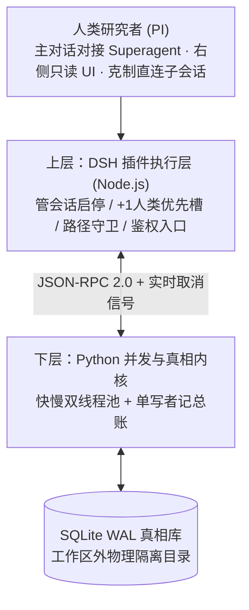
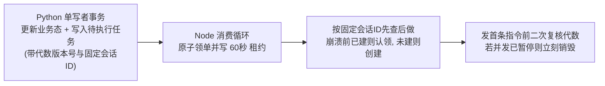
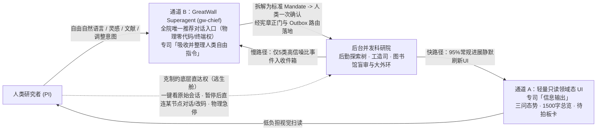
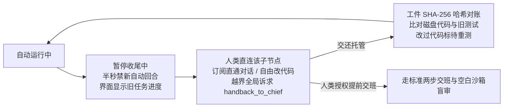

# GreatWall Agent 设施工程架构论文（Infrastructure Engineering）

> **系统版本**：GreatWall Agent `v0.3` 顶层架构定稿  
> **阅读指南**：本文全面介绍 GreatWall Agent 的**设施工程**——它既是承载仪器科学、后勤探索与图书馆三大业务部门的确定性系统底座，也是将人类研究者与高并发 AI 科研院无缝衔接的**人机总控交互底座**。全文严守项目三大根本原则（第一性原理、钱学森《工程控制论》系统边界律、清晰自然语言表达原则），由真实病灶层层展开；精确的数据库表结构、控制面接口与文献出处统一收拢在文末第 7 章，供工程实现与审计查阅。

---

## 1. 设施工程到底要解决什么问题？

当你把多组大模型放到一台电脑上，让它们连续十几个小时并行写代码、跑实验、互相审稿，同时又希望人类首席科学家（PI）能够轻松掌控全局、随时注入科研灵感或暂停插手时，系统会集中撞上六类纯基础设施层面的致命问题——这些问题与具体学科无关，却足以让整套科研系统瘫痪或让人类精疲力竭：

1. **数据库状态与实际运行的会话发生撕裂**：如果编排程序一边修改数据库，一边异步去创建或关闭 AI 会话，只要中途网络抖动、代码抛异常或桌面软件突然重启，就会出现“数据库里明明记着已经暂停，但后台会话仍在偷偷跑并烧钱”或者“会话已经被强杀了，数据库里还一直占着并发名额”的混乱状态。
2. **长期挂在内存里的会话句柄极易丢失，重启即失忆**：如果为了保持某个辅助角色的上下文连贯而一直把它挂在内存里等慢任务，不仅浪费资源，一旦进程重启，内存里的会话句柄瞬间清空，整个流程就会卡死。
3. **安全隔离与科研执行便利的两难**：如果不做目录和命令限制，探索者很容易跨目录偷看隐藏测试集、修改评测脚本或往工作区写满无用的过程文档；可如果为了安全一刀切禁用终端和文件工具，连跑实验脚本和独立验算都没法干。
4. **人类注意力是整个多并发系统的唯一稀缺瓶颈**：DeepSeek Harness 团队在 Super-agent 的实战研究中点破了一个反直觉的事实——当单模型能力足够强之后，**限制多任务 AI 团队生产力的瓶颈早已不是模型智商，而是人类注意力**（人类同时最多有效跟进 3 到 5 个活跃窗口）。如果系统把 6 条探索分支、4 个图书馆角色、工造司和一堆审批表单直接摊在人类面前，逼着人类亲自当“多并发调度员”，跑半小时人类就会被信息噪音拖垮。
5. **人类中途直接介入节点时，系统不知道该怎么让权、也不知道怎么收场**：在保留单一总控对接人的同时，人类依然有权在必要时亲自下场查看某条具体分支的对话或直接修改代码。如果在 45% 暂停改完代码后没有严谨的让权、工件指纹对账与权限退回协议，要么编排器在旁边不断插话抢麦，要么恢复后把旧代码跑出来的成绩张冠李戴算到新代码头上。
6. **慢计算阻塞控制指令，网络限流被误杀为崩溃**：当某台仪器跑一次仿真耗时 60 秒时，单线程服务会被彻底堵死，导致暂停指令和状态查询全部超时；而多并发下常见的 API 限流（429）如果直接被当成节点崩溃收尸，会把刚跑了一小半的健康探索白白冤杀。

**设施工程就是整座科研系统的操作系统、水电煤底座与人机总控网关。** 按照钱学森《工程控制论》的系统边界律，它严守一条铁边界：**只管运行稳定性、并发一致性、安全隔离、注意力保护与人机控制权路由，绝不越权掺和任何具体科学结论的判断。**

---

## 2. 整体结构：两层物理分离与三层逻辑边界

### 2.1 两层物理架构：为什么把“宿主执行”和“记总账内核”彻底分开？

GreatWall 在物理上分为上下两层，中间通过标准 `stdio JSON-RPC 2.0` 管道通信：

- **上层（DSH Cordis 插件，Node.js）尽量做薄**：只负责与 DeepSeek Harness（DSH）宿主对接——创建和释放平级独立会话、维护并发槽位（含人类优先保留槽）、挂接模型配置、在文件读写和终端命令执行前做同步安全拦截，以及向桌面端提供鉴权 HTTP 接口与轻量只读 UI 面板。
- **下层（Python 单写者内核）掌握唯一真相**：负责所有业务规则校验、SQLite 数据库读写以及跨进程隔离评测。为了彻底消除“慢计算卡死快控制”的队头阻塞，Python 内核内部拆成**两条独立的线程池**：
  - **快池（`fast_pool`）**：处理只读查询、上下文水位同步、暂停/恢复、提案落签等毫秒级控制操作；
  - **计算池（`compute_pool`）**：专门跑耗时几十秒的隔离评测、校准回归与终稿打包。同时，一旦上层发出取消信号（`AbortSignal`），管道立刻透传 `$/cancelRequest` 强杀底层计算子进程树，并在写入数据库前二次核查是否已被取消，杜绝“任务已取消、结果却幽灵般落库”。
- **所有数据库写操作严格单写者串行**：读操作走只读连接并发执行，任何写操作统一经进程级写锁与 SQLite `BEGIN IMMEDIATE` 事务排队落盘，从根源上杜绝并发写冲突。

### 2.2 三层逻辑边界：彻底拆清三个不同层级的问题

为了防止系统在复杂度上升后陷入混乱，设施工程强制把三个正交问题拆开，各自有唯一的裁判和存储位置：
1. **科学判定层（这个子题解出来了吗？结果可信吗？）**：只由图书馆空白沙箱盲审与仪器插件说了算，落在观测表、审稿表和确证库里。
2. **设施调度层（机器此刻还该不该给它派活？）**：只由确定性控制面说了算，落在子题运行状态表、节点控制状态与副作用队列里。
3. **权限决策层（现在谁有权改变题面、接管现场、整理执行人类指令或批准交付？）**：只由统一控制服务的鉴权逻辑说了算——**严格区分“对话让权”和“操作授权”**：
   - 当系统检测到人类亲自在某个探索子会话里敲字发言时，只触发**对话让权**（自动挂起该节点的自动续推与超时驱逐，不跟人类抢麦）；
   - 而**改题升版、关停分支、新开人类种子线、波次大外环放行、强制提前交接、紧急叫停、切换自主档位、授权部分交付**这类会改变全局方向或状态的有副作用动作，必须绑定控制面校验过的**真实人类授权**（来自人类对 Superagent 整理出的确认单显式点击批准，或来自鉴权 UI 物理按钮），任何大模型会话（包括 Superagent 本身与所有探索子节点）都绝无权绕过人类单方面自签执行。
   - **关于夜间巡航档（`AUTOPILOT`）的授权边界**：人类主动确认切换至 `AUTOPILOT` 本身即是一份经真实人类授权签发的**有边界委托授权（Standing Mandate）**——它只授权系统在既有 `Parse 0` 口径与硬预算天花板内，自动落地宏观大外环的低风险树结构调整（定向开拓、保护分叉、旁路合体、鉴别仪器、过保护期裁剪）；而对**修改题面口径、提前放弃整题、突破预算上限、授权部分交付**这四类不可逆/越界高危动作，**哪怕处于 `AUTOPILOT` 档也绝不自动放行，必须强制挂起等待人类逐次落签**。

---

## 3. 核心机制一：基于宿主会话日志的按需打开与权限隔离

### 3.1 告别内存挂起：用固定会话编号按需从硬盘唤醒
在 DSH 宿主中，每一个会话的完整事件日志天然持久化保存在磁盘上。释放一个会话句柄（`dispose`），释放的只是运行期内存占用和活跃状态标记，历史对话一字不丢。

设施工程利用这一原生特性，彻底解决了伴随助手（`lineage_companion`）与圆桌主持裁判（`conference_chair`）等跨阶段角色的生命周期管理难题：
- 节点创建时，为伴随助手分配确定性编号（例如 `gw-comp-<节点编号>`）；
- 干完 0% 写前情提要后，立刻释放内存（零空闲开销，重启软件无损）；
- 到了 37% 问诊、70% 交班、乃至后来参加波次圆桌会议时，按编号从硬盘原样重新打开同一个会话；
- 每次打开时，宿主的 `agent/created` 监听钩子会自动查询数据库里这个节点的最新阶段——**如果节点已经完成 70% 交班加锁，系统就物理卸载它修改本分支档案的写工具，只挂上圆桌发言工具**，从代码层彻底杜绝参会后反向修改本分支记录。圆桌结束后，严格按“先释放活跃句柄、再调用宿主原生归档”的顺序永久封存。

### 3.2 双向隔离沙箱与全院 10 角色最小权限规划
安全隔离严格区分“从外往里”和“从里往外”两个方向：
- **从外往里（开放公开输入）**：工作区的公开题面、数据集和《补充裁决文档》对有文件权限的角色只读可见，并在创建分支或盲审沙箱时自动同步挂载到各自工作区的 `inputs/` 目录下。
- **从里往外（物理外置 + 路径守卫）**：SQLite 数据库本体、物理代码快照、隐藏校准集、临时盲审沙箱以及 Stage 3 不可变冻结交付目录，**全部放在工作区之外的独立受控目录**（`$PLUGIN_DATA/workspaces/<ws_hash>/`）。所有文件与终端调用均经基于 `realpathSync()` 的同步路径守卫拦截（解析软链、处理 Windows 大小写差异、放行 DSH 自身溢出临时文件），严禁越界读写，严禁在工作区生成任何过程性行政 `.md` 文件。

在此基础上，全院全部 10 个角色在 DSH 单源预设清单（`cordis.patch.yml`）中实行严格的最小权限裁剪（绝不靠 Prompt 苦苦哀求模型“别越权”，而是直接从工具集物理剥夺不需要的权限）：
- **全院总控对接人 / GreatWall Superagent（`gw-chief`）**：**物理零文件写权、零终端、零外网**；唯一推荐的人类常驻对话入口，专司只读穿透查账、将人类自由指令整理为结构化提案单交人类一键确认，绝不下场亲自写代码或跑实验；
- **立项与口径仲裁员（`supervisory_committee`）**：零文件写权、零终端、零外网；聚焦 Stage 1 签发 `Parse 0` 契约与中途补充口径裁决（Stage 3 终局放行已收编给盲审官冻结包复核 + 确定性哈希事务）；
- **对外采编员（`external_surveyor`）**：全院唯一允许联网检索，但物理禁止读取任何院内成果或分支草稿；
- **对内综述官（`library_chronicler`）**：绝对零外网、零终端、只读内藏视图与受控导出；
- **盲审官（`library_verifier`）**：绝对零外网、零写工作区权，仅在现建现删的独立空白沙箱内开放只读与终端验算；
- **圆桌主持裁判（`conference_chair`）**：绝对零外网、零文件读写与终端权，仅只读跨分支客观硬账本与最新子题总览，主持圆桌对抗并签发宏观调整单；
- **伴随助手（`lineage_companion`）**：绝对零外网、零代码目录写权、零终端；仅可操作本脉档案工具，且 70% 交班封存后自动卸载档案写权、改挂只读圆桌发言工具；
- **后勤分诊员（`logistics_coordinator`）**：绝对零外网、零代码目录写权、零终端；仅在开局登记首批正交方法族或常规控制面遇到疑难/跨域异常时按需拉起；
- **科研人员（`explorer`）与工造司（`works_engineer`）**：绝对零外网，写权分别死锁在各自独立代码目录（Worktree）与仪器目录内；科研人员到 70% 收官回合时由动态只读开关瞬时锁死写权与终端。

---

## 4. 核心机制二：事务后副作用队列、+1 人类优先槽与崩溃恢复协议

为了根治“数据库改了但会话没停，或者会话刚建好还没来得及记账进程就崩了”的撕裂问题，设施工程禁止在异步逻辑里边改库边裸调会话接口，全部改走**带租约的事务后副作用队列（`runtime_effects`）**：

这套恢复协议坚持**稳健性而非过度防御**（GreatWall 是单机桌面端系统，靠**单机单实例进程锁**从根源杜绝双活幽灵抢单，无需照搬跨机房银行级分布式协议），仅靠五条简单坚固的规则即可保证系统怎么崩、怎么并发都不会乱：
1. **原子入队与进程单实例**：插件启动时在受控数据目录持有单实例锁，确保同一工作区永远只有一个活跃宿主消费循环。每当数据库修改业务状态（如派发新节点、暂停节点、子题达标停工、人类通过 Superagent 批准新种子分支、或口径修订广播 `NOTIFY_POLICY_CHANGED`），都在**同一个数据库事务内**递增该实体的代数版本号，并插入一条带幂等键和固定外部会话编号的待执行任务。
2. **租约领单与崩溃认领**：Node 宿主领单时写入自己的实例 ID 和 60 秒租约（长任务定期续租）。如果进程在建完会话、还没来得及把任务标为“已完成”时突然断电崩溃，重启后的新实例会接管租约过期的任务——它先拿着固定会话编号去问 DSH 宿主“这个会话是不是已经建好了”：如果已经建好且目标仍需运行，直接认领挂载，绝不重复建第二个重复会话；如果目标已经过时或被暂停，立刻安全销毁。
3. **并发竞态最终收敛**：假设调度器刚在建会话的同时，人类正好按下了“暂停”。暂停事务会在写锁内把版本号加 1，并立刻把所有旧版本的排队任务取消；而已经在路上的那个建会话任务，在发出第一条提示词前必须回查一次数据库最新版本号，一旦发现版本变了就立刻销毁刚建好的会话。无论谁先谁后，系统最终一定干净收敛为“已暂停、零偷跑、零槽位泄漏”。
4. **+1 人类优先保留槽位（防交互饿死）**：借鉴 DeepSeek `dsh-superagent-prototype` 的 `WorkerSlots` 槽位设计，Node 宿主在普通后台并发上限 `maxWorkers`（供探索分支、盲审、综述竞争）之外，**永久额外保留 1 个专属优先槽位给人类交互通道**（供 Superagent 实时响应、人类直连子节点对话与急停收尾）。无论后台科研任务把普通槽位占得多满，人类的发话与接管永远秒级响应，绝不排队饿死。
5. **瞬态退避与单待办熔断**：对网络和 API 瞬态异常（408、429、5xx、连接重置）专门做原地指数退避重试（15 秒 $\to$ 30 秒 $\to$ 60 秒，上限 3 次），绝不把网关限流冤枉成节点崩溃。对治理队列则采用**单待办项独立熔断器**——同一张工单或待分诊节点连续 2 次无任何客观进展才单独挂起告警，绝不连坐同队列其他健康任务。

---

## 5. 核心机制三：Super-agent 范式的人机协同与总控交互体系

用钱学森《工程控制论》的眼光俯瞰整座 GreatWall，设施工程之所以同时承载底层运维与人机交互，是因为它本质上是整座系统的**「内外双界面控制底座」**：
- **向内界面（对机器托底）**：用单写者 SQLite、Outbox 副作用队列与沙箱守卫，把多智能体的并发不确定性关进确定性铁笼；
- **向外界面（对人类保护注意力）**：把高并发科研院的内部复杂度挡在幕后，向人类研究者（PI）只暴露一个高信噪比、低负担、随时可深挖的优雅协同界面。

### 5.1 第一性原理对照：DSH Super-agent 面对什么困难 vs. GreatWall 面对什么困难？

DeepSeek Harness 团队在《Exploring Super-agent Design》中给出了一个直击本质的第一性原理判断：**当单模型执行能力足够强后，限制多智能体团队生产力的真正瓶颈已从“模型智商”转移为“人类注意力”**——人类大脑是单线程深度思考器，同时最多只能有效跟踪 **3 到 5 个活跃会话**；一旦并行窗口继续增加，人类就会退化为在不同标签页之间复制粘贴背景信息的“人肉路由器”。同时，他们的消融实验用量化数据证明：**绝不能靠 Prompt 劝一个手握执行工具的总管“尽量委派给子代理”**（模型只要觉得某件事“顺手能干”，就会亲自下场把主对话窗拖死，跑出 P95 = 29 分钟的长尾）。

然而，**绝不能把 DSH Super-agent 的方案原封不动地搬进 GreatWall**。两者的核心矛盾高度相通，但面对的“环境”存在本质差异：

| 对比维度 | DSH Super-agent 面对的环境与困难 | GreatWall Superagent 面对的环境与困难 |
| :--- | :--- | :--- |
| **环境本质** | **开放、杂乱无章的外部世界**（飞书/Slack 群聊、GitHub Issues/PR/CI、多名人类协作者） | **整座 GreatWall 科研院自身**（4–8 条并行探索树、工造司、图书馆四角色 + 1 位人类 PI） |
| **信息特征** | 非结构化、高闲聊噪声、含陌生人恶意 Prompt Injection 风险 | **高度结构化（全在 SQLite 单真相库里），无闲聊垃圾，但内部事件频率极高、知识呈 4 层深度证据树** |
| **并发体关系** | 各代码修复工单基本相互独立，偶有同 PR 冲突 | **极度微妙的“隔离与共享并存”**：各纯血分支严禁串味趋同，却共享同一套题目口径、仪器、图书馆与预算池 |
| **最致命风险** | 刷屏惹人烦、主窗被慢任务堵死、跨渠道失忆、乱改代码引发生产事故 | ① 院内高频结构化噪音淹爆主窗；② **人类通过 Superagent 随口一句把分支隔离与空白沙箱红线砸穿**；③ 主窗与直连子节点多头指挥打架；④ 盲目做重型推测执行抢占并发名额、白烧科研算力 |

基于这一清醒对照，GreatWall 将**人类注意力预算（Attention Budget）**立为人机协同的第一定律——**“消耗尽可能少的人类注意力，提供尽可能多的科学价值”**——把整套交互彻底收口为**「单一主对接人（GreatWall Superagent，即 `gw-chief`）+ 对称双通道 + 克制的底层直达权」**：

### 5.2 沿着院内事件生命周期的四环节精细设计

借鉴 DSH Super-agent 沿着“事件到达 $\to$ 过滤 $\to$ 路由 $\to$ 上下文注入与回忆 $\to$ 推测预备”的完整系统工程方法论，针对 GreatWall“信息结构固定但深度极深、隔离极严”的特点，我们逐一给出科研版改造：

#### 环节一：两阶段院内事件过滤与隐式批处理（解决“高频结构化噪音淹死主窗”）
GreatWall 虽然没有群聊闲聊，但内部产生的结构化事件流密度极高——每分钟都有 `probe` 诊断日志、节点 10% $\to$ 37% $\to$ 70% 水位跳动、代码编译报错、原地修 Bug 第 1/2 次、常规 `CONTINUE` 交班、微量 `0.5%` 增量过审、`runtime_effects` 调度心跳。如果全量喂给 Superagent，20 分钟主窗就会被噪音填满；但若只用死板阈值，又会漏掉“进程正常活着、代码没崩、但科学上已经在原地空转”的软故障。因此必须采用**两阶段过滤**：
1. **程序化快路径（95% 院内事件止步于 SQLite 与只读 UI，零模型开销）**：所有日常探针、常规交班、原地修 Bug、普通增量入库、常规副作用执行，只写数据库并静默投影到右侧只读 UI 态势板，**绝不唤醒 `gw-chief`**。
2. **语义慢路径（仅 5 类高信噪比信号准许进入 `gw-chief` 收件箱）**：
   - ① **人类直接输入**：人类发来的任何自然语言消息、论文片段、反例代码或附件（最高优先级，永远穿透）；
   - ② **科研里程碑**：新 `BASELINE_UPDATE` 基线刷新、子题 `FULL_GOAL` 通关停派、波次宏观大外环刚产出新《1500 字总览》与树结构调整单；
   - ③ **阻断与熔断告警**：单待办连续 2 次无进展熔断、题目口径歧义告警、触及预算上限或越过最低投入窗；
   - ④ **子节点越界退回（`Handback`）**：人类在某个子节点聊天框里顺口提出了超出该分支范围的全局诉求，被节点退回总控收件箱；
   - ⑤ **低频全局健康心跳（语义 Watchdog 视角）**：按较长周期推送一次全院结构化体检摘要，让 `gw-chief` 以人类 PI 的视角发现“进程活着但科研空转”（如仪器反复修不好卡死全院、或某子题耗尽一半预算零有效实证），及时向人类发出单句精准预警与处置选项。
3. **自然享受隐式 Prefill 批处理**：当后台在短时间内同时涌来“Q1 刷新基线 + Q2 触发圆桌 + 工造司升版完成”多条高优事件时，常驻单实例 `gw-chief` 在排队唤醒时自然将其合并为同一批输入一次性消化，整理成**一段高密度、不刷屏的合并简报**，彻底避免连续弹窗轰炸。

#### 环节二：对称双通道与宪章正门路由（解决“自由指令注入”与“防后门砸穿红线”）
人机协作的两个方向带宽截然相反，必须彻底分工：
- **通道 A（信息输出 $\to$ 轻量只读「领域态 UI」）**：视觉扫读带宽远高于在聊天窗里爬楼。右侧栏 UI 绝不做成填十几张表的重型控制后台，只遵循三条铁律：① **只展示领域态，隐藏底层会话噪音**（只呈现 `需要你拍板 / 攻关中 / 盲审验真中 / 缺引理挂起 / 已通关停工`，彻底隐藏底层重试、崩溃认领与伴随助手启停）；② **聚焦「三问」+ 直接可读 1500 字总览**（正在做什么的极简分支卡 / 卡在哪里与待拍板清单 / 已证实基线与每道子题唯一《1500 字全局总览》）；③ **静默刷新与主动打扰彻底分离**。
- **通道 B（自由指令输入 $\to$ 物理剥权的 `gw-chief` 宪章正门路由）**：人类脑子里的指令天然是非结构化、跨层、夹杂直觉的——例如随口一句：*“Q1 那条谱方法支线先别停，但我刚想到一个对称性约简的思路，帮我另开一条线试试；顺便让仪器把 $N=1000$ 的稀疏病态边界加进校准集；对了，今晚切自动跑通宵。”*
  `gw-chief` 被**物理剥夺代码编辑权、终端权与裸写库权**，专司将这类模糊意图整理成明确带作用范围的 **`Mandate`（结构化提案凭证 `control_proposals`）**，且**严守科学宪章——每条指令只能投递到三大科研工程本来就认识的合法正门，绝不允许 Superagent 开后门绕过隔离或盲审**：
  - **纯查账 / 晨报复盘**：直接查只读视图带证据编号与原会话链接简短作答，零确认负担；
  - **注入科研灵感 / 外部资料**：整理为“新开一条带 2 班岗成长保护期的人类种子分支（`branch_kind = 'HUMAN_SEEDED'`，绝不污染现有纯血分支，成果照样过空白沙箱盲审）”或“向对外采编员 `external_surveyor` 下发查证单”；
  - **挑评测漏洞 / 加边界反例**：整理为发给工造司 `works_engineering_queue` 的校准/鉴别工单；
  - **调运行节奏 / 放行大外环 / 切换自主档位**：整理为暂停/恢复、批准波次调整单（`APPROVE_WAVE_VERDICT`），或渐进式放权热切换自主档位——默认出厂为**波次确认档 `WAVE_CONFIRM`**（类似 DSH 的 `observe`/确认阶梯，先让人类过目大外环调整单建立信任），用顺手后一句话切换为**夜间巡航档 `AUTOPILOT`**（低风险调整自动执行并记入次日晨报，仅在口径歧义、满投入窗缺口穷尽或预算触顶三类底线事件才挂起等人类）；
  - **动态修订题目口径（单一入口 + 时间线单调铁律 + `PolicyChanged` 温和热传播）**：`v0.3` 彻底废除现版 `v0.2` 靠自动扫描磁盘 `rulings/` 目录就静默升版的旧暗门——磁盘里的编辑内容仅作草稿，**唯一生效入口是人类确认批准口径修订提案的写事务提交**（提案注明受影响子题列表，只改 Q1 时 Q2 毫发无损），冻结快照升至 `spec_revision + 1` 并向受影响在途分支发送 `NOTIFY_POLICY_CHANGED` 温和热通知。全系统统一恪守两条极简的**时间线单调铁律**：① **正在干的活认开工时的口径**（在跑分支与已进审的旧口径盲审按原口径收尾留档，绝不强杀）；② **决定下一步调度的动作认写事务当下的最新口径**（子题达标停派、圆桌裁定落地、全卷终局放行一律在写锁内核对当前最新生效口径，过时的旧提案自动退场）。
- **四条开口与确认铁律**：① 非必要不开口；② 一次只问一个具体问题（通过结构化 `human_action` 卡片明确决策项与受影响对象，新提案自然替代同目标的旧待办，绝不让待办箱堆积过时条目）；③ 按“影响范围”而非“工作量”决定是否停手（边界内跑 6 小时不烦人，触及口径/目标/不可逆放弃 1 分钟也立刻停下请示）；④ 对话窗短答高信噪比，高危落签统一以 DSH 原生交互确认或鉴权 UI 按钮为唯一凭证（绝不靠猜聊天口语直接扣扳机），由 Python 单写者内核原子落盘，并在 Stage 3 交付报告里如实标注 `Human-Seeded / Human-Assisted` 人类贡献谱系。

#### 环节三：科研四级 `Inline & Spill` + 强外键 `Chain of Recall`（解决“长对话膨胀与 4 层证据树溯源”）
GreatWall 的信息不是扁平聊天记录，而是 **4 层深度的立体科研证据树**（1500 字总览 $\to$ 2200 字分支提要与圆桌纪要 $\to$ `L3/L2` 卡片、盲审 Stage 1 实测账本与官方收据 `OBS` $\to$ 原始源码与会话日志）。为防止常驻一天的 `gw-chief` 上下文撑爆或压缩后失忆，我们坚决不另建脆弱的平行向量记忆库，而是采用**「DSH 原生 Compacting 压缩（主干） + 400 字实时现况锚点卡 + 科研四级 `Inline & Spill` 与强外键回忆链」**：
1. **主干放心依赖 DSH 原生 Compacting 压缩**：因为全院所有硬事实已经 100% 持久化在 SQLite 里，`gw-chief` 主窗只需保留近期与人类的沟通默契。
2. **压缩前极力降噪（`Inline & Spill`）**：把主窗上下文当作 CPU L1 Cache 经营——常驻视窗与工具回执永远只 **Inline** 最轻量的骨架（每道子题 1 行状态、当前待决 `human_action`、精炼摘要与核心短 ID：`Q1 / B-2 / N-14 / L3-007 / RV-019 / WC-3`）；长证明、完整代码 diff、全量圆桌辩论实录全部 **Spill** 在数据库与文件外按需拉取。
3. **压缩后零断链（400 字动态锚点卡 + 强外键 `Chain of Recall`）**：
   - 每次压缩后或冷重启恢复时，Node 插件经 DSH 的 `ctx.systemPrompt.context()` 自动注入一张不超过 400 字的**实时「全院现况锚点卡」**（当前自主档位、各子题状态、最新总览版本号与 `PENDING_HUMAN` 提案 ID）；
   - 同时规定 **`gw-chief` 的每个只读查询工具返回对象时，必须强制内联下一跳关联外键 ID 与原始会话锚点**：
     `子题总览 (SV-3)` $\to$ 内联 `L3-007 / GAP-02 / WC-3` $\to$ 查 `L3-007` 自动内联 `RV-019 / N-14 / OBS-088` $\to$ 查 `N-14` 自动内联 `briefing_id / companion_session_id / worktree_path`。
   - 哪怕聊了一整天、压缩了 5 轮，人类突然追问早上某条被拒分支死在哪个边界条件，`gw-chief` 顺着外键回忆链 2 跳就能精准拉出铁证，并在短回复末尾顺手附带可点击的 `openSession` 锚点。

#### 环节四：科研版「零副作用推测预演」（冷静取舍 DSH 3.4 推测执行）
DSH 在软件工程场景里，听到群聊讨论 Bug 就在后台悄悄拉 Worker 复现并试写修复 PR，成本低、边界清、非常划算；但**在 GreatWall 自主科研里，绝对不能照搬这种重型推测执行让 Superagent 自己在后台乱开科研分支**——多路并发探索本就是后勤与宏观大外环的正职，Superagent 擅自偷开重型分支只会抢占并发槽位、污染正交族谱、白烧大量算力。

因此，GreatWall 将推测执行精准改造为**「零副作用推测预演（Zero-Side-Effect Speculative Prep）」**，只在极低成本、零状态污染的三个窄场景换取人类的“零等待体验”：
1. **意图影响面只读预演**：当人类只是跟 `gw-chief` 试探性讨论“我在想是不是该把 Q1 的误差上限放宽一倍？”（还没正式拍板）时，`gw-chief` 立刻只读预演——提前算清现有哪些 `L3` 会跨过新线、哪几条分支受影响、仪器需不需要改参数；等人类下一句说“改吧”，精准修改单 **0 秒端上桌**；
2. **重大事件静默归因预汇总**：当后台核心分支被盲审拒稿、或大外环刚出新一波总览时，`gw-chief` 趁人类还没问，悄悄走完 2 跳回忆链把“3 句话人话归因 + 备选方案”预备好（**严守非必要不开口，绝不主动弹窗打扰**）；等人类开口一问“刚才怎么了”，秒级吐出深刻洞察；
3. **轻量只读排雷与查新预核实**：人类随口丢来一个灵感或文献线索，`gw-chief` 先零成本查院内排雷视图（`v_library_avoidance_radar`）或轻量核实文献——如果该思路 3 小时前院内早就实锤证伪过，直接拿出 `L2` 证据帮人类省下几小时盲跑；确认没踩坑再建议开 `HUMAN_SEEDED` 种子分支。

### 5.3 全双工异步分层复用与钱学森「必要 vs. 伪复杂度」手术刀

1. **全双工异步机制精准复用，绝不叠造新引擎**：
   - **在 `gw-chief`（Superagent）层天然 100% 全双工异步**：因其被物理剥夺了所有耗时执行工具，仅持有毫秒级 SQLite 只读工具与 Outbox 提案入队工具，发起任何后台动作都是入队即返回、立刻释放主对话窗，人类随时可以继续插话；
   - **在 `explorer`（科研人员）层复用既有底座**：重型慢评测已由仪器科学工程的 **`async_eval_jobs`** 承载（入队冻结快照、立即返回 `job_id`、不阻塞探索会话）；人类随时叫停节点走 5.4 的半秒禁新回合 + 取消信号强杀子进程树。
2. **钱学森系统边界律：坚决切掉“为了融入 Super-agent 而带来的伪复杂度”**：

| 维度 | 坚决砍掉的「伪复杂度」（绝不引入） | 精准吸收的「必要复杂度」（极简最小增量） |
| :--- | :--- | :--- |
| **外部输入源** | ❌ 不引入飞书 / Slack / GitHub Webhook 适配器、多人群聊 `Admission Table` 白名单与公网防注入网关（GreatWall 是单研究者桌面端科研院） | ✅ 两阶段院内事件过滤（95% 内部高频噪音止步于 SQLite + UI，仅 5 类高信噪比信号入 `gw-chief` 收件箱）+ 隐式批处理 |
| **调度权归属** | ❌ 绝不让 `gw-chief` 抢走后勤日常分诊权或图书馆盲审/圆桌科学裁决权，绝不搞两套调度器 | ✅ 人类不开口时三大科研工程独立自治；人类一开口，`gw-chief` 只做宪章正门翻译官，零副作用推测预演绝不擅开重型分支 |
| **存储与记忆** | ❌ 不新建平行长期记忆库、不另建独立 Ticket 表、不另起独立外部 Watchdog 进程 | ✅ **零新表、零新角色**——全复用 SQLite 真相库、`control_proposals`（8 类统一动作）、`runtime_effects`（增 `NOTIFY_POLICY_CHANGED`）与原生 Compacting + 400 字动态锚点 |
| **并发与直连** | ❌ 不把“直连子节点”做成第二套全局指挥台，绝不给 `explorer` 开全局控制工具 | ✅ 仅加 1 条「+1 人类优先保留槽位」；子节点直连严格局限本分支内部，越界全局诉求调用 `handback_to_chief` 退回 `gw-chief` |

### 5.4 克制的底层直达权（逃生舱）：一键查底账、直连子节点对话/改码与 `Handback` 退回

虽然 90% 的日常协作都推荐走 **Superagent + 轻量只读 UI**，但系统绝不把底层做成不可穿透的黑盒，而是为人类保留**三项极轻、克制、零花哨的底层直达权利**：

1. **一键透明查底账**：在右侧 UI 或 `gw-chief` 回复里的任意节点、`L3/L2` 卡片、盲审记录、圆桌发言上，一键调用 `uiWorkspace.openSession` 直接跳进原始完整对话流或打开对应 Worktree 代码 diff，随时查验一手证据。
2. **绕过大模型的物理急停**：单分支暂停、单子题暂停、全局急停按钮常驻 UI 显眼处，直接走 Python 快池与 `runtime_effects`，半秒禁止新自动回合，不依赖任何大模型推理。
3. **直接与某个子节点对话或亲自改代码（运行中节点「人工接管 $\to$ 改码对账 $\to$ 交还托管」闭环）**：
   以最贴近真实科研的场景作为验收标准：**分支 A 跑到 45%，后台正跑着实验；你点下暂停，直接在分支 A 的子会话聊天窗里跟它说话、用编辑器改了核心代码，期间甚至重启了一次桌面软件，最后交还机器继续跑（或授权提前交班）。**

这一直连链路严格守住四条底线：
- **接管立竿见影、收尾透明**：点击暂停半秒内禁止该节点新自动回合；若有旧回复或异步评测在跑，界面清晰显示“已禁新派发，正在等待旧任务收尾（已耗时/剩余硬超时）”与强杀按钮；归静默后明确标明“机器已于 HH:MM:SS 让出操作权”，期间硬超时与预算上限仍生效。
- **订阅直通 + `handback_to_chief` 越界退回（守住授权单一事实来源）**：借鉴 DSH 的 Subscription Direct Delivery + Handback——当人类在某个具体分支的聊天窗里直接与该子节点（`explorer`）对话时，对话**直接走代码直通送达该节点**，绝不绕回 `gw-chief` 浪费一轮推理；但**该子节点绝无权仅凭聊天里的一句话去修改全局口径、关停其他分支或宣布结题**——一旦人类在子节点窗里顺口提出超出本分支范围的全局诉求，子节点只负责调用 **`handback_to_chief`** 将该诉求原样退回给 `gw-chief` 收件箱，由 `gw-chief` 结合全局账本整理后再向人类确认执行。
- **恢复时强制工件版本哈希对账（严防张冠李戴）**：人类点击“交还托管”或“授权提前交班”时，系统实时计算该分支候选主文件与 `tools/` 目录的 SHA-256 指纹，并与最近一条有效测试收据逐字节比对：指纹未变则零无效重跑；指纹已变则**永久保留旧测试收据以证明旧代码结果**，同时标为“代码已改动待重测”并通知科研人员与助手必须重跑官方测试才能声称改进；如人工引入了跨分支灵感，如实记入 `node_interventions`。
- **提前交班同样守住流程正义**：人类在任意进度下授权提前交班后，照常走两步交班、助手核对客观事实与空白沙箱盲审——**现场怎么改系统都不会崩，过闸时绝不放脏数据进科学真相库。**

---

## 6. DSH `0.2.2-rc.5` 宿主适配的诚实边界

工程规范必须区分“已在当前目标版本实测跑通的能力”和“来自旧原型、须在目标桌面端先做验证再冻结契约的能力”：
- **已在 DSH `0.2.2-rc.5` 实测稳定的强依赖**：`ctx.agents.create()`、`agentPresets.mount()`、`handle.dispose()`、`workspaceRegistry.archiveSession()`、`tokenMeter`、`sessionProjections`、`sessionQuery`、`uiWorkspace.openSession` 跨目录跳转、`agent/created` 冷恢复重挂、`ctx.systemPrompt.context()` 动态现况锚点注入、`tools/pre-execute -> ask` 原生交互确认流，以及 RC5 严格 JSON Schema 无损适配器。
- **须在 RC5 Desktop 先行验证并保留降级路径的能力**：后台 Shell 作业跟踪（`ctx.jobs`，不可用时降级为跟踪活跃回复回合与 `async_eval_jobs` 异步评测表）、自定义消息信源标签（若宿主强锁 `'user'`，降级为在插件中维护已发送消息 ID 白名单以精确反推人类亲手发言）、以及持久主控预设防重置监听。

---

## 7. 附录：工程契约与参考文献（供开发与审计查阅）

### 7.1 设施层核心 SQLite 表与关键列
数据库隔离存储于 `$PLUGIN_DATA/workspaces/<ws_hash>/greatwall.db`（开启 `WAL` 与 `foreign_keys = ON`），融合 Super-agent 范式实现**零新表、零新角色**：
- **既有表（极简增量）**：
  - `parse0_contract(contract_id)`（新增 `autonomy_mode`：`WAVE_CONFIRM / AUTOPILOT`）；
  - `lineage_nodes(node_id)`（`branch_kind` 支持 `PURE / PROTECTED / SYNTHESIS / HUMAN_SEEDED`）；
  - `compliance_alerts(alert_id)`、`saved_graph_queries(query_name)`、`project_closure_state(id)`（新增 `frozen_delivery_dir_abs_path`）。
- **新增表（与 `agent_kb_v0_3_04` 100% 同构）**：
  1. `runtime_effects(seq, effect_key UNIQUE, kind[含 NOTIFY_POLICY_CHANGED], target_type, target_id, target_generation, external_handle_id, payload_json, status, owner_instance_id, claimed_at, lease_expires_at, superseded_by_seq, attempts, due_at, last_error, created_at, updated_at, completed_at)`；
  2. `node_interventions(intervention_id, node_id -> lineage_nodes, question_id, action, actor_source, prev_candidate_sha256, curr_candidate_sha256, prev_tools_sha256, curr_tools_sha256, artifact_dirty, cross_branch_note, details_json, created_at)`；
  3. `control_proposals(proposal_id, proposed_by, action_type[8 类统一动作：SET_SUBPROBLEM_STATE / AUTHORIZE_EARLY_HANDOFF / AMEND_RULING_DRAFT / AUTHORIZE_PARTIAL_DELIVERY / APPROVE_WAVE_VERDICT / SEED_HUMAN_BRANCH / SUBMIT_WORKS_OR_SURVEY_TICKET / SET_AUTONOMY_MODE], target_id, payload_json, rationale_md, status, approved_by_source, created_at, resolved_at)`。

### 7.2 `gw-chief`（Superagent）窄工具与控制面原语
- **统一错误码**：`ERR_AUTH`、`ERR_INVALID_INPUT`、`ERR_NOT_FOUND`、`ERR_CONFLICT`、`ERR_LOCKED`、`ERR_INVARIANT`、`ERR_EXECUTION`、`ERR_STORAGE`、`MISSING_MODEL_BINDING`、`HUMAN_STOP_NOT_RECORDED`。
- **`gw-chief`（Superagent）物理零写权窄工具**：
  - **只读回忆链查询（强制 `Inline & Spill` + 内联下一跳关联 ID）**：`chief_get_overview_snapshot`、`chief_trace_entity`（沿 `question_id / node_id / review_id / entry_id / conference_id` 多跳展开证据与 `session_id` 直达锚点）、`chief_get_wave_digest`、`chief_preview_impact`（零副作用影响面与排雷预演）；
  - **唯一结构化提案提交口（须经人类确认落盘）**：`chief_propose_control_action`（写入 `control_proposals` 并附带 `human_action` 单问题确认卡与影响预览）。
- **子节点越界退回窄工具**：`handback_to_chief`（挂于 `explorer`，当人类在子节点聊天窗提出跨分支或全局诉求时，原样退回 `gw-chief` 收件箱经 `NOTIFY_CHIEF` 路由）。
- **核心控制面内部原语**：`pause_node`、`mark_node_yielded`、`resume_node`（含 SHA-256 工件对账）、`authorize_early_handoff`、`abort_node`、`set_subproblem_state`、`set_autonomy_mode`、`approve_control_proposal`、`claim_runtime_effects`、`complete_runtime_effect`、`schedule_snapshot`、`sync_pressure`、`init_parse0`、`sync_public_rulings`（附 `NOTIFY_POLICY_CHANGED` 温和热传播）、`record_human_stop`、`ui_inspector`。

### 7.3 核心文献与工程出处
1. **钱学森《工程控制论》**(1954)：确定性系统底座、软智能自主权与必要/伪复杂度切分的正交系统边界原则。
2. **DeepSeek Harness Team — *Exploring Super-agent Design: Toward More Autonomous Agent Systems*** (2026-10-31) & **`dsh-superagent-prototype`**：人类注意力预算第一定律、Router-Worker 物理剥权与消融实验实证、订阅直通与 `Handback` 越界退回、+1 人类优先保留槽位（`WorkerSlots`）、`Inline & Spill` + `Chain of Recall` 回忆链、全双工异步与 `PolicyChanged` 温和热传播、领域态与会话态分离，以及事务内落盘 Outbox 副作用队列。
3. **MAS Should Prioritize Concurrency Control** (`arXiv:2608.18092`, ICML 2026)：以数据库单写者串行事务、代数版本号与版本哈希绑定治理多智能体共享状态写冲突。
4. **Stateless Language Agents (SLA)** (`arXiv:2610.07625`) & **Anthropic Multi-Agent Research System** (2025)：外部状态解耦、短生命周期会话托管与断点检查点恢复。
5. **Arbor** (`arXiv:2606.11926`) & **Model Context Protocol (`MCP`)**：分支 Git Worktree 物理隔离与跨语言 JSON-RPC 2.0 桥接取消。
