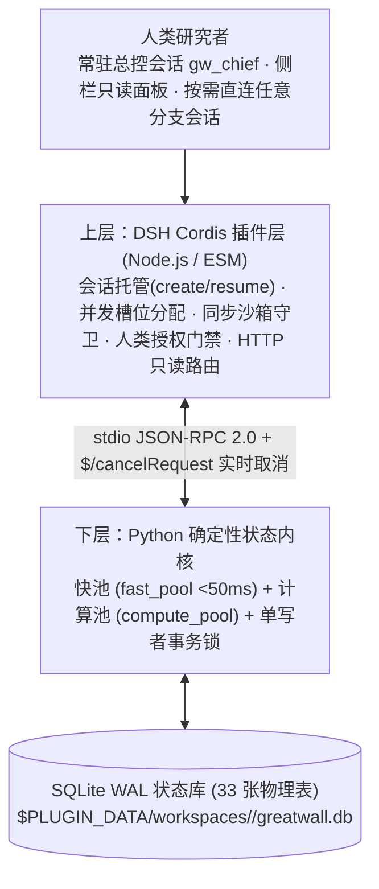

# GreatWall Agent 设施工程架构说明（Infrastructure Engineering）

> **适用版本**：GreatWall Agent `v0.3.2`  
> **文档定位**：本文面向系统架构师与开源协作者，从零前提视角系统性地拆解 GreatWall Agent 的**设施工程（Infrastructure Engineering）**。设施工程是整个科研系统的运行底座与人机交互控制面：向内，它用确定性代码管理跨进程通信、并发事务、会话生命周期、目录沙箱隔离与故障恢复；向外，它通过常驻总控会话（`gw_chief`）与只读状态面板，把高并发后台的复杂运行状态转化为低噪音、可控的人机协作体验。

---

## 1. 设施工程要解决哪些实际问题？

当系统在一台桌面机器上同时运行多个大模型会话，让它们连续十几个小时并行推导、编写代码、运行隔离评测并召开跨分支同行研讨会，同时还要允许人类研究者随时介入指挥、提供思路或手动修改代码时，系统会遇到七类与具体学科无关、却直接决定系统能否稳定运转的基础设施难题：

1. **数据库状态与后台进程脱节（状态撕裂）**  
   如果编排器一边修改数据库里的节点状态，一边直接发起异步网络调用去创建或销毁会话，只要中途遇到网络异常、进程崩溃或桌面端重启，就会出现“数据库记着已暂停，后台会话仍在消耗额度”或“探索会话早已退出，并发槽位却被永久占死”的僵局。
2. **辅助会话常驻内存导致资源浪费与跨轮串库**  
   伴随助手、会议主席等辅助角色并不需要全程挂在内存里干等，否则程序重启就会丢失句柄。另一方面，如果用户在侧栏不小心点开上一轮实验残留的历史会话，没有跨轮隔离机制的话，旧会话可能会把旧课题的脏数据写进新一轮数据库。
3. **沙箱越界防护与正常工具使用的摩擦**  
   如果不做目录隔离，探索者很容易跨分支读取其他路线的草稿、偷看隐藏校准集，甚至修改评测脚本。但如果路径守卫写得过于粗糙（例如探索者调用 `glob("*.py")` 未传路径时默认落到主工作区根目录就被拦，或者搜索正则表达式里的省略号 `...` 被简单字符串匹配误判为目录穿越 `..`），就会引发大量无意义的拦截报错。
4. **人类注意力过载**  
   当单模型执行能力足够强后，限制多智能体系统整体效率的瓶颈往往不再是算力，而是人类的注意力预算（人类研究者同时最多有效跟进 3–5 个活跃对话）。如果把十几个后台会话、低级报错和审批表单全部直接摊给人类，研究者很快就会被拖成疲惫的“人工调度员”。
5. **把“防模型作弊的红线”错扣在“人类日常运维通道”上**  
   防止模型伪造实验结果或绕过评审直接入库，必须由系统硬规则死守；但“今晚优先跑 Q2”“让 Q1 跑完这一轮就先停下”“把重复路线撤编别再自动补生”属于人类研究者的正常调度权。如果连调整优先级都要填写多层审批单，系统就会变得极难操作。
6. **慢任务堵死快控制，以及“写库成功”被误报为“现场已停稳”**  
   联网查文献或重型数值仿真常耗时数分钟，如果主控制循环同步等待慢任务，人类的暂停指令就会迟迟得不到响应；反过来，如果数据库刚改完暂停标志，界面就立刻提示“已停止”，但后台评测进程其实还在运行占槽，人类就无法判断何时可以安全切入。
7. **人类中途亲自接管并修改代码后，缺乏清晰的让权与对账机制**  
   当人类研究者暂停某个分支、亲自与探索者对话甚至手改几行核心代码后再交还托管时，系统必须做到两点：一是在人类对话期间绝不插话抢控制权；二是在交还托管时用文件哈希核对哪些代码已被修改，防止把旧代码跑出的实验收据张冠李戴地算在新代码头上。

**设施工程的核心设计边界非常明确**：用确定性代码和数据库约束管住并发一致性、隔离安全、注意力保护与运行控制流，**绝不越权干预任何具体科学真伪的裁定**。

---

## 2. 总体架构：双层物理分离与两类边界划分

### 2.1 上下两层物理架构：Node.js 薄插件 + Python 单写者内核

GreatWall 在物理上拆分为上下两层，通过标准的 `stdio JSON-RPC 2.0` 管道通信：

- **上层：DSH Cordis 插件层（`dsh_plugin/`）尽量保持轻薄**  
  它不维护第二份业务状态真源，只负责与 DeepSeek Harness（DSH `>= 0.2.2-rc.5`）宿主运行时对接：按需创建、从磁盘恢复或归档子会话；向每个角色挂载最小权限工具集；在工具执行前同步运行沙箱守卫和人类授权门禁；采样实时上下文 Token 压力并同步给内核；为侧栏只读面板提供鉴权 HTTP 接口。
- **下层：Python 确定性状态内核（`core_python/`）掌握唯一状态真源**  
  全部业务状态机、SQLite 读写与跨进程隔离评测都在 Python 内核完成。为了防止重计算阻塞轻量控制，内核内部划分为两条物理隔离的线程池：
  - **`fast_pool`（快池）**：专职处理状态快照查询、上下文水位同步、运行安排写入、暂停与让权等毫秒级（`< 50ms`）控制请求，永远不被耗时实验堵死；
  - **`compute_pool`（计算池）**：专职运行隔离评测、校准集回归与终局交付打包。一旦上层发出 `AbortSignal`，插件层立即通过 `$/cancelRequest` 透传取消信号，底层直接终止计算子进程树，并在写库前再次检查取消标记，防止已取消的任务把半成品写入数据库。
- **单写者串行落盘铁律**  
  SQLite 开启 `PRAGMA journal_mode = WAL` 与 `PRAGMA foreign_keys = ON`。只读查询走独立的只读连接并发执行；所有写事务统一经过进程级写锁（`_SINGLE_WRITER_LOCK`）与 `BEGIN IMMEDIATE` 串行提交，配合工作区级单实例进程锁（`host.lock`），彻底消除多进程双开与 `SQLITE_BUSY` 写锁冲突。

### 2.2 明确切分「不可逾越的科研防伪底线」与「人机日常运维自由」

设施工程在权限设计上执行一条清晰的分界线：

| 边界类别 | 具体硬性规定 | 谁能豁免？ |
| :--- | :--- | :--- |
| **科研防伪底线（数据面）** | 1. 一线探索者严禁联网、前 37% 上下文禁读内部知识库、52% 反思期与 70% 交接期强制只读。 2. 没有任何运维指令（包括 `gw_chief`）可以绕过独立沙箱两阶段评审直接向 `L3_VERIFIED` 写确证结果（由数据库触发器 `trg_l3_require_verified_review` 硬性拦截）。 3. 人类手动改码后，恢复托管前必须做 SHA-256 指纹对账，未重跑评测的新代码不能冒充已测成果。 | **任何角色均不可豁免** |
| **日常运行治理（控制面）** | 调整子题优先权重、限制单题并发分支数、设置暂停新派发与在途收尾方式、将重复路线软撤编、随时手动召开跨分支同行研讨会（`open_wave_conference` 并附带特邀议题）、向具体分支发送指导便签、基于人类蓝图种下新分支。 | **人类通过常驻总控 `gw_chief` 当面一句话即可原子生效** |

---

## 3. 会话生命周期、纪元隔离与双向沙箱守卫

### 3.1 固定会话编号、磁盘恢复与动态权限切换

利用 DSH 原生将每个会话的完整事件流落盘的能力，系统不再把辅助角色长期挂在内存里：

1. **常驻总控会话（`gw-chief-<ws_hash>`）**  
   开启 `keepAliveAfterIdle: true` 与 `archiveOnComplete: false`，常驻侧栏供人类随时对话。桌面端重启后通过 `ctx.agents.resume` 从磁盘无损续接。若用户在侧栏手动新建 `greatwall-chief` 预设会话，宿主 `agent/created` 钩子会自动认领并挂载全套工具与置顶摘要卡。
2. **探索者会话（`gw-exp-<node_id>`）**  
   与单个探索节点绑定，在节点活跃期间保持运行；支持在 52% 暂停编程反思和 70% 交接总结时动态切换为只读态（`setSessionReadonly(sessionId, true, phase)`）；人类中途接管时保留会话不归档，节点彻底封存后才释放并归档。
3. **跨阶段伴随助手（`gw-comp-<node_id>`）与会议主席（`gw-chair-<conf_id>`）**  
   伴随助手在 0% 写完行前摘要后立即 `dispose` 释放内存；到了 37% 问诊、70% 交接封存以及后续代表本分支出席同行研讨会时，按同一固定编号从磁盘恢复。**关键安全检查**：恢复瞬间钩子会实时查询 SQLite——一旦发现该节点已经 70% 封存（`briefing_sealed_at IS NOT NULL`），宿主物理卸载其所有档案写工具，仅挂载会议发言工具 `submit_conference_statement`，杜绝已封存档案被二次篡改。
4. **跨轮纪元栅栏（`epoch_id`）**  
   每个会话在创建时绑定当前工作区的 `parse0_contract.epoch_id`。如果人类重置并开启了新一轮课题（`epoch_id + 1`），旧轮次残留会话一旦发起任何 MCP 写操作，内核立即返回 `ERR_STALE_EPOCH` 硬拦截，并将旧总控会话自动转为只读档案。

### 3.2 双向目录隔离与沙箱守卫细则（`read_isolated_sandbox.js`）

系统的文件与网络隔离严格区分“外部 → 内部”和“内部 → 外部”两个方向：

- **外部 → 内部（只读公开输入）**：工作区下的公开目录（`inputs/`、`source_materials/`、`problem_pack/`、`data/`、`rulings/`、`attachments/` 等及顶层公开文档）对有文件权限的角色只读开放。每当创建新分支或盲审沙箱时，控制面会将对应口径版本的公开输入只读同步到 `<sandbox>/inputs/`。
- **内部 → 外部（受控数据外置）**：SQLite 数据库、观测代码快照（`eval_artifacts/`）、分支物理快照（`snapshots/`）、隐藏校准集（`_hidden_calibrations/`）、临时盲审沙箱（`blind_sandboxes/`）和终局冻结交付包（`frozen_deliveries/`）**全部存放在工作区之外的 `$PLUGIN_DATA/workspaces/<ws_hash>/`**，并配合环境变量清理，让探索者和盲审沙箱在物理上无法触及。
- **同步工具调用守卫（`installRoleSandboxGuard`）的具体规则**：
  1. **缺省路径自动锚定**：探索者或盲审官调用 `read / glob / grep` 未显式传 `path`（或传 `'.'`）时，守卫自动将其参数重写为该会话绑定的隔离目录（`worktree_abs_path` 或 `blind_sandbox_dir`），防止默认落入宿主主工作区触发误拦。
  2. **按路径段精确校验上级目录**：不采用粗暴的 `includes('..')` 子串匹配（避免误伤正则里的 `...` 或区间写法 `1..10`），而是将路径按 `[/\\]` 切分后逐段检查 `segment === '..'`，再调用 `fs.realpathSync` 逐层解析最深存在祖先路径并做规范化前缀包含核验，彻底阻断符号链接逃逸。
  3. **禁止生成过程性 Markdown 公文**：对 `HANDOFF*.md`、`*_AUDIT.md`、`*_CLOSURE.md`、`REVIEW*.md` 等过程性汇报文件名实施硬拦截（`NO_MD_DOSSIER_POLICY`），倒逼模型把状态、交接和审稿结论规范写入 SQLite 窄工具。
  4. **分相位动态只读锁**：
     - 当只读相位为 `HOLIDAY_52`（52% 暂停编程反思期）时，拦截所有文件写、Shell 和评测调用，**唯一放行 `explorer` 调用 `submit_holiday_bet`**；
     - 当只读相位为 `HANDOFF_70`（70% 交接期）或 `ARCHIVED`（已封存档案）时，拦截全部写工具、Shell 和状态变更 MCP 工具。
  5. **网络与 Shell 红线**：`library_verifier` 盲审沙箱内正则拦截所有联网命令（`curl`、`wget`、`Invoke-WebRequest`、`urllib`、`requests`、`socket` 等）及 `worktrees` 引用；全院仅 `external_surveyor` 允许使用 `web_search / web_fetch`（并自动将 arXiv PDF/摘要链接改写为更易解析的 `/html/` 地址），且物理禁止其调用任何本地文件或 Shell 工具。

---

## 4. 异步副作用队列（Outbox）、真实槽位账本与四态回执

### 4.1 事务后副作用队列（`runtime_effects`）

为解决“数据库改了但后台进程没动”和“慢任务卡住主循环”两大难题，内核采用经典的 **Transactional Outbox** 模式：

- **同事务写入**：任何需要触发外部动作的状态变更（如派生新节点、暂停在途节点、强杀会话、唤醒被阻塞分支、刷新总览、运行院内专题综述、启动同行研讨会、广播口径变更、投递导师便签等），都在同一 SQLite 写事务内递增实体的代数版本号（`control_generation`）并向 `runtime_effects` 插入一条待执行记录。系统共定义 **11 类副作用**：
  `SPAWN_PAIR`、`DRAIN_AND_STOP_NODE`、`CANCEL_NODE_SESSION`、`WAKE_BLOCKED_BRANCH`、`REFRESH_LIVING_SURVEY`、`RUN_INTERNAL_SURVEY`、`RUN_WAVE_CONFERENCE`、`NOTIFY_POLICY_CHANGED`、`NOTIFY_CHIEF`、`DELIVER_BRANCH_NOTE`、`DELIVER_HANDBACK_RECEIPT`。
- **按目标并发消费与租约续期**：Node 插件层的 `EffectsConsumer` 领取任务时写入 **60 秒租约**（长任务自动续租）。不同目标的副作用互不阻塞并行执行——例如后台正在跑一份耗时 2 分钟的院内专题综述，完全不会耽误另一条分支的紧急暂停或新节点启动。
- **代数版本号防竞态**：在会话真正发出第一条提示词之前，宿主会再次核对数据库最新的 `control_generation`；如果在排队期间人类刚刚下令暂停或撤编该节点，会话当场优雅销毁，绝不出现“已取消却又跑起来”的幽灵任务。

### 4.2 Node 与 Python 统一口径的槽位账本（含 `+1` 人类优先槽）

- **诚实的两阶段释槽**：当节点被下令停止时，数据库 **0 秒内立即禁止新派发**；但只要对应的探索会话或在途评测进程尚未彻底退出，Python 状态快照与 Node `WorkerSlotAllocator` 会统一将该槽位标记为 **`DRAINING`（正在收尾占槽）**。只有当进程真正退出并回写 `operator_runtime_slots.worker_exited = 1` 后，该槽位才释放为 `FREE`。已处于 `HUMAN_ACTIVE`（人类接管中）、`HIBERNATED` 或 `RETIRED` 状态的节点不占后台并发槽。
- **`+1` 人类优先保留槽**：在常规并发上限 `maxWorkers` 之外，系统永久预留 1 个专属槽位，仅在人类通过 `chief_seed_branch` 种下新分支或显式点名恢复某条分支时动用，确保人类意图永远不必等待后台长队列。

### 4.3 四态操作回执（`operation_receipts`）

每次通过 `gw_chief` 或控制面板执行运行调度，内核都会持久化一条带唯一 `op_id` 的回执，诚实反映现场真实进度，绝不提前报喜：

| 回执状态 | 准确含义 |
| :--- | :--- |
| `SETTLED` | 指令对应的数据库状态与后台进程动作已全部落定 |
| `DRAINING` | 新派发已立即生效，但仍有在途节点正在收尾退场（附带 `pending_targets` 清单） |
| `PARTIAL_FAILED` | 部分目标执行失败（附带失败原因与可重试提示） |
| `SUPERSEDED` | 尚未完全落定前已被人类更新的一条同类指令覆盖 |

---

## 5. 常驻总控（`gw_chief`）与人机协作机制

### 5.1 三层防失忆上下文体系

`gw_chief` 既要充当长程运行的总控调度官，又要能帮人类审阅几百行分支代码、讨论数学推导。为了防止长对话压缩后忘记调度纪律，其上下文被物理切分为三层：

1. **第 1 层：永不压缩的置顶动态真源摘要卡（`<= 1500` 字）**  
   通过 `systemPrompt.context` 在每次推理前由宿主实时从 SQLite 拼接注入，固定包含四个模块：① 真实槽位占用与各子题在跑/收尾/撤编状态；② 当前生效的运行安排（`run_arrangements`）及到期条件；③ 人类置顶的科研共识备忘（`chief_pinned_notes`，`<= 400` 字）；④ 待决的高危审批卡与分支转办单（`handback_records`）。即使聊天历史经历了多轮自动压缩，总控对全局硬状态依然零失忆。
2. **第 2 层：四级截断预览与 4000 字分页读取器（`chief_read`）**  
   列表接口和事件通知严格控制内联长度，只展示核心摘要并附带资源标识与关联外键（Recall Pointer）。需要深看细节时，总控按 UTF-16 游标调用 `chief_read(resource, offset, limit=4000)` 分页阅读子题总览、交接手稿、去思维链的精简对话记录（`transcript`）、审稿账本、研讨会纪要、馆藏论文或院内专题综述；需要审码时直接使用只读的 `read / glob / grep` 或宿主提供的黑盒轨迹查看工具 `chief_get_node_recent_activity`。
3. **第 3 层：两阶段事件过滤与原生自动压缩**  
   95% 的高频过程事件（探针调用、水位常规跳动、常规续跑）只写入 SQLite 与右侧只读面板，不推送给 `gw_chief`；只有里程碑入库、熔断告警、分支转办单与低频状态心跳才会进入总控收件箱。

### 5.2 三道防失控护栏与版本化运行安排（`run_arrangements`）

1. **人类授权回合门禁（`Human-Mandate Gate`）**  
   宿主在 `gw_chief` 的同步工具守卫中校验：唯有当前对话回合是由**人类亲手发消息开启**（携带宿主真实的 `rpcId`），或者关联了带真实人类凭证的未核销分支转办单（`handback_id`），才放行 `chief_operate`、`chief_send_branch_note` 和 `chief_seed_branch`。如果是后台定时事件或里程碑通知自动唤醒总控，总控物理上只能查账、整理汇报或提交待审提案，绝对无法擅自砍分支或改策略。
2. **版本化运行安排的四个正交控制维度**  
   人类通过总控下达的日常运行策略统一落入 `run_arrangements` 表，包含四个互不干扰的维度：
   - **抢槽权重（`priority_weight`）**：软性调节不同子题获取算力槽位的优先顺序，与表示数学前置依赖的硬锁 `question_order` 严格分离；
   - **单题并发上限（`max_active_branches`）**：开新枝、融合扩枝与常规续跑共用同一配额校验函数 `check_question_branch_quota`；
   - **派发开关与在途收尾粒度**：`dispatch_policy` 支持 `NORMAL / NO_NEW_DISPATCH / PAUSED_ALL`；对已经在跑的节点，`inflight_drain_mode` 精确提供三档收尾方式——跑完当前回合即停（`FINISH_CURRENT_TURN`）、跑完本代 70% 交接即停（`FINISH_CURRENT_HANDOFF`）、3 秒宽限立即让权（`IMMEDIATE_YIELD`）；
   - **软撤编与到期自动恢复**：被撤编的分支标记为 `RETIRED`（所属路线可级联归档为 `ARCHIVED`），调度器自动跳过不再补生；每条安排支持 `MANUAL`（手动解除）、`AT_TIME`（定时到期）或 `AFTER_INFLIGHT_BATCH`（当前在途批次结束后自动恢复），同作用域的新安排会自动将旧安排标为 `SUPERSEDED`。
3. **四类高危变更强制走审批卡（`control_proposals`）**  
   只有四类会改变课题基准或清空进度的重大操作不能由总控单方面直接落盘，必须生成待审提案卡（支持 DSH 原生 Action Card 与控制台双端幂等确认）：
   - `AMEND_RULING_DRAFT`（修改或追加题面口径文档，递增 `spec_revision`）；
   - `AUTHORIZE_PARTIAL_DELIVERY`（越过或提前批准部分结题交付）；
   - `ADVANCE_EPOCH`（推进新纪元重置当前工作区）；
   - `APPROVE_WAVE_VERDICT`（在 `WAVE_CONFIRM` 模式下确认同行研讨会决议）。

### 5.3 四条深度人机科研协同路径

1. **非侵入式分支指导便签（`chief_send_branch_note`）**：研究者发现某条支线漏掉某个边界条件时，无需停机，直接发一条指导便签——在线节点温和注入上下文，离线节点存入 `pending_advisor_notes_json` 并在下一回合必达，全过程记入 `node_interventions` 留痕。
2. **完整思路蓝图种枝（`chief_seed_branch`）**：人类与总控共同推导出完整证明思路或算法方案（支持最多 `8000` 字）后，一键创建 `HUMAN_SEEDED` 类型新分支，动用 `+1` 人类优先槽立刻启动（自带 1 代成长保护期，产出同样须经独立盲审）。
3. **按需定制院内专题综述（`request_internal_survey`）**：在总控窗口直接委派断网的 `library_chronicler` 精读馆藏，快速汇总某子题所有已证结论、证伪路径与剩余缺口。
4. **直连子节点改码对账与越界转办（`handback_to_chief`）**：人类可随时暂停并直接点开任意探索者会话对话或修改工作树代码；系统检测到人类发言后立刻优雅让权（`PAUSE_DRAINING -> HUMAN_ACTIVE`），交还托管时自动做 SHA-256 指纹对账。如果人类在子分支窗口顺口提了全局调度要求，探索者调用 `handback_to_chief` 将原话与人类授权凭证打包转交给 `gw_chief` 统一处理。

---

## 6. 宿主集成铁律与附录速查

### 6.1 DSH `0.2.2-rc.5` 运行时集成红线
1. **严格 JSON Schema 子集**：全部 MCP 工具的 `inputSchema` 禁用 `oneOf / anyOf / allOf / $ref`，且数组类型必须显式声明 `items`，由 `tool_registry.py` 单一维护并自动生成 `contracts.generated.json`。
2. **禁止 Preset 重复声明全局根服务**：8 套角色预设复用的全局上下文压缩与 Token 计量服务均在根层挂载，严禁在子 Preset 中重复声明导致 Cordis 服务泄漏。
3. **规范的销毁与归档顺序**：任何会话结束时，必须严格先调用 `handle.dispose()` 释放内存句柄与钩子，再调用宿主 `archiveSession()` 归档；探索者会话在 Windows 无头子进程下必须继承父会话权限预设（`_inheritParentPermissionState`），避免 PowerShell 子进程初始化异常。

### 6.2 设施工程核心数据表与工具清单
- **核心 SQLite 表（12 张）**：`parse0_contract`、`compliance_alerts`、`saved_graph_queries`、`project_closure_state`、`subproblem_runtime_state`、`runtime_effects`、`node_interventions`、`control_proposals`、`run_arrangements`、`operation_receipts`、`chief_pinned_notes`、`handback_records`、`epoch_archives`、`operator_runtime_slots`。
- **`gw_chief` 授权工具（10 个内核 + 1 个宿主）**：`chief_get_overview_snapshot`、`chief_trace_entity`、`chief_read`、`chief_operate`、`chief_send_branch_note`、`chief_seed_branch`、`chief_preview_impact`、`chief_propose_control_action`、`request_internal_survey`、`get_internal_survey_report`，以及宿主注册的 `chief_get_node_recent_activity`。
- **`supervisory_committee` 授权工具（4 个）**：`get_supervisory_audit_snapshot`、`check_stage2_closure_gate`、`record_compliance_check`、`register_saved_graph_query`。

### 6.3 已知权衡与局限
- **应用层沙箱 vs. 容器级强隔离**：当前本地直跑沙箱依赖路径规范化与 Shell 关键字守卫，部署成本极低且跨平台响应快，但不具备 Docker / 微虚拟机级别的内核防逃逸能力。
- **单宿主深度绑定**：当前插件层深度耦合 DSH Cordis 生命周期与前端运行时，跨宿主迁移（如对接 ACP 协议）仍属于后续路线图工作。
