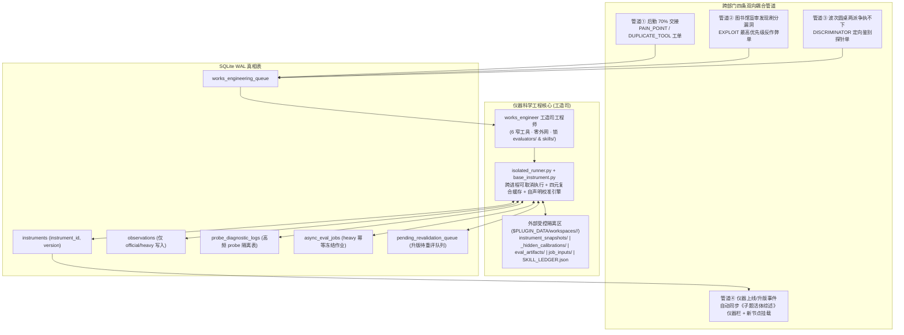
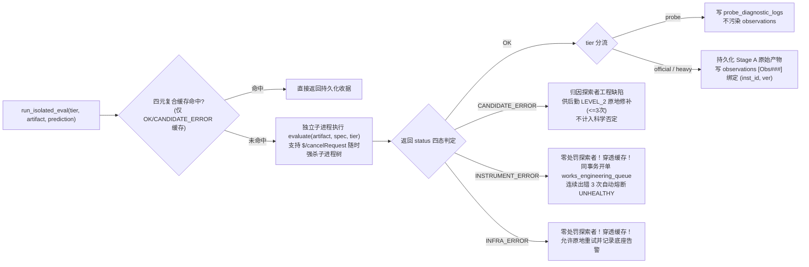

# GreatWall Agent 仪器科学工程架构论文（Instrument Science Engineering / 工造司）

> **系统版本**：GreatWall Agent `v0.3` 终态架构定稿  
> **文档性质**：零前提、自包含子系统架构论文（Architecture Paper）。任何未接触过历史讨论的架构师或工程师，仅凭本文即可完整理解仪器科学工程（工造司）的第一性定位、通用隔离执行底座、与后勤和图书馆的四条双向耦合管道、精确数据与接口契约、学术溯源及验收标准。

---

## 摘要（Abstract）

自主科学发现系统在面对开放科研任务时，普遍面临四大测量陷阱：**将平台或评测脚本故障误判为科学路线失败**、**把特定竞赛题的标量规则硬编码进通用框架导致跨学科瘫痪**、**开发自测脚本与正式评测协议脱节引发“本地过、正式崩”**，以及**评测器升级修补漏洞后新旧观测分数混排失真**。GreatWall Agent 的**仪器科学工程（工造司）**将评测与实验基础设施定义为科研体系中的**“实验室仪器科”**而非“单一标量判官”。本文完整阐述其终态架构：坚持纯粹的 **`plugin is everything`** 通用隔离执行容器；统一抽象 `VERDICT / PROBE / ENV` 三类仪器与 `evaluate(artifact, spec, tier)` 协议；实现**同一份代码三档调用（`probe / official / heavy`）**、**四态物理隔离（判不了绝不判负）**与**四元复合缓存**；以**自声明预期校准集（Calibration Suite）**驱动无死锁回归升版；并通过**四条跨部门耦合管道**（前线痛点与轮子收编、盲审反作弊 `EXPLOIT` 校准反哺、波次圆桌鉴别探针定制、活体综述仪器目录同步），使仪器科随全院科研探索持续协同演化。

---

## 1. 第一性问题定义与设计哲学

### 1.1 第一性定位：科研仪器提供商，而非强行打分的判官
1. **通用底座零学科硬编码（`plugin is everything`）**：隔离执行容器只负责进程隔离、标准取数、产物持久化、复合缓存与返回体协议强校验；一切学科逻辑全部下放至课题仪器插件，原生支持 **0 个判定器（`VERDICT`）开局**的纯理论课题；
2. **扩张可观测性高于复述报错**：实证研究（*Audit the Scaffold*）证明，在模型权重冻结时，仅复述冗长报错对解题进展的效应量为零；真正能扩张可达假设空间 $\mathcal{H}_t(C)$ 的高杠杆投资，是提供能透视新物理/数学维度的透明诊断探针（`PROBE`）；
3. **仪器故障零连坐探索者**：测量仪器本身报错或底座超时绝不能折算为 `0` 分或“算法无效”，必须与候选程序缺陷（`CANDIDATE_ERROR`）和真实科学否定（`MEASURED_REJECTION`）物理隔离。

---

## 2. 系统全貌、核心拆解与四条跨部门耦合管道

### 2.1 仪器科学工程全景与跨部门耦合图



### 2.2 四条跨部门耦合管道的精确运转机制
仪器科绝非只在 Stage 1 建完初始仪器就闲置的孤岛，而是全程深度耦合在后勤与图书馆的运转齿轮中：
1. **管道 ① · 前线痛点与重复轮子收编（后勤 `70%` $\longrightarrow$ 仪器科）**：伴随助手在 `70%` 交接时上报探索者“黑盒看不清需加诊断维度（`PAIN_POINT`）”，或发现多分支在 `<worktree>/tools/` 重复手造同类校验脚本（`DUPLICATE_TOOL`）$\to$ 自动开单工造司将其收编打磨为全院共享只读探针（`PROBE`）或登记入 `SKILL_LEDGER.json`；
2. **管道 ② · 盲审反作弊校准反哺（图书馆盲审 $\longrightarrow$ 仪器科）**：当 `library_verifier` 在空白沙箱审稿时发现某手稿虽拿到旧版仪器的 `VALID_PASS`，实则钻了测试空子（Reward Hacking）$\to$ 盲审官在拒稿/退修的同时签发高优先级 **`EXPLOIT`** 工单 $\to$ `works_engineer` 将该作弊样本作为新毒样本（预期 `OK + FAIL`）沉淀入 `_hidden_calibrations/` 完成校准升版，并将受影响旧观测打入 `pending_revalidation_queue` 诚实重评；
3. **管道 ③ · 波次圆桌“鉴别照妖镜”定制（图书馆开会 $\longrightarrow$ 仪器科）**：在波次圆桌对抗会上，若两大学派就某个未覆盖边界（如病态条件数、极端规模极限）争执不下且现有仪器缺乏鉴别力 $\to$ 圆桌裁定官直接向工造司签发 **`DISCRIMINATOR`** 定向探针/测试集扩充工单，由仪器科造出客观照妖镜，下一波实测一锤定音；
4. **管道 ④ · 仪器资产同步进《子题活体综述》（仪器科 $\longrightarrow$ 图书馆综述 $\longrightarrow$ 科研人员）**：每台新上线或升版的 `VERDICT / PROBE` 仪器与共享 `SKILL` 工具，除在新节点启动桌面自动挂载外，同步反映在图书馆 `library_chronicler` 维护的《子题活体综述地图》顶部【可用官方仪器与探针表】中，防止各分支闭门重复造轮子。

### 2.3 核心源码模块映射
- `core_python/evaluators/base_instrument.py`：`get_public_input(spec)` 标准取数（缺键必抛 `InstrumentInputError`）与 `validate_instrument_result()` 返回体强校验；
- `core_python/evaluators/isolated_runner.py`：独立子进程 `runpy.run_path(cand, run_name="_gw_candidate")` 执行（支持 `.lean` / 反例 JSON 等多 `artifact_schema`）、`CancelRegistry` 接收 `$/cancelRequest` 强杀子进程树、四元复合缓存、Stage A 留存、3 次连续报错自动熔断 `UNHEALTHY` 与独立子进程全量校准集回归；
- `core_python/mcp_server/tools_works.py`：`works_engineer` 6 窄工具实现；
- `core_python/evaluators/examples/`：几何反例、Lean 4 编译与 `#print axioms` 审计桩、多目标 Pareto 仿真样例。

---

## 3. 端到端核心运行流程与状态机

### 3.1 统一调用、四态物理隔离与三档同码分流



- **三档同码模式**：同一份插件代码原生支持 `probe`（高频公开开发集，仅写诊断日志）、`official`（隔离保留集或固定公开多种子复现集，写正式 `[Obs###]`）与 `heavy`（必填事前预测 `linguistic_prediction`，入队 `async_eval_jobs` 同步冻结候选代码、`tools/`、仪器版本与 `spec`，支持重启续跑与 `job_id` 幂等取回仅扣一次预算）。

### 3.2 校准集回归升版与 Stage B 版本域诚实重评
1. **Stage 1 统一核查**：立项启动时固定唤醒 `works_engineer` 核查 `parse0_contract.initial_instruments_json`——非空则锻造校准并注册；为空则确认无待建仪器退出，控制面置 `stage1_works_checked = 1`。
2. **自声明预期校准集唯一门禁**：`PROBE / ENV` 可免配校准集；`VERDICT` 注册与升版必须附带独立校准集，每条用例自声明 `(expected_status, expected_verdict)`（格式退化预期 `CANDIDATE_ERROR + None`、作弊毒样本预期 `OK + FAIL`、合法金样本预期 `OK + PASS`），独立子进程 100% 精准匹配即直接激活/升版。
3. **版本域隔离与诚实重评**：升版同事务仅将该仪器旧观测置 `PENDING_REVALIDATION` 并入 `pending_revalidation_queue`（受触发器 `trg_obs_pending_reval_require_queue` 护航）；`recompute_stage_b_only` 读取外部 `stage_a_output.json` 重算——永久保留旧收据（置 `SUPERSEDED_REVALIDATED`），生成绑定新版的新 `[Obs###]`；若字段缺失或输入规格变化，诚实置为 **`INCOMPATIBLE`** 结案。

---

## 4. 核心数据与接口契约

### 4.1 唯一仪器插件协议与四元复合缓存键
```python
def evaluate(artifact: Any, spec: dict, tier: str) -> dict:
    # 必须通过 base_instrument.get_public_input(spec) 取数
    return {
        "status":  "OK" | "CANDIDATE_ERROR" | "INSTRUMENT_ERROR" | "INFRA_ERROR",
        "verdict": "PASS" | "FAIL" | "UNDECIDED" | None,  # PROBE 恒为 None；非 OK 恒为 None
        "tracks":  dict[str, float | int | str | bool | None],
        "details": str,
    }
```
```text
cache_key = sha256(
    candidate_entry_sha256
  + recursive_tools_dir_sha256
  + spec_sha256(tier + data_slice_sha256)
  + instrument_sha256
)
```
*(同时 `observations.candidate_entry_sha256` 与 `tools_dir_sha256` 直接作为设施工程“人工改码后工件版本哈希对账”的底层真源。)*

### 4.2 核心表、触发器与 `works_engineer` 6 窄工具
- **核心表**：`instruments`、`observations`、`probe_diagnostic_logs`、`async_eval_jobs`、`pending_revalidation_queue`、`works_engineering_queue`（`ticket_type` 支持 `INSTRUMENT_ERROR / PAIN_POINT / DUPLICATE_TOOL / EXPLOIT / DISCRIMINATOR`）；
- **硬触发器**：`trg_obs_pending_reval_require_queue`；
- **6 个窄 MCP 工具**：`get_works_engineering_queue`、`register_question_instrument`、`upgrade_instrument_with_calibration`、`recompute_stage_b_only`、`update_skill_ledger`、`resolve_works_ticket`。

---

## 5. 参考文献与工程溯源

| 文献 / 开源项目 | 原作解决的核心问题 | 仪器科学工程吸收的机制与工程改造 |
| :--- | :--- | :--- |
| **Red Queen Gödel Machine (RQGM)** (`arXiv:2606.26294`) | 静态评估器刷分饱和；演化后分数不可比 | 版本域隔离、盲审 `EXPLOIT` 毒样本沉淀进校准集、Stage A 留存与 Stage B 诚实重评 |
| **Audit the Scaffold** (`arXiv:2609.34924`) | 冻结权重下如何扩张可达假设空间；测试器自身缺陷 | 可观测 `PROBE` 探针优先排序；金/毒/格式自声明校准集反测仪器自身 |
| **Stateless Language Agents (SLA)** (`arXiv:2610.07625`) | 代码报错被误判为科学路线失败 | 四态物理隔离（`CANDIDATE_ERROR` vs `INSTRUMENT_ERROR` vs `MEASURED_REJECTION`） |
| **The Tasteful Agent** (`arXiv:2609.25804`) | 长视界盲猜分叉准确率低 | `tier="probe"` 低成本高频诊断档 |
| **Bayesian-Agent** (`arXiv:2606.08348`) | 技能资产可追踪与可回滚 | `skills/SKILL_LEDGER.json`（含原始成败计数、实存校验与回滚指针） |
| **The Station v2** (`arXiv:2610.08927`) | 开放科研缺乏单一标量目标函数 | 统一 `tracks: dict` 0..N 维多轨道进展 |

---

## 6. 渐进实施边界与可观测验收标准

- **验收标准**：① 坏仪器抛异常时探索者零扣分、穿透缓存、自动开单且连续 3 次熔断 `UNHEALTHY`；② 毒样本漏判拒绝上线，修补后 100% 过校准集升版并入待重评队列；③ `$/cancelRequest` 强杀耗时子进程且无幽灵 `[Obs###]` 落库；④ 修改 `tools/` 下任意文件必然改变 `cache_key` 并触发设施层改码对账告警。
