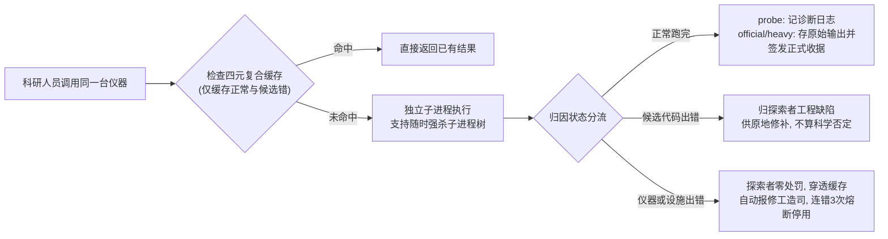
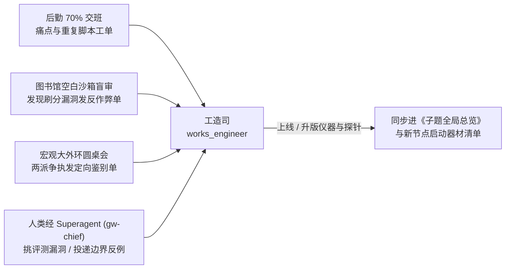

# GreatWall Agent 仪器科学工程架构论文（Instrument Science Engineering / 工造司）

> **系统版本**：GreatWall Agent `v0.3` 顶层架构定稿  
> **阅读指南**：本文全面介绍 GreatWall Agent 的**仪器科学工程（简称“工造司”）**——也就是为全院科研探索提供可信测量仪器、透明诊断探针与隔离计算环境的子系统。正文用清晰平实的自然语言把为什么这样设计、各部分如何运转讲透；精确的接口协议、数据库表结构与参考文献统一收拢在文末第 6 章。

---

## 1. 仪器科学工程到底要解决什么问题？

在自动化科研系统里，“怎么测量和验证一个候选方案的好坏”往往比“怎么生成候选方案”更容易出隐蔽事故。如果不做专门的工程设计，评测环节几乎一定会掉进四个常见陷阱：

1. **把测试脚本坏了当成科学思路错了**：很多系统只要评测脚本运行报错，就直接给候选方案打 `0` 分或者记成“失败”。结果往往是评测器自己漏读了一个字段或环境超时，却让探索者误以为自己的数学思路走不通，白白丢弃了一个好方向。
2. **把某道竞赛题的规则写死在通用框架里**：如果为了解一道优化题，在框架底座里硬编码“必须有零号基线”“误差小于 5% 才算过”“禁止返回全零解”，这套框架一碰到纯数学定理证明、反例构造或物理多目标仿真就会当场瘫痪。
3. **开发自测和正式评测两张皮**：如果探索者平时自己写脚本从终端打印里用正则抠分数，正式交卷时系统又用另一套函数入口去加载代码，就会频繁出现“本地跑得好好的，正式一测全崩”的无效内耗。
4. **评测器升级堵漏洞后，新旧分数混在一起没法比**：随着研究深入，智能体总会慢慢摸索出钻旧评测器空子的捷径（Reward Hacking）。一旦修补了评测器，旧版本下跑出来的分数和新版本就不再是同一把尺子量出来的；更麻烦的是，如果修 Bug 还得满足“新评测器在旧样本上打分更高”，修补工作本身就会陷入死锁。

**仪器科学工程（工造司）把评测系统重新定位为实验室里的“科研仪器科”，而不是给每道题强行打单一分数的判官。** 它的使命是为一线科研人员打造透明、可信、可随课题共同演化的测量仪器与诊断探针。

---

## 2. 第一性原则与系统拆解

### 2.1 三条核心设计原则
1. **通用容器绝对极薄，学科逻辑全部做插件**：底层隔离执行容器只管四件事——在独立子进程里安全运行代码、按统一入口喂测试数据、算缓存与存原始输出、校验返回格式是否合规。至于这道题要不要基线、误差容差怎么算、甚至这道纯理论题是不是开局一台正式打分仪器都没有（0 判定器开局），全部交给具体课题插件自己定义。
2. **提供看得见的“显微镜”，比复述报错更有价值**：实证研究（*Audit the Scaffold*）已经证明，在底层大模型权重冻结的情况下，把冗长的报错信息换着花样复述给模型，对解题进展几乎没有帮助；真正能让模型突破能力天花板的，是给它提供能透视新维度的诊断探针（比如把一个黑盒总分拆成按随机种子分布的耗时、长尾极端样例误差、或守恒律残差谱）。
3. **仪器故障绝对不连坐探索者**：测量仪器自己崩了、漏字段了或系统超时了，探索者零扣分、不消耗修补机会、不写入缓存，同时系统自动开单报修给工造司。

### 2.2 三类仪器与统一调用协议
系统把实验室里所有测算设施统一抽象为“仪器（Instrument）”，按用途分为三类：
- **判定器（`VERDICT`）**：用于产出正式科学结论（通过、拒绝、或暂无法单凭此项定论），结果记入正式观测账本；
- **诊断探针（`PROBE`）**：只读显微镜，不给通过/失败的判决，只输出多维诊断数据帮助探索者看清内部机理；
- **计算环境（`ENV`）**：提供仿真模拟器运行时、基准数据集或符号计算依赖。

不管什么学科、哪类仪器，全部遵守唯一的返回结构：包含四个固定字段——**运行归因状态**（正常跑完 / 候选代码自身出错 / 仪器自身出错 / 底层设施故障）、**科学判决**（仅判定器在正常跑完时填写，其余恒为空）、**多维进展轨道**（允许同时返回 0 条到多条数值、布尔或文本指标，绝不强求压缩成一个单调实数分数），以及面向科研人员的**结构化诊断说明**。

---

## 3. 核心运行机制：三档同码、四态隔离与四元缓存

为了消灭“本地自测一套代码、正式交卷另一套代码”的内耗，**同一份仪器插件代码原生支持三档调用模式**，只需在调用时切换档位：



1. **快速探索档（`probe`）**：挂载公开开发样例，科研人员可以高频反复调用看多维诊断剖面；结果只记入轻量诊断日志表，**绝不污染正式科学观测账本**。
2. **正式凭证档（`official`）**：在受控隔离域运行并签发永久不可覆写的正式观测收据（`[Obs###]`）——有隐藏保留集的课题跑隐藏集；没有隐藏集的开放数值发现题跑固定公开配置加多种子复现集（允许返回“正常跑完但暂不定论”，留待盲审沙箱做独立变种子复现）。
3. **重型异步档（`heavy`，可选）**：面向耗时极长的仿真计算。调用前要求探索者先写下自己对结果的事前预期；一旦入队，系统立刻冻结当时的候选代码、`tools/` 辅助模块、仪器版本和测试规格快照，哪怕中途软件重启也能按原冻结现场继续跑完，并支持凭作业号幂等取回且只扣一次预算。

**为什么要采用“四元复合缓存”？**  
为了既省算力又不误命中脏缓存，每条缓存指纹由四个哈希拼成：**候选主文件哈希 + 本分支 `tools/` 目录下所有辅助脚本的递归哈希 + 测试规格与档位数据切片哈希 + 仪器自身源码哈希**。只要探索者改了 `tools/` 里的哪怕一个辅助函数、或者换了仪器版本、或者从 `probe` 切到了 `official`，缓存键必然变化，绝不会把旧结果张冠李戴。同时，**`observations` 表里记录的代码与 `tools/` 哈希，也直接充当了设施工程“人类改码后工件版本对账”的底层真源。**

---

## 4. 仪器如何安全演进：自声明校准集与版本域诚实重评

在长期科研中，仪器本身也会不断修 Bug、堵刷分漏洞或增加观测维度。工造司用两套严谨机制保证演进既不会卡死，也不会弄乱历史账本：

### 4.1 校准集唯一门禁（无死锁修 Bug 与堵漏洞）
- `PROBE` 和 `ENV` 可免配校准集；**所有正式判定器（`VERDICT`）的首次上线和后续每次升版，都必须附带一套独立校准测试用例集**（保存在探索者看不见的外部受控目录）。
- 校准集里的每一条用例都**自己写明精确预期**：比如空文件或语法错的退化样本，预期必须返回“候选代码出错”；历史上钻过空子的作弊毒样本，预期必须返回“正常跑完且判失败”；已知的合法参考解（金样本），预期必须返回“正常跑完且判通过”。
- 当发现仪器漏读了数据或被钻了空子时，工造司只需先把这个复现案例加进校准集，确认旧版确实没拦住，再修补仪器代码——只要独立子进程实跑全量校准集 **100% 精准匹配每条用例的自声明预期**，就立刻自动升版发布，彻底告别“修 Bug 还得在旧指标上刷高分”的荒谬死锁。

### 4.2 版本域隔离与诚实重评
每一条正式观测收据都永久绑定产出时的 `(仪器编号, 版本号)`，不同版本的指标严禁直接混排比较。每次跑正式评测时，系统还会把候选程序产出的原始中间结果（Stage A 产物）保存在外部目录。

一旦仪器升版，同事务只把这台旧仪器关联的历史观测标为“待重评”并入队（绝不误杀其他子题的观测）。工造司按需读取保存下来的原始输出，用新版评分逻辑重新计算（Stage B 重评）：**旧收据永久保留绝不覆盖**，重评成功就生成一条绑定新版本、并指明源自哪条旧收据的新编号；如果旧产物里压根缺少新版需要的新字段，或者测试输入本身变了，系统就老老实实把旧收据标为“不兼容（`INCOMPATIBLE`）”结案，绝不胡乱估算。

此外，如果多个分支都在各自目录里重复手造了同一种好用的分析脚本，工造司可以将其收编为全院共享的只读探针，经可执行与文件实存校验后记入共享工具台账（`SKILL_LEDGER.json`，记录真实成败计数、适用范围与回滚指针）。

---

## 5. 仪器科如何与设施、后勤、图书馆深度耦合？

工造司绝不是只在开局建完第一台仪器就闲置的摆设，它通过 **5 条清晰的双向管道** 全程嵌在全院的科研循环里：



1. **接前线的痛点与重复轮子（后勤 $\to$ 工造司）**：伴随助手在 70% 交班时记录下“黑盒指标看不清需要新诊断维度”或“多分支在重复造同一种验证脚本”，自动生成工单交工造司打磨成共享高信噪比探针。
2. **接盲审抓出的作弊样本（盲审 $\to$ 工造司）**：当盲审官在空白沙箱里抓到某手稿虽然拿了旧仪器的通过收据、实则钻了测试漏洞时，当场签发最高优先级的反作弊工单（`EXPLOIT`）。工造司直接把这份作弊代码塞进校准集当毒样本完成升版，并触发受影响历史观测重评——形成“审稿倒逼评测器进化”的闭环。
3. **接波次圆桌的“鉴别照妖镜”需求（大外环圆桌 $\to$ 工造司）**：圆桌会上两大学派就某个极端边界（如病态条件数、更大问题规模）争执不下、而现有仪器测不出来时，裁判直接向工造司下达定向鉴别探针单（`DISCRIMINATOR`），下一波用实测数据一锤定音。
4. **接人类研究者的边界反例与评测纠偏（设施 Superagent $\to$ 工造司）**：人类在对话中发现评测漏测边界或手写刁钻反例时，通过 `gw-chief` 整理为 `SUBMIT_WORKS_OR_SURVEY_TICKET` 确认单，经单写者内核落地为 `EXPLOIT` 或 `DISCRIMINATOR` 工单，驱动工造司将人类专家的领域直觉固化进回归校准集与新探针。
5. **同步进图书馆全局总览（工造司 $\to$ 图书馆 $\to$ 科研人员）**：每台新上线或升版的仪器，除了自动列进新节点的启动器材表，还会实时反映在《子题全局总览》顶部的可用仪器栏中，让全院科研人员第一时间用上最新武器。

---

## 6. 附录：工程契约与参考文献（供开发与审计查阅）

### 6.1 唯一仪器插件协议与四元缓存键
```python
def evaluate(artifact: Any, spec: dict, tier: str) -> dict:
    # 必须通过 base_instrument.get_public_input(spec) 取数，缺键必抛 InstrumentInputError
    return {
        "status":  "OK" | "CANDIDATE_ERROR" | "INSTRUMENT_ERROR" | "INFRA_ERROR",
        "verdict": "PASS" | "FAIL" | "UNDECIDED" | None,   # PROBE 与非 OK 恒为 None
        "tracks":  dict[str, float | int | str | bool | None],
        "details": str,
    }
```
```text
cache_key = sha256(
    candidate_entry_sha256
  + recursive_tools_dir_sha256
  + spec_sha256(tier + data_slice_sha256)
  + instrument_sha256
)
```

### 6.2 核心 SQLite 表、触发器与 6 个窄工具
- **核心表**：`instruments(instrument_id, version)`、`observations(obs_id)`、`probe_diagnostic_logs(probe_id)`、`async_eval_jobs(job_id)`、`pending_revalidation_queue(queue_id)`、`works_engineering_queue(ticket_id)`（支持 `INSTRUMENT_ERROR / PAIN_POINT / DUPLICATE_TOOL / EXPLOIT / DISCRIMINATOR`）。
- **数据库硬触发器**：`trg_obs_pending_reval_require_queue`（将观测置为 `PENDING_REVALIDATION` 时，同事务必须在待重评队列插入对应活跃行，否则事务回滚）。
- **`works_engineer` 6 窄工具**：`get_works_engineering_queue`、`register_question_instrument`、`upgrade_instrument_with_calibration`、`recompute_stage_b_only`、`update_skill_ledger`、`resolve_works_ticket`。

### 6.3 核心文献与思想出处
1. **Red Queen Gödel Machine (RQGM)** (`arXiv:2606.26294`)：版本域可比性、作弊错放样本沉淀为回归校准集，以及保留原始产物按需重评。
2. **Audit the Scaffold** (`arXiv:2609.34924`)：冻结权重下扩张可观测探针的高杠杆规律，以及用金/毒校准集反测评估器自身。
3. **Stateless Language Agents (SLA)** (`arXiv:2610.07625`) & **The Tasteful Agent** (`arXiv:2609.25804`)：代码故障与科学否定严格分离；低成本 `probe` 诊断探针替代闭门盲猜。
4. **Bayesian-Agent** (`arXiv:2606.08348`) & **The Station v2** (`arXiv:2610.08927`)：共享技能台账与回滚指针；原生多维 `tracks` 进展记录。
