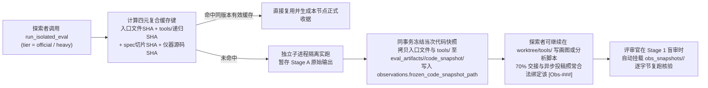

# GreatWall Agent 仪器科学工程架构说明（Instrument Science Engineering）

> **适用版本**：GreatWall Agent `v0.3.2`  
> **文档定位**：本文从零前提视角全面介绍 GreatWall Agent 的**仪器科学工程（Instrument Science Engineering，内部亦称“工造司”）**——即整个系统负责科学测量、隔离执行、可观测性诊断、防作弊校准与观测证据冻结的核心子系统。本文完整讲清所有协议规则、三档评测机制、四态归因、观测快照解耦以及校准升版闭环。

---

## 1. 仪器科学工程要解决哪些实际问题？

在长周期自动化科研系统中，“如何准确、公正、可复现地测量一次实验结果”往往比“如何生成一段候选代码”更容易出隐蔽故障。如果缺少专门的测量工程设计，评测环节通常会遭遇五类致命问题：

1. **把评测脚本自身的 Bug 误判为“科学猜想失败”**  
   许多自动化框架只要评测进程退出码非零，就直接给探索者打 0 分或记录失败。但在真实科研中，评测脚本自己漏处理边界输入、缺依赖或临时超时极为常见；把它算到探索者头上，会导致一条完全正确的数理路线被误杀。
2. **在底座中硬编码单一标量打分规则**  
   如果框架强制要求每道题都必须输出一个单调递增的实数分数，一旦遇到纯解析数学证明（开局可能根本没有自动判定器）、构造性反例或多目标物理守恒律仿真，整套评测体系就会立刻失效。
3. **开发调试与正式提交使用两套不同入口**  
   如果探索者平时用一套自写脚本看终端打印，正式交卷时系统换成另一套加载协议和正则解析，探索者就会把大量上下文和算力浪费在排查格式错位上。
4. **目录哈希连坐导致“实验白跑、交班拒绑”**  
   为了防止伪造实验结果，系统必须记录产生某次观测时的完整代码指纹（包括入口文件与本地 `tools/` 目录）。但如果在 70% 交接时强行要求“工作树当前的 `tools/` 目录哈希必须与几小时前跑核心实验时完全一致”，探索者在跑完正式实验 `[Obs-015]` 后只要往 `tools/` 里多写了一个画图脚本或敏感度分析脚本，前面所有正式观测都会因“目录已变更”被拒之门外，导致整条分支拿不出合法观测提交审稿。
5. **仪器升级修漏洞时的版本混排与工单静默关单**  
   探索者在长程试错中难免无意或有意钻旧评测器的空子（Reward Hacking）。如果修补仪器时没有正/负校准集回归门禁、不区分新旧仪器版本域，新旧观测就会混在一起无法比较；而如果升级仪器时顺手把名下所有未处理工单无备注批量关闭，前线报修的分支就无从得知自己的具体需求到底有没有被解决。

**仪器科学工程的定位不是给每道题硬造分数的“裁判”，而是实验室里的“仪器与测量部门”。** 它的核心职责是提供极薄、通用的隔离测量容器、永久绑定当次代码快照的正式观测记录（`[Obs-###]`），以及能够随研究进展持续演化的诊断探针与校准体系。

---

## 2. 核心设计公理与统一仪器插件协议

### 2.1 三条基本原则

1. **通用执行容器尽量极薄，学科逻辑全部插件化**  
   底层的 [`isolated_runner.py`](../../greatwall-v6up/core_python/evaluators/isolated_runner.py) 不包含任何具体学科的业务判断（不假设有参考基线、不假设零解非法、不假设误差容差怎么算），只做四件确定性工作：在独立子进程中安全执行插件、喂入受控数据切片、计算复合缓存并冻结观测代码快照、校验返回体格式。纯理论证明题允许在立项契约（`Parse 0`）中声明 **0 个判定器** 开局，直接通过解析推导与独立沙箱评审推进。
2. **优先提供“看得见内部机理”的诊断探针**  
   在模型权重固定的前提下，单纯重复返回“测试未通过”几乎无法帮助模型突破瓶颈；真正能帮助探索者定位结构性缺陷的，是能拆解内部机理的高分辨率诊断探针（例如输出按随机种子分组的耗时分布、不同夹角区间的误差曲线、守恒量随时间步长的残差阶数）。
3. **平台仪器故障对探索者绝对零处罚**  
   凡被归因为仪器自身异常（`INSTRUMENT_ERROR`）或底座基础设施故障（`INFRA_ERROR`）的调用，不扣探索者修补次数、不写入科学否定记录、不写入缓存，同时由内核自动向 `works_engineer` 派发故障工单；同一仪器连续报错 **3 次** 后自动熔断置为 `UNHEALTHY`，防止坏仪器持续空耗算力。

### 2.2 三类仪器角色与唯一接口签名

系统将所有测量工具统一归为三类 `instrument_role`：
- **`VERDICT`（正式判定器）**：对候选解或反例执行受控验证，产出明确的 `PASS / FAIL / UNDECIDED` 判决及正式观测记录 `[Obs-###]`；
- **`PROBE`（只读诊断探针）**：仅输出多维结构化剖面 `tracks` 与诊断文本 `details`，`verdict` 字段恒为 `None`，专门用于机理洞察与瓶颈定位；
- **`ENV`（仿真环境与基准数据）**：提供受控计算环境或标准数据切片。

全部仪器插件必须实现同一 Python 函数签名并通过 [`base_instrument.py`](../../greatwall-v6up/core_python/evaluators/base_instrument.py) 的强类型校验：

```python
def evaluate(artifact: Any, spec: dict, tier: str) -> dict:
    # 平台数据必须通过 base_instrument.get_public_input(spec) 安全读取；
    # 若缺键必抛 InstrumentInputError -> 归类为 INSTRUMENT_ERROR，绝不静默返回 0 分。
    return {
        "status":  "OK" | "CANDIDATE_ERROR" | "INSTRUMENT_ERROR" | "INFRA_ERROR",
        "verdict": "PASS" | "FAIL" | "UNDECIDED" | None,   # PROBE 与非 OK 恒为 None
        "tracks":  dict[str, float | int | str | bool | None],  # 0..N 维结构化观测
        "details": str,                                    # 面向探索者的结构化诊断说明
    }
```

对于 Python 候选模块，容器默认使用 `runpy.run_path(cand_file, run_name="_gw_candidate")` 加载并调用约定入口（如 `run(public_input)`），避免误触发脚本的 `if __name__ == "__main__":` 块，也彻底告别脆弱的 `stdout` 正则抓分；对于 Lean 4 源码、反例 JSON 等非 Python 载体，则由对应仪器插件按声明的 `artifact_schema` 执行编译或校验。

---

## 3. 核心机制一：三档同码评测、四态归因与观测代码快照

### 3.1 同一份代码的三种调用档位

一线探索者全程通过唯一的窄工具 `run_isolated_eval` 调用仪器，只需切换 `tier` 参数即可在同一接口协议下完成从快速试错到重型仿真的全流程：

| 调用档位 | 适用场景 | 数据切片与执行方式 | 入账与预算约束 |
| :--- | :--- | :--- | :--- |
| **`probe`**（快速诊断档） | 探索中高频调试、定位局部机理 | 运行公开开发切片，秒级返回多维 `tracks` | 仅写轻量诊断表 `probe_diagnostic_logs`，**不记入正式 `observations`**，不需填事前预期 |
| **`official`**（正式凭证档） | 验证阶段性结论、生成可引用证据 | 在隔离执行域运行受控/保留测试集（无隐藏集题跑固定公开配置多种子集） | 调用前**必填 >= 5 字可证伪事前预期 `linguistic_prediction`**；正常完成签发不可覆写的 `[Obs-###]` |
| **`heavy`**（异步重计算档） | 耗时较长的大规模仿真或高档位验证 | 提交瞬间冻结入口文件、`tools/`、公开输入与当前仪器版本入队 `async_eval_jobs` | 必填事前预期；立即返回 `job_id` 不阻塞主循环，支持重启续跑与凭 `job_id` 幂等取回（预算仅扣 1 次） |

### 3.2 四态物理归因隔离

隔离执行器将每一次调用的结果严格归入四种状态，避免工程错误与科学失败互相污染：

| 返回 `status` | 精确归因 | 内核确定性动作 |
| :--- | :--- | :--- |
| **`OK`** | 仪器健康执行完毕并输出有效观测 | 依 `verdict` 映射为 `VALID_PASS`、`MEASURED_REJECTION` 或 `VALID_UNDECIDED` 入账，并重置仪器连续报错计数 |
| **`CANDIDATE_ERROR`** | 候选代码语法错、运行时崩溃、缺约定入口或超时 | 归因为探索者工程缺陷（后勤可安排原地修补，上限 3 次），**不写入科学否定库 `L2`** |
| **`INSTRUMENT_ERROR`** | 仪器脚本自身抛异常、漏读 `public_input` 或违反返回契约 | **探索者零处罚**，穿透缓存，同事务自动向 `works_engineer` 派发 `INSTRUMENT_ERROR` 工单；连续 3 次自动熔断置 `UNHEALTHY` |
| **`INFRA_ERROR`** | 子进程调度异常、磁盘 I/O 错误或底座超时 | **探索者零处罚**，穿透缓存允许重试并记录系统告警 |

### 3.3 四元复合缓存与观测瞬间轻量代码快照

为了同时兼顾**“绝不误命中旧缓存”**和**“跑完正式实验后不锁死工作树继续开发”**两项要求，系统将两者解耦处理：



- **缓存依然严格防脏命中**：`cache_key = sha256(candidate_entry_sha256 + recursive_tools_dir_sha256 + spec_sha256(tier + data_slice_sha256) + instrument_sha256)`。只要改了任何一行辅助代码、换了档位或升了仪器版本，缓存键立刻变化，绝不会把旧结果张冠李戴。
- **快照彻底解除后续开发束缚**：每次 `official` 或 `heavy` 评测正常落库前，执行器会把产生该观测那一刻的候选入口文件与本地 `tools/` 目录（自动排除 `__pycache__`、`.git` 等临时文件，单份快照设合理体积上限）原子发布到 `$PLUGIN_DATA/workspaces/<ws_hash>/eval_artifacts/<obs_id>/code_snapshot/`，并将路径写入 `observations.frozen_code_snapshot_path`（若评测中途被取消或失败，暂存目录在 `finally` 中自动清理，绝不残留垃圾）。
- **交接与评审闭环**：70% 交接（`submit_node_handoff`）不再要求“交接时的磁盘 `tools/` 必须和几小时前跑 `Obs-015` 时完全相同”，因为每张观测收据本身就绑定了不可变的源码快照；而 `lineage_nodes.artifact_dirty_since_last_obs = 1` 仅精准用于提醒和拦截“人类或模型改完代码后一次正式评测都没跑就宣称已实测达标”的情况。

---

## 4. 核心机制二：自声明校准集回归、版本域重评与工单闭环

### 4.1 自声明正/负校准集回归门禁

所有 `VERDICT` 类判定器在首次注册（`register_question_instrument`）或修复升级（`upgrade_instrument_with_calibration`）时，都必须附带一份存放在外部受控目录（`_hidden_calibrations/`）的校准集 JSON 文件。每条校准用例显式声明自身的预期行为 `(expected_status, expected_verdict)`：
- **坏样本 / 退化样本**（例如空文件、缺入口函数）：预期返回 `CANDIDATE_ERROR + None`；
- **毒样本（已知作弊或边界钻空子样本）**：预期返回 `OK + FAIL`；
- **金样本（合法基准解或已知真解）**：预期返回 `OK + PASS`。

内核会在独立子进程中逐条运行全部校准用例，**必须 100% 命中每条用例自声明的预期状态与结论**，才允许将仪器激活或升级为 `version + 1`。这种机制彻底避免了“修 Bug 补丁必须在旧分上更高”的逻辑死锁：遇到刷分漏洞时，只需先把作弊样本作为毒样本加入校准集，再修补仪器代码并通过全量回归即可无死锁上线。

### 4.2 版本域隔离与诚实 Stage B 重评

- **严禁跨版本直接对比**：每一条 `[Obs-###]` 都永久记录签发时的 `(instrument_id, instrument_version)`。
- **升级联动待重评队列**：当某台仪器升级到新版本时，内核在同一写事务中仅将该仪器名下的历史有效观测标为 `PENDING_REVALIDATION`，并强制同步插入 `pending_revalidation_queue`（由数据库硬触发器 `trg_obs_pending_reval_require_queue` 兜底，绝不误伤其他子题的观测）。
- **Stage A 留存与 Stage B 重评**：每次 `official / heavy` 都会将候选解产出的原始结果持久化为 `stage_a_artifact_path`。仪器升级后，`works_engineer` 可调用 `recompute_stage_b_only` 读取原 Stage A 输出按新版本判定逻辑重算：
  - 若重算成功，**永久保留旧观测记录不覆盖**（置为 `SUPERSEDED_REVALIDATED`），同时签发绑定新版本且通过 `revalidated_from_obs_id` 指向旧单的新 `[Obs-###]`；
  - 若新版本要求额外输出字段而旧 Stage A 产物中并不存在，则诚实将旧观测与队列项标为 `INCOMPATIBLE` 结案，绝不凭空估算补分。

### 4.3 全院报修防洪阀与精确工单结案

系统向 7 个角色开放统一的 `submit_works_ticket` 报修入口，支持五类工单：
- `INSTRUMENT_ERROR`（仪器运行报错）
- `PAIN_POINT`（诊断信息不足、存在可观测盲区）
- `DUPLICATE_TOOL`（多条分支反复手写的公共脚本，申请收编入共享台账）
- `EXPLOIT`（盲审抓获钻旧仪器空子的作弊样本，要求加固回归）
- `DISCRIMINATOR`（同行研讨会或总控点名要求打造极端边界鉴别探针）

为防止后台高并发把工造司队列刷爆，入口内置三道保护：**同键 `OPEN` 工单自动幂等合并**、**单会话最多提交 2 单**、**全院队列上限防洪**。

在结案环节，系统强制执行**精确结案纪律**：
- `works_engineering_queue` 独立记录 `resolution_note`（处理说明）、`resolved_by_version`（修复版本号）与四态 `status`（`OPEN / RESOLVED / WONTFIX / DUPLICATE`）；
- 调用 `upgrade_instrument_with_calibration` 升级仪器时，**严禁将该仪器名下所有 `OPEN` 工单无备注批量关闭**，只允许自动结案本次升版参数 `resolved_ticket_ids` 明确点名的工单；其余未涉及的需求单（如另一条独立的鉴别探针工单）保持 `OPEN`，必须由 `works_engineer` 逐单处理并调用 `resolve_works_ticket` 写明结论。

---

## 5. 与其他子系统的五条协作闭环

1. **Stage 1 初始仪器核查**：课题启动时，编排器统一唤醒 `works_engineer` 核查立项契约中的初始仪器清单——非空则开发、校准并注册；若为纯理论题（清单为空），则确认队列无待建项后置位 `stage1_works_checked = 1` 放行。
2. **共享实用脚本收编（`SKILL_LEDGER.json`）**：多条探索分支重复编写的通用分析工具，由 `works_engineer` 整理后经 `update_skill_ledger` 登记（强校验脚本文件真实存在且可执行，并附带适用范围、版本号、原始成败计数与回滚指针）。
3. **盲审反作弊反哺**：评审官在空白沙箱内发现候选解钻了旧仪器空子时，同事务签发高优 `EXPLOIT` 工单，直接把作弊样本沉淀进校准集驱动仪器升级。
4. **研讨会鉴别探针定制**：跨分支研讨会上若两条路线在某边界情形各执一词，会议主席签发 `DISCRIMINATOR` 动作并写明测试要求，工造司打造专用探针供下一波实测裁决。
5. **新仪器自动推送一线**：任何新注册或升版的健康仪器（及其 `default_spec_json.interface_hint` 接口提示），会自动出现在子题全局总览及后续派生探索者的启动上下文清单中。

---

## 6. 附录：数据表、窄工具与已知局限

### 6.1 核心 SQLite 表与硬触发器
- **6 张核心表**：`instruments`（含 `instrument_role`、`version`、`health_status`、`consecutive_error_count`）、`observations`（含四元哈希、`stage_a_artifact_path`、`frozen_code_snapshot_path`、`obs_status`、`tracks_json`、`linguistic_prediction`）、`probe_diagnostic_logs`、`async_eval_jobs`、`pending_revalidation_queue`、`works_engineering_queue`（含 `resolution_note`、`resolved_by_version`）。
- **硬触发器**：`trg_obs_pending_reval_require_queue`（确保观测置为待重评时同事务必入重评队列）。

### 6.2 授权窄工具清单
- **`works_engineer` 专属（6 个）**：`get_works_engineering_queue`、`register_question_instrument`、`upgrade_instrument_with_calibration`、`recompute_stage_b_only`、`update_skill_ledger`、`resolve_works_ticket`。
- **前线与全院入口（2 个）**：`run_isolated_eval`（`explorer` 专属）、`submit_works_ticket`（7 角色共享）。

### 6.3 已知权衡与局限
- **仪器质量高度依赖课题初始化与校准样本覆盖度**：通用容器可以保证执行隔离、四态归因与缓存一致性，但无法自动凭空发明完美的领域评测标准；对于全新开放学科，仍需人类研究者或工造司在运行过程中逐步补充反例与探针。
- **跨课题工具沉淀仍在早期**：当前 `SKILL_LEDGER.json` 仍以单工作区内的脚本沉淀为主，跨课题复用的工程演化库属于后续路线图方向（参见 `ROADMAP.md` 中关于 *Harness²* 的双轨构想）。
