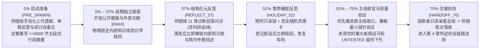
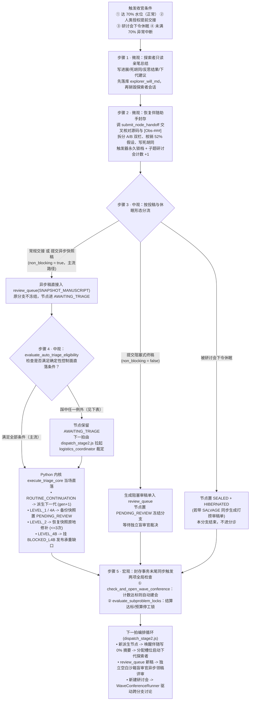

# GreatWall Agent 后勤与谱系工程架构说明（Logistics & Lineage Engineering）

> **适用版本**：GreatWall Agent `v0.3.2`  
> **文档定位**：本文从零前提视角完整拆解 GreatWall Agent 的**后勤与谱系工程**。在整座系统中，后勤与谱系工程是最贴近一线科研生产的子系统：它一方面管理单条研究路线内每一代探索者如何按 `0% → 37% → 52% → 70%` 节奏高效工作、如何反思与防偏、如何通过伴随助手传承记忆；另一方面，它承接探索者到达 `70%` 之后的全部交接、投稿、分诊、派生下代与宏观联动，是微观探索、中观治理与宏观研讨会交汇的枢纽。

---

## 1. 后勤与谱系工程要解决哪些实际问题？

让多组大模型在十几个小时内并行攻克高难度开放科学问题时，如果没有一套清晰的“轮班与谱系制度”，很快会遇到五个根本困境：

1. **长上下文退化与路径惯性**：对话超过二十余万 Token 后，模型不仅推理变慢，还会被早期报错与修补轨迹锚定，难以跳出原有框架。
2. **过早信息共享导致多样性坍塌**：多条并行分支若从一开始就互相阅读未验证草稿，先跑出局部结果的路线会迅速吸干其他分支的探索多样性。
3. **中期反思既要踩刹车，又要防被前人范式同化**：37% 打开内部知识库前，需要客观诊断自身盲区与科研品味；打开知识库读完前人成果后，模型又极易被既有范式同化，需要短暂脱离写码惯性做发散思考——但又不能为了反思作业把原本正在推进的主线彻底丢弃。
4. **“投稿即冻结”导致知识库空转**：如果每次提交阶段成果都锁死整条活跃分支等待评审，探索者就不敢投稿，整个共享知识库会陷入停滞。
5. **跨代交接与宏观会议决议难以无损落地**：换代时不能把前十代聊天记录硬塞给新一代，也不能由高层用死板的行政命令微操一线；必须由最了解本分支代码的伴随助手在微观上消化多源信息，为下一代探索者整理出一份干净、聚焦的开工桌面。

---

## 2. 核心设计：有状态的外部搜索 × 无状态的短会话接力

GreatWall 严格区分“长期记忆”与“单代工作会话”：
- **长期记忆全部外置**：所有源码与脚本存在各分支独占的 Git Worktree（`worktrees/<branch_id>/`）；所有节点历史、观测收据、死胡同档案、前情摘要、审稿反馈与研讨会备忘存在 SQLite 数据库。
- **单代探索者是短生命周期接力手**：默认有效上下文窗口为 **`W = min(360,000, 模型物理窗口)`**（可配置覆盖）。每代探索者只负责跑完自己的 `0% → 70%`（约 `252k` tokens），在上下文尚处于清醒区间时主动交接退场，由下一代干净会话接棒。
- **1:1 配对只读伴随助手（`lineage_companion`）**：每个探索节点绑定固定会话编号 `gw-comp-<node_id>` 的伴随助手。它不写代码、不跑终端，按需从磁盘恢复（`ctx.agents.resume`），用完即释放内存，依次负责：**0% 编写行前摘要 → 37% 主持元反思 → 70% 核对封存交接 →（封存后）作为只读代表出席同行研讨会**。伴随助手的核心价值正如系统设计初衷：**一线探索者专心琢磨具体科学问题，伴随助手在微观上负责治理探索者的上下文与交接质量。**

---

## 3. 单代探索者的工作节拍（0% → 37% → 52% → 70%）

### 3.1 0% 启动准备（`PRE_SPAWN`）：伴随助手整理 `<= 5000` 字行前摘要

每代探索者启动前，编排器先唤醒本节点的伴随助手。内核以恒定体量向其提供五类信息：
1. 当前节点身份、所属研究路线（`family_id`）与生效口径版本（`spec_revision`）；
2. 上一代的行前摘要（`<= 5000` 字）与两栏交接记录（`<= 5000` 字）；
3. **异步审稿意见与已送达的院内综述**：若前代异步投出的阶段报告刚收到修改意见（`pending_review_feedback_json`），或前代申请的院内专题综述已出炉，自动附在此处；
4. **最近一场跨分支同行研讨会的本分支专属备忘（`latest_wave_takeaways`）**：包含最新的子题全局总览、会议纪要，以及同行点名给本分支的接口排雷与模块协作建议（`peer_takeaways_json`）；
5. **跨路线融合导览（仅融合分支）**：若本分支属于跨路线融合分支（`SYNTHESIS`），伴随助手可直接用只读工具翻阅 `.greatwall_donors/<sec_node_id>/DONOR_MANIFEST.md` 与副供体源码。

伴随助手消化全部多源情报后，调用 `save_lineage_briefing` **定额重写**一份总长不超过 **`5000` 字**（服务端与数据库 `CHECK(total_chars <= 5000)` 双重硬校验）的五段式行前摘要：① 核心机制、② 已证实基线与待修审稿意见、③ 当前头号承重瓶颈、④ 最相关死胡同与接口避坑提醒、⑤ 本代行动计划。写完即释放伴随句柄，探索者面对一张干净清爽的桌面开工。

### 3.2 0%–37% 前期独立探索

在消耗前 37% 上下文（约 `0–133k` tokens）期间，探索者在独立 Worktree 内开展推导、编码与实验，并可随时查阅公开题面和外部参考库（`[R###]`）。此阶段**内部确证库（`L3`）、否定记录库（`L2`）、全局总览、院内专题综述及本脉历史图谱均物理锁定**，确保每条路线先独立形成自己的第一性判断。

### 3.3 37% 结构化元反思（`REFLECT_37`）

水位跨过 `37%` 且尚未解锁（`first_reflection_unlocked == 0`）时——**无论是否运行过评测仪器，纯数学推导同样准时触发**——宿主在回合边界暂停探索者，唤醒伴随助手进行最多 **2 轮**、每轮不超过 **500 字**的临床问诊：
- 伴随助手从完整的 **11 类元反思诊断目录（`C01–C11`）** 中对症挑选 `1–2` 类发问，特别强化 `C02`（过度声称）、`C08`（局部吸引子死循环）以及源自 Station 源码的第 11 类 **`C11_RESEARCH_TASTE`（科研品味拷问）**——直面审视当前死磕的细节究竟是决定整题成败的承重主干，还是因报错显眼而陷入的边角料；
- 伴随助手可附最多 2 条相关馆藏或死胡同编号指针，但严守**“三不给红线”**（不代排菜单、不代分算力、不代写公式或代码）；
- 问答结束调用 `record_reflection_and_unlock_pull` 落库并置位 `first_reflection_unlocked = 1`，当场解锁内部知识库两级检索、本脉历史图谱与院内按需专题综述权限。

### 3.4 52% 暂停编程反思（`HOLIDAY_52` / Context Holiday）与防主线中断约束

37% 打开内部知识库后，探索者读完前人成果，在约 `52%`（`~187k` tokens）时最容易被既有范式同化或陷入局部微调。借鉴 *The Station* 的 Holiday 停顿机制，系统在此触发最多 **2 回合**的暂停编程反思：
1. **短时只读锁**：宿主调用 `setSessionReadonly(expSessionId, true, 'HOLIDAY_52')`，临时拦截写文件、Shell 和评测调用，仅放行只读工具与 `submit_holiday_bet`。
2. **完全随机抽取灵感卡（同脉优先不重抽）**：内核排除本分支（`branch_id`）历史已用卡片后，对候选池执行 `random.choice` 完全随机抽卡（抽遍全池再重置），避免并行分支同代撞卡。
3. **提交即干净结回，且不抛弃原主线**：探索者提交 `submit_holiday_bet` 后，宿主立刻解除只读锁并执行 `exec.concludeTurn()` 干净结束反思回合，将控制权交还给常规探索循环。**关键边界约定**：`52% → 70%` 仅剩约 `18%`（`~65k` tokens），反思洞见应优先用于突破或改进原主线收口，或顺手做最小快速探针验证；若反思孕育出需要大段工作量的新假设，**绝不强迫探索者为了测新假设丢弃原主线收尾**——在 70% 交接时如实标记 `UNTESTED` 并写进交接建议，留给下一代在 `0%–37%` 充裕窗口内专门深挖。

---

## 4. 核心全链路：探索者到达 70% 之后究竟发生了什么？

探索者到达 `70%`（或被人类授权提前交接、或遭遇网络/额度异常中断）之后，是一次**贯通微观、中观、宏观三层**的完整状态接力。下面按真实源码（`pair_lifecycle.js` → `tools_companion.py` → `triage_core.py` → `wave_engine.py` → `dispatch_stage2.js`）的执行顺序逐环拆解：

### 步骤 1：探索者只读收尾与持久化（何时允许停？）
系统坚持“未满 `70%` 严禁探索者自主早退”，仅对四级外部硬约束让路：① 人类暂停/预算耗尽/研讨会休眠；② 人类接管后显式授权 `EARLY_HANDOFF_READY`；③ 子题已达最新口径 `FULL_GOAL` 或 `PAUSED_SATURATED`；④ 正常跑满 `70%`。
进入收尾时，宿主切入 `HANDOFF_70` 只读态让探索者写亲笔总结，**先可靠写入 `lineage_nodes.explorer_will_md` 后再销毁探索者会话**。若 `< 70%` 时发生网络或额度崩溃，只要工作树留有实质产物（`is_empty_crash == false`），同样走抢救归档进入步骤 2。

### 步骤 2：伴随助手交叉核对与独占封存（`submit_node_handoff`）
宿主按固定 ID 从磁盘恢复 `gw-comp-<node_id>`。伴随助手用只读工具核对磁盘真实源码与数据库 `[Obs-###]`（得益于仪器科的观测代码快照 `frozen_code_snapshot_path`，后续增写画图或分析脚本**不再导致历史观测拒绑**），提交以下内容并永久锁档（受触发器 `trg_nodes_lock_sealed_handoff` 保护）：
- **A 栏（客观事实与证据）+ B 栏（主观猜想与下代建议）+ `will_md`**，总长 `<= 5000` 字，`mechanism_summary < 100` 字；
- **核销 52% 反思假设**：必填 `holiday_bet_outcome`（`CONFIRMED`、`FALSIFIED` 自动写入本脉 `SCIENTIFIC_REFUTATION` 死胡同、或 `UNTESTED` 留待下代）；
- **递增宏观研讨会计数器**：同事务将 `subproblem_runtime_state.completed_nodes_since_last_conference` **加 1**。

### 步骤 3：何时送审？默认异步快照投稿与防“一稿两投”硬护栏
- **默认异步快照投稿（常态路径）**：伴随助手在 `manuscript_submissions` 中提交 `non_blocking = true` 的阶段成果、定理、算法或反例，内核立刻备份对应快照并生成 `SNAPSHOT_MANUSCRIPT` 审稿单交由后台盲审官异步处理，**原分支不冻结、不等待，也不因阶段成果过审就被 `SEALED` 提前结束**；若盲审后续返回 `REVISE`，修改意见自动追加到该分支最新节点的 `pending_review_feedback_json`，由下一代伴随助手在 `0%` 行前摘要中消化补证。
- **防“一稿两投”自动去重与防误冻结**：同一次交接中，若同时在 `manuscript_submissions` 与历史兼容字段 `local_lemma_submissions` 填写了相同标题，内核按新字段自动去重；更重要的是，**只要本次交接已经提交了非阻塞快照稿，即便伴随误将 `recommended_triage` 填为阻塞式 `LEVEL_1 / SUBMIT_BLIND_REVIEW`，内核也会自动将其归一化为 `ROUTINE_CONTINUATION / CONTINUE`**，彻底杜绝同一节点重复送审、自己与自己撞车查重以及阶段过审反杀活跃分支。
- **阻塞式送审（仅限收官或路线终结）**：仅当分支明确证明某条路线走不通并提交阻碍/反例证明（`LEVEL_4A / SEAL_BARRIER`），或未交非阻塞快照稿且明确请求以阻塞终稿结案（`non_blocking = false` 或独立 `LEVEL_1`）时，节点才置为 `PENDING_REVIEW` 冻结等待裁决（阻塞稿被判 `REVISE` 时节点切回 `ACTIVE_REVISING` 原地返工，Stage 1/2 共用上限 2 轮，第 3 次仍不通过则置 `SEALED` 并记入 `L2(UNRESOLVED_OBJECTION)`）。

### 步骤 4：中观六类去向全貌、确定性直落与 `logistics_coordinator` 的清晰边界
非阻塞节点进入 `AWAITING_TRIAGE` 后，内核先过滤所有平台/仪器故障（`INSTRUMENT_ERROR / INFRA_ERROR` 对探索者零处罚），再按六类明确去向流转：

| 分诊去向 (`triage_level` / `action`) | 适用科学场景 | 确定性内核动作与后继流向 |
| :--- | :--- | :--- |
| **`ROUTINE_CONTINUATION` / `CONTINUE`** | 正常渐进探索、或附带 `manuscript_submissions` 异步投稿的阶段突破 | 备份最新快照、`protection_generations_left` 减 1，派生 `generation + 1` 新节点（`EXPLORING`）继续推进 |
| **`LEVEL_2` / `INPLACE_REPAIR`** | 存在确凿 `CANDIDATE_ERROR` 代码报错，科学假说本身尚未被实测检验 | 从物理快照恢复工作区、锁定原研究路线原地修补，上限 **`3` 次**；满 3 次仍败记入本脉 `lineage_dead_ends(IMPL_FAILURE)` 并回退重启，**绝不污染图书馆 `L2`** |
| **`LEVEL_4A` / `SEAL_BARRIER`** | 构造出严密反例或严格证明该路线不可行（附 `>=15` 字 `barrier_proof_md`） | 冻结分支为 `PENDING_REVIEW` 送盲审；确证后以 `NEG_COUNTEREXAMPLE / BARRIER_PROOF` 入库 `L3` 并置 `SEALED` |
| **`LEVEL_4B` / `PAUSE_TO_READY_QUEUE`** | 明确卡在单个定理级缺失引理，或上游依赖 `L3` 被撤回触发 `premise_revoked` | 节点置 `BLOCKED_L4B` 释放并发槽位，同时在 `open_lemma_gaps` 公开发布悬赏缺口；日后任一过审 `L3` 由盲审官在 Stage 2 勾选 `fulfilled_gap_ids`（或精确 `requires` 就绪）即可原子唤醒该分支继续推进 |
| **`LEVEL_3` / `SPAWN_PROTECTED`** | 主指标暂低但呈现出罕见守恒律、极端反例或单维非支配优势 | 不自动直落，交由后勤评估或留待研讨会 `PROTECT` 单开受保护支线（`branch_kind = 'PROTECTED'`，享有 1 代成长保护期） |
| **`LEVEL_1` / `SUBMIT_BLIND_REVIEW`** | 未走异步快照投稿、且明确需要冻结本分支等待终稿核验时 | 校验可核验载体后备份快照并置 `PENDING_REVIEW` 送审 |

内核调用 `evaluate_auto_triage_eligibility` 决定是否当场直落，并与 **`logistics_coordinator`（后勤调度总管）** 划清极简职责边界（避免与研讨会主席撞权）：

| 执行主体 | 精确触发条件 | 核心职责边界 |
| :--- | :--- | :--- |
| **Python 确定性内核直落** （绝大多数常规交接，零模型开销） | 节点已有已登记的 `family_id`、该子题无 `>50%` 路线聚拢告警、且属于 `{ROUTINE_CONTINUATION, LEVEL_1, LEVEL_2, LEVEL_4A, LEVEL_4B}` 并满足前置条件 | 当场执行 `execute_triage_core` 落库与派生下代（若人类运行安排要求 `FINISH_CURRENT_HANDOFF` 或分支预算耗尽则温和停驻） |
| **`logistics_coordinator` 按需兜底** （仅保留 3 类初始化与场间应急职责） | ① Stage 1 开局为各子题登记首批正交研究路线与初始分支；② 子题出现缺编/零活跃分支时的紧急补枝；③ 两次研讨会之间触发 `>50%` 单路线聚拢告警的即时正交分流（`fork_branch(orthogonal)`），以及未归类/孤儿返工单（`fork_branch(lateral)`）或 `LEVEL_3` 疑难兜底 | 跨路线融合（`SPAWN_SYNTHESIS`）、常规反常保护（`PROTECT`）与裁剪休眠（`HIBERNATE`）统一收归宏观研讨会 `conference_chair`，两头不再撞权 |

### 步骤 5：顺手触发宏观研讨会与子题停工锁
无论步骤 4 是直落派生下代还是进入审稿/休眠，`submit_node_handoff` 末尾都会立即调用：
1. **`check_and_open_wave_conference(conn, question_id)`**：一旦 `completed_nodes_since_last_conference >= max(2, active_branches * 2)`，立刻原子建会并将计数器清零，随后由 `WaveConferenceRunner` 推进研讨会；
2. **`evaluate_subproblem_locks(conn, question_id)`**：核查是否满足达标停派、预算保险丝或串行子题 `question_order` 解锁条件。

---

## 5. 多路线多样性保护、分支级前置依赖与旁路融合

1. **1 代成长保护期**：新开辟路线、受保护支线（`PROTECTED`）、跨路线融合分支（`SYNTHESIS`）与人类种子分支（`HUMAN_SEEDED`）统一读取 `config.json` 的 `branch_growth_protection_generations = 1`（后勤 `fork_branch`、中观 `LEVEL_3` 与研讨会 `OPEN_NEW_BRANCH / PROTECT / SPAWN_SYNTHESIS` 全链路统一），保护期内免于被研讨会过早休眠；跑完第 1 代后 `protection_generations_left` 归零，接受正常评估。
2. **分支级精确前置依赖（`requires`）与温和撤回处理**：无论是由后勤 `fork_branch` 还是研讨会 `OPEN_NEW_BRANCH / PROTECT / SPAWN_SYNTHESIS` 创建的新分支，均可声明确定性前置依赖（仅限活跃 `L3-###` 或通过观测 `OBS:<instrument_id>:PASS`）。调度器**只阻断声明了未就绪依赖的那一条分支，绝不锁死同题其他并行路线**；若运行中途前置 `L3` 被撤回，内核标记 `premise_revoked = 1`，不强杀在跑会话，待其自然交接时自动转入 `LEVEL_4B` 挂起等待重连。
3. **防聚拢分流与软撤编**：某子题下同一方法族满足 `branch_count >= 2` 且活跃占比 `> 50%` 时无豁免触发正交分流（跨路线融合分支豁免此锁）；被撤编（`RETIRED`）或归档（`ARCHIVED`）的路线不再自动补生。
4. **旁路跨路线融合（`SPAWN_SYNTHESIS`）**：不动原纯血分支 A 与 B，新建独立融合分支克隆主供体、只读挂载副供体至 `.greatwall_donors/<sec_node_id>/` 并自动生成 `DONOR_MANIFEST.md`（完整收录研讨会第 2 轮及后续追问轮中双方点对点接口排雷记录）。
5. **串行子题顺序（`question_order`）平滑解锁**：前序子题达成单篇通关（`STOPPED_SOLVED`）、多篇组合终核通关、开放题饱和收敛（`PAUSED_SATURATED`）或人工显式 `CLOSED` 时，立即解锁后续子题。

---

## 6. 附录：核心表、工具与角色精简说明

- **核心表（5 张）**：`lineage_nodes`（默认 `effective_context_window = 360000`、`protection_generations_left = 1`）、`lineage_briefings`（硬约束 `total_chars <= 5000`）、`lineage_dead_ends`、`method_families`、`open_lemma_gaps`（含 `gap_tier`）。
- **硬触发器**：`trg_nodes_lock_sealed_handoff`。
- **角色窄工具**：`explorer`（11 个）、`lineage_companion`（11 个）、`logistics_coordinator`（5 个）。
- **边界收口结论**：`logistics_coordinator` 按现行方案收窄为“Stage 1 开局建首批正交路线 + 缺编补齐 + 两次研讨会间 `>50%` 聚拢应急分流与疑难兜底”，与 `triage_core.py` 确定性直落和 `conference_chair` 宏观调树形成无重叠的三段互补。
