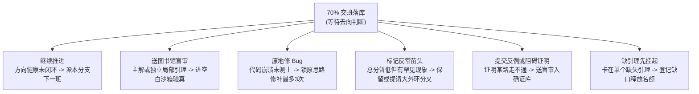

# GreatWall Agent 后勤工程架构论文（Logistics & Lineage Engineering）

> **系统版本**：GreatWall Agent `v0.3` 顶层架构定稿  
> **阅读指南**：本文全面介绍 GreatWall Agent 的**后勤工程**——也就是负责管理一线 AI 科研人员如何思考、如何查资料、如何交接班、如何在单条路线上稳步接力，以及如何落地执行宏观研究树调整的整套体系。正文全程使用平实自然的语言从零讲起，无需任何前置背景即可读懂；精确的数据库表名、枚举值、工具清单与学术出处统一收拢在文末第 7 章，供中层开发与审计对照。

---

## 1. 后勤工程到底要解决什么问题？

假设你雇了一支由前沿大模型组成的科研团队，打算让他们连续跑一整晚，去攻克一道拆分成多个子题（例如 Q1、Q2）的开放科学或算法难题。这些 AI 的知识面极广、写代码和推公式的速度飞快，但如果把它们直接放进聊天室里自由发挥，不出半小时，几乎必然会暴露出四个顽固毛病：

1. **聊得越长越糊涂，还会体面地提前摆烂**：对话拉长到十几万字后，模型不仅推理成本飙升，还会被自己早期的局部直觉锁死，最后用极其流畅的学术辞令宣布“当前方案已接近极限”并停止实质探索。
2. **一开局就互相抄作业，多并发退化成重复劳动**：同时派出 4 个 AI 攻克同一道题，如果它们一上来就能互相偷看未验证的半成品草稿，谁先跑出一个看起来不错的数字，其余 3 个人立刻跟风涌过去，多并发瞬间退化成 4 个人在同一个局部山包上微调。
3. **换人接班时，记忆要么丢光、要么撑爆新窗口**：为了避免长对话脑雾，必须定期结束旧会话、换新会话接班。但如果不做专门设计，新来的 AI 要么完全不知道前人踩过什么坑，要么你把前 10 代人的聊天记录全塞给它，刚一开工上下文窗口就爆了。
4. **单分支视角太窄，容易越权乱改全局方向**：如果让单个正在跑的小组自己决定“把别派砍掉”或者“宣布整道难题无解收工”，它根本看不见全院全局，必然做出短视决定。

**后勤工程的存在，就是为了建立一套井然有序的实验室轮班与接力制度。** 它的边界非常干净：**管好每一班岗怎么干扎实、管好每一条分支内部怎么稳步接力、并忠实执行由宏观大外环下发的整棵树调整指令**（至于跨分支怎么辩论、写全局综述、决定怎么合体或休眠，则交给《图书馆工程》主导的宏观大外环去做）。

---

## 2. 三层分工中的精准站位：后勤工程管什么、不管什么

为了避免职责打架，整座 GreatWall 系统把科研探索严格切成**微观、中观、宏观**三层，每一层只管自己最拿手的事：

- **后勤工程核心负责前两层，并充当第三层的执行手脚**：
  - **微观层（单班岗的一生）**：让 1 名科研人员配 1 名专属助手，按清晰节拍（`0% -> 37% -> 70%`）高质量干完一班岗，到点清醒交班，绝不拖成无限长的脑雾对话。
  - **中观层（单分支纵向快流转）**：只处理**不改变全局树结构**的局部事务——本分支方向健康就派下一班、代码崩了就原地修 Bug、有了硬成果就随时送图书馆盲审、明确缺某个引理就先挂起省算力。响应极快，不需要等全院开大会。
  - **落地执行宏观大外环的树结构工单**：每当图书馆主导的宏观大外环开完圆桌会、写完全局综述并签发了“开辟新学派、保护性分叉、双供体旁路合体、撞车休眠、或者子题停工”的大树变动指令时，由后勤工程负责把代码目录（Git Worktree）、只读供体切片、槽位分配和新助手开机全部精准落到实处。

---

## 3. 微观运转：“科研人员 + 专属助手”一班岗的完整一生

在 GreatWall 里，长期的研究资产（代码、测试收据、死胡同档案、前情提要）全部存在硬盘的数据库和独立代码目录里，而每一个大模型会话都是**用完即走的短工**。把这一班岗的时间轴拉直，它有四个清晰节点：

### 3.1 怎么量一班岗干了多久？（自适应时钟与 70% 硬锁优先级）

系统不按“聊了多少轮”来算一班岗的长度，而是直接按**当前对话消耗了多少上下文空间**来度量。具体取 **`50 万 Token` 与当前模型真实物理窗口的较小值**作为标尺（记作有效窗口 `W`）——对百万级超大窗口封顶在 50 万以控成本、防发散；对 12.8 万或 25.6 万的中小窗口按自身真实上限算比例，确保能顺利抵达 37% 和 70%。

**为什么坚持“未满 70% 不许自己提前下班”？**  
为了治住大模型“跑通一个小例子或遇点阻力就想体面交差”的偷懒毛病，也为了省去“找谁审批允许提前下班”的复杂官僚流程。在无人干预的常规探索中，未满 70% 时系统一律拒收提前交班，自动督促它利用剩余预算去做边界压力测试、寻找极端反例或完善复现脚本。

同时，这条硬锁只约束“AI 自己想偷懒”，遇到外部硬约束必须无条件让路。优先级从高到低写死为四级：
1. **第一优先级**：人类按下紧急叫停，或者整道题/整个项目的硬预算耗尽；
2. **第二优先级**：人类中途接管了这个节点（例如在 45% 暂停并手改了代码），之后显式授权它提前交班（或直接中止该节点）；
3. **第三优先级**：这道子题刚刚在空白沙箱里验真出了当前最新口径下完全达标的解（`goal_coverage = 'FULL_GOAL'`），或证明原题全局无解的严格数学不可能证明（`BARRIER_PROOF` 且 `goal_coverage = 'FULL_GOAL'`），系统下令整道子题立刻停工；
4. **常规托管**：以上情况均未发生，则严格跑满 70% 再交班。

---

### 3.2 第 0 秒开工：助手和科研人员桌上分别摆了什么？

每一班岗启动时，助手和科研人员都是全新创建的干净会话。为了既不断掉研究血脉、又不让初始窗口随代数越来越臃肿，两者的初始桌面有极严格的设计。

#### 伴随助手的初始桌面：固定大小的 4 样小材料 + 从第 0 秒起就能查全馆
助手启动时，系统往它窗口里塞的初始信息**永远只有固定几千字**（无论这条分支已经接力到了第 3 代还是第 50 代，启动开销恒定不变）：
1. **身份与口径头（约 300 字）**：标明子题号、分支号、第几代、当前题目要求是第几版、这条分支的核心研究思路，以及本班任务类型（开局新种子、常规续班、盲审打回返工、代码修 Bug、双供体合体、还是缺失引理补齐后唤醒）。
2. **本分支上代留下的两样核心交接物**：上一班的《前情提要》（不超过 2200 字；如果是第 1 代新种子，则换为种子先验思路），以及上一班刚退场时写的那一页《交班记录》（不超过 2000 字）。前 20 代踩过的所有死胡同绝不硬塞进来，只给一句提示：“本组历史档案里共有 N 条死胡同记录，需要核对时自己去查。”
3. **特殊任务附条（仅特殊节点有）**：
   - 盲审打回返工：附上审稿人的具体修改意见清单；
   - 宏观大外环签发的双供体合体分支：附上合体嫁接目标，以及另一派代码快照的只读文件夹路径；
   - 因缺失引理挂起后被唤醒：附上刚刚在图书馆证出来的那条引理编号与简介。
4. **图书馆最新《子题全局总览》版本号提示（1 行）**：告知目前馆里攒了多少条已证实成果、多少条实锤死路、多少台可用仪器。

**极其重要的一条设计：助手从第 0 秒开工起，就拥有查阅图书馆所有公开资料和本分支全部历史档案的完整权限。** 助手不是要被蒙住眼睛的探索者——它在动手改写本班《前情提要》前，可以先自己去翻一眼图书馆最新的《子题全局总览》，如果发现上代科研人员临走前想试的路线昨天刚被别人证伪成了死路，或者卡住的前置引理已经进了库，助手写提要时心里就有底，绝不把科研人员往已知火坑里推（同时助手严守输出纪律：0% 写提要时只用来帮本派避开已实锤的 `L2` 死坑，绝不抄录他派现成套路或剧透未验证猜想，也不替科研人员定具体算法）。写完不超过 2200 字的新提要存入数据库后，助手的开工活就干完了。

#### 科研人员的初始桌面：一张极其清爽的实验台
助手把本班《前情提要》存进数据库后，系统才启动科研人员。科研人员的提示词彻底做“角色盲盒”——**绝不夹杂任何后勤分诊规则、圆桌会议制度之类的宏观行政名词**，让它全神贯注做研究。桌上只放 4 样东西：
1. **题目要求与当前口径**：要解决什么问题、什么算达标；
2. **现成可用的实验室仪器清单**：只写仪器名、版本号和一句话接口说明，不塞源码；
3. **只读文件与脚本清单**：公开题面数据目录里的文件树，以及本分支自己的 `tools/` 文件夹里前人沉淀的脚本名和首行注释（双供体合体分支则多一行另一派只读目录的路径）；
4. **助手刚写好的《前情提要》（不超过 2200 字）**：清晰锁定本派核心思路、已证实基线（若在返工期则置顶审稿意见）、眼下最核心的矛盾、最相关的几条踩坑记录，以及上代留下的下一步实验交代。

---

### 3.3 前 37%：独立探索，不看院内其他小组的内部成果

开工后的前 37% 上下文空间，科研人员可以在自己独立的代码目录里自由写代码、跑终端、调用三档测量仪器，也可以翻阅公开题面和图书馆整理的**外部公开文献**（教材定理、外部论文摘要）。但**图书馆的内部成果区和本分支深层历史档案此时处于锁定状态**。

这就像科研新人进组后，先让他自己带着本学派的先验独立推演、实实在在地撞一次墙，暴露出自己真正的卡点，而不是第 1 分钟就照抄别人的现成套路导致全院思维趋同。

---

### 3.4 到达 37%：助手回来做一次简短的“外部专家问诊”

上下文占用一到 37%（哪怕全程在推纯数学公式、一次数值脚本都没跑过，同样准时触发），系统会在当前这轮操作结束后暂停科研人员，重新叫回**同一个专属助手**。

助手此时切换为**严苛的外部领域学者**视角，快速扫一遍科研人员前 37% 的行动摘要，结合自己能查到的图书馆成果和本组死胡同档案，与科研人员进行 **最多 2 轮、每轮不超过 300 字** 的短对话：
1. **临床挑毛病**：重点排查大模型最容易掉进去的“假装忙碌”陷阱（例如在局部参数上无止境微调、沉迷写华而不实的元工具、或凭单次失败轻率断言整类方法无解）；
2. **给线索不代打**：如果发现科研人员快要撞进某条已经证伪的死胡同，或者馆里刚好有一条现成的已证实引理，助手最多点出 **1 到 2 个具体编号**，让它待会儿自己去看；
3. **抛一道跳出框架的启发题**：从随机抽取的“夜科学”启发题库里挑一个尖锐问题，帮它换个角度重新审视底层假设。

全过程助手严守**“三不给”红线**：绝不给算力分配、绝不给方案排序菜单、绝不写代码或公式。决定权 100% 留给科研人员。问诊结束当场解锁全馆资料查阅权限，助手退下，科研人员继续攻坚。

---

### 3.5 37% 到 70%：科研人员自己按三步结构精准翻资料

解锁后，我们坚持让科研人员**自己主动去拉取（Pull）需要的资料**，绝不让助手把几千字大文章强行灌进科研人员窗口。为了让 Pull 既准又省空间，科研人员顺着图书馆提供的**三层确定性结构**由粗到细翻阅：
1. **第一步：先看 1 页《子题全局总览》（不超过 1500 字）**——一眼看清这道子题目前最好的已证实解、可用仪器、已证实引理分类索引、实锤死路禁区和眼下全院公认的未解缺口，彻底告别凭运气猜关键词盲搜；
2. **第二步：再拉具体编号的《条目简介卡》（每条不超过 350 字）**——核对清楚某条引理的前提条件、输入输出和适用范围，确认能不能严丝合缝接上自己的推导；
3. **第三步：只点开真正要用的那一两篇《完整原文》**——确认要引用或复用时，才按编号拉取完整证明正文或只读导入其代码模块。

---

### 3.6 到达 70%：两步清醒交班、特殊兜底与“助手去哪了”

上下文到达 70% 时，交班严格分两步执行：
1. **科研人员先亲笔写交代**：系统瞬间锁住它的改文件与终端权限，只允许输出最后一轮纯文本，让它趁头脑清醒亲笔写清本班成果、反常线索和《科研遗嘱》（下一步最小鉴别实验、最怀疑哪有漏洞）。**系统必须先把这份原文可靠存进数据库，才允许关闭科研人员会话。**
2. **叫回同一个助手，拿 4 样真凭实据交叉核对**：助手绝不只听科研人员一面之词，而是同时对照 **① 自己 0% 和 37% 的连贯记忆、② 科研人员亲笔遗嘱与去思维链行动目录、③ 用只读工具亲眼查看硬盘上的真实代码与改动、④ 数据库里的官方测试收据和全馆已有成果**。核对完毕后，将内容硬拆成两栏落库并加锁：**A 栏只写实测或严密推导出的客观事实**（以后送盲审只给看 A 栏），**B 栏只写未证实猜想与遗嘱**；同时把本班排除的新死胡同登记进本分支永久档案。

#### 两种意外场景的兜底
- **没跑到 70% 意外崩溃（断线或超长卡死）**：系统直接唤醒助手进入抢救模式，扫一遍硬盘代码目录与已有测试收据——只要留有哪怕半页推导草稿、反例脚本或阶段代码（不是一字未写的空崩溃），照样整理归档，绝不浪费心血。
- **人类中途暂停改了代码又提前叫停**：设施层会自动比对硬盘当前代码哈希和上次测试收据。改过代码并重新跑过官方测试的，新收据正常记入 A 栏；改了代码没来得及重测、或者人类只在聊天里提了思路的，一律老老实实记入 B 栏和遗嘱，绝不让未经验证的改动混入 A 栏事实。

#### 助手平时不用时去哪了？
得益于底层宿主（DSH）天生把每个会话的完整事件流持久化存在硬盘上，系统只给这班岗的助手分配一个固定会话编号（`gw-comp-<节点编号>`）。**0% 写完提要就释放内存；37% 按编号从硬盘原样打开；70% 交班并给交班记录加锁后再次释放内存；如果随后本分支被叫去参加图书馆的波次圆桌会议，就按编号再打开一次——此时系统自动撤掉它修改本分支档案的写权限，开完会立刻彻底归档。** 下一班岗启新节点编号、换新助手，既零空闲内存占用、不怕软件重启，又完整保留了本班岗从头到尾的一手记忆。

---

## 4. 代际记忆与“树内私有知识”的隔离原则

GreatWall 严格区分**“单棵研究树（分支）的私有知识”**与**“中央图书馆的全局知识”**。后勤工程守护的是每条分支私有的两本账——**别家分支绝对看不见**，这是多路并发不趋同的根本防线：

1. **《全量死胡同档案本》（只增不减）**：每班交班排除的边界条件（按科学证伪、代码实现失败、环境故障分类）永久追加保存。哪怕跑到第 30 代，过 37% 解锁后依然能查到第 1 代踩过的每一个坑。
2. **《2200 字前情提要》（恒定大小滚动改写）**：每换一班岗，助手绝不把旧提要和新手记直接拼接，而是像编辑改稿一样，把旧提要和刚退场这一班的新手记重新浓缩改写成一份总长不超过 2200 字的新提要——已解决的旧矛盾并入已证实基础、过时基线淘汰、活跃盲审异议置顶、死胡同只留眼下最相关的几条并附全表条数提示、下一步交代整段替换为新遗嘱。

---

## 5. 中观快流转：单分支交班后的 6 种去向与成果留存

一班岗交班落库后，在完成去向判断并备份好当前代码快照前，严禁抢跑开启该分支下一班。先过滤掉平台仪器自身报错（对科研人员零处罚，直接报修仪器科），再按实际产出分流至 **6 种中观去向**：

### 5.1 为什么分诊和“打捞局部成果”严丝合缝、绝不打架？
过去容易让人困惑的是：“冲刺大题没成功，但半路证出了一个好引理，到底是交班时直接送审，还是以后派人打捞？”我们把时机彻底划清，分成三个互不重叠的截面：
1. **交班时活节点主动拆着交（最优先，与原分支彻底解耦）**：70% 交班时，只要助手发现本班虽然没解出整道大题，但已经证通了一个干净独立的局部引理或可复用模块，**直接挂在当前冻结快照上新建一张独立局部审稿单送盲审**（绝不锁死来源节点、不改变也不阻断原分支继续推进），同时原分支照常派下一班继续攻主目标，不必等分支死后再翻旧账。
2. **大论文被盲审拒了，审稿人当场收编好零件**：送去冲刺全题的大手稿若主结论有漏洞救不回来，但盲审官在沙箱里已经实测确认其中的局部引理是对的，审稿官直接在盲审阶段把主结论失灵边界入排雷库、同时把那个局部引理直接收进确证库，绝不拒了再让人重审第二遍。
3. **从未送过审却被大外环休眠的路线，才做一次遗产清点**：只有一直闷头走“继续推进”、从未送过审，最后在宏观大外环圆桌会上被判撞车休眠的多代分支，才由裁判按需派人扫一眼硬盘遗产，把漏网的好引理捞出来走独立盲审。

而且一旦**任何渠道产出的局部引理**通过盲审入库，后勤系统通过两条清晰的唤醒通道叫醒对应的挂起分支，绝不靠纯 SQL 猜自然语言等价性：
- **通道一（精确结构化依赖 $\to$ 纯 SQL 秒级自动唤醒）**：凡声明了确定性依赖键（`L3-###` 或 `OBS:<instrument_id>:PASS`）的分支，由数据库事务即时自动投递唤醒任务；
- **通道二（自然语言悬赏引理 `open_lemma_gaps` $\to$ 盲审 Stage 2 显式核销）**：盲审官在第二阶段解盲入库新 `L3` 时，系统自动把本题全部 `OPEN` 状态的 `open_lemma_gaps` 列表一并展示给盲审官；若新过审的 `L3` 恰好证明了其中某条悬赏引理，盲审官在提交裁定时显式勾选对应的 `fulfilled_gap_ids`，单写者事务原子将该缺口标为 `FULFILLED` 并自动叫醒对应分支继续冲刺（严守分权，只读的综述官不直接核销悬赏）。

### 5.2 分支级极简依赖（绝不锁死整道题）
如果某条分支明确依赖图书馆里某条已证实引理才能继续，系统只锁定声明了该依赖的**这一条分支**，绝不把不同分支的依赖取并集锁死整道子题。万一运行中途它依赖的那条前置引理被人推翻撤回了，系统也不粗暴强杀正在跑的会话，而是悄悄打个标记，等它自然跑到 70% 交班时温和转入“缺引理挂起”。

---

## 6. 后勤如何配合宏观大外环执行「树结构变更」与「子题停工」

后勤工程彻底删掉了过去华而不实的“五车道停滞口号”，所有影响整棵科研树的大动作（开拓全新学派、保护性分叉、双供体旁路合体、同构撞车休眠、以及未达标时的语义暂停），统一由《图书馆工程》主导的**宏观大外环**（脉冲式对账 $\to$ 圆桌对抗 $\to$ 硬接地全局综述与明确缺口清单）来决策，再交由后勤工程严格按以下护栏落地执行：

1. **成长保护期护栏**：任何新开拓的学派、刚创建的合体分支，以及人类通过 Superagent 注入的**人类种子分支（`HUMAN_SEEDED`）**，默认享有**至少 2 班岗的成长保护期**；保护期内即使暂时落后，大外环也无权将其裁撤，防止早产儿被一棍子打死。
2. **旁路双供体合体装配（绝不污染原纯血分支）**：当大外环签发“将 A 派已证实模块与 B 派框架融合”的工单时，后勤工程**绝对不动原来的分支 A 和分支 B**，而是单独新建一条合体分支 `Branch-AB`——主工作区克隆主供体快照，同时把次供体的代码快照只读挂载到独立子目录 `.greatwall_donors/<节点编号>/` 下，并挂上大外环批准的有限验证预算（例如最多 2 班岗）。验证成了就转正，不成即销毁，原纯血分支毫发无损。
3. **日常防过度聚拢兜底**：除了宏观大外环的定向开拓外，后勤部仍保留一道确定性底线巡检——如果在两次大外环之间，同一道子题下有超过一半的活跃名额（且至少 2 个分支）意外挤进了同一种底层思路，控制面会立刻发出分流告警，阻止单一思路吞噬全部并发名额。
4. **严格执行子题停工三道锁**：
   - **锁一（硬证据通关，随时立刻停）**：任意时刻，只要某道子题在当前口径下有成果通过空白沙箱验真确认完全达标（`goal_coverage = 'FULL_GOAL'`），**或拿到了证明原题在当前口径下全局无解的严格数学不可能证明（`l3_entry_kind = 'BARRIER_PROOF'` 且必须同时满足 `goal_coverage = 'FULL_GOAL'`；仅证明某一条方法路线不可行的局部阻碍证明归为 `PARTIAL_OR_LEMMA`，绝不停派整道子题）**，后勤立刻禁止给该子题派任何新活，正在跑的其他小组给一个短暂收尾期限（默认 60 秒）安全退出并回收算力，全部投入尚未解出的其他子题；
   - **锁二（大外环语义收敛，受最低投入窗约束）**：在跑满人类设定的最低投入时间前，绝不允许系统以“找不到突破”为由提前停工；越过最低投入窗后，若宏观大外环的硬接地综述确认所有明确缺口已穷尽或连续多波毫无新进展，后勤将这道子题置入**“待人类拍板暂停态”**，停止新派工并保留现场等人类决定；
   - **锁三（物理硬预算保险丝与全员阻塞自报）**：预算上限采用稳健的保险丝原则——只要已耗 Token 或波次触达该子题上限，后勤立刻停止派发新班次并让已在跑的分支自然优雅收尾（绝不整夜空烧，也无需堆砌银行级分布式预扣款四账本）；此外，若调度器发现某活跃子题既未达标、又所有分支均因缺引理挂起（无任何活枝可派），立刻自然置为 `PAUSED_BLOCKED(ALL_BRANCHES_BLOCKED)` 并通知 `gw-chief` 提醒人类介入，杜绝静默僵死。

---

## 7. 附录：工程契约与理论出处（供开发与审计查阅）

> 本章将正文概念 100% 精确映射到现版代码库的真实 SQLite 表结构、保留枚举、窄工具名与学术文献出处。实现时严禁擅自改表名或复用旧编号表达新语义。

### 7.1 核心 SQLite 表与字段映射

| 概念 | 真实表名与主键 | 核心字段与硬约束 |
| :--- | :--- | :--- |
| 单班岗记录 | `lineage_nodes(node_id)` | `question_id`, `branch_id`, `family_id`, `generation`, `branch_kind`（`PURE / PROTECTED / SYNTHESIS / HUMAN_SEEDED`）, `protection_generations_left`, `branch_budget_nodes_left`, `node_status`, `control_state`, `control_generation`, `companion_session_id`, `briefing_sealed_at`, `secondary_donor_node_id`, `mechanism_summary`（`<100` 字）, `evidence_grade`, `column_a_facts_md`, `column_b_hypothesis_md`, `will_md`, `pressure_tokens`, `effective_context_window`, `first_reflection_unlocked`, `premise_revoked`, `revise_count`, `inplace_repair_count`, `artifact_dirty_since_last_obs` |
| 树内全量死胡同档案 | `lineage_dead_ends(dead_end_id)` | `question_id`, `branch_id`, `node_id`, `category`（`SCIENTIFIC_REFUTATION / IMPL_FAILURE / ENV_FAILURE`）, `scope_condition_md`, `failure_mechanism_md`, `bound_obs_id`（只追加不删） |
| 2200 字前情提要 | `lineage_briefings(briefing_id)` | `branch_id`, `node_id`, `sec1_mechanism` ~ `sec5_immediate_will`, `total_chars <= 2200`（服务端硬限） |
| 思路分组族谱 | `method_families(family_id)` | `question_id`, `mechanism_signature`, `orthogonal_contrast`, `family_status`（`ACTIVE / BLOCKED`）, `blocking_lemma` |
| 子题独立收支与停工表 | `subproblem_runtime_state(question_id)` | `desired_state`（`ACTIVE / PAUSED / CLOSED`）, `dispatch_state`（`DISPATCHING / STOPPED_SOLVED / PAUSED_SATURATED / PAUSED_HUMAN / PAUSED_BLOCKED / CLOSED`）, `solved_entry_id`, `started_at`, `min_commitment_sec`, `question_token_budget`, `spent_tokens`, `completed_waves`, `max_waves`, `completed_nodes_since_last_l3`（仅作大外环硬账本参考统计，不单方面触发停工）, `completed_nodes_since_last_conference`, `drain_grace_sec` |
| 缺失引理悬赏榜 | `open_lemma_gaps(gap_id)` | `question_id`, `blocked_node_id`, `formal_statement_md`, `status`（`OPEN / FULFILLED / CANCELLED`）, `fulfilled_by_entry_id` |

### 7.2 六种中观去向的精确枚举（100% 沿用现版 SSOT）

- `ROUTINE_CONTINUATION` $\to$ `CONTINUE`（正常续推本分支下一班）
- `LEVEL_1` $\to$ `SUBMIT_BLIND_REVIEW`（送盲审；支持主解与独立局部引理双粒度，须具备有效观测收据、实体文件、或 $\ge 60$ 字自包含解析 A 栏之一）
- `LEVEL_2` $\to$ `INPLACE_REPAIR`（仅针对代码崩溃 `CANDIDATE_ERROR`，锁定原学派、恢复快照原地修补最多 3 次；满 3 次入本组 `lineage_dead_ends(IMPL_FAILURE)`，禁污图书馆 `L2`）
- `LEVEL_3` $\to$ `SPAWN_PROTECTED`（反常或单维优势保护支线）
- `LEVEL_4A` $\to$ `SEAL_BARRIER`（严密反例或阻碍证明送盲审，确证后入 `L3_VERIFIED`）
- `LEVEL_4B` $\to$ `PAUSE_TO_READY_QUEUE`（登记 `open_lemma_gaps` 冻结释槽，待任意 `L3` 填平缺口自动唤醒）

### 7.3 角色窄工具清单（已移除原五车道工具）

- **科研人员 `explorer`（7 个）**：`run_isolated_eval`、`get_living_survey`（37% 后解锁）、`query_library_catalog`（0–37% 仅返外藏）、`get_library_entry`、`request_literature_survey`、`read_lineage_graph`（37% 后解锁）、`handback_to_chief`（人类直连本子节点对话时，若提出超出本分支范围的全局诉求，原样退回 `gw-chief` 统筹，绝不越权执行）。
- **专属助手 `lineage_companion`（7 个）**：0% 起全套只读 Pull（`get_companion_context`、`get_living_survey`、`query_library_catalog`、`get_library_entry`）+ 阶段写工具（`save_lineage_briefing`、`record_reflection_and_unlock_pull`、`submit_node_handoff`；交班加锁后参会时自动换挂 `submit_conference_statement`）。
- **后勤调度（确定性控制面 + 按需拉起的 `logistics_coordinator`，4 个）**：`get_logistics_dashboard`、`register_method_family`、`triage_node`、`fork_branch`（常规 70% 交班去向由确定性控制面优先按助手结构化提报直接落单；开局登记首批正交方法族或遇疑难/跨域异常时，按需拉起无状态 `logistics_coordinator` 处理）。

### 7.4 核心文献与大厂实战出处

1. **Stateless Language Agents (SLA)** (`arXiv:2610.07625`)：有状态外部搜索 $\times$ 无状态短会话、靠确定性结构主动 Pull、防长对话怠惰、区分代码报错与科学失败。
2. **The Station v1 & v2** (`arXiv:2608.23691`, `arXiv:2610.08927`)：前期隔离防跟风、37% 外部专家问诊（11 类反思与 29 条夜科学启发题）与子题达标冻结。
3. **AgentDiscover** (`arXiv:2610.05334`)：自主定向 Pull、工具回执动态路标、`<worktree>/tools/` 持久化，以及过程顾问“三不给”红线。
4. **OpenAI CDC 64-Agent Prompt**：显式方法族谱、超半数聚拢强制正交分流、延迟交叉授粉，以及强制跑满最低投入时间防提前放弃。
5. **OpenAI `distributed_agent` (`bioRxiv:2026.10.15.759436`)**：一线 Worker 严禁谈全局、只交绑定实证的局部账本。
6. **Diversity Collapse in MAS** (`arXiv:2604.18005`) & **Novelty Search** (Lehman & Stanley, 2011)：严禁跨分支广播未审思路防趋同；为反常垫脚石保留 `LEVEL_3` 保护线。
