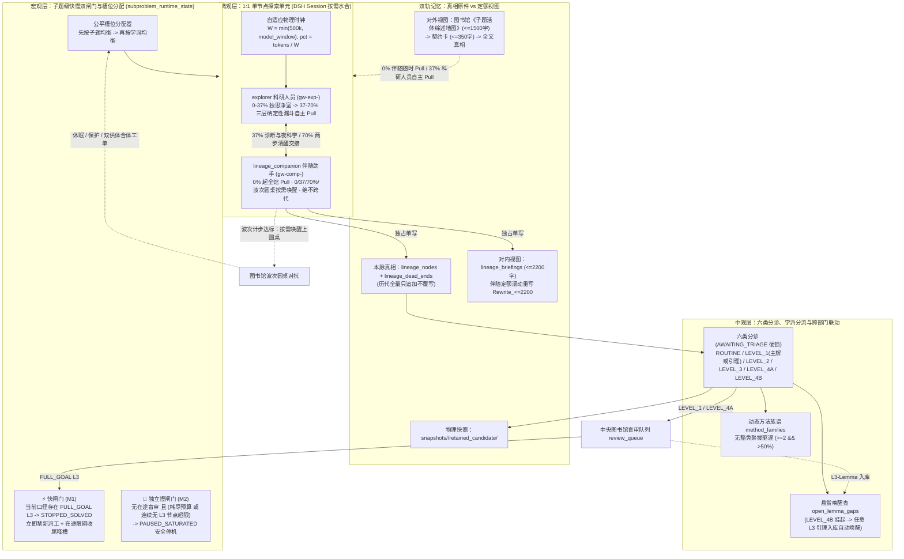

# GreatWall Agent 后勤工程架构论文（Logistics & Lineage Engineering）

> **系统版本**：GreatWall Agent `v0.3` 终态架构定稿  
> **文档性质**：零前提、自包含子系统架构论文（Architecture Paper）。任何未接触过历史讨论的架构师或工程师，仅凭本文即可完整理解后勤工程（一线探索单元、双角色 `0%` 启动上下文与三层确定性 Pull、`gw-comp-<node_id>` 按需水合伴随、70% 后行动轨迹、分诊与打捞无重叠闭环、学派多样性治理与子题快慢双闸门收敛）的系统全貌与核心契约。

---

## 摘要（Abstract）

长周期多智能体自主科研在探索执行层面临四个顽固失效模式：**长会话注意力退化与“体面怠惰”**、**并发分支过早共享未审信息引发群体思维坍塌**、**代际记忆无限拼接与扁平关键词盲搜导致的上下文污染**，以及**多子题大锅饭运行导致已解决子题空烧算力或卡死子题永不收敛**。GreatWall Agent 的**后勤工程（Logistics & Lineage Engineering）**贯彻**“有状态的搜索，无状态的智能体”**范式，并与中央图书馆的《子题活体综述》和《波次圆桌对抗》深度协同，彻底摒弃了低效的口号式停滞标签（如五车道）：
1. **对称清晰的 `0%` 冷启动上下文与确定性 Pull**：伴随助手以恒定 $O(1)$ 最小锚点启动且从 `0%` 起即握有全馆只读 Pull 视野；科研人员以极简实验台启动，`0–37%` 保持独思净室，`37%` 解锁后顺着**《活体综述地图》$\to$《契约目录卡》$\to$《完整真相》**三层确定性结构自己主动高命中率 Pull；
2. **基于 DSH Session Log 的单节点伴随按需水合**：每个节点绑定确定性 `gw-comp-<node_id>`，跨 `0% -> 37% -> 70% -> 波次圆桌` 按需唤醒、平时零内存占用、开完即归档，绝不跨代漂移；
3. **分诊与打捞三截面合一**：活节点在 `70%` 即可主动将成熟局部引理经 `LEVEL_1` 送审，消除“活人有引理却要等死后翻口袋打捞”的逻辑矛盾；
4. **子题快慢双闸门独立收敛**：达标即止盈停派，无进展耗尽预算即独立安全停机。

---

## 1. 第一性问题定义与设计哲学

### 1.1 后勤工程的核心使命
在“服务一线探索者的学术共同体”定位下，**科研人员（`explorer`）才是科学发现的主体**；后勤工程的核心使命是：
1. **管好科研人员与助手的上下文纯度**：用恒定 $O(1)$ 的初始 Push 骨架 + 确定性层级结构指导科研人员自主 Pull（继承 `SLA / AgentDiscover` 第一性原则），绝不把大段历史废话或未审噪声灌进探索窗口；
2. **铁腕防怠惰与外部硬约束分明**：无人托管下死守未满 `70%` 严禁自主停工硬锁，同时明确服从人类急停、硬预算、人工授权提前交接与子题达标停派的更高优先级；
3. **横向破局交给图书馆，后勤聚焦纵向护航与槽位装配**：跨学派排雷、互补嫁接与同构淘汰由图书馆《活体综述》与《波次圆桌》承载，后勤部卸除一切空洞口号，专注单节点四幕护航、六类精准分诊、无豁免 `>50%` 正交分流与双供体工作树装配。

---

## 2. 系统全貌与核心子系统拆解

### 2.1 后勤工程全景拓扑图

### 2.2 核心模块拆解与源码映射

| 子系统 | 物理模块路径 | 核心职责与不变式 |
| :--- | :--- | :--- |
| **单节点时钟与伴随水合驱动** | `dsh_plugin/lib/pair_lifecycle.js`、`clock_and_turn_gap.js` | `TokenMeter` 权威采样并同步 `effective_context_window`；管理 `gw-comp-<node_id>` 跨 `0% / 37% / 70% / 波次圆桌` 按需唤醒与归档；每轮续推前核查 SQLite `node_status` 与 `control_state` 防僵尸 |
| **探索者与伴随工具内核** | `core_python/mcp_server/tools_explorer.py`、`tools_companion.py` | 科研人员 5 窄工具（`0–37%` 锁右翼内藏，`37%` 解锁三层确定性 Pull）；伴随助手从 `0%` 起即合法挂载全馆只读 Pull + 本脉 DAG Pull + Worktree 只读工具，以及看板/反思/独占交接写工具（已闭环节点异稿硬报 `ERR_LOCKED`） |
| **六类分诊与族谱内核** | `core_python/mcp_server/tools_logistics.py`、`control_plane/scheduler_rules.py`、`procedural_guards.py` | 四轨可核验载体硬准入、`LEVEL_1` 主解/引理双粒度送审、`LEVEL_2` 原地修补（上限 3 次、防跨派吞并、禁污 `L2`）、孤儿 `CLOSED_REVISE` 自动接力、`>50%` 无豁免聚拢驱逐与双供体只读挂载装配 |
| **子题快慢双闸门引擎** | `core_python/mcp_server/control_plane/` | 维护 `subproblem_runtime_state`，独立结算快闸门停派（M1）与无循环依赖的设施层慢闸门饱和暂停（M2） |

---

## 3. 核心设计详规：`0%` 无状态启动上下文与确定性 Pull 体系

### 3.1 伴随助手（`lineage_companion`）`0%` 无状态冷启动上下文装配
首次创建 `gw-comp-<node_id>` 时，宿主只 Push **恒定 $O(1)$ 的 4 块最小锚点**（约 `3k–5k` 字，绝不随代数增长），同时从第 0 秒即开放全套只读 Pull 权限：
1. **节点身份与课题口径头（~300 字）**：`question_id / branch_id / node_id / generation / spec_revision / family_id`、Parse 0 目标摘要、最新公开裁决摘要，以及启动类型标签（`SEED_GEN1` / `ROUTINE_NEXT` / `ACTIVE_REVISING` / `LEVEL2_REPAIR` / `SYNTHESIS_DONOR` / `GAP_AWAKENED`）；
2. **本脉代际接力最小输入（恒定 $O(1)$）**：上一代《谱系状态看板》（`<=2200` 字，首代种子则注入种子先验）+ 父节点刚退场的那一页交接手记（`<2000` 字）+ 本脉 `lineage_dead_ends` 总条数 1 行索引；
3. **特殊节点定向锚点（按需注入 1 条）**：盲审返工注入 `last_revision_requests_json`；双供体合体注入圆桌《嫁接路线图》与 `.greatwall_donors/<donor_node_id>/` 路径；`LEVEL_4B` 唤醒注入刚填平缺口的 `L3-Lemma` ID 与摘要；
4. **全馆活体综述 1 行版本指针**：告知当前子题《活体综述》版本号与馆藏计数。助手在 `0%` 可按需 Pull 核查（避免把探索者导向刚被 `L2` 证伪的死路），**遵守不剧透他派未证路线、不代定算法的输出纪律**，执行 $\text{Rewrite}_{\le 2200}(\text{旧看板}, \text{父手记})$ 落库 `save_lineage_briefing` 后释放内存句柄。

### 3.2 科研人员（`explorer`）`0%` 无状态启动上下文与三层确定性 Pull 漏斗
伴随助手写完本代看板后，宿主拉起全新无状态会话 `gw-exp-<node_id>`：
- **System Prompt（角色盲盒）**：仅含一线探索定位、SLA 6 条声明式探索准则、时钟说明与 5 工具单行 JSON 范例；**零宏观治理废话**；
- **Task Context（极简实验台）**：
  1. 硬坐标（`node_id / branch_id / question_id / spec_revision / effective_context_window`）、Parse 0 目标判据与最新裁决摘要；
  2. 当前可用科研仪器速查表（仅列 ID / 版本 / 角色 / 一句话接口约定）；
  3. 只读公开 `inputs/` 相对路径树与本 Worktree `<worktree>/tools/` 脚本清单（文件名 + 首行 docstring）；*(合体节点附 `.greatwall_donors/` 路径)*；
  4. 伴随刚写好的 **`<= 2200` 字《谱系状态看板》扉页**。
- **两阶段自主 Pull 协议（科研人员自己 Pull，靠确定性结构提准）**：
  - **`0% – 37%` 独思净室**：开放 Worktree、公开 `inputs/`、三档仪器与左翼**外藏 `[R###]`**；物理锁定右翼内藏与深层 DAG；
  - **`37%` 反思解锁 $\longrightarrow$ `70%` 攻坚**：伴随按需唤醒执行 `<=2` 轮、`<=300` 字严苛专家诊断（必查 Station 第 7 类 `Attractor Tasks` + 夜科学题 + `<=2` 条编号指针，严守三不给红线）并当场置 `first_reflection_unlocked = 1`。随后科研人员顺着**三层确定性漏斗**自主 Pull：
    1. **Layer 1 · 《子题活体综述地图》（`get_living_survey`，`<=1500` 字）**：四栏固定结构（最优基线 / 模块化 `L3` 引理树 / 实锤死路区 / 悬赏缺口榜 + 可用仪器表）；
    2. **Layer 2 · 《结构化契约目录卡》（`query_library_catalog` / `read_lineage_graph(view='dead_ends')`，`<=350` 字）**：核对前提条件、输入输出签名与成立口径；
    3. **Layer 3 · 《完整真相原件》（`get_library_entry` / `read_lineage_graph(target_node_id)`）**：仅按 ID 精读确认复用的 1–2 篇正文或导入模块。

---

## 4. `70%` 停笔后伴随行动轨迹、硬锁优先级与分诊打捞合一

### 4.1 `70%` 托管硬锁与外部终态的精确优先级序列
$$\text{P1 (人类急停 / 项目硬预算)} > \text{P2 (人工授权提前交接 / abort\_node)} > \text{P3 (子题快闸门 FULL\_GOAL 停派)} > \text{P4 (无人托管未满 70\% 严禁自主停工)}$$

### 4.2 科研人员停笔后，伴随助手的 4 大上下文源头与 5 种行动轨迹
科研人员到达 `70%`（先锁只读亲笔输出《成果总结与科研遗嘱》并持久化 `will_md` 后销毁）或遇异常中断/人工提前交接时，宿主唤醒同一个 `gw-comp-<node_id>`。助手的输入严格来自 **4 大确定性真源**：① 自身连贯会话记忆（`0%` 看板 + `37%` 承诺）；② 宿主注入的亲笔 `will_md` 与去思维链工具轨迹目录；③ 对 Worktree 的直接 `read / glob / grep` 磁盘核查；④ 数据库 `[Obs###]`、`probe` 日志、本脉 `dead_ends` 与全馆 Pull。

| 退场时的真实境况 | 伴随助手的客观核查与提报动作 | 对应分诊编号（100% 沿用现版 SSOT） |
| :--- | :--- | :--- |
| **1. 产出完整突破、独立局部引理、或严密反例/阻碍证明** | 核验磁盘文件与 `[Obs###]` 满足四轨可核验载体，剥离水份写 A/B 栏并锁死 `briefing_sealed_at` | **`LEVEL_1`**（支持主解或独立局部引理双粒度送审）或 **`LEVEL_4A`**（反例/阻碍送审，确证入 `L3`） |
| **2. 方向健康有阶段进展，但未形成闭环可送审成果** | 提炼事实入 A 栏、局部排除入 `lineage_dead_ends`、下步鉴别实验入遗嘱，锁死交接包 | **`ROUTINE_CONTINUATION`**（未到波次开会点直接派生下代；到开会点则本伴随唤醒上圆桌） |
| **3. 发现罕见结构反常或单维 Pareto 优势** | 核查 `[Obs###]` 与探针排除代码 Bug 伪迹，标注反常特征锁死交接包 | **`LEVEL_3`**（单开受保护支线深查，或在圆桌会核准保护期） |
| **4. 主干通畅，但精确卡在独立子引理或平台缺仪器** | 卡引理则脱敏写成纯命题写入 `open_lemma_gaps` 冻结释槽；卡仪器则填 `tool_pain_point` 报工造司 | **`LEVEL_4B`**（`BLOCKED_L4B`，待全院任意 `L3` 填平自动唤醒） |
| **5. 纯代码 Bug 未调通（`CANDIDATE_ERROR`）或 `<70%` 崩溃 / 人工改码交接** | 纯代码崩则锁定原 `family_id` 原地快照修补（限 $\le 3$ 次，超限仅入本脉 `IMPL_FAILURE` 禁污 `L2`）；崩溃或人工交接则按真实磁盘产物与 SHA-256 对账单（未重测改动只入 B 栏）客观落库 | **`LEVEL_2`**（原地修补）或 `CRASH_RECOVERY` 抢救入 DAG |

### 4.3 彻底消除「分诊」与「打捞」矛盾的三截面无重叠法则
1. **截面一（`70%` 活节点主动交引理）**：`LEVEL_1` 原生支持提报独立局部引理，伴随助手在现场即可直接送审，原分支照常推进，不必等分支死后打捞；
2. **截面二（盲审 Stage 2 当场降级收编）**：冲刺主解手稿若主命题被击穿但其中局部引理已在盲审沙箱实测通过，盲审官直接在 Stage 2 走 `ACCEPT_NARROWED` 将主命题边界入 `L2`、同时将已验真局部引理直接入 `L3`（省去拒了再重捞的冗余）；
3. **截面三（沉船遗珠清点）**：仅针对连续跑多代 `ROUTINE` 从未送审却在波次会议被判休眠或阻塞的分支，由圆桌裁定官按需勾选 `salvage_check` 派馆员清点一次遗产走异会话复验。

---

## 5. 子题级快慢双闸门收敛与无豁免多样性治理

1. **⚡ 快闸门（M1 主线）**：任一子题在当前最新 `spec_revision` 下出现活跃 `L3_VERIFIED(goal_coverage='FULL_GOAL')` $\to$ 同事务置 `subproblem_runtime_state.dispatch_state = 'STOPPED_SOLVED'` $\to$ 立即禁止该子题一切新派工，在途节点按 `drain_grace_sec`（默认 `60s`）收尾释槽投入其他未解子题；
2. **🐢 独立慢闸门（M2 增强，零圆桌循环依赖）**：设施层独立按子题核算 `spent_tokens`、`completed_nodes_since_last_l3` 与在途 `review_queue` 计数；无在途核验且达预算或连续无 `L3` 节点上限即置 `PAUSED_SATURATED` 安全停机，输出“当前最佳已验证结果”与剩余缺口；
3. **无豁免 `>50%` 聚拢驱逐与分支级极简依赖**：任意子题一旦 `branch_count_in_family >= 2 && share > 0.50`，强制 `fork_branch(fork_mode='orthogonal')` 正交分流（无高产豁免后门）；仅支持 Parse 0 可选 `question_order` 与分支级确定性 `requires`（仅限 `L3-###` 或 `OBS:<inst_id>:PASS`，前置撤回仅置 `premise_revoked=1` 待自然交接转 `LEVEL_4B`）。

---

## 6. 核心数据与接口契约

- **核心表**：`lineage_nodes`（含 `companion_session_id / briefing_sealed_at / secondary_donor_node_id / control_state / control_generation / artifact_dirty_since_last_obs`）、`lineage_dead_ends`、`lineage_briefings`（硬限 `<=2200` 字）、`method_families`、`subproblem_runtime_state`、`open_lemma_gaps`。
- **核心工具**（已移除 `dispatch_stagnation_five_lanes`）：
  - `explorer` (6)：`run_isolated_eval`、`get_living_survey`（`37%` 后解锁）、`query_library_catalog`、`get_library_entry`、`request_literature_survey`、`read_lineage_graph`；
  - `lineage_companion` (7)：`0%` 起全套只读 Pull（`get_companion_context`、`get_living_survey`、`query_library_catalog`、`get_library_entry`）+ 阶段写工具（`save_lineage_briefing`、`record_reflection_and_unlock_pull`、`submit_node_handoff` / 圆桌期换挂 `submit_conference_statement`）；
  - `logistics_coordinator` / 确定性控制面 (4)：`get_logistics_dashboard`、`register_method_family`、`triage_node`、`fork_branch`。

---

## 7. 参考文献与工程溯源

| 文献 / 出处 | 原作解决的核心问题 | 后勤工程吸收的机制与工程改造 |
| :--- | :--- | :--- |
| **Stateless Language Agents (SLA)** (`2610.07625`) | 长会话退化、体面怠惰、报错与负结果混淆 | 无状态短会话、确定性结构主动 Pull、硬性跑满 `70%`、`Retained Candidate` 快照与 `LEVEL_2` 修补 |
| **The Station v1 & v2** (`2608.23691`, `2610.08927`) | 引力任务/路灯效应、初期跟风与子题冻结 | `0–37%` 独思净室、11 类元反思（必查第 7 类 `Attractor Tasks`）、29 条夜科学题库与子题达标冻结 |
| **AgentDiscover** (`2610.05334`) | 过重外环束缚自主性；过程顾问越界代打 | `37–70%` 自主定向 Pull、`next_step_guidance` JIT 路标、`<worktree>/tools/`、`meta.md` 顾问“三不给”禁令 |
| **OpenAI CDC 64-Agent Prompt** | 高并发算力扎堆与过早放弃 | 动态 `method_families`、`>=2 && >50%` 无豁免正交分流、最短投入时间窗 |
| **Diversity Collapse in MAS** (`2604.18005`) | 共享未审假说引发多样性坍塌 | 严禁广播未审在研路线，`0–37%` 锁定右翼内藏 |
| **Abandoning Objectives** (2011) | 欺骗性地形扼杀垫脚石解 | `LEVEL_3` 偏科/反常特异保护支线 |

---

## 8. 渐进实施边界与可观测验收标准

- **M1 主线**：快闸门达标停派、`70%` 优先级序列、确定性伴随 Session 按需水合、`0%` 启动上下文装配；
- **M2 增强**：独立慢闸门、`open_lemma_gaps` 悬赏唤醒与三层确定性 Pull 漏斗；
- **验收标准**：① `Q1` 达标后立即停派并在 `drain_grace_sec` 内释槽，`Q2` 零中断；② 伴随 `0%` 可 Pull 最新活体综述避坑，科研人员 `0–37%` 被硬拒读内藏、`37%` 后顺三层漏斗精准 Pull；③ 无五车道残留，单分支子题达限准确进 `PAUSED_SATURATED`。
