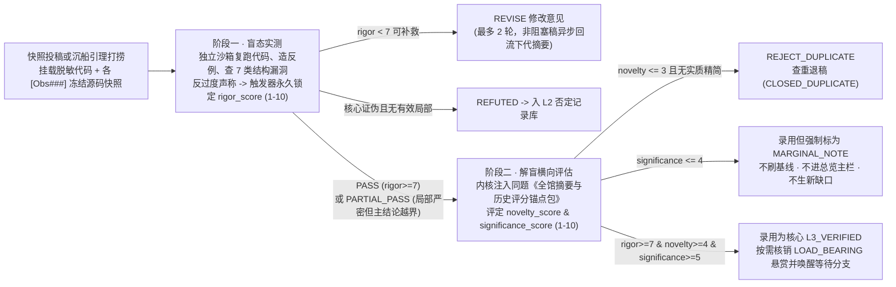
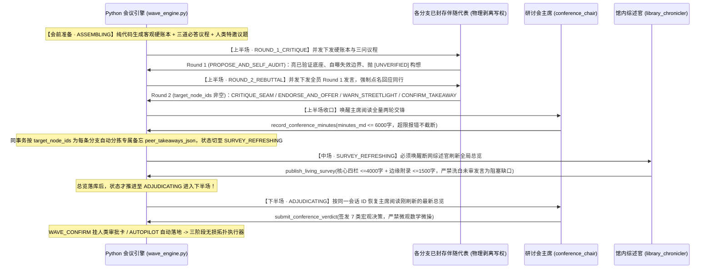

# GreatWall Agent 图书馆与评审工程架构说明（Library & Peer-Review Engineering）

> **适用版本**：GreatWall Agent `v0.3.2`  
> **文档定位**：本文从零前提视角完整拆解 GreatWall Agent 的**图书馆与评审工程**。该子系统统一承担全院的知识沉淀、质量裁判与宏观协调职能：① 外部参考资料与内部确证知识库的物理分表管理；② 零外网院内按需专题综述服务；③ 独立空白沙箱中的两阶段同行评审与反路灯分流；④ 周期性跨分支同行研讨会（含人类与总控的手动召会权、上半场同行协作、中场综述官刷新总览、下半场主席宏观拍板）与 Stage 3 不可变终核交付。

---

## 1. 图书馆与评审工程要解决哪些实际问题？

多条并行研究分支各自推进一段时间后，如果不建立一套严密的知识过滤与跨分支交流机制，系统会集中暴露五个问题：

1. **一维评审诱发路灯效应（Streetlight Effect）**：如果评审只看“逻辑是否严密（Rigor）”，不衡量“相对馆藏是否新颖（Novelty）”与“对核心目标是否重要（Significance）”，并且总览把零测度退化点或微小容差吐槽列为头号缺口，全院算力就会长期空耗在边角细节上。
2. **高摩擦投稿导致知识库空转**：送审即冻结分支会让探索者不敢提交阶段成果；缺乏作者署名、引用关系、绑定观测与公开审稿意见的记录也难以支撑后续复用。
3. **馆藏变厚后缺少断网、客观的院内专题综述**：固定长度的全题总览不够深，让探索者逐篇拉全文又会塞爆上下文；需要一位绝对断网、只整合证据绝不代出点子的院内综述服务。
4. **跨分支交流的两难**：24 小时开放公共论坛会迅速引发群体趋同；零和淘汰式互撕又会诱发隐瞒缺陷、专挑边缘瑕疵的博弈行为。正如 Google DeepMind *Quantum Swarm*（`arXiv:2611.09822`）所实证的，“已验证共享 Wiki + 定期点对点技术研讨会”双轨协作合计贡献了 **39%** 的总收益（Wiki 15% + Conference 24%），其核心威力正是围绕已验证底座对未验证构想进行点对点接口排雷。
5. **外网检索与内部编纂混权泄密、常驻审稿人因压缩失真**：联网角色一旦能读内部草稿就有泄密风险；常驻有记忆审稿人在多轮压缩后不仅记忆失真，还会破坏盲审公正性。

---

## 2. 组织编制：四个权限物理隔离的无状态角色

图书馆所有角色均为**按需拉起、任务完成即释放的无状态短会话**，权限物理隔离：

| 角色 | 网络 / 文件 / 终端权限 | 核心职责 |
| :--- | :--- | :--- |
| **`external_surveyor`**（对外文献检索员） | **全院唯一可联网**（透传代理，自动改写 arXiv `/html/`）· 物理禁读任何本地文件与内部表 | 检索公开文献产出外藏参考卡 `[R###]`（强制标注 `read_depth`，查无实据如实报 `UNAVAILABLE_REPORT`） |
| **`library_verifier`**（独立盲审官） | 绝对断网 · 每单现建现删一次性空白沙箱（只读 + 终端） | 阶段一盲态复现实跑锁严谨度；阶段二对照全馆摘要锚点评新颖度与重要性；兼任多篇组合终核与 Stage 3 冻结包复核 |
| **`library_chronicler`**（馆内综述与编纂官） | 绝对断网 · 无文件写与终端 · 只读全部内藏 | ① 研讨会中场刷新分栏《子题全局总览》；② 日常按需承接院内专题综述；③ Stage 3 仅基于 `L3` 导出终局交付五件套 |
| **`conference_chair`**（研讨会主席） | 绝对断网 · 无文件读写与终端 · 只读硬账本与总览 | 主持研讨会上半场纪要归集与下半场宏观拍板，严禁微观数学微操 |

---

## 3. 知识库结构、四项交互原语与院内专题综述

### 3.1 外藏与内藏物理分表
- **外部参考库（`external_literature_cards`，`[R###]`）**：0% 起开放，标明为“未经本系统独立复验的外部参考”。
- **内部研究库（`internal_research_ledger`）**：37% 元反思后解锁，分两类：
  - **确证库（`L3_VERIFIED`）**：平等收录正向定理/算法（`POS_THEOREM`）、严格构造反例（`NEG_COUNTEREXAMPLE`）与结构阻碍证明（`BARRIER_PROOF`），完整记录内核溯源的血统署名（`author_node_id / branch_id / family_id`）、核验口径版本、精确成立范围、显式引用列表、绑定观测编号、自包含正文、三维评分与层级（`publish_tier`）及随文公开的审稿评语（`reviewer_comment_md`）。
  - **否定记录库（`L2_FAILURE_RECORD`）**：仅收录经实锤证伪的科学路径或经最多 2 轮修改仍未消除的实质异议（`publish_tier` 显式置空，与确证库层级隔离），严禁混入纯工程代码崩溃。
- **非连坐引用图（`MOTIVATING_REF` vs `REQUIRED_PREMISE`）**：稿件声明的引用默认登记为启发参考边（`MOTIVATING_REF`），上游调整不会无差别连坐下游；仅当盲审官在 Stage 2 通过 `edge_type_overrides` 将某条前置显式升级为承重前提（`REQUIRED_PREMISE`），或属于组合完备核验（`COMPOSITE_FULL_GOAL`）成员时，上游失效才会精准触发下游重审。

### 3.2 四项交互原语与院内专题综述三条铁律
知识库通过四个工具原语运转：**发表（`submit_node_handoff` 的非阻塞快照 `manuscript_submissions`）→ 目录速览（`query_library_catalog`，每篇 `<= 350` 字，按重要性排序并将边缘笔记沉底）→ 全文与审稿评语同读（`get_library_entry`）→ 按需院内专题综述（`request_internal_survey` → `get_internal_survey_report`）**。

37% 解锁后的探索者、伴随助手或 `gw_chief` 均可发起院内专题综述（单节点限 2 次，通过 `RUN_INTERNAL_SURVEY` 后台异步拉起断网的 `library_chronicler` 交付 `800–4000` 字报告）。参照 *The Station* 的 `ARCHIVE_SURVEYOR` 纪律，专题综述严格遵守三条铁律：**① 绝不代出新点子；② 绝不下达路线指令；③ 核心事实陈述必须附带精确馆藏或观测编号**（由校验器按段落核验引用锚点）。

---

## 4. 独立空白沙箱中的两阶段同行评审

每次评审现建一次性空白沙箱 `blind_sandbox_<review_id>/`，只读拷入手稿绑定口径版本（`spec_revision`）对应的公开输入、A 栏客观事实、脱敏源码/证明以及每条绑定观测的冻结代码快照（挂载于 `obs_snapshots/<obs_id>/`），物理隔离数据库、B 栏主观猜想、探索者工作树与外网，审毕即删。

- **为什么盲审官每次都是新会话，却能保持跨单一致的评判标准？** 阶段一之所以必须全新无状态盲审，是为了防止记忆压缩失真与门派偏见；而阶段二由 `get_unblinded_manuscript_and_peers` 自动从数据库注入同题全部有效 `L3` 的标题、路线署名、成立范围与历史 `[R, N, S]` 评分作为客观参照系，把机构记忆放在数据库档案里而非某个长会话里。
- **阶段一硬规则**：严格按手稿提交时的口径版本 `spec_revision` 判定真伪；严打过度声称（主结论越界但局部引理严密时判 `PARTIAL_PASS`，阶段二经 `ACCEPT_NARROWED` 同事务将严密局部收编进 `L3`、越界范围记入 `L2`）；阶段一提交瞬间由触发器 `trg_reviews_lock_stage1` 永久锁死证据账本与 `rigor_score`；抓获刷分作弊当场签发工造司 `EXPLOIT` 工单。
- **阶段二硬规则**：内核计算 $\text{overall} = \text{round}(0.40 R + 0.25 N + 0.35 S, 1)$；`novelty <= 3` 且无 $\ge 20\%$ 精简判重复退稿；`significance <= 4` 强制降层为 `MARGINAL_NOTE`（连续入库 $\ge 2$ 篇触发 `STREETLIGHT_WARNING`）；剩余未决问题强制二分为可悬赏的 `LOAD_BEARING` 承重缺口与仅留文末 `Limitations` 备考的 `IMPROVEMENT` 改良项。

---

## 5. 周期性跨分支同行研讨会：唤起权、上下半场与综述官中场

### 5.1 何时唤起研讨会？（自动触发 + 人类与总控随时强召）

研讨会共有**两条完全合法的唤起路径**（见 [`wave_engine.py`](../../greatwall-v6up/core_python/mcp_server/control_plane/wave_engine.py) 与 [`operator_ops.py`](../../greatwall-v6up/core_python/mcp_server/control_plane/operator_ops.py)）：

1. **自动波次触发**：每当任意节点完成 `submit_node_handoff` 封存，该子题的 `completed_nodes_since_last_conference` 自动加 1 并立即检查：
   $$\text{completed\_nodes\_since\_last\_conference} \ge \max\!\left(2,\; \text{当前活跃分支数} \times 2\right)$$
   只要子题处于 `DISPATCHING` 且当前没有进行中的会议，达标即原子建会并清零计数器。
2. **人类与常驻总控 `gw_chief` 随时手动强召**：无论当前完成了多少个节点，只要子题未结题且无进行中会议，人类研究者都可以直接通过 `gw_chief` 调用 **`chief_operate(operation="open_wave_conference", details={"question_id": "Q1", "human_agenda_md": "...", "discussion_rounds": 3})`**，以 `force = True` 跳过计数阈值立刻召开研讨会，按需把关注议题（`human_agenda_md`）和上半场讨论轮次（`discussion_rounds`，默认 `2` 轮，可配置 `2–4` 轮）直接注入议程。

**建会分流与慢分支保护**：
- 建会时内核同时收集两类分支最近一代**已封存**的伴随助手（`briefing_sealed_at IS NOT NULL`）作为参会代表：① 当前活跃或挂起分支；② **本波次内刚封存交接并已结案置为 `SEALED`、且非研讨会休眠裁撤的分支**（避免刚出成果的分支被漏掉导致误跳上半场）。全过程**绝不打断正在中途探索的慢分支**（慢分支由其上一代已封存伴随代表出席；第 1 代从未封存的分支本波免于参会并受 1 代成长保护期庇护）；
- 若收集到的已封存参会分支 **`>= 2` 条**，会议进入 `ROUND_1_CRITIQUE`（正常开启上半场多轮同行讨论）；若 **`< 2` 条**，则跳过上半场，直接进入 `SURVEY_REFRESHING`（中场综述官刷新总览 → 下半场主席拍板）。

### 5.2 完整结构：会前准备 → 上半场 → 综述官中场 → 下半场 → 散会落地

整场研讨会由 `wave_conferences` 状态机与 `WaveConferenceRunner` 严格按四个阶段顺序推进（支持宿主重启后从任意阶段断点续跑）：

1. **会前准备（`ASSEMBLING`，纯代码）**：不消耗模型 Token，Python 直接从数据库生成客观硬账本（各分支真实观测、`L3` 三维评分、活跃 `LOAD_BEARING` 缺口、是否亮 `STREETLIGHT_WARNING`）并组装三道必答议程问题（主干拼图盘点、跨分支接口排雷、反路灯提醒）及可选的人类特邀议题 `human_agenda_md`。
2. **上半场（同行技术讨论与纪要归集，非零和无淘汰压力）**：
   - 各分支已封存伴随助手恢复参会时，宿主物理卸载其全部档案写工具，仅挂载 `submit_conference_statement`；
   - **Round 1（`PROPOSE_AND_SELF_AUDIT`，`<= 1200` 字）**：亮出绑定证据的底座、诚实自曝当前失效边界，并抛出未验证构想（强制打 `[UNVERIFIED]` 标签，对应 Google 图 1 的 Step 1）；
   - **Round 2 至第 $K$ 轮（可配置多轮点对点追问，`K ∈ [2, 4]`，默认 `2` 轮，每轮 `<= 1200` 字）**：参会分支 $\ge 2$ 时内核硬校验 `target_node_ids` 非空，强制点名同行执行接口排雷（`CRITIQUE_SEAM`）、背书借模块（`ENDORSE_AND_OFFER`）、提醒边缘细节（`WARN_STREETLIGHT`）或确认采纳（`CONFIRM_TAKEAWAY`）；当议程设定 `discussion_rounds = 3` 或 `4` 时，可在前轮排雷后继续完成回应、修法确认与接力收口，且每轮均支持宿主重启后幂等断点续跑；
   - **上半场纪要与备忘分拣**：唤醒 `conference_chair` 撰写不超过 `6000` 字的完整纪要（超长返回精确字数要求精简，绝不静默截断）；内核同事务汇总第 2 轮及后续全部追问轮的点名记录，按目标分支自动打包 `peer_takeaways_json`（融合分支同步写入 `DONOR_MANIFEST.md`）。
3. **中场衔接（`SURVEY_REFRESHING`，断网综述官 `library_chronicler` 必须出场）**：
   - 上半场纪要落盘后，会议**不会**立刻让主席拍板，而是先切入 `SURVEY_REFRESHING` 唤醒断网的 `library_chronicler`；
   - 综述官综合硬账本、刚出炉的会议纪要与全馆 `L3/L2`，调用 `publish_living_survey` 刷新两块物理隔离的内容：**核心四栏（`<= 4000` 字）**（基线与仪器、核心 `L3` 树、硬证伪清单、仅录 `LOAD_BEARING` 的核心空白——**严禁把圆桌未审发言私自升格为官方阻塞缺口**）与**独立边缘附录（`marginal_notes_md <= 1500` 字）**（集中收纳 `MARGINAL_NOTE` 与边缘争议，加盖禁立项标记）；
   - **只有综述官完成总览发布，会议状态才正式切入 `ADJUDICATING` 进入下半场**。
4. **下半场（`ADJUDICATING`，同一主席宏观拍板与三阶段无损执行）**：
   - 宿主按同一 `gw-chair-<conference_id>` 从磁盘恢复主席，令其对照刚刚刷新好的最新总览，在严守**禁止微观数学微操**的前提下调用 `submit_conference_verdict` 签发 7 类宏观动作：`HIBERNATE`（休眠冗余/边缘内卷分支，遵守 **1 代**成长保护期，可选 `salvage_audit` 触发残骸引理打捞）、`SPAWN_SYNTHESIS`（旁路新建双供体融合分支）、`OPEN_NEW_BRANCH`（针对承重缺口开辟新路线）、`PROTECT`（延长反常潜力分支保护期）、`DISCRIMINATOR`（委托工造司打造边界鉴别探针）、`CONVERGE_SUBPROBLEM`（发起多篇组合完备终核或开放题饱和收敛）、`PAUSE_FOR_HUMAN`（重大歧义提请人类裁示）。
   - 决议经确认后，[`wave_engine.py`](../../greatwall-v6up/core_python/mcp_server/control_plane/wave_engine.py) 严格按**三阶段不可颠倒顺序**执行：**阶段一先执行全部 `HIBERNATE` 温和收尾腾槽并创建打捞审稿单 → 阶段二利用新空位执行 `SPAWN_SYNTHESIS`（豁免单路线 `> 50%` 聚拢锁并自动生成 `DONOR_MANIFEST.md`）/ `OPEN_NEW_BRANCH` / `PROTECT` → 阶段三执行 `DISCRIMINATOR`、`PAUSE_FOR_HUMAN` 与双模收敛**（`CONVERGE_FULL_COMPOSITE` 签发组合终核审稿单经盲审合法生成总成 `L3`，零后门满足触发器；`CONVERGE_SATURATED` 越过最短投入窗后置 `PAUSED_SATURATED` 并平滑解锁后续子题）。
5. **散会后微观落地**：对于所有继续推进的分支，不需要主席下达死板命令；下一代伴随助手在 `0% PRE_SPAWN` 自动收到 `latest_wave_takeaways`（最新总览、会议纪要与本分支专属 `peer_takeaways_json`），自主阅读相关 `L3` 后将接口修法与验证计划消化写进 `<= 5000` 字的新行前摘要。

---

## 6. Stage 3 终局交付：不可变冻结目录与一步哈希终核

当全部必答子题完备通关（`FULL`），或越过最短投入窗触发预算耗尽 / 人类批准部分交付（`PARTIAL_ON_BUDGET / PARTIAL_ON_HUMAN_STOP`）后：
1. 断网的 `library_chronicler` 仅基于有效 `L3_VERIFIED` 导出五件套终局交付物至 `<workspace>/final_delivery/`，内核同时将完全一致的副本与 SHA-256 清单原子锁定至工作区外的不可变冻结目录；
2. 独立盲审官 `library_verifier` 只读该外部冻结副本，实跑最小复现套件并核查正文未夸大任何被引 `L3` 的成立边界；核验通过后，内核在单写者短事务内实时比对冻结目录哈希完全一致，一步结项为 `CLOSED_VERIFIED`。

---

## 7. 附录：核心表、工具与演进说明

- **核心表（7 张）**：`external_literature_cards`（+FTS5）、`survey_requests`、`internal_survey_requests`、`review_queue`、`internal_research_ledger`（+FTS5）、`subproblem_living_surveys`、`wave_conferences`。
- **只读视图与触发器**：`v_library_avoidance_radar`、`v_library_mini_papers_catalog`；`trg_reviews_lock_stage1`、`trg_l3_require_verified_review` + `uq_l3_verified_review`。
- **四角色工具**：`external_surveyor`（3 个）、`library_verifier`（6 个）、`library_chronicler`（6 个）、`conference_chair`（4 个）；另封存态伴随参会时仅挂载 `submit_conference_statement`。
- **跨场次演进方向（对齐 Google Quantum Swarm Fig. S5）**：当前单场研讨会上半场已支持 `2–4` 轮可配置并发点对点讨论（`wave_conference_discussion_rounds` / `discussion_rounds`，默认 `2` 轮），支持完整异步断点续跑与按轮分拣。后续版本将进一步把上一场会议中尚未闭环的跨分支拼接追问（如某分支确认采纳的 `CONFIRM_TAKEAWAY` 验证进展）自动带入下一场议程，实现跨场次的连续技术评审线程。
