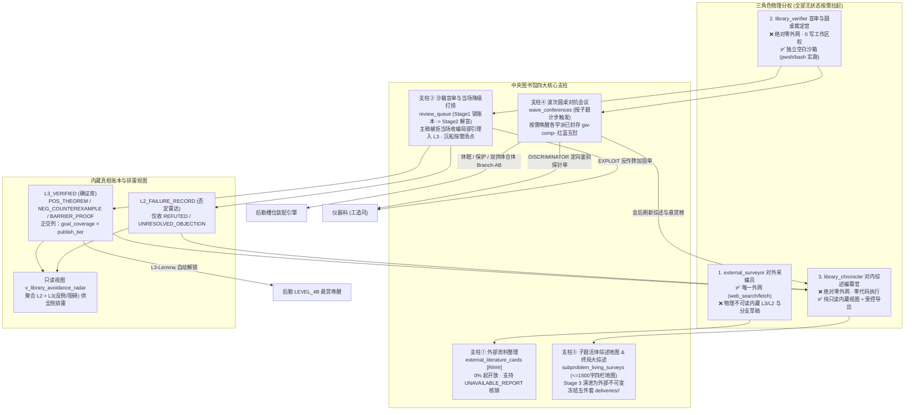
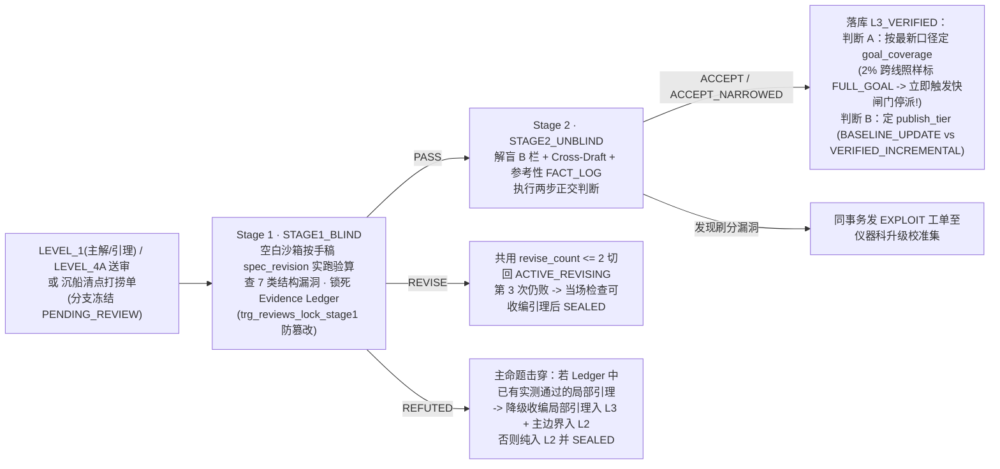
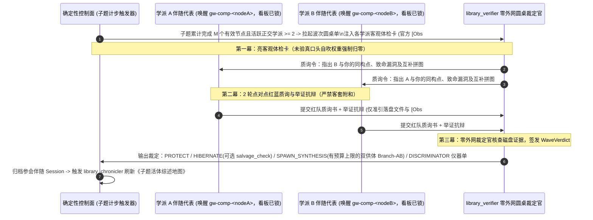

# GreatWall Agent 图书馆工程架构论文（Library & Peer-Review Engineering）

> **系统版本**：GreatWall Agent `v0.3` 终态架构定稿  
> **文档性质**：零前提、自包含子系统架构论文（Architecture Paper）。任何未接触过历史讨论的架构师或工程师，仅凭本文即可完整理解中央图书馆的**三角色物理分权**、**四大核心支柱（外部资料整理、空白沙箱盲审与当场降级收编/打捞、活体结构化综述地图、波次圆桌对抗会议）**、端到端状态机、精确数据与接口契约、学术溯源及验收标准。

---

## 摘要（Abstract）

自主科研多智能体系统的跨学派协作与质量治理面临五类核心矛盾：**完全隔离则各自重复踩坑无法互补，直接共享在研半成品则引发群体趋同坍塌**；**零散卡片越攒越多导致科研人员关键词盲搜失准**；**主定理盲审不过关却被一刀切丢弃浪费其中正确的局部引理**；**固定提升门槛误杀恰好跨过题面通关线的真实解**；以及**兼具外网权限与终稿撰稿权的单一馆员存在泄密与引入未审外部幻觉风险**。GreatWall Agent 的**图书馆工程（Library & Peer-Review Engineering）**借鉴 Google DeepMind 量子算法并发团队的 **Shared Wiki + Conference** 双通道实证与 `Cogentic / Station` 实测同行评议机制，将中央图书馆重塑为**三角色物理分权 × 四大核心支柱**的严密学术中枢：**① `external_surveyor`** 独占外网且物理隔离内藏，专司外部资料整理（`[R###]`）；**② `library_verifier`** 绝对零外网、在独立空白沙箱执行两阶段实测盲审（实施“题面达标 vs 基线发布”两步正交判断与主稿被拒**当场降级收编局部引理**），并按子题计步主持**波次圆桌对抗会议**（唤醒各学派封存后的伴随 Session 红蓝互怼，签发休眠/保护/双供体合体/鉴别仪器单）；**③ `library_chronicler`** 绝对零外网、零代码执行，专司编纂供科研人员高准确率 Pull 的**《子题活体综述地图（`<=1500` 字）》**以及 Stage 3 绑定不可变冻结快照的终局五件套正式综述论文。

---

## 1. 第一性问题定义与设计哲学

### 1.1 四条认识论与安全铁律
1. **静动双通道分离（综述 $\perp$ 开会）**：
   - **活体综述（异步静态导航）**严格只收录**已经过盲审验真的 `L3` 硬成果、`L2` 实锤死路、纯命题悬赏缺口与可用仪器表**，绝不剧透任何在研分支的未验真猜想；
   - **波次开会（同步动态对抗）**专门承载**未验真在研路线的点对点红蓝质询、扒皮换皮同构与跨脉互补嫁接**；一线探索者不参会，由已锁死传承包的伴随 Session 代表出席，保护纯血探索者不被带偏。
2. **三角色物理分权（零外网串扰）**：在无状态短会话架构下，多拆角色零闲置成本，将“对外联网查文献”与“对内写活体综述和终稿”物理拆成两个角色，彻底杜绝把院内未公开进展泄露至外网或把未经盲审的外部内容混入终稿。
3. **科学真伪判定 $\perp$ 共享视图发布**：按当前 `spec_revision` 题面核验是否成立并满足 `FULL_GOAL`（哪怕仅改善 `2%` 只要跨过通关线就必须写入 `L3_VERIFIED` 并立即触发快闸门停派）；是否刷新共享首页最优基线（如定量 $\ge 5\%$ 提升或 $\ge 20\%$ 精简）属于独立的发布投影列 `publish_tier`，绝不阻断入账与停派。
4. **证据等级原口径兼容 + 终局物理不可变**：`LEVEL_4A` 确证反例与阻碍证明永久留在 `L3_VERIFIED` 保持外键与依赖撤回语义，全院排雷通过只读视图聚合；Stage 3 审稿与核签锁定外部不可变冻结目录快照，彻底封死“审 A 放 B”。

---

## 2. 系统全貌：三角色物理分权与四大支柱拆解

### 2.1 中央图书馆全景架构图

### 2.2 核心模块源码映射

| 子系统 | 物理模块路径 | 核心职责 |
| :--- | :--- | :--- |
| **对外采编** | `core_python/mcp_server/tools_surveyor.py`（拆出 `external_surveyor`） | 响应 `survey_requests` 采编 `[R###]`，强制 `read_depth` 与 `support_scope`，支持 `UNAVAILABLE_REPORT` 诚实核销 |
| **盲审、降级收编与圆桌裁定** | `core_python/mcp_server/tools_verifier.py`、`control_plane/blind_sandbox.py` | 现建现删空白沙箱、`_require_non_self_review` 异会话拦截、Stage 1 不可逆 `Evidence Ledger`、Stage 2 两步判断与当场降级收编、沉船打捞复验、以及波次圆桌裁定 |
| **对内活体综述与终局导出** | `core_python/mcp_server/tools_chronicler.py`（由原终稿导出独立演进） | 按波次结束或馆藏累积更新 `subproblem_living_surveys`（`<=1500` 字）；Stage 3 导出五件套并同步冻结外部不可变快照 `$PLUGIN_DATA/.../deliveries/<delivery_id>/` |
| **数据库硬触发器** | `core_python/mcp_server/db_schema.py` | `trg_reviews_lock_stage1`、`trg_l3_require_verified_review`、`uq_l3_verified_review`、FTS5 同步触发器 |

---

## 3. 四大支柱端到端核心运行流程

### 3.1 支柱 ①：外部资料整理（`external_surveyor`）
- 仅在 Stage 1 预采编与 Stage 2 收到脱敏 `survey_requests` 时拉起；
- 确有来源时按 `outcome="CARD_PUBLISHED"` 写入 `external_literature_cards`（标明未复验外部参考、`read_depth`、`support_scope` 与 `60–1500` 字独立摘要）；资料不存在或越界时传 `outcome="UNAVAILABLE_REPORT"` 核销委托单为 `CLOSED_UNAVAILABLE`，严禁造假卡。

### 3.2 支柱 ②：空白沙箱两阶段盲审、两步判断与当场降级收编

- **两步正交判断（彻底解决 `2%` 跨线冲突）**：
  - **判断 A（科学验真与达标停派）**：凡实测严密且在当前最新 `spec_revision` 下满足题面通关线，无论相对前任只改进了 `2%` 还是 `0.5%`，均标 `goal_coverage = 'FULL_GOAL'` 写入 `L3_VERIFIED` 并同事务触发子题快闸门停派；
  - **判断 B（发布基线视图 `publish_tier`）**：`FULL_GOAL`、新定性定理/反例/障碍、填补悬赏缺口、定量提升 $\ge 5\%$ 或等价精简 $\ge 20\%$ 标为 `BASELINE_UPDATE` 刷新共享首页基线；其余微小增量标为 `VERIFIED_INCREMENTAL` 合法入账留档但不刷屏。
- **跨口径公正性与非连坐引用图**：Stage 1 按手稿绑定 `spec_revision = vK` 判真伪；旧口径成立但新口径已升版时禁标最新 `FULL_GOAL`；声明引用默认记 `MOTIVATING_REF` 不连坐，唯 Stage 2 经 `edge_type_overrides` 显式认证的 `REQUIRED_PREMISE` 传播重审。
- **当场降级收编与沉船清点**：主命题被击穿但 Stage 1 `Evidence Ledger` 已实测验真的局部引理，盲审官当场收编入 `L3_VERIFIED(PARTIAL_OR_LEMMA)` 同时将主命题失灵边界入 `L2`；仅从未送审却在圆桌被判休眠的多代沉船分支才触发独立 `Auditor` 遗产清点（强校验 `session_id != proposer_session_id` 且禁在 `ACTIVE_REVISING` 返工期插手）。

### 3.3 支柱 ③：活体结构化综述地图 & Stage 3 不可变终稿核签（`library_chronicler`）
1. **日常《子题活体综述地图》（`subproblem_living_surveys`，硬限 `<=1500` 字）**：
   - **触发时机**：① 每次该子题波次圆桌会议结束时；② 或波次中间累计新增 $K$ 条（默认 `3` 条）重要 `L3/L2` 或仪器升版时；
   - **固定四栏确定性结构**（科研人员 `37%` 解锁后自主 Pull 的第 1 层入口）：`① 当前已证最优基线与可用仪器速查`、`② 可复用模块化引理目录树 (L3-Lemmas ID 索引)`、`③ 已实锤封死的死路禁区 (v_library_avoidance_radar 索引)`、`④ 公共纯命题悬赏榜 (open_lemma_gaps)`；**绝对零未验真分支剧透**。
2. **Stage 3 五件套终局综述与不可变冻结快照**：
   - 通过双段终局门禁（`FULL` / 越过 `min_commitment_window` 的 `PARTIAL_ON_BUDGET` / 人类控制面实签 `PARTIAL_ON_HUMAN_STOP`）后，`library_chronicler` 仅基于已审 `L3` 与精确剩余缺口导出五件套至 `<workspace>/final_delivery/`，同时原子归档不可变快照与 `manifest.json`（逐文件 SHA-256）至 `$PLUGIN_DATA/workspaces/<ws_hash>/deliveries/<delivery_id>/`；
   - `library_verifier` 经 `STAGE3_FINAL_AUDIT:<delivery_id>` **只读取外部不可变冻结目录**实跑复现并核查未夸大任何 `L3` 的 `exact_verified_scope_md`；终核放行事务内实时重算冻结目录 SHA-256 与数据库绑定值完全一致方晋升 `CLOSED_VERIFIED`。

### 3.4 支柱 ④：按子题计步触发的波次圆桌对抗会议（`wave_conferences`）

- **不卡木桶的触发契机**：按子题独立计步——某子题累计完成 $M$ 个有效探索节点（默认 `活跃分支数 × 2` 代，确保新分支跑够保护期）且存在 $\ge 2$ 个独立活跃学派时，在下一次槽位调度间隙召开（独苗学派不空开会议，直接由后勤补齐正交新脉）；
- **零串味物理保障**：参会代表为各学派刚封存交接包的 `gw-comp-<node_id>` 按需水合唤醒，`agent/created` 钩子已物理卸载其写本脉看板与交接的工具，开完圆桌立即 `dispose + archiveSession`；
- **硬预算防延滞**：任何由圆桌签发的双供体合体支线 `Branch-AB`（挂载次供体只读切片 `.greatwall_donors/<donor_node_id>/`），必须从有硬上限（如 $\le 2$ 节点）的专项验证预算中扣减，绝不延后后勤工程的独立慢闸门。

---

## 4. 核心数据与接口契约

- **核心表与视图**：`external_literature_cards`（+ FTS5）、`internal_research_ledger`（+ FTS5，含 `publish_tier / verified_spec_revision`）、`review_queue`、`epistemic_edges`、`survey_requests`、`project_closure_state`（含 `frozen_delivery_dir_abs_path`）、`subproblem_living_surveys`、`wave_conferences`、`v_library_avoidance_radar`。
- **三角色窄工具契约**：
  - `external_surveyor` (2)：`get_survey_requests`、`publish_external_literature_card`；
  - `library_verifier` (7)：`get_blind_manuscript`、`submit_stage1_blind_ledger`、`get_unblinded_manuscript_and_peers`、`submit_stage2_unblind_verdict`（含 `publish_tier` 与当场降级收编字段）、`propose_salvaged_lemma`、`get_conference_dossier`、`submit_conference_verdict`；
  - `library_chronicler` (3)：`get_chronicler_snapshot`、`publish_living_survey`（硬限 `<=1500` 字）、`export_stage3_final_delivery`。

---

## 5. 参考文献与工程溯源

| 文献 / 出处 | 原作解决的核心问题 | 图书馆工程吸收的机制与工程改造 |
| :--- | :--- | :--- |
| **Google DeepMind Quantum Algorithms Swarm** (`arXiv:2611.09822`) | 大规模并发探索中异步沉淀与同步碰撞协同、防共享库膨胀 | 吸收 **Shared Wiki（《子题活体综述》+ `5%/20%` 发布基线视图）+ 定期 Conference（强制直接回复质询 + 未验真零权重）** 双通道协作架构 |
| **Cogentic** (`arXiv:2609.40324`) | 开放定理证明严谨审稿与失败引理打捞 | 单篇 + 跨篇两阶段对抗审稿、草稿与确证账本分离、`Auditor` 异会话打捞 |
| **The Station v2 App. D** (`arXiv:2610.08927`) | 盲审解盲后倒改判断 | 6 步 `Evidence Ledger` 与 `trg_reviews_lock_stage1` 物理不可逆锁 |
| **OpenAI CDC 64-Agent Prompt** | 伪等价归约、跳步证明与夸大结题 | 7 类结构漏洞红队清单、`EQUIVALENT_REDUCTION` 禁标 `FULL_GOAL`、诚实部分交付双段门禁 |
| **Evaluating Sakana's AI Scientist** (`arXiv:2502.14297`) | 文献浅查幻觉、终稿夸大与机械全拒 | 外藏标明未复验先验、Stage 3 严查边界夸大、`<=2` 轮 `REVISE` 返工通道 |
| **ResearchOS** (`DOI:10.20944/preprints202610.2216.v1`) | 抑制文献引述幻觉 | 外藏 `read_depth` 强制枚举 |

---

## 6. 渐进实施边界与可观测验收标准

- **M1 主线**：落地两步正交判断（`2%` 跨线必过且触发停派）、`v_library_avoidance_radar` 排雷视图、盲审当场降级收编局部引理、以及 Stage 3 外部不可变冻结目录核签；
- **M2 增强**：拆出零外网 `library_chronicler` 与《子题活体综述地图》自动更新；
- **M3 闭环**：启用按子题计步触发的波次圆桌对抗与双供体只读挂载合体支线，以等预算对照验证净收益。
- **验收标准**：① `2%` 跨线候选过审写 `L3_VERIFIED(FULL_GOAL)` 并立即触发快闸门；② 主稿被击穿但 Stage 1 实测通过的局部引理当场收编入 `L3` 并解锁 `LEVEL_4B`；③ 导出后篡改 `<workspace>/final_delivery/` 不影响 `STAGE3_FINAL_AUDIT` 读取外部不可变冻结目录；④ `external_surveyor` 物理不可访问内藏，`library_chronicler` 物理无外网。
