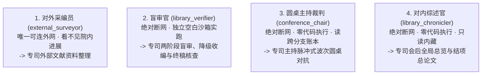
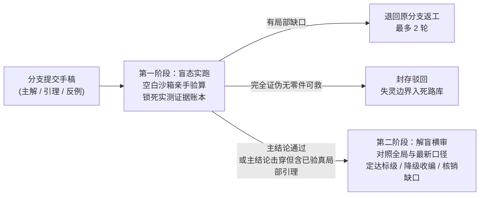
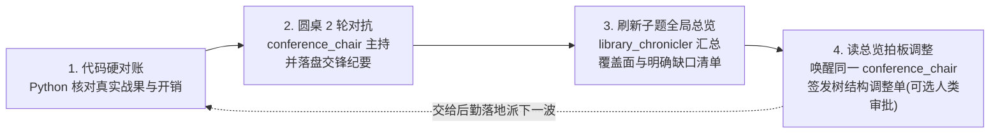

# GreatWall Agent 图书馆工程架构论文（Library & Peer-Review Engineering）

> **系统版本**：GreatWall Agent `v0.3` 顶层架构定稿  
> **阅读指南**：本文全面介绍 GreatWall Agent 的**图书馆工程**——它既是全院跨分支交流知识的唯一合法枢纽、把守科学真伪的空白沙箱法庭，也是主导“脉冲式开会、全局综述与研究树宏观调整”的大外环中枢。正文全程采用清晰自然的语言层层展开；精确的数据库表名、触发器、工具签名与大厂实战出处统一收拢在文末第 6 章。

---

## 1. 图书馆工程到底要解决什么问题？

在多智能体并发科研里，单个小组（后勤工程）可以把自己的那班岗干得很扎实，但只要把 4 个、8 个甚至更多小组放到一起攻克同一道难题，立刻会撞上五个极其棘手的系统级问题：

1. **大模型很擅长用流畅的学术辞令骗过自己和别人**：如果没有独立、冷酷的实测审稿机制，一篇藏着边界漏洞或偷换概念的漂亮手稿一旦混进公共知识库，全院其余分支都会在错误的底座上盖高楼。
2. **主论文被拒时，怎么不把里面对的好零件一起倒掉？**：科研中十有八九冲击终极目标的手稿会在严苛盲审下暴露漏洞，但如果一拒了之全扔垃圾桶，里面顺手证出来的漂亮局部引理和好用的构造器就全白费了。
3. **完全隔绝会重复踩坑、无法互补，直接共享又会全员抄作业**：如果大家各自闭门造车，A 派刚刚踩过的死胡同 B 派还要重踩一遍，A 派的长板也帮不到 B 派的短板；可要是把各派还没验证的半成品想法广播给所有人看，不出两轮大家又会迅速趋同。
4. **零散卡片越攒越多，科研人员根本搜不准，也看不清全局还缺什么**：当知识库里攒了四五十条零散卡片时，靠猜关键词检索极容易漏掉关键引理；更麻烦的是，没人站在高空把这些碎片拼成一张全局地图，也就无法准确判断“下一步该开拓哪块空白、该把哪两派合体、该砍掉哪条撞车路线、或者什么时候该收工”。
5. **查外部文献和写内部终稿混在同一个角色手里太危险**：联网检索外部资料必须开外网权限，而整理院内未公开进展和撰写最终论文必须绝对断网，既防搜索词泄露内部课题，也防模型在写终稿时偷偷上网抄一段未经验证的内容混进来。

**图书馆工程就是为了彻底解决这五个问题而建的。** 它一手抓**日常铁面验真与实时排雷**，一手主导**脉冲式的宏观大外环（开会 + 全局综述 + 宏观决策）**。

---

## 2. 组织分工：四个权限彻底隔离的角色，一对一承接四件核心大事

因为系统里的所有馆员都是**按需拉起、干完即走的短会话**，多拆一个角色不会增加任何闲置成本，反而能让每个角色只对应一条纯粹的状态机和一套极简工具——尤其是**盲审**（需要现建空白沙箱配终端实跑代码、走两阶段防篡改流程）与**圆桌主持**（零代码执行、读跨分支硬账本并主持红蓝交锋）在流程和权限上截然不同，必须彻底拆开，防止工具混杂引发逻辑 Bug。中央图书馆由 **4 个权限物理隔离的角色** 一对一承接 **4 件核心大事**：

1. **对外采编员（`external_surveyor`）**：全院**唯一允许联网检索**的角色，但系统从物理上禁止它读取院内任何研究成果或分支草稿。它只在立项开局、或者科研人员提交了脱敏查新单时出场，专门把外部教材、标准定理和公开论文整理成结构化参考卡片。
2. **盲审官（`library_verifier`）**：**绝对断网**，不能修改任何分支的代码目录，只在每次审稿时领到一个现建现删的**独立空白沙箱**（配齐终端、Python、SymPy 或 Lean 等验算工具），专心负责日常两阶段实测盲审、主稿被拒时的当场降级收编、沉船遗产复验以及 Stage 3 终稿核查。
3. **圆桌主持裁判（`conference_chair`）**：**绝对断网、且不需要运行任何代码**（零原生文件与终端工具），只在宏观大外环到达波次节拍时拉起：第 2 拍主持各学派助手的 2 轮点对点红蓝交锋并落盘《圆桌交锋纪要》，待第 3 拍综述官刷新完全局总览与明确缺口清单后，第 4 拍原地重新唤醒同一会话读取最新总览，统一签发树结构调整与定向鉴别仪器工单。
4. **对内综述官（`library_chronicler`）**：**绝对断网、且不运行任何代码**，手里只有图书馆内藏的只读视角。平时每次波次开完会，由它执笔刷新每道子题唯一的那一页《子题全局总览与明确缺口清单》；到整个项目最终结项时，由它基于全部已证实成果汇纂最终交付论文。

---

## 3. 平时怎么运转：外部资料、实时硬卡片与空白沙箱盲审

借鉴 Google DeepMind 量子算法并发团队的实战经验（`arXiv:2611.09822`），图书馆的知识绝不是混在一篇大文章里，而是**按“每道子题一个独立目录”**清晰分层，且**硬资产平时随时更新，绝不等开会**。

### 3.1 区分「树内私有知识」与「图书馆全局知识」
- **树内私有知识**（留在后勤部）：每条分支自己的《2200 字前情提要》、《全量死胡同档案》和代码目录。装着本派未验证的猜想和试错过程，别家分支绝对看不见。
- **图书馆全局知识**（按每道子题独立存放）：只存经过核实的东西，分为四块：
  1. **外部公开参考卡（`[R###]`）**：由对外采编员整理，明确标定为“带出处的未复验外部参考”，科研人员从 0% 起就能看。每张卡必须老实标注真实阅读深度（读了全文、指定章节、还是只看了摘要）；如果委托查的资料客观不存在，采编员直接诚实结案，**绝不编造假卡片**。
  2. **已证实成果与引理卡（`L3` 确证库）**：只要任意分支做出主解、独立局部引理、或者严格构造反例/不可能证明，**过了空白沙箱盲审就立刻独立入库**，不等开会，全院科研人员过 37% 就能直接按编号复用。
  3. **实锤死路笔记（`L2` 否定雷达）**：凡被盲审实锤证伪或返工超限仍解不开致命异议的路线，立刻入库并写明失灵边界（注意：纯代码写崩了只记在分支自己家里，绝不污染图书馆）。同时系统提供一个只读的“排雷汇总视图”，把 `L2` 死路和 `L3` 里的严格反例/阻碍证明合在一起展示，方便全院 37% 问诊时一眼避坑，又不破坏底层证据等级。
  4. **每道子题唯一的一篇《子题全局总览》（不超过 1500 字）**：平时不频繁重写，主要在每次宏观大外环开完圆桌会后更新（详见第 4 章）。

### 3.2 空白沙箱两阶段实测盲审（走一遍完整审稿流程）

每一次盲审，系统都会唤醒一名全新的、从未参与过该分支工作的盲审官，现建一个只放着公开题面、客观 A 栏文本、脱敏代码与官方测试收据的**空白临时沙箱**（彻底屏蔽作者身份、分支编号、B 栏主观吹嘘、数据库与外网）：

1. **第一阶段（盲态实跑，先锁证据账本）**：盲审官必须按手稿提交时绑定的题目口径，亲手在沙箱里跑代码、变种子复现、用符号计算或形式化工具逐行核验，重点排查 7 类常见学术漏洞（隐式假设、退化极限、局部冒充全局、把原问题换个等价说法就宣称解完、循环跳跃、刷代理指标、把相关性当因果）。检查完毕后，必须逐条列出每一句主张对应的实测输出或代码行号，**在数据库里永久加锁锁定这份《证据账本》**（由数据库触发器保证解盲后绝无法倒改实测记录，彻底杜绝马后炮）。
2. **第二阶段（解盲横审，两步分开判断 + 悬赏缺口核销）**：只要第一阶段不是“彻底证伪且无任何可救零件”，就解开作者的 B 栏解释与同题其他在审/已审成果、以及本题当前所有 `OPEN` 状态的分支缺失引理悬赏单（`open_lemma_gaps`）做横向比对。这里有一个非常关键的细节——**把“是否达标停派”和“是否刷新首页最优基线”拆成两步独立判断**：
   - **判断一（按当前最新口径是否达标，在写锁内实时核验）**：盲审终审落库时，必须在单写者 `BEGIN IMMEDIATE` 写事务内实时核对当前子题的最新生效口径（与全卷结项查询共用同一套判定函数）。哪怕一份候选相对前任只提升了 `2%`，只要它实测严密且恰好跨过了当前生效口径的通关线（或给出了原题全局无解的严格不可能证明 `BARRIER_PROOF` 且 `goal_coverage = 'FULL_GOAL'`），就必须标为“完全达标（`FULL_GOAL`）”入库，并**立刻触发该子题停工止盈**，绝不能被任何基线门槛拦在门外！（如果手稿是在旧题目口径下成立、但人类后来修改了本题新口径，盲审官照样公正承认它在旧口径下成立留作历史证据，只是如实注明适用口径、不触发新口径停派；若只证明某单一方法不可行，则标为 `PARTIAL_OR_LEMMA`，绝不触发整题停派。）
   - **判断二（是否刷新共享首页基线）**：在确定合法入库后，再决定展示权重——凡完全达标解、新定性定理/反例、填平悬赏缺口的引理、定量指标相对当前最优提升 $\ge 5\%$、或者指标持平但代码/证明篇幅精简 $\ge 20\%$（防长程接力导致代码无限膨胀），标为“刷新基线”置顶展示；其余真确但仅 `0.5%` 的微小增量照样合法存库留档，但不刷屏打扰全院。
   - **顺手核销悬赏缺口（唤醒 `LEVEL_4B` 分支）**：如果新入库的 `L3` 恰好证明了某条处于 `OPEN` 状态的自然语言缺失引理悬赏单，盲审官在提交裁定时显式勾选对应的 `fulfilled_gap_ids`，单写者事务内立刻将其标为 `FULFILLED` 并自动唤醒被卡住的挂起分支。
3. **三条保护科研效率的硬机制**：
   - **返工不乱打断**：局部有缺口但方向没死的手稿，退回原分支返工（共用最多 2 轮），返工期间严禁外部角色插手抢断；第 3 次仍过不了才封存。
   - **被拒当场收编好零件（100% 遵守双阶段硬触发器）**：如果主结论在第一阶段确实被反例击穿没法救，但第一阶段锁死的《证据账本》里已经实测通过了其中的某个独立局部引理，**严禁在第一阶段短路直接写库**（那样会撞死数据库的双阶段硬触发器 `trg_l3_require_verified_review`）；系统正常流转进入第二阶段，由盲审官裁定 `ACCEPT_NARROWED`，在**同一单写者事务内**完成三件事：① 审稿单置为 `CLOSED_ACCEPTED`；② 插入 1 条 `L3_VERIFIED(PARTIAL_OR_LEMMA)` 收编已验真的局部引理；③ 同时插入 1 条 `L2_FAILURE_RECORD` 记录主命题的失灵边界（唯一索引 `uq_l3_verified_review` 仅约束 `L3_VERIFIED`，同单附带 1 条 `L2` 完全合法），既守住数据库硬件不变量，又免去拒了再重审第二遍的折腾。
   - **默认引用不连坐 + 反作弊反哺仪器科**：手稿引用的参考文献默认记为“背景启发”，上游变动绝不无差别连坐全院；只有第二阶段盲审官亲手认证为“承重必要前提”的引用，上游被推翻时才会精准通知下游重审。如果盲审官在沙箱里抓到某份手稿钻了旧版评测仪器的空子，当场反手给仪器科发一张高优先级反作弊工单，把这份作弊代码塞进校准集逼仪器升级！

---

## 4. 宏观大外环：脉冲式开会、全局综述与整棵研究树的演进

如果说平时靠空白沙箱保证每一块砖都是硬的，那么**“整棵科研树往哪长、哪两条路线该融合、哪条撞车了该砍掉、还缺哪几块拼图、什么时候算真正试够了”**，这些全部需要站在全局高空才能看清的问题，由图书馆主导的**宏观大外环**统一承接。

每隔一个固定的工作量节拍（例如某道子题累计跑完一波有效探索，默认约为活跃分支数 $\times 2$ 班岗，确保新分支跑够成长保护期，不硬卡慢分支木桶效应），系统为该子题拉起一次宏观大外环，按极简的四拍推进：

### 第一拍：纯代码先拉一张铁面《本波硬账本》
借鉴 OpenAI `distributed_agent` 的归约铁律：开会写综述前，先由 Python 内核自动生成一张客观对账单——本子题原计划开着几条分支、实际跑完几班、新通过空白沙箱入了多少条 `L3`、实锤证伪了多少条 `L2`、有几条挂起缺引理、还剩多少预算。**所有没过空白沙箱的口头宣称统一打标为“未验真、零权重”，严禁把“有几个小组提到了某个思路”的人头数当作科学打分。**

### 第二拍：脉冲式圆桌对抗（解决“未验真半成品的碰撞”）
借鉴 DeepMind 每 4 小时虚拟研讨会的实战经验（实证贡献了近四分之一的跨团队总突破）：光靠冷冰冰的已证实文件，看不出“两派是不是换了马甲在做同一种东西”，也看不出“A 派的一个未完成想法嵌进 B 派主回路里哪个地方会崩”。
- **谁来开会、慢分支怎么办、怎么防污染？** 一线科研人员不参会；系统直接从硬盘重新唤醒各活跃分支最近一代**已封存交班记录**的专属助手上桌（唤醒时系统已物理撤掉它们修改本分支档案的写权限，开完会立刻彻底归档，100% 杜绝会后反向串味）。如果触发开会那一刻某条慢分支正跑到 40% 还没交班，**绝不打断它继续跑**：若它已有上一代已封存的 `gw-comp-<prev_node_id>`，则由上一代助手代表该脉参会（标明“截至第 $g-1$ 代快照，第 $g$ 代运行中”）；若它仍在第 1 代且从未封存过交班记录，则本波自动跳过参会、且受成长保护期庇护绝不被裁撤。
- **怎么开？** 由零外网、零代码执行的**圆桌主持裁判（`conference_chair`）**主持 **2 轮强制点对点红蓝交锋**（严禁各自念状态汇报）：每轮必须直接回复挑刺——指出谁和谁底层思路换皮撞车、攻击对方回避的边界漏洞、辩护真有价值的罕见反常现象，并识别两派之间可以严密互补的模块拼图。两轮结束后，`conference_chair` 先调用 `record_conference_minutes` 落盘《圆桌交锋纪要与争议焦点》（暂不拍板下工单，并暂停休眠等待第 3 拍总览出炉）。

### 第三拍：零外网综述官刷新唯一《子题全局总览（1500 字导览索引）》
紧接着，绝对断网、不跑代码的对内综述官（`library_chronicler`）拿到**代码硬账本 + 圆桌交锋纪要 + 馆里全部已证实卡片 + 本题活跃的分支悬赏引理（`open_lemma_gaps`）**，重写并发布这道子题唯一的一页**《子题全局总览》（硬限 1500 字以内，定性为高密度导览索引而非全量倾倒）**，严格遵守四条纪律：
1. **做精准导览索引，不往 1500 字里硬塞全表**：清清楚楚列明四栏——① 当前最优已证实解与实验室可用仪器；② 已证实可复用的模块化引理索引；③ 实锤死路禁区；④ **《明确未解科学缺口导览（Explicit Gaps）》**（只列当前最紧迫的 Top 缺口摘要与高优悬赏编号；完整悬赏列表本来就存在 `open_lemma_gaps` 表里，按编号翻页查即可，彻底避免缺口增多时撑爆 1500 字）。
2. **绝不抹杀少数派反例**：归并相似发现时，必须同时保留支持证据和反面矛盾证据的原始编号。
3. **只写客观问题缺口，严禁泄露他派私有思路**：综述官虽然阅读圆桌交锋纪要，但写进公共总览的 `Explicit Gaps` **只能写“问题本身哪里还没覆盖”的客观缺口描述，严禁把任何分支正在私下尝试的未验真算法路线写进总览**，死守分支独立性。
4. **只读不越权**：综述官绝不直接核销 `open_lemma_gaps` 悬赏（核销权严格归盲审官 Stage 2 或确定性依赖）。

### 第四拍：唤醒同一圆桌裁判，盯着最新《明确缺口导览》克制拍板
第 3 拍总览落库后，系统按同一会话编号**重新唤醒第 2 拍的 `conference_chair`**（完整保留刚听完 2 轮交锋的上下文），让它读取刚刚出炉的《子题全局总览（`Explicit Gaps`）》，调用 `submit_conference_verdict` 正式签发本波的宏观结构调整单——在默认的**波次确认档（`WAVE_CONFIRM`）**下，会议状态在此切入 `PENDING_HUMAN_APPROVAL` 并生成待审建议单（`APPROVE_WAVE_VERDICT`），**等待期间只挂起新建/合体/裁剪等大结构动作，已经健康的纯血分支照常单线续班绝不干等**，人类花 2 分钟扫一眼总览与调整单（或在 `gw-chief` 主窗里确认）即可落地；在人类预先授权的**夜间巡航档（`AUTOPILOT`）**下，低风险树结构调整校验护栏通过即自动执行并记入次日晨报，唯独涉及 `PAUSE_FOR_HUMAN` 等越界高危停工仍强制挂起等待人类拍板。**所有调整单真正落库执行时，内核均按“时间线单调铁律”复核一次最新口径与目标分支最新状态**（若某分支刚在第 3 拍新过审了引理，原本要休眠它的旧条目自动跳过不误裁；若会议中途因异常、改题或人类驳回中止，则干净记入 `CANCELLED / EXPIRED / FAILED` 终态），再交由后勤工程与工造司落地：
- **定向开拓（`OPEN_NEW_BRANCH`）**：某个关键缺口目前没人碰、或者所有路线都在同一种框架里打转 $\to$ 针对这个空白缺口新开一条正交分支；
- **保护分叉（`PROTECT`）**：圆桌核实某条低分路线确实冒出了非 Bug 的罕见结构反常 $\to$ 从该节点旁路分叉出一条保护支线去深查；
- **旁路双供体融合（`SPAWN_SYNTHESIS`）**：综述与圆桌确认 A 派已证实模块与 B 派框架严密互补 $\to$ **绝不涂改原纯血分支 A 或 B**，而是旁路新建一条合体分支 `Branch-AB`，挂载次供体只读快照并给一笔有上限的验证预算去验证这个嫁接假设；
- **冷静裁剪（`HIBERNATE`）**：只有实锤同构撞车、或连续多波对任何缺口零实质推进、且**已经度过 2 班岗成长保护期**的分支，才令其优雅休眠释槽（若其为从未送过审的多代分支，裁判在工单中勾选 `salvage_audit: true`，由确定性内核排单盲审官扫一眼其硬盘快照，对发现的漏网好引理调用 `propose_salvaged_lemma` 走独立盲审）；
- **定向鉴别仪器（`DISCRIMINATOR`）**：若两派争执焦点是现有仪器测不出来的极端边界，向工造司签发一张定制鉴别探针单，下一波用实测数据一锤定音；
- **申请暂停待人类拍板（`PAUSE_FOR_HUMAN`）**：仅在已越过最低投入时间窗且综述确认明确缺口已穷尽时方可签发，将子题切入待人类拍板暂停态。

### 坦诚交代：大外环的两道防呆底线
综合 DeepMind 与 OpenAI CDC 的真实教训，我们绝不盲信大外环是万能神药，提前焊死两道防呆锁：
1. **绝不让大外环变成新的“趋同官僚司令部”**：严守成长保护期与旁路合体原则，大外环只做“填补空白缺口、给互补搭桥、清理实锤撞车”，绝不每波把落后的独立流派全砍光强迫全员追同一个热门点子。
2. **绝不让大模型仅靠写一份综述就提前摆烂收工**：正如 OpenAI CDC 强令“至少跑满 8 小时不许放弃”，在未满人类设定的最低投入时间前，**大外环无权以“找不到突破”为由单方面停工**（除非拿到了空白沙箱证实的完全达标解，或证明原题全局无解的 `BARRIER_PROOF` 且 `goal_coverage = 'FULL_GOAL'`）；越过最低投入窗后，若综述确认明确缺口已穷尽，系统也只切入**“待人类拍板暂停态”**，把这页总览推给人类决断；若模型编造伪缺口无限拖延，则由设施层的物理硬预算兜底强制暂停。

---

## 5. 终局交付：平时不写长论文，结项一次封箱与防“审 A 放 B”

平时科研期间，图书馆只维护每道子题不超过 1500 字的极简总览地图和独立硬卡片，绝不浪费算力反复写万字长文。只有当全部必答子题达标（`FULL` 完整交付），或者在越过最低投入窗耗尽预算 / 人类显式叫停并经人类批准部分交付提案（`AUTHORIZE_PARTIAL_DELIVERY` / `record_human_stop`，进入 `PARTIAL_ON_BUDGET` 或 `PARTIAL_ON_HUMAN_STOP` 模式）后，才进入终局交付阶段：

1. **只组装硬成果，如实写缺口**：零外网的对内综述官（`library_chronicler`）仅基于已经通过空白沙箱盲审的 `L3` 确证成果，在工作区导出五件套最终交付物（正式研究总报告、最小可运行复现套件、阻碍证明与否定清单、谱系探索路线图、后续研究断点笔记），严禁混入任何未过审的草稿。
2. **外部不可变冻结快照，彻底防“审 A 放 B”（收口 Stage 3 终核放行）**：导出五件套的同时，系统把完全相同的一份副本和逐文件 SHA-256 校验清单原子锁进工作区外的**不可变冻结目录**。随后拉起盲审官（`library_verifier`）做终局核查——**盲审官只读这份外部不可变冻结副本**，亲手跑通复现套件并逐条核对总报告有没有夸大任何一条结论的适用边界（查出夸大立刻打回重导）。最后放行结项的同一确定性单写者数据库事务内，实时重算冻结目录哈希与数据库绑定值一字不差，方才正式宣布结项（彻底收编原 `v0.2` 需另起 `supervisory_committee` 放行的冗余环节）——哪怕核签瞬间有人改了工作区里的文件，也绝不可能造成“审过版本 A 却放行版本 B”。

---

## 6. 附录：工程契约与大厂实战出处（供开发与审计查阅）

> 本章将正文概念 100% 精确映射到现版代码库的 SQLite 表结构、硬触发器、四角色窄工具清单与一手论文/代码出处。

### 6.1 核心 SQLite 表、只读视图与硬触发器

| 概念 | 真实表名 / 视图名 | 核心字段与硬约束 |
| :--- | :--- | :--- |
| 外部参考卡片 | `external_literature_cards(ref_id)` + FTS5 | `question_id`, `title`, `abstract_md`（60–1500 字）, `exact_preconditions_md`, `formulas_or_operators_md`, `read_depth`（`full_text / specified_sections / abstract_only`）, `support_scope`, `is_unverified_external=1` |
| 内部硬卡片账本 | `internal_research_ledger(entry_id)` + FTS5 | `ledger_type`（`L3_VERIFIED / L2_FAILURE_RECORD`）, `l3_entry_kind`（`POS_THEOREM / NEG_COUNTEREXAMPLE / BARRIER_PROOF`）, `goal_coverage`（`FULL_GOAL / PARTIAL_OR_LEMMA / EQUIVALENT_REDUCTION`）, `publish_tier`（`BASELINE_UPDATE / VERIFIED_INCREMENTAL`）, `verified_spec_revision`, `verified_review_id` |
| 盲审队列与证据账本 | `review_queue(review_id)` | `question_id`, `source_node_id`, `source_type`（`LEVEL1_MANUSCRIPT / LEVEL4A_BARRIER / AUDITOR_SALVAGED_LEMMA`）, `proposer_session_id`, `review_status`, `spec_revision`, `stage1_ledger_json`, `stage1_locked_at`, `final_locked_at`, `final_verdict` |
| 每道子题唯一全局总览 | `subproblem_living_surveys(survey_id)` | `question_id`, `revision`, `sec1_baseline_and_instruments_md`, `sec2_l3_lemma_tree_md`, `sec3_avoidance_radar_md`, `sec4_explicit_gaps_md`（汇总全部活跃 `open_lemma_gaps` + 宏观空白覆盖缺口）, `total_chars <= 1500` |
| 波次圆桌对抗记录 | `wave_conferences(conference_id)` | `question_id`, `wave_no`, `status`（`ASSEMBLING / ROUND_1_CRITIQUE / ROUND_2_REBUTTAL / SURVEY_REFRESHING / ADJUDICATING / PENDING_HUMAN_APPROVAL / COMPLETED / CANCELLED / EXPIRED / FAILED`）, `participant_nodes_json`, `critiques_ledger_json`, `minutes_md`, `linked_survey_id`, `chair_session_id`, `verdict_json`（`OPEN_NEW_BRANCH / PROTECT / SPAWN_SYNTHESIS / HIBERNATE / DISCRIMINATOR / PAUSE_FOR_HUMAN`）, `synthesis_budget_nodes` |
| 引用关系图与终局锁 | `epistemic_edges`、`survey_requests`、`project_closure_state` | 默认引用 `MOTIVATING_REF`，唯 Stage 2 显式认证的 `REQUIRED_PREMISE` 传播重审；终局绑定 `latest_delivery_id / sha256 / frozen_delivery_dir_abs_path` |
| 排雷汇总视图 | `v_library_avoidance_radar`（只读视图） | 自动聚合活跃 `L2_FAILURE_RECORD` 与 `L3_VERIFIED(NEG_COUNTEREXAMPLE / BARRIER_PROOF)` |
| 数据库硬件级触发器 | `trg_reviews_lock_stage1`、`trg_l3_require_verified_review`、`uq_l3_verified_review` | 物理禁止解盲后篡改 Stage 1 证据账本；强制 `L3_VERIFIED` 必须对应同题、双阶段锁定且审定通过的审稿单，且一单最多生成 1 条 `L3`（同单可附带 1 条 `L2` 记录降级收编的主命题失灵边界） |

### 6.2 四角色窄 MCP 工具契约

- **对外采编员 `external_surveyor`（2 个，唯一带外网、禁读内藏）**：`get_survey_requests`、`publish_external_literature_card`（支持 `CARD_PUBLISHED` 与 `UNAVAILABLE_REPORT`）。
- **盲审官 `library_verifier`（5 个，绝对零外网、空白沙箱实跑，与现版 `tools_verifier.py` 完全同构）**：`get_blind_manuscript`、`submit_stage1_blind_ledger`（附带可选 `exploit_ticket_payload` 以便沙箱抓到作弊样本时同事务签发工造司 `EXPLOIT` 工单）、`get_unblinded_manuscript_and_peers`（附带本题全部 `OPEN` 悬赏缺口列表）、`submit_stage2_unblind_verdict`（含 `publish_tier`、`ACCEPT_NARROWED` 同事务收编 `L3+L2` 字段、`fulfilled_gap_ids` 核销字段及可选 `exploit_ticket_payload`）、`propose_salvaged_lemma`（用于未送审沉船遗产打捞立单）。
- **圆桌主持裁判 `conference_chair`（3 个，绝对零外网、零代码执行）**：`get_conference_dossier`、`record_conference_minutes`（第 2 拍落盘交锋纪要）、`submit_conference_verdict`（第 4 拍读完最新总览后签发 6 类宏观调整单）。
- **对内综述官 `library_chronicler`（3 个，绝对零外网、零代码执行）**：`get_chronicler_snapshot`、`publish_living_survey`（硬限 `<=1500` 字）、`export_stage3_final_delivery`。

### 6.3 一手大厂实战与核心文献出处

1. **Google DeepMind Quantum Algorithms Swarm** (`arXiv:2611.09822`, Appendix C & Figs. S4–S5)：按“每问题一目录”组织共享 Wiki（平时随时合入经机器校验的最优解、可复用局部模块与带反例死路笔记，设 $\ge 5\%$ 降本与 $\ge 20\%$ 精简两道基线门槛），叠加每 4 小时定期虚拟学术会议直接交锋未验真构想（实证贡献 $24\%$ 总降本，跨团队合计 $39\%$）。
2. **OpenAI `distributed_agent`** (`bioRxiv:2026.10.15.759436`, `reduction.md` & `REASONING_CONTRACT.md`)：先由确定性代码对账再归约写综述；归并同类发现时强制同时保留支持与反面矛盾证据，严禁按提及次数打分；读完综述盯着 `Explicit Gaps` 定向派单。
3. **OpenAI CDC 64-Agent Prompt**：7 类结构漏洞红队清单、等价归约禁标完成、延迟交叉授粉，以及强制守住最低投入窗绝不轻言放弃的终局纪律。
4. **Cogentic** (`arXiv:2609.40324`) & **The Station v2 App. D** (`arXiv:2610.08927`)：单篇 + 跨篇两阶段对抗审稿、先锁不可逆 `Evidence Ledger` 再解盲、以及异会话局部引理打捞复验。
5. **Evaluating Sakana's AI Scientist** (`arXiv:2502.14297`) & **ResearchOS** (`DOI:10.20944/preprints202610.2216.v1`)：外部文献强制标注阅读深度且须引用方实证复核；终稿严查夸大边界；用有限次 `REVISE` 返工替代一刀切拒稿。
