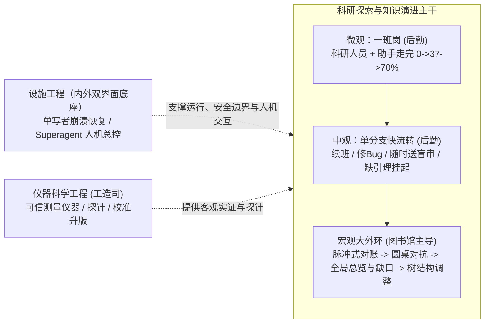

# GreatWall Agent `v0.3` 顶层架构总纲与项目根本原则

> **文档定位**：本文是 GreatWall Agent `v0.3` 完整顶层设计套件的总导航。全套设计由 **1 份总纲 + 4 篇独立工程架构论文 + 1 份精确数据库与迁移契约** 组成，力求让任何未接触过历史讨论的架构师、研究者或工程师，仅凭这套文档就能清晰、完整、无歧义地看懂整座系统的全貌。

---

## 一、GreatWall 三大项目根本原则

无论后续架构如何演进、代码如何重构，整个项目在设计、讨论与文档编写上始终并列恪守三条根本原则：

1. **第一性原理（First Principles）**：不迷信流行的多智能体套路或花哨算法，永远回到具体科研任务的本质约束出发——大模型在长程开放任务中究竟为什么会退化、为什么会趋同、为什么会撒谎、为什么难收敛，针对真实病灶给出最简洁直接的解法。
2. **钱学森《工程控制论》系统边界律**：一个真正优秀的系统，不是把一堆追求局部最优的子系统强行拼凑在一起，而是由边界清晰、相互配合、整体稳定的组件构成的和谐整体。确定性代码守住并发一致性、隔离边界与流程底线，把真正的科学思考和探索自由还给模型与人类研究者。
3. **清晰自然语言表达原则（Clarity Without Jargon）**：我们不为了追求浅白而牺牲学术严谨性，但也坚决拒绝堆砌自造“黑话”来营造虚假的高级感。任何架构机制、流程设计或工程取舍，都必须能用清晰、准确、层层递进的自然语言向一位聪明但不了解背景的读者完全说明白——**凡是用自然语言讲不清楚的设计，本质上往往是架构本身还没想透。**

---

## 二、整座系统的三层运行画面与四大工程分工

为了避免各模块职责纠缠，GreatWall 把长周期多智能体自主科研严格切分为**微观、中观、宏观大外环**三个层次，并落在**四大正交工程**中：

- **一、设施工程（内外双界面底座与 Super-agent 人机总控中枢）**：向内负责 Node 宿主插件与 Python 单写者内核的双层运行、基于宿主磁盘会话日志的按需打开与 10 角色物理剥权、带租约的事务后副作用队列与 **+1 人类优先保留槽位**；向外以 **GreatWall Superagent（`gw-chief`）** 为唯一推荐人机对接入口，沿院内事件生命周期落地两阶段事件过滤与隐式批处理、对称双通道（轻量只读领域态 UI 负责信息输出、物理剥权的 Superagent 负责将人类自由指令整理为 8 类宪章正门确认单与 `PolicyChanged` 温和热传播）、科研四级 `Inline & Spill` + 强外键 `Chain of Recall`（配 Compacting 与 400 字动态锚点）、零副作用推测预演，同时克制保留一键查底账、物理急停与 45% 暂停直连子节点对话/改码（直通 + `handback_to_chief` 越界退回 + SHA-256 工件对账）。
- **二、仪器科学工程（工造司）**：负责极薄通用隔离容器、同一份仪器代码三档调用（快速探针 / 正式凭证 / 重型异步）、四类状态隔离（仪器故障对探索者零处罚）、四元复合缓存、自声明校准集无死锁升版、版本域诚实重评，并通过五条管道响应前线痛点、盲审反作弊、圆桌鉴别实验与人类经 Superagent 投递的边界反例需求。
- **三、后勤工程（一线探索与单分支接力）**：负责单班岗的自适应时钟与 70% 防偷懒硬锁、伴随助手 0% 全馆视野与科研人员 37% 后三步按结构自主翻资料、两步清醒交班、本分支私有的《全量死胡同档案》与《2200 字前情提要》、单分支六种中观去向（含活节点主动交局部引理），以及忠实落地执行宏观大外环下发的树结构变更（含 2 班岗成长保护期与旁路双供体只读挂载）。
- **四、图书馆工程（知识枢纽、空白沙箱法庭与宏观大外环）**：拆分为四个权限物理隔离的无状态角色——对外采编员（唯一联网、禁读内藏）、盲审官（绝对零外网、独立空白沙箱实跑）、圆桌主持裁判（绝对零外网、零代码执行，专司主持脉冲式波次圆桌对抗）、对内综述官（绝对零外网、不跑代码）。平时硬成果与实锤死路过了盲审**随时立刻入库**（区分“跨过题面通关线即停派”与“刷新首页基线”两步判断，主稿被拒但局部引理严密时当场降级收编）；每推进一波由宏观大外环脉冲一次，经代码硬对账、圆桌红蓝交锋后刷新每道子题唯一的《子题全局总览与明确缺口清单》，克制地决定定向开拓、保护分叉、旁路合体、撞车休眠或在最低投入窗与硬预算约束下暂停等人类拍板；结项时经外部不可变冻结目录导出并核签五件套总论文，彻底杜绝“审 A 放 B”。

---

## 三、一题全生命周期串行总览与全院角色映射

为了消除“平时怎么跑很清楚、但开局冷启动和结项收口不知道谁接棒”的盲区，整道科研任务从接到题目到交付结项严格走三段串行交接：

1. **Stage 1：立项冷启动（从 0 到首批分支起跑）**：
   - 人类提交题面与输入数据，由 `supervisory_committee`（立项与口径仲裁员）签发不可随意涂改的 `Parse 0` 科研契约（按子题写死通关判据、测量策略、最低投入时间窗与预算上限；**纯理论题允许声明 0 判定器开局，直接靠解析证明与空白沙箱盲审验真**）；
   - 确定性内核在同一事务内自动为每道子题初始化 `subproblem_runtime_state`；
   - 两项冷启动准备**并行执行**：① 工造司（`works_engineer`）为需要数值/代码评测的子题构建初代通用仪器并通过金/毒校准集上线；② 对外采编员（`external_surveyor`）联网预采编基础外部公开参考卡（`[R###]`）；
   - 准备就绪后，后勤分诊员（`logistics_coordinator`）根据题面登记首批互相正交的方法族谱（`method_families`），控制面为每条初始分支派发第 1 代节点（默认自带 2 班岗成长保护期），正式进入 Stage 2。
2. **Stage 2：日常探索与宏观大外环双环运转**：
   - **微观与中观（后勤主导）**：各分支独立走 0% $\to$ 37% $\to$ 70% 单班岗，交班时快速分流（续推、原地修 Bug、主动拆交局部引理或主解送盲审、缺引理挂起）；
   - **平时随时验真（图书馆盲审官）**：任何手稿过了独立空白沙箱两阶段盲审，硬成果（`L3`）与实锤死路（`L2`）立刻入库，跨过最新口径通关线（或获得原题全局不可能证明）的子题立刻触发锁一停派；
   - **脉冲式宏观大外环（图书馆圆桌裁判 + 综述官主导）**：每推进一波，依次完成「代码硬对账 $\to$ 圆桌 2 轮对抗 $\to$ 综述官刷新 1500 字全局总览与明确缺口清单 $\to$ 圆桌裁判读总览签发树结构调整单（半自动模式下交人类 2 分钟把关）」，由后勤落地开拓、分叉、旁路合体、撞车休眠或越过最低投入窗后的暂停等人类拍板。
3. **Stage 3：封箱组装与防篡改终局交付**：
   - 当全部必答子题达标、或越过最低投入窗耗尽预算、或人类显式叫停后，对内综述官（`library_chronicler`）仅基于已过审的 `L3` 资产导出五件套终稿并原子冻结至工作区外不可变目录；
   - 盲审官（`library_verifier`）只读该不可变冻结目录完成复现与边界夸大核查；通过后由确定性单写者事务实时重算目录 SHA-256 哈希核验一致，正式签发结项。

### 全院角色权限总表与 `v0.2` $\to$ `v0.3` 演变映射

| `v0.3` 角色名 | 归属工程 | 核心职责 | 外网 / 文件 / 终端权限 | 与 `v0.2` 既有 7 角色的映射 |
| :--- | :--- | :--- | :--- | :--- |
| **`gw-chief`（Superagent）** | 设施工程 | 全院唯一推荐人机主对接人：只读回忆链查账、将人类自由指令整理为 8 类结构化确认单路由全院 | 零外网 · 零文件写 · 零终端（物理剥权，+1 人类优先槽） | `v0.3` 新增（Super-agent 范式主对接人） |
| **`supervisory_committee`** | 设施/治理 | Stage 1 签发 `Parse 0` 契约与中途补充口径裁决 | 零外网 · 零代码写 · 零终端 | 沿用 `v0.2`，**剥离 Stage 3 放行**（改由 `library_verifier` + 确定性哈希事务收口） |
| **`works_engineer`** | 仪器科学 | 仪器开发、校准升版、反作弊加固与鉴别探针 | 零外网 · 仅写仪器目录 · 受限终端 | 沿用 `v0.2` 并增强五条耦合管道 |
| **`explorer`** | 后勤工程 | 一线科研人员：单班岗独立探索、37% 后按结构翻库、70% 收官交稿 | 零外网 · 仅写本分支 Worktree · 70% 动态锁死 | 沿用 `v0.2` |
| **`lineage_companion`** | 后勤工程 | 伴随助手：0% 写提要、37% 问诊、70% 写两本账、封存后无写权参会 | 零外网 · 零代码写 · 零终端（仅读写本脉档案，封存后撤写权） | 沿用 `v0.2` 并改用 DSH 持久化按需重开 |
| **`logistics_coordinator`** | 后勤工程 | 开局登记首批正交方法族；常规中观分诊由控制面优先直落，仅疑难/跨域异常按需拉起 | 零外网 · 零代码写 · 零终端 | 沿用 `v0.2` 并轻量化（剥离原五车道与宏观树决策） |
| **`external_surveyor`** | 图书馆 | 唯一对外采编员：检索外部教材论文，产出带阅读深度标注的 `[R###]` 卡 | **唯一可连外网** · 物理禁读院内任何成果 | 由原 `library_surveyor` 拆分出（外网侧） |
| **`library_chronicler`** | 图书馆 | 对内综述官：波次会后写 1500 字总览与明确缺口；Stage 3 组装终稿 | 零外网 · 零终端 · 只读内藏与受控导出 | 由原 `library_surveyor` 拆分出（纯内网侧） |
| **`library_verifier`** | 图书馆 | 盲审官：空白沙箱两阶段实跑盲审、当场降级收编、Stage 3 冻结包终核 | 零外网 · 仅限现建现删空白沙箱读写与终端 | 沿用 `v0.2` 并彻底剥离圆桌主持职责 |
| **`conference_chair`** | 图书馆 | 圆桌主持裁判：主持波次 2 轮红蓝交锋，会后读最新总览签发宏观树调整单 | 零外网 · 零文件读写 · 零终端 | `v0.3` 从盲审中独立拆分出的纯裁判角色 |

---

## 四、全套顶层设计文档导航

| 文档 | 核心覆盖范围 |
| :--- | :--- |
| **[`ARCH_PAPER_01` 设施工程架构论文](./ARCH_PAPER_01_设施工程_Infrastructure_Engineering.md)** | 双层物理架构、三层逻辑边界、DSH 持久化会话与 10 角色物理剥权、事务后副作用队列与 +1 人类优先槽、Super-agent 范式人机协同（DSH vs GreatWall 困难对照、两阶段院内事件过滤、UI 输出与宪章正门指令整理、四级 `Inline & Spill` 与强外键回忆链、零副作用推测预演、必要与伪复杂度红线）、45% 直连与 `handback_to_chief` 对账、RC5 适配边界 |
| **[`ARCH_PAPER_02` 仪器科学工程架构论文](./ARCH_PAPER_02_仪器科学工程_Instrument_Science_Engineering.md)** | 实验室仪器科定位、零学科硬编码通用容器、三档同码、四态物理隔离、四元复合缓存、自声明校准集升版、版本域诚实重评、与设施 Superagent/后勤/盲审/圆桌/总览的五条耦合管道 |
| **[`ARCH_PAPER_03` 后勤工程架构论文](./ARCH_PAPER_03_后勤工程_Logistics_and_Lineage_Engineering.md)** | 微观单班岗完整一生（0/37/70% 与双角色初始桌面）、科研人员三步按结构自主拉取资料、树内私有两本账、六种中观去向与分诊打捞无重叠衔接、成长保护期、旁路双供体挂载与三道停工锁 |
| **[`ARCH_PAPER_04` 图书馆工程架构论文](./ARCH_PAPER_04_图书馆工程_Library_and_PeerReview_Engineering.md)** | 四角色物理分权（采编/盲审/圆桌主持/综述）、树内知识与全局每题一目录分离、平时随时入库硬卡片、空白沙箱两阶段盲审（达标与基线两步分离 + 当场降级收编）、宏观大外环四拍与两道防呆底线、Stage 3 不可变冻结终核 |
| **[`agent_kb_v0_3_04` 精确 SQLite DDL 与迁移规范](./agent_kb_v0_3_04_数据模型与旧库迁移_精确SQLite_DDL与工具契约增量.md)** | 100% 对齐现版 `db_schema.py` 且经开启外键的真实 SQLite 实测通过的增量建表 SQL、封存不可逆触发器、旧库平滑升级脚本规范与控制面原语契约 |

---

## 五、`v0.3.0-alpha.1` 统一大更新施工组装与稳健性验收路线

当前全套架构蓝图已彻底明朗，**不再保留早期架构未定时的 M1 / M2 / M3 分步割裂缓兵之计**——直接以完整统一的 `v0.3` 蓝图推进一次干净利落的大版本重构，彻底清理 `v0.2` 老代码中的历史双入口与口径断裂（如废除扫磁盘自动升版暗门、解耦局部引理送审与原分支锁定、统一子题停派与全卷结项的最新口径判定），坚持**“追求系统稳健性（Robustness），而非堆砌防御性补丁（Defensiveness）”**。

施工按自然的底层到上层依赖依次组装并统一联调：
1. **第一装（数据底座与设施内核）**：落地完整 `v0.3` SQLite DDL 与 `v0.2` 旧库无损迁移（含 `verified_spec_revision` 从审稿表真实回填、`works_engineering_queue` 放开 `DISCRIMINATOR`、封存防改触发器）、单机进程锁 + Outbox 副作用队列崩溃恢复、统一口径升版单一入口，以及运行中节点 45% 暂停直连与工件 SHA-256 对账。
2. **第二装（三大科研工程全角色联动）**：上线仪器科五条耦合管道、后勤局部引理独立送审与全员阻塞自报出口、以及图书馆四角色物理分权（对外采编、空白沙箱盲审与 Stage 2 同事务降级收编、波次圆桌主持裁判、对内综述官 1500 字导览总览与 Stage 3 外部不可变冻结终核）。
3. **第三装（Super-agent 人机总控与领域态 UI 总装）**：上线物理剥权的 `gw-chief`（两阶段院内事件过滤、回忆链只读查账、零副作用影响面预演、8 类确认单、+1 人类优先保留槽与 `handback_to_chief` 越界退回）及右侧轻量只读「三问」领域态 UI。
4. **整机稳健性验收**：在 DSH `0.2.2-rc.5` 上端到端跑通全套核心场景——① 子题达标（含仅提升 `2%` 跨线）即时停派而不影响其他子题；② 半路改题遵循“正在干的活认开工口径、下一步调度认最新口径”单调铁律；③ 45% 暂停直连改码 + 重启恢复 + 哈希对账；④ 波次圆桌期间慢分支不中断、健康纯血分支不干等、全员阻塞自动告警；⑤ Stage 3 不可变冻结目录防篡改核签与旧库平滑升级。

---

## 六、`v0.3.0-alpha.1` 施工微调与整机落盘同步纪要

本次 `v0.3.0-alpha.1` 代码大重构已严格按顶层 6 组裁决全部落盘并跑通整机自动化验收，以下施工期确认的精确微调同步归档于此：

1. **Superagent 现况锚点卡弹性字数公式**：由固定 400 字升级为 `min(hardCap, max(400, 180 + 100 * 子题数))`（默认硬封顶 `1200` 字，支持插件配置 `chiefAnchorHardCapChars` 调优），在多子题并发下不挤爆正文，同时配合 `dsh-compaction-basic` 自动压缩后通过 `systemPrompt.context` 重注实现零断链。
2. **Stage 1 新增 `PARTIAL_PASS` 枚举**：盲审官在“主结论击穿但局部引理严密”时无需强判 `PASS`，可直接签发 `PARTIAL_PASS` 锁定 Stage 1 证据账本并推进至 `STAGE2_UNBLIND`，再于 Stage 2 裁定 `ACCEPT_NARROWED` 同事务收编 1 条 `L3(PARTIAL_OR_LEMMA)` + 1 条 `L2_FAILURE_RECORD`。
3. **局部引理独立拆交一次性盲审**：70% 交班可选附带 `local_lemma_submissions` 挂冻结快照独立建 `LOCAL_LEMMA_SUBMISSION` 审稿单，绝不锁死也不打断继续推进的原分支，并采用一次性盲审（通过即入 `L3` 并按需核销悬赏；未通过仅留档意见供后续代次参考，不跨代拉回原分支返工）。
4. **Stage 3 一步原子终签与非阻塞哈希校验**：`library_verifier` 校验外部不可变冻结目录无误后，先在写锁外完成目录 SHA-256 计算，再进 `BEGIN IMMEDIATE` 短写锁做毫秒级比对并一步原子结项 `CLOSED_VERIFIED`（同步置全部子题 `CLOSED`），彻底取消原 `v0.2` 二次监察委放行。
5. **实装模块地图**：完整 `v0.3.0-alpha.1` 代码目录边界、44 工具 × 10 角色 × 8 套 Preset 契约与全量验收命令见 [`greatwall-v6up/MODULE_MAP.md`](../../greatwall-v6up/MODULE_MAP.md)。
