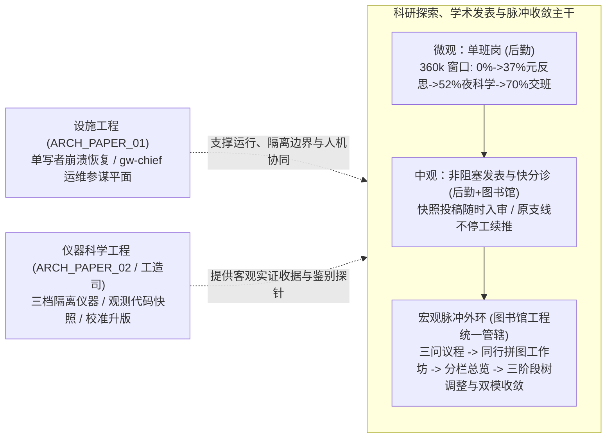

# GreatWall Agent `v0.3.2` 顶层架构总纲与项目根本原则

> **文档定位**：本文是 GreatWall Agent `v0.3.2` 完整顶层设计套件的总导航，与核心施工主手册 [`greatwall_v0_3_2_architecture_and_engineering_manual.md`](../greatwall_v0_3_2_architecture_and_engineering_manual.md) 严格对齐。全套拆解由 **1 份总纲 + 4 篇独立工程架构论文 + 1 份精确数据库与工具契约规范** 组成，力求让任何未接触过历史讨论的架构师、研究者或工程师，仅凭这套文档就能零障碍看懂整座系统的真实问题、设计原理与工程实现。

---

## 一、GreatWall 三大项目根本原则

无论架构如何演进、代码如何迭代，整个项目在设计、讨论与文档编写上始终恪守三条根本原则：

1. **第一性原理（First Principles）**：不迷信流行的多智能体噱头或花哨框架，永远回到高难度科研攻关的本质约束出发——大模型在长程开放任务中究竟为什么会注意力退化、为什么会群体趋同、为什么会过度声称（Overclaiming）、为什么会在照得最亮的零测度边角料下陷入“路灯效应（Streetlight Effect）”，针对真实病灶给出最简洁直接的制度解法。
2. **钱学森《工程控制论》系统边界律**：一个真正稳健的系统，不是把一堆追求局部最优的子模块强行粘合在一起，而是由边界清晰、相互配合、整体稳定的组件构成的有机整体。用确定性代码（SQLite 单写者事务、触发器、沙箱守卫、拓扑执行器）焊死并发一致性、防作弊红线与流程底线，把真正的科学直觉、猜想构造与路线抉择自由交还给模型与人类首席科学家（PI）。
3. **清晰自然语言表达原则（Clarity Without Jargon）**：我们绝不为了通俗而牺牲学术与工程严谨性，但也坚决拒绝堆砌自造“黑话”来掩盖逻辑含混。任何架构机制、状态流转或工程取舍，都必须能用清晰、准确、层层递进的自然语言向一位聪明但不了解项目前情的读者完全讲明白——**凡是用平实自然语言讲不清楚的设计，本质上往往是架构本身还没想透。**

---

## 二、整座系统的三层运行画面与四大工程分工

为了避免各模块职责纠缠，GreatWall 把长周期多智能体自主科研严格切分为**微观、中观、宏观脉冲外环**三个层次，并落在**四大正交工程**中：

1. **设施工程（`ARCH_PAPER_01`：内外双界面底座与 `gw-chief` 运维参谋中枢）**：
   - **向内对机器托底**：负责 Node.js（DSH Cordis 插件）与 Python（快慢双线程池 + SQLite WAL 单写者内核）双层架构、基于宿主磁盘 Session Log 的按需唤醒、10 角色最小权限沙箱守卫（自动锚定分支 `worktree` 默认路径与精确路径段越界拦截）、带 60 秒租约的并发 `runtime_effects` 副作用队列、`epoch_id` 跨轮纪元栅栏与 `+1` 人类优先保留槽位。
   - **向外对人类护航**：以常驻 **`gw-chief`** 为全院唯一推荐人机对话窗口，配备三层防失忆上下文（`<= 1500` 字永不压缩的置顶动态真源卡 + `chief_read` 4000 字分页读取器 + 只读源码审阅 `read/glob/grep`）。通过宿主级 `Human-Mandate Gate`（人类当面授权门禁），让人类一句话即可直执版本化运行安排（`run_arrangements`：权重、分支上限、新派发开关、三档在途收尾、软撤编与学派级联归档）、发送导师点拨便签（`chief_send_branch_note`）或种下带 8000 字完整推导蓝图的先验分支（`chief_seed_branch`），并通过四态回执（`operation_receipts`）诚实反馈收尾进度；仅对改题面口径、部分结题、纪元重置与波次确认保留一键审批卡。
2. **仪器科学工程（`ARCH_PAPER_02`：科研仪器科 / 工造司）**：
   - 负责零学科硬编码的通用隔离评测容器、同一份仪器代码三档调用（`probe` 快速诊断 / `official` 正式收据 / `heavy` 重型异步）、四态归因隔离（仪器自身报错对探索者零处罚）与四元复合缓存。
   - **`v0.3.2` 关键进化**：每次签发 `official / heavy` 正式观测时，同步将当次入口脚本与 `tools/` 目录轻量冻结至 `observations.frozen_code_snapshot_path`，彻底解除同代后续增写辅助脚本引发的 70% 交班拒绑死锁；开放全院 7 角色共享报修工具 `submit_works_ticket`，强制工单结案记录精确 `resolution_note`，杜绝升版时静默批量关单。
3. **后勤工程（`ARCH_PAPER_03`：一线探索、夜科学破局与单分支接力）**：
   - 负责微观单班岗（默认有效窗口 `360,000` tokens）的四段节律：`0%` 伴随助手消化上代遗嘱与最近一场圆桌同行备忘（`latest_wave_takeaways`）重写 `<= 3600` 字五段看板 $\to$ `0%–37%` 纯净独思净室 $\to$ **`37%` 完整 11 类外部专家元反思问诊**（`<= 2` 轮、`<= 500` 字/轮，含第 11 类 `Research Taste` 科研品味拷问，解锁内藏与院内 `survey`）$\to$ **`52%` 停码夜科学绿洲**（宿主物理只读锁 2 回合，跨界类比立下可证伪赌注 `submit_holiday_bet`，在 `52%–70%` 实测兑现）$\to$ `70%` 两步清醒交班（A/B 分栏总长 `<= 5000` 字）。
   - 推行**默认非阻塞快照投稿（`manuscript_submissions`）**：交班时随时切出阶段引理或主定理快照送盲审，原分支不停工直接续推下一班；忠实落地双供体 `DONOR_MANIFEST.md` 挂载、成长保护期与支持组合/饱和双模收敛的 `question_order` 串行解锁。
4. **图书馆工程（`ARCH_PAPER_04`：微型学术论文馆、三维盲审、院内专题综述员与脉冲同行工作坊）**：
   - **微型学术论文库（Archive Mini-Paper）**：每篇入馆 `L3/L2` 完整具备首发节点/分支/学派署名、引用网络 `cited_entries_json`、绑定观测快照、三维评分与随文公开的审稿人评语附页 `reviewer_comment_md`。
   - **两阶段三维盲审（空白沙箱 + 全馆锚点注入）**：每单拉起一次性无状态 `library_verifier` 会话，Stage 1 盲态实跑锁定 `rigor_score`（1–10）并严打 `Overclaiming`（特例吹通解必判 `PARTIAL_PASS` 削足适履或 `REVISE`）；Stage 2 注入《全馆摘要锚点包》评定 `novelty_score` 与 `significance_score`——`novelty <= 3` 判 `REJECT_DUPLICATE` 查重退稿，`significance <= 4` 强制标为 `'MARGINAL_NOTE'` 物理隔离出主干视野，剩余问题严格二分为承重阻塞级（`LOAD_BEARING`）与文末改良项（`IMPROVEMENT`）。
   - **零外网院内专题综述员（`Archive Surveyor` 模式）**：由 `library_chronicler` 按需响应探索者（37%+）、伴随助手与总控的 `request_internal_survey`，精读馆藏产出 `800–4000` 字带精确引用的专题综述，严守“只做客观证据综合、绝不代出新点子或下行政指令”铁律。
   - **脉冲式同行拼图工作坊与宏观战略收敛**：统一归口图书馆工程——第 1 拍确定性组装硬账本与 `virtual-lab` 式三问议程；第 2 拍召集各脉已封存伴随代表开展 2 轮非零和点对点回复链（`CRITIQUE_SEAM / ENDORSE_AND_OFFER / WARN_STREETLIGHT / CONFIRM_TAKEAWAY`），主席落盘 `<= 6000` 字不截断纪要并自动提取各脉 `peer_takeaways_json`；第 3 拍刷新 `<= 4000` 字核心四栏总览并将边角吐槽隔离进 `marginal_notes_md`；第 4 拍主席签发宏观动作，由控制面按 **Phase 1 先休眠腾槽与打捞遗产 $\to$ Phase 2 合体（豁免 `>50%` 聚拢锁）与开枝 $\to$ Phase 3 工单与双模收敛（`CONVERGE_FULL_COMPOSITE` 组合终核通关 / `CONVERGE_SATURATED` 饱和止盈）** 原子落地。

---

## 三、一题全生命周期串行总览与全院 10 角色 × 53 内核窄工具总表

### 3.1 从立项到交付的三阶段全生命周期

1. **Stage 1：立项冷启动（从 0 到首批正交分支起跑）**
   - `supervisory_committee` 核签 `Parse 0` 科研契约（写明各子题目标判据、`question_order` 硬前置依赖、最低投入时间窗与预算；纯理论题支持 0 判定器开局），同事务初始化 `subproblem_runtime_state`；
   - 并行完成工造司（`works_engineer`）初代仪器校准上线与对外采编员（`external_surveyor`）公开文献预建卡（`[R###]`）；
   - `logistics_coordinator` 登记首批正交方法学派（`method_families`），控制面按 `priority_weight` 派发自带 2 班岗保护期的初代探索节点，并拉起常驻 `gw-chief` 就绪。
2. **Stage 2：微观四段探索、非阻塞三维审稿与脉冲工作坊双环演进**
   - **微观与中观快流转**：各支线沿 `0% -> 37% -> 52% -> 70%` 推进，70% 交班随时通过 `manuscript_submissions(non_blocking=true)` 将阶段引理与构造算法投往图书馆，原支线不停工续推；37% 解锁后可随时调用 `request_internal_survey` 定制院内专题综述；
   - **日常三维盲审与防路灯分流**：空白沙箱两阶段审定 `[Rigor, Novelty, Significance]`，核心突破刷新基线或核销 `LOAD_BEARING` 悬赏唤醒挂起支线，低重要性边角料归入 `MARGINAL_NOTE`；
   - **波次脉冲会议与宏观收敛**：每满一波节点，执行四拍制同行拼图工作坊与三阶段宏观调整；当单篇 `FULL_GOAL` 过审、或多篇互补 `L3` 经 `COMPOSITE_FULL_GOAL` 组合终核通过、或开放题经确认进入 `PAUSED_SATURATED` 时，该子题圆满收官并自动解锁 `question_order` 中的下一道子题 `Q2 -> Q3 -> Q4`。
3. **Stage 3：封箱组装与外部不可变冻结目录一步终核**
   - `library_chronicler` 仅基于有效 `L3_VERIFIED` 导出五件套终稿并原子冻结至工作区外不可变目录；
   - `library_verifier` 只读该冻结目录复跑复现套件、严查过度声称，通过后在单写者短事务内重算 SHA-256 指纹一致即一步签发 `CLOSED_VERIFIED`。

### 3.2 全院 10 大标准角色权限与 53 个内核窄工具分配总表（`CONTRACTS_SCHEMA_VERSION = "0.3.2"`）

| 角色名 | 归属工程 | 外网 / 原生文件 / 终端权限 | 授权挂载的内核窄工具清单（全院去重共 **53** 个，另加宿主 `chief_watchdog_status`） |
| :--- | :--- | :--- | :--- |
| **`gw_chief`** | 设施工程 | 零外网 · **只读 `read/glob/grep`** · 零文件写 · 零终端（写操作受 `Human-Mandate Gate` 硬保护） | 独占 8 个：`chief_get_overview_snapshot`, `chief_trace_entity`, `chief_read`, `chief_operate`, `chief_send_branch_note`, `chief_seed_branch`, `chief_preview_impact`, `chief_propose_control_action` 共享 2 个：`request_internal_survey`, `get_internal_survey_report` *(+宿主 `chief_watchdog_status`)* |
| **`supervisory_committee`** | 设施/治理 | 零外网 · 零文件读写 · 零终端 | 独占 4 个：`get_supervisory_audit_snapshot`, `check_stage2_closure_gate`, `record_compliance_check`, `register_saved_graph_query` |
| **`works_engineer`** | 仪器科学 | 零外网 · 仅写仪器受控目录 · 受限终端 | 独占 6 个：`get_works_engineering_queue`, `register_question_instrument`, `upgrade_instrument_with_calibration`, `recompute_stage_b_only`, `update_skill_ledger`, `resolve_works_ticket` |
| **`explorer`** | 后勤工程 | 零外网 · 仅读写本分支 `worktree` · 受限终端（52% 绿洲 2 回合与 70% 收官动态只读锁） | 独占 5 个：`run_isolated_eval`, `request_literature_survey`, `read_lineage_graph`, `handback_to_chief`, `submit_holiday_bet` 共享 6 个：`get_living_survey`, `query_library_catalog`, `get_library_entry`, `request_internal_survey` (37%+), `get_internal_survey_report` (37%+), `submit_works_ticket` |
| **`lineage_companion`** | 后勤工程 | 零外网 · `PRE_SPAWN/HANDOFF` 只读看本分支 `worktree` · 零文件写 · 零终端（封存参会态撤档案写权） | 独占 5 个：`get_companion_context`, `save_lineage_briefing`, `record_reflection_and_unlock_pull`, `submit_node_handoff`, `submit_conference_statement` 共享 6 个：`get_living_survey`, `query_library_catalog`, `get_library_entry`, `request_internal_survey`, `get_internal_survey_report`, `submit_works_ticket` |
| **`logistics_coordinator`** | 后勤工程 | 零外网 · 零文件读写 · 零终端 | 独占 4 个：`get_logistics_dashboard`, `register_method_family`, `triage_node`, `fork_branch` 共享 1 个：`submit_works_ticket` |
| **`external_surveyor`** | 图书馆 | **全院唯一可连外网（透传代理）** · 物理禁读任何院内表与工作区代码 | 独占 2 个：`get_survey_requests`, `publish_external_literature_card` 共享 1 个：`submit_works_ticket` |
| **`library_chronicler`** | 图书馆 | 零外网 · 零终端 · 只读内藏与 Stage 3 受控导出 | 独占 5 个：`get_chronicler_snapshot`, `publish_living_survey`, `export_stage3_final_delivery`, `get_internal_survey_task`, `publish_internal_survey_report` 共享 1 个：`submit_works_ticket` |
| **`library_verifier`** | 图书馆 | 零外网 · 仅限现建现删空白盲审沙箱读写与终端（Stage 3 只读外部冻结目录） | 独占 5 个：`get_blind_manuscript`, `submit_stage1_blind_ledger`, `get_unblinded_manuscript_and_peers`, `submit_stage2_unblind_verdict`, `propose_salvaged_lemma` 共享 1 个：`submit_works_ticket` |
| **`conference_chair`** | 图书馆 | 零外网 · 零文件读写 · 零终端 | 独占 3 个：`get_conference_dossier`, `record_conference_minutes`, `submit_conference_verdict` 共享 1 个：`submit_works_ticket` |

---

## 四、版本演进里程碑纪要（`v0.3.0` $\to$ `v0.3.1` $\to$ `v0.3.2`）

1. **`v0.3.0`（三层分离与双阶段物理盲审基座）**：确立微/中/宏三层分离、10 角色物理剥权、单写者 SQLite + `runtime_effects` 崩溃恢复、两阶段空白沙箱盲审（含 `PARTIAL_PASS` 与 `ACCEPT_NARROWED` 降级收编）及 Stage 3 外部不可变冻结终核。
2. **`v0.3.1`（常驻 `gw-chief` 运维总控平面与全非阻塞协同）**：打通常驻总控自动认领与三层防失忆上下文（`<= 1500` 字置顶锚点卡 + `chief_read`）、`Human-Mandate Gate` 当面直执 `chief_operate`、版本化运行安排 `run_arrangements`（四维正交控制 + 三档在途收尾 + 软撤编归档防再生）、四态诚实回执 `operation_receipts`、导师便签与 8000 字蓝图种枝，并将行前看板放宽至 `<= 3600` 字、子题总览放宽至 `<= 4000` 字。
3. **`v0.3.2`（学术文献馆、三维反路灯盲审、脉冲拼图工作坊与夜科学绿洲——当前定稿）**：基于第三轮 17 小时实机压测取证，引入观测瞬间代码快照解耦（`frozen_code_snapshot_path`）与默认非阻塞快照投稿、馆藏微型学术论文标准规格、Stage 1/2 三维盲审（`Rigor / Novelty / Significance` + 反过度声称 + `MARGINAL_NOTE` 物理分流）、`library_chronicler` 按需院内专题综述员（`Archive Surveyor` 模式）、`ColMAD` × Google 五步脉冲同行拼图工作坊与三阶段无损拓扑执行器及双模宏观收敛、`360k` 紧凑窗口 + 完整 11 类元反思（含 `Research Taste`）+ 52% 停码夜科学绿洲，以及工单 `resolution_note`、沙箱默认路径重写与外藏代理抓取硬化。
