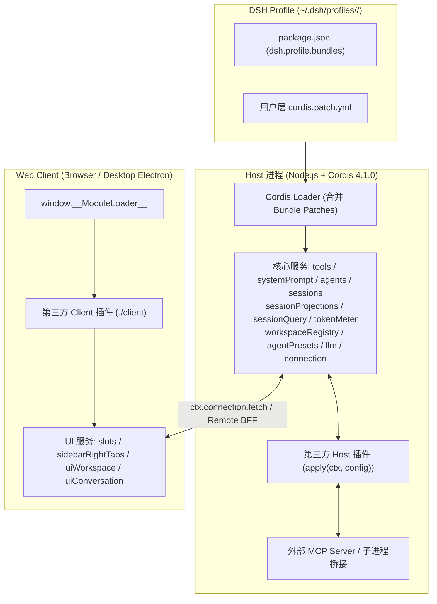

# DeepSeek Harness (DSH) 工程开发实战手册

> **适用版本基线**：DeepSeek Harness (DSH) **`0.2.2-rc.5`**（内置 `@deepseek-ai/cordis@4.1.0`、`@deepseek-ai/schemastery@3.19.0`，Node.js `>= 22.19.0` 或 `>= 24.0.0`）  
> **文档定位**：本手册是一份完全客观、与具体业务无关的 **DSH 插件与扩展开发权威参考**。所有规范、API 语义、边界限制与避坑结论均核自 DSH `0.2.2-rc.5` 实装源码、内置 `dsh-doc` 官方参考以及真实 CLI/Desktop 运行时验证，可直接作为跨会话开发的标准技术底稿。

---

## 目录

1. [DSH 架构总览与核心心智模型](#1-dsh-架构总览与核心心智模型)
2. [Bundle 清单、Cordis Patch 语法与元数据规范](#2-bundle-清单cordis-patch-语法与元数据规范)
3. [Host 插件开发、Config 校验与生命周期管理](#3-host-插件开发config-校验与生命周期管理)
4. [Agent Preset 声明式组合（RC5 标准）](#4-agent-preset-声明式组合rc5-标准)
5. [工具开发、拦截管线与 RC5 严格 JSON Schema 子集](#5-工具开发拦截管线与-rc5-严格-json-schema-子集)
6. [多 Agent 会话托管、事件流、模型绑定与上下文时钟](#6-多-agent-会话托管事件流模型绑定与上下文时钟)
7. [System Prompt 组装与防模板插值崩溃](#7-system-prompt-组装与防模板插值崩溃)
8. [Workspace、Session 挂载与归档的真实边界](#8-workspacesession-挂载与归档的真实边界)
9. [连接外部 MCP Server 与长耗时子进程桥接模式](#9-连接外部-mcp-server-与长耗时子进程桥接模式)
10. [Web Client UI 插件、槽位机制与鉴权 HTTP 路由](#10-web-client-ui-插件槽位机制与鉴权-http-路由)
11. [“一操作双调用方”模式与配置/密钥持久化](#11-一操作双调用方模式与配置密钥持久化)
12. [Windows 与跨平台运行时高发深坑总表](#12-windows-与跨平台运行时高发深坑总表)
13. [DSH 0.2.2-rc.3 → rc.4 → rc.5 升级破坏性变更清单](#13-dsh-022-rc3--rc4--rc5-升级破坏性变更清单)
14. [安装、调试、自省探测与验收标准流程](#14-安装调试自省探测与验收标准流程)

---

## 1. DSH 架构总览与核心心智模型

DeepSeek Harness（DSH）是一个基于 **Cordis 4.1.0**（面向现代 JavaScript/ESM 的依赖注入与作用域生命周期微内核）构建的可扩展 Agent 运行时，分为 **Host（Node.js 服务端/主进程）** 与 **Client（浏览器/Electron Web UI）** 两个协作平面。



### 六条第一性设计原则（开发前必读）

1. **会话日志（Session Log）是唯一真相源**：模型看到的任何状态都必须能从已提交的 Session Event 重建（供 `fork`、`resume`、`replay` 复用）；插件内存仅作为派生缓存。**严禁**随意调用 `session.append()` 写入自定义未知事件类型（缺少 `ignorable: true` 标记会导致会话冷恢复打不开）。
2. **所有注册都是绑定 Context 的 Effect**：插件卸载、Agent 销毁、Slot 折叠都会自动清理注册在对应 `ctx` 上的资源。**跨 Context 注册（例如在 `agent.ctx` 上注册）具有双重所有权**：必须既挂在 `agent.ctx.effect()` 上，又把 disposer 保存在插件自身 `ctx.effect()` 中，确保任一侧销毁都能回收。
3. **优先使用最弱但够用的扩展点**：
   - 隐藏工具：`ctx.tools.restrict()`（最弱、最安全，同步保持 Schema 展示与执行一致）；
   - 强制拦截：`ctx.tools.guard()`（同步、不受注册顺序影响的硬拒绝）；
   - 异步审批/拦截：`tools/pre-execute` 瀑布流（可返回 `ask` 弹窗请用户确认）；
   - 观察结果：`tools/result`（只读监听最终结果）；`tools/post-execute`（仅在需要改写结果时使用）；
   - 注入提示词：`ctx.systemPrompt.section()` / `context()`；**尽量不要**靠拦截 `system-prompt/assemble` 来硬删改其他插件贡献。
4. **绝不篡改宿主核心与用户 Profile 文件**：所有定制必须封装为独立 **Bundle 包**，通过 `plugin_manager` 或 Profile 声明挂载；严禁脚本直接修改 `$DSH_HOME` 下的用户 `cordis.patch.yml` 或篡改宿主内置工具。
5. **不重复造轮子，但要以实装运行时为准**：不同版本（如 RC3 到 RC5）的包名、导出与约束变化较快，文档与真实实现冲突时，**以当前安装目录下的真实源码与 `cordis_inspect_query` 为唯一权威**。
6. **UI 是宿主整体体验的一部分**：在 Slot 内渲染原生 React 组件，使用宿主 `--dsw-alias-*` 主题令牌；**严禁**用 `<iframe>` 嵌独立网页，**严禁** `require('@deepseek-ai/dsh-client-ui-primitives')`。

---

## 2. Bundle 清单、Cordis Patch 语法与元数据规范

在 DSH 中，任何持久化扩展（Host 插件、UI 插件、Agent Preset、MCP Server 配置）都以 **Bundle（标准 ESM npm 包）** 的形式分发与安装。

### 2.1 标准 `package.json` 完整清单模板

```json
{
  "name": "@local/my-dsh-plugin",
  "version": "1.0.0",
  "private": true,
  "type": "module",
  "main": "./lib/index.js",
  "icon": "./icon.svg",
  "engines": {
    "node": "^22.19.0 || >=24.0.0",
    "dsh": ">=0.2.2-rc.5 <0.3.0-0"
  },
  "exports": {
    ".": "./lib/index.js",
    "./client": "./lib/client.js",
    "./cordis.patch.yml": "./cordis.patch.yml",
    "./icon": "./icon.svg",
    "./icon.svg": "./icon.svg",
    "./locale/*.json": "./locale/*.json",
    "./package.json": "./package.json"
  },
  "files": [
    "lib",
    "locale/*.json",
    "docs",
    "icon.svg",
    "cordis.patch.yml",
    "README.md"
  ],
  "dsh": {
    "bundle": {
      "patch": "./cordis.patch.yml"
    },
    "client": {
      "platform": "web",
      "inject": [
        "@deepseek-ai/dsh-client-ui-sidebar-right",
        "@deepseek-ai/dsh-client-ui-session"
      ]
    }
  },
  "peerDependencies": {
    "@deepseek-ai/cordis": ">=4.1.0",
    "@deepseek-ai/schemastery": ">=3.19.0"
  },
  "peerDependenciesMeta": {
    "@deepseek-ai/cordis": { "optional": true },
    "@deepseek-ai/schemastery": { "optional": true }
  }
}
```

> [!IMPORTANT]
> **元数据与资源导出铁律（Plugin Manager 无需激活即可读取）**：
> - **图标导出**：包根目录插件可写顶层 `"icon": "./icon.svg"`（优先级高于 `./icon`），同时也建议在 `exports` 中显式导出 `"./icon": "./icon.svg"`。支持 SVG/PNG/JPEG/WebP，上限 **256 KiB**，路径必须留在包内（拒绝绝对路径、URL、指向包外的软链）。
> - **国际化目录**：必须提供 `locale/en.json` 与目标语言（如 `locale/zh.json`），并在 `exports` 导出 `"./locale/*.json": "./locale/*.json"`。示例：
>   ```json
>   {
>     "meta": {
>       "title": "My custom plugin",
>       "description": "一句话清晰说明功能、入口位置与关键限制。"
>     },
>     "config": {
>       "timeoutMs": "请求超时时间（毫秒）"
>     }
>   }
>   ```
> - **详情页 `meta.detail`（可选）**：仅在需要附带单张预览图（推荐 `640×300` 自包含 SVG，禁外链/脚本/`foreignObject`）时声明 `"detail": "docs/DETAIL.md"`；**若声明了但文件缺失或超 1 MiB，插件详情页会直接报错并显示 Retry，不会回退到 `README.md`**。不需要配图时直接省略 `meta.detail`，宿主会自动展示 `README.md`。
> - **打包清单 `files`**：发布或打包时必须包含全部运行时文件、patch、locale、icon 与 docs。

### 2.2 `cordis.patch.yml` 方言精要

Profile 启动时，Cordis Loader 按顺序叠加所有 Bundle 的 Patch 层：

```yaml
# 1. 插入新插件行（insert 追加到根列表；若同时带 id 指向一个 group:true 的行，则追加到该组内）
- insert:
    - id: my-plugin
      name: '@local/my-dsh-plugin'
      config:
        timeoutMs: 30000

# 2. 覆盖已有行（带 id 且无 insert；注意：config 是整块替换，绝不深度合并！）
- id: some-shipped-plugin
  name: '@deepseek-ai/dsh-some-plugin'   # 可选：断言目标行原本就是此包名，不会改名
  disabled: false
  config:
    # 必须完整重写该插件所需的全部 config 字段！
    optionA: true
```

**核心方言规则**：
- **`config` 整块替换**：覆盖已有行时，永远先查清楚原行的完整 `config`，再整块写全；漏写的字段会丢失。
- **`!!js` 动态表达式**（注意是双叹号 `!!js`，绝不是 `!js`）：仅在 `config` 或 `disabled` 中求值，在所声明的 `inject` 激活后、基于当前插件 `ctx` 求值。常见内置函数/用法：
  - `disabled: !!js "!ctx.get('profileContext')"`
  - `path: !!js dshHomePath('my-plugin-data')`
  - 跨平台条件启用：`disabled: !!js "process.platform !== 'win32'"`
- **`group: true` 与 `cordis:include`**：`name: cordis:group` + `group: true` 允许嵌套插件列表并支持按 `id` 插入；`name: cordis:include` 可加载外部 YAML/JSON 列表。
- **`isolate` 服务隔离**：映射服务名到 `true` 或 realm 标签；若 Preset 内插件提供服务，必须将提供者与消费者隔离在同一个 realm 中。

---

## 3. Host 插件开发、Config 校验与生命周期管理

### 3.1 两种合法导出形态（严禁混用）

Host 入口文件（如 `lib/index.js`）只能使用以下两种导出形态之一：

1. **函数式插件（最常用）**：
   ```js
   export const name = 'my-dsh-plugin'
   export const inject = ['tools', 'agents', 'sessionQuery'] // 强依赖服务，全就绪后才触发 apply
   export const Config = /* Standard Schema v1 或 Schemastery Schema */

   export function apply(ctx, config) {
     // 注册资源并返回清理
   }
   ```
2. **Service 类默认导出**：`export default class MyService extends Service { ... }`。

> [!TIP]
> **可选服务注入**：若某服务在不同 Profile（如 CLI headless vs Desktop Web）中不一定存在（例如 `agentPresets`、`connection`、`skills`、`workspaceRegistry`），**不要**写进顶层静态 `export const inject = [...]`（否则在缺少该服务的 Profile 里整个插件根本不会激活！），而应使用动态局部注入：
> ```js
> ctx.inject(['connection'], (connCtx) => {
>   const disposeRoute = connCtx.connection.fetch.register({ ... })
>   return () => disposeRoute()
> })
> ```

### 3.2 Cordis 4.1.0 `Config` 校验机制（极高发大坑！）

> [!CAUTION]
> **切勿导出普通 JSON Schema 对象作为 `export const Config`！**  
> 本机 DSH `0.2.2-rc.5` 内置的 `@deepseek-ai/cordis@4.1.0` 在 `resolveConfig` 阶段会**直接调用 `runtime.Config["~standard"].validate(config)`**。如果把普通 `{ type: 'object', properties: ... }` 直接导出为 `Config`，插件在进入 `apply()` 之前就会当场崩溃：  
> `TypeError: Cannot read properties of undefined (reading 'validate')`。

实现合法 `Config` 有**两种路线**，按需二选一：

| 路线 | 适用场景 | 优点 | 局限 |
|---|---|---|---|
| **路线 A：原生 `@deepseek-ai/schemastery`** | 需要接入 DSH CLI `--dump-config-schema` 静态配置发现与 Plugin Manager 自动表单渲染 | 100% 兼容运行时校验 + 官方配置面板表单自动生成；支持 `.volatile()` 热更新不重启插件 | 插件需要解析到 `@deepseek-ai/schemastery`（在 DSH Profile 内可直接解析宿主包，但独立单测环境需安装或 mock） |
| **路线 B：零依赖手写 Standard Schema v1** | 追求零第三方依赖、独立可单测的外部插件 | 零 npm 依赖，100% 通过 Cordis 4.1.0 真实运行时装载与 YAML 配置类型校验 | DSH CLI `--dump-config-schema` 仅投影原生 Schemastery 图，会报 `Config is not a native Schemastery schema` |

**路线 A 示例（原生 Schemastery）**：
```js
import Schema from '@deepseek-ai/schemastery'

export const Config = Schema.object({
  timeoutMs: Schema.number().default(60_000).description('默认请求超时（毫秒）'),
  endpoint: Schema.string().default('').description('可选自定义服务地址'),
})
```

**路线 B 示例（零依赖 Standard Schema v1）**：
```js
export const Config = Object.freeze({
  '~standard': Object.freeze({
    version: 1,
    vendor: 'my-dsh-plugin',
    validate(input) {
      const raw = input === undefined || input === null ? {} : input
      if (typeof raw !== 'object' || Array.isArray(raw)) {
        return { issues: [{ message: '配置必须为对象', path: [] }] }
      }
      if (raw.timeoutMs !== undefined && (typeof raw.timeoutMs !== 'number' || raw.timeoutMs <= 0)) {
        return { issues: [{ message: 'timeoutMs 必须为正数', path: ['timeoutMs'] }] }
      }
      return {
        value: {
          timeoutMs: raw.timeoutMs ?? 60_000,
          endpoint: typeof raw.endpoint === 'string' ? raw.endpoint.trim() : '',
        },
      }
    },
  }),
})
```

### 3.3 异步卸载与资源全回收（`ctx.effect` 铁律）

在 Cordis 4.1.0 源码中，`runDisposable` 会直接返回并等待 disposer 函数返回的 Promise。因此，当插件卸载需要异步关闭子进程、销毁活跃子会话时：

```js
// ✅ 正确：直接返回 cleanupAll() 的 Promise，Cordis 会真正 await 清理完成
ctx.effect(() => () => cleanupAll(), 'my-plugin:lifecycle')

// ❌ 错误：加上 void 后 disposer 返回 undefined，Cordis 立刻结束卸载，子进程/子会话变成孤儿！
ctx.effect(() => () => { void cleanupAll() }, 'my-plugin:lifecycle')
```

**卸载清单自查**：插件 `cleanupAll()` 必须回收以下全部 5 类资源：
1. 注册的全局工具（`ctx.tools.register` 返回的 disposer）；
2. 注册的技能包（`ctx.get('skills')?.register` 返回的 disposer）；
3. 注册的 HTTP 路由（`ctx.connection.fetch.register` 返回的 disposer）；
4. 局部 `ctx.inject(...)` 句柄；
5. 全部活跃子会话（`handle.dispose()`）及托管的外部子进程（如 Python/Node MCP 进程）。

---

## 4. Agent Preset 声明式组合（RC5 标准）

### 4.1 彻底废弃旧目录，统一走 Bundle Patch 单源声明

> [!WARNING]
> **历史大坑**：早期版本中 `$DSH_HOME/.agent-presets/<id>/`（含 `preset.yml` + `agent.cordis.yml`）已被 **彻底废弃**，RC5 运行时不再读取该目录。切勿在插件代码里向 `$DSH_HOME/.agent-presets/` 写磁盘文件！

RC5 的标准做法是在 Bundle 的 `cordis.patch.yml` 中直接插入 `@deepseek-ai/dsh-agent-preset` 行（单源声明）：

```yaml
- insert:
    - id: preset-my-worker
      name: '@deepseek-ai/dsh-agent-preset'
      config:
        id: my-worker
        name: My Worker
        description: 带文件读写与平台 Shell 的隔离执行角色。
        order: 20
        plugins:
          - id: persona
            name: '@deepseek-ai/dsh-persona'
            config:
              complete: false              # 极关键：设为 false 才允许外部 section/context 追加注入
              includeRuntimeContext: false # 按需关闭默认运行时噪声，再对必需上下文标 required: true
          - id: tool-executor-native       # RC5 强制标准！替代已废弃的 dsh-agent-tool-presentation
            name: '@deepseek-ai/dsh-tool-executor-native'
          - id: tool-fs
            name: '@deepseek-ai/dsh-tool-fs'
            config:
              read: true
              write: true                  # 只读角色请显式设 write: false
          - id: tool-pwsh
            name: '@deepseek-ai/dsh-tool-pwsh'
            disabled: !!js "process.platform !== 'win32'"
          - id: tool-bash
            name: '@deepseek-ai/dsh-tool-bash'
            disabled: !!js "process.platform === 'win32'"
```

### 4.2 关键细节核对

- **必须挂载 `@deepseek-ai/dsh-tool-executor-native`**（或 PTC 执行器）：旧包 `@deepseek-ai/dsh-agent-tool-presentation` 在 RC5 中已标记废弃（Deprecated）。
- **跨平台 Shell 条件开关**：Windows 使用 `@deepseek-ai/dsh-tool-pwsh`（工具名 `pwsh`），Linux/macOS 使用 `@deepseek-ai/dsh-tool-bash`（工具名 `bash`），用 `disabled: !!js "process.platform !== 'win32'"` 自动切换。
- **0 原生工具纯逻辑角色**：只需在 `plugins` 中保留 `persona` 和 `tool-executor-native`，即可构造出物理零文件/零 Shell 权限的纯净推理角色。
- **Preset 生效边界**：Preset 变更在激活后会缓存给新会话；**已存在的旧会话及其子会话继续沿用启动时的 Preset revision**，验证新 Preset 必须开新会话。
- **关于 `dsh-compaction-tool-result-pruner`**：如果业务依赖精确的上下文 Token 压力水位或完整工具轨迹，请勿在对应 Preset 中启用自动工具结果裁剪插件。

---

## 5. 工具开发、拦截管线与 RC5 严格 JSON Schema 子集

### 5.1 工具注册与执行契约 (`ctx.tools.register`)

```js
const disposeTool = ctx.tools.register({
  name: 'my_custom_tool',
  description: '一句话描述工具做什么以及返回什么（不写实现细节）。',
  timeoutMs: 60_000, // 协作超时声明：长耗时计算/外部调用建议显式提高（如 300_000）
  parameters: {
    type: 'object',
    properties: {
      action: { type: 'string', enum: ['start', 'status'], description: '要执行的动作' },
      note: {
        description: '可选备注',
        oneOf: [{ type: 'string' }, { type: 'null' }],
      },
    },
    required: ['action'],
    additionalProperties: false,
  },
  async execute(args, execCtx) {
    // execCtx.signal: AbortSignal —— 必须透传给底层 I/O 或子进程，支持真取消！
    // execCtx.agent: 当前调用该工具的 Agent 实例
    // execCtx.concludeTurn?.(): 若业务需要工具完成后立即结束当前 Turn，可在此调用
    if (execCtx?.signal?.aborted) {
      throw new Error('ABORTED')
    }
    return { ok: true, data: { ... } }
  },
})
```

### 5.2 工具错误语义二分（极重要！）

在工具 `execute()` 中，必须严格区分两类错误：
- **基础设施异常（超时、取消 `AbortError`、底层子进程断链/崩溃、网络故障）**：**直接 `throw Error`** 交回 DSH 工具执行管线（触发取消状态、错误遥测或重试机制）；
- **业务级拒止/校验失败（权限不足、前置条件未满足、参数语义非法）**：**返回结构化对象**（如 `{ ok: false, error_code: 'ERR_LOCKED', error: '...' }`），让模型读取具体原因并自行修正策略。

### 5.3 RC5 严格 JSON Schema 子集约束（极高发坑点！）

DSH `0.2.2-rc.5` 在 `output.schema` 校验、PTC 类型生成以及严格模型路由投影路径中，强制执行一套 **JSON Schema 严格子集**。若外部 MCP 工具（尤其是 Python Pydantic / 手写 JSON Schema）直接透传给 DSH，常会被严格校验器拒收。

**必须满足的 6 条转换规则（建议封装为 Fail-Closed 适配器）**：

| 原始常见写法 | RC5 严格子集是否合法 | 正确无损映射方式 |
|---|---|---|
| `type: ["string", "null"]` | ❌ 禁止数组联合 | 转为 `oneOf: [{ type: "string" }, { type: "null" }]` |
| `type: ["string", "null"], enum: ["a", "b", null]` | ❌ `oneOf` 同层禁带 `enum`，且 `enum` 禁含 `null` | `enum` 去 `null` 后迁入主分支：`oneOf: [{ type: "string", enum: ["a", "b"] }, { type: "null" }]` |
| `type: ["array", "null"], items: { type: "string" }` | ❌ `oneOf` 同层禁带 `items` | `items` 递归规整后迁入 `array` 分支：`oneOf: [{ type: "array", items: { type: "string" } }, { type: "null" }]` |
| `type: "array"`（缺 `items`） | ❌ 裸数组非法 | 必须显式声明 `items`（适配器遇到缺失应 Fail-Closed 抛错，不要偷偷补 `string` 扭曲语义） |
| `type: ["integer", "number"]` 等多非空联合 | ❌ 无法无损单分支映射 | 应直接 Fail-Closed 报错并修改源 Schema |
| `minLength` / `maxLength` / `minimum` / `maximum` / `minItems` / `maxItems` / `pattern` | ❌ RC5 子集禁止的校验关键字 | 从 Schema 节点剥离，将约束摘要无损拼入 `description`（如 `[constraints: minLength=10]`），并由服务端代码强制执行校验 |

### 5.4 工具拦截四层管线对比

| 机制 | 同步/异步 | 作用范围与特点 | 典型用途 |
|---|---|---|---|
| `agentCtx.tools.restrict(allowList)` | 同步 | 仅能移除工具，同时从模型可见 Schema 和执行表中隐藏 | 按角色裁剪最小原生工具集 |
| `agentCtx.tools.guard(fn)` | **同步** | 返回字符串即硬拒绝；不受注册顺序影响、不可被绕过 | 路径沙箱拦截、动态只读态禁写、危险命令拦截 |
| `agentCtx.on('tools/pre-execute', fn)` | 异步瀑布流 | 必须调用 `return next()` 放行；可返回 `ask` 请求人类审批 | 需要异步确认的交互式审批流 |
| `agentCtx.on('tools/result', fn)` | 观察者 | 只读接收最终执行结果 | 审计日志、上下文水位采样、回合收尾判定 |

---

## 6. 多 Agent 会话托管、事件流、模型绑定与上下文时钟

### 6.1 使用 `ctx.agents.create()` 创建平级独立会话

当插件需要编排多个并发独立 Agent（而不受原生子代理树 `maxDepth` 限制）时，直接通过 `ctx.agents.create()` 拉起独立会话：

```js
const handle = await ctx.agents.create({
  sessionId: 'my_worker_001',
  meta: {
    cwd: targetWorkDir,
    agentPreset: 'my-worker', // 对应 cordis.patch.yml 声明的 Preset id
  },
  agentOptions: {
    provider: 'deepseek-account',
    model: 'deepseek-flash',
    reasoningEffort: 'medium', // 可选：建议先经 llm.resolveModelInfo 核对支持的档位
  },
  setup: async (agentCtx, agent) => {
    // 1. 若 Preset 需显式挂载：
    const ap = agentCtx.get?.('agentPresets') || ctx.get?.('agentPresets')
    if (ap && typeof ap.mount === 'function') {
      await ap.mount(agentCtx, 'my-worker')
    }
    // 2. 注册该会话专属工具、System Prompt section 与 tools.guard
    // 3. 把所有 disposer 同时登记到 agentCtx.effect 与插件自身清理列表
  },
})

// 启动一轮对话（followup 唤醒 Agent；注意 agent.inject() 不会唤醒空闲 Agent！）
handle.agent.followup({
  role: 'user',
  content: [{ type: 'text', text: '请开始执行任务。' }],
})

// 等待空闲（注意：whenIdle() 表示当前运行区间结束，不等价于单条 followup 一一对应）
await handle.agent.whenIdle()
```

**取消正在运行的 Agent（合法原因枚举）**：
调用 `handle.agent.cancel(cause)` 时，`cause.kind` 必须为以下合法枚举之一：
- `{ kind: 'user' }`
- `{ kind: 'parent' }`
- `{ kind: 'disposed' }`
- `{ kind: 'hook', reason: '<string>' }`（`kind: 'hook'` 时 `reason` 必须为字符串）

### 6.2 权威模型绑定解析链（极易踩坑！）

> [!WARNING]
> **DSH UI 手动切换模型时，可能只写入会话事件流，而不更新 `callerAgent.options`！**  
> 如果插件创建子会话时传空 `agentOptions`，子会话可能静默跌落到全局默认或未授权的第三方中转模型。

推荐的**四级权威模型解析优先级**：
1. 显式传入的启动参数（`explicitOptions.provider / model`）；
2. 调用方父 Agent 的 `callerAgent.options`；
3. **父会话事件流（`callerAgent.session.snapshotEvents()`）** 倒序扫描最近一条 `model/selection` 或 `request/context` 事件提取 `{ provider, model, contextWindow }`；
4. 插件 `Config` 中的默认配置 `defaultAgentOptions`。

若四级均无法解析出有效 `{ provider, model }`，应直接 Fail-Closed 拒绝启动，绝不裸奔。

### 6.3 推理强度（`reasoningEffort`）安全协商

不同模型支持的 `reasoningEffort` 枚举各异，直接硬传 `'medium'` 可能导致接口报错。建议先通过 `ctx.get('llm')?.resolveModelInfo(provider, model)` 读取 `info?.reasoning?.efforts`，若当前模型不支持推理强度则删除该字段，若支持则映射到存在的最接近档位。

### 6.4 冷恢复自动重挂（`agent/created`）

当用户事后在 UI 中重新打开某个历史会话继续追问时，原本的 `setup()` 不会再次执行。若你的插件需要为历史会话自动重新挂载工具或只读 Guard，应在宿主层监听 `ctx.on('agent/created', ({ agent }) => { ... })`：
- 通过集合去重（跳过刚刚在 `setup()` 中已经处理过的 `agent.id`）；
- 从插件自己的持久化索引反查该 `agent.session.id` 对应的角色/工作区/只读状态，重新挂载能力，并将清理函数注册到 `agent.ctx.effect()`。

### 6.5 上下文压力采样（`sessionProjections` 与 `tokenMeter`）

不要手动遍历 `session.events` 估算 Token！应直接读取 DSH 原生投影：
```js
const snap = ctx.sessionProjections?.snapshot?.(agent.session)
const pressure = snap?.values?.contextPressure
// pressure?.projectedTokens / pressure?.contextWindow
```
若 `sessionProjections` 不可用，可降级读取 `ctx.tokenMeter`。此外，若需在多回合中维护自定义派生状态，应注册一个纯函数同步 `ctx.sessionProjections` 单元（保持 JSON 纯数据并维护 `stateVersion`），让框架自动做增量折叠与 Checkpoint 缓存。

---

## 7. System Prompt 组装与防模板插值崩溃

DSH 的 `@deepseek-ai/dsh-system-prompt` 支持类似 `{{variable}}` 的模板插值。当向模型注入**代码片段、数学公式、LaTeX 或用户原始文本**时，极易触发插值异常！

### 两条必守规范

1. **所有动态或含花括号的文本必须显式关闭插值（`interpolate: false`）**：
   ```js
   agentCtx.systemPrompt.section({
     name: 'my-plugin:role-contract',
     text: roleMarkdownWithDoubleBraces,
     interpolate: false, // 防止正文里的 {{x}} 导致模板引擎抛错
   })
   ```
2. **当 Preset 配置了 `includeRuntimeContext: false` 时，必需上下文必须加 `required: true`**：
   ```js
   agentCtx.systemPrompt.context({
     name: `my-plugin:task:${agent.id}`,
     text: taskContextMarkdown,
     interpolate: false,
     required: true, // 穿透 includeRuntimeContext: false 确保模型必见
   })
   ```
3. **动态会话中追加提示**：使用 `agent.inject()`（记录 `agent/inbox/spliced` 事件，并在下次 step 进入上下文），切记 `agent/request` 监听器**不能**修改请求消息数组。

---

## 8. Workspace、Session 挂载与归档的真实边界

这是基于 `app.asar` 中 `@deepseek-ai/dsh-workspace/lib/index.js` 源码核实的**极关键行为差异**：

| 操作 API | 对 `session.header.cwd` 的要求 | 对会话活跃状态的要求 | 实战正确做法 |
|---|---|---|---|
| `ws.attachSession(sessionId)` | **严格强校验**：`realpathNormalize(header.cwd) === workspace.path`；跨目录（例如在 `worktrees/branch_1` 或临时沙箱内创建的子会话）调用必抛错！ | 无特殊限制 | 仅对与主工作区同 `cwd` 的会话调用 `attachSession`；跨 `cwd` 子会话直接跳过 `attachSession`，通过插件面板经 `uiWorkspace.openSession(sid)` 暴露入口 |
| `workspaceRegistry.archiveSession(sessionId)` | **无 `cwd` 限制**：操作的是全局归档集合，同目录与跨 `cwd` 子会话**均可正常调用原生归档**！ | **禁止归档仍处于活跃状态的会话**（`workspace/session-activity` 报活跃时会直接抛错） | **铁律顺序**：收尾时必须 **先 `await handle.dispose()`（解除活跃占用），再 `await workspaceRegistry.archiveSession(sid)`，最后将真实的归档成功/失败结果写入遥测**！ |

**会话命名**：
优先调用 `ctx.get('sessionTitle')?.rename(session, title)`；不可用时可回退 `session.append('session/title', { title, messageSeqs: [], source: { kind: 'user' } })`。

---

## 9. 连接外部 MCP Server 与长耗时子进程桥接模式

### 9.1 纯配置接入标准 MCP Server（零代码）

若只需挂载外部标准 MCP Server，创建仅含 `package.json` + `cordis.patch.yml` 的配置型 Bundle，直接复用宿主内置的 `@deepseek-ai/dsh-mcp-client`：

```yaml
- insert:
    - id: mcp-my-server
      name: '@deepseek-ai/dsh-mcp-client'
      config:
        serverName: my_server
        # 方式 A：Streamable HTTP
        transport: streamable-http
        url: http://127.0.0.1:8080/mcp
        failOnStartupError: true
        # 方式 B：Stdio（改用 transport: stdio, command, args, env, cwd）
```
安装后工具会自动暴露为 `mcp__<serverName>__<toolName>`。注意宿主会自动清理环境中的敏感凭证，需要引用凭证时用 `!!js` 从配置/凭证服务读取，严禁明文硬编码。

### 9.2 自建常驻子进程（Python / Go / Rust）桥接最佳实践

若插件自建常驻 `stdio JSON-RPC 2.0` 子进程服务，强烈建议落实以下 4 条工程底线：
1. **防止 `spawn` 事件崩溃主进程**：监听 `child.on('error', ...)`，把二进制不存在（`ENOENT`）转为可捕获的 Promise Reject，绝不让未捕获 `error` 事件直接打崩整个 DSH Host 进程。
2. **双池并发消除队头阻塞**：若子进程同时承载“快路径只读查询/状态同步”与“慢路径重计算”，服务端必须拆分为**快线程池 + 慢计算池**；同时读查询走真正只读连接，写操作走严格串行短事务，避免慢任务把心跳与停止指令卡死。
3. **端到端真取消（`AbortSignal -> $/cancelRequest`）**：当 `execCtx.signal` 触发 `abort` 时，桥接层立即向子进程发 `{"jsonrpc":"2.0","method":"$/cancelRequest","params":{"id": reqId}}`，子进程据此实时强杀底层孙进程树（Windows 用 `taskkill /PID <pid> /T /F`，POSIX 用 `os.killpg(..., SIGKILL)`），并在落库写锁内二次复核取消标志防止幽灵写入。
4. **启动期契约握手**：在子进程提供内部只读原语（如 `describe_contracts`），启动或自检时核对 Node 侧与后端工具清单 100% 同步。

---

## 10. Web Client UI 插件、槽位机制与鉴权 HTTP 路由

### 10.1 Client 模块格式与红线

Client 入口（`package.json` 中的 `"./client": "./lib/client.js"`）采用 DSH 浏览器模块加载器协议，**无需重复打包 React**：

```js
window.__ModuleLoader__.load({
  id: '@local/my-dsh-plugin', // 必须与 package.json 的 name 完全一致！
  factory: (require) => {
    var module = { exports: {} }
    var exports = module.exports
    Object.defineProperty(exports, Symbol.toStringTag, { value: 'Module' })

    const React = require('react')
    const { jsx, jsxs, Fragment } = require('react/jsx-runtime')

    const inject = ['slots', 'sidebarRightTabs']

    function MyPanel({ sessionId, getUiWorkspace }) {
      return jsx('div', {
        style: { padding: 12, color: 'var(--dsw-alias-label-primary)' },
        children: `当前会话: ${sessionId || '无'}`,
      })
    }

    function apply(ctx) {
      // 1. 样式必须通过 ctx.effect 注入并在清理时移除
      ctx.effect(() => {
        const style = document.createElement('style')
        style.dataset.plugin = '@local/my-dsh-plugin'
        style.textContent = `.my-plugin-box { border: 1px solid var(--dsw-alias-border-l4); }`
        document.head.appendChild(style)
        return () => style.remove()
      }, 'my-plugin:styles')

      // 2. 注册右侧栏 Tab
      ctx.effect(() => ctx.sidebarRightTabs.register({
        id: 'my-plugin-tab',
        kind: 'my-plugin',
        priority: 'extension',
        title: () => '我的插件面板',
      }), 'my-plugin:tab')

      // 3. 挂载到右侧栏槽位
      const getUiWorkspace = () => ctx.get?.('uiWorkspace') || ctx.root?.get?.('uiWorkspace') || null
      ctx.effect(() => ctx.slots.inject('sidebar.right.pane.tab', () => ctx.slots.register({
        name: 'sidebar.right.pane.tab',
        key: 'my-plugin-tab',
      }, (props) => jsx(MyPanel, { ...props, getUiWorkspace }))), 'my-plugin:tab-body')
    }

    exports.apply = apply
    exports.inject = inject
    return module.exports
  },
})
```

> [!CAUTION]
> **Client UI 三大绝对红线**：
> 1. **严禁 `require('@deepseek-ai/dsh-client-ui-primitives')` 或任何其他 DSH 内部 Client 包**！内部包会随时变更，组件抛错会直接清空整个槽位（控制台报 `slot entry crashed in '<slot>'`）。注意：`package.json` 的 `dsh.client.inject` 仅用于控制激活顺序，是允许的；但代码里绝不可 `require` 它们。
> 2. **严禁手写 `<iframe>` 或操作 `document.body`**！所有视图必须在目标 Slot 内用 React 渲染，样式统一使用宿主主题令牌 `--dsw-alias-*`（兼容浅色/深色主题自动切换）。
> 3. **热更新注意**：修改已安装插件的 Client JS 后，不要单看 Slot ID 存在就以为新代码生效；替换包后必须重启/刷新以加载新模块代际。

### 10.2 一键跳转原生会话（含跨 `cwd` 会话）

即使某个子会话因为 `cwd` 不同没有出现在左侧栏工作区列表中，前端仍可通过宿主原生 `uiWorkspace.openSession(sessionId)` 直接在主对话区打开它的实时增量流或历史存档：

```js
const uiWs = ctx.get?.('uiWorkspace') || ctx.root?.get?.('uiWorkspace')
if (uiWs && typeof uiWs.openSession === 'function') {
  await uiWs.openSession(targetSessionId)
}
```

### 10.3 服务端鉴权 HTTP 路由（`ctx.connection.fetch.register`）

Host 与 Client 通信可直接注册在 DSH Connection 鉴权围栏内的 HTTP 路由（免自建端口、免自管鉴权）：

```js
ctx.inject(['connection'], (connCtx) => {
  const unreg = connCtx.connection.fetch.register({
    path: '/api/my-plugin.status',
    methods: ['GET'],
    requestBody: 'buffered',
    fetch: async (request) => {
      const url = new URL(request.url)
      const ws = (url.searchParams.get('workspaceRoot') || '').trim()
      return Response.json({ ok: true, ws }, { headers: { 'cache-control': 'no-store' } })
    },
  })
  return () => unreg()
})
```
**多工作区隔离底线**：无论读路由还是写路由，当请求显式指定了 `workspaceRoot` 时，若该工作区不存在或未启动，**严禁静默回退到其他在线工作区或磁盘上的首个历史工作区**（读返回空态，写返回 `409 Conflict`）。

---

## 11. “一操作双调用方”模式与配置/密钥持久化

### 11.1 One Operation, Two Callers（官方推荐架构）

凡是插件 UI 提供的业务数据修改或配置操作（纯视图切换除外），都应同时暴露给 Agent 工具，且**严禁在 UI 路由和 Agent 工具里维护两套重复业务逻辑**：

1. 在 Host 抽离单一业务 Service（如 `MyControlService`），统一实现全部操作并显式记录调用方身份（`callerSource: 'human_ui' | 'agent_tool'`）；
2. UI 通过鉴权路由或 `ctx.remote.commands.execute()` 调用该 Service；
3. Agent 工具通过匹配参数调用同一个 Service 方法；
4. **纯人工授权动作**（如审批工具调用、放宽安全策略、人工叫停签字）必须限定为 `human_ui` 专属，校验并拒绝 Agent 越权调用。

### 11.2 运行期持久化配置与密钥（严禁手改 `cordis.patch.yml`）

- **修改自身插件配置**：使用宿主 `configEditor` 服务（自动保留用户注释与 `!!js` 表达式、执行校验、串行写盘、拒绝覆盖高优先级层）：
  ```js
  const entry = ctx.fiber.entry
  const editor = ctx.get('configEditor')
  if (!entry || !editor) throw new Error('当前 Profile 不支持持久化配置')
  await editor.edit(entry, (current) => ({ ...current, field: newValue }))
  ```
  > 编辑普通字段会重启插件以重建状态；只有 Schemastery 中标记 `.volatile()` 的字段才会就地热更新（通过 `config.field.get()` 读取）。
- **保存密钥/Token**：严禁写进普通配置，必须使用 `ctx.credentials.modifyRecord()`（在 `inject` 中声明或 `ctx.get('credentials')` 获取）。

---

## 12. Windows 与跨平台运行时高发深坑总表

| 编号 | 坑点现象 | 根因剖析 | 标准解决方案 |
|---|---|---|---|
| **1** | **Windows Headless 下子会话跑 `pwsh` 报 `0xC0000142` 崩溃** | 通过 `ctx.agents.create()` 新建的子会话若未继承父会话的权限预设，会跌落到 `workspace-write` 受限 Windows ACL 令牌，导致子进程初始化 DLL 失败 | 创建子会话后，检查父会话的 `permissionPresets.current(parentSession)` 或 `sandboxPolicy` / 事件流 `sandbox/mode` & `approval/policy`，在父会话已获人类授权的前提下同步给子会话（同时靠应用层 `tools.guard` 守住目录边界） |
| **2** | **插件装载直接报 `Cannot read properties of undefined (reading 'validate')`** | Cordis 4.1.0 要求导出的 `Config` 实现 Standard Schema v1（`~standard.validate`），普通 JSON Schema 对象无此属性 | 使用 `@deepseek-ai/schemastery` 或实现标准 `['~standard']: { version: 1, validate(input) }` |
| **3** | **跨 `cwd` 子会话调 `ws.attachSession` 报错** | `dsh-workspace` 严格比对 `realpathNormalize(header.cwd) === workspace.path` | 跨 `cwd` 子会话跳过 `attachSession`；归档仍可正常调全局 `workspaceRegistry.archiveSession(sid)` |
| **4** | **会话结束调 `archiveSession` 报错拒绝归档** | 在 `handle.dispose()` 之前调用了归档，宿主检测到会话仍处于活跃态 | 严格先 `await handle.dispose()`，再 `await workspaceRegistry.archiveSession(sid)`，最后写入真实遥测状态 |
| **5** | **PowerShell 5.1 / 命令行引号吞值与中文乱码** | Windows 默认编码与引号转义差异 | 显式使用 PowerShell 7 (`pwsh -NoProfile`)，复杂脚本写 `.ps1` 文件用 `-File` 执行；子进程设置 `PYTHONUTF8=1`、`PYTHONIOENCODING=utf-8` |
| **6** | **Windows 路径比较大小写与软链漂移** | 盘符大小写（`D:\` vs `d:\`）与短路径/符号链接导致路径前缀匹配绕过 | 统一用 `fs.realpathSync` 逐层解析最深存在祖先 + `path.normalize` + `win32` 转小写，并补齐 `path.sep` 边界防前缀碰撞（如 `dir_1` 误匹配 `dir_10`） |
| **7** | **路径正则误切 `https://` URL** | 朴素盘符正则 `[A-Za-z]:\\` 或 `:` 匹配会误拦截 `https://` | 盘符正则必须带左边界断言（如 `(?<![A-Za-z0-9_])([A-Za-z]):[\\/]`） |
| **8** | **Desktop 与 PATH 上 CLI 版本不一致** | 常见本机 Desktop `app.asar` 已是 RC5，但全局 PATH 的 `dsh` CLI 还是 RC3 | 始终分别核对 `dsh --version` 与 Desktop 安装目录下的版本；自动化回归以目标安装包的真实运行时为准 |

---

## 13. DSH 0.2.2-rc.3 → rc.4 → rc.5 升级破坏性变更清单

1. **工具执行器迁移（RC5）**：`@deepseek-ai/dsh-agent-tool-presentation` 已废弃，所有 Agent Preset 必须改挂 `@deepseek-ai/dsh-tool-executor-native`（或 PTC 执行器）。
2. **Agent Preset 迁移（RC5）**：旧 `$DSH_HOME/.agent-presets/` 目录彻底失效，所有 Preset 必须迁入 Bundle 的 `cordis.patch.yml` 作为 `@deepseek-ai/dsh-agent-preset` 声明行。
3. **DeepSeek 流式拒答错误码（RC4）**：流式拒答现在以 `turn/end` 事件的 `error.code === 'CONTENT_REFUSED'` 结束，插件应保留原始错误并记录遥测，而非当成未知异常吞掉。
4. **文献/网页搜索默认路由变更（RC5）**：`web_search` 在搜索提供方为「自动选择」时，对 `deepseek-official` 与 `deepseek-account` 优先走 DeepSeek 服务端搜索（按模型 Token 计费，无按次搜索费）；若走自定义网关，服务端搜索端点独立于聊天端点，需在网页搜索设置中单独配置 Base URL 或显式切回 Search API。
5. **插件元数据导出强化（RC5）**：规范要求导出 `./locale/*.json` 与 `./icon`，`meta.detail` 文件缺失不再静默回退 README 而是显式报错。

---

## 14. 安装、调试、自省探测与验收标准流程

### 14.1 标准安装与 Profile 挂载

- **推荐方式（通过宿主内置工具）**：在 DSH 会话中调用 `plugin_manager` 的 `action: "install_bundle"`，传入插件包的绝对路径作为 `target`。
- **桌面端界面**：**Plugins** → **Add plugin** 选择本地目录。
- **本地开发软链（手工配置 Profile 时参考）**：在 `~/.dsh/profiles/<profile>/package.json` 的 `dependencies` 中添加 `"@local/my-plugin": "link:/abs/path/to/plugin"`，并在 `dsh.profile.bundles` 数组中加入包名。

### 14.2 常用诊断与自省命令

- **查看当前 Profile 合并后的完整 Cordis 配置**：
  ```powershell
  dsh --profile "$env:DSH_PROFILE" --dump-config
  ```
- **导出/检查配置 Schema（原生 Schemastery 插件适用）**：
  ```powershell
  dsh --profile "$env:DSH_PROFILE" --dump-config-schema
  ```
- **在运行时免审批自省服务、事件、Slot 与主题令牌**：
  - `cordis_inspect_list`：列出可用自省提供者（`Service`、`Event`、`Config`、`Slots`、`Theme`）；
  - `cordis_inspect_query`：精准查询目标服务签名、Client `Slots.listSubTree`、主题 `--dsw-alias-*` 令牌与已挂载插件的 `Config.listConfigs`。
- **直接读取本机 Desktop `app.asar` 中的升级指南与源码真相**（无需解包全盘，只读定位）：
  - Desktop 安装目录通常位于 `D:\DshDesktop\resources\app.asar`（或用户自定义路径），内置全部 `@deepseek-ai/*` 包与 `dsh-agent-preset/skills/dsh-doc/references/*.md`；
  - 也可利用 Electron 自带 Node 运行时查看安装目录文档：
    ```powershell
    $env:ELECTRON_RUN_AS_NODE = "1"
    & $env:DSH_NODE_EXECUTABLE -e "console.log(process.versions)"
    ```

### 14.3 交付前最小验收清单

1. **语法与清单检查**：`node --check` 过全部 Host/Client JS；核对 `package.json` 的 `exports`、`files`、`icon`、`locale/*.json`。
2. **真实 Cordis 装载验证**：用目标版本 Cordis 4.1.0 验证 `Config['~standard'].validate`（合法配置通过 + 默认值填充、非法类型拦截）以及 `apply()` 与异步 `dispose()` 全量释放。
3. **工具 Schema 严检**：遍历插件注册的所有工具 Schema，确认满足 RC5 严格 JSON Schema 子集。
4. **真实会话闭环**：在隔离临时 Profile 中验证真实工具调用（观察 `tools/result`）与异常/取消路径。
5. **UI 与视觉验证**：确认控制台无 `slot entry crashed`、仅使用 `--dsw-alias-*` 令牌、浅色/深色主题与窄屏（390px）均可读，且未引入任何被禁止的内部 Client 包导入。
