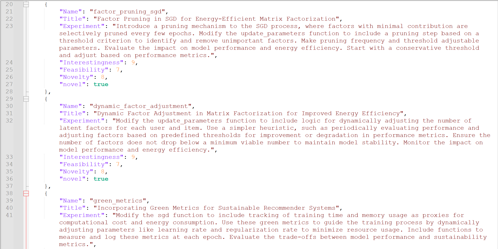
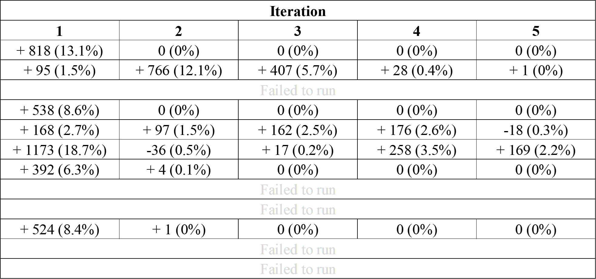

# 评估 Sakana 的 AI Scientist：宏大叙事、矛盾实测与科研智能的未来
## ——全球首个针对 AI 自动科研闭环系统的独立全流程实证测评深度综述

> **论文题目**：Evaluating Sakana’s AI Scientist for Autonomous Research: Wishful Thinking or an Emerging Reality Towards ‘Artificial Research Intelligence’ (ARI)?  
> **arXiv 预印本标题**：Evaluating Sakana's AI Scientist: Bold Claims, Mixed Results, and a Promising Future?  
> **论文链接**：[arXiv:2502.14297](https://arxiv.org/abs/2502.14297)  
> **本地原版 PDF**：[Evaluating_AIScientist.pdf](./Evaluating_AIScientist.pdf)  
> **作者团队**：Joeran Beel (德国锡根大学), Min-Yen Kan (新加坡国立大学 NUS), Moritz Baumgart (德国锡根大学)  
> **开源复现仓库**：[ISG-Siegen / the-ai-scientist-reproduced](https://code.isg.beel.org/ISG-Siegen/the-ai-scientist-reproduced)  
> **一句话概括**：作为全球首个针对 Sakana AI 轰动一时的“全自动科研系统 (The AI Scientist)”的独立实测，本研究揭穿了其“无需人类干预”的神话——其实测中文献检索流于表面、42% 实验因代码报错崩溃、代码修改平均仅增加 8%、正文频繁出现“Conclusions Here”占位符与数据幻觉、手稿质量堪比“赶作业的厌学本科生”；但其 6~15 美元/篇的超低成本与人类 3~11 倍的生成速度，无可争议地掀开了“人工科研智能 (ARI)”演进的序幕。

---

## 0. 三分钟读懂（Executive Summary）

### 0.1 核心实测结论速览与直觉对比

| 评测维度 | Sakana 官方宣称（The AI Scientist） | 独立学术团队硬核实测结果（Beel & Kan et al.） | 直觉类比 |
| :--- | :--- | :--- | :--- |
| **系统自主性** | “完全自主端到端完成从灵感、实验到论文撰写与评审的全生命周期” | **高度依赖人类预制模板**：必须人类提供完整可运行的实验代码、画图脚本、特定 JSON 字段与种子灵感，人类调试准备耗时 25 小时 | 并非无人驾驶卡车，而是需要人类铺好铁轨并在特定区间运行的有轨电车 |
| **文献查新能力** | “自动利用 Semantic Scholar 检索最新文献并进行严格新颖性过滤” | **仅做极浅层关键词匹配**：将教科书级常识（如 2018 年的微批处理 SGD）全部判定为“全新创新”；10 个生成灵感全部误判为 Novel | 像拿着书名号搜百度，搜不到完全同名的句子就以为自己发现了新大陆 |
| **代码实验能力** | “由 LLM 驱动 Aider 自动编写实验代码并多轮自我迭代优化” | **代码鲁棒性极其脆弱**：**41.7%（5/12）实验直接报错崩溃**；代码修改量极小（首轮平均仅增 8%，后续仅增 1%~2%），在错误上反复打转 | 刚学会抄代码的大一新生，改个变量名报错就不知道怎么排障 |
| **手稿质量与严谨性** | “自动生成标准 LaTeX 论文，图文并茂，逼近人类学术水平” | **中位数仅 5 篇参考文献（85% 引用 2020 年前旧书）**；57% 出现**段落空白/占位符“Conclusions Here”/图表重复**；57% 包含数值与超参数幻觉 | 熬夜到清晨 5 点应付结课作业的学生，复制粘贴模板忘了删占位符 |
| **自动同行评审** | “具备接近人类专家水平的审稿精度，客观公正” | **严重保守偏见与抓小放大**：自己生成的 7 篇烂手稿全被拒（但漏掉了致命占位符与逻辑荒谬）；评测 OpenReview 10 篇真实论文居然拒掉 9 篇 | 无论看到什么文章都挑刺“数据集太小”的僵化答辩评委 |
| **综合耗时与金钱成本** | “每篇论文成本低至约 15 美元” | **完全属实甚至更低**：实测 API 费用仅 **$6 ~ $15 美元/篇**，人类工时约 **3.5 小时/篇**，产出速度是人类的 **3 到 11 倍** | 工业流水线批量生产的塑料快餐玩具，虽然粗糙但成本极具压迫感 |

---

### 0.2 五个最具震撼力的实测数据

```text
[ 41.7% ] 实验崩溃率：12 个实验创意中有 5 个直接因代码逻辑报错无法运行（Failed to run）
[  8.4% ] 代码修改停滞：基线代码 6,260 字符，大模型 Aider 迭代首轮仅改动 8%，后续几轮平均仅增几十字符
[ 57.1% ] 严重排版破损率：生成手稿中高达 57% 存在缺失图表、图表重复、或出现 "Conclusions Here" 占位符
[ 85.3% ] 参考文献过时率：平均每篇仅 5 篇引用，全部 34 条引用中有 29 条（85.3%）停留在 2020 年以前
[  $6.0 ] 极限生产成本：每篇 7 页含图表的完整 LaTeX 论文手稿，API 消耗仅 6 美元，人类耗时仅 3.5 小时
```

---

## 1. 动机与背景：神话破壁与现实审视

### 1.1 Sakana AI 的轰动宣称与资本狂欢
2024 年秋季，总部位于日本东京、融资达 2 亿美元的明星初创公司 **Sakana AI**，联合牛津大学与不列颠哥伦比亚大学等团队发布了名为 **The AI Scientist** 的自动化科研系统。该系统宣称开启了“科学发现的新纪元”，能够全自主完成从：
1. **灵感生成（Idea Generation）**；
2. **文献检索与新颖性检验（Novelty Checking via Semantic Scholar）**；
3. **实验规划与代码执行（Experiment Execution via Aider）**；
4. **可视化图表生成（Visualizations via Matplotlib）**；
5. **LaTeX 论文撰写（Manuscript Writing）**；
6. **自动同行评审（Automated Peer Review）**。

Sakana 宣称其系统每篇论文成本仅约 15 美元，且评审系统具备“接近人类的准确率”。消息一出，国内外科技媒体、YouTube 顶流博主与 X 上的 AI 狂热爱好者争相转发，将其奉为通往“人工通用智能 (AGI)”与“超级智能”的里程碑。

### 1.2 狂热背后的盲区与独立学术质疑
然而，一个残酷的事实浮出水面：**绝大多数大加赞赏的博主和媒体从未真正亲自动手复现或跑通该系统**。与此同时，GitHub Issue 讨论区与 Reddit 上充斥着研究人员“完全跑不通”、“环境配不齐”、“代码乱报错”的沮丧求助。

为此，来自**德国锡根大学（University of Siegen）**智能系统组与**新加坡国立大学（NUS）**计算学院的资深学者（包括国际知名推荐系统与信息检索专家 Joeran Beel 教授和 Min-Yen Kan 教授），指导本科生 Moritz Baumgart 展开了**全球学术界首个完全独立、可复现、端到端的第三方实证测评**。

<p align="center">
  
  <br>
  <em>图 1：AI Scientist 在评测中所生成的科研灵感、评分及 Semantic Scholar 检索片段（来源：论文源码资产）</em>
</p>

---

## 2. 评测实验设置与系统机制拆解

评测团队并没有选择花哨但难以验证的纯概念任务，而是选取了信息检索与推荐系统领域一个严肃且易于严谨量化的前沿方向——**绿色推荐系统（Green Recommender Systems, RecSys 能耗与碳排放优化）**。

### 2.1 硬件与实验环境配置
- **原型环境**：消费级笔记本（HUAWEI MateBook D 16, i5-12450H, 16GB RAM, Windows 11），验证轻量可行性。
- **集群实验环境**：锡根大学高性能计算集群节点（Rocky Linux 8.8，双路 AMD EPYC 7452，共 64 核心，256GB RAM），采用 **Singularity 容器** 运行，以隔绝 LLM 自主执行不受信代码的安全隐患。
- **基线模型与任务**：基于 FunkSVD 矩阵分解算法在经典 MovieLens-100k 数据集上进行协同过滤训练，优化目标是在保证推荐精度（RMSE）的同时，显著降低计算能耗与训练时间。
- **底层大模型**：采用官方首选且性能最成熟的 `gpt-4o-2024-05-13`。

### 2.2 所谓的“全自主”真相：人类必须喂到嘴边的模板（Templates）
测试的第一项发现便打破了“完全自主”的幻想：**AI Scientist 绝非只需一句自然语言 Prompt 就能开展科研**。人类研究者必须预先编写并精准对齐以下四大组件：
1. **任务描述文件 (`prompts.json`)**：明确指定算法、任务目标与边界；
2. **实验与训练代码 (`experiment.py`)**：必须按照其未公开详述的特殊接口规范编写，且必须将指标严格写入特定格式的 `final_info.json`；
3. **可视化绘图代码 (`plot.py`)**：负责抓取指标折线图；
4. **人类预置的种子灵感（Seed Ideas）**：评测团队提供了两个种子想法（自适应学习率 SGD 与 e-fold 动态折叠交叉验证）。

整个实验模板的编写与适配花费了人类研究员 **15 个小时**，前期环境搭建花了 **5 个小时**，后续分析耗费 **10 个小时**。

---

## 3. 五大维度硬核实测：翻车现场与技术病理剖析

### 3.1 致命伤一：文献查新沦为“浅层关键词过滤”，常识当创新
AI Scientist 会向 Semantic Scholar API 发起请求，每次最多抓取 10 篇论文的标题、摘要与元数据，循环比对最多 10 轮。如果没有完全匹配的字面标题，系统便将该 Idea 标记为 `novel = True`。

实测中，系统生成的全部 10 个 Idea 以及人类输入的 2 个种子 Idea，**全部被大模型判定为具有新颖性（Novel）**！
- **经典技术当创新**：系统生成的 Idea 7（*Micro-batching for energy-efficient SGD*）声称是全新发现，但实际上**微批处理（Micro-batching）早就在深度学习和并行计算中被研究得极其透彻**（如 Jain et al., 2018）；
- **成熟理论当创新**：混合矩阵分解（Hybrid MF）、自适应学习率（Adaptive Learning Rates）均是教科书级基础常识；
- **自创名词当创新**：许多所谓的灵感仅仅是把经典剪枝（Pruning）、量化（Quantization）套在协同过滤的名字上，缺乏机理上的深度创新。

### 3.2 致命伤二：实验代码鲁棒性极其脆弱（崩溃率达 41.7%）
AI Scientist 依赖外部代码代理 **Aider** 对 `experiment.py` 进行多轮补丁式修改（最多 5 轮迭代）。
- **失败率高达 41.7%**：在 12 个实验分支中，多达 **5 个实验直接因 Python 语法错误、未定义变量或接口不兼容导致崩溃并彻底中断**（如表 1 所示）；
- **错误死循环**：当代码报错时，Aider 往往只是在产生错误的附近打转，甚至循环尝试几种早已证明错误的修改方案，缺乏真正的故障排查能力。

<p align="center">
  
  <br>
  <em>图 2：Aider 在各轮编码迭代中相对于前一轮净增加的字符数与增幅比例（来源：论文 Table 1）</em>
</p>

### 3.3 致命伤三：代码修改极度表面化，缺乏深层架构改动
评测团队对 Aider 的代码修改量进行了精确的字符级追踪（见图 2 / 表 1）：
- 基线模板代码为 **6,260 字符（255 行 Python）**；
- **第 1 轮修改**：平均仅净增加 **529 字符（+8.4%）**；
- **第 2~5 轮修改**：增加字符量暴跌至 118、83、66、21 字符（增幅往往在 0% ~ 2% 之间）。
这证明：大模型根本没有进行任何深层的算法重构或模块创新，仅仅是在人类搭好的脚手架上“缝缝补补”、修改几个超参数或包裹一层浅浅的 `for` 循环。

### 3.4 致命伤四：方法学荒谬与自欺欺人
哪怕在顺利跑通代码的 7 个实验中，结果也充斥着严谨学术界无法容忍的逻辑崩塌：
1. **硬编码作弊与基线缺失**：
   在 *e-fold 交叉验证* 实验中，大模型的计划是动态调整折数 $e \in \{2, 3, 4, 5\}$，然而在生成的执行代码中，**大模型把 $e$ 死死硬编码为 2**，并且**根本没有重新运行标准的 k-fold 基线**，便草率下结论声称“e-fold 性能显著优于传统 k-fold”。（在数学上，e-fold 只能通过少折节省算力，理论上精度绝不可能无端超越全量 k-fold）。
2. **节能目标与能耗结果南辕北辙**：
   在能效优化实验中，系统声称成功研发了更绿色的低碳推荐算法。支撑其论点的证据是：RMSE 微弱提升，训练时间从 116 秒微降至 115 秒（仅缩短 1 秒，无统计显著性）；但极其荒谬的是，**算法的显存/内存开销反而大幅度暴增**！消耗了更多计算资源，大模型却在正文中高谈阔论其“节能贡献”，暴露出其无法在多目标优化中保持批判性自我反思。

### 3.5 致命伤五：手稿充斥未完占位符与数据幻觉（宛如赶作业的本科生）
系统成功生成的 7 篇论文手稿（长度 6~8 页，中位数 7 页）：
- **引文贫乏且古老**：中位数仅引用了 **5 篇文献**（范围 2~9 篇）。在引用的全部 34 篇论文中，**仅有 5 篇（14.7%）发表于 2020 年之后**，系统疯狂引用诸如 Goodfellow 2016 年的《Deep Learning》花书等基础教材凑数；
- **格式破损严重（57%）**：4 篇手稿存在图表丢失、图表重复贴出，正文中甚至公然遗留了 **“Conclusions Here”** 等未填充的提示词占位符；
- **数值与超参幻觉（57%）**：4 篇手稿的正文描述与底层代码实际打印的指标数据对不上，随意编造超参数。

> **评测团队犀利评述**：
> *“这些手稿投到任何正规学术会议都必然会被秒拒。然而，如果是一名本科生为了赶截止日期在通宵后交上来的课程大作业，只要任课老师不仔细检查代码和细节，只粗略浏览排版，这篇论文甚至可能蒙混过关。”*

---

## 4. 自动审稿智能体（AI Reviewer）评测：严格但盲目的“无情考官”

AI Scientist 内置了一个基于 LLM 的 Peer Reviewer 智能体。评测团队不仅让其自审生成的 7 篇论文，更将其放在 **OpenReview 真实学术数据** 上进行了双盲对标检验。

### 4.1 审视自身产物：挑得出小毛病，看不出硬伤
- 对于自身生成的 7 篇手稿，AI Reviewer 给出的结论**全部为 Reject（全部拒稿）**；
- 其主要扣分理由是“仅使用了单一小型数据集（MovieLens-100k），泛化性不足”。这一批评虽然成立，但它完全是由人类给定的基线管线决定的；
- **令人失望的是**：AI Reviewer 完全没有识别出手稿正文中明晃晃的“Conclusions Here”占位符、硬编码的参数作弊以及时间减少 1 秒却增加内存的逻辑悖论。

### 4.2 审视人类顶会论文：极度保守与决策错位
评测团队挑选了 OpenReview 上的 10 篇人类真实论文（5 篇被真实接收，5 篇被真实拒绝）：
- **令人震惊的偏见**：AI Reviewer 居然**直接拒掉了 10 篇中的 9 篇**！
- 它拒掉了 4 篇经过严格人类同行评审最终录用的顶会优质论文；
- 唯一一篇被它建议 Accept（录用）的论文，恰恰是在真实会议中被人类评审员拒收的文章！
- **机制诊断**：AI Reviewer 只能提取纯文本，完全无法审阅图表、公式和附录代码；它倾向于根据预设模板僵化地挑刺，缺乏对创新价值和论证脉络的高阶鉴赏力。

---

## 5. 经济学账本与颠覆性生产力：被忽视的另一面

尽管存在上述严峻的技术缺陷，但评测团队给出的结论**绝非全盘否定**，反而指出了其极其可怕的发展潜力。

### 5.1 震撼业界的真实成本账单
- **API 支出**：执行 10 个创意生成、运行 7 组实验、产出 7 篇完整 LaTeX 论文并完成同行评审，OpenAI API 总花费仅为 **$42 美元**；
- **单篇手稿成本**：**平均每篇手稿仅花费 6 美元**（若算上更复杂的探索，Sakana 宣称的 15 美元完全真实可靠）；
- **人类工时投入**：扣除一次性环境配置，整套流水线每篇论文仅需人类参与 **3.5 小时**（主要用于看日志和确认）。

### 5.2 与人类科研生产力的量化对比

```text
┌─────────────────────────┬──────────────────────┬──────────────────────┐
│       指标维度          │     人类科研人员     │    AI Scientist      │
├─────────────────────────┼──────────────────────┼──────────────────────┤
│ 产生完整手稿耗时        │ 10 ~ 40 小时 / 篇     │ 3.5 小时人类监督     │
│ 货币成本 (计算+工时)    │ 数百至数千美元        │ $6 ~ $15 美元        │
│ 相对生产速度提升        │ 基准 (1x)            │ 提升 3 至 11 倍      │
│ 格式与执行可靠性        │ 高 (受过严谨学术训练)│ 极低 (42% 崩溃, 幻觉)│
└─────────────────────────┴──────────────────────┴──────────────────────┘
```

> **核心洞察**：
> 几年前，全自动科研系统还只存在于科幻小说中；如今，AI Scientist 已经能用极低的代价在数小时内搭出一个学术论文的完整骨架。它不是终点，而是**人工科研智能（Artificial Research Intelligence, ARI）**的起点。

---

## 6. 学术界的应对倡议与未来治理方案

针对 AI 驱动科研代理（Research Agents）带来的结构性冲击，作者团队向国际信息检索社区（SIGIR / ACM）及学术出版界提出了极具前瞻性的治理建议：

### 6.1 两大元数据标记语言提案
为避免学术界被海量“似是而非”的 AI 论文淹没，必须建立端到端的追溯机制：
1. **RAML (Research Attribution Markup Language - 研究归属标记语言)**：
   基于 JSON Schema 的文档级元数据标准，精细标记论文每一部分的生成状态：
   - `Generated`：大模型完全自主生成；
   - `Edited`：大模型初稿、人类大幅润色修改；
   - `Suggested`：大模型提供灵感架构、人类主体撰写。
2. **RPML (Research Process Markup Language - 科研全流程标记语言)**：
   系统性捕获科研代理的执行全生命周期，包括完整的 Prompt 轨迹、Aider 代码差分（Git Commit Diff）、Docker/Singularity 容器哈希、实验超参数演变与被丢弃的失败实验日志，确保机器科研的可复现性与透明度。

### 6.2 严防学术垃圾工场（Paper Mills 2.0）与高校教学重构
- **学术期刊与会议防线**：在现阶段全面禁止纯 AI 生成的手稿进入学术审稿流；
- **高等教育考核范式转移**：鉴于大模型生成的作业已经达到“敷衍本科生”水平、足以骗过粗心批卷老师，高校必须紧急重组考核机制——从纯粹的课后期末论文，转向**随堂闭卷测试、面对面口试答辩、中间代码草稿迭代审查**。

---

## 7. 总结与启示：迈向真正的“人工科研智能 (ARI)”

Sakana 的 The AI Scientist 描绘了一个诱人而宏大的未来图景，但 Beel 与 Kan 等学者的实测无情地戳破了泡沫：
1. **现阶段定位**：它根本不是一个能够独立发现未知的“AI 科学家”，而是一个**需要人类手把手喂代码模板、容易在基础错误上崩溃、文献阅读能力极为浅薄的高级代码生成助手**。
2. **未来的必然性**：随着底层基础大模型推理能力（如 o1/o3、DeepSeek-R1、Gemini 2.0 Flash Thinking）与外部工具（Deep Research、符号求解器）的融合，科研代理跨越“本科生及格线”、达到优秀硕士甚至博士研究员水平只是时间问题。
3. **学术共同体的责任**：学术界不应傲慢地嘲笑其初期的笨拙，亦不可被商业宣传牵着鼻子走，而应主动下场，制定基准评测、构建验证标准，确保科技向善，让科研智能真正服务于人类知识边界的拓展。

---
*综述归档于：`2502.14297_Evaluating_Sakanas_AI_Scientist_Bold_Claims_Mixed_Results_and_a_Promising_Future/2502.14297_Evaluating_AIScientist_中文综述.md`*  
*配套原始论文：`2502.14297_Evaluating_Sakanas_AI_Scientist_Bold_Claims_Mixed_Results_and_a_Promising_Future/Evaluating_AIScientist.pdf`*
