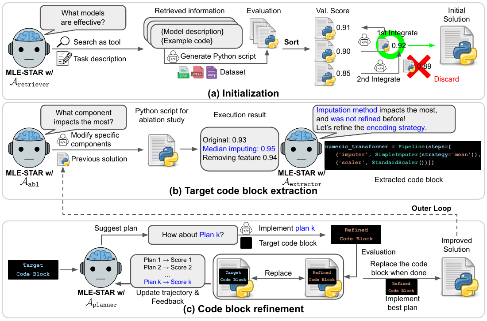
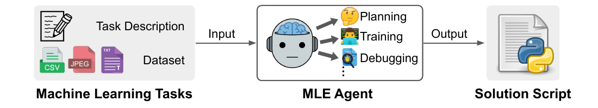
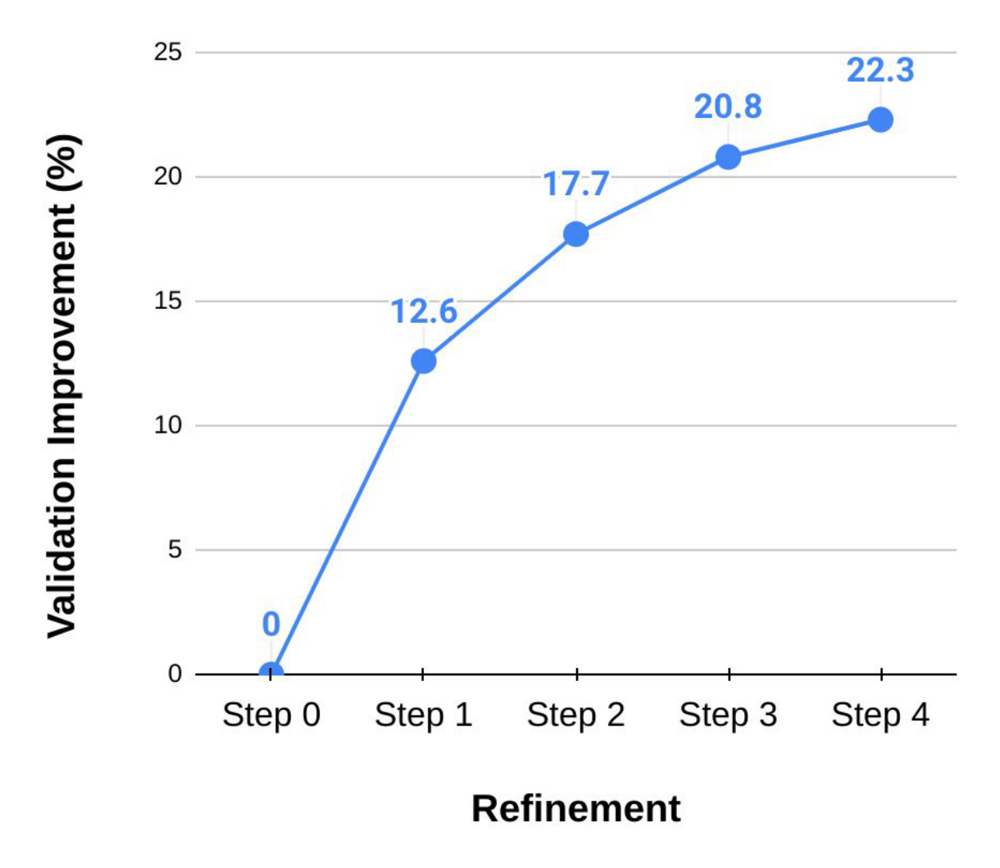
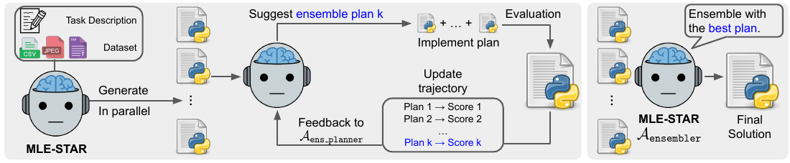
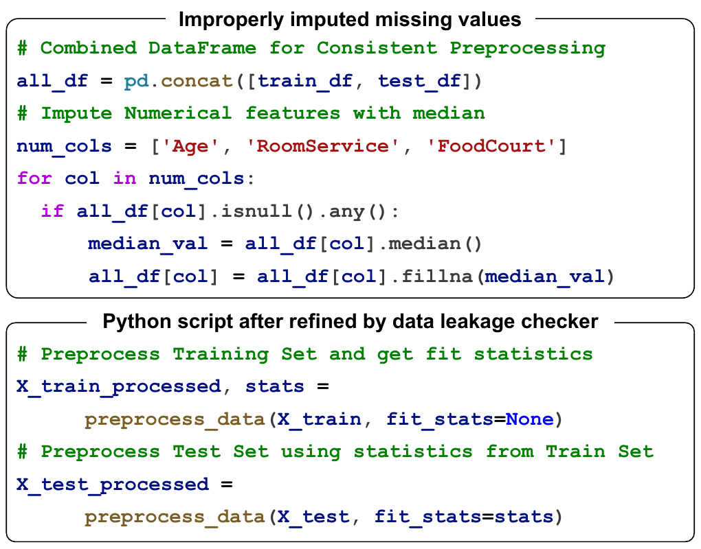
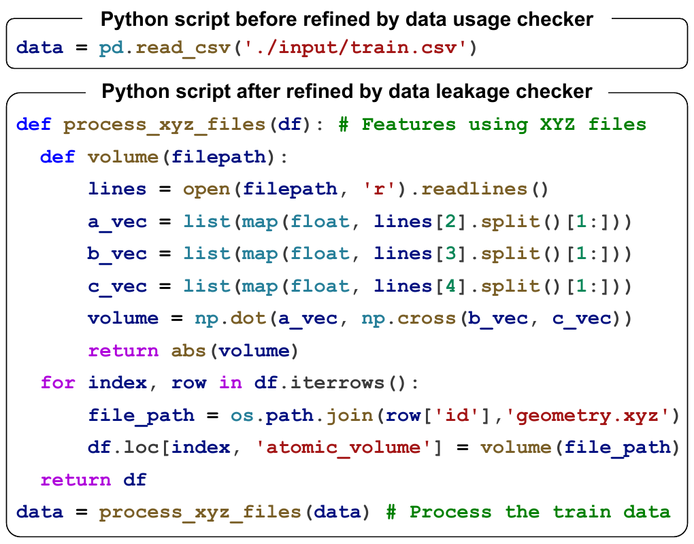
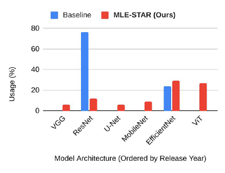
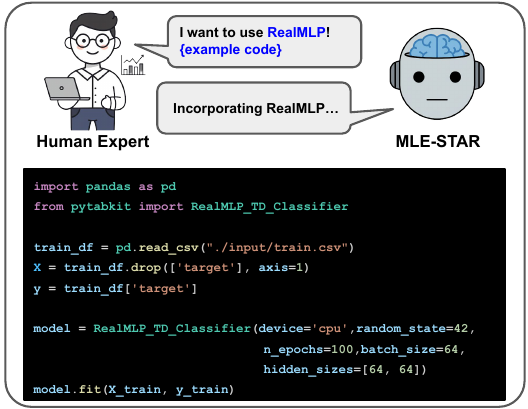

# MLE-STAR: 融合检索增强与靶向代码块精调的机器学习工程智能体深度综述

> **论文题目**：MLE-STAR: Machine Learning Engineering Agent via Search and Targeted Refinement  
> **作者团队**：Jaehyun Nam (KAIST), Jinsung Yoon (Google Cloud AI Research), Jiefeng Chen (Google Cloud AI Research), Jinwoo Shin (KAIST), Sercan Ö. Arık (Google Cloud AI Research), Tomas Pfister (Google Cloud AI Research)  
> **论文来源**：Google Cloud AI Research & KAIST · arXiv:2506.15692 (2025)  
> **论文代码与资产**：[GitHub / jaehyun513/MLE-STAR](https://github.com/jaehyun513/MLE-STAR)  
> **本地文档索引**：[高清论文 PDF 存档](./MLE-STAR.pdf) ｜ [高清配图资产](./综述配图/) ｜ [完整 LaTeX 源码工程](./source/)  

---

## 0. 三分钟读懂（Executive Summary）

### 0.1 核心直觉类比：为什么以往的 AI 算法工程师总拿不到 Kaggle 金牌？

如果把自动化机器学习工程（AutoML / MLE）比作**一位初入职场参加算法竞赛的参赛选手**：

| 对比维度 | 传统 MLE Agent（如 AIDE、DS-Agent） | MLE-STAR（本论文方案） | 直觉类比 |
| :--- | :--- | :--- | :--- |
| **开局选型策略** | **全凭预训练记忆“拍脑袋”**：习惯性掏出 Scikit-learn 的逻辑回归或陈旧的 ResNet，无视任务特异性与最新前沿模型。 | **先联网调研（Web Search）**：针对具体赛题检索业界最新的 SOTA 方案（如 ViT、EfficientNet、CatBoost）与参考代码，再做贪心验证融合。 | 不盲目凭老经验硬写，而是先去 Kaggle 讨论区与 GitHub 检索当下最能打的开源 baseline。 |
| **代码迭代粒度** | **“大拆大建”的粗粒度重构**：每一轮都要求 LLM 把几百上千行的完整 Python 脚本全部重写一遍。 | **“外科手术级”的靶向双循环（Nested Loop）**：先用消融实验（Ablation）揪出影响性能最大的核心代码块，然后在该局部块内精耕细作 $K$ 轮。 | 调特征工程就专心调特征工程，绝不顺手把模型架构和数据加载全改乱导致无法归因。 |
| **模型集成方式** | **简单硬投票或最大值择一**：选验证集得分最高的单一解，或做简单粗暴的未加权平均。 | **智能体自主规划集成策略（Agentic Ensembling）**：LLM 自主构思概率加权、Stacking 元学习器或动态集成方案，并在闭环中调优。 | 资深 Kaggle Grandmaster 的模型融合艺术：用专门设计的元模型有机组合异构候选方案。 |
| **工程质量防护** | **裸奔运行**：经常被执行报错卡死，甚至发生用测试集填充缺失值、目标变量穿越等隐性作弊。 | **双哨兵保驾护航**：配备静态与语义分析的**数据防泄漏检查器（$\mathcal{A}_\mathtt{leakage}$）**与**多模态数据防遗漏检查器（$\mathcal{A}_\mathtt{data}$）**。 | 严格的代码审查机制（Code Review），在提交前杜绝数据穿越（Data Leakage）与遗漏输入文件。 |

<p align="center">
  
  <br>
  <em>图 1：MLE-STAR 整体系统架构与模块协同工作流（检索初始化 → 消融驱动靶向精调双重循环 → 智能体自主探索高级集成）</em>
</p>

### 0.2 五大硬核量化数据

1. **MLE-bench 奖牌率翻倍（63.6%）**：在涵盖真实真实 Kaggle 比赛的权威基准 MLE-bench Lite 上，搭配 Gemini-2.5-Pro 的 MLE-STAR 斩获了 **63.6%** 的总奖牌率，相比前 SOTA 基线 AIDE（25.8%）提升了 **+37.8 个百分点**！
2. **金牌率突破天花板（36.4%）**：在全部 22 个复杂赛题中，金牌率高达 **36.4%**，甚至使用轻量级模型 Gemini-2.0-Flash 也能斩获 **30.3%** 的金牌，远超搭载强大推理模型 o1-preview 的 AIDE（20.7%）。
3. **人类中位数超越率高达 83.3%**：MLE-STAR 在 **83.3%** 的比赛中成绩超越了人类参赛选手的历史中位数。
4. **提交有效率达成 100%**：不同于开源基线频繁因代码语法、依赖或环境报错导致的提交夭折（AIDE 仅 78.8%，OpenHands 仅 71.2%），MLE-STAR 实现了 **100% 成功生成有效提交文件**。
5. **零人工案例库干预（Zero-Shot Generalization）**：在无需像 DS-Agent 那样人工维护专家案例库的前提下，MLE-STAR 在表格分类任务中全面超越 DS-Agent，并在图像、文本、音频等多模态竞赛中表现出色。

---

## 1. 动机与核心痛点（The "Why"）

### 1.1 大模型在机器学习工程中的“阿喀琉斯之踵”

将大语言模型（LLM）构建为自主机器学习工程智能体（MLE Agent），是当前 Agent 领域的最前沿课题之一。然而，直觉上强大的编码与推理能力，在真实的竞赛级算法工程中却频频受挫。论文作者深入剖析了现有方案（如 AIDE、DS-Agent、MLAgentBench）的四大致命软肋：

<p align="center">
  
  <br>
  <em>图 2：机器学习工程智能体面临的端到端代码空间搜索与指标优化挑战</em>
</p>

1. **预训练记忆带来的模型选型严重滞后与偏见（Familiarity Bias）**：
   - LLM 在面对赛题时，天生倾向于选择预训练语料中出现频率最高的陈旧方案。例如在文本多标签分类挑战中，LLM 经常固执地掏出 Scikit-learn 的 `LogisticRegression`；在图像分类赛题中，大模型频繁选用 2015 年提出的 `ResNet`，而忽视近几年性能显著跃升的 `EfficientNet` 或 `Vision Transformer (ViT)`。
2. **全脚本粗粒度重写的“无头苍蝇式搜索”（Coarse-Grained Exploration）**：
   - 现有的迭代方式往往让 LLM “看一眼验证集得分，然后重写整份脚本”。这种全量重构导致智能体无法对特定模块进行深水区探索——当大模型刚开始尝试某些特征工程技巧时，往往因为全局改动带来的副作用而过早放弃，转头跳去调模型超参，导致每个组件都只触及皮毛，陷入局部最优。
3. **隐蔽且致命的数据泄漏（Silent Data Leakage & Cheating）**：
   - LLM 编写的代码在语法上虽然能够跑通，但在统计学逻辑上常常严重不合规。最典型的案例是在特征预处理时，直接使用包含测试集的全局均值进行缺失值填充，甚至将未脱敏的目标标签（Target Variable）泄漏进特征构造环节。这种“作弊”使得**验证集指标虚高攀升，而线上测试集断崖式跌落**。
4. **多源多模态数据的“视而不见”（Data Neglect）**：
   - 在复杂比赛中，出题方往往附带了多格式的辅助资产（如 3D 晶体结构的 `geometry.xyz`、图像文件夹、音频文件）。LLM 往往只抓取并读取单一的 `train.csv`，导致高达一半的关键输入信息被完全遗漏。

---

## 2. MLE-STAR 整体系统架构与核心机制推导（The "How"）

针对上述痛点，论文提出了 **MLE-STAR**（**M**achine **L**earning **E**ngineering Agent via **S**earch and **TA**rgeted **R**efinement）。系统主要由三大支柱引擎与双重安全哨兵构成。

### 2.1 引擎一：Web 检索外挂与贪心集成初始化（Search-Driven Initialization）

MLE-STAR 不依赖 LLM 的闭卷记忆，而是赋予其 Google Search 工具接口，针对当前赛题的特定模态与评估指标主动搜寻行业前沿模型。

#### 核心步骤推导：

1. **前沿候选模型检索**：
   输入赛题任务描述 $\mathcal{T}_{\mathtt{task}}$，检索智能体 $\mathcal{A}_{\mathtt{retriever}}$ 返回 $M$ 组前沿候选模型及其实际代码范例：
   $$\{\mathcal{T}^{i}_{\mathtt{model}}, \mathcal{T}^{i}_{\mathtt{code}}\}_{i=1}^{M} = \mathcal{A}_{\mathtt{retriever}}(\mathcal{T}_{\mathtt{task}})$$
   通过强制要求输出结构化 JSON 并包含可运行的参考代码片段，克服大模型因对新型库不熟悉而生成幻觉代码的顽疾。
2. **独立基线脚本构建与实机跑分**：
   候选评估智能体 $\mathcal{A}_{\mathtt{init}}$ 分别为 $M$ 个模型生成独立端到端执行脚本 $s_\mathtt{init}^i$：
   $$s_\mathtt{init}^i = \mathcal{A}_{\mathtt{init}}(\mathcal{T}_{\mathtt{task}}, \mathcal{T}_{\mathtt{model}}^i, \mathcal{T}_{\mathtt{code}}^i)$$
   在本地隔离沙箱中执行，计算验证集客观指标 $h(s_\mathtt{init}^i)$。
3. **贪心模型融合（Greedy Model Merging）**：
   对 $M$ 个方案按验证集得分降序排列：$h(s_{(1)}) \geq h(s_{(2)}) \geq \dots \geq h(s_{(M)})$。以排位第一的单模型作为起点 $s_0 \leftarrow s_{(1)}$。随后依次调用合并智能体 $\mathcal{A}_{\mathtt{merger}}$，尝试将后续模型 $s_{(k)}$ 引入基线脚本：
   $$s_{\mathtt{candidate}} \leftarrow \mathcal{A}_{\mathtt{merger}}(s_0, s_{(k)})$$
   **门禁条件**：仅当新融合方案的实测指标 $h(s_{\mathtt{candidate}}) \geq h_{\mathtt{best}}$ 时，才更新 $s_0$；一旦出现指标下降，立即终止融合循环。这为后续迭代铸就了一个坚如磐石的强基线。

---

### 2.2 引擎二：双重嵌套循环与消融驱动靶向代码块精调（Targeted Refinement）

这是 MLE-STAR 最具工程洞见的创新点：**将庞大的代码重构问题，拆解为外层“消融定靶”与内层“局部手术”的双重嵌套闭环**。

<p align="center">
  
  <br>
  <em>图 3：随着迭代推进，相对误差稳定下降；早期消融定位的高影响力模块带来了最大幅度的性能阶跃</em>
</p>

#### ① 外层循环（Outer Loop, $t = 0 \dots T-1$）：消融实验与关键代码块定位

每一轮外层循环的目标是**科学找出当前流水线中最值得优化的“瓶颈短板”**：
1. **自动生成消融脚本**：消融智能体 $\mathcal{A}_{\mathtt{abl}}$ 根据当前代码 $s_t$ 与历史消融经验 $\{\mathcal{T}_{\mathtt{abl}}^i\}_{i=0}^{t-1}$，生成专门切除/简化特定模块的消融脚本 $a_t$：
   $$a_t = \mathcal{A}_{\mathtt{abl}}(s_t, \{\mathcal{T}_{\mathtt{abl}}^i\}_{i=0}^{t-1})$$
2. **消融执行与智能提炼**：执行 $a_t$ 获得终端输出 $r_t$，由总结智能体 $\mathcal{A}_{\mathtt{summarize}}$ 过滤掉冗余的训练日志，输出结构化的消融影响结论 $\mathcal{T}_{\mathtt{abl}}^t$。
3. **关键代码块提取与首轮规划**：提取器智能体 $\mathcal{A}_{\mathtt{extractor}}$ 结合消融反馈与已优化过的历史模块集合 $\{c_i\}_{i=0}^{t-1}$，精准截取出对最终得分影响最剧烈的单一代码块 $c_t$（如缺失值填充、交互特征构造、学习率衰减策略），并同步生成初始调优计划 $p_0$：
   $$c_t, p_0 = \mathcal{A}_{\mathtt{extractor}}(\mathcal{T}_{\mathtt{abl}}^t, s_t, \{c_i\}_{i=0}^{t-1})$$

#### ② 内层循环（Inner Loop, $k = 0 \dots K-1$）：专注局部的字符串替换级深耕

一旦锁定代码块 $c_t$，外层全局代码被暂时“冻结”，智能体在局部的深水区展开密集探索：
1. **代码精确微创重写**：编程智能体 $\mathcal{A}_{\mathtt{coder}}$ 依据方案 $p_k$ 修改该局部代码块得到 $c_t^k$。
2. **无缝热插拔替换**：系统通过确定性的字符串定位与替换，将新局部代码织入原脚本：
   $$s_t^k = s_t.\mathtt{replace}(c_t, c_t^k)$$
   **技术优势**：绝不重新生成整篇代码，杜绝因大模型偶发性截断、变量名遗忘或无关代码引入隐性 Bug。
3. **闭环反思与进阶规划**：规划智能体 $\mathcal{A}_{\mathtt{planner}}$ 捕获该模块内所有历史尝试结果 $\{(p_j, h(s_t^j))\}_{j=0}^{k-1}$，自主反思“为什么之前的特征分箱有效/无效”，从而提出下一阶段更具针对性的进化方案 $p_k$。
4. **优中选优**：在完成 $K$ 轮探索后，挑选出提升最显著的最佳局部代码 $c_t^*$，提交给外层作为进入下一阶段的 $s_{t+1}$。

---

### 2.3 引擎三：智能体策略搜索的高级集成（Agentic Ensembling）

为了突破“单次运行可能会落入特定局部最优”的限制，MLE-STAR 进一步探索了推理期计算缩放（Inference-Time Scaling）在集成学习上的潜力：

<p align="center">
  
  <br>
  <em>图 4：推理期扩展与集成策略消融：相比传统 Best-of-N 和简单平均，MLE-STAR 自主探索的自适应集成策略大幅提升了金牌率</em>
</p>

1. **并行求解池构建**：系统并行运行 $L$ 条独立的求解流水线，沉淀出一批在模型架构、特征侧重点上各具优势的高质量异构解 $\{s_l\}_{l=1}^L$。
2. **告别死板的简单投票**：资深算法工程师都知道，简单的平均加权远不如 Stacking 或条件概率融合。MLE-STAR 引入了专门的集成规划智能体 $\mathcal{A}_{\mathtt{ens\_planner}}$：
   $$e_r = \mathcal{A}_{\mathtt{ens\_planner}}(\{s_l\}_{l=1}^L, \{(e_j, h(s_{\mathtt{ens}}^j))\}_{j=0}^{r-1})$$
3. **集成方案多轮自进化**：
   - 第 0 轮：以基础预测概率均值或排序加权作为起点；
   - 第 $1 \dots R$ 轮：智能体自主构思高阶融合思路——例如**训练次级元学习器（Meta-Learner）、基于置信度区间的动态加权门控、或针对高偏类别的条件概率重校准**；
   - 集成执行智能体 $\mathcal{A}_{\mathtt{ensembler}}$ 落实方案并评测，最终产出超越所有单一候选解的集成皇冠模型 $s_{\mathtt{ens}}^*$。

---

### 2.4 工业级防护双哨兵：彻底杜绝作弊与遗漏

<p align="center">
  
  <br>
  <em>图 5：数据泄漏检查器（$\mathcal{A}_\mathtt{leakage}$）精准捕获并修复测试集统计量穿透问题</em>
</p>

#### 1. 数据防泄漏检查器（Data Leakage Checker, $\mathcal{A}_{\mathtt{leakage}}$）
- **检测机制**：在大模型生成的代码提交执行前，专门抽取数据预处理代码段 $c_{\mathtt{data}}$，进行静态数据流与语义审查；
- **拦截场景**：严防模型在预处理训练集时调用了测试集的数据分布（如全局拟合 `StandardScaler` 或联合计算均值/方差），严防将目标标签（如 Kaggle 的 `Target` / `Transported` 列）引入无监督特征衍生；
- **自动修复**：一旦发现潜在泄漏，检查器自动将其重写为“仅在训练集上 `fit`，并在测试集上纯 `transform`”的标准合规范式。

#### 2. 多模态数据防遗漏检查器（Data Usage Checker, $\mathcal{A}_{\mathtt{data}}$）

<p align="center">
  
  <br>
  <em>图 6：数据完整性检查器（$\mathcal{A}_\mathtt{data}$）自动纠正大模型仅读取 CSV 而忽略辅助 3D 文件的缺陷</em>
</p>

- **检测机制**：在首轮代码生成后，对照赛题任务描述中的输入目录清单；
- **拦截场景**：当发现赛题包含图像目录、音频文件夹或辅助结构化物理文件（例如 Nomad2018 比赛中的 `geometry.xyz` 文件），但大模型脚本中仅出现了 `pd.read_csv('train.csv')` 时；
- **强制注入**：检查器自动介入修改数据加载接口，将原本被漠视的特征提取代码无缝补全。

---

## 3. 关键实验与量化消融深度分析（Quantitative Rigor）

实验基于包含 22 个真实世界 Kaggle 竞赛的权威基准 **MLE-bench Lite** 展开，涵盖表格预测、图像分类、图像去噪、文本分类、音频检测等极其多样的模态。基准时限统一严格对齐为 24 小时。

### 3.1 主榜对比：全维度碾压现有代码 Agent

下表总结了 MLE-STAR 与目前学术界及工业界主流开源 MLE Agent 的横向评测结果（3 个不同随机种子统计平均与标准差）：

| 框架体系 | 底座大模型 | 成功提交率 (%) | 有效提交率 (%) | 超越人类中位数 (%) | 铜牌率 (%) | 银牌率 (%) | 金牌率 (%) | 综合奖牌率 (%) |
| :--- | :--- | :---: | :---: | :---: | :---: | :---: | :---: | :---: |
| **MLE-STAR (Ours)** | **Gemini-2.5-Pro** | **100.0** ± 0.0 | **100.0** ± 0.0 | **83.3** ± 4.6 | 6.1 ± 3.0 | **21.2** ± 5.1 | **36.4** ± 6.0 | **63.6** ± 6.0 |
| **MLE-STAR (Ours)** | **Gemini-2.0-Flash** | 95.5 ± 2.6 | 95.5 ± 2.6 | 63.6 ± 6.0 | **9.1** ± 3.6 | 4.5 ± 2.6 | **30.3** ± 5.7 | **43.9** ± 6.2 |
| AIDE | o1-preview | 99.7 ± 0.3 | 90.3 ± 1.6 | 58.2 ± 2.6 | 4.8 ± 1.1 | 11.1 ± 1.7 | 20.7 ± 2.2 | 36.6 ± 2.6 |
| AIDE | Gemini-2.0-Flash | 87.9 ± 4.0 | 78.8 ± 5.0 | 39.4 ± 6.0 | 4.5 ± 2.6 | 9.1 ± 3.5 | 12.1 ± 4.0 | 25.8 ± 5.4 |
| AIDE | GPT-4o | 82.1 ± 1.4 | 65.7 ± 1.7 | 29.9 ± 1.6 | 3.4 ± 0.6 | 5.8 ± 0.8 | 9.3 ± 1.0 | 18.6 ± 1.4 |
| AIDE | Claude-3.5-Sonnet | 81.8 ± 4.7 | 66.7 ± 5.8 | 33.3 ± 5.8 | 3.0 ± 2.1 | 6.1 ± 2.9 | 10.6 ± 3.8 | 19.7 ± 4.9 |
| AIDE | Llama-3.1-405B | 72.7 ± 5.5 | 51.5 ± 6.2 | 18.2 ± 4.7 | 0.0 ± 0.0 | 4.5 ± 2.6 | 6.1 ± 2.9 | 10.6 ± 3.8 |
| OpenHands | GPT-4o | 81.8 ± 4.7 | 71.2 ± 5.6 | 16.7 ± 4.6 | 3.0 ± 2.1 | 3.0 ± 2.1 | 6.1 ± 2.9 | 12.1 ± 4.0 |
| MLAgentBench | GPT-4o | 84.8 ± 4.4 | 63.6 ± 5.9 | 7.6 ± 3.3 | 3.0 ± 2.1 | 1.5 ± 1.5 | 1.5 ± 1.5 | 6.1 ± 2.9 |

> [!IMPORTANT]
> **核心突破点解读**：
> 1. **越级打击推理模型**：仅搭载普通速度型模型 Gemini-2.0-Flash 的 MLE-STAR（奖牌率 43.9%、金牌率 30.3%），直接超越了搭载昂贵大推理模型 o1-preview 的 AIDE（奖牌率 36.6%、金牌率 20.7%），证明了**优秀 Agent 架构的针对性与外科手术式精调，能够大幅弥补甚至逆转基础模型的纯算力差距**。
> 2. **SOTA 登顶**：当接入顶尖思考模型 Gemini-2.5-Pro 后，奖牌率更是一跃冲上 63.6%，金牌占比超半数，创下当前完全自主数据科学 Agent 的最高纪录。

---

### 3.2 质性突破：模型选型对比分析

<p align="center">
  
  <br>
  <em>图 7：AIDE 与 MLE-STAR 在图像分类任务中的模型选用分布：Web Search 外挂使智能体摆脱了对老旧 ResNet 的依赖</em>
</p>

如上图所示，由于 AIDE 完全依赖大模型的固有先验，在图像任务中几乎全盘选择了 2015 年的经典模型 ResNet（仅获得 26% 奖牌）；而 MLE-STAR 通过联网检索，敏锐识别并采用了工业界 SOTA 的 **EfficientNet** 与 **ViT (Vision Transformer)**，在图像分类任务上的获奖率直接拔高至 **37%**。

---

### 3.3 集成策略消融实验

下表展现了不同集成方案对最终评测表现的影响（基于 Gemini-2.0-Flash，3 次随机种子）：

| 集成方法配置 | 有效提交率 (%) | 超越人类中位数 (%) | 铜牌率 (%) | 银牌率 (%) | 金牌率 (%) | 综合奖牌率 (%) |
| :--- | :---: | :---: | :---: | :---: | :---: | :---: |
| **AIDE 原版基线（无集成）** | 78.8 ± 5.0 | 39.4 ± 6.0 | 4.5 ± 2.6 | 9.1 ± 3.5 | 12.1 ± 4.0 | 25.8 ± 5.4 |
| **MLE-STAR（单解，无集成）** | 95.5 ± 2.6 | 57.6 ± 6.1 | 7.6 ± 3.3 | 4.5 ± 2.6 | 25.8 ± 5.4 | **37.9** ± 6.0 |
| **MLE-STAR + Best-of-N** | 95.5 ± 2.6 | 62.1 ± 6.0 | 6.1 ± 3.0 | 7.6 ± 3.3 | 28.8 ± 5.6 | 42.4 ± 6.1 |
| **MLE-STAR + 简单平均集成** | 95.5 ± 2.6 | 60.6 ± 6.1 | 6.1 ± 3.0 | **12.1** ± 4.0 | 25.8 ± 9.4 | 43.9 ± 6.2 |
| **MLE-STAR + 智能体自主探索集成（Ours）** | **95.5** ± 2.6 | **63.6** ± 6.0 | **9.1** ± 3.6 | 4.5 ± 2.6 | **30.3** ± 5.7 | **43.9** ± 6.2 |

从消融结果可见：
- **单解质量即已降维打击**：即使完全不做任何集成，MLE-STAR 依靠消融靶向精调产出的单一模型，综合奖牌率（37.9%）便已大幅领先原版 AIDE（25.8%）。
- **自主集成冲刺金牌**：简单平均集成虽然能拉高部分银牌（12.1%），但金牌率停留在 25.8%；唯有经过智能体多轮自适应探索出的高阶集成方案，成功攻克了高难度任务，使**金牌率一举突破至 30.3%**，超越人类中位数比例达到最高的 63.6%。

---

### 3.4 惨痛案例启示：哨兵机制的不可替代性

#### ① 数据泄漏引发的“虚假繁荣”灾难（Spaceship-Titanic 赛题）
在经典的 `spaceship-titanic` 竞赛中，如果关闭数据防泄漏检查器 $\mathcal{A}_{\mathtt{leakage}}$：
- **大模型作弊行为**：LLM 在执行特征工程时，偷偷将目标变量 `Transported` 参与了派生特征计算；
- **指标假象**：本地验证集准确率从 `0.8188` 虚假暴涨至 `0.8677`（智能体欢欣鼓舞以为找到神级特征）；
- **真实惨案**：线上不可见测试集的真实准确率从 `0.8033` 断崖式坠落至 **`0.7343`**（直接跌出奖牌区）！
- **MLE-STAR 修复后**：拦截作弊代码，稳步收获稳健模型。

#### ② 数据遗漏引发的欠拟合（Nomad2018 赛题）
在材料科学赛题 `nomad2018-predicting` 中：
- 未启用 $\mathcal{A}_{\mathtt{data}}$ 时：大模型只读了纯数值表格，RMSLE 误差为 `0.0591`；
- 启用 $\mathcal{A}_{\mathtt{data}}$ 后：强制把原本忽略的原子空间排布文件 `geometry.xyz` 引入特征提取流水线，RMSLE 显著降低至 **`0.0559`**。

---

## 4. 人机协同（Human-in-the-Loop）扩展设计

虽然 MLE-STAR 是一套完全自主运行的无人化智能体，但其模块化契约为人类专家干预留出了极佳的插槽接口：

<p align="center">
  
  <br>
  <em>图 8：人类专家介入：① 手工注入冷门/前沿模型卡片（如 RealMLP）；② 显式指定重点深耕的代码块</em>
</p>

1. **先验模型注入（Model Card Injection）**：
   若人类专家掌握某些尚未在公开网页广泛索引的最前沿小众模型（如学术界刚发布的 `RealMLP`），无需修改系统逻辑，只需在配置中直接追加一个结构化卡片 `{\mathcal{T}_\mathtt{model}, \mathcal{T}_\mathtt{code}}`，MLE-STAR 即可自动将其纳入首轮候选评估与融合池；
2. **靶向代码块人为定向（Target Block Steering）**：
   如果算法专家已敏锐预判该赛题的胜负手完全在于“特征交叉”而非“模型超参”，专家可以直接覆写提取器 $\mathcal{A}_{\mathtt{extractor}}$ 的输入指令，强行锁定特定特征工程块让智能体专心深耕 $K$ 轮，从而达成“人类全局指引 + AI 密集穷举试错”的完美共生。

---

## 5. 工程实战避坑与落地深水区总结（Lessons Learned）

对于正在设计与部署自身代码 Agent、自动化数据科学平台的工程师而言，MLE-STAR 提供了极具借鉴价值的工程落地铁律：

### 1. 放弃“全脚本重写”，拥抱“微创手术级局部替换”
- 许多代码 Agent 开发者喜欢让 LLM 在每一轮迭代都“重新输出完整的 500 行 Python 脚本”。
- 实践证明，这极易引发**上下文漂移**（大模型在中途把之前调试好的数据加载逻辑丢了）、**输出截断**（Token 超限）、以及**不可归因**（改了 10 处，无法判断到底哪处使得分数提升）。
- MLE-STAR 的 `s.replace(c_t, c_t^*)` 范式，将每次改动的范围严格约束在一个闭合的小代码块内，既省 Token、又快、且能确保优化过程严格可控与可回溯。

### 2. 消融实验是最高效的“探索导向罗盘”
- 随机尝试不同优化思路（如先调参、再换损失函数、再做归一化）往往效率低下。
- MLE-STAR 的外层循环先执行一轮自动消融实验（切除特征、切除数据清洗、切除特定模型分支），根据性能掉点的剧烈程度来决定优化优先级。**哪块掉点最严重，哪块就是最有潜力的杠杆点**。

### 3. 数据科学 Agent 必须建立严谨的“防作弊静态审计”
- 语言模型天生具有“指标优化走近路”的本能。在没有约束的情况下，大模型会不知不觉地利用未来数据、测试集统计特征进行过拟合。
- 在本地构建独立的代码审计哨兵（检查数据隔离度、检查标签是否参与特征计算），是所有企业级 AutoML Agent 迈向生产环境的必经之路。

### 4. 检索是治愈模型“固执偏见”的最佳良药
- 不要指望单靠 Prompt 催眠大模型“请使用最新的算法”。
- 赋予智能体结构化的 Web 搜索能力，把检索结果转化为即插即用的参考代码卡片，是大模型拥抱最新软件生态与前沿算法的成本最低、效果最好的解法。

---

## 6. 总结与未来展望

**MLE-STAR** 代表了自主机器学习工程智能体从“粗放式全局碰运气”向“精细化科研范式”的重要跨越。它通过：
1. **网络检索外挂** 打破大模型对老旧算法的先验偏见；
2. **消融引导的靶向局部精调** 实现深水区技术深耕；
3. **自主进化的自适应集成策略** 压榨出解空间的最高上限；
4. **数据防泄漏与防遗漏哨兵** 守护工程实战的坚实底线。

在 MLE-bench Lite 上斩获 **63.6% 的高奖牌率** 与 **36.4% 的金牌率**，不仅印证了该框架在 Kaggle 竞技环境下的绝对压制力，更为未来企业级复杂长程软件工程与自动化科学研究（AI for Science）的智能体架构设计，提供了不可多得的范式标杆。

---

### 📚 引用规范（BibTeX）
```bibtex
@article{nam2025mlestar,
  title={MLE-STAR: Machine Learning Engineering Agent via Search and Targeted Refinement},
  author={Nam, Jaehyun and Yoon, Jinsung and Chen, Jiefeng and Shin, Jinwoo and Ar{\i}k, Sercan {\"O} and Pfister, Tomas},
  journal={arXiv preprint arXiv:2506.15692},
  year={2025}
}
```
