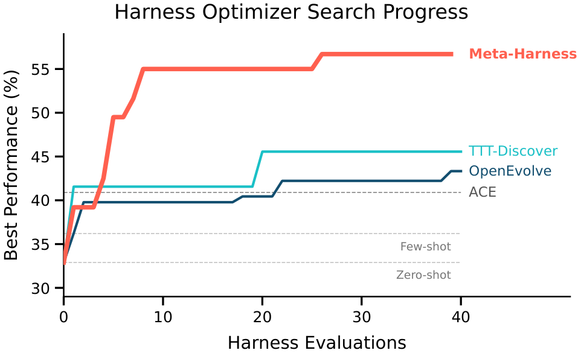
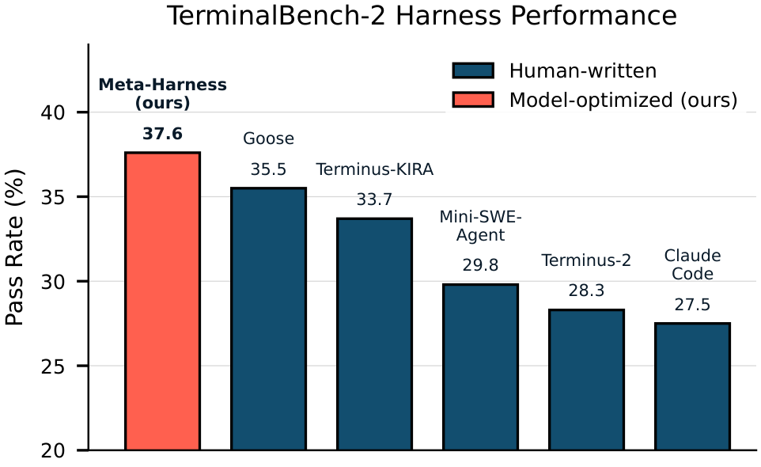
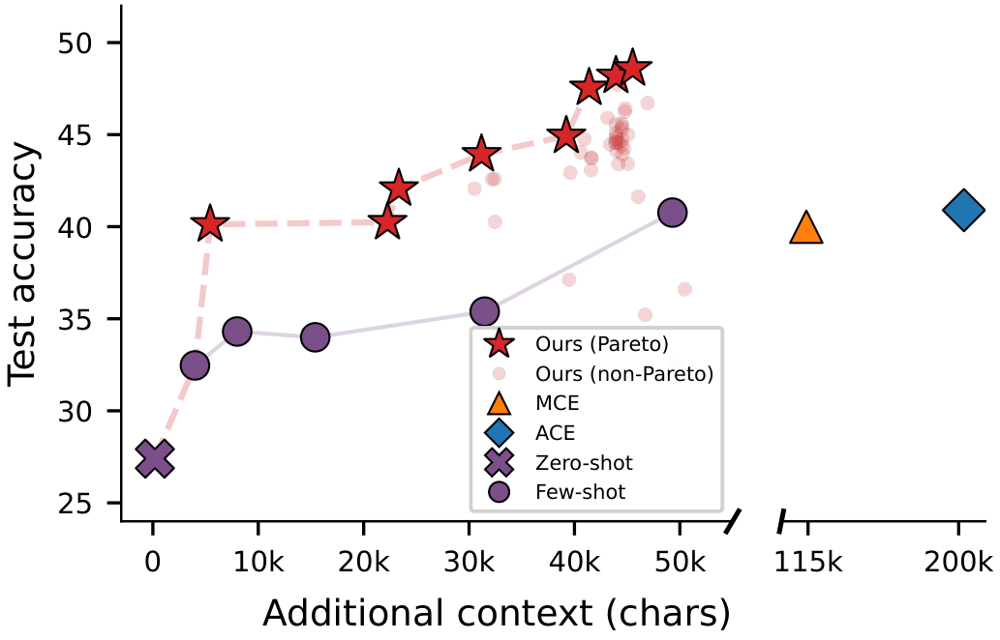
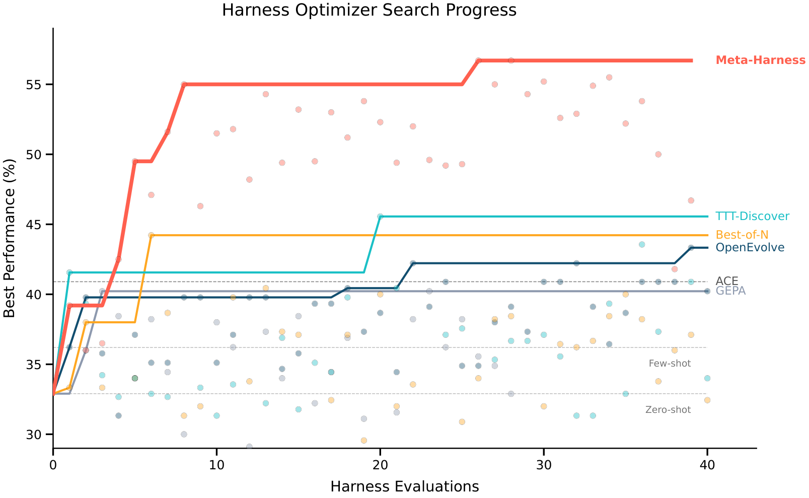
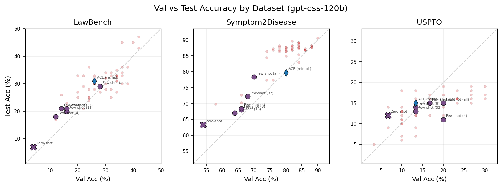

# Meta-Harness：模型 Harness 的端到端自动化优化——深度精读综述

> **论文标题**：*Meta-Harness: End-to-End Optimization of Model Harnesses*  
> **作者与机构**：Yoonho Lee, Roshen Nair, Qizheng Zhang (Stanford), Kangwook Lee (KRAFTON), Omar Khattab (MIT), Chelsea Finn (Stanford)  
> **论文索引**：`arXiv:2603.28052v1`（[PDF 原件](./Meta-Harness_End-to-End_Optimization_of_Model_Harnesses.pdf) ｜ [英文原文解析](./2603.28052_Meta-Harness_原文解析.md) ｜ [全文中文翻译](./2603.28052_Meta-Harness_中文翻译.md)）  
> **开源与演示**：[项目主页](https://yoonholee.com/meta-harness/) ｜ [TerminalBench-2 优化后 Harness](https://github.com/stanford-iris-lab/meta-harness-tbench2-artifact)

---

## 一、导读与核心摘要（Executive Summary）

### 1.1 一句话核心洞察

**Meta-Harness 将“手工调优 LLM 外围代码（Harness Engineering）”升级为“由编程智能体驱动的代码空间端到端搜索”：通过开放完整的文件系统访问权限（源码 + 分数 + 原始执行轨迹），使提议器能够在单轮千万级 Token 诊断足迹中进行非马尔可夫式的因果归因，从而在文本分类、IMO 级数学推理与 TerminalBench-2 编程基准上全面超越顶尖手工 Harness 与现有文本优化器。**

### 1.2 学术直觉与第一性原理动机（Research Taste）

在固定大语言模型（LLM）权重的前提下，外围 **Harness（决定存储什么、检索什么、向模型呈现什么的有状态程序）** 的差异可以在同一基准测试上造成高达 **$6\times$ 的性能鸿沟**。然而，长期以来 Harness 工程几乎完全依赖人类工程师手工试错，而自动化文本优化器（Text Optimizers，如 OPRO、TextGrad、AlphaEvolve、GEPA、TTT-Discover）在这一领域却步履维艰。

作者敏锐地捕捉到了一个被学界忽视的**结构性张力**：
1. **长程依赖与诊断足迹的量级错配**：Harness 是跨越数十乃至上百个交互步骤的**有状态程序**。某个早期关于“记忆写入格式”或“状态标志位重置”的微小代码改动，往往在几十步之后的推理崩溃中才显现后果。一次完整的 Harness 评估所产生的诊断信息高达 **10,000,000 Tokens（10 MTok/iter）**，而现有文本优化器每步所能消费的上下文仅在 **100 到 30,000 Tokens（0.002–0.026 MTok/iter）** 之间——相差整整**三个数量级**。
2. **有损压缩摧毁了因果归因链**：为了适配 LLM 的上下文窗口，现有优化器普遍采取“激进压缩”策略——要么只看标量分数（AlphaEvolve），要么只看单次候选的局部反馈（TextGrad），要么让 LLM 先将轨迹总结为简短文本摘要（GEPA、Feedback Descent）。但当多个改动同时发生、或失败源于隐蔽的状态机 Bug 时，**事前的静态摘要会彻底抹除“将下游失败追溯到上游代码决策”所需的微弱因果信号**。
3. **从“被动喂入摘要”到“主动按需检索”的范式跃迁**：既然无法把 10M Token 塞进单次 Prompt，最优解不是“压缩它”，而是**将其外置为文件系统，并把一个具备 `grep` / `cat` / 代码编辑能力的 Coding Agent（如 Claude Code）作为提议器**。这样，提议器就从“被动接收压缩反馈的文本生成器”进化为“主动翻阅历史代码与原始报错轨迹的诊断型工程师”。

### 1.3 核心范式与实验数据看板

| 对比维度 | 传统文本优化器 (OPRO / TextGrad / GEPA / AlphaEvolve / TTT-Discover) | **Meta-Harness（本文方法）** |
| :--- | :--- | :--- |
| **优化对象** | 提示词模板、单函数代码片段 | **完整可执行 Harness 程序**（100–1000 行有状态 Python 代码） |
| **提议器形态** | 原始 LLM（单次前向 Prompt 生成） | **编程智能体（Coding Agent）**（具备终端检索、读代码、改代码能力） |
| **反馈通道** | 标量分数 / 固定窗口 / LLM 事后摘要 | **完整历史文件系统 $\mathcal{D}$**（全部先验源码 + 分数 + 原始执行轨迹） |
| **单轮诊断足迹** | `0.002 – 0.026 MTok/iter` | **`10.0 MTok/iter`**（高出 3 个数量级） |
| **父代选择机制** | 固定规则（锦标赛 / PUCT / 最近父代） | **无硬编码父代限制**（非马尔可夫自由检索，中位数每轮读 **82 个文件**） |

**核心实验战果一览：**

- **在线文本分类（`GPT-OSS-120B`）**：准确率达 **48.6%**，超越 SOTA 手工系统 ACE（40.9%）**+7.7 个百分点**，同时上下文 Token 消耗降低 **$4\times$**（11.4K vs 50.8K）；仅用 **4 次评估**即追平 OpenEvolve / TTT-Discover 在 60 次评估后的最终准确率，并在最终精度上领先 **10+ 个百分点**；在 9 个未见过 OOD 数据集上平均提升 **+2.9 个百分点**（73.1% vs 70.2%）。
- **检索增强 IMO 数学推理（200 题）**：在 `GPT-OSS-20B` 上搜索出的单一四路由 BM25 Harness，零样本迁移至 5 个留出模型（含 `GPT-5.4-nano/mini`、`Gemini-3.1-Flash-Lite/3-Flash`），相比无检索基线平均提升 **+4.7 个百分点**，超越常规 BM25（+1.3 点）与稠密检索。
- **智能体编程（TerminalBench-2，89 个长程 CLI 任务）**：在 `Claude Opus 4.6` 上取得 **76.4%** 通过率（超越手工基线 Terminus-KIRA 的 74.7%，排行榜第 2）；在 `Claude Haiku 4.5` 上取得 **37.6%** 通过率（超越 Goose 的 35.5%，**全榜排名第 1**）。

---

## 二、研究背景与痛点剖析：为什么现有文本优化器在 Harness 工程上失效？

在 Meta-Harness 之前，自动化改进 LLM 系统的尝试主要沿着三条路径展开，但都在 Harness 工程面前撞上了同一堵墙——**长程信用分配（Long-Horizon Credit Assignment）与信息瓶颈**。




*图 1：（左）在线文本分类中，Meta-Harness 仅用 4 次评估即追平次优文本优化器（OpenEvolve、TTT-Discover）的最终性能，最终领先逾 10 个百分点；（右）TerminalBench-2 上，Meta-Harness 在 `Claude Haiku 4.5` 上排名第一。*

### 2.1 现有优化器的三重信息瓶颈

论文在 Table 1 中定量对比了 6 种代表性文本优化器与 Meta-Harness 的信息吞吐量：

| 方法 | 历史保留方式 | 反馈内容 | 单轮诊断容量 (`MTok/iter`) | 在 Harness 工程中的失效原因 |
| :--- | :--- | :--- | :---: | :--- |
| **OPRO** | 滑动窗口 | 过往 `(solution, score)` 对 | 0.002 | 只有标量分，完全不知道代码在哪一步出了错 |
| **TextGrad** | 仅上一轮 | 当前工件的文本梯度反馈 | 0.015 | 无跨轮次记忆，无法对比不同候选间的混淆变量 |
| **AlphaEvolve** | 滑动窗口 | 程序数据库 + 评估分数 | 0.022 | 面向无状态单函数，缺乏执行轨迹诊断能力 |
| **GEPA** | 摘要 | 来自 rollout 轨迹的反思性摘要 | 0.008 | 每次只反思单个候选，且摘要会丢失底层状态机细节 |
| **Feedback Descent** | 摘要 | 成对比较 + 文本反馈 | 0.012 | 同受限于单轮压缩摘要，无法跨 20+ 历史候选归因 |
| **TTT-Discover** | 滑动窗口 | 先前解片段（PUCT 选择） | 0.026 | 受限于结构化父代选择与局部片段视角 |
| **`Meta-Harness`** | **完整历史** | **全部代码 + 全部轨迹 + 全部分数** | **10.0** | **通过 Coding Agent 主动检索，实现跨代因果归因** |

### 2.2 为什么“LLM 摘要”甚至可能不如“只看分数”？

论文在在线文本分类上做了一组极具启发性的**接口信息消融实验**（Table 3），揭示了一个反直觉现象：

| 提议器接口条件 | 分数 (Scores) | 代码 (Code) | 摘要 (Summary) | 原始轨迹 (Traces) | 中位数准确率 | 最佳准确率 | 超越 Zero-Shot 次数 |
| :--- | :---: | :---: | :---: | :---: | :---: | :---: | :---: |
| **Scores Only** | ✓ | ✓ | ✗ | ✗ | 34.6 | 41.3 | 26 |
| **Scores + Summary** | ✓ | ✓ | ✓ | ✗ | 34.9 | **38.7** | 23 |
| **`Meta-Harness` (full)** | ✓ | ✓ | - | ✓ | **50.0** | **56.7** | **39** |

> **深度解读**：当把原始执行轨迹替换成 LLM 生成的摘要（Scores + Summary）时，最佳准确率反而从 41.3 跌到了 **38.7**（超越 Zero-Shot 的有效运行次数也从 26 降到 23）。作者指出：在 Harness 优化中，决定胜负的往往是某个特定样本上的检索误命中、某个边界截断字符、或某个状态变量重置。**事先生成的摘要在压缩信息的同时引入了信息失真与盲区，误导提议器去修改错误的地方；而完整原始轨迹让提议器能够按需下钻到具体样本的 Prompt 与输出，从而做出精准判断。**

---

## 三、核心方法与数学/架构深度拆解

### 3.1 数学形式化与多目标帕累托优化

Meta-Harness 将 Harness 优化形式化为策略代码空间中的期望奖励最大化问题。

令 $M$ 表示一个**权重完全冻结**的底层语言模型，$\mathcal{X}$ 表示目标任务分布。一个 Harness $H$ 是一个包裹 $M$ 的有状态程序：对于任务实例 $x \sim \mathcal{X}$，系统执行一条多步交互轨迹 $\tau \sim p_M(H, x)$——在每一步中，$H$ 负责构建上下文 Prompt 送入 $M$，接收 $M$ 的响应并更新自身内部状态（如记忆库、检索索引、待完成标志位等）。最后，由任务特定奖励函数 $r(\tau, x)$ 对整条轨迹评分。优化目标为：

$$
H^* = \argmax_{H} \mathbb{E}_{x \sim \mathcal{X}, \tau \sim p_M(H, x)} \; r(\tau, x)
$$

当任务同时关注多个指标（如分类准确率 vs. 上下文 Token 成本）时，Meta-Harness 不将它们强行加权成单一标量，而是在**帕累托支配（Pareto Dominance）**关系下维护前沿集合：对于任一候选 $H$，若不存在另一个候选在所有目标上都不劣于 $H$ 且至少在一个目标上严格更优，则 $H$ 保留在帕累托前沿中。这使得工程师可以在搜索完成后按预算自由挑选工作点。

### 3.2 Meta-Harness 外循环架构


*图 2：Meta-Harness 搜索循环。（1）Coding Agent 提议器读取包含所有先前候选源代码、执行轨迹与评分的文件系统 $\mathcal{D}$，提出新 Harness；（2）在评估任务上运行候选 Harness（提议器隔离在评估之外）；（3）所有新日志（代码、轨迹、分数）写入文件系统新目录，进入下一轮迭代。*

外循环（Algorithm 1）极其克制且优雅，仅由三个核心部件构成：
1. **初始种群 $\mathcal{H}$ 与独立评估器**：从领域内已知的基线 Harness（如 Zero-Shot、Few-Shot、ACE、MCE 或 Terminus-KIRA）出发，在**搜索集（Search Set）**上运行评估，将结果写入文件系统 $\mathcal{D}$。注意：**提议器永远看不到留出测试集（Held-out Test Set）**。
2. **极简领域 Skill 约束**：提议器 $P$（实验中为搭载 `Opus-4.6` 的 Claude Code）仅接收一个轻量级自然语言 Skill，告知：
   - 新 Harness 应写入的文件路径与接口契约（单文件 Python 程序）；
   - 如何查询历史目录与辅助 CLI；
   - **禁止事项**（如禁止修改评估脚本、禁止硬编码测试集答案），但**绝对不硬编码诊断步骤或父代选择策略**。
3. **接口预检门禁（Lightweight Validation）**：提议器每轮提出 $k$ 个候选（通常 $k=2$）后，先运行数秒钟的轻量级单元测试（导入模块、实例化类、在极小样本上调用核心方法），过滤掉语法/接口错误后，再送入昂贵的完整搜索集评估。

### 3.3 为什么 Coding Agent + 文件系统能产生“非马尔可夫因果推理”？

传统进化算法强制规定“从 Top-k 父代变异”，本质上是马尔可夫或近马尔可夫的。而在 Meta-Harness 中，文件系统 $\mathcal{D}$ 向提议器开放了**全局历史**。论文统计了 TerminalBench-2 搜索中（10 轮迭代，`Claude Opus 4.6`）提议器的真实文件读取行为（Table A1）：

- **每轮读取文件数**：中位数高达 **82 个**（范围 69–99），远超单一父代的文件数量；
- **注意力分配极其均衡**：**41%** 用于阅读先前的 Harness 源代码，**40%** 用于检查原始执行轨迹，**6%** 用于分数摘要，**13%** 用于其他辅助文件。

此外，**代码空间本身具有天然的“算法正则化偏置（Regularization Bias）”**：前沿编程模型在大量软件工程数据上训练而成，倾向于写出结构清晰、可复用的通用算法（如 TF-IDF 检索、四路学科正则路由），而非针对个别训练样本的脆弱 `if-else` 硬编码——这不仅提升了 OOD 泛化性，也让过拟合变得**肉眼可审计**。

---

## 四、实验验证、消融分析与反直觉发现

### 4.1 领域一：在线文本分类（准确率 + 上下文双赢与 OOD 泛化）

在在线文本分类设定中，模型 `GPT-OSS-120B` 逐条接收带标签样本并更新记忆，随后在留出测试集上评估。搜索集覆盖 LawBench（215 类）、Symptom2Disease（22 类）和 USPTO-50k（180 类）三个高难度多分类数据集，共演化 20 轮（40 个候选）。

**1. 对比手工 SOTA Harness（Table 2 & Figure 3）：**

| Harness | USPTO-50k | Symptom2Disease | LawBench | **平均准确率** | **平均上下文 (K chars $\downarrow$)** |
| :--- | :---: | :---: | :---: | :---: | :---: |
| Zero-Shot | 12.0 | 63.2 | 7.0 | 27.4 | 0 |
| Few-Shot (all) | 15.0 | 78.3 | 29.0 | 40.8 | 12.3 |
| MCE | 14.0 | 83.0 | 23.0 | 40.0 | 28.5 |
| ACE | **16.0** | 77.8 | 29.0 | 40.9 | 50.8 |
| **`Meta-Harness`** | 14.0 | **86.8** | **45.0** | **48.6** | **11.4** |



*图 3：在线文本分类的准确率—上下文帕累托前沿。Meta-Harness 在几乎所有上下文预算区间均严格支配（Dominate）所有手工与 Few-Shot 基线。*

**2. 对比现有文本优化器（Table 4 & Figure 4）：**



*图 4：搜索集上随评估次数变化的收敛曲线（聚合与分数据集）。Meta-Harness 在第 4 次评估即追平 OpenEvolve 和 TTT-Discover 的最终水平，并在 LawBench 上实现了断层式领先。*

| 文本优化器（统一 `Opus-4.6` 提议器，同评估预算） | 搜索集中位数准确率 | 搜索集最佳准确率 |
| :--- | :---: | :---: |
| GEPA | 32.6 | 40.2 |
| Best-of-N（无搜索对照） | 34.0 | 44.2 |
| OpenEvolve | 39.1 | 43.3 |
| TTT-Discover | 34.1 | 45.6 |
| **`Meta-Harness`** | **50.0** | **56.7** |

> **关键洞察**：值得注意的是，**Best-of-N（44.2）竟然略微超过了 OpenEvolve（43.3）和 GEPA（40.2）**！这再次印证了论文的核心论点：在缺乏原始执行轨迹的情况下，施加死板的变异或摘要结构反而可能限制大模型的探索能力；而一旦开放完整文件系统，Meta-Harness 的中位数表现（50.0）就能碾压其他所有方法的最优解。

**3. 9 个未见过 OOD 数据集泛化评估（Table 5）：**
将搜索出的 `Meta-Harness (Label-Primed Query)` 直接零修改迁移至 9 个全新文本分类数据集（SciCite、FiNER-139、Amazon Reviews、Financial PhraseBank、GoEmotions、Banking77、AG News、SciTail、TweetEval-Hate），`Meta-Harness` 取得 **73.1%** 平均准确率（ACE 为 70.2%，Few-Shot-32 为 69.6%），在 6/9 个数据集上排名第一（尤其在 SciCite 上达到 53.3% vs ACE 40.7%，Amazon 5 星评分上达到 60.0% vs ACE 48.0%），且上下文消耗（7.3K）显著低于 ACE（11.7K）。同时论文观察到一个典型反直觉现象：**在 7/9 的任务上，把 Few-Shot 样本从 32 个盲目增加到 `all` 反而导致准确率下降**——盲目堆砌上下文会稀释模型注意力，而精准的对比样本构建才是关键。



*图 B1：各发现策略在搜索集与测试集上的准确率相关性散点图。几乎所有粉色点均紧贴 $y=x$ 对角线，证明代码空间搜索未发生严重的过拟合。*

---

### 4.2 领域二：检索增强 IMO 级数学推理（跨模型迁移能力）

在 535,356 道严格去重去污染的数学竞赛题库上，Meta-Harness 仅用小模型 `GPT-OSS-20B` 在 250 道奥林匹克难题上搜索 40 轮（109 个候选），随后将选出的**单一最优 Harness** 直接迁移到 200 道未见过的 IMO 级别难题（IMO-AnswerBench + IMO-ProofBench + ArXivMath）和 **4 个搜索期间从未见过的异构大模型**上进行测试（Table 6）：

| 检索方法 | `GPT-5.4-nano` | `GPT-5.4-mini` | `Gem-3.1-FL` | `Gem-3-Flash` | `GPT-OSS-20B` | **5 模型平均** |
| :--- | :---: | :---: | :---: | :---: | :---: | :---: |
| No Retriever | 23.0 | 28.8 | 28.6 | 42.6 | 47.6 | 34.1 |
| Dense Retrieval ($k=1$) | 27.1 (+4.1) | 24.5 (-4.3) | 31.3 (+2.7) | 42.3 (-0.3) | 46.9 (-0.7) | 34.4 (+0.3) |
| Dense Retrieval ($k=5$) | 31.1 (+8.1) | 28.3 (-0.5) | **37.1** (+8.5) | **47.2** (+4.6) | 46.7 (-0.9) | 38.1 (+4.0) |
| Random Few-shot | 23.1 (+0.1) | 24.5 (-4.3) | 31.0 (+2.4) | 40.4 (-2.2) | 41.8 (-5.8) | 32.2 (-1.9) |
| BM25 Retrieval | 30.2 (+7.2) | 29.2 (+0.4) | 32.8 (+4.2) | 46.6 (+4.0) | 48.9 (+1.3) | 37.5 (+3.4) |
| **`Meta-Harness`** | **31.7** (+8.7) | **30.4** (+1.6) | 34.9 (+6.3) | 46.3 (+3.7) | **50.6** (+3.0) | **38.8** (+4.7) |

> **关键发现**：
> 1. **“盲目检索”的负迁移风险**：Random Few-shot 平均掉点 `-1.9`，而 Dense Retrieval ($k=1$ / $k=5$) 在 `GPT-5.4-mini` 和 `GPT-OSS-20B` 上均出现了不同程度的负收益（噪声例题干扰了模型自身的推理链）。
> 2. **纯词法栈上的算法碾压**：Meta-Harness 没有引入任何昂贵的稠密向量编码器，仅在最朴素的 BM25 词法栈上通过代码空间优化检索路由与重排策略，就在**所有 5 个模型上实现零负迁移的稳定正增益**，平均提升 **+4.7 个百分点**。

---

### 4.3 领域三：TerminalBench-2 智能体编程

在 89 个极具挑战性的长程 CLI 工程任务（TerminalBench-2）上，Meta-Harness 从 Terminus 2 和 Terminus-KIRA 出发搜索，取得了目前自动搜索智能体的顶尖战绩（Table 7）：

- **`Claude Opus 4.6`**：**76.4%** 通过率，超越手工工程化的 Terminus-KIRA（74.7%）与 Capy（75.3%），位列官方排行榜第 2（仅次于作者无法仅凭公开仓库复现的 ForgeCode 81.8%）。
- **`Claude Haiku 4.5`**：**37.6%** 通过率，超越 Terminus-KIRA（33.7%）与 Goose（35.5%），**荣登该模型排行榜第 1**。

---

## 五、典型案例与工程细节还原

### 5.1 TerminalBench-2 搜索轨迹还原：提议器如何做“因果归因”与“混淆剥离”？

论文附录 A.2 逐字记录了 `Opus-4.6` 提议器在 TerminalBench-2 前 10 轮迭代中的真实推理链，完美诠释了“完整文件系统访问”的价值：

```text
[Iter 1: evo_marker_fix] ──▶ 58.9% (-5.6pp)
  修改：剥离 __CMDEND__ 泄漏标记 + 循环打破器 + 【新清理导向 Prompt 模板】
[Iter 2: evo_single_confirm] ──▶ 57.8% (-6.7pp)
  修改：移除二次确认完成机制 + 剥离标记 + 【同款新清理导向 Prompt 模板】
       │
       ▼ (Iter 3 读取两者轨迹与代码，对比发现共同点！)
[Iter 3: evo_strip_only] ──▶ 63.3% (-1.1pp)
  因果诊断：“结构性修复被清理指令 Prompt 混淆了！Prompt 导致智能体在完成前删掉了必要状态。”
  行动：回退 Prompt，仅隔离测试标记剥离 + 循环打破器。
       │
       ▼ (Iter 4-6 尝试修复状态机重置 Bug 与智能等待，均仍回退)
  经验沉淀：修改“完成流（completion flow）”、Prompt 模板或观测处理属于高危雷区！
       │
       ▼ (Iter 7 战略转向：从“改控制流”转向“纯增量前置信息”)
[Iter 7: evo_env_bootstrap] ──▶ 【本轮最佳胜出候选】
  行动：不触碰任何原有方法，仅在首轮 LLM 调用前运行 `_gather_env_snapshot()`，
        将工作目录、/app 列表、可用编译器/语言版本、包管理器注入 [Environment Snapshot]。
  效果：在依赖复杂的任务（如 protein-assembly, path-tracing）上直接省去 2-4 轮盲目环境探测！
```

这种**“提出假设 $\rightarrow$ 识别跨候选混淆变量 $\rightarrow$ 设计控制变量实验隔离因子 $\rightarrow$ 从历史失败中提炼风险边界并切换为正交增量策略”**的高阶工程思维，是任何只看标量分或单轮摘要的优化器绝对无法涌现的行为。

### 5.2 演化出的四大典型 Harness 算法结构

Meta-Harness 并非在调参，而是在写具备精巧控制流的算法（100–1000 行 Python）：

1. **文本分类低成本端点 — `Draft Verification` (`draft_verification.py`)**：
   - **两阶段验证机制**：第一阶段用 5 个最近邻做初步预测（Draft）；第二阶段**以预测标签为条件**重新检索 5 个同标签*确认样本（Confirmers）*和 5 个异标签*挑战样本（Challengers）*，让模型在正反例对峙中决定维持还是修正答案。
2. **文本分类高精度端点 — `Label-Primed Query` (`label_primed_query_anchored.py`)**：
   - **三段式 Prompt 构造**：① *Label Primer*（预先列出完整合法标签集）；② *Coverage Block*（每类至少包含 1 个与当前查询最相关的代表样本，保证类别空间覆盖）；③ *Query-Anchored Contrastive Pairs*（基于 TF-IDF 在查询局部邻域成对展示“文本高度相似但标签不同”的样本，锐化局部决策边界）。
3. **数学推理 — 四路由学科自适应 BM25 策略**：
   - 借助数学感知分词器（将 `\frac`、`^{2}` 作为原子 Token），使用轻量级词法/正则门控将题目路由至四条独立管线：**组合**（取 20 去重至 8，按词法+难度重排取 Top 3，兼顾多样性与高难度）、**几何**（1 个高难度 NuminaMath 参考题 + 2 个原始 BM25 近邻，搜索发现几何更依赖结构相似而非难度）、**数论**（取 12 按词法+难度+“早期点明技巧奖励”重排）、**默认**（根据头部检索分数集中度自适应决定返回数量）。
4. **TerminalBench-2 — 环境自举 (`_gather_env_snapshot()`)**：
   - 在 Terminus-KIRA 之上仅增加约 80 行代码，带 15 秒超时保护与静默失败降级，预先收集 OS、语言工具链（Python/GCC/Node/Java/Rust/Go）、包管理器（pip/apt-get）及 `/app` 截断列表，彻底消除早期探索轮次浪费。

---

## 六、局限性、适用边界与工程落地启示

### 6.1 局限性与边界

1. **对强提议器模型的依赖**：所有主实验均使用 `Claude Code (Opus-4.6)` 作为提议器。更弱或工具调用能力不足的编程模型是否能稳定执行 82 文件级的非马尔可夫诊断，论文尚未系统验证。
2. **TerminalBench-2 的发现问题（Discovery Problem）设定**：由于该基准仅有 89 个任务且评估成本极高，实验未做 Train/Test 划分而是在全集上直接搜索（辅以人工和正则审计防字符串泄漏）。尽管文本分类（OOD 9 数据集）与数学推理（4 个未见模型 + 200 未见 IMO 题）充分证明了泛化性，但在单一小基准上搜索仍需警惕隐式过拟合。
3. **单向演化而非权重协同**：当前基础模型 $M$ 始终冻结；如何让 Harness 演化与模型权重微调/RL 协同进化（Co-evolution），是作者留待未来的方向。

### 6.2 对 Agent Harness 工程落地的 6 条可操作法则（源自 Appendix D）

1. **打磨高杠杆 Skill，但不要管死诊断过程**：Skill 文本对搜索质量的影响大于迭代次数或种群规模。Skill 应严格定义**接口契约、禁止事项与优化目标**，但把“如何读日志、先改哪块”的自由度完全留给 Coding Agent。投入全量搜索前，先跑 3–5 轮短程实验专门调试 Skill。
2. **构建“小而痛”的区分度搜索集**：不要用几千条简单题做搜索集。挑选基线刚好做错或足够多样的高难度子集（如分类 50–100 条、数学 88–250 题），确保单轮评估足够快，能在一次运行中支撑 40–60 次完整评估。
3. **日志结构化与机器可读化**：将每次评估的源码、分数、每步输入输出轨迹按一致的目录层级存为 JSON，方便提议器直接用 `grep` / 正则精准定位失败样本。
4. **提供轻量级查询 CLI（高性价比优化）**：随着历史轮次增多，直接翻目录会消耗大量导航 Token。提供一个能列出帕累托前沿、Top-$k$ 候选以及两两运行 `diff` 的小 CLI，能极大提升提议器效率。
5. **前置几秒钟的“烟雾测试（Smoke Test）”**：在送入耗时数十分钟的基准评估前，用脚本自动验证模块导入、类实例化与 1–2 个极小样本调用，将语法/接口报错的试错成本压到接近零。
6. **评估流水线与提议器完全解耦**：不要让提议器自己跑全量评测脚本，由外部守护 Harness 负责执行评估、记录日志并更新文件系统。
