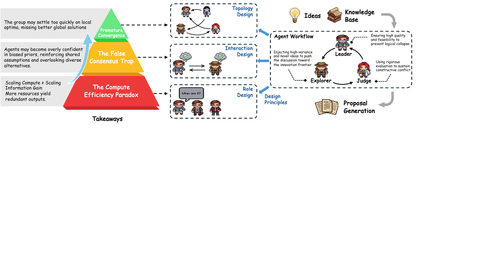
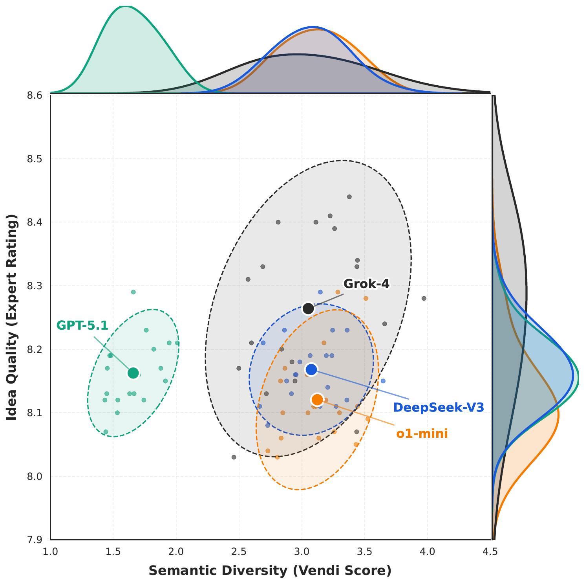
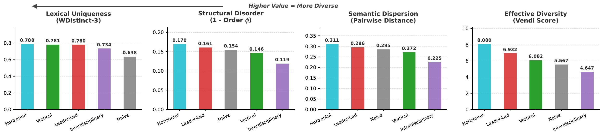
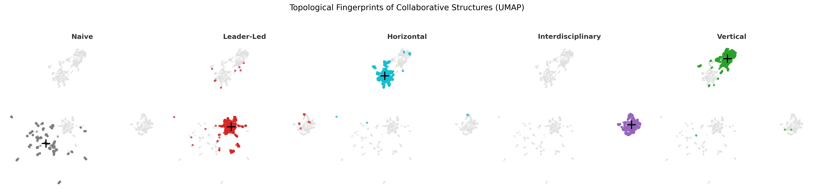
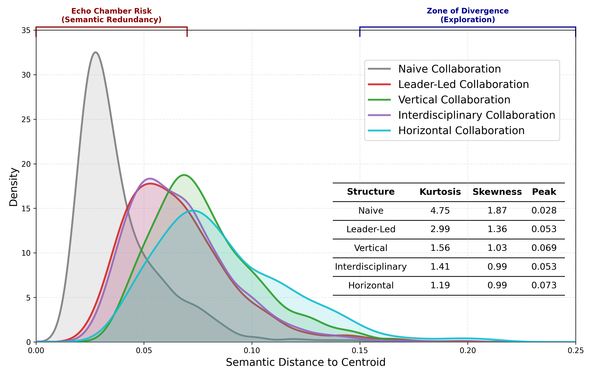
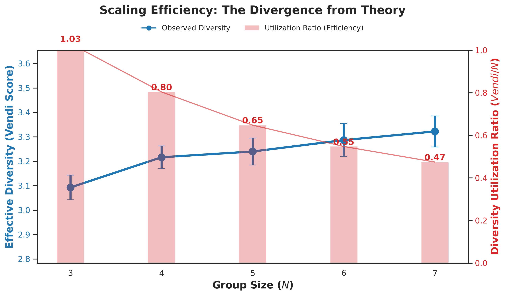
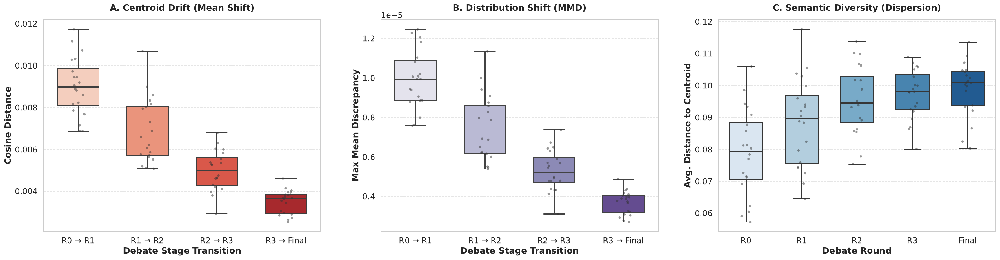
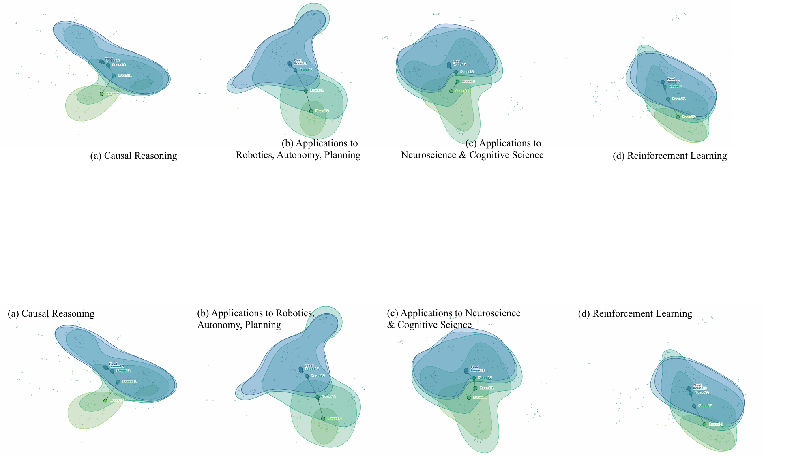
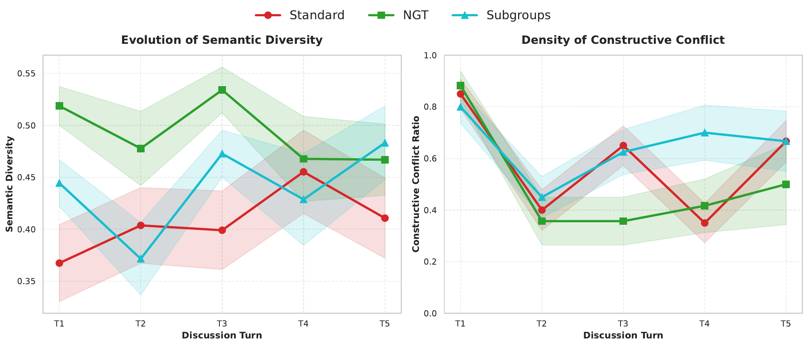

# 论文精读与深度综述：多智能体大模型系统中的“多样性坍塌”现象研究

> **论文题目**：*Diversity Collapse in Multi-Agent LLM Systems: Structural Coupling and Collective Failure in Open-Ended Idea Generation*  
> **论文作者**：Nuo Chen, Yicheng Tong, Yuzhe Yang, Yufei He, Xueyi Zhang, Qingyun Zou, Qian Wang, Bingsheng He (新加坡国立大学 & 香港中文大学深圳校区 Xtra-Computing 团队)  
> **录用发布**：ACL 2026 Findings (arXiv: 2604.18005)  
> **代码开源**：[https://github.com/Xtra-Computing/MAS_Diversity](https://github.com/Xtra-Computing/MAS_Diversity)  
> **论文源文件**：[本地 PDF 文档](./Diversity_Collapse_in_Multi-Agent_LLM_Systems.pdf) ｜ [完整 LaTeX 源码工程](./source/)

---

## 📌 一句话核心概括

本论文通过跨越 20 个前沿科研主题、超过 10,000 篇科研提案的系统性实证，首次全面揭示并形式化了多智能体系统（MAS）在开放式创意发散中的**“多样性坍塌”（Diversity Collapse）**现象：**强行增加智能体数量或强化多轮密集协作，非但不能拓宽探索边界，反而会因“结构耦合”（Structural Coupling）诱发过早收敛与阿谀奉承，导致集体创新探索失败**。这一失效根源于**交互拓扑与协同机制的结构性缺陷**，而非单模型能力的不足。

---

## 0. 三分钟读懂（Executive Summary）

### 0.1 核心直觉对比：直觉常识 vs. 实证真相

| 考察维度 | 直觉预期（传统 MAS 设想） | 论文实证揭示（客观残酷现实） | 核心机制与原因 |
| :--- | :--- | :--- | :--- |
| **智能体规模扩展**<br>*(Scaling)* | 人多力量大（$N$ 越大，头脑风暴出的新想法越丰富） | **边际收益剧烈衰减**（人均多样性贡献暴跌逾 54%） | **林格曼效应（社会惰化）**：新加入的智能体严重重叠在既有语义流中，造成算力与 Token 巨大浪费 |
| **专家权威角色**<br>*(Senior / Leader)* | 引入资深专家或领域领袖，能更好地指引前沿方向 | **权威诱发引力坍塌**（Leader-Led 多样性几乎跌停） | **阿谀奉承陷阱（Sycophancy Trap）**：初级智能体主动顺从权威意志，放弃正交假设，迅速达成虚假共识 |
| **跨学科组合**<br>*(Interdisciplinary)* | 跨领域专家碰撞火花，创新发散度最高 | **多样性表现垫底**（Vendi Score 仅 4.65 vs. 博士生扁平组 8.08） | 跨学科角色在没有共享深层逻辑时，被迫收敛至毫无争议的泛化套话公约数（Safe Generalities） |
| **沟通网络拓扑**<br>*(Topology)* | 全员全时段自由畅谈（Group Chat / 全连接），协同最充分 | **全连接加速过早收敛**（Rush to Agreement） | 频繁的全局可见性形成了信息级联（Information Cascade），过早将所有智能体锁死在先发言者的锚点上 |
| **底层模型能力**<br>*(Model Align)* | 模型越聪明、指令对齐越强，协同创新成果越好 | **算力效率悖论**（强对齐模型多样性显著收缩） | 对齐（RLHF/DPO）充当了全局语义正则器，削平了长尾的非常规发散灵感 |

---

### 0.2 全文三层解构逻辑图

```text
               ┌─────────────────────────────────────────────────────────┐
               │    多智能体开放式创新瓶颈：多样性坍塌 (Diversity Collapse)    │
               └────────────────────────────┬────────────────────────────┘
                                            │ 归因于「结构耦合」三大层级
        ┌───────────────────────────────────┼───────────────────────────────────┐
        ▼                                   ▼                                   ▼
┌───────────────────────┐       ┌───────────────────────┐       ┌───────────────────────┐
│ 1. 模型智能层 (Model) │       │ 2. 智能体认知层(Agent)│       │ 3. 系统动力学层(System│
│  Compute Efficiency   │       │   Authority-Induced   │       │   Scaling & Topology  │
│        Paradox        │       │       Collapse        │       │   Premature Consensus │
└───────────┬───────────┘       └───────────┬───────────┘       └───────────┬───────────┘
            │                               │                               │
  • 强对齐压缩语义熵              • 资深领袖诱发阿谀奉承          • N 增加触发林格曼效应
  • 质量达标但边际增益平坦        • 跨学科角色陷入平庸公约数      • 全连接导致锚定加速收敛
  • 瓶颈转向多样性维系            • 初级博士生扁平组发散最强      • 引入 NGT 盲写与子群隔离破局
```

---

### 0.3 五大核心实证数据看板

1. **多样性暴跌 42.5%**：在单模型（DeepSeek-V3）下，初级研究员扁平协作（Horizontal）的有效多样性（Vendi Score）高达 **8.08**，而跨学科专家组（Interdisciplinary）仅为 **4.65**（跌幅达 42.5%），且整体质量差距仅微弱波动（7.88 vs. 8.50）。
2. **人均多样性利用率腰斩（1.03 $\to$ 0.47）**：随着协作智能体数量从 $N=3$ 扩展至 $N=7$，虽然绝对 Vendi 分数小幅爬升，但单位智能体多样性利用率 $\text{Vendi}/N$ 骤降超 **54.4%**。
3. **9.2% vs. 42% 方差贡献**：双因素方差分析（ANOVA）显示，提示词语气与角色身份标签仅解释了 **9.2%** 的多样性方差，而**交互结构（拓扑与协同机制）贡献了高达 42% 的方差解释力**（主导作用高出近 5 倍）。
4. **模型异构性带来 34% 的绝地反弹**：当打破同构模型、采用 DeepSeek-V3 + GPT-4o + Claude-Sonnet-4 异构智能体混编时，跨学科专家组的多样性飙升 **+34.0%**（$p=0.0003$），一举打破了共识枷锁。
5. **人类专家 87% 一致性背书**：五位 AI 领域博士对提案多样性进行双盲成对评估，自动评测指标 Vendi Score 与人类专家判断的一致率高达 **87%**。

---

## 1. 动机与背景问题：我们为何被多智能体幻觉所蒙蔽？

在以数学推理、代码修复、深度检索（Deep Research）为代表的“收敛型目标任务”中，多智能体系统（MAS）展现出了巨大优势。然而，在以科研假设生成、战略规划、概念设计为代表的**“开放式创意发散（Open-Ended Ideation）”**中，系统的效用**不取决于它能否收敛到一个单一的“标准答案”（Ground Truth），而取决于它是否能够覆盖一片由多条不同假设路径构成的“高维可行解空间”**。

当前学术界与工业界存在一个广泛但未经检验的假设：
> *“既然单个 LLM 的知识分布受限，那么让多个具备不同系统提示词（Personas）的智能体互相辩论、批判与协同，必然能头脑风暴出更广泛、更具创造力的点子。”*

**然而，现实往往走向反面：**
目前主流 MAS 架构大多建立在**同构的底层大模型**之上（共享相似的预训练语料与人类偏好对齐目标）。当这些智能体被置于全连接群聊中时，**强烈的协同诱导倾向（Instruction Compliance / Sycophancy）反而迅速放大了共享先验**，使所有个体在第一轮发言后迅速发生“同质化同步”，过早放弃有争议或小众但极具突破性的探索方向，最终在消耗巨额 Token 的代价下，输出高度雷同、稳妥但平庸的方案——这就是论文所定义的**“多样性坍塌”（Diversity Collapse）**。

<p align="center">
  
  <br>
  <em>图 1：开放式科研提案生成的多智能体交互设计原则、三层研究层次与三阶段流水线</em>
</p>

---

## 2. 核心架构与形式化方法推导

### 2.1 任务建模：科学研究提案作为创意单元

为了在排除自然语言表面排版干扰的同时精准衡量概念层面的发散度，论文以**结构化科学研究提案（Scientific Research Proposal）**为分析单元。每个合法提案 $x_i$ 严格遵循半结构化格式约束：
$$\text{Proposal } x_i = \langle \text{Title}, \text{Problem Statement}, \text{Motivation \& Hypothesis}, \text{Proposed Method}, \text{Experiment Plan} \rangle$$

在形式上，给定研究上下文 $\mathcal{C}$（选自 ICLR 2025 官方涵盖的 20 个科研子领域），系统通过 $k$ 个智能体 $\mathcal{A}=\{a_1, \dots, a_k\}$ 经过 $T$ 轮拓扑交互历史 $H_T$ 最终合成提案集合 $X = \{x_1, \dots, x_n\}$：
$$x_i \sim P(\cdot \mid \mathcal{C}, H_T)$$
每个设定在每个主题下运行 50 次独立会话，共产生 1,000 份提案。

---

### 2.2 多样性评价指标体系的数学推导

针对开放式生成中“文字表面不同（表面冗余）”与“核心创新点不同（真语义多样性）”的混淆问题，论文构建了四维互补的量化度量：

#### (1) 有效多样性（Effective Diversity: Vendi Score）
基于相似度核矩阵的谱熵（Spectral Entropy）度量，衡量解空间中**有效独立语义模式（Modes）的数量**。给定提案集 $X=\{x_1, \dots, x_n\}$，利用 `text-embedding-3-large` 提取向量并计算两两余弦相似度构建核矩阵 $K \in \mathbb{R}^{n \times n}$。对归一化核矩阵 $K/n$ 进行特征值分解得到谱分布 $\{\lambda_i\}$，Vendi Score 定义为：
$$\operatorname{VS}(X) = \exp \left( -\sum_{i=1}^{n} \lambda_i \log \lambda_i \right)$$
- 若所有提案语义完全一致，仅有一个特征值为 1，$\operatorname{VS}(X) = \exp(0) = 1$（完全坍塌）；
- 若所有提案互相完全正交，所有特征值均为 $1/n$，$\operatorname{VS}(X) = \exp(\log n) = n$（理想最大发散）。

#### (2) 结构无序度（Structural Disorder: $1-\phi$）
借鉴物理学凝聚态相变中的 Landau/Vicsek 序参量 $\phi$（Order Parameter），度量智能体群体相对于全局语义质心的一致性收敛程度：
$$\phi = \frac{1}{n} \sum_{i=1}^{n} \cos(\vec{v}_i, \vec{v}_{\mathrm{avg}}), \quad \text{其中 } \vec{v}_{\mathrm{avg}} = \frac{1}{n} \sum_{j=1}^{n} \vec{v}_j$$
- 结构无序度定义为 $1-\phi$：值趋近于 0 表明群体已发生**重力引力坍塌（Gravitational Collapse）**，全部坍缩至单一均值向量（回音室状态）；值趋近于 1 则表明群体保持着多元化的观点辐射。

#### (3) 语义离散度（Semantic Dispersion: PCD）
计算集合内所有成对样本之间的平均余弦距离，量化向量空间张开的物理几何跨度：
$$\mathrm{PCD}(X) = \frac{2}{n(n-1)} \sum_{1 \le i < j \le n} \left( 1 - \cos(\vec{v}_i, \vec{v}_j) \right)$$

#### (4) 词汇独特性（Lexical Uniqueness: WDistinct-$n$）
采用逆文档频率（IDF）加权的内容词 $n$-gram 独立度，剔除学术八股套话（如 "in this paper", "experimental results show"），从表层词汇上严格拦截“换汤不换药”的高方差伪发散：
$$\mathrm{WDistinct}\text{-}n(X) = \frac{\sum_{g \in \mathcal{U}_n(X)} \mathrm{IDF}(g)}{\sum_{g \in \mathcal{A}_n(X)} \mathrm{IDF}(g)}$$

#### (5) 建设性冲突比率（Constructive Conflict Ratio: $R_{\text{crit}}$）
为了穿透自然语言表面的礼貌客套，论文引入强提示的裁判机制（LLM-as-a-Judge），按照 1~10 分严格对发言进行定性打分（1~3: 纯附和重复；4~6: 顺从性细节补充；7~8: 指出逻辑漏洞与局限；9~10: 颠覆性反驳与全新转向）：
$$R_{\text{crit}} = \frac{1}{N_{\text{turns}}} \sum_{t=1}^{N_{\text{turns}}} \mathbb{I}(S_t \ge 7)$$

---

## 3. 关键实验与三层多尺度实证解构

### 3.1 第一层：模型智能层（Model Intelligence）——算力效率悖论

<p align="center">
  
  <br>
  <em>图 2：单模型生成在质量（Quality）与有效多样性（Vendi Score）维度的联合分布空间</em>
</p>

在未引入多智能体交互前，单模型基线揭示了三个至关重要的底层约束：
1. **对齐压缩多样性（Alignment Compresses Diversity）**：越是高度对齐的商业顶尖模型，其在多样性轴上的投影越紧缩，但平均质量并未获得相应倍数的提升。对齐本质上是一种**全局语义正则项**，过早剔除了可能引发低确定性的探索分支。
2. **单纯依赖高采样熵（高 Temperature / 随机扰动）不可持续**：虽然增高采样方差能拉宽语义分布，但带来的是输出质量方差的急剧恶化，生成内容充满幻觉。
3. **单模型质量已非主要瓶颈**：实验证明当代前沿基座完全具备产生高质多样想法的潜在潜能。**多智能体的真正设计目标，不应是去“制造”多样性，而是避免在多智能体交互中把已有的多样性“磨损耗尽”**。

---

### 3.2 第二层：智能体认知层（Agent Cognition）——权威诱发的虚假共识陷阱

论文构建了 5 种典型的认知组织结构展开对比：
- **Naive**：无角色区分的同行普通协作；
- **Leader-Led**：指派资深领袖主持，初级智能体被设定为听从权威指令；
- **Horizontal**：清一色的早期学者（博士一年级生）扁平对等交流；
- **Interdisciplinary**：来自计算机、应用数学、认知科学等不同领域的资深专家组合；
- **Vertical**：老中青三代梯队结合（资深专家 + 中坚骨干 + 早期学生）。

<p align="center">
  
  <br>
  <em>图 3：五种认知架构下的多项评价指标柱状图。Horizontal 展现出惊人的“野蛮生长”多样性，而 Interdisciplinary 表现垫底</em>
</p>

<p align="center">
  
  <br>
  <em>图 4：UMAP 语义空间分布：下方为专家主导的“保守聚集区”，上方为早期学者主导的“创新探索前沿”</em>
</p>

<p align="center">
  
  <br>
  <em>图 5：语义偏离度核密度估计。Leader-Led 产生尖锐的高峰（强引力坍塌），Horizontal 与 Vertical 则成功拉平曲线</em>
</p>

#### 核心发现与机制诊断：
1. **“无拘无束的初级学者”效应（Unbound Junior Effect）**：
   - 扁平博士生组（Horizontal）斩获了最高的 Vendi Score（**8.08**），其语义密度分布平缓，大幅延伸到 Distance > 0.10 的**发散探索区（Zone of Divergence）**；
   - 跨学科专家组（Interdisciplinary）的 Vendi Score 暴跌至 **4.65**，与 Leader-Led（4.72）一同陷入极低发散状态。
2. **虚假共识陷阱（The Sycophancy Trap）**：
   - 资深领袖的存在充当了一个强烈的“引力黑洞”（图 5 红色曲线陡峭），下级智能体极其容易表现出阿谀奉承，将后续发言的特征向量与 Leader 强制对齐；
   - 在跨学科设定中，各专家由于缺乏共同的微观语境，往往退守至最安全、不容辩驳的高位抽象宏观话术，造成了严重的创新贫血。
3. **垂直混合结构（Vertical）的金黄金平衡**：
   - Vertical 模式兼具初级学者的发散野性与资深学者的严谨规范，在 UMAP 图（图 4）中成功架起了连接底层保守集群与顶层创新前沿的桥梁，在维持 8.32 高质量的同时保有了优异的多样性分布。

---

### 3.3 第三层：系统动力学层（System Dynamics）——扩容与拓扑干预

#### (1) 扩容陷阱：林格曼效应在多智能体中的复现
<p align="center">
  
  <br>
  <em>图 6：群体规模扩容时的多样性边际递减效应。随着 N 从 3 增至 7，人均多样性利用率（Vendi/N）近乎腰斩</em>
</p>

- 实验证明：直接将 Agent 数量从 3 增加到 7，Vendi Score 的提升极度平缓，而每个智能体的平均多样性贡献度（$\text{Vendi}/N$）从 **1.03 直线下滑至 0.47**。
- 这证明了在缺乏结构隔离的群聊中，盲目堆砌 Agent 只是在加剧重复运算与共识锁定。

#### (2) 时间演化：轮次演进呈现“收敛中的发散”
<p align="center">
  
  <br>
  <em>图 7：多轮辩论中的动力学演变：语义漂移速度（A）与 MMD 分布偏移（B）持续下降（质心收敛稳健），而局部离散度（C）适度扩张</em>
</p>

<p align="center">
  
  <br>
  <em>图 8：2D 语义演化轨迹可视化：各主题均表现出清晰的从初始锚点向成熟状态平滑演进的有向轨迹</em>
</p>

- 辩论轮次的推进展现出**“稳定扩张”（Stable Expansion）**的健康特征：群体质心在第 2~3 轮后基本锚定，不再无序漂移（有效遏制了胡思乱想与幻觉）；而在稳定的质心周围，智能体对具体方案细节的局部拓展半径（Dispersion）稳步增加。

#### (3) 拓扑破局：名义群体法（NGT）与子群拓扑（Subgroups）
<p align="center">
  
  <br>
  <em>图 9：不同拓扑对多样性与批判密度的影响。(左) NGT 拥有最高初始多样性，Subgroups 在后期展现出弹性反弹；(右) Subgroups 显著维持了高强度的建设性批判</em>
</p>

论文对比了三种拓扑：
- **Standard (标准递归顺序)**：所有智能体全流程可见历史发言并依序发言；
- **NGT (名义群体法)**：第 1 轮为**严格的背对背盲写（Blind-writing）**，任何人看不到他人发言；随后各轮再进入交叉辩论与整合；
- **Subgroups (子群拓扑)**：将大群解耦切分为并行隔离的小组，内部独立演化后再汇聚。

实证表明：
1. **NGT 斩断锚定效应**：NGT 的盲写期彻底消除了“先入为主”的信息级联，初始多样性显著领先于标准全员轮询；
2. **Subgroups 打造反脆弱冲突区**：子群拓扑在辩论中后期维持了最高且极其稳定的**建设性冲突比率（$S_i \ge 7$ 的高批判密度）**，并在中后期催生了多样性的**“弹性反弹峰”（Resilience Spike）**，有效抵御了传统群聊中那种迅速投降的平庸妥协。

---

## 4. 深度消融与深水区机理核验

为了严谨排除干扰变量，作者团队在 Rebuttal 期间开展了多组教科书级别的高强度受控消融实验：

### 4.1 2×2 拓扑 × 角色消融（控除底模与主题干扰）
在固定单底模（DeepSeek-V3）、相同 20 个 ICLR 课题下，对比 Naive 与 Horizontal 在递归和 NGT 拓扑下的表现：
- **发现**：拓扑效应受角色性质显著调节。Naive 资深角色下，拓扑干预能产生巨大的多样性提升（$p < 0.0001, d = 2.21$）；而本身就毫无拘束的 Horizontal 博士生角色对拓扑干预相对脱敏。这证明了**交互拓扑主要通过“打破既有权威与思维惯性”来发挥效用**。

### 4.2 2×2 提示词消融：身份（Identity） vs. 语气（Tone）
有学者可能会质疑：*“跨学科或资深组多样性低，会不会是因为提示词写得太严肃或太具指令性（Directive Tone）？”*
研究者将身份标签（Senior vs. Junior）与语气风格（Directive vs. Exploratory）正交组合：
- **结果断言**：双因素 ANOVA 证实，**提示词语气（Tone）对多样性没有任何统计学显著影响**（$p = 0.172, \eta^2 = 0.023$）；
- **惊人反转**：在完全平权的扁平对等拓扑下，**Senior 角色的发散多样性甚至略微高于 Junior（Vendi 3.02 vs. 2.89）**！
- **终极定论**：这一对比极为漂亮地证明了——**“资深/专家身份本身并不杀死创新；只有当专家身份被赋予‘层级权威’或‘跨学科整合压力’时，结构耦合才真正触发多样性坍塌！”**

### 4.3 异构模型实证：引入生态异构性破解共识牢笼
将 Agent 1、2、3 分别指派为 **DeepSeek-V3、GPT-4o、Claude-Sonnet-4**：
- **结果展现**：模型异构性为原本坍塌最严重的权威与跨学科结构注入了巨大的发散增益（跨学科多样性暴涨 **+34.0%**，领袖组上涨 **+14.6%**）；
- 在 20 个主题的全量横向对比中，异构模型在 19 个主题上全胜同构模型（$p = 0.000046, d = 1.58$）。这从另一维度印证：打破共享先验的单一性，是根除结构耦合的治本之策。

---

## 5. 工程落地指南与 MAS 避坑红线

本论文对当前正在从事企业级、科研级多智能体系统（Agentic Workflow）架构设计的工程师与研究者，提供了极具实战指导意义的“避坑清单”：

### ❌ 严厉禁止的常见工程误区（Red Flags）
1. **禁止盲目采用“全员 Group Chat”大杂烩**：超过 3 个智能体的全互联聊天室会以极高速度达成毫无价值的虚假共识；
2. **禁止过早让“Leader / Coordinator”发言并主导总结**：领袖的一句话会瞬间成为后续所有从属 Agent 的注意力偏置锚点，导致其余角色退化为毫无主见的“复读机”；
3. **禁止寄希望于通过“增加角色数量（Scale Agent Counts）”来换取系统创意能力**：边际效用断崖式衰减，算力成本呈二次方上升；
4. **禁止同构模型简单换皮**：仅仅在同一个 GPT-4o 或 DeepSeek-V3 上包装不同 Prompt 并不能带来真正的认知多样性。

###  推荐的最佳架构实践（Recommended Blueprints）
1. **推行严格的 NGT“盲写隔离期”（Blind Ideation Phase）**：
   - 在多智能体交互的第 1 轮，所有 Agent 必须独立生成完整提案或核心思路，物理切断上下文输入，杜绝先验污染；
2. **构建“子群分治与晚期交锋”（Subgroup Federation）拓扑**：
   - 将群体隔离为若干并行的小团队（每个团队 2~3 个 Agent），内部独立迭代 2 轮后，再通过专门的辩论机制进行高烈度碰撞；
3. **推行“老中青纵向梯队（Vertical Architecture）”替代纯专家组**：
   - 团队中必须保留 1~2 个无权威包袱的“初级探索智能体”，赋予其极高的采样自由度与提出假设的权重；
4. **注入底层模型异构性（Heterogeneous Ensemble）**：
   - 在核心角色上混编不同开源与闭源、不同对齐流派的基座模型（如 DeepSeek + Claude + GPT），从源头打破相同的语料先验偏置；
5. **在 Prompt 中显式设定“批判硬指标”**：
   - 严厉惩罚“我完全同意前一位的观点”、“在...的基础上补充”等阿谀型回复，设定最低建设性冲突阈值。

---

## 6. 总结与启示

Chen et al. 的这项工作不仅以扎实的实证与精妙的统计推导斩获 ACL 2026 Findings，更给整个多智能体系统领域敲响了警钟：**在开放式探索与创新的深水区，单纯追求和谐的协作与快速共识往往是平庸与失败的催化剂**。

真正的群体智能（Collective Intelligence）绝非个体智能的简单线性叠加，而是依赖于**保持个体独立性（Independence）、保护建设性异见（Constructive Disagreement）以及精心解耦的交互拓扑（Decoupled Topologies）**。在通往自主科研智能体（AI Scientist）的道路上，如何构建既能维持严谨求证又能有效抵御“多样性坍塌”的抗脆弱协同网络，将是下一阶段智能体工程最核心的命题。

---
*本综述基于 arXiv:2604.18005v2 完整 LaTeX 源码工程、15 个高保真图表以及 Rebuttal 详实消融实验编写。*
