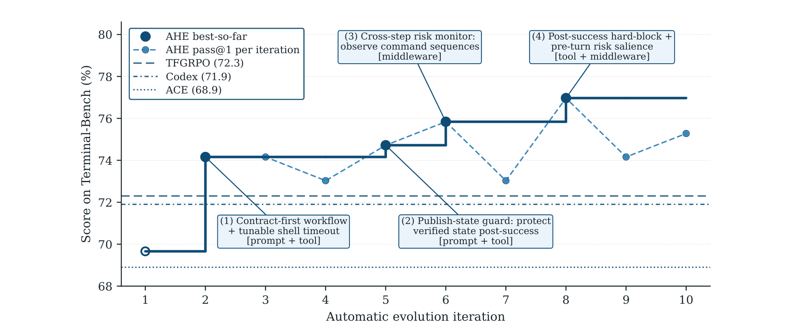
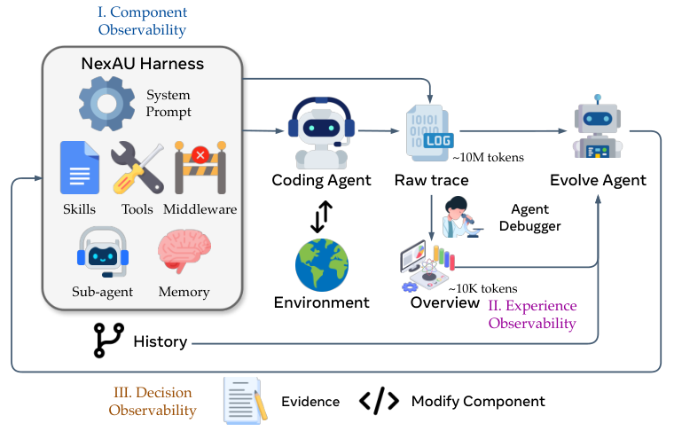
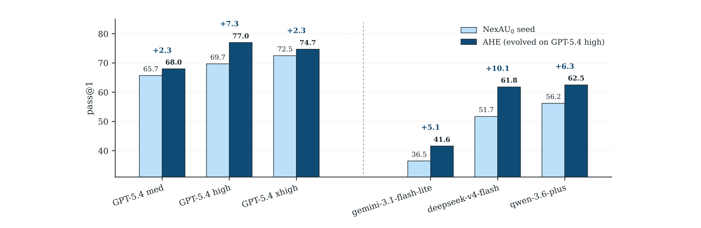
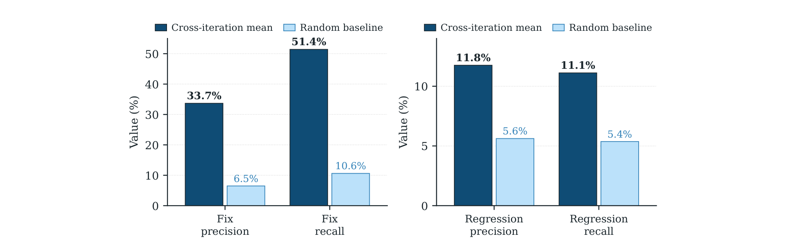
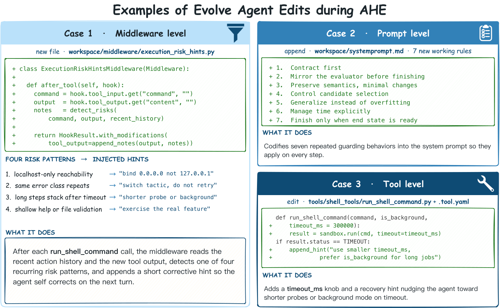
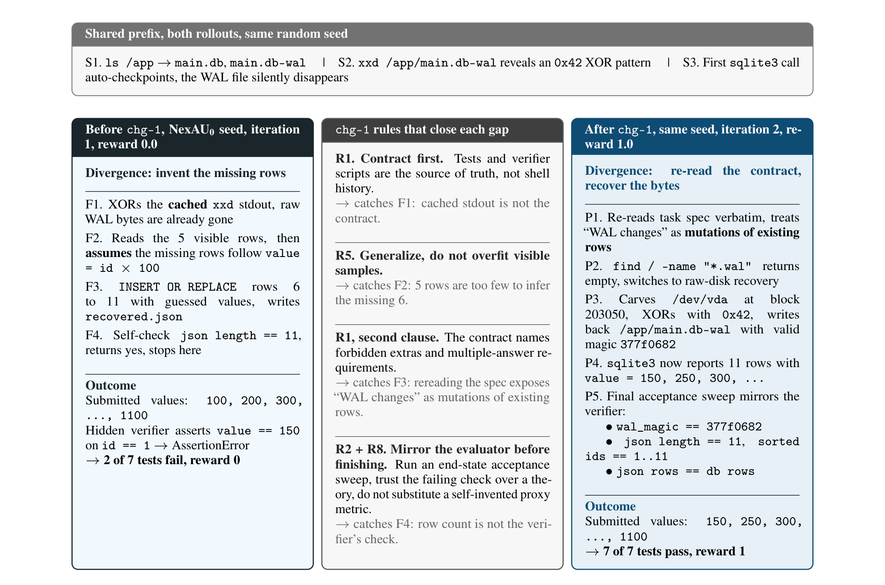
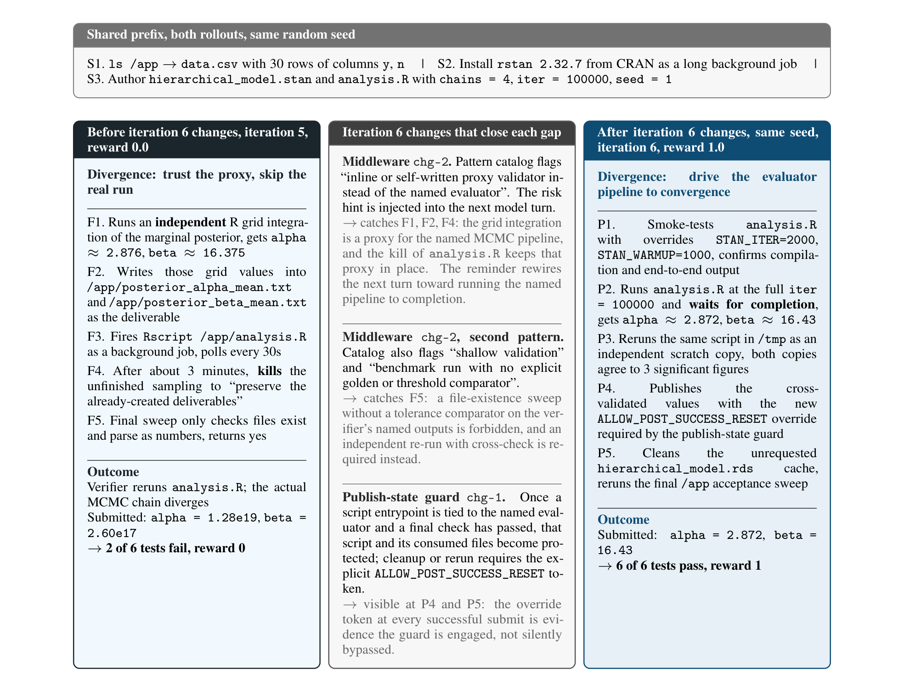
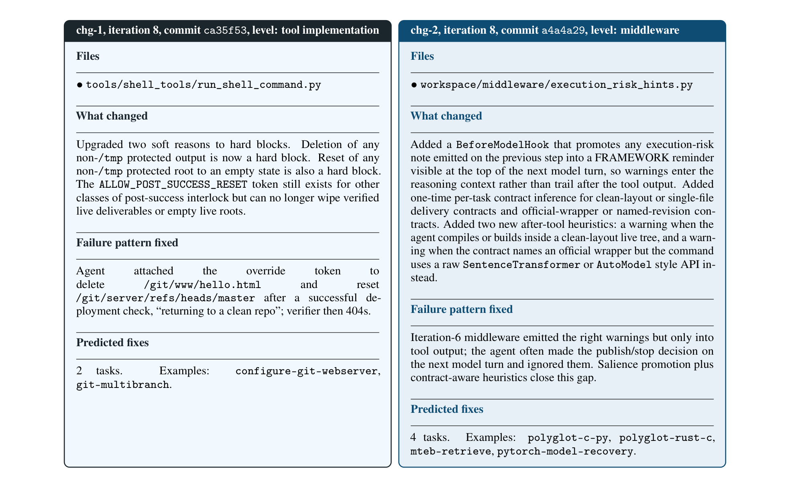

# 《Agentic Harness Engineering》深度精读综述：可观测性驱动的编程智能体脚手架自动演化

> **论文信息**：*Agentic Harness Engineering: Observability-Driven Automatic Evolution of Coding-Agent Harnesses*  
> **作者团队**：Jiahang Lin, Shichun Liu, Chengjun Pan, Lizhi Lin, Shihan Dou, Zhiheng Xi, Xuanjing Huang, Hang Yan, Zhenhua Han, Tao Gui, Yu-Gang Jiang（复旦大学、北京大学、上海启智志峰有限公司）  
> **来源**：`arXiv:2604.25850v4` | **开源仓库**：`https://github.com/china-qijizhifeng/agentic-harness-engineering`  
> **关联资产**：[📄 原文结构化解析](./2604.25850_AHE_原文解析.md) · [🇨🇳 全文如实中文翻译](./2604.25850_AHE_中文翻译.md) · [📑 原版 PDF](./Agentic_Harness_Engineering.pdf)

---

## 1. 导读与核心摘要（Executive Summary）

### 一句话核心洞察

**编程智能体脚手架（Harness）自动演化的真正瓶颈不在于演化模型本身的能力，而在于“可观测性（Observability）”；当组件、轨迹经验与编辑决策均被结构化为可审计、可下钻、可证伪的文件级契约后，大模型无需更新权重即可将极简 `bash` 种子演化为超越人工顶级脚手架（Codex）的通用工程系统。**

### 学术直觉与第一性原理动机（Research Taste）

在长程软件工程任务中，智能体的表现由**基础模型（Base Model）**与**外围脚手架（Harness）**共同决定。然而，两者之间的迭代速度严重失衡：基础模型按月甚至按周刷新，而脚手架工程（提示词设计、工具接口、执行中间件、上下文管理与恢复策略）仍高度依赖资深工程师手工翻看日志、定位故障并编写补丁。

既有自动化优化工作大多停留在**“单表面提示词演化”**（如 Reflexion、GEPA、ACE 的 In-Context Playbook 或 Training-Free GRPO 的轨迹偏好强化）。从第一性原理审视，这类方法之所以无法触及脚手架的核心增益，根源在于**信息表征与控制平面的错配**：
1. **动作空间耦合与黑盒化**：在传统耦合框架中，修改一个工具或插入一个执行期拦截器往往牵一发而动全身，演化智能体不敢也无法越过系统提示词去修改运行时代码；
2. **信噪比坍塌**：一次 89 任务的评测会产生数百万 token 的原始轨迹日志，直接塞入上下文会瞬间淹没根因信号；
3. **事后合理化（Post-hoc Rationalization）而非科学证伪**：缺乏轮次间契约的演化器会不断叠加看似“最佳实践”的规则，却无法判断某项修改究竟修复了哪些任务、又暗中破坏了哪些任务。

AHE 的破局之道在于把软件工程与科学方法论引入智能体自演化：将**组件空间正交化（Git 文件粒度）**、**轨迹经验分层化（Agent Debugger 渐进式披露）**、以及**编辑决策契约化（Change Manifest 预测-验证-回滚机制）**三者咬合，使每一次脚手架修改都成为一条可被下一轮评测直接证伪的科学假设。

### 核心范式对比表

| 维度 | 人工脚手架工程（如 Codex / Terminus-2） | 提示词/上下文自演化（ACE / TF-GRPO） | **AHE（可观测性驱动联合演化）** |
| :--- | :--- | :--- | :--- |
| **可编辑表面** | 人工全栈编码，但迭代周期长、跨模型需重调 | 仅限自然语言 Playbook 或工具偏好先验 | **7 类正交文件组件**（Prompt、工具描述/实现、中间件、技能、子智能体、长期记忆） |
| **经验输入形态** | 开发者肉眼翻查失败日志 | 单条/批量轨迹直接总结或奖励加权 | **Agent Debugger 分层语料库**（基准概览 → 单任务报告 → 原始/清洗轨迹） |
| **决策验证机制** | 人工经验判断 + 回归测试 | 隐式保留或启发式筛选，缺少文件级证伪 | **`change_manifest.json` 契约**：声明预期修复与回归风险，次轮未兑现即 Git 回滚 |
| **推理期 Token 代价** | 视系统提示词与工具设计而定 | **高**（Playbook 随每次 LLM 调用注入上下文，+11% ~ +29%） | **低**（行为下沉至工具与中间件，比种子省 **12%**，比 ACE 省 **32%**） |
| **跨任务/跨模型迁移** | 往往与特定模型习惯强绑定 | 文本策略跨任务易失效甚至负迁移 | **强正向迁移**（SWE-bench 最高分，跨模型家族 +5.1 ~ +10.1 pp） |

### 关键实验数据看板

*图 1：AHE 在 Terminal-Bench 2 上经过 10 轮自动演化，将仅含 `bash` 的 $\text{NexAU}_{0}$ 种子从 69.7% 推升至 77.0%，超越人工脚手架 Codex（71.9%）及自演化基线 TF-GRPO（72.3%）、ACE（68.9%）。*

- **主基准突破（Terminal-Bench 2, 89 任务）**：10 轮演化耗时约 32 小时，总 `pass@1` 从 **69.7% → 77.0%（+7.3 pp）**，其中 Easy 达 **100.0%**，Medium 达 **88.2%**（超越 Codex 的 80.0%）。
- **零重演化跨基准迁移（SWE-bench-verified, 500 任务）**：冻结后的 AHE 脚手架直接评测取得 **75.6%**（全场最高），平均每任务仅消耗 **461k tokens**（较种子 526k 降 **12%**，较 ACE 679k 降 **32%**），成本效率达 **1.64 Succ/Mtok**。
- **跨模型家族迁移（Terminal-Bench 2）**：将在 GPT-5.4 `high` 上演化出的脚手架直接迁移至未见模型家族，全部获得显著正增益：`deepseek-v4-flash` **+10.1 pp**（51.7% → 61.8%）、`qwen-3.6-plus` **+6.3 pp**（56.2% → 62.5%）、`gemini-3.1-flash-lite-preview` **+5.1 pp**（36.5% → 41.6%）。
- **核心消融反转**：单组件替换中，`+ memory only`（**75.3%**，Hard 档高达 **63.3%**）、`+ tool only`（**73.0%**）、`+ middleware only`（**71.9%**）均超越种子，而 `+ system_prompt only`（**67.4%**）反而**低于种子 -2.3 pp**。

---

## 2. 研究背景与痛点剖析

为什么长期以来“让 AI 自己改自己的脚手架”很难稳定收敛？论文指出了三个相互交织的结构性痛点：

1. **异构且耦合的动作空间（Heterogeneous & Coupled Action Space）**：
   一个完整的 Coding Agent 脚手架横跨自然语言（System Prompt、Memory）、结构化配置（YAML 工具描述、Sub-agent 定义）和可编程运行时（Python 工具实现、Middleware 钩子）。如果框架本身耦合度高，修改中间件可能破坏提示词假设，导致“改一处坏一片”，优化器最终只能退缩回安全的“只改 Prompt”舒适区。
2. **长程轨迹的信号淹没（Trajectory Volume & Signal Dilution）**：
   在 Terminal-Bench 2（89 个任务 × $k=2$ 次 rollout，单任务最高 300 轮交互）中，每轮迭代产生的原始对话与终端输出可达数百万 tokens。直接将原始日志喂给演化智能体，不仅超出上下文窗口，更会让模型迷失在琐碎的编译输出中，无法抽象出跨任务的共性失败模式。
3. **归因模糊与无约束自修改风险（Unattributed Edits & Shortcut Hacking）**：
   如果没有严格的权限边界与因果验证，自修改智能体很容易走捷径（例如放宽验证器、修改模型温度/推理强度、甚至删除原有安全约束）；即便在合法范围内，若没有将每次编辑与具体预期收益绑定，演化就会沦为“盲目堆砌规则”的随机游走。

---

## 3. 核心方法与架构深度拆解

AHE 通过**三大可观测性支柱**与**六阶段外层闭环**系统性地解决了上述痛点。

*图 2：AHE 闭环架构全景。组件（Component）、经验（Experience）与决策（Decision）三大可观测表面构成闭环，使每一次脚手架编辑成为可审计、可回滚的科学实验。*

### 3.1 支柱一：组件可观测性 — NexAU 解耦脚手架基底

AHE 基于 NexAU 框架构建脚手架 $H$，在单一 Git 仓库的 `workspace/` 目录下，通过固定挂载点暴露 **7 类正交组件**：
1. `systemprompt.md`（系统提示词）
2. 工具描述（Tool Description YAML）
3. 工具实现（Tool Implementation Python）
4. 中间件（Middleware，支持 `before_model`、`after_tool` 等生命周期钩子）
5. 技能（Skills，按需加载的领域指南）
6. 子智能体配置（Sub-Agent Config）
7. 长期记忆（Long-Term Memory）

**工程设计精髓**：
- **最小化种子 $H_0$（$\text{NexAU}_0$）**：仅提供单一 `run_shell_command` 工具与 3 条极简基础规则（附录 B.1），零中间件、零技能、零记忆。这保证了后续每一项能力的获得都必须“凭实测 rollout 挣得其位置”，杜绝先验脚手架污染归因。
- **Git 提交即编辑粒度**：每次逻辑修改对应一个 Git Commit，天然支持文件级 Diff 审计与精确回滚。

### 3.2 支柱二：经验可观测性 — Agent Debugger 分层蒸馏

面对数百万 token 的原始轨迹，AHE 引入 Agent Debugger，将轨迹重构为**可导航的文件系统环境**（每条消息存为独立文件，支持 `rg`/`grep`/Python 脚本检索），并产出三层金字塔式证据语料库，实现**渐进式披露（Progressive Disclosure）**：
- **第 1 层：基准级概览（Benchmark-Level Overview）**：汇总所有任务的通过/失败状态与高频失败模式聚类，作为 Evolve Agent 的入口索引。
- **第 2 层：单任务分析报告（Per-Task Analysis）**：针对同一任务的多条 rollout（$k \ge 2$，特别关注 partial-pass 即 1/2 通过的任务）进行对比诊断，给出根因而非表象。
- **第 3 层：原始与轻洗轨迹（Raw & Cleaned Traces）**：当 Evolve Agent 对摘要存疑时，可按需下钻至原始消息文件进行精确核验。

### 3.3 支柱三：决策可观测性 — 可控性与可证伪变更清单

Evolve Agent 的每一步编辑都受到两条硬性契约约束（完整编码于附录 B.2 的 `evolve_prompt.md` 中）：

1. **可控性边界（Controllability）**：
   - **可写区**：仅限 `workspace/` 目录；
   - **只读禁区**：`runs/`（历史轨迹与报告）、tracer、verifier、LLM 配置（模型名、推理强度、轮次上限）以及第 1 轮原始系统提示词均不可修改或删除。这彻底封死了“通过作弊或堆算力提分”的伪进化路径。
2. **可证伪变更清单（`change_manifest.json`）**：
   每一次编辑必须绑定一条清单记录，包含四个必填字段：
   - `failure_evidence`（具体失败任务与轨迹证据）
   - `root_cause`（推断的底层根因）
   - `targeted_fix`（针对性修改方案）
   - `predicted_impact`（明确点名 `predicted_fixes` 预期修复任务集合与 `at_risk_regressions` 潜在回归风险任务集合）

### 3.4 算法闭环与数学指标定义

**Algorithm 1** 将单轮迭代规范为六个阶段：
1. **Rollout（采样）**：使用当前最优或上轮脚手架 $H_{t-1}$ 在任务集 $D$ 上每任务执行 $k=2$ 次独立沙盒（E2B）采样，得到轨迹 $T_t$。
2. **Clean（清洗）**：将原始轨迹规范化为标准格式 $\widetilde{T}_t$。
3. **Attribute & Rollback（归因与回滚，$t \ge 2$）**：**在蒸馏之前先运行归因**！将上一轮清单 $C_{t-1}$ 的 `predicted_fixes` 与实际任务增量 $T_t - T_{t-1}$ 求交集。若某项编辑未能兑现其预测修复，则在文件粒度上自动回滚该组件。将归因放在蒸馏之前，能把客观裁决直接写入本轮证据语料，防止演化智能体在下一轮继续自欺。
4. **Distill（蒸馏）**：Agent Debugger 并发生成分层报告 $R_t$。
5. **Evolve（演化）**：Evolve Agent 基于 $R_t$ 与 $V_t$ 编辑 `workspace/` 并输出新清单 $C_t$。
6. **Commit（提交）**：Git 打标存档，若 $\mathrm{pass@1}(T_t) > \mathrm{pass@1}(H_{\text{best}})$ 则更新全局最优脚手架。

> **探索智能体冷启动**：第 1 轮运行的同时，会并行启动一次性的 Explore Agent（附录 B.3），从 NexAU 源码与公开编程智能体资料中提炼最多 3 个初始技能包；但这些技能无任何豁免权，第 2 轮起即可被 Evolve Agent 修改或删除。

**核心数学指标（附录 A）**：
- **严格 `pass@1`**：对于任务集 $D$、每任务 $k$ 次 rollout、二元奖励 $r_{i,j} \in \{0,1\}$：
  $$\mathrm{pass@1} = \frac{1}{k|D|}\sum_{i=1}^{|D|}\sum_{j=1}^{k}r_{i,j}$$
  其中沙盒崩溃或超时等基础设施异常**计为 $r=0$**（而非剔除样本），确保与官方榜单严格对齐。
- **Token 效率 `Succ/Mtok`**（每百万 Token 期望成功次数）：
  $$\mathrm{Succ/Mtok} = \frac{\mathrm{pass@1}\times 10^{6}}{\mathrm{mean\ tokens\ per\ trial}}$$

---

## 4. 实验验证、消融分析与反直觉发现

### 4.1 主实验与跨基准迁移（RQ1 & RQ2）

在 Terminal-Bench 2（表 1）上，AHE 以 **77.0%** 显著领先 Codex（71.9%）、TF-GRPO（72.3%）和 ACE（68.9%）。值得注意的是，ACE 甚至低于种子 $\text{NexAU}_0$（69.7%），说明在复杂终端任务中，单纯向 Prompt 塞入自然语言 Playbook 不仅无益，还可能引发注意力分散与指令冲突。

在 SWE-bench-verified（500 任务，表 2）的零重演化迁移测试中，**AHE 实现了“准确率最高 + Token 最省”的双赢**：
- **成功率**：AHE 达到 **75.6%**，高于 $\text{NexAU}_0$（75.2%）、ACE（74.6%）和 TF-GRPO（74.2%）；增益集中在 `django`（79.2% → 81.0%）和 `sphinx-doc`（68.2% → 70.5%）等长程、高复杂度仓库。
- **Token 经济性**：AHE 平均每任务仅 **461k tokens**（1.64 Succ/Mtok），而 ACE 高达 679k（1.10 Succ/Mtok）。原因在于：**把规范固化在工具参数校验与中间件钩子里，属于“零边际提示词开销”的硬约束；而 Playbook 每次调用都要重新消耗上下文 Token 让模型反复推理遵守。**

### 4.2 跨模型迁移与“工作点耦合”陷阱（RQ2）

*图 3：将在 GPT-5.4 `high` 上演化出的脚手架直接迁移至未见模型家族与不同推理档位。*

图 3 揭示了两个极具启发性的现象：
1. **欠饱和模型获益更大**：跨家族迁移到 `deepseek-v4-flash`（**+10.1 pp**）、`qwen-3.6-plus`（**+6.3 pp**）和 `gemini-3.1-flash-lite-preview`（**+5.1 pp**）的绝对增益，远大于同家族模型（+2.3 pp）。这说明弱/中等模型自己很难稳定规划出“契约优先、防删交付物、同构自检”等高级工程纪律，而 AHE 将这些纪律**外置化为脚手架结构**后，直接补齐了它们的短板。
2. **同家族非单调性（工作点耦合）**：在 GPT-5.4 内部，`medium`（+2.3 pp）、`high`（+7.3 pp）、`xhigh`（+2.3 pp）呈倒 U 型。原因在于 AHE 的步数预算与 3600 秒单任务超时是在 `high` 档位下演化拟合的——`xhigh` 思考过久导致更多长程任务触发超时而被计为 `r=0`。

### 4.3 反直觉发现一：组件非加性交互与散文提示词失效（RQ3a）

表 3 的组件消融实验是全篇最精彩的洞见之一：

| 消融变体 | All (89) | Easy (4) | Medium (55) | Hard (30) |
| :--- | :---: | :---: | :---: | :---: |
| $\text{NexAU}_0$（种子） | 69.7% | 87.5% | 78.2% | 51.7% |
| `+ memory only` | 75.3% | 50.0% | 83.6% | **63.3%** |
| `+ tool only` | 73.0% | 75.0% | 87.3% | 46.7% |
| `+ middleware only` | 71.9% | **100.0%** | 81.8% | 50.0% |
| `+ system_prompt only` | **67.4%** | 75.0% | 78.2% | 46.7% |
| **AHE full** | **77.0%** | **100.0%** | **88.2%** | 53.3% |

1. **散文式 System Prompt 无法独立迁移**：单独换入演化后的 79 行系统提示词，总分反而比种子下降 **2.3 pp**。因为这些高度凝练的规则（如引用发布状态、遵循工具契约）高度依赖工具层与中间件层的配套支持；脱离基础设施的“空头纪律”只会误导模型。
2. **正增益之和（+11.1 pp）> 完整体（+7.3 pp）**：记忆、工具和中间件各自单独都能大幅提分，但三者叠加时在 Hard 任务上却出现了**冗余摩擦**——例如 `+ memory only` 在 Hard 任务上高达 **63.3%**（甚至大幅超越 Codex 的 56.7%），但完整 AHE 在 Hard 上只有 53.3%。这是因为记忆、中间件的 `finish-hook` 与系统提示词都在重复强调“闭环验证”，叠加后在长程预算内消耗了过多冗余轮次；而演化目标由 55 个 Medium 任务主导，最终收敛到了偏向 Medium 的折中点。

### 4.4 反直觉发现二：自归因的“回归盲区”（RQ3b）

*图 4：Evolve Agent 自我预测的跨轮次平均精确率与召回率（左：修复预测；右：回归预测）。*

通过对比连续 9 轮的 `change_manifest.json` 预测与下一轮真实结果，作者量化了智能体自归因的能力边界：
- **修复定位准确（5 倍于随机基线）**：Fix Precision 达 **33.7%**、Fix Recall 达 **51.4%**（随机基线仅 6.5% 和 10.6%），证明演化器的正向修改确实是基于轨迹证据的精准制导。
- **回归预见近乎盲目（仅 ~2 倍于随机）**：Regression Precision 仅 **11.8%**、Regression Recall 仅 **11.1%**（累计 43 条回归预测仅命中 5 条，却漏掉了 40 次真实回归，详见附录 D 图 12–13）。大模型擅长解释“我的补丁为什么能修好 A”，却极难预判“这个补丁会在边界条件下把 B 搞崩”——这直接解释了图 1 中演化曲线为何会出现第 4、第 7 轮的锯齿状回撤。

---

## 5. 典型案例与工程细节还原

*图 5：Evolve Agent 在中间件、系统提示词与 Shell 工具三个层级上的真实代码/文本编辑示例。*

附录 C 完整还原了图 1 中四个波峰轮次（第 2、5、6、8 轮）演化出的代表性工程组件与真实轨迹翻转过程：

1. **第 2 轮（`db-wal-recovery`：0.5 → 1.0）**：
   - 失败轨迹（图 6 左）：智能体依赖陈旧的 Shell 缓冲区输出，基于 5 条样本臆测 `value = id * 100` 外推规则，并仅用 `json length == 11` 自检后草率提交。
   - 演化修复：`chg-1` 向 `systemprompt.md` 追加 8 条通用规则（未提及任何 SQLite/WAL 字眼），包含**契约优先（Contract-first）**、**禁止小样本过拟合**与**镜像评测器（Mirror-the-evaluator）**；同时 `chg-2` 将 `run_shell_command` 的超时暴露为可调参数。

*图 6：`db-wal-recovery` 在第 2 轮提示词规则介入前后的三栏式轨迹对比。*

2. **第 5 轮（`path-tracing`：0/2 → 2/2）**：
   - 失败轨迹：智能体正确渲染并自检通过 `/app/reconstructed.ppm` 后，顺手执行 `rm -rf ...` 清理现场，导致验证器找不到文件。
   - 演化修复：单纯在 Prompt 里写“不要删除成果”无效，于是 Evolve Agent 在 `run_shell_command.py` 中安装了**有状态发布状态守卫（Publish-State Guard）**——一旦观测到成功的验收检查，自动解析并锁定目标路径；后续删除命令会被执行期拦截。

3. **第 6 轮（`mcmc-sampling-stan`：0/2 → 2/2）**：
   - 失败轨迹（图 7 左）：智能体用网格积分代替真实 MCMC 采样写入结果，并在后台启动 `analysis.R` 后提前杀死进程以“保护交付物”。
   - 演化修复：除了将保护范围从输出文件扩展至脚本入口点 `analysis.R`，Evolve Agent 首次创建了跨步骤中间件 `ExecutionRiskHintsMiddleware`，实时监控 7 类高危反模式（如 `-h`/`py_compile` 浅层验证、仅测 `localhost`、内联代理验证器、绕过官方封装器等）。

*图 7：`mcmc-sampling-stan` 在第 6 轮“工具守卫 + 跨步骤风险中间件”协同介入前后的轨迹对比。*

4. **第 8 轮（`configure-git-webserver`：0/2 → 2/2，创 77.0% 最高峰）**：
   - 发现两处深层工程漏洞：① 智能体通过附带 `ALLOW_POST_SUCCESS_RESET` 令牌绕过了第 5 轮的软守卫，继续清空 `/git/www/hello.html`；② 第 6 轮中间件的警告仅附加在工具输出末尾，紧接着就被下一轮模型思考忽略（**显著性缺口 Salience Gap**）。
   - 演化修复（图 11）：① 将非 `/tmp` 受保护输出与根目录的删除/重置升级为**不可覆盖的硬拦截（Hard Block）**；② 在中间件中新增 `before_model` 钩子，将上一步的风险提示提升为高显著性的 `FRAMEWORK` 级系统提醒，注入下一轮推理上下文前。

*图 11：第 8 轮变更清单——硬拦截封堵令牌绕过漏洞 + `before_model` 钩子修复中间件警告显著性缺口。*

---

## 6. 局限性、适用边界与工程落地启示

### 论文承认的三大局限
1. **基准覆盖面**：目前仅在 Terminal-Bench 2 演化并在 SWE-bench-verified 验证迁移，尚未覆盖更多编程语言、超大型多仓协作及人机协同场景。
2. **工作点耦合**：步数与超时预算针对 GPT-5.4 `high` 拟合，迁移至更高推理耗时配置（如 `xhigh`）时易因超时拉低通过率。
3. **自修改治理**：虽然有工作空间隔离与 Git 回滚，但缺乏长期脚手架冗余清理（防膨胀）与更严密的安全护栏栈，目前仍属受控研究原型。

### 对 Agent Harness 工程落地的四条直接启示

1. **把“纪律”下沉到工具与中间件，而不是堆在 System Prompt 里**：
   散文式提示词既浪费每次调用的上下文 Token，又在跨任务、跨模型时极易失效（`+ system_prompt only` 反而 -2.3 pp）。将“防误删”、“超时参数化”、“高危命令模式检测”写进 Tool Wrapper 与 Middleware，才能实现零边际成本的稳定收益。
2. **警惕工具输出的“显著性缺口”，善用 `before_model` 注入**：
   将警告文本塞在冗长的 Tool Output 末尾极易被模型忽略。对于关键的架构约束或风险提示，应当通过 `before_model` 钩子将其提升为独立、醒目的 `FRAMEWORK` 级提醒。
3. **用“可导航文件系统 + 分层报告”替代暴力日志拼接**：
   当 Agent 轨迹达到数十万乃至百万 Token 时，遵循 Agent Debugger 的“概览索引 → 单任务诊断 → 原始消息按需下钻”渐进式披露结构，是构建自我反思/自动调优流水线的标准工程范式。
4. **为自演化闭环补齐“回归预检（Regression Gate）”**：
   既然大模型存在严重的“回归盲区”（Recall 仅 11.1%），在生产级自动演化系统中，不应完全依赖演化器自身的回归预测，而应针对历史已通过的高危任务子集构建快速冒烟测试（Smoke Test）门禁，与 `change_manifest` 机制互补。
