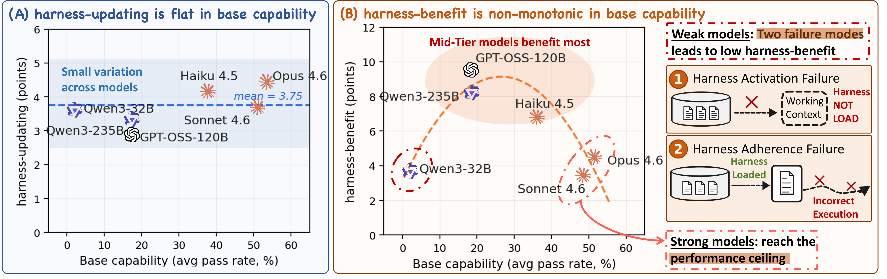
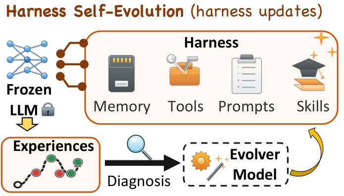
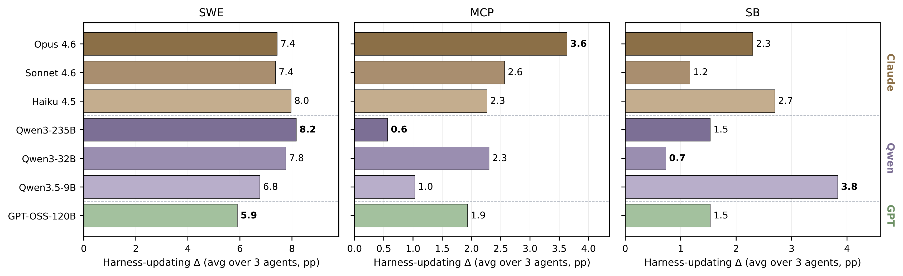
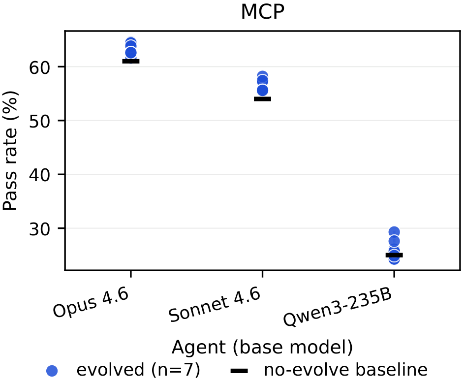
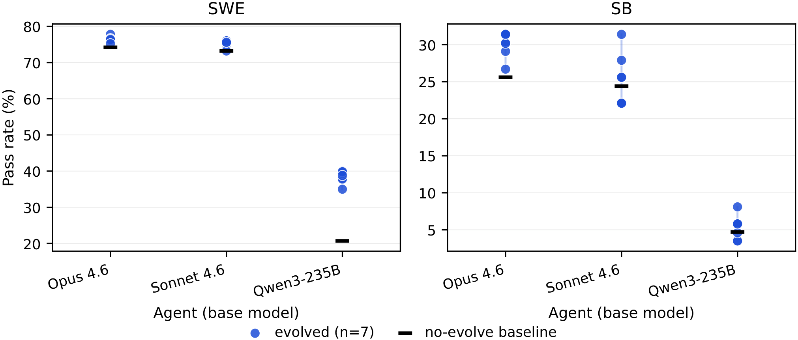
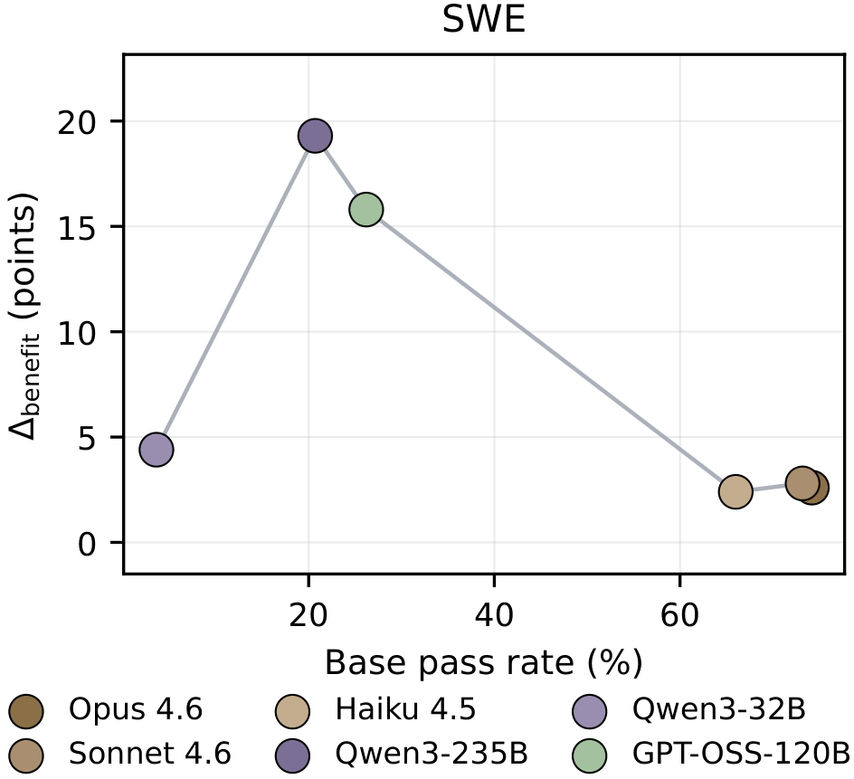
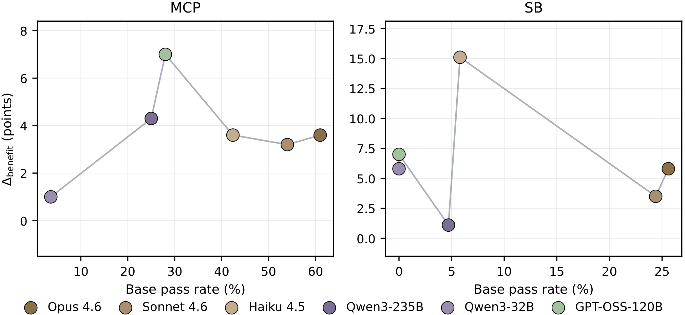
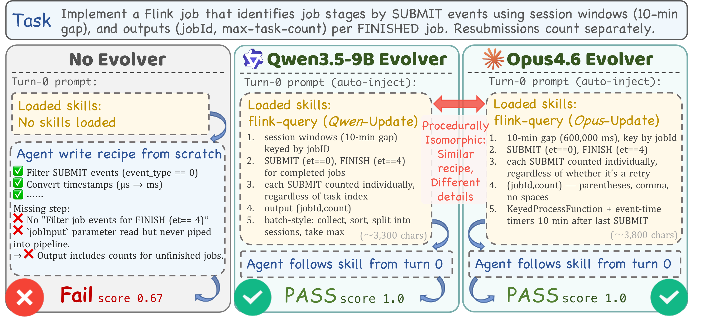
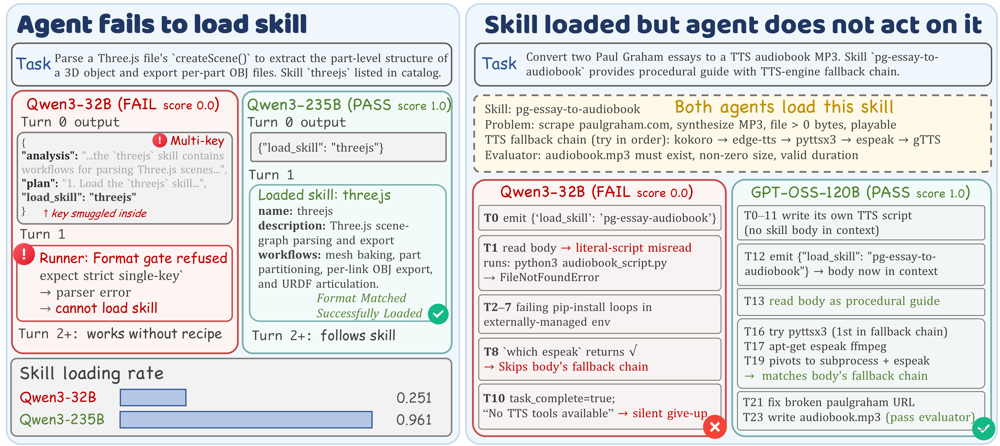

# 更新不等于受益：解耦自进化 LLM 智能体中的进化能力（`arXiv:2605.30621` 深度精读综述）

> **论文标题：** *Harness Updating Is Not Harness Benefit: Disentangling Evolution Capabilities in Self-Evolving LLM Agents*  
> **作者团队：** Minhua Lin\* (PSU), Juncheng Wu\* (UCSC), Zijun Wang (UCSC), Zhan Shi, Yisi Sang, Bing He (Amazon), Zewen Liu (Emory), Tianxin Wei (UIUC), Zongyu Wu, Zhiwei Zhang (PSU), Dakuo Wang (Northeastern), Xiang Zhang (PSU), Benoit Dumoulin (Amazon), Cihang Xie, Yuyin Zhou (UCSC), Suhang Wang (PSU), Hanqing Lu (Amazon)  
> **论文链接：** [arXiv:2605.30621v1](https://arxiv.org/abs/2605.30621v1) · **开源代码：** [A-EVO-Lab/a-evolve (harness-evolution)](https://github.com/A-EVO-Lab/a-evolve/tree/release/harness-evolution)

---

## 1. 导读与核心摘要（Executive Summary）

### 一句话核心洞察

**在脚手架自进化（Harness Self-Evolution）系统中，“能写出好脚手架”与“能用好脚手架”是两种完全解耦的能力——前者（脚手架更新能力 $\Delta_{\text{update}}$）在模型基础能力上几乎是一条平坦直线（9B 小模型写出的技能与 Opus 4.6 效果相当），而后者（脚手架受益能力 $\Delta_{\text{benefit}}$）呈非单调倒 U 型曲线（中等模型获益最大，强模型受限于天花板，弱模型则卡死在“不会加载”与“长程忘词”上）。**

### 学术直觉与第一性原理动机（Research Taste）

过去两年的自进化智能体研究（如 Reflexion、ACE、GEPA、EvolveR、SkillRL、EvoSkill）普遍遵循同一个评估范式：**把一个进化器（Evolver）和一个求解智能体（Task-solving Agent）绑在一起跑完基准测试，然后汇报一个端到端的涨分数字**。

然而，从第一性原理来看，任何非参数化的自进化系统本质上都包含两个截然不同的信息处理阶段：
1. **归纳与压缩阶段（Induction / Updating）**：从历史执行轨迹、报错与评分反馈 $\mathcal{D}_t$ 中提炼共性规程并改写外部脚手架 $H_{t-1} \to H_t$；
2. **检索与执行阶段（Activation / Execution）**：在面对新任务 $x$ 时，在运行期主动触发脚手架产物（如 `load_skill`），并在多轮工具调用的长程上下文中持续受其约束。

端到端分数将“模型的基础能力 $M_{\text{base}}(f)$”、“进化器的更新质量”与“智能体的受益能力”三者混为一谈。这直接导致了一个盲区：当一个系统在弱模型上进化失败，或在强模型上进化有效时，工程团队根本不知道**算力预算应该花在进化器上，还是花在求解智能体上**，也不知道弱模型究竟是“总结不出好经验”，还是“根本执行不了好经验”。

这篇论文的精妙之处，在于它**用极简的交叉配对实验设计（Cross-pairing Factorial Design）打破了角色绑定**：把 7 个不同能力层级的开源/闭源模型分别放在 **Evolver** 和 **Agent** 两个槽位上两两解耦测试，从而剥离出两个反直觉的科学规律。

### 核心范式对比与关键实验看板

| 评估维度 | 传统端到端自进化评估 | 本文解耦分析范式 |
| :--- | :--- | :--- |
| **角色绑定** | 进化器与求解器通常同源或固定单配对 | 独立交叉配对：$7$ 个进化器 $\times$ $6$ 个求解智能体 |
| **评估指标** | 单一端到端通过率提升 | 分离定义 $\Delta_{\text{update}}(e)$ 与 $\Delta_{\text{benefit}}(f)$ |
| **核心归因** | 无法区分是“经验写得好”还是“执行者悟性高” | 证实瓶颈在**智能体侧**而非**进化器侧** |
| **预算指导** | 倾向于盲目使用最强旗舰模型兼任进化器 | **预算全投给求解智能体**，进化器可用轻量模型 |

**关键实验数据看板（横跨 3 大基准：SWE-bench Verified / MCP-Atlas / SkillsBench）：**
- **进化器极差极窄**：在同一基准上，从 9B 到 Opus 4.6，7 个进化器的 $\Delta_{\text{update}}$ 最大极差不超过 **3.1 pp**（SWE 上 5.9–8.2 pp；MCP 上 0.6–3.6 pp；SB 上 0.7–3.8 pp）。
- **小模型逆袭进化器**：`Qwen3.5-9B` 在 SkillsBench 上拿下最高的 $\Delta_{\text{update}}$（**+3.8 pp**），超过 `Claude Opus 4.6`（+2.3 pp）和 `Qwen3-235B`（+1.5 pp）。
- **智能体主导最终上限**：在极端对抗配对中（最弱锚定智能体 `Qwen3-235B` 配最佳进化器 vs. 最强锚定智能体 `Opus 4.6` 配最差进化器），强智能体依然稳稳领先 **18.6 至 35.2 pp**。
- **非单调倒 U 型受益**：在 SWE-bench Verified 上，$\Delta_{\text{benefit}}$ 峰值出现在中游的 `Qwen3-235B`（**+19.3 pp**）和 `GPT-OSS-120B`（**+15.8 pp**），而弱模型 `Qwen3-32B` 仅获 **+4.4 pp**，强模型 `Opus 4.6` 仅获 **+2.6 pp**。
- **弱模型两大诊断数字**：`Qwen3-32B` 在 SkillsBench 上的**技能加载率（SLR）仅 25.1%**（强模型约 **96%**）；即使成功加载，其**脚手架遵循率（HFR）也只有 14.2%**（`Opus 4.6` 为 **75.7%**），且随轮次推进遵循度从 **0.52 暴跌至 0.13**（漂移 `-0.39`，衰减陡峭度是 `Opus 4.6` 的 **4 倍以上**）。

---

## 2. 研究背景与痛点剖析

### 为什么人工脚手架不够用，而自进化评估又会失真？

在现代 Agent Harness 工程中，大模型本身权重 $f$ 通常是冻结的，系统性能高度依赖围绕它的外部脚手架 $H$：系统提示词（Prompts）、可调用技能包（Skills）、持久化记忆（Memory）与工具接口（Tools）。人工编写的脚手架在真实部署环境中面临两大挑战：任务分布漂移与长尾边界条件，因此“从执行证据中自动更新脚手架”成为主流趋势。

如图 1 所示，脚手架自进化形成了一个闭环：智能体在当前脚手架 $H_{t-1}$ 下执行任务并产生轨迹与反馈 $\mathcal{D}_t$，进化器 $e$ 据此生成更新 $\Delta H_t$ 并提交为 $H_t$。但现有研究几乎都只问“自进化有没有用”，却忽略了两个核心工程问题：
1. **如果弱模型在自进化中表现差，是因为它写不出好脚手架，还是因为它用不好脚手架？**
2. **如果用小模型（如 9B）代替旗舰模型（如 Opus 4.6）充当后台进化器，系统性能会崩塌吗？**

不回答这两个问题，开发者在搭建多智能体或自进化 Harness 时就会陷入“算力错配”：要么给后台反思/进化模块分配最昂贵的旗舰模型，造成巨大的推理成本浪费；要么以为给弱模型外挂一个顶级进化器就能让它起飞，结果发现弱模型根本“接不住”更新后的脚手架。

---

## 3. 核心方法与数学/架构深度拆解

### 3.1 形式化定义与解耦指标

作者将第 $t$ 步的 LLM 智能体定义为一个二元组：

$$
A_t = (f, H_t)
$$

其中 $f$ 为冻结的模型骨干，$H_t$ 为第 $t$ 步结束后的外部脚手架状态。在进化循环中，智能体在任务批次 $\mathcal{X}_t$ 上执行求解：

$$
(\tau_{t,x}, y_{t,x}) = \mathrm{Solve}(A_{t-1}, x), \qquad \mathcal{D}_t = \{(x, \tau_{t,x}, y_{t,x}) : x \in \mathcal{X}_t\}
$$

进化器 $e$ 接收上一代脚手架与本批执行证据，输出补丁并提交：

$$
\Delta H_t = e(H_{t-1}, \mathcal{D}_t), \qquad H_t = \mathrm{Apply}(H_{t-1}, \Delta H_t)
$$

为了将两种能力彻底剥离，作者定义了四个递进指标：

1. **基础能力（Base Capability）**：初始脚手架 $H_0$ 下的任务通过率：
   $$M_{\text{base}}(f) = J_{\mathcal{X}}(f, H_0)$$
2. **配对进化收益（Pairwise Evolution Gain）**：智能体 $f$ 在进化器 $e$ 驱动下进化 $T$ 步后的净增量：
   $$\Delta(f, e) = J_{\mathcal{X}}(f, H_T^{(f, e)}) - M_{\text{base}}(f)$$
3. **脚手架更新能力（Harness-updating Capability, $\Delta_{\text{update}}$）**：固定一组锚定智能体 $\mathcal{F}^\star = \{\text{Opus 4.6}, \text{Sonnet 4.6}, \text{Qwen3-235B}\}$，度量进化器 $e$ 为它们带来的**平均净增量**：
   $$\Delta_{\text{update}}(e) = \frac{1}{|\mathcal{F}^{\star}|} \sum_{f \in \mathcal{F}^{\star}} \Delta(f, e)$$
   - *物理直觉*：用平均增益来衡量一个进化器输出的脚手架更新在不同接收者身上的“通用有效性与泛化性”。
4. **脚手架受益能力（Harness-benefit Capability, $\Delta_{\text{benefit}}$）**：固定一组锚定进化器 $\mathcal{E}^\star = \{\text{Opus 4.6}, \text{Sonnet 4.6}, \text{Qwen3-235B}\}$，度量智能体 $f$ 从中能获取的**最大净增量**：
   $$\Delta_{\text{benefit}}(f) = \max_{e \in \mathcal{E}^{\star}} \Delta(f, e)$$
   - *物理直觉*：取最大值 $\max$ 是为了消除特定进化器偶然失误的干扰，测出一个模型在获得“它能得到的最好更新”时，自身吸收与执行脚手架的能力上限。

### 3.2 原位评估（In-situ Evaluation）的防泄漏机制

自进化实验最容易犯的错误是“数据泄漏”或“事后诸葛亮”。本文采用严格的**原位顺序评估（In-situ Evaluation）**：
- 任务流 $\mathcal{X} = \bigcup_{t=1}^T \mathcal{X}_t$ 依次到达；
- 在第 $t$ 步，批次 $\mathcal{X}_t$ 中的每个任务 $x$ 必须先在**上一代脚手架 $H_{t-1}$** 下完成求解并锁定得分；
- 只有得分锁定后，该任务的轨迹与评分反馈才被打包进 $\mathcal{D}_t$，交给进化器去生成 $H_t$（供 $t+1$ 步及之后的任务使用）。

这确保了没有任何一个任务的得分是靠“自己刚生成的补丁反过来刷自己”得到的。

### 3.3 三大基准与可编辑脚手架范围契约

论文选择了三个互补的真实 Agent 基准，并对进化器的写权限做了严格沙箱隔离：

| 基准测试 | 任务规模 | 核心能力考察 | 可进化产物（Writable Scope） | 只读禁区（Read-only） |
| :--- | :---: | :--- | :--- | :--- |
| **SWE-bench Verified** | $500$（12 仓库） | 长程代码库定位与 GitHub Issue 补丁修复 | `skills/` | `tools/`、评估脚本、隐藏测试、模型权重 |
| **MCP-Atlas** | $500$（36 服务器 / 220 工具） | 多服务器 MCP 工具链式编排（3–6 步） | `prompts/system.md`、`skills/`、`memory/`（仅追加） | `tools/`、评估脚本、模型权重 |
| **SkillsBench** | $86$（11 领域 × 5 次试验） | 跨领域技能按需加载与多步规程执行 | `skills/`（从空技能集冷启动） | `tools/`、评估脚本、模型权重 |

### 3.4 诊断流水线：激活（SLR）与两阶段盲化裁判（HFR & Phase-Adherence）

为了解释为什么弱模型受益低，作者在 SkillsBench 上构建了细粒度的行为诊断体系：
1. **技能加载率（SLR, Skill-Load Rate）**：统计智能体轨迹中成功发出合法动作、至少将一项技能正文加载进上下文的轨迹比例。
2. **加载后通过率（LPR, Pass-When-Loaded）**：仅在成功加载了技能的轨迹子集上计算的任务通过率。
3. **脚手架遵循率（HFR, Harness-Following Rate）**：采用**两阶段盲化 LLM 裁判流水线**（裁判模型为 `Claude Sonnet 4.6`，轨迹中所有模型名称均替换为 `<MODEL>`）：
   - **Stage 1（锁定评分标准提取）**：先将 `SKILL.md` 正文提取为 3–8 条原子化、可观测的规程指令 JSON（标注 `required` / `conditional` / `optional`、触发条件以及 `FOLLOWED` / `VIOLATED` 判据）；
   - **Stage 2（逐指令遵循裁决）**：对照锁定 Rubric 审查盲化轨迹，给出 `FOLLOWED`、`VIOLATED_COMMISSION`（主动违背）、`VIOLATED_OMISSION`（该做未做）等裁决及精确违规轮次。
   - 公式定义为：$\mathrm{HFR}(f) = N_f^{\text{follow}} / N_f^{\text{load}}$。
4. **阶段级遵循度漂移（Phase-Level Adherence）**：通过独立裁判提示词将轨迹切分为 5 个时间切片（`harness_loaded`、`first_action`、`midpoint`、`pre_final`、`final_validation`），逐阶段给出 $[0, 1]$ 遵循度得分，专门捕捉长程执行中的“指令遗忘/漂移”。

---

## 4. 实验验证、消融分析与反直觉发现

### 4.1 进化器侧发现：脚手架更新能力与基础能力“平坦解耦”

Figure 3 与 Table 5 揭示了一个颠覆直觉的事实：**一个模型自己会不会做题，几乎不影响它能不能帮别人总结错题本。**

- **极差极窄且无常胜将军**：
  - 在 **SWE-bench Verified** 上，7 个进化器的 $\Delta_{\text{update}}$ 全部落在 `5.9 pp`（GPT-OSS-120B）到 `8.2 pp`（Qwen3-235B）之间，最大差距仅 `2.3 pp`；`Qwen3.5-9B`（`6.8 pp`）与 `Opus 4.6`（`7.4 pp`）仅差 `0.6 pp`。
  - 在 **MCP-Atlas** 上，所有进化器的 $\Delta_{\text{update}}$ 在 `0.6 pp` 到 `3.6 pp` 之间（极差 `3.0 pp`）。
  - 在 **SkillsBench** 上，所有进化器的 $\Delta_{\text{update}}$ 在 `0.7 pp` 到 `3.8 pp` 之间（极差 `3.1 pp`），而排名第一的竟然是最小模型 **`Qwen3.5-9B`（+3.8 pp）**！

从 Figure 5（MCP）和 Figure 8（SWE 与 SB）的“蓝点簇”可以直观看到：**决定最终得分高度的，是智能体本身的横坐标（基础能力），而不是上面挂了哪个进化器的蓝点。**
- 在 SWE 上，`Qwen3-235B` 跨 7 个进化器的波动范围最多 `5.0 pp`，但 `Opus 4.6` 与 `Qwen3-235B` 之间的基础能力鸿沟高达 **`53.5 pp`**（相差 **11 倍**）。
- 哪怕把最弱锚定智能体配给它的最强进化器，去打最强锚定智能体配给它的最差进化器（Table 6），强智能体依然在三个基准上分别碾压 **35.2 pp (SWE)**、**32.3 pp (MCP)** 和 **18.6 pp (SB)**。

### 4.2 智能体侧发现：脚手架受益能力呈非单调“倒 U 型”曲线

**Table 1 核心数据汇总（Base Pass Rate % / $\Delta_{\text{benefit}}$ pp）：**

| 智能体模型 | SWE Base | SWE $\Delta_{\text{benefit}}$ | MCP Base | MCP $\Delta_{\text{benefit}}$ | SB Base | SB $\Delta_{\text{benefit}}$ |
| :--- | :---: | :---: | :---: | :---: | :---: | :---: |
| **Qwen3-32B** | 3.6 | 4.4 | 3.6 | 1.0 | 0.0 | 5.8 |
| **Qwen3-235B** | 20.7 | **19.3** | 25.0 | 4.3 | 4.7 | 1.1 |
| **GPT-OSS-120B** | 26.2 | 15.8 | 28.0 | **7.0** | 0.0 | 7.0 |
| **Haiku 4.5** | 66.0 | 2.4 | 42.4 | 3.6 | 5.8 | **15.1** |
| **Sonnet 4.6** | 73.2 | 2.8 | 54.0 | 3.2 | 24.4 | 3.5 |
| **Opus 4.6** | 74.2 | 2.6 | 61.0 | 3.6 | 25.6 | 5.8 |

为什么收益曲线呈“中间高、两头低”？
- **右端（强模型）**：是经典的**天花板效应**。`Opus 4.6` 和 `Sonnet 4.6` 在 SWE 上初始就已经解出了 73–74% 的题目，剩下的都是极难的硬骨头，外部技能提示带来的边际增益自然收敛到 2.6–2.8 pp。
- **左端（弱模型）**：按理说 `Qwen3-32B` 只有 3.6% 的基础通过率，拥有超过 96% 的理论提升空间，但它的 $\Delta_{\text{benefit}}$ 却只有可怜的 `4.4 pp`（SWE）和 `1.0 pp`（MCP）。这说明弱模型并非没有提升空间，而是**不具备消化外部脚手架的能力**。

### 4.3 弱模型失效的深层机制：激活失效与长程遵循漂移

作者在 SkillsBench 上的定量诊断（Table 2 与 Table 3）精准切开了弱模型的病灶：

1. **脚手架激活失效（Activation Failure）**：
   - `Opus 4.6`（0.957）、`Sonnet 4.6`（0.959）、`Qwen3-235B`（0.961）几乎在 96% 的轨迹中都能正确加载技能；
   - `GPT-OSS-120B` 掉到 **0.446**，而 `Qwen3-32B` 暴跌到 **0.251**——四分之三的任务连技能正文都没加载进上下文！
2. **脚手架遵循失效（Adherence Failure）**：
   - 对比 `Qwen3-235B` 与 `Opus 4.6` 是整篇论文最精彩的对照：`Qwen3-235B` 的加载率（SLR = **0.961**）甚至略高于 `Opus 4.6`（0.957），但它的脚手架遵循率（HFR）只有 **0.350**（`Opus 4.6` 为 **0.757**），导致其加载后通过率（LPR）仅 **0.022**（`Opus 4.6` 为 **0.177**）。这铁证如山地说明：**“把技能塞进上下文”远远不够，模型必须在执行中真正按规程办事。**
3. **长程遵循度漂移（Long-Horizon Drift）**：
   - Table 3 显示，在刚刚加载完脚手架时，`Qwen3-32B` 的遵循度尚有 `0.52`；但到了轨迹中期就跌至 `0.22`，到最终验证轮次只剩 `0.13`（总漂移 **-0.39**）。相比之下，`Opus 4.6` 从 `0.89` 到 `0.80`（漂移仅 **-0.09**）。弱模型的衰减幅度是强模型的 **4.3 倍**。

---

## 5. 典型案例与工程细节还原

### 案例一：为什么 9B 小模型写出的技能能媲美 Opus 4.6？（`flink-query`）

在 SkillsBench 的 `flink-query` 任务上，作者固定求解智能体为 `Opus 4.6`：
- **无进化技能**：智能体漏掉了 `FINISH` 事件过滤器，部分指标失败，得分 `0.67`。
- **Qwen3.5-9B 进化出的技能** vs. **Opus 4.6 进化出的技能**：两者均使 `Opus 4.6` 拿到满分 `1.0`。拆解两个技能文本后发现，它们编码了**完全同构的 5 步规程**：
  1. 过滤 `SUBMIT` 事件；
  2. 过滤 `FINISH` 事件；
  3. 分别统计每次 `SUBMIT`；
  4. 输出 `(jobId, count)`；
  5. 应用 10 分钟会话窗口。
- **差异仅在表面**：`Qwen3.5-9B` 写了手动批处理会话化，而 `Opus 4.6` 使用了 `KeyedProcessFunction`。这说明：**从执行报错和成功轨迹中归纳“问题规程骨架”，对模型参数规模的要求远低于在长程复杂环境中“一步步稳健执行”的要求。**

### 案例二：弱模型是如何把脚手架“用坏”的？（`threejs` & `pg-essay-to-audiobook`）

- **协议层激活失效（`threejs`）**：`Qwen3-32B` 在第 0 轮其实已经看出了该加载哪个技能，但它在输出 JSON 动作时，习惯性地把 `analysis`（自由推理）、`plan`（计划）和 `load_skill` 塞进了同一个多键 JSON 对象中。运行器的格式门控只接受单键动作，直接拒收了这次调用，导致技能正文从未进入上下文。
- **规程层僵化失效（`pg-essay-to-audiobook`）**：技能文档里写了一条条件回退链（Fallback Chain）：先试主 TTS 路由，失败则切备选路由。`Qwen3-32B` 第 0 轮成功加载了技能，第 1 轮主路由报 `FileNotFoundError`，它却没有触发条件分支去走备选路由，而是像跑死板脚本一样盲目继续，并在第 10 轮直接输出 `task_complete:true` 宣告失败。

### 工程契约与提示词设计亮点

从附录 Table 8–14 的真实 Prompt 模板中，我们可以提取出三项值得借鉴的 Harness 工程实践：
1. **严格的目录权限隔离**：通过用户消息中的 `Workspace scope` 块明确划分 `prompts/`、`skills/`、`memory/`（可写/仅追加）与 `tools/`（全局只读），防止进化器通过篡改工具或评测脚本“作弊”。
2. **简洁与去冗余约束**：进化器系统提示词明确要求“Prefer concise, reusable updates over task-specific patches”，避免脚手架在多轮迭代后膨胀成针对单个任务的过拟合补丁。
3. **两阶段盲化裁判**：在评估 Agent 是否真正遵循了 Skill 时，先锁定 Rubric 再盲化模型名评判，避免了 LLM-as-a-Judge 常见的模型偏见与事后标准漂移。

---

## 6. 局限性、适用边界与工程落地启示

### 论文局限性与适用边界

1. **纯非参数化设定**：本文仅研究权重冻结下的外部脚手架自进化，未涉及参数微调、RL（如 SkillRL 类权重更新）或混合进化架构。
2. **模型网格与进化形态限制**：7 个模型虽然覆盖了开源/闭源与 9B–235B+，但主要是通用指令/推理模型；且实验中的脚手架更新以文本类产物（`skills/`、`prompts/`、`memory/`）为主，未包含像 Meta-Harness 那样直接重写复杂编排代码（`Code as Harness`）的场景——在代码级脚手架进化中，进化器的代码生成能力是否依然“平坦”，有待进一步验证。

### 对 Agent Harness 与 AI 系统工程落地的三大启示

1. **算力与预算分配原则：重“执行者”，轻“进化器”**
   - 在构建自进化 Agent 系统或后台经验蒸馏流水线（如定期复盘日志生成 `SKILL.md` 或更新 Memory）时，**完全没有必要全程调用最贵的旗舰模型（如 Opus 级）充当 Evolver**。用轻量、高性价比的模型（如 9B–32B 或 Haiku/Flash 级）做后台归纳与脚手架更新，把省下来的预算全部倾斜给前线的 Task-Solving Agent，性价比最高。
2. **把“脚手架调用协议”做成一等训练/微调目标**
   - 弱模型（甚至部分中等模型）在复杂协议下很容易因为多键 JSON、格式门控或工具调用时机判断失误而导致“技能根本没加载”。在自建小模型 Agent 时，应将 `load_skill` / `memory_retrieve` 等脚手架激活原语作为独立、严格的 SFT/RL 训练样本，并在 Harness 运行器侧提供更宽容的动作解析或清晰的格式纠错反馈。
3. **重点攻克长程轨迹中的“条件分支”与“防漂移”**
   - 仅仅把几千字的 Skill 或 System Prompt 塞进 Turn 0 的上下文并不能保证执行效果——弱模型在 10 轮之后遵循度就会衰减殆尽。工程上可以通过**分阶段状态提醒（Phase-aware Prompt Injection）**、**关键检查点复述（Checklist Re-anchoring）**，或者在检测到报错（如 `FileNotFoundError`）时由 Harness 显式高亮对应 Skill 中的 Fallback 分支，来弥补模型在长程指令遵循上的结构性短板。
