# Bayesian-Agent：用“显式贝叶斯后验”管住 Skill 进化与幻觉
## —— arXiv:2606.08348v2 全景深度精读与工程实践指南

> **论文原题**：*Bayesian-Agent: Posterior-Guided Skill Evolution Across LLM Agent Harnesses*  
> **作者团队**：Xiaojun Wu\*$^{1,2}$, Cehao Yang\*$^{1,2}$, Honghao Liu\*$^{1,2}$, Xueyuan Lin\*$^{2}$, Wenjie Zhang$^{1}$, Zhichao Shi$^{1}$, Xuhui Jiang$^{1,3}$, Chengjin Xu$^{1,3}$, Jia Li$^{\dagger 2}$, Jian Guo$^{\dagger 1}$  
> **所属机构**：$^{1}$ IDEA Research；$^{2}$ 香港科技大学（广州）；$^{3}$ DataArcTech Ltd.  
> **论文编号**：`arXiv:2606.08348v2 [cs.CL]`（2026 年 8 月 11 日）  
> **开源仓库**：https://github.com/DataArcTech/Bayesian-Agent  
> **配套资产**：[原版 20 页论文 PDF](./Bayesian-Agent.pdf) ｜ [英文全量原文解析](./2606.08348_Bayesian-Agent_原文解析.md) ｜ [全文如实中文翻译](./2606.08348_Bayesian-Agent_中文翻译.md) ｜ [11 张 300 DPI 高清配图](./配图/)

---

## 📌 导读与核心摘要（Executive Summary）

### 一句话核心洞察
> **别再让 Agent 跌倒一次就重写全局 Skill！**  
> **Bayesian-Agent** 在执行框架（Harness）与面向模型的技能文本（Skill/SOP）之间插入了一层**显式贝叶斯后验证据层**：仅摄入外部验证器确认的成败轨迹，先用后验信念（Beta-Bernoulli + 因子化类别后验）对稀疏样本做平滑收缩，只有当同一失效模式被重复验证后才触发靶向修补（Patch）或退役（Retire），同时把统计账本与模型上下文严格隔离。

---

### 学术直觉与第一性原理推导（Research Taste）
这篇论文最值得学习的 Research Taste，在于它没有把“Agent 自进化”当成一个工程 Prompt 修补技巧，而是从**统计决策论与有限样本推断**的第一性原理出发，精准识别出了现有范式的结构性矛盾：

1. **为什么“优化模型权重”与“优化外部环境”在数学上具有对偶性？**  
   当基座模型 $M_\theta$ 参数冻结时，决定任务成败的唯一自由度是外部推理环境 $C_t = (P_t, R_t, A_t, V_t)$。Skill 作为 $P_t$ 中跨任务持久化的程序性知识，其演化本质上是在**不可导、无梯度、且每次采样代价极高（数万 Token）的外部空间上做序列决策**。
2. **为什么自然语言反思与经验频率在稀疏域（Sparse Regime）必然失效？**  
   - *自然语言反思（Reflexion 类）的本质缺陷*：它把**单一轨迹的局部归因**（可能只是偶发噪音或上下文特有故障）直接“硬编码”为**全局持久化规则**，缺乏对“证据强度（Sample Size）”与“不确定性（Posterior Variance）”的显式建模，导致策略在微弱信号下发生过拟合（图 1a）。
   - *原始经验频率（$q_F = S/n$）的本质缺陷*：在经典频率学派视角下，极大似然估计（MLE）在 $n \to \infty$ 时无偏且最优；但在 Agent 线上运行的 $n=1, 2$ 极小样本区，$q_F$ 的采样方差 $\frac{\theta(1-\theta)}{n}$ 极高，一次偶然成败就会使估计值在 $0$ 与 $1$ 之间剧烈跳变，从而触发极端的策略切换。
3. **直觉跃迁：将 Skill 建模为“贝叶斯证据对象”**  
   如果把每个局部技能单元 $(h_k, z)$ 的真实可靠性 $\theta_\omega$ 视为未知随机变量，赋予正则化先验 $\text{Beta}(\alpha_0, \beta_0)$，那么**单次失败不再直接触发规则重写，而是先进入“后验信念账本”做平滑收缩**——仅当外部验证器在相同失效模式上积累到足够高的后验置信度（如 $F_k(r) \ge 2$）时，才将信念状态离散映射为可审计的文本编辑动作（图 1b）。这就从第一性原理上把“统计稳定性”与“规则可读性”统一了起来。

---

### 三大 Skill 演化范式对比

| 对比维度 | 启发式自然语言反思<br>*(如 Reflexion / ExpeL)* | 原始经验频率控制器<br>*(Raw Empirical-Rate)* | **Bayesian-Agent（本文方案）** |
| :--- | :--- | :--- | :--- |
| **演化依据** | LLM 自我口头反思（无外部统计约束） | 原始成功次数 / 观测总数（$q_F = S/n$） | **先验 + 外部验证器轨迹 $\to$ 显式后验信念** |
| **稀疏样本抗噪性** | **极差**：单次偶然失败即可写入有害硬规则 | **差**：$n=1,2$ 时估计值在 $0\%$ 与 $100\%$ 间剧烈震荡 | **强**：Beta 收缩有效降低小样本均方风险 |
| **可审计性与状态分离** | 规则混杂在自然语言记忆中，难以追溯来源 | 无显式不确定性状态，仅存点估计 | **审计账本（$\alpha,\beta,s_k$）与模型护栏严格隔离** |
| **动作空间** | 无约束的文本增删改 | 简单的阈值启停 | **5 种可审计显式动作**：Explore / Patch / Split / Compress / Retire |
| **跨框架可移植性** | 强绑定特定 Prompt/循环实现 | 依赖特定日志格式 | **统一适配器边界**：支持 BA Native、GA、MiniSWEAgent、Claude Code |

---

### 全文核心实验数据看板

```text
┏━━━━━━━━━━━━━━━━━━━━━━━━━━━━━━━━━━━━━━━━━━━━━━━━━━━━━━━━━━━━━━━━━━━━━━━━━━━━━━┓
┃                     Bayesian-Agent (arXiv:2606.08348v2) 核心实测看板           ┃
┣━━━━━━━━━━━━━━━━━━━━━━━━━━━━━━━━━━━━━━━━━━━━━━━━━━━━━━━━━━━━━━━━━━━━━━━━━━━━━━┫
┃ 🧪 1. 贝叶斯 vs. 原始频率对照 (Native BA, RealFin-Bench 40 题从零演化)          ┃
┃  • deepseek-v4-flash：Bayesian 70.0% (28/40) vs. Raw Freq 37.5% (15/40) [+32.5%]┃
┃  • deepseek-v4-pro  ：Bayesian 70.0% (28/40) vs. Raw Freq 45.0% (18/40) [+25.0%]┃
┣━━━━━━━━━━━━━━━━━━━━━━━━━━━━━━━━━━━━━━━━━━━━━━━━━━━━━━━━━━━━━━━━━━━━━━━━━━━━━━┫
┃ 🚀 2. 增量修复模式 (BA-Inc) 相对 GenericAgent 基线提升 (deepseek-v4-flash)      ┃
┃  • SOP-Bench         ：80% ──► 95%  (仅需 153k 修复 Token)                     ┃
┃  • Lifelong AgentBench：90% ──► 100% (仅需 84k 修复 Token)                      ┃
┃  • RealFin-Bench     ：45% ──► 65%  (pro 模型下达 68%)                         ┃
┣━━━━━━━━━━━━━━━━━━━━━━━━━━━━━━━━━━━━━━━━━━━━━━━━━━━━━━━━━━━━━━━━━━━━━━━━━━━━━━┫
┃ 🪜 3. 跨框架复杂度阶梯消融 (BA-Inc 修复后准确率，RealFin-Bench)                 ┃
┃  • BA Native    ：flash 62.5% → 72.5% ｜ pro 65.0% → 77.5%                    ┃
┃  • MiniSWEAgent ：flash 60.0% → 70.0% ｜ pro 70.0% → 80.0% (仅 2.02M 修复 Token)┃
┃  • Claude Code  ：flash 77.5% → 87.5% ｜ pro[1m] 65.0% → 75.0%                ┃
┣━━━━━━━━━━━━━━━━━━━━━━━━━━━━━━━━━━━━━━━━━━━━━━━━━━━━━━━━━━━━━━━━━━━━━━━━━━━━━━┫
┃ 🔄 4. 任务执行顺序重排鲁棒性 (Native BA, flash, 跨 3 基准共 80 题)              ┃
┃  • 原序 85.0% (68/80) vs. 重排 83.8% (67/80)，相对原始频率仍保持 +17.5% 绝对优势 ┃
┗━━━━━━━━━━━━━━━━━━━━━━━━━━━━━━━━━━━━━━━━━━━━━━━━━━━━━━━━━━━━━━━━━━━━━━━━━━━━━━┛
```

---

## 一、研究背景与痛点剖析：稀疏在线场景下的 Skill 演化困境

### 1.1 从“调模型权重”转向“维护外部环境”
大语言模型智能体（LLM Agents）在工业界与科研场景中的表现，越来越取决于模型外部的**决策环境（External Environment）**——包括系统提示词、工具接口、检索记忆、标准操作规程（SOPs）以及外部验证器。当基础模型参数 $M_\theta$ 固定（Frozen）时，**可复用技能（Reusable Skills）**是让外部环境在跨任务之间持久化积累的核心载体。

然而，在真实业务与科研评测的**稀疏在线（Sparse Online）**场景中，维护 Skill 面临两大天然障碍：
1. **轨迹极其昂贵且数量稀少**：一次复杂任务（如金融数据计算、代码仓库修复）往往消耗数万甚至数十万 Token，根本没有成千上万条“训练集轨迹”可供做文本梯度（如 TextGrad、SkillGrad）或离线微调。
2. **失败原因高度依赖上下文**：单次失败可能是偶然的模型抽风、环境超时，也可能是某个可复用缺陷的初次暴露。

### 1.2 为什么现有自演化机制会“越改越坏”？
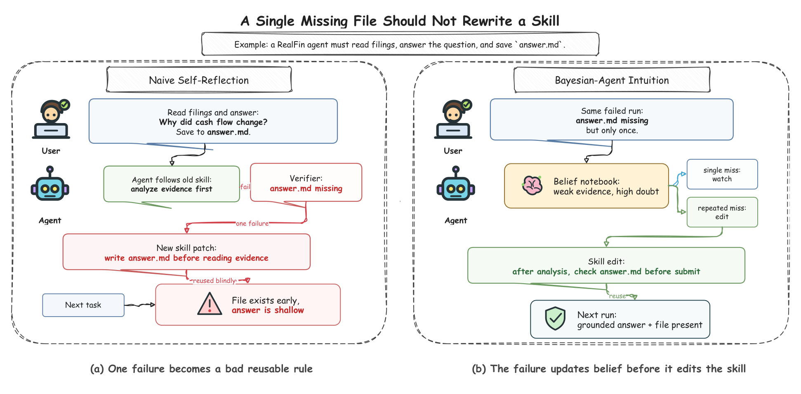
*图 1：稀疏技能证据的动机示例。(a) 朴素自反思将单次缺失 `answer.md` 的失败直接改写为“先写文件再读证据”的有害规则；(b) Bayesian-Agent 先更新信念账本（单次失败仅观察，多次失败才修补），确保最终产出的护栏既解决文件缺失又保证论证深度。*

论文通过 **RealFin-Bench** 上的真实案例（图 1）揭示了当前自演化流水线的两种典型病灶：
- **病灶一：过度反应（Overreaction）**。如图 1(a) 所示，Agent 遵循旧 Skill“先分析财报证据，再回答现金流变化并保存到 `answer.md`”，某次运行中因上下文过长忘记创建 `answer.md`，验证器报错 `answer.md missing`。朴素反思器立刻把这条报错总结为一条新规则：“**在阅读证据之前先把 `answer.md` 写好**”。结果在下一个任务中，Agent 一上来就写了个空洞的 `answer.md`，文件虽然存在了，答案却极度浅薄。
- **病灶二：无平滑的点估计震荡**。如果不用自然语言反思，而改用简单的“成功次数/总次数”统计（即原始经验频率 $q_F = S/n$），在 $n=1$ 时一次失败就会让可靠性瞬间归零，系统既无法区分“1 次失败（$\beta=1$，不确定性极高）”与“20 次失败（$\beta=20$，确凿缺陷）”，也无法在稀疏观测下做出克制的演化决策。

---

## 二、核心方法与数学直觉深度拆解

### 2.1 问题形式化：统一推理环境与受限动作空间
作者将固定参数模型 $M_\theta$ 在任务 $t$ 时所处的外部推理环境形式化为一个四元组：

$$C_t = (P_t, R_t, A_t, V_t) \tag{1}$$

- $P_t$：提示词与可复用技能文本（Prompt + Skill）；
- $R_t$：检索或记忆上下文（Retrieved / Remembered Context）；
- $A_t$：工具与动作接口（Tools + Actions）；
- $V_t$：外部验证器或反馈通道（Verifier / Feedback）。

在这一视角下，Prompt 工程、上下文工程与 Harness 工程不再是互不相干的零散技巧，而是**对同一个条件决策环境 $C_t$ 的联合干预**。给定任务 $x_t$、技能 $h_k$ 以及执行前可见的任务/框架签名 $z_t^-$，该技能的局部可靠性定义为：

$$p_{k,t} = P(y_t = 1 \mid M_\theta, C_t, h_k, z_t^-) \tag{2}$$

其中 $y_t \in \{0, 1\}$ 是**外部验证器**给出的二值成败结果。系统根据当前信念状态 $B_t$，在一个**受限且保守的技能动作集 $\Delta$** 中选择最优干预 $\delta_t^\star$，在最大化预期成功率的同时控制上下文成本：

$$\delta_t^\star = \arg\max_{\delta \in \Delta} \mathbb{E}_{B_t}\left[ P(y_t = 1 \mid M_\theta, C_t^\delta, h_k, z_t^-) - \lambda_{\text{cost}}\,\text{Cost}(C_t^\delta) \right] \tag{3}$$

---

### 2.2 理论基石：为什么“显式贝叶斯后验”在有限样本下更稳？（偏差–方差权衡）
这是全篇最核心的理论支撑（第 3.2 节与附录 B）。考虑单个局部技能单元 $\omega = (h_k, z)$，设其真实未知成功概率为 $\theta_\omega$。在 $n$ 次独立同分布的已验证伯努利试验中观测到 $S$ 次成功：
- **频率学派原始比率估计**：$q_F = \frac{S}{n}$（当 $n=0$ 时甚至无定义）。它是无偏的（$\mathbb{E}[q_F] = \theta_\omega$），但方差很大：$R_F(\theta_\omega) = \frac{\theta_\omega(1-\theta_\omega)}{n}$。
- **贝叶斯 Beta 后验均值**：先验设 $\theta_\omega \sim \text{Beta}(\alpha_0, \beta_0)$，令 $A = \alpha_0 + \beta_0$，则后验均值为：

$$q_B = \mathbb{E}[\theta_\omega \mid S, n] = \frac{\alpha_0 + S}{\alpha_0 + \beta_0 + n} \tag{5}$$

其固定参数均方风险（MSE）可以精确分解为**方差项 + 偏差平方项**：

$$R_B(\theta_\omega) = \mathbb{E}[(q_B - \theta_\omega)^2 \mid \theta_\omega] = \underbrace{\frac{n\theta_\omega(1 - \theta_\omega)}{(A + n)^2}}_{\text{更低的采样方差}} + \underbrace{\frac{(\alpha_0 - A\theta_\omega)^2}{(A + n)^2}}_{\text{向先验均值收缩的偏差}} \tag{6}$$

**关键结论（何时贝叶斯严格更优？）**：  
在默认均匀先验 $(\alpha_0, \beta_0) = (1, 1)$（即完全不偏不倚的先验）下，论文推导出：

$$R_B(\theta_\omega) \le R_F(\theta_\omega) \iff \theta_\omega(1 - \theta_\omega) \ge \frac{n}{8n + 4} \iff \theta_\omega \in [\ell_n, u_n] \tag{7}$$

其中 $\ell_n = \frac{1 - \sqrt{(n+1)/(2n+1)}}{2},\; u_n = \frac{1 + \sqrt{(n+1)/(2n+1)}}{2}$：
- 当 **$n = 1$** 时，该优势区间高达 **$[0.092, 0.908]$**——也就是说，只要技能的真实成功率不是极端地低于 $9.2\%$ 或高于 $90.8\%$，仅凭 1 个样本时，贝叶斯收缩估计的均方误差就严格小于原始频率！
- 随着 **$n \to \infty$**，区间收敛至 **$[0.146, 0.854]$**。
- **边界诚实性**：作者明确指出，贝叶斯并非“无条件碾压”——当真实成功率 $\theta_\omega$ 极端接近 $0$ 或 $1$ 且先验失配时，原始经验频率反而偏差更小；但在存在不确定性的稀疏中间区域，后验收缩能有效防止单次观测把决策拉向极端。

---

### 2.3 系统架构与“审计层 vs. 模型上下文层”隔离
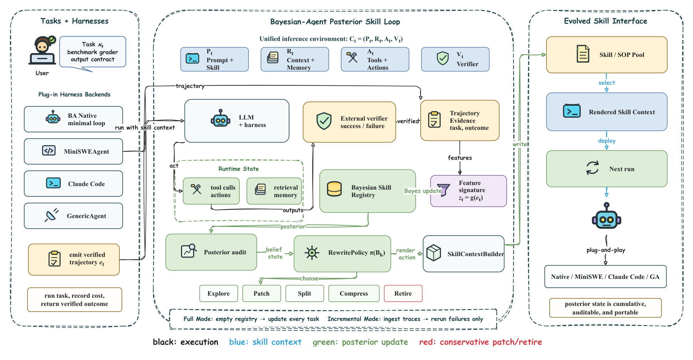
*图 2：Bayesian-Agent 架构图。左侧为可插拔的多种执行框架后端（BA Native / MiniSWEAgent / Claude Code / GenericAgent）；中间为后验技能循环；右侧为演化后的技能接口。注意黑色（执行）、蓝色（技能上下文）、绿色（后验更新）、红色（保守修补/退役）的职责边界。*

#### 1. 轨迹证据表示与时间因果边界
Bayesian-Agent **绝不采信模型自评**，只摄入外部验证器返回的轨迹九元组：

$$e_t = (x_t, h_k, c_t, y_t, u_t, \tau_t, \ell_t, r_t, m_t) \tag{8}$$

其中包含任务 $x_t$、所用技能 $h_k$、上下文类别 $c_t$、外部验证结果 $y_t \in \{0,1\}$、总 Token 开销 $u_t$、轮次 $\tau_t$、耗时 $\ell_t$、**验证器推导出的失效模式 $r_t$** 以及标量元数据 $m_t$。验证完成后映射为紧凑的离散特征签名：

$$z_t^+ = g(e_t) = \left(c_t, r_t, b_u(u_t), b_\tau(\tau_t), b_\ell(\ell_t), m_t^{\le 80}\right) \tag{9}$$

这里有一个严谨的工程设计：**时间因果边界（$z_t^-$ vs. $z_t^+$）**。在当前任务执行**之前**，只能查询任务前可用特征 $z_t^-$；只有当任务执行完毕并经过外部验证**之后**，失效模式 $r_t$ 与开销分桶 $b_u, b_\tau, b_\ell$ 才作为执行后证据 $z_t^+$ 写入后验，避免数据泄漏或因果倒置。

#### 2. 类别型贝叶斯证据模型 + 共轭 Beta 审计摘要
系统维护两套互补的后验统计：
1. **因子化类别型后验（用于上下文条件选择）**：在拉普拉斯平滑 $\lambda = 1$ 下，分别统计技能在不同结果 $\ell \in \{0,1\}$ 下的边际概率 $\pi_{k,t}(\ell)$ 与各离散特征取值的条件概率 $\theta_{k,j,t}^{(\ell)}(z_j)$，并在对数空间计算特征条件成功率 $s_{k,t}(z)$（公式 10–13）。
2. **共轭 Beta 摘要（用于审计与失败主导判断）**：直接累计成功与失败伪计数 $\alpha_{k,t} = \alpha_0 + \sum \mathbb{1}[y_i=1]$、$\beta_{k,t} = \beta_0 + \sum \mathbb{1}[y_i=0]$。

**关键工程原则**：所有 $\alpha, \beta, s_{k,t}$ 数值**只保存在后端的审计注册表（Audit State）中**，绝不直接把一堆概率数字塞进 LLM 的 Prompt 里；`SkillContextBuilder` 只根据选定的动作，渲染出干净的、可执行的护栏与失效补丁（`skill_context.md`）。

#### 3. 五种显式、可审计的技能动作策略 $\pi(B_k)$
后验状态 $B_k$ 按如下**固定优先级顺序**（公式 15 / 表 5）映射为 5 种可审计动作：

| 优先级 | 动作 | 触发条件（默认阈值） | 物理意义与具体操作 |
| :---: | :--- | :--- | :--- |
| **1** | **Explore（探索）** | $\|D_k\| = 0$ | 尚无观测记录，保持基线技能不变，先收集初始证据 |
| **2** | **Retire（退役）** | $\beta_k \ge 4 \land s_k(\emptyset) < 0.45$ | 失败次数达 4 次以上且无条件成功率低于 45%，说明现有技能方向性失效，发出**退役/重新设计**信号 |
| **3** | **Patch（修补）** | $\max_r F_k(r) \ge 2$ | 同一失效模式 $r$ 至少被外部验证器抓到 **2 次**，才将针对该失效模式的补丁注入模型上下文 |
| **4** | **Split（拆分）** | $\|C_k\| \ge 3 \land \|D_k\| \ge 4$ | 观测跨越至少 3 种不同上下文且总数 $\ge 4$，说明单一技能涵盖场景过于异质，建议拆分 |
| **5** | **Compress（压缩）** | $\|D_k\| \ge 3 \land s_k(\emptyset) \ge 0.72$ | 已有 $\ge 3$ 次观测且成功率 $\ge 72\%$，说明技能稳定可靠，保持指令紧凑，拒绝画蛇添足的冗长重写 |
| **6** | **Explore（兜底）** | 其他情形 | 证据尚不足以触发上述任何强动作，继续观察 |

#### 4. 全量模式（BA-Full）vs. 增量修复模式（BA-Inc）
- **BA-Full（全量在线演化）**：注册表从空（$B \leftarrow \emptyset$）起步，按顺序每跑完一个任务就更新后验并动态调整后续任务的技能上下文。
- **BA-Inc（增量靶向修复）**：先直接读取一次已完成基线运行的全部已验证轨迹 $R_0$ 来初始化后验注册表，然后**只把基线中失败的任务 $T' = \{x \in T : x \text{ failed in } R_0\}$ 挑出来**，注入后验生成的修复护栏进行重跑！

---

## 三、实验验证、消融分析与反直觉发现

论文在三大高难度 Agent 基准上进行了系统评测：**SOP-Bench**（工业级多步标准操作规程）、**Lifelong AgentBench**（跨任务序列化经验复用）、**RealFin-Bench**（存在隐含/缺失前提的真实金融推理）。

### 3.1 核心控制实验：贝叶斯后验 vs. 原始经验频率（表 1 & 图 3）
在 RealFin-Bench（40 题）从零开始的对照实验中，固定其他一切条件，仅把贝叶斯后验替换为无平滑的原始经验频率 $S/n$：

| 后端 | 模型 | 方法 | 准确率$\uparrow$ | 成功数$\uparrow$ | 总 Token$\downarrow$ | 效率（题/M Token）$\uparrow$ |
| :--- | :--- | :--- | :---: | :---: | :---: | :---: |
| GA | `flash` | Bayesian | 52.5% | 21/40 | 3.15M | 6.67 |
| GA | `flash` | Raw freq. | 52.5% | 21/40 | 3.31M | 6.35 |
| GA | `pro` | Bayesian | 65.0% | 26/40 | 3.70M | 7.02 |
| GA | `pro` | Raw freq. | 57.5% | 23/40 | 3.77M | 6.10 |
| **Native BA** | `flash` | **Bayesian** | **70.0%** | **28/40** | 10.89M | 2.57 |
| **Native BA** | `flash` | Raw freq. | 37.5% | 15/40 | 4.03M | 3.72 |
| **Native BA** | `pro` | **Bayesian** | **70.0%** | **28/40** | 9.91M | 2.83 |
| **Native BA** | `pro` | Raw freq. | 45.0% | 18/40 | 4.16M | 4.32 |

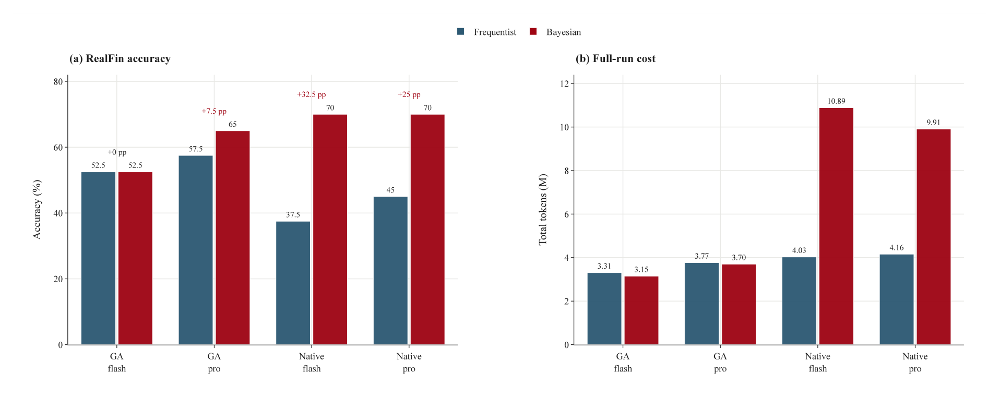
*图 3：RealFin-Bench 上的贝叶斯与原始频率控制实验对比。(a) 完成准确率与增益标注；(b) 全流程 Token 开销对比。*

**反直觉洞察——为什么原始频率的“效率数字（Efficiency）”反而更高？**  
看表 1 最后四行：Native BA 下，Raw freq. 的每百万 Token 解题数（3.72 / 4.32）看似高于 Bayesian（2.57 / 2.83），但准确率却惨跌了 **32.5%** 和 **25.0%**！结合附录 H（图 7）的任务级归因可知：原始频率控制器因为缺乏先验平滑，在早期遇到几次失败后丢弃或错改了关键护栏，导致大量任务**在还没算出结果、还没创建目标输出文件时就早早崩溃退出**，看似省了 Token，实则全军覆没；而 Bayesian-Agent 坚持保留了文件创建、缓存读取、空行过滤与格式校验等后验加权护栏，多花推理预算把尝试真正转化成了有效产物。

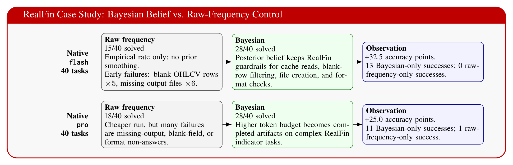

---

### 3.2 主实验与“增量修复优于全量演化”现象（表 2 & 图 5）
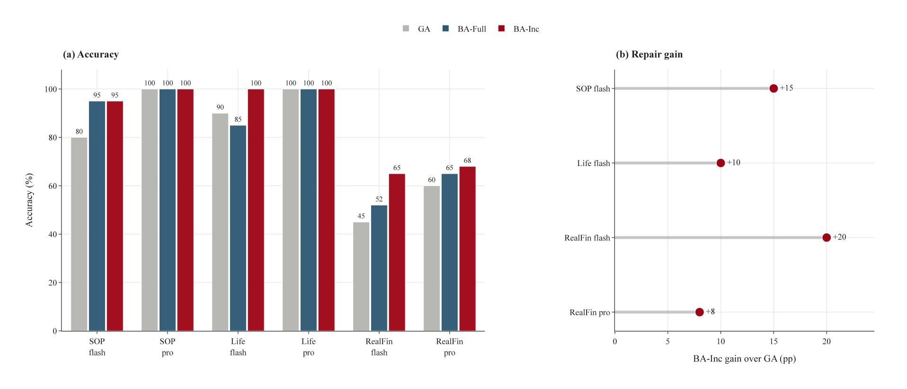
*图 5：(a) GA、BA-Full 与 BA-Inc 在三大基准与两款 DeepSeek 模型上的准确率矩阵；(b) BA-Inc 相对 GA 基线的最终准确率增益及修复比例（修复成功数 / 基线失败数）。*

从主实验（表 2）与图 5 可以提炼出两条极有价值的工程规律：
1. **增量修复（BA-Inc）全面优于全量在线演化（BA-Full）**：在 `deepseek-v4-flash` 下，BA-Inc 将 SOP-Bench 从 80% 推至 **95%**（仅耗 153k 修复 Token），Lifelong AgentBench 从 90% 推至 **100%**（仅耗 84k 修复 Token），RealFin-Bench 从 45% 推至 **65%**（`pro` 下达 **68%**）。
2. **在线演化的非单调性风险**：在 Lifelong AgentBench (`flash`) 上，BA-Full 反而比 GA 基线降了 5 个百分点（90% $\to$ 85%），而 BA-Inc 稳稳达到 100%。原因在于从零开始的在线演化早期样本极少，前几个任务的偶然序列可能触发非最优的上下文变动；而 BA-Inc 先用全量基线轨迹把后验“喂饱”，再精准重跑失败题，既避免了退化，又省去了对已成功任务的重复开销。

---

### 3.3 跨框架阶梯消融：不是模型越贵越好，而是契约匹配（表 3 & 图 4）
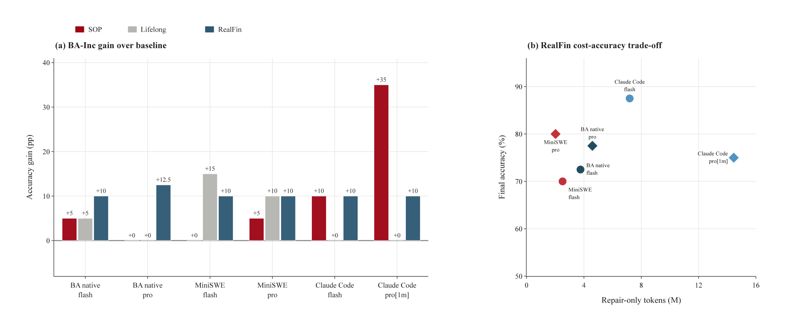
*图 4：(a) 各后端（BA Native / MiniSWEAgent / Claude Code）上 BA-Inc 相对各自基线的准确率增益；(b) RealFin 上“仅修复 Token 开销”与“最终准确率”的帕累托权衡散点图。*

作者沿**框架复杂度阶梯（BA Native $\to$ MiniSWEAgent $\to$ Claude Code）**做了完整全样本消融（表 3 与附录 D 表 6–8）：
- 在 RealFin-Bench 上，BA-Inc 在三个完全不同的 Harness 上均实现稳定提分：BA Native 达 `72.5% / 77.5%`，MiniSWEAgent 达 `70.0% / 80.0%`，Claude Code 达 `87.5% / 75.0%`（flash / pro）。
- **成本与契约权衡**：虽然 `Claude Code + flash` 拿到了全场最高的 **87.5%**，但它基线就烧掉了 **49.41M** Token，修复阶段又烧了 **7.19M** Token；相比之下，**`MiniSWEAgent + pro` 仅用 2.02M 修复 Token 就拿到了 80.0% 的高分**，是性价比最优的增量修复组合。

---

### 3.4 模型规模消融与“适配器契约瓶颈”（表 9 & 图 6）
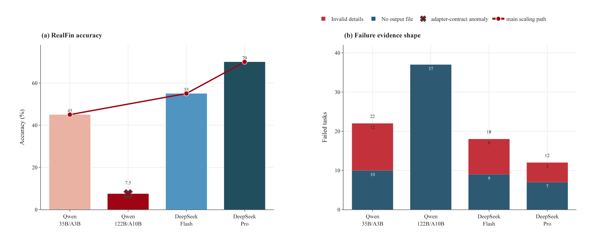
*图 6：(a) MiniSWEAgent + BA-Full 在 RealFin-Bench 上的模型规模扩展曲线；(b) 失败任务的形态拆解（蓝色为“根本没生成输出文件”，红色为“生成了文件但未通过验证细节”）。*

在固定 MiniSWEAgent 与 BA-Full 的模型缩放实验中（表 9）：
- `qwen3.5-35b-a3b`（45.0%）$\to$ `deepseek-v4-flash`（55.0%）$\to$ `deepseek-v4-pro`（70.0%）呈现出清晰的模型能力缩放收益；
- 但参数量更大的 **`qwen3.5-122b-a10b` 却暴跌至 7.5%（仅 3/40）**！图 6(b) 揭示了真相：**它的 37 次失败中，整整 37 次全部都是 `No File`（未按约定在工作区生成输出文件）**！这证明了一个极其关键的工程定律：**大模型推理能力只有在 Harness 契约能够将其行为转化为可验证产物时，才能促进技能演化；一旦发生适配器契约失配，换更大模型也无济于事。**

---

### 3.5 任务执行顺序鲁棒性（表 10）
尽管 Beta 后验更新对固定的成功/失败多重集满足数学上的**置换不变性（Permutation Invariance）**，但因为技能演化是一个**闭环系统**——早期任务触发的 `Patch` 会改变后续任务的上下文，进而改变后续轨迹的生成路径——所以作者专门做了任务序列重排实验（Table 10）。结果显示，打乱任务顺序后，Native BA (`flash`) 在 SOP-Bench 和 Lifelong AgentBench 上依然保持 **100%**，RealFin-Bench 仅变动 1 题（28/40 $\to$ 27/40），总准确率从 **85.0% 微调至 83.8%**，仍大幅领先频率学派对照组 **17.5 个百分点**。

---

## 四、真实文本级演化案例全景还原（附录 I）

为了证明 Bayesian-Agent 绝非黑盒，作者在附录 I 中公开了三大基准的真实演化轨迹（图 8）以及演化前后注入模型的完整 `skill_context.md` 原文（图 9–11）：

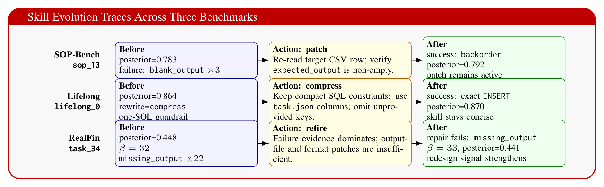
*图 8：SOP-Bench 的 Patch 轨迹、Lifelong AgentBench 的 Compress 轨迹，以及 RealFin-Bench 的 Retire/Redesign 信号轨迹。*

1. **Patch（靶向修补）—— SOP-Bench `sop_14`（图 9）**：  
   验证器连续 3 次抓到同一失败模式 `left_expected_output_blank`（漏填目标 CSV 单元格）。系统在模型上下文顶部渲染出精准补丁（`observed=3 -> 4`）：要求 Agent 写完 `test_set_with_outputs.csv` 后**必须重新读取并确认目标行的 `expected_output` 非空**，否则写入计算好的原始类别字符串（如 `backorder`）。修复后任务立刻通过，后验升至 `0.792`。
2. **Compress（稳定压缩）—— Lifelong AgentBench `lifelong_0` & `lifelong_12`（图 10）**：  
   当 SQL 技能后验已高达 `0.864 -> 0.870` 时，策略选择 `compress`，**拒绝做冗余重写**，仅保留紧凑的 6 条 SQL 护栏（只写一条 SQL 到 `answer.sql`、禁止跨任务目录窥探、禁止自加主键等）；而当后续在 `lifelong_12` 出现 2 次 `wrote_transcript_instead_of_sql_after_workspace_confusion` 失败时，系统才精准追加一条“禁止输出执行记录文本”的补丁。
3. **Retire（退役/重设计信号）—— RealFin-Bench `task_34` & `task_16`（图 11）**：  
   `task_34_etf_constituent_arbitrage` 累计已有 56 次观测，其中 `β = 32` 且 `missing_output` 高达 22 次，后验跌至 `0.448 < 0.45`，触发 **`Retire`（退役）**动作——明确告知开发者“仅靠微调输出文件/格式补丁已救不回来，需要重构任务工具链或技能设计”。而在 `task_16` 中，当 `missing_requested_output_file` 累计到 `observed=2` 时，系统自动补上了“即使没有符合条件的股票，也必须创建带空结果说明的 `.txt` 文件”（图 11）。

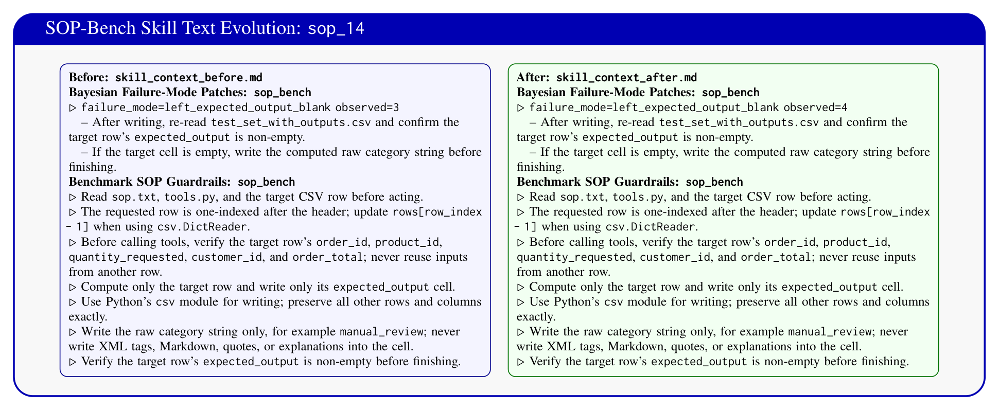
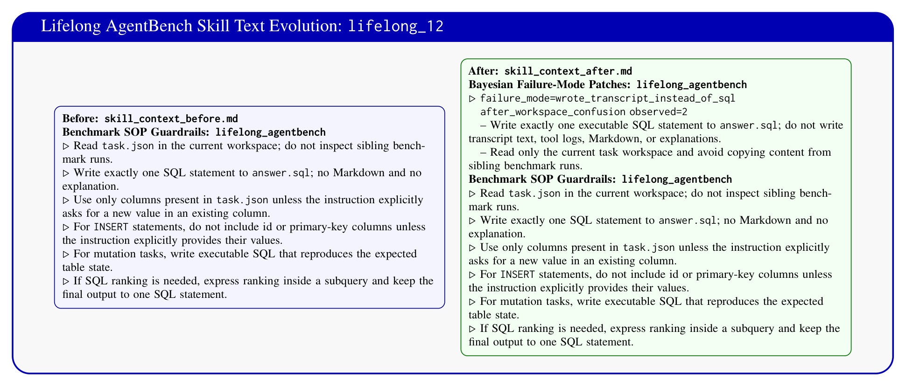
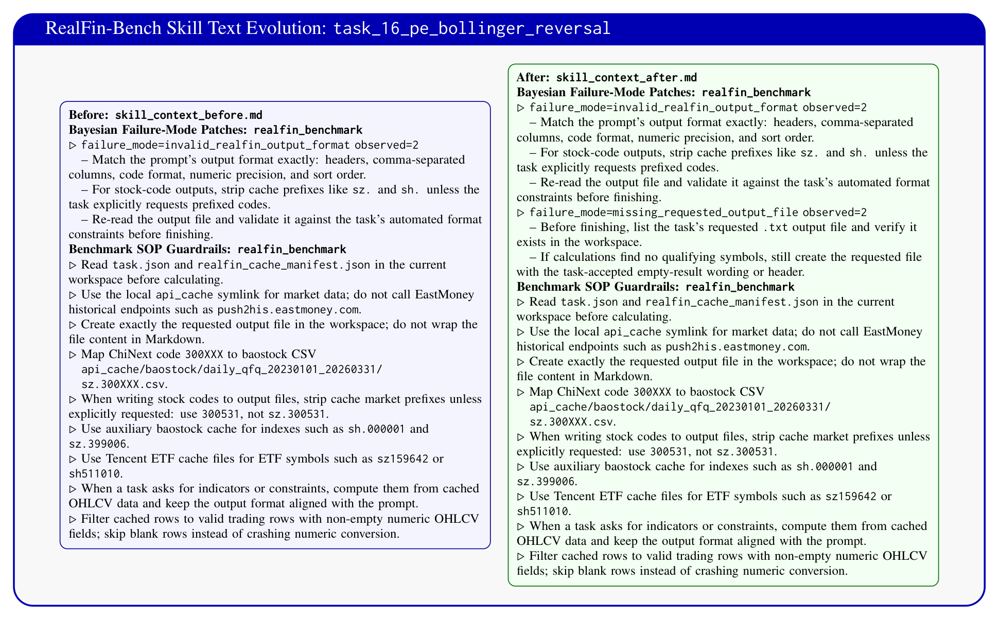

---

## 五、局限性、适用边界与工程落地指南

### 5.1 论文承认的边界与局限
- **适用场景边界**：最适合**有明确外部验证器、存在可恢复的程序化重复失败、且 Harness 暴露可控 Skill 接口**的重复性任务；不适合一次性主观任务、高度非平稳环境，或因外部工具/数据源本身不可用导致的失败。
- **模型简洁性**：默认证据模型是带拉普拉斯平滑的因子化朴素贝叶斯，尚未引入完整贝叶斯结构学习或在线上下文赌博机（Contextual Bandits）动态调参。

### 5.2 给 Agent Harness 工程师的 4 条落地准则
1. **用“外部验证 + 重复计数阈值”替代单次反思**：任何自动写入 Skill/Memory 的规则，必须绑定外部可验证结果，并设置最小重复次数门限（如 $F_k(r) \ge 2$），用贝叶斯先验过滤偶发噪音。
2. **严格隔离“审计账本”与“模型上下文”**：把 $\alpha, \beta$、失败分布和触发原因留在后端数据库/JSON 中供人类审计，只向 LLM 注入极简的可执行护栏，防止统计数字污染模型注意力。
3. **生产环境优先上 BA-Inc（增量修复）**：先跑一轮基线攒够初始后验，再针对失败样本做增量修复，性价比与稳定性远高于从零开始的纯在线演化。
4. **先修“产物契约”，再谈“模型缩放”**：上线新模型或新 Harness 前，先用小样本排查 `No File` / 格式不合规等 Adapter-Contract 故障；否则模型越大，产出的无效垃圾证据越多。
