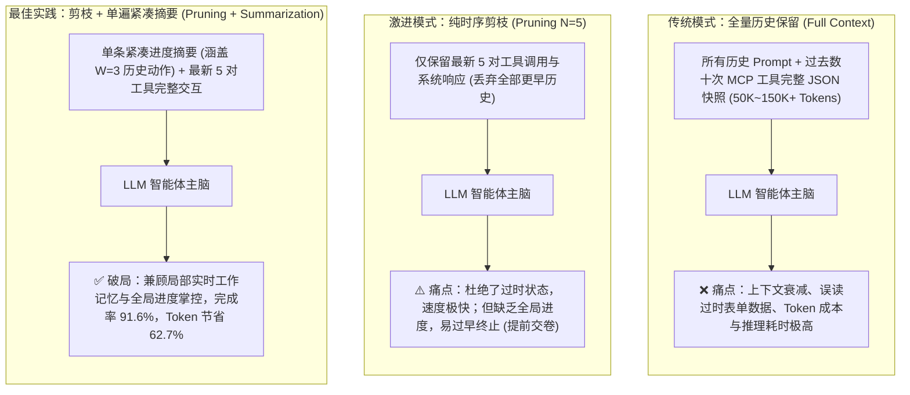
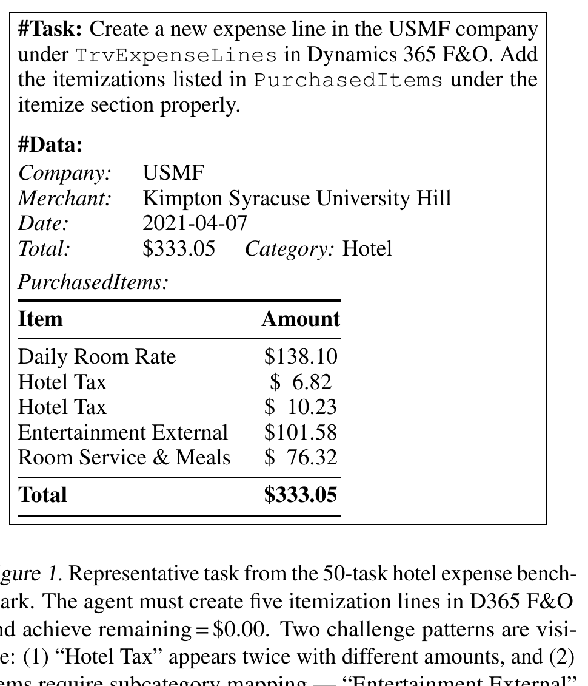
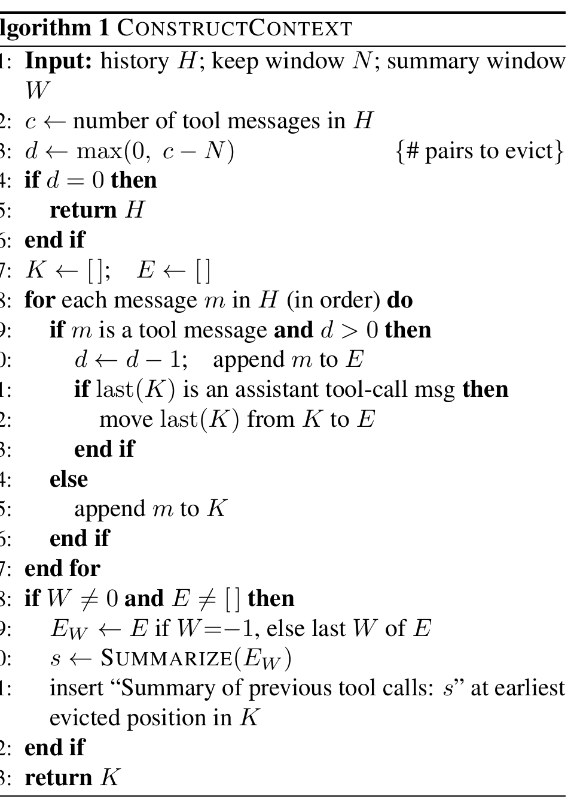
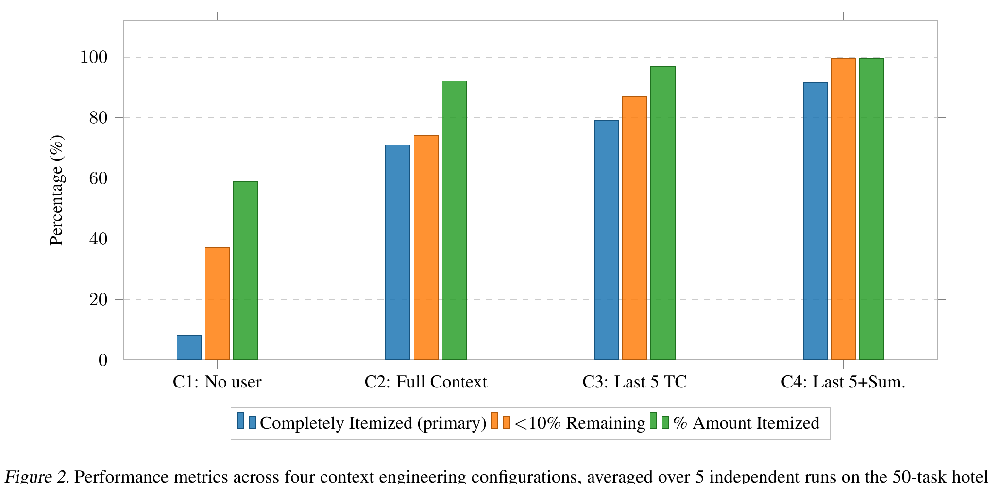
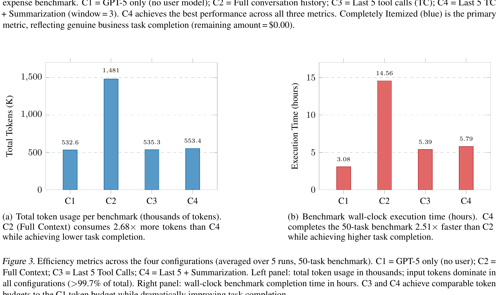

# Less Context, Better Agents：长程工具调用智能体的高效上下文工程

> **论文题目**：Less Context, Better Agents: Efficient Context Engineering for Long-Horizon Tool-Using LLM Agents  
> **论文作者**：Abhilasha Lodha$^*$, Mahsa Pahlavikhah Varnosfaderani, Abir Chakraborty, Abhinav Mithal  
> **研究机构**：微软总部 (Microsoft) / Microsoft Dynamics 365 AI 团队  
> **发表时间**：2026 年 6 月 (arXiv:2606.10209)  
> **核心主题**：长程智能体（Long-Horizon Agents）、工具调用（Tool Use）、模型上下文协议（Model Context Protocol, MCP）、上下文工程（Context Engineering）、上下文衰减（Context Rot）、企业级 ERP 自动化  
> **交付物归档**：
> - 完整研读报告 Markdown：[2606.10209_ContextEngineering_中文综述.md](./2606.10209_ContextEngineering_中文综述.md)
> - 官方编译 17 页完整论文 PDF：[Less_Context_Better_Agents.pdf](./Less_Context_Better_Agents.pdf)
> - 高分辨率原版配图资产：[`综述配图/`](./综述配图/)
> - 完整 LaTeX 源码工程：[`source/`](./source/)

---

## 0. 三分钟读懂（Executive Summary）

### 0.1 直觉类比：为什么“少即是多”？
想象一位在大型企业财务科负责复杂报销的资深会计。如果这位会计工作时把**过去所有翻阅过的账本废页、旧表单草稿全部摊在办公桌上**（对应传统智能体的 **Full Context** 全量历史保留模式）：
1. **视线被大量垃圾信息淹没**：他在每次做下一笔账前，都必须把桌上几十页旧草稿从头到尾扫视一遍（消耗天量输入 Token，处理速度极慢）；
2. **产生致命的“过时记忆混淆”**：他在录入第 5 笔款项时，眼睛很可能会瞟到 5 步之前旧表单上未扣减的旧余额（例如 \$420），误以为那是最新数字，从而重复录入导致平账彻底崩溃；
3. **更聪明的现代工作法**：这位会计桌上**只保留最近两笔操作的原始凭证**（剪枝 $N=5$ 对工具交互），并在左上角贴一张**小黄便利贴**，上面只简明写着“*已完成报销单创建，已录入房费 \$180 与住宿税 \$14.4*”（紧凑摘要 $W=3$）。这样他既能看清手头正在做的事，又清楚整体进度走到哪里，做账既快、又准、绝不漏算！

### 0.2 五个最硬核的实验结论数据
1. **端到端完全交割率断崖式提升**：在真实微软 Dynamics 365 Finance and Operations（D365 F&O）的 50 项企业级酒店费用核销测试集上，剪枝结合摘要策略（C4）将任务完全成功率从全量历史（C2）的 **71.0%** 跃升至 **91.6%**（绝对提升 **+20.6 个百分点**），平均金额核销率达到惊人的 **99.64%**。
2. **Token 消耗狂砍六成以上**：整个基准测试消耗的 Token 总量从全量历史的 **148.1 万**（1,480,996）锐减至 **55.3 万**（553,374），**输入 Token 降幅高达 62.7%**。
3. **执行端耗时缩减 60.2%**：全量历史跑完 50 个复杂报销任务需耗费 **14.56 小时**，而优化后的上下文工程方案仅需 **5.79 小时**，端到端吞吐速度提升 **2.51 倍**。
4. **过时状态（Stale-State）错误彻底扑灭**：全量历史保留诱发的“读取过时表单快照”导致的错误高达 **34 次**，在上下文工程优化后骤降至 **4 次**（降幅达 **88.2%**）。
5. **黄金超参数膝点验证**：剪枝窗口 $N=5$、摘要窗口 $W=3$ 是严密的系统膝点（Knee Point）。盲目扩大窗口（$N=10$ 或全量历史摘要）会导致 Token 暴增 50% 以上，却带来 0 精度提升；过紧的窗口（$N=3$ 或 $W=1$）则会导致智能体丧失大局观而过早交卷。

### 0.3 核心机制对比总览



---

## 1. 研究动机与背景痛点

将大型语言模型（LLM）部署为端到端执行企业复杂业务流的自主智能体（Autonomous Agents）是当前 AI 工业落地的兵家必争之地。然而，当智能体深入到诸如 ERP（企业资源计划系统）、CRM 或核心数据库等重型企业软件中时，面临着一道严峻的技术鸿沟：

### 1.1 企业级 MCP 工具返回的“信息洪峰”
现代智能体普遍通过**模型上下文协议（Model Context Protocol, MCP）**代理与 ERP 系统交互。与轻量级天气查询或网页搜索不同，企业 ERP 系统的表单返回天然是**极度冗长且高结构化的（Verbose State Snapshots）**：
- 单次工具交互往往包含当前页面的全部表单控件树、嵌套的表格行元数据、字段校验状态、下拉枚举项以及面包屑导航路径；
- 单次 MCP 工具响应即消耗 **500 至 3,000 个 Token**；
- 一项需要拆解 4 至 23 个明细科目的复杂报销任务，通常需要 **15 至 30 轮**深入交互，累计上下文迅速累积至 **50,000 至 150,000+ Token**。

### 1.2 上下文衰减（Context Rot）与“过时状态幽灵”
业界普遍直觉认为“长上下文模型能力越强，保留越多历史信息越安全”。但论文尖锐指出，在企业长程工作流中，**旧上下文不仅冗余，而且具有强烈的破坏性**：
- **有效注意力衰减（Context Rot）**：随着输入 Token 长度膨胀，即便是顶尖的前沿基座模型，其在庞大 Prompt 中的有效检索定位与推理精准度也会急剧下滑；
- **状态变迁的时空混淆（Stale-State Errors）**：企业 ERP 是动态演变的状态机。智能体在前几轮交互中读取的表单快照（如未核销余额 \$500）在完成部分录入后已经被系统废弃。但在全量历史模式下，这些已被废弃的快照依然一清二楚地悬挂在上下文深处。模型在后续步骤中经常发生注意力漂移，误将旧快照的金额和控件状态拿来作为当前行动的依据，造成重复建行、金额错配等致命失误。

### 1.3 财务业务场景中的“零残差（Zero Residual）”硬指标
在微软 Dynamics 365 Finance and Operations（D365 F&O）的差旅费用明细化（Expense Itemization）业务中，企业合规要求具有极端的刚性约束：
- 每一笔总账发票金额，必须被精确拆分到对应的子科目中（例如每日房费、客房增值税、城市非客房税、会议室租金、送餐服务等）；
- **最终系统未核销金额（`remaining_amount`）必须严格等于 \$0.00**；
- 哪怕智能体成功核销了 99% 的项目，只要残余 \$0.37，在生产环境中该报销单就无法提交结算，系统直接判定为失败并转入昂贵的人工审计流程。

### 1.4 现有长文本优化技术的死穴
面对这一问题，现有的技术方案均存在水土不服：
- **Token 级提示词压缩（如 LLMLingua、Selective Context）**：在词元粒度上删除所谓“低信息熵”的 Token。这在自然语言问答中有效，但在严谨的企业表单中，极易误删控制字段名称、控件 ID 或破坏小数点数字，导致格式解析崩溃；
- **外部检索增强记忆（如 MemoryBank、LongMem）**：侧重于多轮跨会话的外部事实检索，无法解决单会话中高频更迭的工作记忆与状态机同步问题；
- **学习型压缩器（如 ACON）**：需要额外的失败轨迹数据蒸馏出专门的小模型，工程接入复杂度高且与基座模型强绑定。

---

## 2. 核心系统架构与上下文工程算法

为了在不微调模型、纯推理期（Inference-time Only）解决长程智能体的上下文膨胀难题，微软团队系统性地提出了面向工具调用智能体的**语义级上下文工程策略（Semantic-Level Context Engineering）**。

### 2.1 整体评测系统架构

系统由四个高度解耦的核心组件构成：
1. **主执行智能体（GPT-5 Agent）**：负责业务逻辑规划与工具调用决策，内置完整的 D365 F&O 费用核销规范及 23 项科目枚举映射规则；
2. **虚拟用户模型（User Model, GPT-4.1）**：作为会话参与者模拟真实业务员，解决无人值守离线评测（Non-interactive Evaluation Harness）中，GPT-5 因自主停顿提出确认疑问时无人工回复而卡死的问题；
3. **D365 F&O MCP 服务端**：公开了 21 个标准 MCP 工具，划分为三大类：
   - **表单交互工具（Form Tools, 13 个）**：页面与 Tab 导航、控件值读写、弹窗查找、表格网格过滤、行选择、按钮点击与表单保存；
   - **实体数据工具（Data Tools, 6 个）**：针对 F&O 底层实体的 OData CRUD 操作；
   - **服务端动作工具（API Tools, 2 个）**：发现并调用服务端动作菜单项。
4. **独立自动化评测 Harness**：负责驱动交互循环、应用上下文构建算法，并在任务结束后**直接从 ERP 数据库回读表单物理持久化状态**进行客观评测，严禁采纳智能体的自述总结。

<p align="center">
  
  <br>
  <em>图 1：基准测试中的典型任务卡片（展示重复科目项与严格映射挑战）</em>
</p>

从图 1 可以看出企业级核销的两大典型阻碍：
- **相同科目多行重复出现**：发票上包含两笔不同税率的 `Hotel Tax`（\$6.82 与 \$10.23），智能体必须按顺序录入且不能因为已添加过就跳过第二笔；
- **非平凡子科目映射**：发票文本 `Entertainment External` 必须被准确映射到 ERP 枚举 `Business entertainment`，`Room Service & Meals` 必须映射为 `Room service`。

---

### 2.2 上下文构建算法：Algorithm 1 (ConstructContext)

论文的核心创新在于将上下文管理的操作单元从传统的“Token 粒度”提升到**“工具调用/响应对（Tool Call / Response Pair）”的语义单元**。

<p align="center">
  
  <br>
  <em>图 2：论文提出的动态上下文构建算法 Algorithm 1 源码实现</em>
</p>

#### 算法关键逻辑推演：
设当前会话全部历史消息列表为 $H$，保留窗口参数为 $N$（最近 $N$ 对工具调用），摘要窗口参数为 $W$。
1. **统计工具交互对**：统计 $H$ 中包含的工具响应消息总数 $c$。需要从历史中剔除的超额对数为：
   $$d = \max(0,\, c - N)$$
2. **原子化成对剔除（Atomic Pair Eviction）**：
   按时间正序遍历历史消息。当遇到属于待剔除配额（$d > 0$）的工具响应消息 $m$ 时，**不仅将 $m$ 移入被剔除集合 $E$，同时强制将其在保留列表 $K$ 中紧邻的前一个助手工具调用消息 $\mathrm{last}(K)$ 一并移入 $E$**。
   > **设计精髓**：绝对不单独丢弃工具响应而留下孤立的助手调用，反之亦然。这完全符合现代 LLM（如 OpenAI/Anthropic 工具调用协议）对消息成对存在的语法约束，杜绝 API 报格式错误。
3. **单遍局部摘要插入（Local Summarization）**：
   若 $W \neq 0$ 且被剔除集合 $E$ 非空：
   - 截取 $E$ 中最近的 $W$ 条被剔除消息（若 $W=-1$ 则提取全部 $E$）；
   - 发起一次轻量级单遍 LLM 调用：$s \leftarrow \textsc{Summarize}(E_W)$；
   - 在保留列表 $K$ 最早被剔除的位置，插入一条结构化系统/助手消息：`"Summary of previous tool calls: " + s`。

---

### 2.3 四大实验对比配置矩阵

为了严密剥离不同因子的独立贡献，论文精心设计了渐进式配置对比链条：

| 配置代号 | 架构设定 | 历史上下文策略 | 设计定位与验证目的 |
| :--- | :--- | :--- | :--- |
| **C1** | GPT-5 (无 User Model) | 全量保留 ($N=\infty, W=0$) | **动机性消融对照**：证明在非人工交互评测框架下，GPT-5 因自主停顿需依赖协同交互 |
| **C2** | GPT-5 + User Model (GPT-4.1) | **全量保留** ($N=\infty, W=0$) | **行业现状基准线**：标准全上下文工程，作为所有优化的对照原点 |
| **C3** | GPT-5 + User Model (GPT-4.1) | **最近 5 对剪枝** ($N=5, W=0$) | **噪声消除消融**：验证抛弃陈旧表单状态对准确率与效率的直接增益 |
| **C4** | GPT-5 + User Model (GPT-4.1) | **剪枝 + 摘要** ($N=5, W=3$) | **本工作最佳实践**：验证局部宏观进度补偿能否填补纯剪枝的早停缺陷 |

> **关键实验设计哲学**：论文在 C2、C3、C4 中将 User Model 保持**完全恒定且统一存在**，从而严格控制单一变量，确保 C2 $\to$ C3 $\to$ C4 的所有性能跃升纯粹源自**上下文管理策略**本身。

---

## 3. 实验评测与多维度深度消融

评测建立在由 50 项真实酒店报销任务组成的复杂基准数据集上，每项配置均进行 **5 轮独立重复实验（Independent Runs）**，计算样本均值与离散度，以彻底杜绝评测偶发性。

### 3.1 核心质量与效率对比（主实验）

下表汇总了四种配置在完整基准测试上的端到端指标（对应论文 Table 2 与 Table 1）：

| 配置方案 | 完全核销率<br>(Comp. Item., %)<br>*(核心指标)* | 残差 <10%<br>(<10% Rem., %) | 至少完成一项<br>($\geq$1 Item., %) | 平均核销金额率<br>(%Amt Item., %) | 总消耗 Token<br>(Total Tok., K) | 输入 Token<br>(Input Tok., K) | 输出 Token<br>(Output Tok., K) | 基准总耗时<br>(Time, hrs) |
| :--- | :---: | :---: | :---: | :---: | :---: | :---: | :---: | :---: |
| **C1: 无用户模型** | 8.0% | 37.2% | 99.6% | 58.89% | 532.6 | 531.3 | 1.3 | 3.08 |
| **C2: 全量历史上下文** | 71.0% | 74.0% | **100.0%** | 92.03% | 1,481.0 | 1,478.5 | **2.5** | 14.56 |
| **C3: 最近 5 对剪枝** | 79.0% | 87.0% | **100.0%** | 96.92% | **535.3** | **532.8** | **2.5** | **5.39** |
| **C4: 剪枝 + 紧凑摘要** | **91.6%** | **99.6%** | **100.0%** | **99.64%** | 553.4 | 550.8 | 2.6 | 5.79 |

<p align="center">
  
  <br>
  <em>图 3：四种配置下的质量指标柱状图（C4 在完全核销率与金额覆盖率上均取得压倒性优势）</em>
</p>

<p align="center">
  
  <br>
  <em>图 4：系统资源效率对比：（a）总 Token 开销；（b）基准测试总耗时</em>
</p>

#### 实验现象深度解读：
1. **输入 Token 决定一切（占比 >99.7%）**：
   在所有配置中，输入 Token 占总 Token 开销的 99.75%~99.87%，输出 Token 稳定在 2.5K 左右。这意味着智能体的思考深度没有变，**削减输入上下文是降低系统成本与运行延迟的绝对第一杠杆**。
2. **C2 的“高耗低效”怪圈**：
   全量历史虽然将成功率从 C1 的 8.0% 提升到了 71.0%，但代价是灾难性的：单次基准消耗 **148.1 万 Token**，运行时间拉长至 **14.56 小时**（输入-输出比达 594.7:1），在生产环境中极不经济。
3. **C3 的“去伪存真”与“失忆代价”**：
   纯剪枝（C3）使完全核销率提升了 8 个百分点（71% $\to$ 79%），Token 暴降 63.9%，耗时缩短 63.0%。**这有力证明了更早的旧上下文不是信息资产，而是干扰噪声！**
4. **C4 的“绝杀闭环”**：
   在 C3 基础上仅增加单遍摘要（C4），成功率再次大幅跃升 12.6 个百分点达到 **91.6%**，几乎消灭了所有严重未完成的任务（<10% 残差率达 **99.6%**）。而为此付出的代价仅仅是微不足道的 **3.4% Token 开销**（553.4K vs 535.3K）和 **7.4% 时间增加**。

---

### 3.2 统计学显著性分析：杜绝随机噪点

为了证明 C2 $\to$ C3 $\to$ C4 的性能梯度不是随机抽样波动，论文分别从**运行级 $t$ 分布**与**池化二项式 Wilson 得分区间**进行了双重数学检验（对应论文 Table 3）：

| 配置 | 5 轮独立运行 均值 $\pm$ 标准差 | 95% 置信区间 ($t$-interval, $df=4$) | 池化 250 次试验 Wilson 95% 得分区间 |
| :---: | :---: | :---: | :---: |
| **C2** | $71.0\% \pm 4.4\%$ | $[65.5\%,\ 76.5\%]$ | $[65.1\%,\ 76.3\%]$ |
| **C3** | $79.0\% \pm 8.2\%$ | $[68.8\%,\ 89.2\%]$ | $[73.5\%,\ 83.6\%]$ |
| **C4** | $\mathbf{91.6\% \pm 1.7\%}$ | $\mathbf{[89.5\%,\ 93.7\%]}$ | $\mathbf{[87.5\%,\ 94.4\%]}$ |

> **统计学核心洞见**：
> - **C4 与 C3 的置信区间实现完全正交分离**（$[87.5, 94.4]$ vs $[73.5, 83.6]$），在 $p < 0.05$ 显著性水平下彻底证明了引入摘要的绝对有效性；
> - **方差收敛效应**：C3 纯剪枝由于切断了全局历史，运行间波动最大（标准差 $\pm 8.2\%$）；而 C4 引入摘要后，标准差骤降至 $\pm 1.7\%$，说明**摘要起到了压舱石作用，极大地增强了智能体执行的鲁棒性与确定性**。

---

### 3.3 超参数敏感度扫描：为什么是 $N=5$ 与 $W=3$？

论文在附录 Table 7 中系统扫描了剪枝窗口 $N$ 和摘要窗口 $W$ 的参数空间，清晰勾勒出性能与开销的帕累托前沿：

```text
剪枝窗口 N 扫描 (固定 W=0):
  N = 3  : 74.0% 完全核销率 | 425 K Tokens  --> (过窄：丢失必要工作记忆，准确率下降 5 pts)
  N = 5  : 79.0% 完全核销率 | 535 K Tokens  --> [黄金膝点：覆盖两个完整记账动作]
  N = 10 : 80.0% 完全核销率 | 820 K Tokens  --> (边际收益极低：Token 激增 53%，仅换取 1 pt 提升)
  N = ∞  : 71.0% 完全核销率 | 1481 K Tokens --> (全量恶化：过时状态污染，准确率倒退 8 pts)

摘要窗口 W 扫描 (固定 N=5):
  W = 1  : 86.4% 完全核销率 | 540 K Tokens  --> (过短：信息密度不足，遗漏关键里程碑)
  W = 3  : 91.6% 完全核销率 | 553 K Tokens  --> [黄金膝点：精度最佳，开销可忽略]
  W = 5  : 92.0% 完全核销率 | 575 K Tokens  --> (收益饱和：Token 增加，精度仅微增 0.4 pt)
  W = -1 : 92.0% 完全核销率 | 615 K Tokens  --> (全历史摘要：Token 增加 11%，无任何精度收益)
```

**任务动作步长解析**：在 D365 F&O 中，录入单行费用标准需要 2~3 个工具调用（打开控件行 $\to$ 填入科目与金额 $\to$ 检查确认）。因此 **$N=5$ 恰好提供了容纳 2 个完整记账周期的短期工作记忆**，既能回溯上一步是否报错，又不会卷入更早的旧数据。

---

### 3.4 跨业务类别与跨模型泛化验证

#### 1. 跨越三种不同复杂度的 ERP 费用场景（Table 4）
为了证明该策略不仅适用于酒店发票，论文在另外两大类业务上进行了完整复制：
- **Travel (中复杂度，租车 10 个子类 + 机票 4 个子类，$n=30$)**：
  C2 ($76.0\%$) $\to$ C3 ($86.6\%$) $\to$ **C4 ($95.0\%$)**，总 Token 降低 61.6%，耗时缩短 60.4%。
- **Meals & Gifts (低复杂度，商务宴请与礼品 3~4 个子类，$n=32$)**：
  C2 ($75.6\%$) $\to$ C3 ($89.4\%$) $\to$ **C4 ($96.1\%$)**，总 Token 降低 60.7%，耗时缩短 57.2%。

**跨类别核心规律**：无论业务结构如何变化，**C2 $\to$ C4 的净提升幅度恒定维持在 $+19.0$ 至 $+20.6$ 个百分点**，Token 节约率恒定维持在 $60\% \sim 63\%$。

#### 2. 跨模型架构泛化：Claude Sonnet 4.5 评测（Table 8）
将主脑切换为 Anthropic 的 Claude Sonnet 4.5，得到两点极具震撼力的跨模型发现：

| 配置 (Claude Sonnet 4.5) | 完全核销率 (%) | 残差 <10% (%) | 平均金额核销率 (%) | 总消耗 Token (K) | 基准耗时 (hrs) |
| :--- | :---: | :---: | :---: | :---: | :---: |
| **No CE (全量历史)** | 88.0% | 96.0% | 98.23% | 3,562 | **6.20** |
| **Pruning (最近 5 对剪枝)** | 92.0% | 96.5% | 98.78% | **2,161** | 10.70 |
| **Pruning + Summ. (剪枝+摘要)** | **94.5%** | **97.5%** | **99.20%** | 2,235 | 11.30 |

- **发现一：模型先天的自主性差异**。在完全没有 User Model 的离线环境下，Sonnet 4.5 不会像 GPT-5 那样停顿等待确认，其原生 baseline 直接达到 88.0%（反观 GPT-5 的 C1 仅 8.0%）。这确证了 GPT-5 的低 C1 是特定模型的停顿失步行为，而非上下文工程失效。
- **发现二：上下文工程法则依然普适**。在 Sonnet 4.5 上，剪枝加摘要依然将完全核销率从 88.0% 进一步推高至 **94.5%**，同时 Token 节约达 **37.3%**（356.2 万 $\to$ 223.5 万），充分证明了方法与基座模型无关的通用性。

---

## 4. 失败模式分类学与工程避坑实录

论文对 C2、C3、C4 运行中未能完成的全部任务进行了严密的根因剖析，归纳出长程智能体在真实企业软件中的**六大核心失败模式（Failure Modes）**：

<div align="center">

| 失败模式分类 (Failure Mode) | C2 (全量历史)<br>失败计数 | C3 (最近 5 对剪枝)<br>失败计数 | C4 (剪枝 + 摘要)<br>失败计数 | 现象特征与深层机理 |
| :--- | :---: | :---: | :---: | :--- |
| **1. 过时状态引用 (Stale-state reference)** | **34** | 6 | **4** | 智能体读取了早先被废弃的表单快照，把旧余额误当最新余额，导致重复添加已存在科目或计算溢出 |
| **2. 过早终止 (Premature termination)** | 9 | **18** | **3** | 智能体在未达到 \$0.00 残差前提前提交表单。在 C3 中因剪枝导致大局观丢失，此错误暴增一倍；C4 依靠摘要彻底压制 |
| **3. 重复子项漏记/跳过 (Duplicate/skipped item)** | 12 | 11 | **5** | 多晚连续住宿中，相同金额的同名科目（如 Room Tax）未能完整计数，提前认为已记录完毕 |
| **4. 错误科目映射 (Wrong subcategory mapping)** | 8 | 9 | 6 | 业务文本近义词混淆（如把送餐早餐误归为客户宴请）。属于语义理解瓶颈，与上下文策略无关 |
| **5. 工具/表单导航死锁 (Form navigation error)** | 6 | 5 | 2 | 传入非法枚举字符串报错后，智能体无法自我纠错退出死循环 |
| **6. 残差四舍五入失真 (Residual amount mismatch)** | 4 | 4 | 1 | 浮点数计算极小误差（如差 \$0.37），无法达到绝对零残差 |
| **总失败任务轮次 (Total Non-completions)** | **73** | **53** | **21** | **C4 相比 C2 将总业务失败数缩减了 71.2%！** |

</div>

### 4.1 典型错误微观轨迹透视

#### 案例 1：全量历史下的“过时状态幽灵”（Stale-State in C2）
```text
Agent: get_form_state()
Tool : {lines: [{Room, $180}], total_added: $180, remaining: $420}  <-- 早期快照
Agent: add_line(RoomTax, $40)
Tool : {ok, line_id: 7}
Agent: get_form_state()
Tool : {lines: [{Room, $180},{RoomTax, $40}], total_added: $220, remaining: $380}
... (经过多轮复杂操作后，上下文膨胀) ...
Agent: # 注意力发生漂移，错误回溯并锁定了最早的第 1 次快照！
Agent: add_line(Room, $180)  # 致命重复录入！
Tool : {ok, line_id: 12}
Agent: submit_form()
结果  : 残差变为 -$180.00 (透支溢出，任务彻底失败)
```

#### 案例 2：C4 实际生成的标准紧凑摘要范例
在 C4 运行中，滑出滑动窗口的消息被精炼为如下紧凑文本再注入 Prompt：
```text
Summary of previous tool calls:
- Opened the Expense report form and navigated to expense report ER-00184 (hotel category, receipt total $612.40).
- Clicked the "Itemize" button and opened the itemization sub-form for the hotel line.
- Added a Hotel-Room line with amount $180.00 via the add_line control.
- Added a Hotel-Tax line with amount $14.40 via the add_line control.
```
> **核心机制总结**：该摘要虽然简练，但它清晰锚定了两大关键基石：**（1）已经做过了哪些操作；（2）目前已经报销了多少钱**。这就使智能体在只保留最新 5 步局部细节的同时，大脑中始终悬挂着全局进度计，一举消灭了 C3 的过早终止问题！

---

## 5. 论文结论与工程实战启示

微软研究院的这项工作为工业界落地企业级长程工具调用智能体（Long-Horizon Tool-Using Agents）提供了极具实操价值的“上下文工程黄金准则”：

### 5.1 企业级上下文工程三大黄金法则
1. **语义对成组截断原则（Semantic-Pair Eviction）**：
   抛弃粗暴的 Token 级压缩。在工具调用型智能体中，**“工具调用 + 工具返回”是一个不可分割的最小原子语义单元**。裁剪时必须整对剔除，确保消息树的语法完备性。
2. **工作记忆视界最小化（Minimal Working Memory Window）**：
   无需将智能体设计为全知全能的长记忆怪物。针对状态机型业务，**只需将滑动窗口 $N$ 设定为覆盖 1~2 个完整业务动作的步长**（本研究中 $N=5$）。过多的旧状态不仅浪费算力，更是滋生幻觉与过时状态错误的温床。
3. **低成本摘要锚定里程碑（Progress Anchoring via Lightweight Summary）**：
   纯剪枝会导致大局观丢失。**在截断分界线处插入一条涵盖最近滑出动作的轻量级摘要（$W=3$）**，仅以不到 4% 的 Token 微小代价，就能为模型注入全局进度感知，彻底规避提前交卷。

### 5.2 局限性与未来展望
1. **从固定窗口向自适应窗口演进**：当前 $N=5, W=3$ 为离线网格搜索确定的静态超参数，未来可根据动作执行失败重试次数或表单复杂度实现动态自适应调整；
2. **重要性剪枝（Importance-based Eviction）**：未来不仅考虑时间上的先后（Recency），还可结合智能体注意力高频引用的主键（如特定行 ID）进行选择性保活；
3. **更广泛的企业应用迁移**：该范式可无缝扩展至复杂 CRM 客户线索流转、供应链采购订单对账、ITSM 运维工单排障等所有具有高信息冗余工具返回的自动化场景。

---

## 6. 参考文献与官方资产

- **arXiv 论文链接**：[arXiv:2606.10209 (cs.AI)](https://arxiv.org/abs/2606.10209)
- **本地 PDF 文档**：[Less_Context_Better_Agents.pdf](./Less_Context_Better_Agents.pdf)
- **原版 LaTeX 源码工程**：[`source/`](./source/)
- **高清晰图表资产**：
  - [图 1：典型发票核销任务卡片](./综述配图/fig1_representative_task.png)
  - [图 2：Algorithm 1 动态上下文构建算法](./综述配图/alg1_construct_context.png)
  - [图 3：四种配置下的业务质量指标对比柱状图](./综述配图/fig2_performance_metrics.png)
  - [图 4：系统资源效率对比（Token 与耗时）](./综述配图/fig3_efficiency_metrics.png)
