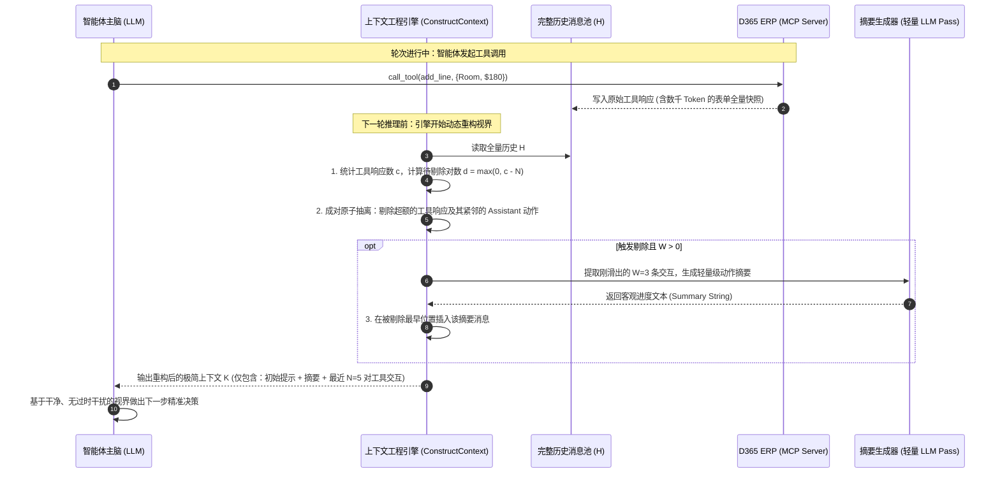
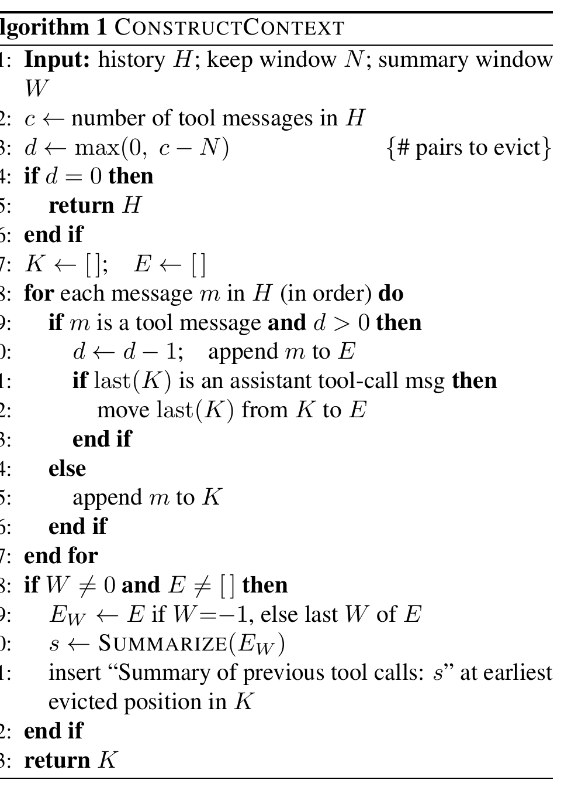
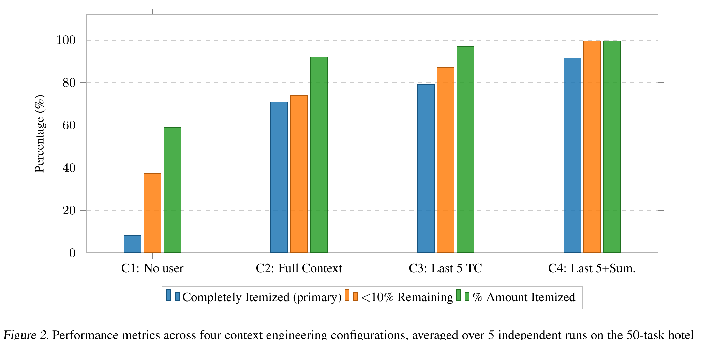

# 微软长程智能体上下文工程引擎（Context Engineering Engine）底层实现与运行机制深度剖析

> **关联论文**：Microsoft Research (2026.06, arXiv:2606.10209)  
> *Less Context, Better Agents: Efficient Context Engineering for Long-Horizon Tool-Using LLM Agents*  
> **定位说明**：本文剥离常规背景介绍与宏观业务叙述，**100% 聚焦于该论文最核心的技术贡献——上下文工程引擎（Context Engineering Engine）的具体构造、算法推导、消息流转、抗噪机制与工程复刻实现**。

---

## 1. 核心设计哲学：为什么必须是“语义级上下文工程”？

在长程工具调用智能体（Long-Horizon Tool-Using Agents）中，传统上下文管理通常有两种极端：
1. **全量保留（Full History, C2）**：将所有历史交互和工具返回完整留在 Prompt 中。由于企业级 MCP 工具返回的表单快照单次可达 500~3,000 Tokens，多轮后上下文迅速突破 10 万 Token，不仅吞噬算力，更引发**注意力衰减（Context Rot）**和**过时状态混淆（Stale-State Errors）**；
2. **粗暴截断或 Token 级压缩（LLMLingua 等）**：在词元粒度上删除低熵 Token。这在表单交互场景中会带来毁灭性灾难——它会随意截断 JSON 结构、破坏控件枚举值（Control Enum）或抹掉数字的小数点。

微软团队的破局之道在于提出**“语义级原子操作（Semantic-Level Atomic Unit）”**：
- **最小操作单元不是 Token，也不是单条 Message，而是“助手工具调用 + 系统工具返回”的消息对（Tool Call / Response Pair）**；
- 引擎只对**完整的交互对**进行成组保活或成组剔除，被保留的工具交互保持 100% 原文字符级无损；
- 通过“**时序滑动窗口（Working Memory） + 逆序局部摘要（Progress Anchoring）**”双轨协同，实现无损与轻量的完美平衡。

---

## 2. 上下文引擎的状态机生命周期

上下文引擎在智能体单步决策执行中的拦截与重构位置如下：



---

## 3. 核心算法逐行深度推导：Algorithm 1 (ConstructContext)

论文给出的核心上下文构造算法伪代码如下（对应原论文第 5 页 Algorithm 1）：

<p align="center">
  
  <br>
  <em>图 1：论文 Algorithm 1 上下文构建算法</em>
</p>

### 3.1 变量与符号定义
- $H$：会话截止到当前的完整历史消息列表（List of Messages）；
- $N$：保留的最近工具调用/响应对数（Pruning Window，论文主推荐值为 $N=5$）；
- $W$：摘要提取窗口大小（Summary Window，论文主推荐值为 $W=3$；$W=0$ 表示不启用摘要，$W=-1$ 表示全量历史摘要）；
- $c$：当前历史 $H$ 中所有**工具响应消息（Tool Messages）**的总计数；
- $d$：当前轮次需要剔除的工具交互对数：$d = \max(0,\, c - N)$；
- $K$：最终组装并投递给 LLM 推理的**保留消息列表（Kept Messages）**；
- $E$：本轮被剔除出视界的**废弃消息集合（Evicted Messages）**。

---

### 3.2 算法分步执行逻辑解析

#### 步骤 1：判断是否超出滑动窗口容量
```python
c = count_tool_messages(H)
d = max(0, c - N)
if d == 0:
    return H  # 尚未超出窗口配额，原样返回完整上下文
```
当系统刚启动、发生的工具交互还不足 $N$ 对时，引擎完全不介入，保留完整上下文。

#### 步骤 2：正向遍历与“原子成对抽离”（Atomic Pair Eviction）
```python
K = []
E = []
for m in H:
    if is_tool_message(m) and d > 0:
        d -= 1
        E.append(m)  # 将当前工具响应移入被剔除区
        # 核心机理：回溯检查刚刚放入 K 的前一条消息
        if len(K) > 0 and is_assistant_tool_call(K[-1]):
            # 将触发该工具的 Assistant 消息一并移出 K，放入 E
            E.append(K.pop())
    else:
        K.append(m)
```
> 🔍 **底层精妙之处**：
> 1. **语法合法性保障**：在 OpenAI / Anthropic 等 API 协议规范中，每一个 `tool_call` 必须与紧随其后的 `tool_response`（带匹配的 `tool_call_id`）一一对应。如果只删工具返回，留下的 Assistant 消息会引发 API 校验报错；如果只删 Assistant 消息，工具返回就会悬空。
> 2. **成对剔除**：将动作动机（Assistant Thought/Call）与系统反馈（Tool Output）视为不可分割的语义闭环，成对移入 $E$，确保留在 $K$ 中的历史在语法上严格完备。

#### 步骤 3：逆序局部采样与单遍轻量摘要（Local Summarization）
```python
if W != 0 and len(E) > 0:
    if W == -1:
        E_W = E                  # 全量历史摘要 (对比基线)
    else:
        E_W = E[-W:]             # 仅提取刚滑出视界的最近 W 条交互
    
    # 触发单次轻量级 LLM 调用
    s = Summarize(E_W)
    
    # 在保留列表 K 中最早被剔除的位置，插入合成的进度摘要
    K.insert(earliest_evicted_idx, f"Summary of previous tool calls: {s}")

return K
```
> 🔍 **底层精妙之处**：
> 1. **为什么是逆序取最近 $W$ 条（$E[-W:]$），而不是全量历史？**  
>    论文在敏感度分析中证明：越早的历史其细节价值呈指数级衰减，全量摘要（$W=-1$）会引入大量早已无关的初始导航动作，造成摘要文本自身膨胀；而**刚滑出窗口的 $W=3$ 条交互恰好是承前启后的关键桥梁**（包含了上一步刚刚完成的建行和金额）。
> 2. **单遍确定性成本**：  
>    每次发生截断时，**仅产生严格 1 次额外的 LLM 摘要调用**，且 Prompt 输入极小（仅 $W$ 条消息），输出仅几十个 Token，耗时通常只需数百毫秒。

#### 步骤 4：摘要的注入锚点（Earliest Evicted Position）
摘要绝不能随意塞在最后（会干扰实时工具返回），也不能放在最前面（会干扰 System Prompt）。引擎将其精确插在**“最早被剔除的消息所处的原始位置”**：
- 前方：保持初始系统说明、用户任务要求（`#Task`, `#Data`）；
- 中间：承接“先前的工具调用进度摘要（Summary of previous tool calls）”；
- 后方：滑动窗口内完整保真的最近 $N=5$ 对工具交互。
这种结构完美符合人类工作记忆的时序逻辑：**先读全局任务 $\to$ 再读宏观阶段进度 $\to$ 专注手头具体细节**。

---

## 4. 双向阻断机制：它如何同时消灭过时状态与过早终止？

纯剪枝（C3）与剪枝+摘要（C4）的表现差异，揭示了长程智能体上下文管理的深刻本质。

<p align="center">
  
  <br>
  <em>图 2：完全核销率（蓝色）：全量历史 C2 (71.0%) → 纯剪枝 C3 (79.0%) → 剪枝+摘要 C4 (91.6%)</em>
</p>

### 4.1 痛点一：全量历史（C2）中的“过时状态幽灵”（Stale-State Errors）
- **现象**：C2 配置下发生了 **34 次** 过时状态引用错误（占所有失败原因的 47%）。
- **机理**：智能体在处理 5 晚住宿的多行拆分时，需要多次调用 `get_form_state()` 查看未核销余额。第 1 轮返回 `{remaining: $420}`；第 4 轮返回 `{remaining: $180}`。当历史达到 20 步时，模型上下文发生注意力弥散，在第 5 轮决策时，模型错误地关联回了第 1 轮的旧快照，误以为还有 \$420 未核销，于是再次添加了已经录入过的房费项目，导致账目溢出崩溃（Residual: -\$180）。
- **引擎阻断方案**：**滑动剪枝窗口 $N=5$ 强制抹去了 5 步以前的所有旧表单快照**。模型在眼前只看得到最新一步的表单返回值，物理上杜绝了对历史废弃快照的注意力漂移！因此在 C3/C4 中，该错误直接从 34 次被压至 6 次与 4 次。

### 4.2 痛点二：纯剪枝（C3）带来的反噬——“过早终止（Premature Termination）”
- **现象**：C3 虽然消除了过时状态，但它的**过早终止错误从 9 次暴增到了 18 次**（翻了一倍，成为 C3 的头号死因）。
- **机理**：把旧历史一刀切全扔掉后，智能体虽然专注于当下，但也彻底患上了“顺行性遗忘症”——它不知道整张报销单到底有多少笔、前几晚是否已经记过账。当智能体处理完手头这一项时，容易误以为“全部任务已经做完”，直接调用 `submit_form()` 提前交卷，留下未清零的残差（如 Residual: \$195）。
- **引擎阻断方案**：**单遍紧凑摘要（Summarization, $W=3$）充当了“大局观锚点”**。引擎将刚刚滑出的动作转化为结构化小结：
  ```text
  Summary of previous tool calls:
  - Opened Expense report ER-00184 (hotel, total $612.40).
  - Clicked "Itemize" button and opened sub-form.
  - Added Hotel-Room line with amount $180.00.
  - Added Hotel-Tax line with amount $14.40.
  ```
  这份几十个 Token 的小结不包含任何易引起混淆的复杂中间快照，却明确向模型传达了：**“总账是 \$612.40，目前只录了两笔（约 \$194），发票还远没报完！”** 这使得智能体在 C4 下的过早终止错误从 18 次**骤降至 3 次**（减少 83.3%）。

---

## 5. 超参数选取依据与微观设计细节

### 5.1 为什么滑动窗口 $N=5$ 是企业级 ERP 的最优参数？
在业务系统自动化中，$N$ 的取值不是玄学拍脑袋，而是由**业务原子操作步长（Atomic Business Action Footprint）**决定的：
- 在 D365 F&O 中，向报销单录入单行明细的标准交互链条为：
  1. 调用表单控件创建新空白行（`add_line`）；
  2. 写入子科目枚举并填充金额（`set_control_values`）；
  3. （可选）校验表单响应或读取当前行状态（`get_row_state`）。
- **单行录入恰好消耗 2~3 个工具调用对**。
- 因此，$N=5$ 恰好提供了**容纳约 2 个完整业务循环的短期工作记忆（Working Memory）**。它既能让智能体比对手头正在做的一行和刚刚做完的一行（防止单行重复录入），又绝不会引入更早的陈旧历史。
- **敏感度验证（论文 Table 7）**：
  - $N=3$：工作记忆不足 1 个半周期，一旦某步有重试就会丢失前序状态，完全核销率下降至 74.0%；
  - $N=10$：工作记忆过大，Token 开销激增 53.2%（535K $\to$ 820K），完全核销率仅微增 1%（80.0%），边际性价比极低；
  - $N=\infty$（全量历史）：完全核销率倒退至 71.0%。

### 5.2 为什么摘要窗口选 $W=3$？
- $W=1$：只摘要最后 1 步，无法形成有意义的操作连续性，完成率下跌 5.2 个百分点（86.4%）；
- **$W=3$：正好覆盖上一个刚刚完成的单行录入全过程，成功率达到最优膝点 91.6%**；
- $W=5$ 与 $W=-1$（全历史摘要）：完成率仅为 92.0%（仅提升 0.4%），但 Token 开销分别增加 4% 和 11%，属于无意义消耗。

---

## 6. 生产级 Python 完整复刻代码

以下是一个生产就绪（Production-Ready）、完全契合论文 Algorithm 1 规约的上下文工程引擎实现。兼容标准 OpenAI/Anthropic/MCP 消息字典格式：

```python
"""
ContextEngineeringEngine: 面向长程工具调用智能体的高效上下文工程引擎
基于 Microsoft Research (arXiv:2606.10209) Algorithm 1 生产级复刻
"""

from typing import List, Dict, Any, Tuple, Optional
import copy


class ContextEngineeringEngine:
    def __init__(
        self,
        keep_window_n: int = 5,
        summary_window_w: int = 3,
        summarizer_client: Optional[Any] = None,
        summarizer_model: str = "gpt-4.1-mini",
    ):
        """
        初始化上下文工程引擎
        :param keep_window_n: 保留的最新工具调用/响应对数 (默认 5)
        :param summary_window_w: 局部摘要窗口大小 (默认 3, -1 为全量历史, 0 为不摘要)
        :param summarizer_client: 用于生成轻量级摘要的 LLM 客户端
        :param summarizer_model: 摘要模型名
        """
        self.N = keep_window_n
        self.W = summary_window_w
        self.client = summarizer_client
        self.model = summarizer_model

    def is_tool_message(self, message: Dict[str, Any]) -> bool:
        """判断是否为系统工具返回响应 (Role 为 tool 或 function)"""
        return message.get("role") in ["tool", "function"]

    def is_assistant_tool_call(self, message: Dict[str, Any]) -> bool:
        """判断是否为助手发起的工具调用指令"""
        return (
            message.get("role") == "assistant"
            and message.get("tool_calls") is not None
            and len(message.get("tool_calls", [])) > 0
        )

    def generate_summary(self, evicted_messages: List[Dict[str, Any]]) -> str:
        """
        单遍轻量级摘要生成器：将滑出视界的工具交互压缩为客观动作与状态小结
        """
        if not evicted_messages:
            return ""

        # 如果没有注入外部模型客户端，提供鲁棒的规则降级兜底方案
        if self.client is None:
            tool_names = []
            for m in evicted_messages:
                if self.is_assistant_tool_call(m):
                    for tc in m.get("tool_calls", []):
                        fn_name = tc.get("function", {}).get("name", "unknown")
                        tool_names.append(fn_name)
            return f"Executed operations: {', '.join(tool_names)} successfully processed."

        # 标准 LLM 提示词：强调客观事实陈述，无需复杂数学计算
        system_prompt = (
            "You are a concise enterprise agent state summarizer. Summarize the following "
            "evicted tool interactions into 2-4 bullet points detailing: (1) forms opened, "
            "(2) controls clicked, (3) line items and amounts entered into the system. "
            "Be purely factual, compact, and brief."
        )

        try:
            response = self.client.chat.completions.create(
                model=self.model,
                messages=[
                    {"role": "system", "content": system_prompt},
                    {"role": "user", "content": str(evicted_messages)},
                ],
                max_tokens=150,
                temperature=0.0,
            )
            return response.choices[0].message.content.strip()
        except Exception as e:
            return f"Prior operations completed up to step checkpoint ({len(evicted_messages)} interactions archived)."

    def construct_context(self, history: List[Dict[str, Any]]) -> List[Dict[str, Any]]:
        """
        核心上下文重构函数 (对应 Algorithm 1: ConstructContext)
        在每次将上下文投递给智能体推理前执行
        """
        # 1. 统计全量历史中 tool message 的数量
        c = sum(1 for m in history if self.is_tool_message(m))

        # 2. 计算需要剔除的工具交互对数
        d = max(0, c - self.N)

        # 若未超出保留窗口配额，原样返回完整上下文副本
        if d == 0:
            return copy.deepcopy(history)

        K: List[Dict[str, Any]] = []
        E: List[Dict[str, Any]] = []
        earliest_evicted_index: Optional[int] = None

        # 3. 顺序扫描消息历史并执行成对原子剔除
        for m in history:
            if self.is_tool_message(m) and d > 0:
                d -= 1
                # 记录最早被剔除发生的位置索引
                if earliest_evicted_index is None:
                    earliest_evicted_index = len(K)

                # 将当前工具返回放入废弃集合 E
                E.append(copy.deepcopy(m))

                # 关键原子操作：回溯移出上一条紧邻的 Assistant Tool Call
                if len(K) > 0 and self.is_assistant_tool_call(K[-1]):
                    E.append(K.pop())
            else:
                K.append(copy.deepcopy(m))

        # 4. 逆序局部摘要生成与锚点注入
        if self.W != 0 and len(E) > 0:
            if self.W == -1:
                E_W = E
            else:
                # 逆序截取最近滑出的 W 条消息
                E_W = E[-self.W :]

            summary_text = self.generate_summary(E_W)

            summary_message = {
                "role": "assistant",
                "content": f"Summary of previous tool calls:\n{summary_text}",
            }

            # 精准插入在最早被剔除的位置
            insert_pos = earliest_evicted_index if earliest_evicted_index is not None else 1
            K.insert(insert_pos, summary_message)

        return K
```

---

## 7. 总结：上下文工程引擎的核心精髓

如果用三句话提炼微软这项工作的上下文引擎核心精髓：
1. **语义对等（Atomic Pairs）**：摒弃 Token 级截断，将 `(Tool Call, Tool Response)` 作为一个原子结构进退，杜绝破坏表单语法；
2. **两级分离（Bilevel Separation）**：将局部工作记忆与全局进度感知彻底解耦——$N=5$ 的滑动窗口只负责“最新两步的现场表单细节”，$W=3$ 的局部摘要只负责“总进度走到了哪里”；
3. **少即是多（Less is More）**：长程 Agent 性能崩塌的主因往往不是“记不住”，而是**“被陈旧垃圾信息严重污染”**。把过时状态果断踢出视界，Agent 才能具备最顶级的鲁棒性与决策确定性。
