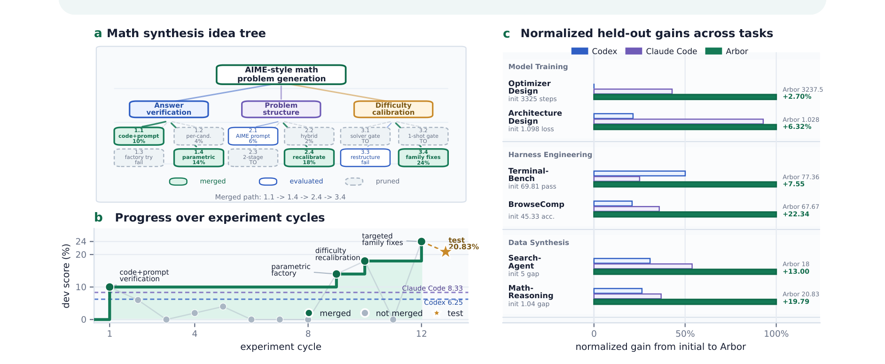
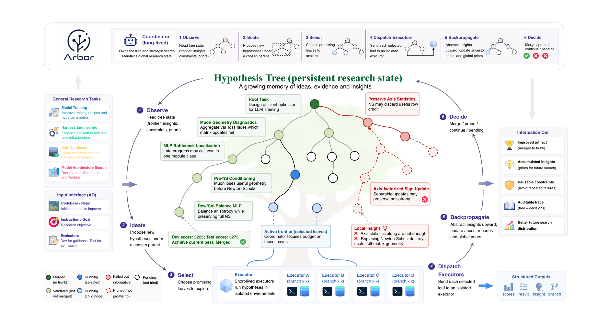
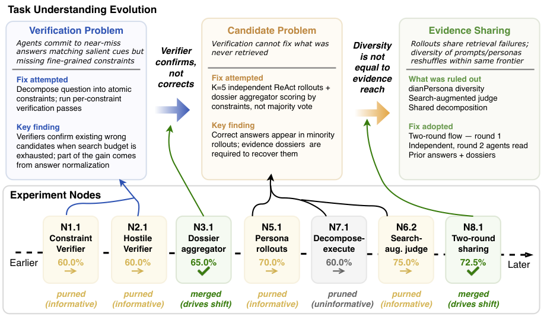
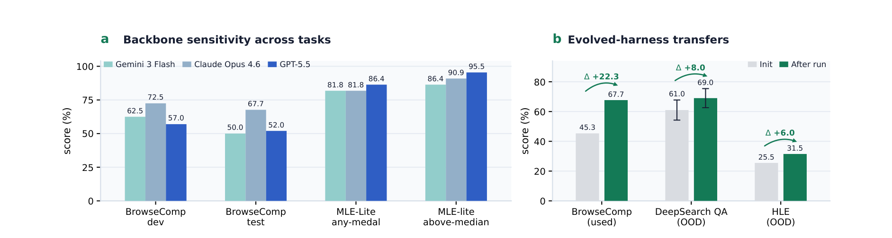
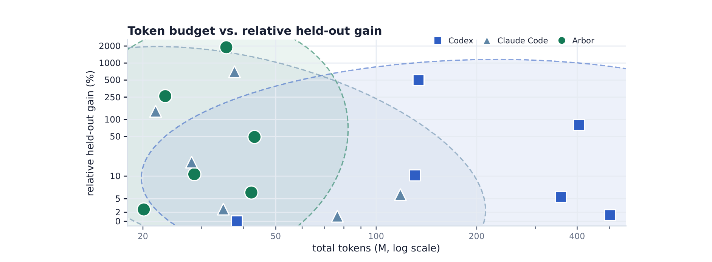
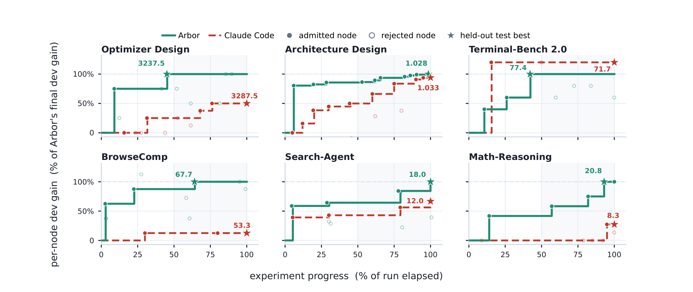

# Arbor 深度精读综述：用“持久化假设树 + Git Worktree 隔离 + 洞察反向传播”取代肥胖上下文房间

> **论文标题**：*Toward Generalist Autonomous Research via Hypothesis-Tree Refinement*  
> **作者机构**：中国人民大学高瓴人工智能学院（RUC GSAI）× 微软研究院（Microsoft Research / MSRA）  
> **论文链接**：[arXiv:2606.11926v1](https://arxiv.org/html/2606.11926v1) ｜ [本地 PDF 原件](./Arbor.pdf) ｜ [英文全量解析](./2606.11926_Arbor_原文解析.md) ｜ [全文如实中文翻译](./2606.11926_Arbor_中文翻译.md)  
> **开源仓库**：https://github.com/RUC-NLPIR/Arbor（2026年6月发布技术报告 / 10月开源 CLI 与 Skill）

---

## 一、核心痛点：为什么“肥胖房间（线性长上下文）”撑不起自主研究？

以 Codex CLI、Claude Code（`/goal` 模式）为代表的通用编程智能体已经能够在真实代码库中连续运行数小时，但**执行时长并不等于研究深度**。在论文定义的**自主优化**（Autonomous Optimization, AO）设定下——即给定初始制品 $\mathcal{M}_0$、自然语言目标 $\mathcal{O}$、开发评估器 $\mathcal{E}_{\mathrm{dev}}$ 与留出测试评估器 $\mathcal{E}_{\mathrm{test}}$，智能体需要在无分步人工监督下最大化 $\mathcal{E}_{\mathrm{test}}$——传统的单轨迹“肥胖房间”模式会迅速暴露三大结构性瓶颈：

1. **上下文肥胖与压缩失真**：把探索思考、文件读取、代码修改、训练日志与报错堆栈全部堆进同一个线性对话窗口。一旦触及上下文阈值（如 200K tokens 的 80%）触发摘要压缩，早期失败原因与分支对比就会丢失，智能体沦为“金鱼记忆式”的局部盲目试错。
2. **共享工作区耦合与污染风险**：所有实验在同一个工作目录原地修改，既无法安全地并发探索多个竞争假设，又极易因某次失败实验的残留文件或未清理修改污染主干代码与评估结果。
3. **开发集过拟合与无审计轨迹**：缺乏开发反馈与留出准入的硬隔离，智能体容易在 $\mathcal{E}_{\mathrm{dev}}$ 上“刷榜”（如 Terminal-Bench 2.0 上 Claude Code 开发集冲到 75.00%，测试集却跌回 71.70%），且每次代码变更无法追溯到具体的科学假设与因果归因。

**`Arbor` 的破局之道非常干脆**：彻底拆掉“肥胖房间”，用**“持久化假设树（HTR） + Git Worktree 物理隔离 + 洞察反向传播”**取而代之——在相同量级的 Token 预算（20.12M–43.19M tokens）下，在六大真实研究任务上取得了超越 Codex 与 Claude Code 平均相对留出增益 **$2.5\times$** 的表现，并在 MLE-Bench Lite 上搭配 GPT-5.5 达到 **86.36% Any Medal（77.27% Gold）**。

---

## 二、总体架构：长生命周期协调器 × 短生命周期执行器

`Arbor` 将自主研究严格切分为**战略控制层（Coordinator）**与**局部实验层（Executor）**，两者通过持久化假设树 $\mathcal{T}\!\textit{ree}$ 与隔离的 Git Worktree 进行异步解耦：

### 1. 职责硬边界（Tool-Level Enforcement）

| 角色 | 生命周期 | 核心职责 | 工具权限硬边界（非靠 Prompt 祈祷，而是工具层强制） |
| :--- | :--- | :--- | :--- |
| **Coordinator（协调器）** | 长生命周期（单个持久化 ReAct 循环，最多 500 轮 / 20 周期） | 维护全局研究状态 $\mathcal{T}\!\textit{ree}$；执行 Observe $\to$ Ideate $\to$ Select $\to$ Dispatch $\to$ Backpropagate $\to$ Decide | **严禁直接编辑代码**（无 `FileEdit`/`FileWrite` 权限，禁止用 `Bash` 改代码），仅能通过 `Tree*` 工具改树、通过 `RunSubagent(Parallel)` 派发执行器、通过 `GitMergeBranch` 合并。 |
| **Executor（执行器）** | 短生命周期（单假设单次运行，上限 50 轮 / 48h） | 在独立 Worktree 中实现指定假设 $h_n$，运行 $\mathcal{E}_{\mathrm{dev}}$ 并修复实现 bug，返回结构化四元组 | **严禁读取主干与兄弟分支、严禁修改树、严禁运行 $\mathcal{E}_{\mathrm{test}}$、严禁擅自偷换研究假设 $h_n$**。只能在其专属 `/tmp/` worktree 内操作。 |

> [!IMPORTANT]
> **为什么禁止 Coordinator 直接改代码、禁止 Executor 擅自换假设？**
> - 若 Coordinator 能直接改代码，它会忍不住做“不建树节点的局部小修补”，破坏“每一次代码变更都可追溯至一个假设”的不变量；
> - 若 Executor 在指标停滞时能擅自更换假设，返回的分数与证据就不再属于原节点 $n$，祖先节点上的洞察聚合就会失去因果语义。

### 2. 持久化假设树（HTR）的数据结构与防肥胖投影

`Arbor` 不把研究状态存在聊天记录里，而是外化为一棵实时落盘（JSON + Markdown）的**假设树（Idea Tree）** $\mathcal{T}=(\mathcal{V},\mathcal{E})$，每个节点 $n = \langle h_n, \iota_n, \mu_n \rangle$ 包含 10 个标准字段：

- **结构骨架**：`id`（点分层级地址，如 `"ROOT"`, `"1"`, `"1.1"`）、`parent_id`、`children_ids`、`depth`（默认最大深度 `max_depth = 2`：Depth-1 为宽泛方向，Depth-2 为具体分支干预）。
- **语义与生命周期**：`hypothesis`（Ideate 阶段一次性写入、永不修改）、`status`（`pending` $\to$ `running` $\to$ `done` $\to$ `{merged, pruned}`）。
- **证据与指针**：`score`（$\mathcal{E}_{\mathrm{dev}}$ 标量分）、`result`（原始事实观测）、`insight`（提炼的因果教训）、`code_ref`（Git 分支引用，代码本体绝不塞进树里）。

为了彻底取代“肥胖房间”，Coordinator 每次循环通过 **`TreeView` 的五种受控投影** 按需读取状态，并在上下文管理上实施两项关键减负：
1. **`TreeView(format="constraints")`**：在每次 Ideate 前加载树形态、根节点全局洞察、已验证发现（作为前置假设）与**已剪枝原因（作为硬负向约束）**，避免重蹈覆辙；
2. **`LoadSkill` 用后即剪（Post-Commit Context Pruning）**：Ideate 阶段按需加载 `idea_drafting`、`first_principles_probe`、`fatal_flaw_scan` 三个 Skill 指导提案，一旦调用 `TreeAddNode` 提交节点，**立即从上下文中剔除 Skill 正文与草稿推理**，确保上下文不会随周期数线性膨胀。

---

## 三、核心机制深潜：Git Worktree 双重隔离与洞察反向传播

### 1. Git Worktree 双重隔离与留出合并门控（Held-Out Merge Gate）

`Arbor` 在工程上设计了极其严密的**双 Worktree 隔离机制**，彻底杜绝并发冲突与开发/测试数据泄漏：

- **第一重隔离（Executor 开发沙箱）**：每次派发 `RunSubagent` / `RunSubagentParallel`（并发 2–4 个），系统从当前最优主干 `HEAD` 在 `/tmp/` 下切出独立分支与 Worktree $W_n$。评估命令强制使用 `{cwd}` 与 `{node_id}` 模板变量替换，严禁硬编码绝对路径，确保并发实验的输出互不覆盖。提交前执行保守的**制品过滤（Artifact Filtering）**，只提交实现代码变更，剥离大日志、模型 checkpoint 与缓存。
- **第二重隔离（`GitMergeBranch` 留出准入门控）**：只有当叶节点的 $\mathcal{E}_{\mathrm{dev}}$ 得分超越当前最优至少达到合并阈值（默认 `5.0%`）时，才会触发 `GitMergeBranch`。该工具在**另一个全新的游离 Worktree** 中检出候选分支并运行 $\mathcal{E}_{\mathrm{test}}$，仅当测试得分严格超越当前最优时才允许合入主干；否则标记为未合并/剪枝，作为“开发集过拟合的负向证据”保留在树中。

此外，针对动辄数小时的训练任务，`Executor` 配备了 **`RunTraining`** 工具（最长支持 7 天超时），支持 `smoke / pilot / full` 分阶段预算，并持续捕获中间指标与进度日志——哪怕跑到 80% 超时，也能返回有价值的半程轨迹证据供剪枝决策，避免“静默超时导致零信息量”。

### 2. 洞察反向传播（Insight Backpropagation）

这是 `Arbor` 区别于普通 MCTS/代码树搜索（如早期 AIDE）的灵魂所在：

- 当叶节点 $n$ 执行完毕，Executor 返回紧凑的 6 段式报告（`Idea` / `Changes` / `Implementation Choices` / `Baseline vs. Result` / `Analysis` / `Insights`），提取出事实记录 $r_n$ 与局部因果洞察 $\iota_n$；
- Coordinator 调用 `propagate_insights`，沿着从父节点到根节点的路径 $\textsf{path}(n_0 \to n)$ 逐层向上走，在每个祖先节点处调用 LLM 将其所有子节点的洞察合成为一段 **$<200$ 词的抽象摘要**；
- **语义逐层升维**：叶节点洞察记录具体实现成败（如某参数/数据接口不匹配） $\to$ 深度 1 方向节点洞察总结一族干预的适用边界 $\to$ 根节点洞察维护整次任务的全局认知先验。

如图 6（BrowseComp 案例）所示，洞察反向传播让智能体的任务理解经历了三次清晰的跃迁：
1. **验证问题阶段**：早期节点 `N1.1`（约束验证器）和 `N2.1`（对抗验证器）虽然提升了开发集分数，但诊断发现“验证器只能确认已有候选，无法找回从未检索到的答案”；
2. **候选覆盖问题阶段**：`N3.1`（证据档案聚合器）证明保留少数轨迹中的正确证据有效，而 `N5.1`、`N7.1`、`N6.2` 相继证伪了角色多样性、共享分解与搜索增强评判器（均对开发集过拟合或破坏轨迹独立性）；
3. **证据共享定型阶段**：前序负向约束汇聚成先验，直接催生了最终合入的 `N8.1`（两轮独立探索 + 仅在第二轮共享候选答案与证据档案，绝不共享计划与角色）。

---

## 四、实证结果、消融实验与成本分析

### 1. 六大真实研究任务（AO Task Suite）主结果

在 48 小时墙钟上限、相同初始代码库与评估器下，`Arbor`（默认 20 周期、最大深度 2）对比使用 `/goal` 长程模式的 **Codex (GPT-5.5)** 与 **Claude Code (Claude Opus 4.6)**：

| 任务类型 | 任务名称 | 指标方向 | Initial (Dev / Test) | Codex (Dev / Test) | Claude Code (Dev / Test) | `Arbor` (Dev / Test) | `Arbor` Test 净增益 |
| :--- | :--- | :--- | :---: | :---: | :---: | :---: | :---: |
| **模型训练** | Optimizer Design | Steps ($\downarrow$) | 3325 / 3325 | 3325 / 3325 | 3275 / 3287.5 | **3225 / 3237.5** | **+2.63%** |
| **模型训练** | Architecture Design | Loss ($\downarrow$) | 1.096 / 1.098 | 1.089 / 1.083 | 1.033 / 1.033 | **1.029 / 1.028** | **+6.38%** |
| **脚手架工程** | Terminal-Bench 2.0 | Pass% ($\uparrow$) | 58.33 / 69.81 | 63.89 / 73.59 | **75.00** / 71.70 | 72.22 / **77.36** | **+7.55** |
| **脚手架工程** | BrowseComp | Acc% ($\uparrow$) | 52.50 / 45.33 | 57.50 / 50.00 | 55.00 / 53.33 | **72.50 / 67.67** | **+22.34** |
| **数据合成** | Search-Agent | Gap ($\uparrow$) | 4.00 / 5.00 | 12.00 / 9.00 | 12.00 / 12.00 | **16.00 / 18.00** | **+13.00** |
| **数据合成** | Math-Reasoning | Gap ($\uparrow$) | 2.00 / 1.04 | 6.00 / 6.25 | 8.00 / 8.33 | **24.00 / 20.83** | **+19.79** |

核心发现：
- **全胜且泛化**：`Arbor` 在全部 6 项任务上的留出测试集均取得第一，平均相对留出增益达到 Codex 与 Claude Code 的 **$2.5\times$** 以上。
- **Dev/Test 分离抓出刷榜**：在 Terminal-Bench 2.0 上，Claude Code 开发集高达 75.00% 却在测试集跌至 71.70%；`Arbor` 凭借留出合并门控避免过拟合，测试集稳步提升至 77.36%。

### 2. MLE-Bench Lite 与跨基座/跨任务迁移

- **MLE-Bench Lite**：搭配 Gemini-3-Flash 达到 **81.82% Any Medal**（金牌率 40.90%，超越同基座 AI-Scientist 的 31.82% 与 LoongFlow 的 39.39%）；切换为 GPT-5.5（不改控制器与树结构）直接冲到 **86.36% Any Medal、95.45% Above Median、77.27% Gold**，全面领跑榜单。
- **跨任务脚手架迁移**：将仅在 BrowseComp 上演化得到的搜索脚手架冻结后直接测未见过的基准，**HLE 从 25.50% $\to$ 31.50%**，**DeepSearchQA 从 $61.00\% \to 69.00\%$**，证明 HTR 挖掘出的是通用机制改进而非过拟合补丁。

### 3. 消融实验（为什么“树 + 洞察”缺一不可？）

在 MLE-Bench Lite（Claude Opus 4.6 基座）上的消融结果揭示了极其深刻的结论：

| 变体 | Valid Sub. | Above Median | Bronze | Silver | Gold | Any Medal |
| :--- | :---: | :---: | :---: | :---: | :---: | :---: |
| **Full `Arbor`** | 100.00% | **90.91%** | 4.55% | **27.27%** | **50.00%** | **81.82%** |
| `w/o tree`（退化为扁平队列） | 100.00% | 72.72% | 9.09% | 22.73% | 31.82% | 63.64%（-18.18） |
| `w/o insight feedback`（保留树但禁用洞察传播） | 100.00% | 77.27% | 4.55% | 13.64% | 36.36% | **54.54%（-27.28）** |

1. **所有变体均可运行（100% Valid Sub.）**：说明 HTR 提升的不是“代码能不能跑通”，而是**中后期研究精炼的质量**；
2. **有树无洞察比没树更差**：`w/o insight feedback` 掉点（-27.28%）比 `w/o tree`（-18.18%）更严重！说明没有语义洞察传播的树只是一个语法层面的空壳，无法把局部实验教训转化为未来决策约束。

### 4. Token 成本与探索效率

- `Arbor` 在 6 个完整记录的任务上总消耗为 **20.12M–43.19M tokens**（已计入 Coordinator + 所有 Executor），与单轨迹基线处于同一数量级；
- 强候选往往出现在**运行中后期**（由前期节点排除错误路径、累积约束后“水到渠成”），证明 HTR 真正改变了后续提案的条件分布，而不是靠盲目增大采样碰运气。

---

## 五、对自主智能体与 Harness 工程的启示

1. **状态外化是长程 Agent 的唯一出路**：把“研究记忆”从易失、易膨胀的对话历史（肥胖房间）迁出，落盘为结构化的 JSON/Markdown 假设树，配合按需投影（`TreeView`）与用后即剪（`LoadSkill` pruning），能让 Agent 跨越数百轮对话与上下文压缩而不失焦。
2. **用系统边界替代 Prompt 约束**：`Arbor` 没有靠 Prompt 劝说 Coordinator “不要直接改代码”，而是直接在工具集里拿掉它的编辑工具；没有靠 Prompt 劝说 Executor “不要偷看测试集”，而是把 $\mathcal{E}_{\mathrm{test}}$ 锁进 `GitMergeBranch` 并在另一个临时游离 Worktree 中执行。这是构建可靠 Multi-Agent Harness 的黄金准则。
3. **失败不是噪声，而是最宝贵的约束**：通过 `TreePrune` 记录失败原因，并通过 `propagate_insights` 逐层向上抽象为 $<200$ 词的先验，让每一次失败都能收窄后续搜索空间（`constraints` 视图）。
4. **局限与边界**：目前仍受限于标量目标优化（尚不支持多目标 Pareto 权衡）、高难度任务上从第一性原理重构问题的能力仍依赖基础模型上限，以及长程多并发评估的系统工程成本。
