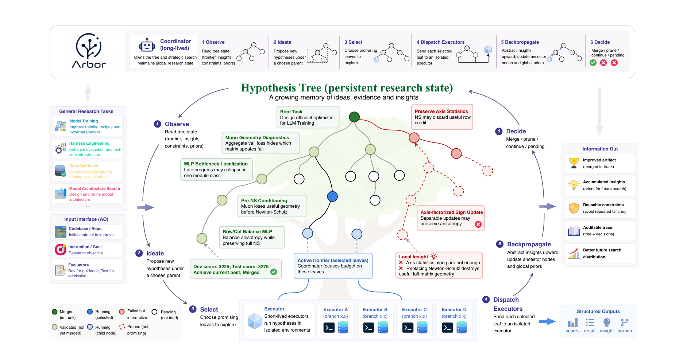
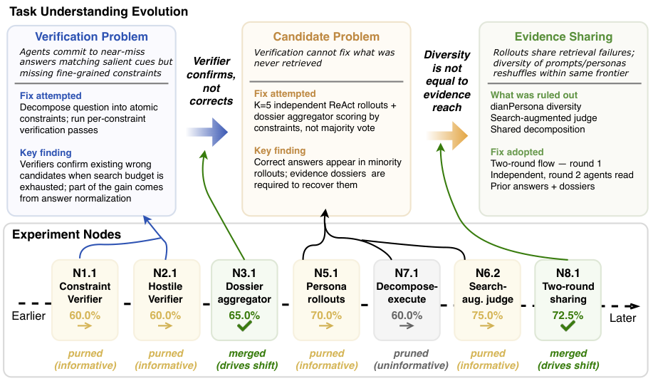

# 专题深度剖析：Arbor 中的“洞察反向传播（Insight Backpropagation）”究竟是什么？

> **定位说明**：在工程界，Git Worktree 隔离并发与树形任务管理（Tree Search / MCTS）确实已是常见基建；但 `Arbor` (`arXiv:2606.11926`) 在 MLE-Bench Lite 消融实验中的一个反直觉结果揭示了它真正的灵魂：**“保留树结构但关闭洞察反向传播（`w/o insight feedback`）”比“彻底拿掉树结构退化成扁平队列（`w/o tree`）”掉点更惨（54.54% vs. 63.64%，完整版为 81.82%）**。  
> 本文专门剥离其余工程外衣，从形式化定义、执行链路、与 MCTS/Reflexion 的本质差异、真实演化案例以及工程落地细节五个维度，彻底讲透**洞察反向传播**。

---

## 一、一句话看懂：什么是“洞察反向传播”？

如果用深度学习来做类比：
- **神经网络的反向传播（Backprop）**：前向推理得到标量 Loss $\to$ 反向逐层计算数值梯度 $\nabla_w \mathcal{L}$ $\to$ 更新上游各层权重，改变下一次前向推理的分布。
- **传统树搜索（MCTS / LATS / AIDE）的反向传播**：叶节点跑完拿到标量得分 $s_n$ $\to$ 反向沿路径累加访问次数 $N$ 和平均价值 $Q$ $\to$ 下次用 UCB 公式挑分高的分支继续扩展。**它只传“好不好（标量）”，不传“为什么（语义）”。**
- **`Arbor` 的洞察反向传播（Insight Backpropagation）**：把**自然语言因果归因**当成**“语义梯度（Semantic Gradient）”**，在叶节点实验结束后，从叶节点沿着父链一路向上走到根节点，在每一层祖先节点处用 LLM 把“所有子节点的局部教训”压缩抽象为一段 **$<200$ 词的方向级/全局级认知**，从而**在下一轮前向提案时直接改变 LLM 的假设生成分布（Proposal Distribution）**。

---

## 二、形式化拆解：树上的“前向-反向”双流机制

在 `Arbor` 中，假设树 $\mathcal{T}=(\mathcal{V},\mathcal{E})$ 的每个节点是一个三元组 $n = \langle h_n, \iota_n, \mu_n \rangle$：
- $h_n$：研究假设（**只写一次，永不修改**，近根处为宽泛方向，深层为具体代码干预）；
- $\mu_n$：元数据（状态、`score`、原始 `result`、Git 分支指针 `code_ref`）；
- **$\iota_n$（Insight，洞察）**：唯一在节点执行后会被**自底向上重写更新**的语义记忆字段。

### 1. 反向传播的三个精确步骤（算法 1 & 算法 2 & 附录 B.3）

```text
[叶节点 Executor 结束]
  │  产出四元组: (score s_n, 原始事实 r_n, 局部洞察 ι_n, 分支 b_n)
  ▼
Step 1: 局部蒸馏 (Distill)
  │  ι_n ← Distill(h_n, Δ_code, r_n)
  │  语义：尝试了什么、发生了什么、为什么支持/削弱/约束了原假设 h_n
  ▼
Step 2: 沿路径逐层向上归约 (Backpropagate / propagate_insights)
  │  遍历 a ∈ path(n_0 → n)（从 n 的父节点一路走到根节点 n_0）：
  │     ι_a ← Abstract( { ι_c | c ∈ children(a) } )   [硬约束：< 200 词]
  │  注意：聚合对象是祖先 a 的【全部子节点】（含成功、失败、已剪枝的兄弟节点）！
  ▼
Step 3: 持久化落盘
  │  每次变更立即序列化为 JSON + Markdown，成为上下文压缩后的唯一真实状态源
```

### 2. 更新后的洞察如何在下一轮“前向”消费？

反向传播更新完各层祖先的 $\iota_a$ 和根节点的 $\iota_{n_0}$ 后，下一轮循环会在**两个截然不同的位置**消费它们：

1. **在 Coordinator 的 `Ideate` 阶段（改变提案分布）**：
   Coordinator 调用 `TreeView(format="constraints")` 读取**树形态 + 根节点洞察 $\iota_{n_0}$（全局先验）+ 已验证发现 + `TreePrune` 剪枝原因**。此时的 $\iota_{n_0}$ 已经吸收了过去所有分支的宏观教训，Coordinator 不会再盲目乱猜，而是基于“已知成立的前提”和“已被证伪的负向约束”生成下一批子假设。
2. **在 Executor 的 `Dispatch` 阶段（注入路径上下文）**：
   当新叶节点 $n^{(i)}$ 被派发给短生命周期的 Executor 时，系统提取从根节点到其父节点路径上的所有祖先洞察 $\iota_{\mathrm{anc}(n^{(i)})}$，直接注入 Executor 的提示词。Executor 虽然看不到兄弟分支的代码，但能看到“前人在这条大方向上踩过什么坑、有什么接口约束”。

---

## 三、深度案例透视：它是怎么把“失败实验”变成“正确解法”的？

看两个论文里的真实轨迹，就能立刻明白为什么“数值反向传播”做不到这一点：

### 案例 1：Optimizer Design（图 2 主框架图中的红绿双线交互）



1. **右侧失败分支（红线）**：
   - 方向节点（Depth 1）：*Preserve Axis Statistics*（“Newton-Schulz 可能会丢弃有用的行统计信息”）。
   - 叶节点（Depth 2）：*Axis-factorized Sign Update*（“用可分离的轴分解符号更新来保留各向异性”） $\to$ **实验失败 ❌**。
   - **局部洞察 $\iota_{\text{leaf}}$**：① 仅靠轴统计量是不够的；② **直接替换掉 Newton-Schulz 会破坏掉有用的全矩阵几何结构**。
2. **反向传播**：这条失败教训没有被扔掉，而是沿红线反向传播到父节点和根节点，变成了一条**全局负向约束**：“*可以平衡行列各向异性，但绝不能拿掉完整的 Newton-Schulz 正交化*”。
3. **左侧成功分支（绿线）**：
   - 在上述全局约束下，Coordinator 在左侧分支提出了 `Row/Col Balance MLP`：**在保留完整 Newton-Schulz 的前提下，额外平衡 MLP 层的行列各向异性** $\to$ **Dev 3225 / Test 3275 步，打破基线并合并进主干 ✅**。

> [!NOTE]
> 如果没有洞察反向传播，传统的树搜索看到右侧分支得分很差，只会把右侧分支的 UCB 价值调低，然后随机去搜别的方向——它**不知道“不能拿掉 Newton-Schulz”这个因果边界**，完全可能过两轮在另一个分支里再犯一次同样的错误。

### 案例 2：BrowseComp 脚手架演化（图 6 的三次认知跃迁）



在 BrowseComp（从 45.33% 提升到 67.67%）的运行中，洞察反向传播让系统对任务本质的理解发生了三次跃迁：
1. **第一层认知（验证问题）**：`N1.1`（约束验证器）和 `N2.1`（对抗验证器）虽然在开发集小涨（60.0%），但反向传播提炼出关键机制发现：**“验证器只能确认已经检索到的候选，无法找回从未被检索到的正确答案”** $\to$ 瓶颈从“严格验证”转向“扩大候选覆盖”。
2. **第二层认知（候选覆盖问题）**：`N3.1`（证据档案聚合器，65.0% 合并）证明跨轨迹保留证据档案有效；随后 `N5.1`（角色多样性，70.0%）、`N7.1`（共享问题分解，60.0%）、`N6.2`（搜索增强评判器，75.0% 但过拟合）虽然有些开发集分很高，但**全被剪枝并反向传播出负向约束**：“角色多样性只是在同一检索前沿内重排；共享分解会破坏轨迹独立性；评判器带搜索会过拟合开发集”。
3. **第三层认知（证据共享定型）**：前序所有正负洞察汇聚成最终设计约束，直接催生了 `N8.1`（72.5% 开发集 / 67.67% 留出测试集）：**两轮流式架构——第一轮完全独立探索，第二轮仅共享候选答案与证据档案，绝不共享计划、角色或问题分解**。

---

## 四、横向对比：洞察反向传播 vs. MCTS vs. Reflexion

| 维度 | 传统 MCTS / AIDE | Reflexion / 对话反思 | `Arbor` 洞察反向传播 |
| :--- | :--- | :--- | :--- |
| **传播载体** | 标量（Score / Win-rate / Visit Count） | 线性对话历史中的自然语言反思文本 | 树节点上的结构化语义洞察 $\iota_n$（$<200$ 词/层） |
| **层级抽象** | 无抽象，仅数值均值聚合 | 扁平堆叠，随轮次增加导致上下文肥胖 | **逐层语义归约**（叶：代码事实 $\to$ 父：方向边界 $\to$ 根：全局先验） |
| **失败处理** | 降低分支选中概率，失败原因丢失 | 混在长对话里，上下文压缩后易被遗忘 | 显式写入 `TreePrune` 原因并聚合进 `constraints` 视图，成为硬负向约束 |
| **对未来的作用** | 决定“选哪个旧节点扩展”（Selection） | 影响同一条线性轨迹的下一步修补 | **同时改变 Coordinator 的新假设提案分布 + 注入新 Executor 的路径先验** |

---

## 五、为什么消融实验里“有树无洞察”比“没树”更差？

论文 Table 4 在 MLE-Bench Lite（Claude Opus 4.6）上的消融数据非常耐人寻味：

- **Full `Arbor`**：81.82% Any Medal（50.00% Gold）
- **`w/o tree`**（退化为扁平实验队列）：63.64% Any Medal（31.82% Gold）
- **`w/o insight feedback`**（保留树结构，但关闭洞察向上传播）：**54.54% Any Medal**（36.36% Gold）

**原因何在？**
当保留树结构却关闭洞察反向传播时，树退化成了**纯粹的“语法容器”**：Coordinator 依然被迫按照树层级做父节点选择和分支扩张，但却**盲目地看不到子节点为什么死掉、兄弟节点暴露了什么边界**。相比之下，扁平队列（`w/o tree`）反而没有树形结构带来的探索约束包袱。这用实证证明了：**树只是骨架，沿树路径逐层抽象的语义反向传播才是让假设树真正“活”起来的血液**。

---

## 六、对工程实践的局限与启发

1. **可控的摘要开销与防膨胀**：每层强制 `< 200` 词的 LLM `Abstract` 归约，保证哪怕树横向长到几十个节点、纵向几十个周期，根节点与各方向节点的洞察总长度依然恒定可控，绝不演变成“肥胖房间”。
2. **人工干预接口 (`TreePropagate`)**：由于树是 JSON/Markdown 持久化存储的，人类研究员可以随时手动修改某个节点的 `insight` 并调用 `TreePropagate`，像“手动注入一条人工先验梯度”一样瞬间刷新整条路径直到根节点。
3. **当前局限**：如论文附录 A 坦言，目前每层 LLM `Abstract` 仍依赖基础模型的因果归纳能力，偶尔会出现“过早放弃有潜力的方向”或“基于得分做表面归因而非第一性原理归因”的现象；未来需要更精细的不确定性追踪与挂起分支重访机制。
