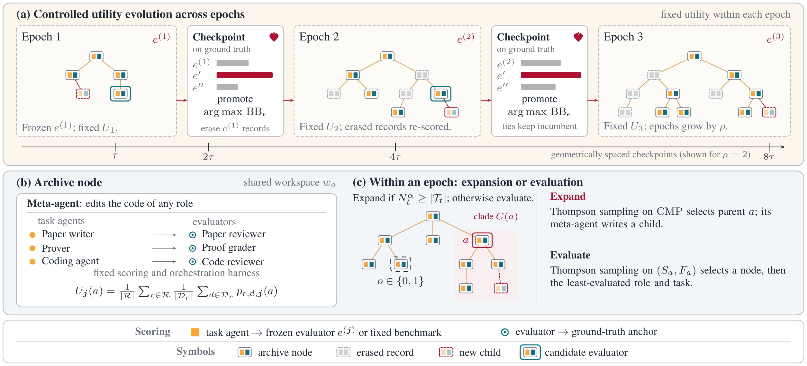
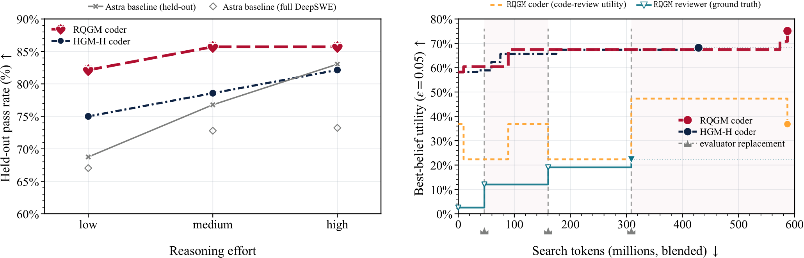
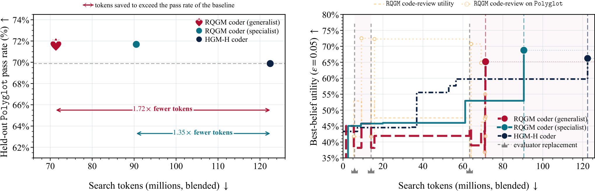
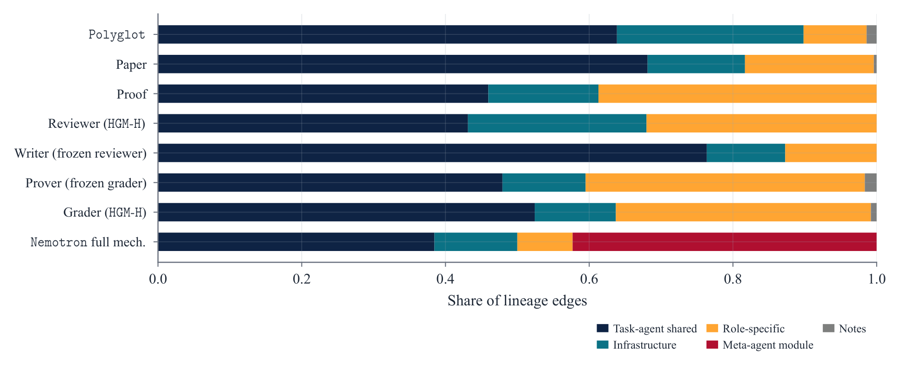
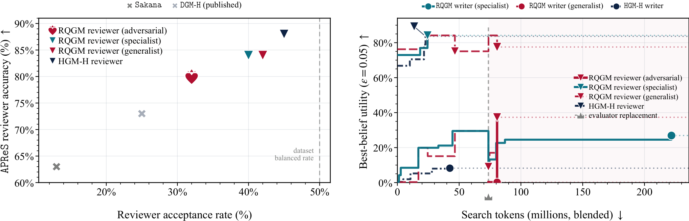
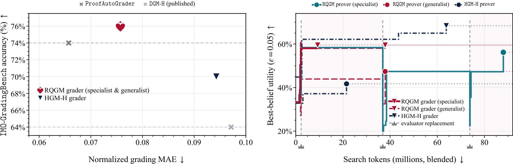
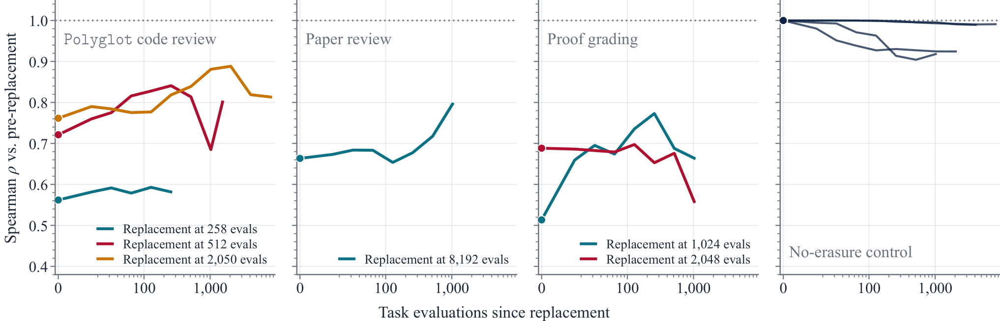
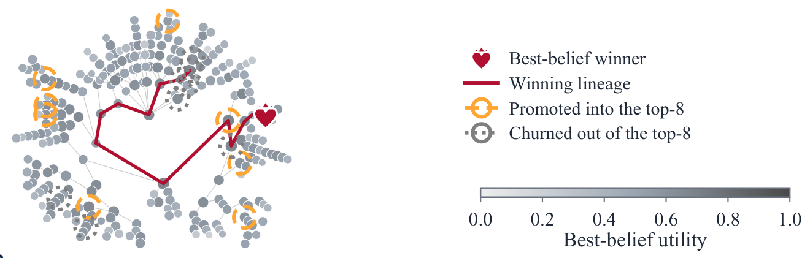
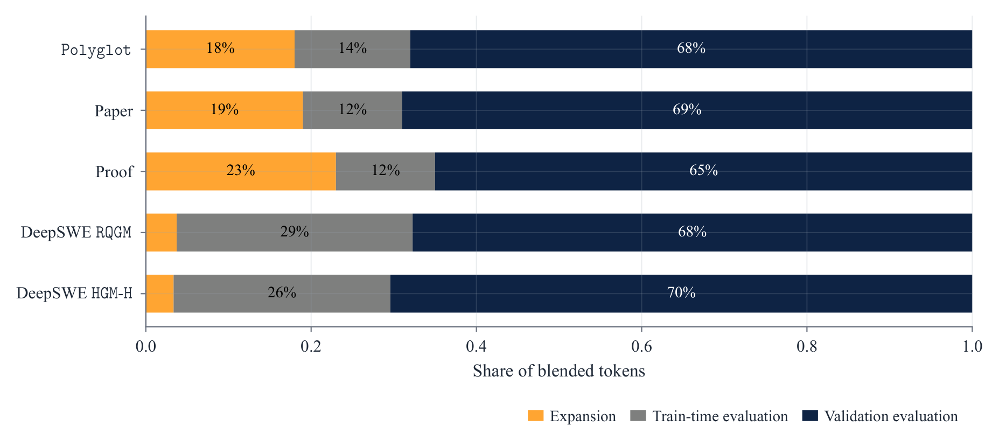
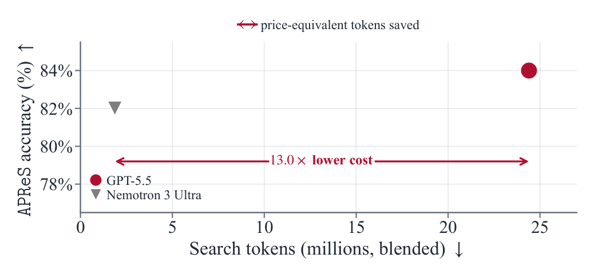

# 红皇后哥德尔机（RQGM）：让评估器与智能体“红皇后协同进化”——深度精读综述

> **论文原题**：*The Red Queen Gödel Machine: Co-Evolving Agents and Their Evaluators*  
> **arXiv 编号**：[`arXiv:2606.26294`](https://arxiv.org/abs/2606.26294)（2026 年 6 月）  
> **研究机构**：剑桥大学（University of Cambridge, MLSys Lab）领衔，联合 NVIDIA、Flower Labs、MBZUAI、Inria  
> **核心作者**：Alex Iacob*、Andrej Jovanović*、William F. Shen*（共同一作），Nicholas D. Lane 等 15 位研究者  
> **核心关键词**：自进化智能体（Self-Improving Agents）、受控效用演化（Controlled Utility Evolution）、非平稳效用（Non-Stationary Utilities）、选择性擦除（Selective Erasure）、对抗正则化（Adversarial Regularization）  

---

## 一、 导读与核心摘要（Executive Summary）

### 1.1 一句话核心洞察

**红皇后哥德尔机（Red Queen Gödel Machine, RQGM）** 首次将“评估器本身”拉入自进化智能体的代码搜索环路，通过**“纪元内冻结 + 真值锚点门控替换 + 选择性擦除 + 指数检查点按需重评”**构成的**受控效用演化（Controlled Utility Evolution）**机制，在严格保留 `HGM` 纪元局部统计有效性的前提下，实现了任务智能体与学习型评估器之间的递归协同自举（Recursive Bootstrapping）。

### 1.2 学术直觉与第一性原理动机（Research Taste）

在自进化智能体（Recursive Self-Improvement, RSI）领域，存在一个根本性的**理论张力（Theoretical Tension）**：

1. **为什么传统自进化必须把评估器锁在循环外？**  
   从 `DGM` 到 `HGM` 再到 `HyperAgents`，树搜索算法依赖 **Thompson Sampling** 与 **$\epsilon$-最佳信念（Best-Belief）** 来估计每个智能体节点的真实期望效用 $U(a)$。这一统计推断的基石是**平稳性假设（Stationarity）**：对同一节点重复评估得到的二元结果必须是独立同分布（i.i.d.）的伯努利样本。如果评估器本身在搜索过程中不断变化，那么同一节点在不同时间点获得的成败记录 $(S_a, F_a)$ 就混杂了完全不同的评判标准，导致 Beta 工作后验失效、分支元生产力（$\mathrm{CMP}$）失真，甚至引发评估器与生成器相互迎合的**自指漂移（Self-Referential Drift）**。
2. **如果死守静态评估，又会撞上什么墙？**  
   当任务进入开放式科研（论文撰写、IMO 数学证明）或复杂软件工程（DeepSWE）时，静态外部评估面临三大死结：(a) 写手与证明器**没有直接的自动化真值函数**，只有“审稿/评分”才有真值数据集；(b) 静态学习型裁判在几轮进化后就会被任务智能体摸透并**饱和/刷榜（Reward Hacking）**；(c) 固定 LLM 裁判存在根深蒂固的**自我偏好（Self-Preference Bias）**，对 AI 生成文本的宽容度远高于人类作品。
3. **`RQGM` 的破局之道：用“离散纪元 + 因果擦除”化解连续非平稳性**  
   作者没有试图在连续漂移的效用场上强行推导复杂的非平稳 Bandit 算法，而是抓住了问题的第一性原理：**只要把效用的演化离散化为“纪元（Epochs）”，并在纪元边界精确切除受旧评估器污染的因果依赖记录（$\operatorname{dep}(z)$），每一个纪元内部就依然是一个标准的固定准则搜索问题！** 同时，为了防止评估器在演化中“放水自嗨”，每一次评估器晋升都必须通过独立**真值锚点（Ground-Truth Anchor）**的门控，并可在锚点之上叠加**对抗池（Adversarial Pool）**以突破锚点自身的偏见天花板。

### 1.3 自进化范式演进对比

| 系统 / 范式 | 搜索对象 | 节点评分依据 | 评估器是否可进化 | 是否支持无直接基准任务 | 防止自我偏好 / 漂移机制 |
| :--- | :--- | :--- | :---: | :---: | :--- |
| **Gödel Machine** (2003) | 自身完整代码 | 形式化定理证明 | 否（理论假设） | 否 | 形式化证明保证 |
| **`DGM`** (Zhang et al., 2025) | 编码智能体代码 | 节点自身基准得分 | 否（固定外部基准） | 否 | 固定单元测试 |
| **`HGM`** (Wang et al., 2025) | 编码智能体代码 | 分支元生产力（$\mathrm{CMP}$） | 否（固定外部基准） | 否 | 固定单元测试 |
| **`HyperAgents`** (Zhang et al., 2026) | 元智能体 + 任务智能体 | $\mathrm{CMP}$ / 基准得分 | 否（固定外部评估器） | 有限（依赖人工固定 Prompt 裁判） | 无 |
| **`RQGM` (本文)** | **元智能体 + 任务智能体 + 评估器** | **纪元局部 $\mathrm{CMP}$ + 角色均衡效用** | **是（纪元边界门控替换）** | **是（协同进化评分器/审稿人）** | **真值锚点门控 + 历史错判对抗池 + 选择性擦除** |

### 1.4 核心实验数据看板

| 实验领域 | 核心指标 | 基线表现 | `RQGM` 表现 | 核心增益与成本对比 |
| :--- | :--- | :--- | :--- | :--- |
| **`DeepSWE` (编码)** | 保留集通过率 (`low` / `high`) | `HGM-H`: 75.0% / 82.1%<br>`GPT-6 Astra`: 68.8% / 83.0% | **82.1% / 85.7%** | 低推理搜索即可迁移至高推理，`+7.1%` 绝对提升 |
| **`Polyglot` (编码)** | 保留集通过率 | `HGM-H`: 69.9% | **71.7%** | 搜索 Token 消耗降低 **$1.35\times\text{--}1.72\times$** |
| **科学论文撰写** | 四评委面板平均录用率 | `HGM-H`: 21.8% | **38.8% (通才) / 40.5% (专家)** | 录用率达基线 **$1.78\times\text{--}1.86\times$** |
| **论文对抗审稿** | AI vs. 人类论文录用率对比 | `HGM-H`: 64% vs. 45% ($1.42\times$ 偏置) | **29%–31% vs. 32%**（80% 准确率） | 彻底消除自我偏好，标准对齐人类水平 |
| **IMO 证明撰写** | 三评委面板均分 / `Pass@6` | `IMO25`: 4.07 / 55.0%<br>`HGM-H`: 3.73 / 51.7% | **4.33 / 61.7%** | 无人工特化脚手架超越人工金牌管线均分 |
| **IMO 证明评分** | `IMO-GradingBench` 准确率 & 搜索成本 | `HGM-H` / `ProofAutoGrader` | 最高准确率 & 最低 MAE | 搜索成本仅为 `HGM-H` 的 **$1/3$** |
| **RL 奖励设计** | 四足机器人跳跃得分 & 成功率 | 静态评估: $0.306$ ($3/5$ 跳跃) | **$0.365$ ($5/5$ 跳跃)** | 跳跃得分 **+19%**，成本比 `HyperAgents` 低 **$3.85\times\text{--}4.33\times$** |

---

## 二、 研究背景与痛点剖析：为什么固定评估必然失效？

从实际实验观测出发，论文揭示了固定外部评估体系在自进化搜索中的三条典型失效链路：

```text
失效链路 1（无直接客观基准）：
  开放任务（写论文 / 写 IMO 证明）──▶ 无客观打分函数 ──▶ 必须依赖固定 LLM 裁判 ──▶ 裁判自身缺陷直接锁死搜索上限

失效链路 2（静态裁判饱和与刷榜）：
  固定审稿人（论文消融表 8）──▶ 任务智能体迅速拟合固定 Prompt 偏好 ──▶ 验证集录用率虚高至 100.0%（真实锚点仅 78.2%）

失效链路 3（自我偏好与过度宽松）：
  仅在真值锚点上优化静态审稿人 ──▶ 学会通过放宽门槛提高整体召回 ──▶ 对 AI 论文录用率（64%）远高于人类论文（45%），写手靠“流畅废话”过关
```

此外，论文通过**无擦除对照组（No Erasure Control）**证明了**单纯更换评估器而不清理历史统计量同样会失效**：在评估器替换后，如果不擦除旧评估器留下的 $(S_a, F_a)$ 记录，大量陈旧证据的惯性会把档案库节点的排名死死锁住（Spearman 相关系数 $\rho \ge 0.90$），新评估器无法重排搜索方向，最终导致搜索停滞并反复重访相同节点。

---

## 三、 核心方法与数学/架构深度拆解


*图 1：`RQGM` 系统总览。每个档案节点包含任务智能体、学习型评估器与元智能体的共享工作空间。评估器在真值锚点上接受评分，在检查点处按 $\epsilon$-最佳信念择优替换，并选择性擦除依赖被淘汰评估器的历史效用记录。*

### 3.1 共享可进化工作空间与角色划分

如图 1 与图 2 所示，`RQGM` 维护一棵从种子节点 $a_0$ 生长的档案树 $\mathcal{T}_t$。每个节点 $a$ 是一个**完全可编辑的代码与提示词工作空间**（仅有底层的评分统计与调度宿主固定）：
- **任务智能体（Task Agents）**：分为**评估器独立角色**（如直接运行 `Polyglot` / `DeepSWE` 单元测试的编码器）与**评估器依赖角色**（如依赖学习型审稿人/评分器的论文写手、数学证明器）。
- **学习型评估器槽位（Evaluator Slots）**：系统维护 $M \le K$ 个独立槽位，每个槽位保存当前冻结的在位评估器 $E[m]$，其被替换的次数记为纪元向量 $\boldsymbol{j} = (j_1, \dots, j_M) \in \mathbb{N}^M$。
- **元智能体（Meta-Agent）**：读取祖先节点在**训练集（Train Split）**上的预测结果、代码 Diff 与运行日志，对工作空间进行编辑以生成子节点。**由于所有角色共用同一工作空间，元智能体修改通用工具或检索流程时，可以直接同时惠及任务智能体与评估器。**


*图 2：`RQGM` 方法展开视图。(a) 纪元内冻结评估器，几何间隔检查点执行替换与擦除；(b) 共享工作空间内部结构；(c) 纪元内的三层采样与扩展/评估交替机制。*

### 3.2 三层采样调度与统一效用公式

在任意两个检查点之间，`RQGM` 沿用并改造了 `HGM` 的调度逻辑（见算法 1）：
1. **扩展 vs. 评估门控（UCB-Air Gate）**：当总评估次数 $N_t$ 满足 $N_t^\alpha \ge |\mathcal{T}_t|$（主实验默认 $\alpha=0.6$；`DeepSWE` 预热阶段前 600 次用 $\alpha=2/3$，随后切回 $\alpha=1/2$）时，触发节点扩展；否则执行一次验证评估。这保证了档案库规模按亚线性速率 $\mathcal{O}(N_t^\alpha)$ 增长。
2. **三层均衡采样**：
   - 扩展父节点：按**分支元生产力（Clade Metaproductivity）** $\widehat{\mathrm{CMP}}(a) = S_a^C / (S_a^C + F_a^C)$ 进行 Thompson Sampling，鼓励探索能产生高分后代的谱系；
   - 评估节点：基于节点自身的 $(S_a, F_a)$ 采样节点 $a^\star$，再下钻两层选择评估次数最少的合格角色 $r^\star = \arg\min_r n_r(a^\star)$ 与评估次数最少的合格任务 $d^\star = \arg\min_{d \in \mathcal{D}_{r^\star}} n_d(a^\star)$。
3. **效用与置信下界数学定义**：
   $$U_{\boldsymbol{j}}(a) = \frac{1}{K} \sum_{r=1}^K \left[ \frac{1}{|\mathcal{D}_r|} \sum_{d \in \mathcal{D}_r} p_{r,d,\boldsymbol{j}}(a) \right], \qquad BB_\epsilon(a) = \operatorname{Quantile}_\epsilon\!\left[\operatorname{Beta}(1 + S_a,\, 1 + F_a)\right]$$
   - **符号与工程含义**：$U_{\boldsymbol{j}}(a)$ 对不同角色及其任务池 $\mathcal{D}_r$ 取**均匀平均**而非按样本数加权，防止样本量极多或可无限生成样本的任务（如写手生成论文）淹没其他角色；$BB_\epsilon(a)$（默认 $\epsilon=0.05$，且要求至少有 5 次观测）是 Beta 工作后验的 5% 下分位数，天然惩罚样本量不足的“虚高幸运儿”，确保只有证据充分且稳健的节点才能成为胜者。
   - **连续效用适配**：在四足机器人奖励设计任务中，适应度落在 $[0,1]$ 连续区间，系统相应将 $\mathrm{CMP}$ 改为子树平均效用，并将 Beta 后验替换为未知方差 Normal-Gamma 先验诱导的 **Student-$t$ 后验**。

### 3.3 受控效用演化与因果记录擦除


*图 3：各领域如何将持久的真值锚点证据（实线）与纪元局部的评估器记录（虚线）严格隔离。只有不受评估器影响的锚点证据才能进入检查点的替换门控。*

`RQGM` 为每一条效用记录打上因果标签 $z = (a, r, d, o, \operatorname{dep}(z), \kappa(z))$，其中 $\operatorname{dep}(z) \subseteq \{1,\dots,M\}$ 记录了该记录在生成、采样、重放或评分过程中**究竟依赖了哪些评估器槽位**：
- **纯锚点记录（$\operatorname{dep}(z) = \emptyset$）**：如编码器通过单元测试的记录、或审稿人在 `APReS` 真值锚点上的准确率记录，**永久有效**。
- **评估器依赖记录（$m \in \operatorname{dep}(z)$）**：如写手生成的论文被槽位 $m$ 审稿人录用的记录。一旦槽位 $m$ 在检查点发生替换（纪元 $j_m \to j_m+1$），系统立刻执行**选择性擦除**：
  $$\operatorname{Erase}_m(\mathcal{Z}_a) = \bigl\{ z \in \mathcal{Z}_a : m \notin \operatorname{dep}(z)\ \text{或}\ \kappa_m(z) = \kappa_m^{(j_m+1)} \bigr\}$$
  并仅从保留的合法记录中重算节点与分支的 $(S_a, F_a)$。**所有原始产物（如已生成的论文、补丁、证明）全部保留**。

### 3.4 核心理论保证与边界条件

1. **纪元局部固定准则有效性（Prop. 4–6）**：由于纪元内评估器、生成协议与评分规则完全冻结（Assumption 2），且选择性擦除保证了档案库在任何时刻仅包含当前活跃准则下的合法记录，因此每个纪元 $[\tau_k, \tau_{k+1})$ 在数学上严格等价于一个固定二元结果搜索问题，`HGM` 的 $\mathrm{CMP}$ 完备性定理（Thm. 1）在纪元内无缝成立。
2. **锚点近似误差与对抗漂移界（Prop. 2–3 & Eq. 5）**：在有限验证样本上用 $BB_\epsilon$ 估计真实锚点得分 $Q(e)$，若估计误差以 $\eta_j$ 为界，则新晋升的评估器满足：
   $$Q(e_{\mathrm{new}}) \ge \max_{e \in \mathcal{E}_j} Q(e) - 2\eta_j \ge Q(e_{\mathrm{old}}) - 2\eta_j$$
   当引入对抗池 $P$ 后，槽位目标变为 $Q_P(e) = \frac{1}{2} p_+(e) + \frac{1}{4} p_-(e) + \frac{1}{4} r_P(e)$（$p_+, p_-$ 为正负锚点准确率，$r_P$ 为对抗池拒绝率）；若前后两代对抗池导致目标漂移量为 $\delta_j = \sup_e |Q_{j+1}(e) - Q_j(e)|$，则下界相应修正为 $Q_{j+1}(e^{(j+1)}) \ge Q_j(e^{(j)}) - 2\eta_j - \delta_j$。
3. **指数检查点的线性重评上界（Prop. 7）**：若擦除后立即全量重评整个档案库，总重评开销会达到 $\Theta(B^2)$。`RQGM` 采用**按需重评（仅当搜索再次选中旧节点时，复用其缓存产物调用新评估器打分）**配合**指数间隔检查点** $\mathcal{C}_B(\rho, h) = \{\lfloor h\rho^q \rfloor\}$（主实验 $\rho=2$），将全预算 $B$ 内的累计重评记录数严格压低至：
   $$\sum_{q=0}^Q h\rho^q < \frac{\rho}{\rho - 1} B = \mathcal{O}(B) \quad (\text{当 } \rho=2 \text{ 时至多 } 2B)$$

---

## 四、 实验验证、消融分析与反直觉发现

### 4.1 编程领域：`DeepSWE` 与 `Polyglot`（RQ1）


*图 4：`DeepSWE` 保留集通过率与搜索轨迹。`RQGM` 仅在低推理强度下搜索，即以 82.1% 大幅领先 `HGM-H` (75.0%)，且脚手架改进可迁移至中/高推理强度（85.7%）。*


*图 5：`Polyglot` 保留集通过率与搜索轨迹。`RQGM` 以 $1.35\times\text{--}1.72\times$ 更少的混合 Token 达到 71.7%（vs. `HGM-H` 69.9%）。*

- **反直觉发现 1——为什么加了一个代码审查器，编码器反而省 Token 且更强？**  
  直觉上多维护一个审查器会稀释预算，但图 6 的补丁修改面分析（Patch Surface Analysis）揭示了真相：在 `DeepSWE` 中 **83%**、在 `Polyglot` 中 **90%** 的被接受代码补丁修改的是**编码器与审查器共享的任务智能体基础设施**（如 JSON 解析重试、工具调用预算、目录卫生与上下文读取）。两个角色围绕同一套共享代码库形成了正向协同增强。
- **反直觉发现 2——并不是所有真值晋升的审查器都能有效过滤坏补丁！**  
  表 11（见下）统计了 `DeepSWE` 搜索过程中先后上任的 7 个审查器对实际编码补丁的判别力。令人震惊的是，**前 6 个在位审查器对失败补丁的误放行率高达 81.8%–100.0%**，几乎沦为“橡皮图章”；直到最后一个在真值锚点上达到 `0.48` 高分的审查器 `54ce092` 上任后，失败补丁误放行率才骤降至 **20.8%**（均衡准确率从 0.52 跃升至 0.64），真正为编码器提供了高信噪比的筛选梯度。

| `DeepSWE` 在位审查器 | 锚点得分 | 评审补丁总数 | 其中失败补丁数 | 通过补丁接受率 | **失败补丁误接受率 ($\downarrow$)** |
| :--- | :---: | :---: | :---: | :---: | :---: |
| 前 6 位早期审查器 (`beec9b7` ~ `0051587`) | $0.19 \sim 0.36$ | $39 \sim 262$ | $1 \sim 37$ | $88.9\% \sim 100\%$ | **$81.8\% \sim 100.0\%$（无效信号）** |
| **最终胜出审查器 (`54ce092`)** | **$0.48$** | $1{,}181$ | $298$ | $35.0\%$ | **$20.8\%$（强筛选力）** |


*图 6：各主运行中被接受补丁的代码修改表面分布。共享任务智能体与基础设施修改占绝对主导（59%–90%）。*

### 4.2 无客观基准领域：科学论文与 IMO 数学证明（RQ2 & RQ4）


*图 7：论文领域协同进化结果。左图：`RQGM adversarial` 将 `APReS` 人类论文录用率（32%）与 AI 写手论文录用率（29%–31%）校准至一致水平；右图：对抗池触发替换后，通才效用先因擦除与严苛标准短暂回落，随后重新攀升。*


*图 8：IMO 证明领域协同进化结果。`RQGM` 评分器以最低 MAE 与最高准确率超越所有基线，且搜索成本仅为 `HGM-H` 的 $1/3$。*

1. **论文写作与“对抗池”消除自我偏好**：  
   在四评委面板（`Sakana`、`DGM-H`、`HGM-H`、`RQGM adversarial`）上，`RQGM` 写手平均录用率达到 **38.8%**（通才，匹配成本 $44.6\text{M}$）和 **40.5%**（专家），是 `HGM-H`（**21.8%**）的 **$1.78\times\text{--}1.86\times$**。关键在于对抗池的作用：`HGM-H` 审稿人虽然在 `APReS` 上有 88% 准确率，但它对 AI 论文录用率高达 64%（人类仅 45%）。`RQGM` 将前任错判录用的 AI 论文放入对抗池后，虽然新审稿人的原始 `APReS` 准确率微降至 80%，但将 AI 录用率与人类录用率精准对齐至 **29%–31% vs. 32%**，从而逼迫写手必须写出具备扎实实验与逻辑实质的论文。
2. **IMO 证明的细节边界**：  
   在三评委面板上，`RQGM` 专家证明器取得最高平均分 **4.33/7** 与最高 `Pass@6`（**61.7%**），即使剔除自家的 `RQGM` 评分器，均分仍达 **4.03**，追平人工精调金牌管线 `IMO25`（4.08）。但仔细拆解分档数据可见：`RQGM` 专家在 `Pass@7`（48.3%）上略逊于静态 `IMO25`（55.0%），其高均分主要来源于大幅减少了低分废稿、产出更多“仅差微小算术/局部细节的 $6/7$ 准完整证明”。

### 4.3 课程效应、机制消融与混合模型降本（RQ3 & Ablations）


*图 9：评估器替换后的档案排名 Spearman $\rho$ 轨迹。带擦除的三个领域 $\rho$ 均永久下降并开启新课程；右侧无擦除对照组的 $\rho$ 始终锁定在 $0.90$ 以上。*


*图 10：论文搜索档案树在替换后的谱系延续视图。尽管 Top-8 局部节点不断洗牌，深红色的获胜骨干谱系在更严苛标准下稳健存活。*

为了验证每个组件的必要性，论文在 `Nemotron 3 Super`（论文域）和 `Nemotron 3 Ultra`（证明域）上做了严格的机制消融：

| 消融条件 | 论文：审稿人锚点准确率 ($\uparrow$) | 证明：专家证明器得分 ($\uparrow$) | 证明：评分器一致率 ($\uparrow$) | 证明：评分器 $\text{MAE}/7$ ($\downarrow$) |
| :--- | :---: | :---: | :---: | :---: |
| **完整机制（Full mechanism）** | **$95.0\% \pm 10.3$** | **$3.60$** | **$67.3\%$** | **$0.122$** |
| 关闭对抗池（Pool off） | $91.2\% \pm 7.4$ | $3.14$ | $58.8\%$ | $0.169$ |
| 关闭选择性擦除（No erasure） | $92.9\% \pm 10.8$ | -- | -- | -- |
| 固定/关闭转换（Fixed / Off） | $78.2\% \pm 4.4$（写手虚高 100%） | $2.64$ | $56.0\%$ | $0.197$ |
| 耦合 `HGM`（Coupled `HGM`） | -- | $3.05$ | $65.7\%$ | $0.141$ |

**成本分解与 13 倍混合降本策略**：  
如图 11 与图 12 所示，全流程的混合 Token 消耗中，**验证期评估占 65%–70%**，训练期评估占 12%–29%，而**元智能体的代码扩展仅占 3%–23%**。基于这一结构性特征，作者提出**“强模型扩展 + 廉价模型评估”的混合路由架构**：保留 `GPT-5.5` (low) 作为元智能体，将搜索期任务智能体全部路由至 `Nemotron 3 Ultra`，最终以**约 $13.0\times$ 更低的价格等效成本**（选定审稿人仅耗 $1.87\text{M}$ 等效 Token）在 `APReS` 测试集上几乎追平纯 `GPT-5.5` 的准确率！


*图 11：五组主运行的混合 Token 成本分解，验证期评估占据绝对大头。*


*图 12：混合模型路由（`GPT-5.5` 元智能体 + `Nemotron 3 Ultra` 任务智能体）以 $13.0\times$ 更低的价格等效成本逼近纯 `GPT-5.5` 准确率。*

---

## 五、 典型案例与代码级演化还原

在 `RQGM` 中，协同进化不是黑盒权重微调，而是**人类可读的代码与提示词演化**。以下还原四个最具代表性的真实演化产物：

1. **证明器“反倒退”代码补丁（Proof Node 66）**：  
   元智能体发现基线继承的“草稿润色修订环节”反而会把原本严谨的长证明改写成“依赖未证明冷门定理的短答案”，于是直接通过环境变量开关默认禁用了该修订阶段：
   ```diff
   -    IMO_PROOF_REVISION_ENABLED = os.environ.get("HYPERAGENTS_IMO_PROOF_REVISION", "1") != "0"
   +    IMO_PROOF_REVISION_ENABLED = os.environ.get("HYPERAGENTS_IMO_PROOF_REVISION", "0") == "1"
   @@ Draft proof:
   -Find any hidden gaps ... If the draft is sound, keep it but make it cleaner.
   +Preserve the draft if it is essentially sound; do not replace a detailed proof
   +with a shorter answer that relies on an unproved obscure named theorem.
   ```
2. **IMO 评分器的两步里程碑细则（Gen 2 $\to$ Gen 22）**：  
   从一行空白指令自发演化出“先从指南提取必要里程碑步骤，再逐一核验证明文本是否真正严谨证明了它们（无视空洞陈述与表面相似性）”的规范流程，并明确界定 `7/7`（完全严谨）、`6/7`（仅限微小局部漏洞，严禁用于缺失主要引理）、`1/7` 与 `0/7` 的边界；随后在第 22 代学会包容与参考答案路径不同但逻辑严谨的简练证明。
3. **论文对抗审稿人的合取式准则（Gen 4）**：  
   面对对抗池压力，第 4 代审稿人演化出明确的**合取式拒稿门控**（必须同时满足非平凡贡献、方法/实验严谨、充分定位与证据支撑），并显式写入一条反欺骗铁律：`Do not be swayed by fluent writing alone.`（切勿被流畅的文笔所迷惑）。
4. **`DeepSWE` 审查器的沙盒实测演化（`e28cf32f` $\to$ `54ce092`）**：  
   从“单次 LLM 通读 diff”演化为“独立撰写验收清单 + 最多 3 轮仓库代码检索 + 基于 Git 在临时副本中实际打补丁查验”，并要求每次拒稿必须给出具体的执行或 API 调用路径、预期结果与实际错误代码路径（`For each proposed rejection give a concrete execution or API call...`）。

---

## 六、 局限性、适用边界与工程落地启示

### 6.1 论文坦承的三大局限性

1. **纪元内平稳性假设的现实脆弱性**：闭源 API 服务商在后台进行的静默模型更新，或代码沙盒/工具执行环境中的非确定性波动，可能在工程上破坏纪元内的严格平稳假设。
2. **自动化面板而非人类专家盲审**：尽管使用了多来源的交叉评委面板，生成论文与证明的最终质量仍由模型面板评判，尚未经过大规模人类专家盲审验证。
3. **真值锚点的能力天花板**：真值锚点在防止评估器漂移的同时，也把评估器限制在锚点自身的决策边界与噪声水平之内（例如 `APReS` 和 `IMO-GradingBench` 本身并不完美）。若想超越锚点上限，必须在其之上主动设计额外的正则化目标（如对抗池或课程）。

### 6.2 对 Agent Harness 与自主科研工程落地的四大启示

1. **用“共享工作空间”替代“孤立多 Agent 隔离”**：工程上将 Executor（编码/写手）与 Verifier/Judge（审查/评分）置于同一个可被元智能体编辑的代码库中，不仅不会内耗，反而能让基础工具链（Parse Retry、上下文检索、沙盒操作）的改进以 **83%–90%** 的比例实现跨角色复利。
2. **动态评估器的工程铁律：“冻结纪元 + 因果擦除 + 缓存按需重评”**：在自进化 Harness 中切忌每步更新裁判 Prompt 或模型。应当采用**指数间隔检查点（$\rho=2$）**切换裁判，切换时**仅清理依赖该裁判的统计计数，保留已生成的任务产物**，并在后续访问时复用缓存产物按需重评，以 $\mathcal{O}(B)$ 线性代价换取统计可靠性。
3. **用“历史错判负样本池”低成本校准 LLM-as-a-Judge**：在缺乏绝对客观真值的任务（如代码风格/架构审查、科研报告评审）中，把上一代裁判放行但人工或后验判定为低质的生成产物自动沉淀为**对抗池**，纳入下一代裁判的晋升门控，是消除“AI 互吹”与自我偏好的极简通用解法。
4. **采用“强脑扩展 + 廉价执行”的混合算力路由**：由于自进化搜索中 65%–70% 的 Token 消耗在验证期评估，元智能体的代码进化仅占 3%–23%，工程上完全可以用旗舰推理模型做元智能体修改脚手架，而将海量验证评估路由至高性价比模型（实测可降本 **$13\times$** 且几乎无损精度）。

---

## 七、 归档资产导航

- **原论文 PDF**：[The_Red_Queen_Godel_Machine.pdf](./The_Red_Queen_Godel_Machine.pdf)
- **英文全量无损解析（含源码级公式与相对路径配图）**：[2606.26294_RedQueenGodelMachine_原文解析.md](./2606.26294_RedQueenGodelMachine_原文解析.md)
- **全文如实中文翻译（含正文 + 参考文献 + 全部附录 A–K）**：[2606.26294_RedQueenGodelMachine_中文翻译.md](./2606.26294_RedQueenGodelMachine_中文翻译.md)
- **高清配图目录（300 DPI PNG）**：[`配图/`](./配图/)
